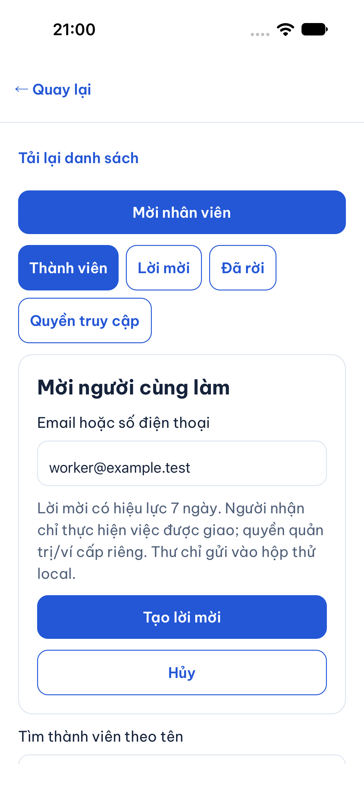
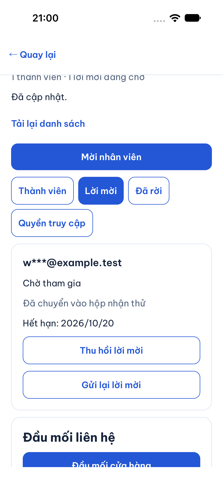
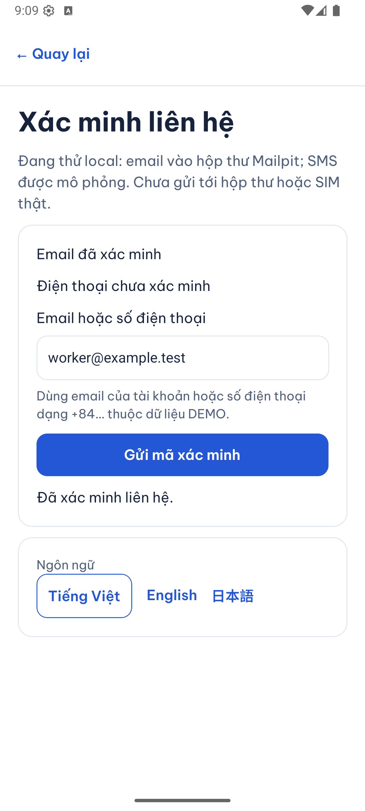
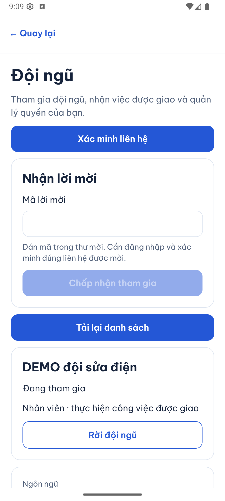
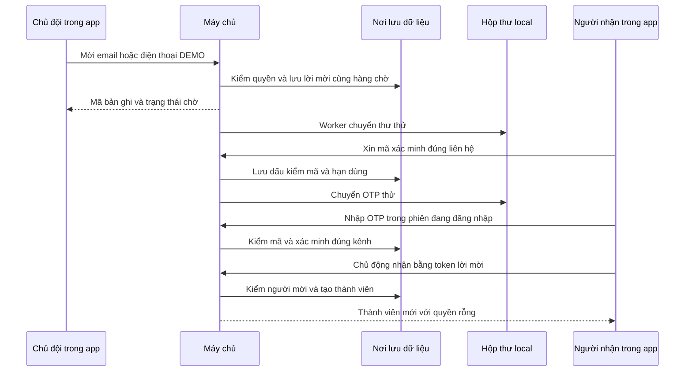

# B04-01 — Mời đội ngũ và xác minh liên hệ trên máy

13/10/2026 · P1-01 A/B · B01-02 (phần verify local), B04-01 · [Mục lục](../README.md) · [Kế hoạch được duyệt](../de-xuat/P1-01-doi-ngu-va-xac-thuc-local.md). Code đang sửa trong workspace, chưa commit/push. Báo cáo và ảnh chỉ lưu repo.

## 1. Bạn đã dùng được gì?

Từ **Tài khoản → Đội ngũ**, chủ cửa hàng/doanh nghiệp mở đội của mình và mời một liên hệ DEMO bằng email hoặc số điện thoại. Người nhận đăng nhập, vào **Xác minh liên hệ**, lấy mã trong hộp nhận thử, xác minh rồi dán mã lời mời tại Đội ngũ. Khi nhận thành công, tên doanh nghiệp xuất hiện trong danh sách của người đó. Thành viên mới chỉ thực hiện việc được giao; chưa có quyền quản lý hay ví.

Email được đưa vào **Mailpit**, hộp thư chạy trên máy ở `http://127.0.0.1:8025`. SMS được ghi vào thư mục thử riêng trên máy chủ. Không gửi tới Gmail hoặc SIM thật. Xác minh email không bật xác minh điện thoại; các điều kiện điện thoại khi tạo hồ sơ/gửi/nhận việc vẫn do máy chủ kiểm.

Đã nối DB → API → app và kiểm hành trình hai tài khoản trên web. iOS simulator gửi lời mời, Android emulator đọc mã từ Mailpit để xác minh và nhận lời. Đây là máy ảo, chưa kiểm điện thoại vật lý hoặc UAT của chủ dự án. Quyền và rời đội được giải thích tiếp ở [B04-02](B04-02-quyen-va-ban-giao-doi-ngu.md).

### Ảnh app chạy thật với dữ liệu DEMO

iOS simulator iPhone 18 Pro, iOS 27, 13/10/2026: nhập email mời và trạng thái đang chờ. Ảnh không chứa mã lời mời, OTP hoặc mật khẩu.

Android emulator API 36, 13/10/2026: email đã xác minh và thành viên sau khi nhận lời. Trạng thái điện thoại được hiển thị riêng.

## 2. Hai loại mã có nhiệm vụ khác nhau

**OTP** là mã xác minh một lần gồm 6 số, tồn tại 5 phút. Nó chứng minh tài khoản đang thao tác với liên hệ trong môi trường thử. **Token lời mời** là chuỗi bí mật trong thư mời, tồn tại 7 ngày; nó chỉ cho phép nhận lời sau khi tài khoản đã xác minh đúng liên hệ. Token lời mời không tự đăng nhập hoặc xác minh tài khoản.

**API** là cửa giao tiếp giữa app và máy chủ. App gửi ý định; máy chủ quyết định liên hệ có hợp lệ, mã còn dùng được và ai được vào đội. **Transaction** là một nhóm thay đổi DB: hoặc lưu toàn bộ, hoặc không lưu phần nào. Nhờ vậy không có lời mời đã tạo mà mất hẳn công việc gửi thư.

## 3. Từ thao tác tới kết quả

Sơ đồ là nhánh thành công. Khi mã sai, máy chủ vẫn lưu tăng số lần thử trước khi trả lỗi. Nếu gửi lại OTP, mã trước mất hiệu lực. Khi gửi lại lời mời, bản cũ chuyển “Đã thay thế”, bản mới có token/hạn mới. Thu hồi không xóa lịch sử. Nhận lời kiểm lại quyền người mời ở thời điểm nhận, kể cả lời mời được tạo khi họ còn quyền.

## 4. Mở code theo thứ tự nào?

| Bước | File và hàm thật | Nhận gì, làm gì, trả gì? |
|---|---|---|
| 1 | [TeamScreen.tsx](../../../apps/mobile/src/features/organizations/screens/TeamScreen.tsx), `run` | Nhận liên hệ ở form; giữ khóa thao tác để retry, gọi `inviteMember`; chỉ cập nhật danh sách sau thành công. |
| 2 | [auth-session.ts](../../../apps/mobile/src/features/auth/state/auth-session.ts), `inviteMember`, `requestChallenge`, `verifyChallenge`, `acceptInvitation` | Kiểm tài khoản đang thao tác và dùng phiên hiện hành để gọi API. Đổi tài khoản không dùng lại dữ liệu người trước. |
| 3 | [organizations-api.ts](../../../apps/mobile/src/features/organizations/api/organizations-api.ts), `createOrganizationsApi` | Biến input thành HTTP JSON, gửi token trong header/body phù hợp; kiểm hình dạng response, không tin dữ liệu bất thường. |
| 4 | [organizations.service.ts](../../../services/api/src/modules/organizations/organizations.service.ts), `invite`, `newInvitation`, `acceptance`, `accept` | Kiểm `members.manage`, hạn/lịch sử/đúng người nhận; lưu lời mời hoặc membership. Mời chỉ nhận `permissions=[]`; nhận lại sau rời không phục hồi quyền cũ. |
| 5 | [local-messages.ts](../../../services/api/src/integrations/local-messages.ts), `queue`, `drain`, `deliver` | Mã hóa nội dung cần chuyển, lấy hàng chờ dưới khóa DB rồi gửi vào Mailpit hoặc file SMS. Xóa payload sau gửi/hết hạn. |
| 6 | [VerifyContactScreen.tsx](../../../apps/mobile/src/features/organizations/screens/VerifyContactScreen.tsx), `send`, `verify` | Đếm thời gian chờ gửi lại; che và xóa OTP sau khi gửi kiểm; tải lại thông tin tài khoản để hiển thị cờ mới. |
| 7 | [challenges.service.ts](../../../services/api/src/modules/auth/challenges.service.ts), `request`, `rate`, `verify` | Tạo mã ngẫu nhiên, lưu HMAC để đối chiếu thay vì lưu mã rõ; kiểm user, lần đăng nhập, contact, hạn và số lần sai. Email và điện thoại là hai định danh riêng. |
| 8 | [OrganizationsScreen.tsx](../../../apps/mobile/src/features/organizations/screens/OrganizationsScreen.tsx), `run`, `load` | Nhận token từ người dùng, gọi accept, xóa token sau thành công và tải memberships của chính tài khoản. |

Các link tương đối đi từ báo cáo tới file thật. [Migration 009](../../../services/api/migrations/009_team_local_auth.sql) tạo các bảng mới; migration cũ giữ nguyên checksum.

## 5. Dữ liệu và xử lý lỗi

| Tình huống | Hành vi |
|---|---|
| OTP sai / hết hạn / đã dùng | `CHALLENGE_INVALID` hoặc `CHALLENGE_EXPIRED`; tối đa 5 lần sai, cần xin mã mới. |
| Xin mã quá nhanh | Chờ tối thiểu 60 giây; DB giữ quota qua restart: 5/contact/giờ, 20/user/giờ, 100/IP/giờ. |
| Mã đúng nhưng tài khoản/phiên/liên hệ sai | Bị từ chối; không chiếm email/số của người khác, không thay kênh đã có. |
| Mailpit tắt hoặc timeout | Hàng chờ giữ nội dung mã hóa, trạng thái `unknown`, retry vận chuyển tối đa 3 lần. `submitted` chỉ nghĩa hộp thư đã nhận yêu cầu. |
| Worker chết sau khi gửi | Có thể chuyển thư trùng khi chạy lại; không cam kết vận chuyển đúng một lần. Token nghiệp vụ chỉ dùng một lần. |
| Mất mạng khi nhận lời | App giữ thao tác và `Idempotency-Key` để thử lại; máy chủ không tạo membership lần hai và kiểm lại quyền trước trả kết quả cũ. |
| Người mời đã mất quyền | Nhận lời bị từ chối, không giữ quyền quản lý từ lúc tạo thư. |
| Thư hết hạn / bị thay / thu hồi | Không thể gia nhập bằng token đó. API danh sách chỉ hiện liên hệ che bớt, không trả token/hash. |

HMAC là dấu kiểm được tính bằng bí mật phía máy chủ. AES-GCM mã hóa liên hệ/nội dung gửi trong DB. Mật khẩu/token/OTP không vào audit hoặc snapshot retry thô. Hộp Mailpit/file SMS có nội dung thư rõ để người thử đọc nên chỉ dùng dữ liệu DEMO trên máy.

## 6. Tự thử và học code

1. Mở hai tài khoản DEMO khác nhau; chủ đội mời email nhân viên. Trong Mailpit sẽ có thư mời.
2. Nhân viên vào Xác minh liên hệ, xin OTP và nhập mã từ thư mới. Quan sát email đã xác minh nhưng điện thoại chưa xác minh.
3. Vào Đội ngũ, nhập token trong thư mời và bấm Nhận lời. Chủ tải lại danh sách sẽ thấy người mới.
4. Thử mã sai, tài khoản khác hoặc lời mời đã thu hồi. Kết quả phải bị chặn; không sửa DB để cho qua.

Câu hỏi: vì sao hai mã không thay thế nhau? Vì OTP gắn định danh/phiên, còn token chỉ gắn quyền nhận lời. Vì sao nhân viên mới không có quyền ví? `inviteInput` chỉ cho quyền rỗng, quyền nhạy cảm phải qua bước ở B04-02. Vì sao API không trả OTP? Người gửi yêu cầu không được dùng response để tự chứng minh đã nhận thư.

## 7. Bằng chứng và giới hạn

Bộ kiểm P1 gồm API unit/integration với PostGIS thật, kiểm màn/API mobile và một hành trình web hai tài khoản. Android/iOS dùng backend local cùng DB test với schema mới, Mailpit thực sự nhận thư. SMS mô phỏng được worker ghi file rồi xác minh thành công trong khâu tạo chủ đội DEMO; chưa có bằng chứng SMS nhà mạng.

SDD-PROJECT giữ toàn bộ 71 tiêu chí cũ và thêm tiêu chí P1; danh mục hiện có 93 QA/130 API. QA vẫn `partial`/`unmapped`, không đánh dấu toàn B01/B04 đã nghiệm thu. Kết quả cuối xem [checklist](../01-checklist.md). Chưa remote CI cho code mới, UAT, điện thoại vật lý, email/SMS thật, OTP login/recover, MFA admin hoặc production.

Tra cứu lệnh và cấu hình

- Compose: `docker compose -f infra/compose.yaml --profile test --profile p1-local up -d --wait db-test mailpit`.
- Cấu hình trong [environment.ts](../../../services/api/src/config/environment.ts) và [.env.example](../../../services/api/.env.example): mặc định disabled; chỉ `development/test`, DB `dvqb_p1_demo` hoặc `dvqb_test` trên loopback, secret riêng ≥32 ký tự và danh sách liên hệ DEMO. Không bật trên `dvqb_local` chứa dữ liệu cũ.
- API focused: từ `services/api`, `node --import tsx --test test/integration/organizations.test.ts`. Fixture tự tạo/xóa schema test riêng.
- Full: `npm run sdd:run -- --change SDD-PROJECT`, sau đó `npm run sdd:check -- --change SDD-PROJECT --phase verify`.
- Evidence local không track: `.local/p1-01/` (native, Mailpit, registry/readback), `test-results/sdd/SDD-PROJECT/` (log/report mỗi bước). File flow native có thể chứa mã DEMO nên không đưa vào báo cáo/Git.
- Contract: [OpenAPI](../../technical-design/openapi.json), [QA-089–093](../../technical-design/qa-cases.json), migration009; không thêm thư viện/runtime framework.
- Spec đã đồng bộ local/mirror/ZIP, SRS/UX/FR native Drive và 16 raw Drive cùng ID tải lại khớp byte. Sổ quản lý v1.49 ghi P1-01 và phạm vi ảnh hưởng; báo cáo chỉ repo.

