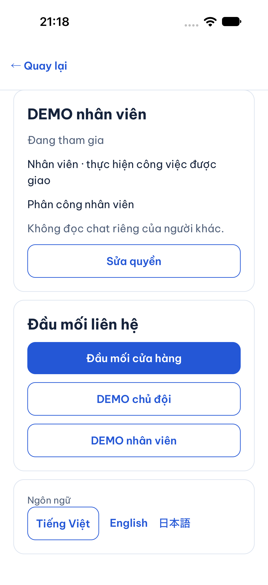
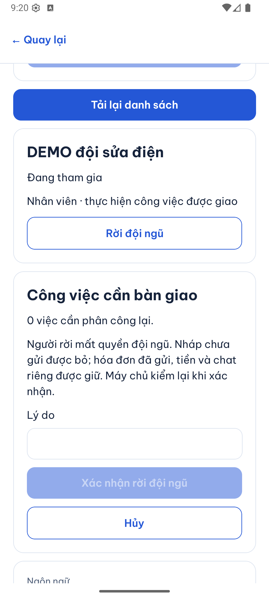
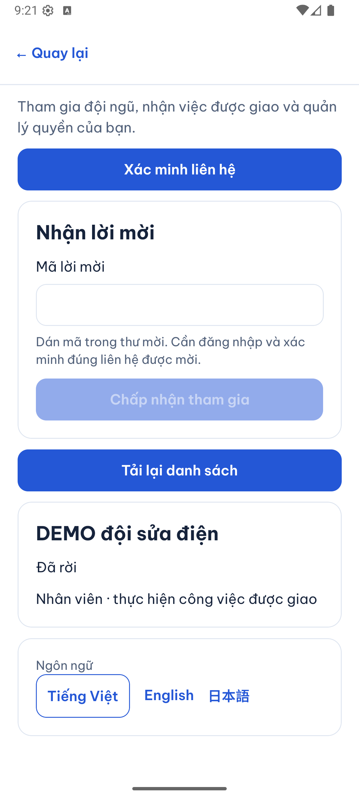
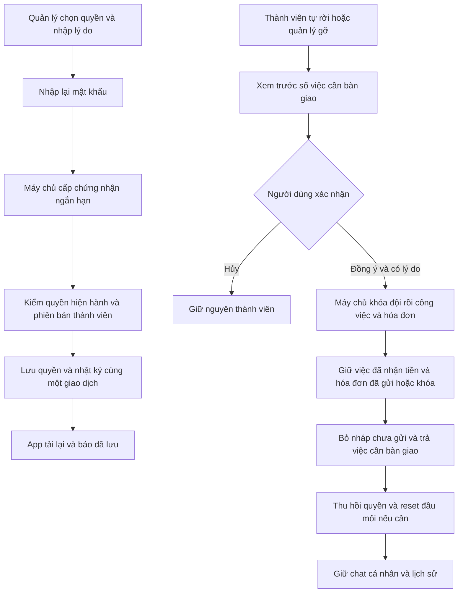

# B04-02 — Cấp quyền, rời đội và bàn giao công việc

13/10/2026 · P1-01 A/B · B04-01/B04-02 · [Mục lục](../README.md) · Đọc [B04-01](B04-01-doi-ngu-va-xac-thuc-local.md) trước. Code workspace chưa commit/push; chỉ local/test, báo cáo chỉ repo.

## 1. Người dùng làm được gì?

Trong **Đội ngũ → Quyền truy cập**, chủ hoặc người được giao quản lý chọn thành viên, chọn quyền, nhập lý do và nhập lại mật khẩu của chính mình. Sau khi máy chủ lưu thành công, danh sách mới hiện quyền đã cấp. Không tự sửa quyền của mình hoặc sửa chủ; người quản lý không thể cấp quyền ngoài phạm vi mình đang có. Cấp quyền ví không đồng nghĩa đã mở chức năng nạp/rút hoặc ngân hàng.

Thành viên thường vào danh sách đội của mình để **Tự rời**. Chủ/quản lý có thể **Gỡ thành viên**. Cả hai đều có bước xem số việc cần phân công lại, nhập lý do và xác nhận. Nút Hủy chỉ đóng bước xem trước. Người rời mất quyền doanh nghiệp ngay, nhưng giữ phòng chat cá nhân đã có với khách.

Đầu mối liên hệ có thể chọn thành viên đang hoạt động hoặc quay về cửa hàng. Nếu người làm đầu mối rời đội, cấu hình tự trở về cửa hàng. Đây là quản lý cấu hình; chưa có cuộc gọi Internet thật.

### Ảnh DEMO trên app

iOS simulator iPhone 18 Pro, iOS 27, 13/10/2026: quyền phân công đã lưu, mật khẩu đã xóa. Đã đối chiếu DB chỉ có `jobs.assign` được cấp cho nhân viên thử.

Android emulator API 36, 13/10/2026: xem trước rời đội rồi trạng thái đã rời. Ca này không có việc cần bàn giao; các ca có hóa đơn được kiểm riêng bằng API/PostGIS.

## 2. Vì sao phải nhập lại mật khẩu?

Phiên đăng nhập cho biết người đang sử dụng tài khoản. **Xác thực lại** kiểm tra mật khẩu gần thời điểm thay quyền. Máy chủ trả một **grant**, tức chứng nhận ngắn hạn: chỉ dùng một lần, trong 5 phút, với đúng tài khoản/lần đăng nhập và đúng thao tác quyền thành viên. Grant không phải quyền quản lý; API vẫn kiểm quyền hiện hành riêng. Nhập lại mật khẩu không phải MFA (xác thực nhiều yếu tố).

**Version** là số phiên bản dữ liệu. Nếu hai người đang sửa cùng một thành viên, người gửi phiên bản cũ nhận lỗi thay vì ghi đè thay đổi vừa lưu. **Idempotency-Key** là mã của một thao tác: gửi lại sau mất mạng dùng cùng mã để nhận kết quả cũ, tránh thực hiện hai lần. Snapshot kết quả không giữ mật khẩu hoặc grant thô.

## 3. Luồng sửa quyền và rời đội

Số việc xem trước có thể thay đổi trước lúc bấm xác nhận. Máy chủ đọc lại toàn bộ dưới khóa DB; không tin danh sách gửi từ app. Thứ tự khóa thống nhất với phân công/hóa đơn giúp hai thao tác cạnh tranh không cùng thay đổi một việc.

## 4. Đi qua code thật

| Bước | File/hàm | Nhận gì → xử lý gì → kết quả |
|---|---|---|
| 1 | [TeamScreen.tsx](../../../apps/mobile/src/features/organizations/screens/TeamScreen.tsx), `saveGrants` | Lấy quyền/lý do/mật khẩu; xóa mật khẩu khỏi form, xin grant rồi gửi mutation. Thông báo cũ được xóa trước khi bắt đầu. |
| 2 | [challenges.service.ts](../../../services/api/src/modules/auth/challenges.service.ts), `reauthenticate` | Kiểm mật khẩu và hạn mức bằng DB; trả grant ngẫu nhiên, chỉ lưu HMAC, user/family/scope/hạn dùng. |
| 3 | [organizations.service.ts](../../../services/api/src/modules/organizations/organizations.service.ts), `grants`, `target` | Chặn tự sửa/chủ/thành viên không hợp lệ; chỉ thêm/bớt quyền người cấp có; consume grant, lưu quyền và audit trong cùng transaction. |
| 4 | Cùng file, `preview`, `departure` | Preview chỉ trả ID/trạng thái/version và tổng số. Khi rời/gỡ, khóa partner → các job → invoice; kiểm lại, thu hồi quyền, reset contact và lưu các việc bàn giao. |
| 5 | [invoice-handover.ts](../../../services/api/src/modules/invoices/invoice-handover.ts), `discardUnsentDrafts` | Xóa phiên bản chưa gửi và liên kết ảnh nháp. Nếu đã có bản gửi thì phục hồi bản đó để tiếp tục sửa; chỉ có nháp thì bỏ invoice nháp. Không xóa bản gửi/khóa hoặc khoản tiền. |
| 6 | [jobs.service.ts](../../../services/api/src/modules/jobs/jobs.service.ts), `change` (nhánh `assignments`) | Khi đổi nhân viên cũng dùng cùng hàm bỏ nháp; người mới không kế thừa nội dung nháp chưa gửi của người cũ. Phòng riêng mỗi người vẫn theo quyền tài khoản. |
| 7 | [OrganizationsScreen.tsx](../../../apps/mobile/src/features/organizations/screens/OrganizationsScreen.tsx), `preview`, `run` | Hiển thị ảnh hưởng, chờ xác nhận; success tải lại memberships và profile. Hủy không gọi mutation. |
| 8 | [account-transaction.ts](../../../services/api/src/modules/accounts/account-transaction.ts), `run` | Chống lặp theo user/operation/key, kiểm quyền hiện tại cả khi trả snapshot; lỗi giữa chừng rollback toàn bộ. |

`audit_events` là lịch sử chỉ được thêm. Trigger DB chặn sửa/xóa. Nhật ký ghi người thao tác, lý do, quyền trước/sau và ID các việc bàn giao; không ghi nội dung chat hoặc bí mật.

## 5. Bàn giao không phải xóa công việc

| Trạng thái lúc người thực hiện rời | Kết quả |
|---|---|
| Chưa có hóa đơn | Kết thúc phân công hiện tại, việc cần phân công lại. |
| Chỉ có hóa đơn nháp chưa gửi | Bỏ nháp và liên kết ảnh nháp; việc vẫn còn. |
| Đã gửi, đang có nháp sửa | Bỏ phần chưa gửi, giữ phiên bản gửi và lý do sửa; người mới tiếp tục. |
| Hóa đơn đã khóa nhưng chưa nhận tiền | Giữ số tiền/point/khoản giữ; về chờ phân công để người mới tiếp tục đúng quyền. |
| Người thực hiện đã nhận tiền | Giữ người thực hiện lịch sử và hóa đơn; không đưa việc này vào danh sách cần bàn giao. |
| Chat riêng đã có | Người cũ vẫn vào phòng của mình; quản lý/người mới không đọc thay. |

Grant hết hạn/đã dùng hoặc từ lần đăng nhập khác trả `REAUTH_REQUIRED`. Phiên đã thu hồi bị chặn ngay. Version cũ trả `VERSION_CONFLICT`, cần tải lại trước quyết định mới. Lỗi mạng giữ mutation để retry; lỗi quyền không cố chạy lại bằng dữ liệu quyền cũ.

## 6. Tự thử

1. Chủ cấp quyền **Phân công nhân viên** cho người vừa tham gia ở B04-01. Nhập sai mật khẩu trước: quyền không đổi. Nhập đúng: danh sách phản ánh quyền mới.
2. Người được cấp thử tự nâng quyền hoặc cấp quyền ví mình không có: máy chủ phải chặn, kể cả gửi API trực tiếp.
3. Nhân viên chọn Tự rời → Hủy: vẫn tham gia. Chọn lại, nhập lý do và xác nhận: chuyển Đã rời; chủ tải lại sẽ thấy ở tab lịch sử.
4. Với việc đang có hóa đơn, đối chiếu bảng trên. Không dùng dữ liệu tiền thật để thử.

Câu hỏi: vì sao cần cả mật khẩu và quyền? Mật khẩu xác thực người thao tác, quyền xác định việc họ được làm. Vì sao không xóa hóa đơn đã gửi? Đó là lịch sử khách đã nhận và có thể gắn tiền. Vì sao preview không phải phê duyệt? Nó chỉ là ảnh chụp lúc đọc, trạng thái phải được kiểm lại khi lưu.

## 7. Kiểm thử và giới hạn

API kiểm có chủ, quản lý giới hạn, nhân viên và người ngoài; có cạnh tranh accept/revoke, thu hồi người mời, rejoin, reauth một lần/expiry/family/replay, kiểm contact/version và audit không bị sửa. Ca rời đội kiểm nháp sửa, chỉ có nháp, đã khóa, đã nhận tiền và giữ chat riêng. Bộ invoice hiện hành tiếp tục hồi quy các ca tài chính; không coi fixture chèn dữ liệu test là chứng minh tích hợp ngân hàng.

Web kiểm trọn hai tài khoản từ lời mời đến rời. iOS kiểm sửa quyền và DB; Android kiểm preview/Hủy/xác nhận rời. Chưa chứng minh mọi tổ hợp cạnh tranh trên native hoặc mạng thiết bị thật. Chưa remote CI cho thay đổi mới, UAT, chuyển chủ/đóng doanh nghiệp, gọi thật, push, ngân hàng hoặc production. Không đóng toàn bộ B04 chỉ từ lát này.

Tra cứu kỹ thuật

- API: [organizations.test.ts](../../../services/api/test/integration/organizations.test.ts), 9 bài integration P1, có kiểm response với OpenAPI hiện hành; [unit](../../../services/api/test/unit/organizations.test.ts).
- App: [Organizations.test.tsx](../../../apps/mobile/src/features/organizations/screens/Organizations.test.tsx), [API boundary](../../../apps/mobile/src/features/organizations/api/organizations-api.test.ts), [web](../../../tests/e2e/web/organizations.spec.mjs).
- [SDD traceability](../sdd/traceability.json) nối QA-089–093 tới test cụ thể; giữ các gap chưa kiểm. `sdd:run`/`verify` chạy lại sau khi chốt bộ file, xem kết quả tại checklist.
- Bằng chứng local `.local/p1-01/team-contract-reviewed.log`, `native-ios`, `native-android`, `test-results/sdd/SDD-PROJECT/`; ảnh chọn lọc cạnh báo cáo không có bí mật.
- Migration 009 thêm 7 bảng; khóa chung ở partner giữ thứ tự với Jobs/Invoices. Phân trang thành viên dùng thời gian đến mili giây nhất quán với cursor JavaScript để không lặp bản ghi.
- Không sửa migration 001–008, không thêm dependency; cấu hình môi trường local và limits ở B04-01.

