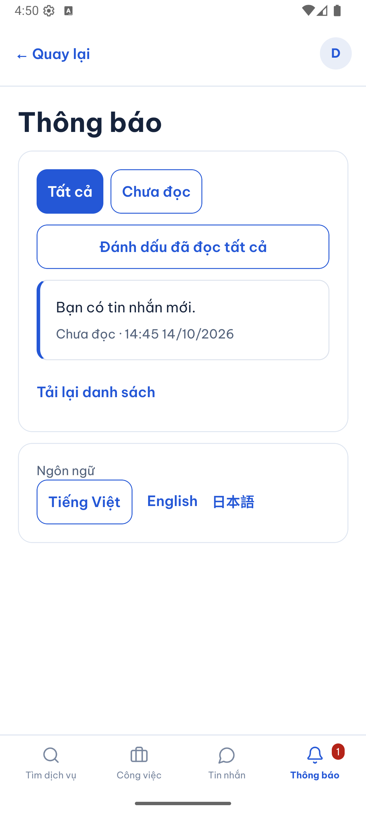
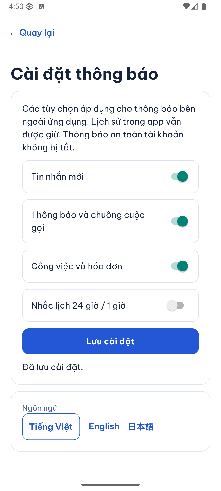
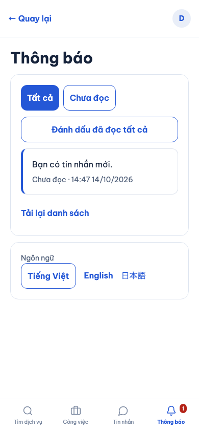
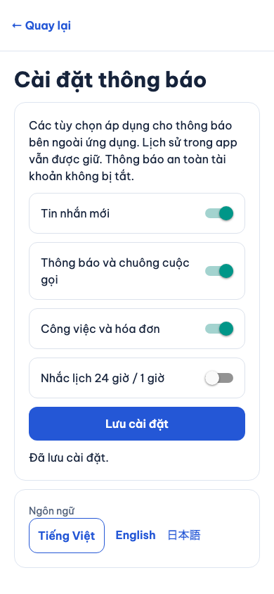
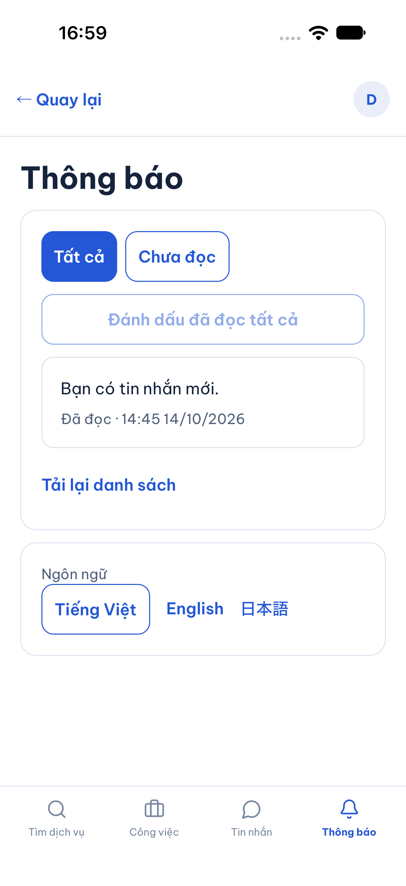
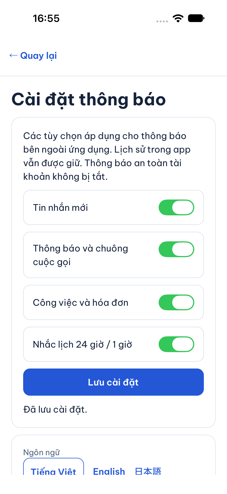
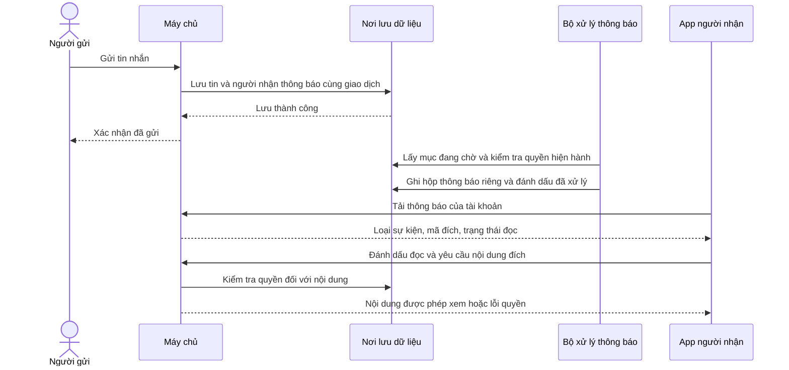

# B05-01 — Nhận thông báo và quản lý nhắc lịch

> Cập nhật 15/10/2026: [MSG-01 / B05-03](B05-03-tach-tin-nhan-va-thong-bao.md) thay thế hành vi đưa chat vào Thông báo. Tin nhắn có badge riêng; ảnh/test mô tả hành vi cũ bên dưới giữ làm bằng chứng lịch sử.

14/10/2026 · P1-2 / quyết định P1-02 · Checklist B05-02 và phần nhắc lịch B05-03. Code đang sửa trong máy phát triển, chưa commit/push; chưa có CI mới hoặc nghiệm thu của chủ dự án.

## 1. Bạn đã dùng được những gì?

Khi người bên kia gửi tin nhắn hoặc cập nhật công việc/hóa đơn, bạn mở tab **Thông báo** để xem thông báo của mình. Số đỏ trên tab là số chưa đọc. Chọn **Chưa đọc**, đánh dấu tất cả đã đọc, hoặc bấm một thông báo để mở cuộc trò chuyện/công việc/hóa đơn tương ứng. Máy chủ kiểm tra lại quyền trước khi app mở nội dung.

Trong **Tài khoản → Cài đặt thông báo**, bạn có bốn công tắc: tin nhắn, cuộc gọi, công việc/hóa đơn và nhắc lịch 24 giờ/1 giờ. Công tắc nhắc lịch riêng được chủ dự án duyệt ngày 14/10. Lựa chọn được lưu theo tài khoản trên máy chủ, còn nguyên khi đăng nhập lại; đổi tiếng Việt/Anh/Nhật không làm mất nội dung đang chọn.

Hiện tại đã có thông báo **trong app** và bộ xử lý lịch trên máy chủ local. Cài đặt được lưu để điều khiển kênh gửi ngoài app; chưa có dịch vụ gửi push đến điện thoại khi đóng app. Tắt bốn công tắc không xóa lịch sử trong app. Mục bảo mật không thuộc các công tắc này; đợt này chưa bổ sung kênh gửi bảo mật.

### Ảnh app chạy thật với dữ liệu DEMO

Ngày kiểm 14/10/2026. Android là emulator API 36, iOS là simulator iPhone 18 Pro/iOS 27; không phải điện thoại thật. Web là Expo web qua Chromium, nối API/PostGIS test. Ảnh chỉ chứng minh màn và thao tác đã ghi; không chứng minh push ngoài app.

| Android emulator — inbox | Android emulator — lưu nhắc lịch riêng |
|---|---|
|  |  |

| Web — inbox | Web — cài đặt |
|---|---|
|  |  |

| iOS simulator — inbox đã đọc từ Android | iOS simulator — cài đặt |
|---|---|
|  |  |

## 2. Một tin nhắn trở thành thông báo như thế nào?

**API** là đường app gửi yêu cầu tới máy chủ. **Giao dịch dữ liệu** nghĩa là một nhóm thay đổi cùng được lưu hoặc cùng bị hủy nếu lỗi. **Worker** là bộ xử lý chạy nền trên máy chủ; không phải một ứng dụng mới.

Người A gửi tin nhắn. Máy chủ lưu tin và danh sách người được nhận thông báo trong cùng giao dịch. Sau khi lưu thành công, worker lấy từng thông báo đang chờ, kiểm tra người nhận còn quyền hay không rồi đưa vào hộp thông báo riêng. App của B tải hộp này định kỳ khi đang mở. Nội dung hộp chỉ có loại sự kiện và mã tham chiếu, không sao chép nội dung chat, địa chỉ hay số dư.

Sơ đồ là nhánh thành công. Nếu quyền đã bị thu hồi, mục đang chờ bị bỏ qua. Thông báo lịch sử đã giao có thể vẫn còn, nhưng bấm vào không vượt qua quyền của API đích. Người mới tham gia đội không nhận lại các sự kiện cũ vốn không gửi cho mình.

## 3. Nhắc lịch dùng giờ nào?

Khi nhận một việc có giờ hẹn, `syncReminders` tạo các mốc trước 24 giờ và 1 giờ còn nằm trong tương lai. Ví dụ nhận việc trước giờ hẹn 2 giờ thì chỉ tạo mốc 1 giờ, không gửi bù mốc 24 giờ đã qua.

Đổi lịch tăng số phiên bản lịch và thay các mốc chưa gửi bằng lịch mới. Dừng việc làm mất hiệu lực mốc đang chờ, kể cả khi còn phí thỏa thuận và công việc vẫn giữ trạng thái `accepted`. Bộ xử lý kiểm tra lại phiên bản trước khi giao thông báo để không nhắc lịch cũ. Quá giờ hẹn không tự đóng công việc. Dữ liệu lưu thời điểm tuyệt đối; phần hiển thị dùng bộ định dạng múi giờ nghiệp vụ hiện có, không thay theo ngôn ngữ.

## 4. Mở code theo thứ tự nào?

Đường dẫn dưới đây tính từ báo cáo. `App.tsx` và module API nối các thành phần khi khởi động; các hàm trong bảng xử lý hành động thực tế.

| Bước | File / hàm thật | Nhận gì, làm gì và chuyển cho ai? |
|---|---|---|
| 1 | [chat.store.ts](../../../services/api/src/modules/chat/chat.store.ts), `event`; [jobs.service.ts](../../../services/api/src/modules/jobs/jobs.service.ts) | Nhận sự kiện chat/việc/hóa đơn đã xử lý trong giao dịch; gọi bộ tạo thông báo trước khi lưu giao dịch thành công. |
| 2 | [notifications.store.ts](../../../services/api/src/modules/notifications/notifications.store.ts), `queueEventNotifications`, `queueNotice`, `jobRecipients` | Chọn người nhận theo quyền tại lúc phát sinh; lưu mã sự kiện và mã đích. Cùng một sự kiện/người nhận chỉ có một mục. |
| 3 | Cùng file, `syncReminders` | Nhận mã việc, hủy mốc cũ và tạo mốc tương lai của lịch hiện hành. Không đổi trạng thái công việc. |
| 4 | [notifications.worker.ts](../../../services/api/src/modules/notifications/notifications.worker.ts), `drain`, `process` | Lấy mục chờ, kiểm tra quyền/lịch lần nữa, ghi inbox rồi đánh dấu xử lý trong cùng giao dịch. Chạy lại không tạo bản sao. |
| 5 | [notifications.controller.ts](../../../services/api/src/modules/notifications/notifications.controller.ts), `list`, `read`, `settings`, `save` | Kiểm dạng dữ liệu HTTP, chuyển cho [NotificationsService](../../../services/api/src/modules/notifications/notifications.service.ts); service xác thực tài khoản và chỉ đọc/ghi dữ liệu của người đó. |
| 6 | [notifications-api.ts](../../../apps/mobile/src/features/notifications/api/notifications-api.ts), `createNotificationsApi`; [auth-session.ts](../../../apps/mobile/src/features/auth/state/auth-session.ts), `listNotifications` | App gửi HTTP, kiểm cấu trúc phản hồi. Bộ phiên đăng nhập giữ token và kiểm kết quả vẫn thuộc tài khoản đang dùng. |
| 7 | [NotificationsProvider.tsx](../../../apps/mobile/src/features/notifications/NotificationsProvider.tsx), `refresh`, `markRead` | Tải các trang, gộp theo mã để không trùng, tính số chưa đọc. Giữ khóa thử lại cho mỗi thao tác đọc. Xóa dữ liệu khỏi giao diện khi đổi tài khoản/đăng xuất. |
| 8 | [NotificationsScreen.tsx](../../../apps/mobile/src/features/notifications/screens/NotificationsScreen.tsx), `Inbox`, `open`, `Settings`, `save` | Hiển thị và lọc thông báo; tải đích bằng API có kiểm quyền trước khi chuyển màn. Bốn công tắc gửi chung một bản cài đặt; chỉ báo đã lưu sau khi máy chủ xác nhận. |

## 5. Dữ liệu được nhớ ở đâu và lỗi được xử lý ra sao?

[Migration 010](../../../services/api/migrations/010_notifications.sql) tạo `notifications` (hộp của từng tài khoản), `notification_settings` (bốn lựa chọn), `reminders` (mốc lịch) và `notification_deliveries` (hàng chờ nội bộ của cách triển khai). Bảng hàng chờ cuối là chi tiết vận hành, không thêm API hoặc sự kiện realtime công khai.

Danh sách người nhận được chụp tại thời điểm sự kiện phát sinh, rồi quyền được kiểm lại lúc giao. Hàng chờ cố ý không dùng khóa ngoại sang người nhận để tránh việc hai tài khoản gửi cho nhau khóa chéo; việc thêm hàng chờ và worker đều kiểm tài khoản còn hoạt động. Inbox thật vẫn có khóa ngoại. Worker khóa theo thứ tự thống nhất với nghiệp vụ và giới hạn 100 mục mỗi lượt, không đánh dấu `outbox_events` của kênh realtime là đã xử lý.

Nếu ghi inbox lỗi, giao dịch quay lại trạng thái chưa xử lý và lượt sau thử lại. Khóa duy nhất `(user_id,event_key)` ngăn thông báo trùng khi khởi động lại hoặc có hai worker. Cập nhật đã đọc giữ lần đọc đầu tiên. Máy chủ dùng `Idempotency-Key` — mã của một lần thao tác — để nhận ra yêu cầu thử lại sau mất mạng; dùng lại mã với nội dung khác bị từ chối.

App giữ danh sách và bản cài đặt đang chỉnh trong bộ nhớ tạm. Khi lưu thất bại, có nút thử lại với cùng nội dung/khóa cũ; không báo thành công giả. Trong lúc đang chờ kết quả không cho sửa công tắc để tránh gửi lại một nội dung khác. Đổi ngôn ngữ chỉ đổi chữ hiển thị, state không giữ câu đã dịch. API trả `Cache-Control: no-store` cho dữ liệu riêng.

## 6. Bạn có thể tự thử và kiểm hiểu

1. Dùng hai tài khoản DEMO, gửi tin từ tài khoản A tới B. B mở Thông báo: số chưa đọc tăng, bấm thông báo mở đúng chat.
2. B chọn Chưa đọc rồi đánh dấu tất cả đã đọc. Đăng xuất/đăng nhập lại: không biến mục đã đọc thành chưa đọc.
3. Trong Tài khoản → Cài đặt thông báo, tắt riêng Nhắc lịch; giữ Công việc và hóa đơn bật. Lưu, đổi ngôn ngữ, mở lại: hai lựa chọn vẫn độc lập.
4. Với việc hẹn trước, thử đổi lịch rồi dừng việc. Các test API bên dưới điều chỉnh thời gian chờ trong DB test để kiểm ngay, không bắt chủ dự án chờ 24 giờ.

- Vì sao tắt nhắc lịch vẫn thấy inbox? Vì lựa chọn dành cho kênh ngoài app; lịch sử trong app được giữ.
- Vì sao cần kiểm quyền hai lần? Người nhận có thể rời đội giữa lúc phát sinh và lúc worker giao. Xem `queueNotice` và `process`.
- Vì sao giờ hẹn đã qua mà việc chưa đóng? Thời gian không phải bằng chứng hoàn tất/thu tiền; worker không sửa trạng thái nghiệp vụ.

## 7. Bằng chứng và giới hạn

Đã kiểm API/PostGIS test, mobile component và hành trình web thật. Android emulator/iOS simulator kiểm cài đặt và bấm thông báo mở chat; không kiểm hệ điều hành nhận push khi app đóng. Các lượt native dùng schema DEMO riêng, không thay dữ liệu người dùng. Không có remote CI mới hoặc UAT trong lần bàn giao này.

Tra cứu test, contract và đồng bộ

| Phạm vi | Kiểm chứng |
|---|---|
| API riêng | [notifications.test.ts](../../../services/api/test/integration/notifications.test.ts): 4 bài; contract Settings/Ack/Page, bốn công tắc độc lập, account scope, rollback/retry/concurrency, cursor/read, quyền thu hồi và lịch cũ/dừng việc. |
| Hồi quy việc/chat | `jobs-chat.test.ts`: 6 bài đạt ở lượt kiểm riêng sau khi xử lý thứ tự khóa giao dịch. |
| Mobile | [Notifications.test.tsx](../../../apps/mobile/src/features/notifications/screens/Notifications.test.tsx): 3 bài; trang trùng, đọc tất cả, đổi tài khoản, retry, đích bị từ chối, locale. Adapter API: 1 bài. Shell: 2 bài. |
| Web | [notifications.spec.mjs](../../../tests/e2e/web/notifications.spec.mjs): 1 hành trình hai tài khoản với API thật, độc lập settings, read/unread, đổi ngôn ngữ và mở chat. |
| Native | Android API36: lưu nhắc lịch tắt, inbox, mở chat. iOS27: lưu cài đặt, inbox, mở chat. Log cục bộ `.local/p1-02/`; ảnh được lưu trong báo cáo. |
| SDD toàn dự án | `npm run sdd:run -- --change SDD-PROJECT`, sau đó `npm run sdd:check -- --change SDD-PROJECT --phase verify`. Report/log mới tại `test-results/sdd/SDD-PROJECT/`, không track Git; phải chạy lại khi code đổi. Không dùng lượt prepare làm bằng chứng test. |
| Sơ đồ và ảnh | Mermaid kiểm parse và render; ảnh app đã mở xem. Đã đối chiếu Storybook `notification-center` trước triển khai; dữ liệu app thật thay dữ liệu mô phỏng. |

Nguồn hiện hành: [OpenAPI](../../technical-design/openapi.json) v0.1.12, [QA-025](../../technical-design/qa-cases.json), [activity spec](../../../ui-ux/specs/activity-batch.md). Không thêm thư viện/framework.

Quyết định P1-02 được ghi trong [sổ quản lý](../../project-control/So-quan-ly-tai-lieu.xlsx) v1.50: sheet Quyet dinh dòng 73, Dong bo 922–970 và các dòng Danh muc liên quan. Sổ local/Drive ban đầu khớp byte; giữ các chỉnh sửa trước, kiểm lại công thức/liên kết/validation và không có ô lỗi. FR dòng 111, SRS-NOT-002 và UX native trên Drive đã đọc lại sau sửa. Nguồn kỹ thuật, mirror HTML, ZIP kỹ thuật và ZIP UI được cập nhật đúng phần ảnh hưởng; 9 raw file Drive giữ ID, tải lại khớp byte. Báo cáo/checklist chỉ repo.

RTM giữ QA/operation IDs cũ vì không thêm yêu cầu hay operation mới; QA-025 mở rộng assertions cho trường đã duyệt. Không chuyển QA tổng thành đạt. Các tài liệu về vai trò, trạng thái, quan hệ ERD, sequence và mô hình kinh doanh không đổi vì quyết định chỉ thêm thuộc tính cài đặt; lý do không áp dụng được ghi trong sổ.

## 8. Phần chưa làm và bước sau

Lát này chưa đóng toàn B05 hoặc P1-2. Inbox hiện nhận các cập nhật yêu cầu/nhận/phân công/đổi lịch/dừng việc, chat văn bản, gửi/sửa/khóa/báo trả tiền/quyết toán hóa đơn và nhắc lịch. Những miền chưa có code như xét báo cáo, ngân hàng, gọi hoặc thông báo bảo mật không được coi đã nối sự kiện.

Chưa có đăng ký thiết bị, provider push, WebSocket, màn lịch tổng hợp, kiểm điện thoại thật, CI mới hoặc UAT. App tải toàn bộ các trang inbox mỗi 15 giây khi hoạt động để số chưa đọc chính xác theo contract hiện có; chưa có API đếm riêng hoặc chính sách lưu trữ dài hạn. Worker retry lỗi ở lượt sau; chưa có hàng lỗi riêng hay lịch backoff cho một mục hỏng kéo dài.

Bước tiếp theo trong P1-2 là phần hỗ trợ còn đủ contract (lịch tổng hợp/đánh giá); các mục gọi, xét xác minh/báo cáo/admin hoặc provider phải kiểm phụ thuộc/contract trước khi mở. Không suy ra phê duyệt provider, billing, tiền thật, production hoặc PROMO-02 từ đợt này.
