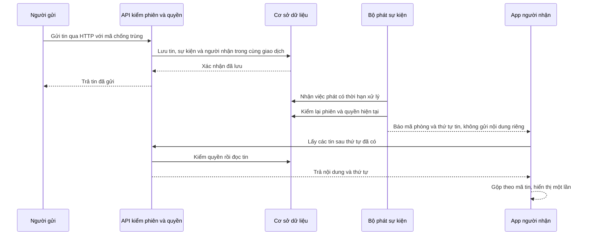
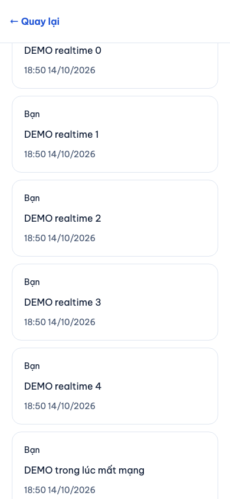
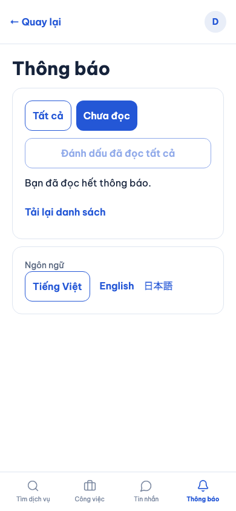
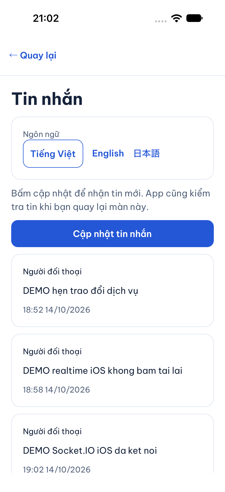
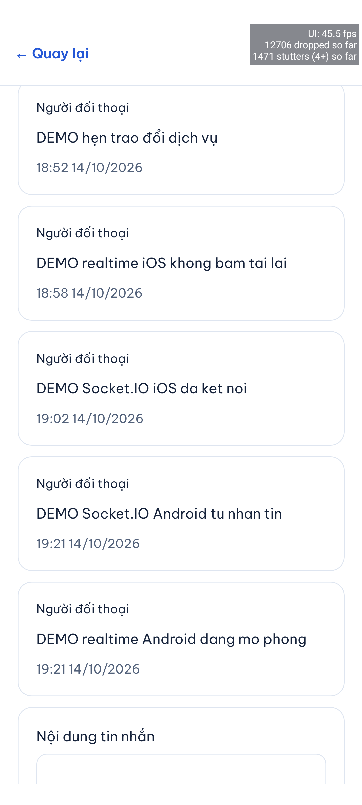

# B05-02 — Tin nhắn và inbox cập nhật khi app đang mở

> Cập nhật 15/10/2026: [MSG-01 / B05-03](B05-03-tach-tin-nhan-va-thong-bao.md) thay thế hành vi đưa chat vào Thông báo. Tin nhắn có badge riêng; ảnh/test mô tả hành vi cũ bên dưới giữ làm bằng chứng lịch sử.

14/10/2026 · RT-01A đã duyệt · Code và kiểm thử local trên working tree; chưa commit/push/remote CI/UAT. Đây là phần tiếp theo của [B05-01](B05-01-thong-bao-va-nhac-lich.md), không thay kết quả lịch sử của báo cáo đó.

## Người dùng thấy gì?

Khi khách đang ở trong phòng chat, tin người thợ vừa gửi tự xuất hiện. Không cần rời màn hình hoặc bấm **Cập nhật**. Inbox và số thông báo chưa đọc cũng được tải lại khi có thay đổi; đọc trên một phiên sẽ cập nhật phiên khác. Màn công việc và hóa đơn nhận tín hiệu thay đổi rồi đọc lại dữ liệu đúng quyền.

Nếu mất mạng, app vẫn giữ nội dung đang nhập. Khi nối lại, app hỏi API để lấy phần tin còn thiếu. Nếu người khác đã thay đổi việc hoặc hóa đơn trong lúc bạn sửa, app giữ bản nhập và yêu cầu tải lại trước khi tiếp tục; backend vẫn kiểm phiên bản khi ghi. Việc nhận một tín hiệu không tự quyết toán, cộng tiền hay cộng số thông báo.

Phạm vi này dùng **Socket.IO** — thư viện giữ kết nối qua WebSocket — để máy chủ báo “dữ liệu đã thay đổi”. **HTTP** tiếp tục gửi tin, đánh dấu đọc, thực hiện nghiệp vụ và lấy nội dung. Hiện chỉ hỗ trợ một tiến trình API; chưa triển khai Redis hoặc nhiều API instance.

## Một tin nhắn đi qua hệ thống như thế nào?

**Giao dịch** nghĩa là những bản ghi liên quan cùng được lưu hoặc cùng bị hủy. **Outbox** là bảng giữ sự kiện cần phát. **Snapshot người nhận** là danh sách người được nhận tại lúc phát sinh; thêm người mới vào đội sau đó không làm họ nhận lại sự kiện cũ.

Bộ phát chỉ giữ khóa cơ sở dữ liệu trong lúc kiểm quyền và đưa gói tin vào kết nối. Nó không chờ thiết bị xác nhận qua mạng trong giao dịch. Nếu thu hồi quyền đã hoàn tất trước lần kiểm này thì dữ liệu không được phát. Một gói đã phát trước thời điểm thu hồi không thể lấy lại.

## Nên đọc code theo thứ tự nào?

Các đường dẫn dưới đây tính từ thư mục gốc repo.

| Bước | File và hàm thật | Nhận gì → làm gì → trả gì |
|---|---|---|
| 1. Ghi thay đổi | `services/api/src/common/events/event.store.ts` — `event` | Nhận mã sự kiện/tài nguyên/phiên bản → ghi outbox và người nhận trong transaction của nghiệp vụ → không phát mạng trước commit |
| 2. Ghi inbox | `services/api/src/modules/notifications/notifications.worker.ts` — `process` | Nhận hàng chờ → kiểm người nhận/quyền → lưu notification và `notification.created.v1` cùng transaction |
| 3. Đọc inbox | `services/api/src/modules/notifications/notifications.service.ts` — `read` | Nhận notification của chính user → chỉ đổi `read_at` từ null lần đầu → phát `notification.read.v1` một lần |
| 4. Lấy việc phát | `services/api/src/modules/realtime/realtime.worker.ts` — `drain`, `process` | Claim hàng chờ bằng lease → gọi publisher → đánh dấu riêng realtime, hoặc retry cùng event ID |
| 5. Kiểm và phát | `services/api/src/modules/realtime/realtime.gateway.ts` — `attach`, `withAccess`, `publish`, `audit` | Auth handshake, giới hạn gói/kết nối, kiểm phiên + ACL trước enqueue; thu hồi các kết nối/subscription đang mở |
| 6. Quyền tài nguyên | `services/api/src/modules/realtime/realtime.access.ts` — `resourceAccess` | Dùng lại quyền chat/việc; hóa đơn tra về việc; notification chỉ chính user |
| 7. Phiên app | `apps/mobile/src/features/auth/state/auth-session.ts` — `bindRealtime` | Đưa token nội bộ cho transport; refresh đi cùng cơ chế khóa phiên có sẵn; token không nằm trong state màn hình |
| 8. Kết nối chung | `apps/mobile/src/lib/realtime/realtime-client.ts` — `setSession`, `start`, `watch`, `schedule` | Gắn listener trước connect, đăng ký tài nguyên, reconnect có giãn thời gian, gộp event ID, dọn khi đổi phiên/background |
| 9. Làm mới màn | `apps/mobile/src/app/providers/RealtimeProvider.tsx` — `useRealtimeRefresh` | Giữ cờ “cần đọc lại” khi đang bận; đọc lại khi rảnh; subscribe ACK cũng kích hoạt lấy bù |
| 10. Hiển thị | `ConversationScreen.tsx`, `ConversationsScreen.tsx`, `JobsScreen.tsx`, `JobDetailScreen.tsx`, `InvoiceScreen.tsx`, `NotificationsProvider.tsx` | Mỗi feature vẫn sở hữu HTTP snapshot, sequence, bản nhập và trạng thái lỗi của mình |

Gateway được Nest quản lý vòng đời và gắn vào HTTP server hiện hành trong `bootstrap.ts`; không mở cổng thứ hai. `RealtimeModule` chỉ được bật khi có auth và cờ realtime. Socket.IO server/client được ghim cùng phiên bản `4.8.4`.

## Dữ liệu, quyền và retry

Migration `011_realtime.sql` thêm `outbox_events.correlation_id` để lần phát lại vẫn truy về yêu cầu gốc. Bảng `realtime_deliveries` có unique `(event_id,user_id)`, tài nguyên để kiểm quyền, số lần thử, thời điểm thử tiếp, lease và mã lease. Mã lease ngăn worker cũ ghi đè kết quả của lần claim mới. Đây là trạng thái của consumer realtime, độc lập `notification_deliveries` và `outbox_events.processed_at`.

Không suy đoán hoặc backfill người nhận cho outbox lịch sử thiếu snapshot. Các màn đọc lại HTTP để khôi phục lịch sử. `processed_at` chỉ nói lần dispatch đã xử lý; không chứng minh tất cả thiết bị của tài khoản đã nhận hoặc đọc.

Khi worker dừng sau emit nhưng trước đánh dấu xong, lần thử tiếp giữ nguyên `event_id`. Client nhớ tối đa 2.048 mã gần nhất; tin nhắn còn được gộp theo ID/sequence nên không hiện hai bản. Retry tăng thời gian và có độ lệch ngẫu nhiên; sau 8 lần lỗi, hàng đó có `failed_at`, không chặn hàng khác. Vận hành local xem `RealtimeWorker.metrics`, `RealtimeGateway.metrics` và hàng pending/failed; chưa có dashboard production. Chỉ reset hàng failed sau khi sửa nguyên nhân và đối chiếu dữ liệu, không xóa outbox để “làm xanh”.

Phiên bị logout, refresh hoặc thu hồi không được dùng tiếp trên socket. `AuthService.accessChanged` được gọi sau commit ở các đường thu hồi; gateway rà lại kết nối/subscription. Mỗi lần phát vẫn kiểm DB, không tin phòng đã join từ trước. Rời doanh nghiệp thu hồi quyền việc/phòng doanh nghiệp; phòng riêng của đúng hai tài khoản vẫn giữ theo contract cũ.

Sự kiện chỉ mang mã tài nguyên, thứ tự hoặc phiên bản; không gửi body chat, địa chỉ hay số dư. Nhận `access.revoked` xóa dữ liệu riêng đang mở và đọc lại theo quyền. Trạng thái đã đọc của inbox không bị một HTTP response cũ đẩy về chưa đọc.

## Mất mạng, background và đang nhập

- Kết nối khỏe: event kích hoạt HTTP; kiểm đối chiếu định kỳ khoảng 60 giây khi foreground.
- Mất kết nối: HTTP dự phòng khoảng 15 giây; kết nối thử lại có backoff/jitter. Đây là cấu hình local, không phải SLA.
- Background: đóng socket; khi active lại, reconnect và đọc bù. Không giả định socket chạy bền trong nền điện thoại.
- Sự kiện đến trong lúc HTTP đang chạy được giữ bằng cờ dirty để chạy thêm lượt; không bị bỏ qua vì đang busy.
- Chat dùng `after_sequence` và phân trang. Read receipt của hai người không dùng chung một phép so sánh version toàn phòng.
- Biểu mẫu việc/hóa đơn giữ bản đang nhập và báo cần tải lại; HTTP mutation vẫn có expected_version và Idempotency-Key. Một lần retry không tạo hóa đơn/quyết toán thứ hai.

React Native có thể tự thêm `Origin` theo URL của WebSocket. Client native đặt Origin rỗng, vẫn bắt buộc auth token; browser dùng Origin thật và chịu allowlist server. Không dùng header để gửi token, không bỏ kiểm Origin của web. Bốn tùy chọn push vẫn độc lập và không tắt realtime foreground.

## Bằng chứng đã kiểm

| Lớp kiểm | Bằng chứng và giới hạn |
|---|---|
| API/PostGIS | `services/api/test/integration/realtime.test.ts`: auth/Origin/ACL, token hết hạn, logout/rotation, đua thu hồi quyền trong lúc dispatch chờ khóa, rollback, offline recovery, thu hồi quyền, 10 kết nối/user, flood, client chậm, lease, crash sau emit và poison. Không thay full ma trận quyền toàn dự án. |
| Mobile logic | `realtime-client.test.ts`: listeners trước connect, ACK recovery, dedupe, token rotation, background/cleanup, auth busy retry, đăng ký tuần tự chờ ACK, lỗi tạm thời không thu hồi quyền và flag off. Bộ mobile coverage đạt trong đợt; kết quả cuối nằm trong SDD run. |
| Web hai tài khoản | `realtime.spec.mjs`: chat đang mở tự nhận tin, mất mạng lấy bù, read inbox từ phiên khác. `invoices.spec.mjs` bật realtime: tự chuyển trạng thái sửa/khóa/hoàn tất, giữ retry xác nhận và tiền test. |
| Load một API | 100 kết nối, 3.000 tin trong 300,12 giây, đủ 60.000 lượt tin chat; p95 HTTP ACK → client nhận frame 112,8 ms, max 453,8 ms; không lỗi retry/slow. `test-results/load/realtime.json`. |
| UI web | 5 lần gửi qua UI đến khi cửa sổ bên kia hiện: 117, 114, 254, 113, 116 ms trong lượt focused đầu. Bao gồm nhập/bấm; mẫu nhỏ, không phải đo UI trong bài load 100 kết nối. |
| Native | iOS 27 simulator: đã kiểm Socket.IO kết nối, phòng đang mở tự nhận tin DEMO và có ảnh. Android API 36 emulator: build debug thành công, phòng đang mở tự nhận hai tin DEMO; lần gửi sau có HTTP đọc bù trong khoảng 690 ms theo log API, không bấm tải lại. Không phải thiết bị thật. |
| Spec | realtime v0.2/API v0.1.13, QA-094–097/RTM, schema/data model, ADR/UX, viewer/mirror/ZIP; native Google SRS/UX/FR đọc lại. 12 raw Drive cùng ID tải lại khớp byte. Sổ quản lý v1.51 giữ chỉnh sửa cũ, kiểm XML/features và render, tải lại đúng byte. Báo cáo chỉ repo. |
| SDD toàn repo | Giữ mọi tiêu chí cũ, thêm phạm vi RT-01A và inventory mới. Chạy `sdd:run` rồi `verify`; kết quả máy tại `test-results/sdd/SDD-PROJECT/`. QA còn partial/unmapped, không coi toàn bộ spec đã nghiệm thu. |

Ảnh 14/10/2026, dữ liệu DEMO/test. Web Chromium, iOS simulator và Android emulator; không chứa token/mật khẩu.

## Tự chạy và tự thử

| Việc | Lệnh hoặc thao tác |
|---|---|
| Migration local | `npm run db:migrate` |
| Bật API | `REALTIME_ENABLED=1`; CORS_ORIGIN liệt kê origin web được phép |
| Bật app | `EXPO_PUBLIC_REALTIME_ENABLED=1`, API URL đúng máy; khởi động lại Metro khi đổi env |
| Test API riêng | Trong `services/api`: `node --import tsx --test test/integration/realtime.test.ts` |
| Test web | `npm run build -w services/api` rồi `npm exec -- playwright test --config tests/e2e/web/playwright.config.mjs realtime.spec.mjs invoices.spec.mjs` |
| Load | `node tests/performance/realtime.mjs` sau API build; mặc định 300 giây, chỉ DB `dvqb_test` cô lập |
| SDD | `npm run sdd:check -- --change SDD-PROJECT --phase prepare`; `npm run sdd:run -- --change SDD-PROJECT`; `npm run sdd:check -- --change SDD-PROJECT --phase verify` |
| Rollback transport | Tắt cả hai cờ và restart; giữ migration/outbox/inbox. HTTP vẫn hoạt động; không xóa dữ liệu. |

Thử mở hai tài khoản DEMO ở hai cửa sổ, giữ người nhận ở trong phòng rồi gửi từ bên kia. Ngắt mạng người nhận, gửi thêm vài tin, bật mạng lại và kiểm không thiếu/trùng. Mở inbox ở hai phiên cùng tài khoản rồi đọc ở một phiên. Cuối cùng mở hóa đơn hai bên, sửa ở một bên trong lúc bên kia đang nhập để quan sát yêu cầu tải lại.

Câu hỏi để học code: Vì sao commit DB trước rồi mới phát? Vì sao đã kiểm quyền lúc subscribe vẫn phải kiểm trước emit? Vì sao không tăng badge thêm một với mỗi event? Vì sao `processed_at` không đồng nghĩa “người dùng đã đọc”? Hãy tìm từng câu trả lời trong `event`, `withAccess`, `NotificationsProvider` và `RealtimeWorker.process`.

## Phần chưa chứng nhận

Chưa remote CI trên commit mới, UAT chủ dự án, thiết bị thật, full ma trận native mạng yếu/background dài hạn, benchmark production hoặc UI p95 dưới load. Chưa Redis/multi-instance, provider push, gọi, presence/typing, live location, admin/PROMO-02 hoặc tiền thật. `Socket.IO connectionStateRecovery` tắt; HTTP là đường khôi phục. Kết quả spec sync không thay bằng chứng chạy app.

Nguồn kỹ thuật đã đối chiếu: [Socket.IO server options](https://socket.io/docs/v4/server-options/), [client options](https://socket.io/docs/v4/client-options/), [React Native WebSocket Android](https://github.com/facebook/react-native/blob/main/packages/react-native/ReactAndroid/src/main/java/com/facebook/react/modules/websocket/WebSocketModule.kt).
