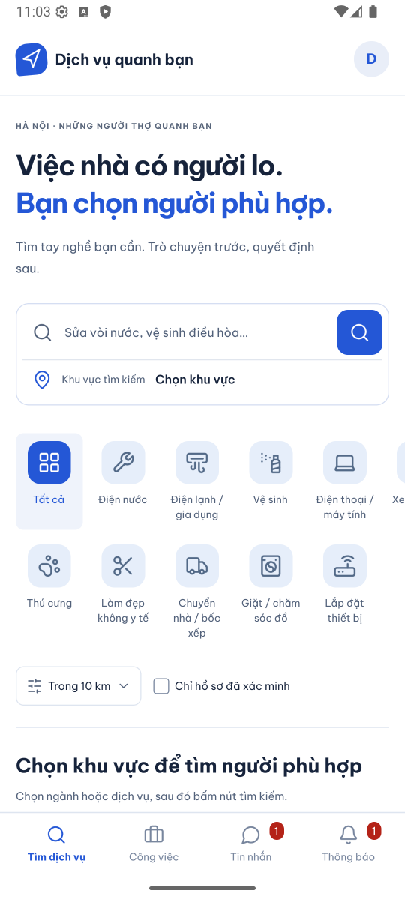
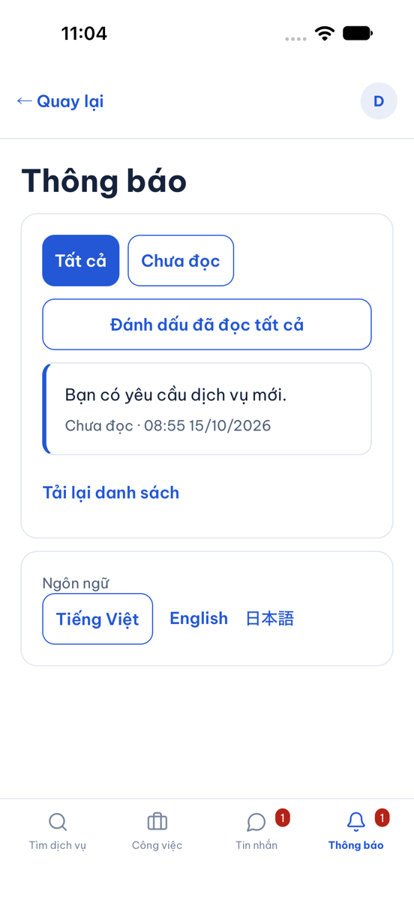
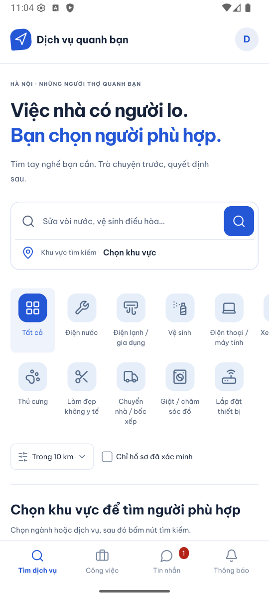
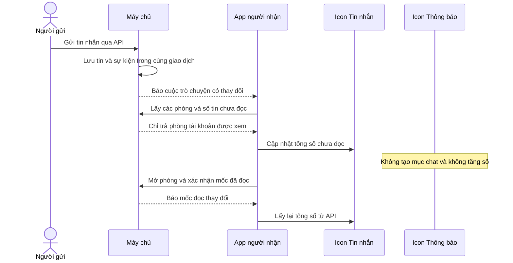

# B05-03 — Tin nhắn và Thông báo có số chưa đọc riêng

MSG-01 · 15/10/2026 · Chủ dự án chốt “chuẩn rồi, hãy sửa lại”. Code đã sửa trong repo, chưa có commit/CI mới cho bản sửa này. [Mục lục](../README.md) · [Checklist](../01-checklist.md).

## Bạn sẽ thấy gì?

Khi nhận một tin nhắn mới, icon **Tin nhắn** hiện số **1**. Icon **Thông báo** giữ nguyên. Màn Thông báo chỉ liệt kê những thông báo khác đã triển khai, như yêu cầu dịch vụ, nhận việc, hóa đơn và nhắc lịch.

Ví dụ, bạn đang có một tin nhắn và một thông báo chưa đọc. Hai icon đều hiện 1. Bấm **Đánh dấu đã đọc tất cả** trong Thông báo chỉ bỏ số ở chuông. Số 1 tại Tin nhắn vẫn còn cho tới khi bạn mở cuộc trò chuyện và app xác nhận đã đọc với máy chủ. Đọc ở một phiên cũng cập nhật phiên đang mở khác của cùng tài khoản.

**Badge** là số nhỏ trên icon. Badge Tin nhắn cộng tổng số tin chưa đọc của tất cả phòng mà tài khoản còn quyền xem, không đếm số phòng. Không tính tin do chính mình gửi; giữ quy tắc hiện hành về tin hệ thống trong phòng. Số 0 được ẩn, trên 99 hiển thị 99+.

## Ảnh app chạy thật trên máy giả lập

Dữ liệu DEMO, chụp 15/10/2026. Android 16 emulator và iPhone 18 Pro iOS 27 simulator; không phải điện thoại vật lý. Hai máy dùng cùng tài khoản để kiểm việc đọc đồng bộ giữa hai phiên. Thông báo công việc trong lượt native là dữ liệu fixture, tin chat được gửi qua API. Hành trình web bên dưới dùng hai tài khoản riêng và gửi chat qua giao diện. Không quay lại video theo yêu cầu chủ dự án; video cũ ghi hành vi trước MSG-01.

| Android: hai badge riêng | iOS: inbox chỉ có thông báo công việc |
|---|---|
|  |  |

Sau khi đọc Thông báo trên iOS, Android vẫn còn 1 tin nhắn chưa đọc:



## Một tin nhắn đi qua code như thế nào?

**API** là đường app trao đổi với máy chủ. **Realtime** là kết nối để máy chủ báo app biết có thay đổi. Tín hiệu realtime không phải số chưa đọc: app vẫn hỏi lại API để nhận số đúng, tránh cộng trùng khi nhận lại cùng sự kiện.



## Thứ tự đọc code

1. [notifications.store.ts](../../../services/api/src/modules/notifications/notifications.store.ts), `queueEventNotifications`: nhận loại sự kiện và ID tài nguyên. Chỉ các sự kiện việc/hóa đơn được chọn mới tạo hàng chờ Thông báo. Sự kiện chat vẫn tồn tại để phục vụ realtime nhưng không đi vào hàng chờ này.
2. [chat.store.ts](../../../services/api/src/modules/chat/chat.store.ts), `readConversation`: nhận ID phòng và tài khoản, dùng mốc `conversation_reads.last_sequence` để đếm tin chưa đọc. Máy chủ kiểm quyền trước khi trả phòng.
3. [auth-session.ts](../../../apps/mobile/src/features/auth/state/auth-session.ts), `unreadConversations` và `passiveRead`: app tải danh sách để lấy số mà không khóa biểu mẫu đang nhập. Token hết hạn vẫn đi qua đường làm mới phiên có khóa; kết quả của tài khoản cũ không được trả cho tài khoản mới.
4. [MessageUnreadProvider.tsx](../../../apps/mobile/src/features/chat/MessageUnreadProvider.tsx), `MessageUnreadProvider`: giữ tổng dùng chung cho các màn. Đọc hết các trang, gộp theo ID phòng rồi cộng `unread`. Event chat, đọc ở phiên khác, kết nối lại hoặc quay lại foreground yêu cầu tải lại. Event tới giữa lúc tải được giữ để tải tiếp lượt sau.
5. [ProductShell.tsx](../../../apps/mobile/src/app/layout/ProductShell.tsx), `ProductShell`: dùng tổng chat cho `message-badge`; dùng các mục Thông báo chưa đọc cho `notification-badge`. Hai nguồn dữ liệu riêng.
6. [ConversationScreen.tsx](../../../apps/mobile/src/features/chat/screens/ConversationScreen.tsx), `Room`: tải tin, xác nhận mốc đã đọc và yêu cầu tính lại badge ngay cả khi tắt realtime. Nếu xác nhận đọc lỗi, lần tải lại vẫn gửi lại mốc cao nhất đã xem.

## Dữ liệu cũ, quyền và lỗi

Không cần migration mới, không xóa tin nhắn. [NotificationsService.list/read](../../../services/api/src/modules/notifications/notifications.service.ts) loại `conversation.*` trước phân trang; ID thông báo chat cũ trả 404 khi đọc. [NotificationsWorker.process](../../../services/api/src/modules/notifications/notifications.worker.ts) đánh dấu hàng chờ chat cũ đã xử lý mà không tạo mục inbox mới. App cũng lọc chat để phòng lúc nâng cấp lệch phiên bản.

Số lấy theo quyền hiện hành của API. Đăng xuất/đổi tài khoản ẩn số cũ ngay; kết quả tải muộn bị bỏ. Khi lỗi mạng, app giữ số đã biết và thử lại với khoảng chờ tăng dần, không tự biến lỗi thành 0. Khi không có realtime, app đối chiếu HTTP mỗi 15 giây trong foreground; khi kết nối khỏe, đối chiếu định kỳ 60 giây ngoài các lần cập nhật do sự kiện. App chạy nền không có bảo đảm nhận ngay: push ngoài app chưa triển khai.

Bốn công tắc push vẫn độc lập. `message_push` không quyết định badge trong app. Đọc Thông báo không sửa `conversation_reads`; đọc chat không sửa `notifications.read_at`.

## Đã kiểm và giới hạn

- Mobile: 7 test tập trung về tổng qua nhiều trang, phòng trùng, sự kiện tới giữa lúc tải, đổi tài khoản, lỗi/cursor lặp, polling fallback và hai badge độc lập, 0/99+.
- API: 5 test thông báo đạt; bao gồm không tạo delivery chat, loại dữ liệu cũ, từ chối đọc ID cũ, giữ cài đặt/nhắc lịch/quyền và retry. Bộ realtime giữ kiểm phát thông báo ngoài chat/đọc một lần.
- Web: hai hành trình notifications/realtime đạt. Hai tài khoản gửi qua UI, nhận khi màn đang mở, lấy bù mất mạng; giữ 1 thông báo và nhận thêm chat, đọc hai nhóm độc lập, đồng bộ đọc phiên khác. Thông báo độc lập trong ca realtime được seed; ca notifications tạo/nhận việc qua API thật rồi mở đích trên UI.
- Android/iOS: kiểm hai badge và thao tác đọc độc lập giữa hai phiên như ảnh. Không suy ra kiểm toàn bộ hành trình native hoặc thiết bị vật lý.
- Toàn bộ test mobile/API/tooling ở lượt kiểm local: 214 mobile, 105 API, 50 tooling đạt; coverage gate mobile/API đạt. 17 hành trình web toàn bộ đạt; build app/API, load danh mục, prototype và Storybook đạt. Lượt SDD cuối vẫn phải khớp snapshot (dấu băm toàn bộ nội dung), đọc evidence mới để xác nhận.
- SDD: bổ sung tiêu chí MSG-01, giữ toàn bộ 93 tiêu chí cũ; QA vẫn `partial`/`unmapped`. Kết quả toàn bộ lint/typecheck/coverage/build/web/prototype/Storybook được ghi mới trong `test-results/sdd/SDD-PROJECT/` khi chạy lệnh dưới đây, không lấy kết quả đợt RT-01A thay bằng chứng.

Trong hồi quy, một lượt web phát hiện nút xác nhận hóa đơn bị khóa khi sự kiện realtime trùng đến sau lúc khách nhập point. [InvoiceContent](../../../apps/mobile/src/features/invoices/screens/InvoiceScreen.tsx) nay lấy lại dữ liệu qua API và so phiên bản trước khi yêu cầu tải lại. Cùng phiên bản giữ số point; phiên bản thay đổi vẫn khóa xác nhận cho tới khi người dùng tải lại. Test mới đã tái hiện lỗi trước sửa, sau sửa cả 8 test `InvoiceScreen` và 2 lượt hành trình hóa đơn web đạt. Đây là sửa implementation, không đổi quy tắc tiền/quyền hoặc spec MSG-01.

Spec đã đồng bộ: SRS, UX, FR trên Drive cùng ID; UX/account/activity trong repo; API v0.1.14, realtime v0.2.1, ý nghĩa notifications và QA-025/095; các bản mirror/HTML/ZIP. Sổ quản lý v1.52 ghi MSG-01 và phạm vi áp dụng. Không đổi schema vật lý, trạng thái việc/tiền hoặc kiến trúc transport. Báo cáo/checklist chỉ ở repo.

<details>
<summary>Lệnh và bằng chứng để tra cứu</summary>

```sh
npm test -w apps/mobile -- --runInBand MessageUnreadProvider ProductShell
cd services/api
node --import tsx --test --test-concurrency=1 test/integration/notifications.test.ts test/integration/realtime.test.ts
# Từ gốc repo:
npx playwright test --config tests/e2e/web/playwright.config.mjs notifications.spec.mjs realtime.spec.mjs
npm run sdd:run -- --change SDD-PROJECT
npm run sdd:check -- --change SDD-PROJECT --phase verify
```

Bằng chứng đồng bộ và fixture native nằm tại `.local/msg-01/` (local ignored, không gửi token/mật khẩu lên báo cáo). Ảnh ở trên được lưu cùng báo cáo. SDD tạo evidence mới khi chạy, không chứng nhận CI hay production.

</details>

## Tự thử để hiểu

1. Có 1 thông báo và 2 tin nhắn chưa đọc. Bấm “Đánh dấu đã đọc tất cả” tại Thông báo: chuông mất số, Tin nhắn vẫn là 2.
2. Mở một phòng rồi quay về: số chỉ giảm theo các tin đã đọc trong phòng đó. Đọc `readConversation` để thấy vì sao không thể chỉ trừ 1 mỗi lần mở phòng.
3. Nhận lại cùng event hai lần: số không tăng gấp đôi vì provider lấy số từ máy chủ. Tìm `dirty` trong provider để xem event tới giữa lúc tải được giữ thế nào.

Chưa có CI mới, UAT, push ngoài app hoặc kiểm điện thoại thật cho MSG-01. Không bổ sung thông báo đánh giá/comment của chức năng chưa triển khai.
