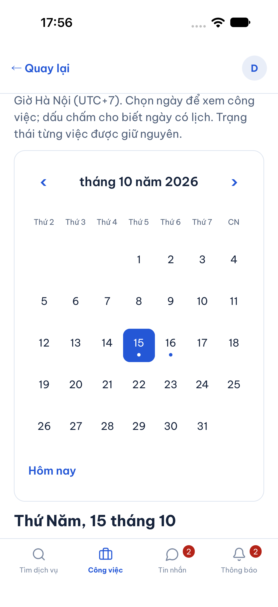
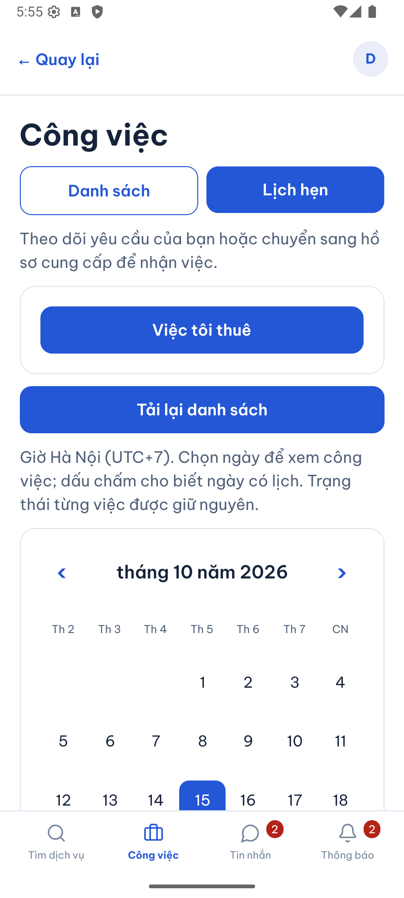
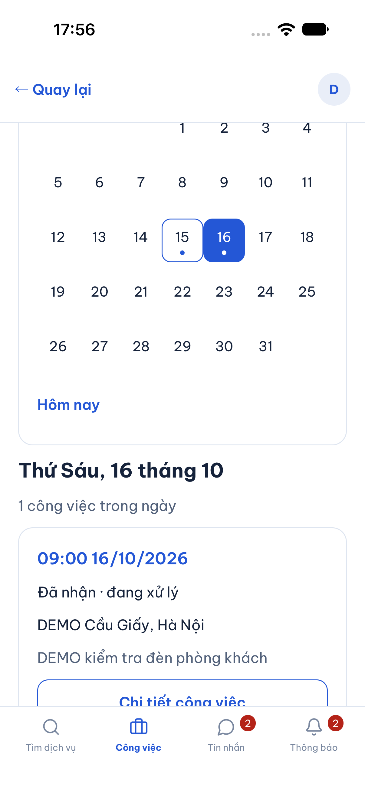
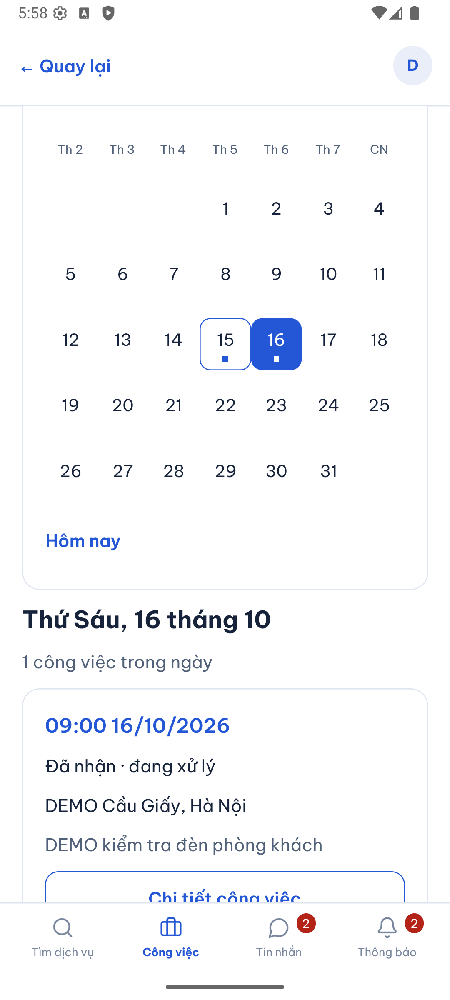
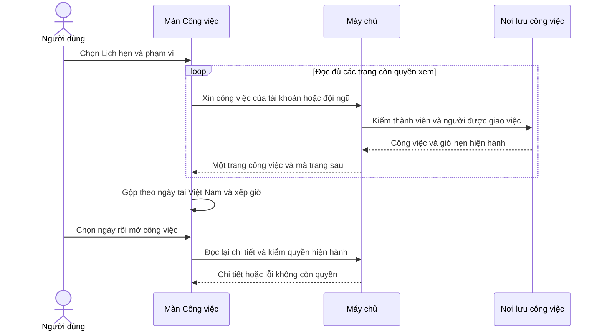

# B05-04 — Xem lịch hẹn từ công việc thật

15/10/2026 · P1-2 / B05-03 · Chủ dự án yêu cầu xem phần tiếp theo trong kế hoạch và triển khai. Code đang sửa trong máy, chưa commit/push hoặc có CI mới. [Mục lục](../README.md) · [Checklist](../01-checklist.md).

## Bạn dùng được gì?

Mở **Công việc → Lịch hẹn**, chọn phạm vi **Việc tôi thuê** hoặc hồ sơ cung cấp dịch vụ đang tham gia. Chọn một ngày để xem công việc theo giờ Hà Nội, bấm **Xem công việc** để vào chi tiết và dùng thao tác đổi lịch đã có. Lịch có tháng trước/tháng sau, nút Hôm nay và dấu chấm ở ngày có giờ hẹn. Màn dùng tiếng Việt, Anh hoặc Nhật nhưng thời điểm hẹn luôn theo Việt Nam.

Ngày có công việc đã dừng hoặc hoàn tất vẫn hiển thị công việc cùng trạng thái đó. Đây là lịch giờ hẹn của các công việc được phép xem, không phải bảng cam kết còn chỗ nhận việc. Việc chưa có giờ hẹn nằm trong mục riêng; không tự suy giờ hẹn từ thời điểm tạo. Việc quá giờ không tự đóng. Khi quay lại sau đổi lịch, ngày đang chọn được giữ và dữ liệu được tải lại.

Đây là phần còn thiếu trong P1-2 sau thông báo/nhắc lịch, realtime và MSG-01. Tận dụng DB/API hiện hành, không thêm trạng thái, endpoint, migration hoặc dependency. Đã đọc prototype `activity/JobExtras.jsx` và Storybook: chúng có lịch hẹn trong chi tiết việc, chưa có màn lịch tháng tổng hợp. Màn tháng dùng màu xanh `#2457D6`, font Be Vietnam Pro, thẻ và điều hướng hiện có; không tuyên bố có mẫu lịch tháng đã được nghiệm thu. Không đồng bộ Drive, `ui-ux`, Excel hoặc các bản xuất.

## Ảnh và kiểm trực tiếp

Dùng dữ liệu DEMO/test ngày 15/10/2026. Đã kiểm trên Android 16 emulator DVQB_API_36 và iPhone 18 Pro/iOS 27 simulator: đăng nhập DEMO, Công việc → Lịch hẹn, chọn ngày 16/10 và mở đúng chi tiết việc hẹn 09:00. Không phải thiết bị thật hoặc UAT. Native chưa kiểm trọn hành trình đổi lịch/nhân viên/nhiều trang; các phần này có bằng chứng web/API riêng.

| iOS simulator — lịch tháng | Android emulator — lịch tháng |
|---|---|
|  |  |

| iOS — việc trong ngày được chọn | Android — việc trong ngày được chọn |
|---|---|
|  |  |

Kiểm native phát hiện lưới dùng phần trăm chiều rộng bị xuống 6 cột trên iOS; đã sửa thành từng hàng cố định 7 ngày và căn giữa số trong toàn ô, kiểm lại hình/khung tương tác trên cả hai nền tảng. Màn giữ khung lịch khi đang tải lại, chỉ xóa dữ liệu công việc và hiện đang tải để tránh việc tháo cả lịch khỏi giao diện. Lượt Maestro đầu không đạt vì bàn phím iOS che ô nhập và driver Android timeout; kết quả native trên là thao tác trực tiếp bằng Mobile MCP sau sửa, không ghi các lượt Maestro lỗi thành đạt.

## Một lần mở lịch đi qua đâu?

**API** là đường app trao đổi với máy chủ. **Trang dữ liệu** là từng nhóm công việc mà máy chủ trả về; mỗi trang có mã để lấy trang tiếp theo. Màn lịch phải lấy đủ các trang rồi mới cho biết một ngày có bao nhiêu việc.



Sơ đồ là nhánh thành công. Nếu một trang lỗi, app không dùng các trang đã tải để kết luận lịch đã đầy đủ. Bấm Thử lại để tải lại từ đầu. Rời màn hoặc đổi tài khoản khiến kết quả trả muộn bị bỏ.

## Đọc code theo thứ tự

| Bước | File và hàm thật | Nhận gì, làm gì, chuyển gì? |
|---|---|---|
| 1 | [JobsScreen.tsx](../../../apps/mobile/src/features/jobs/screens/JobsScreen.tsx), `List` | Nhận tài khoản và phạm vi; chọn Danh sách/Lịch hẹn, giữ ngày đang xem; bắt đầu đọc khi vào màn hoặc cần tải lại. |
| 2 | [calendar.ts](../../../apps/mobile/src/features/jobs/state/calendar.ts), `loadCalendarJobs` | Nhận hàm đọc một trang; đọc đến hết, gộp ID trùng bằng phiên bản mới hơn, phát hiện mã trang lặp và bỏ lượt đã hết hiệu lực. Chỉ trả một bộ dữ liệu sau khi đủ trang. |
| 3 | [auth-session.ts](../../../apps/mobile/src/features/auth/state/auth-session.ts), `listJobs` → [jobs-api.ts](../../../apps/mobile/src/features/jobs/api/jobs-api.ts), `list` | Kiểm phiên và tài khoản, gọi GET `/jobs` với partner/cursor hiện hành; kiểm hình dạng dữ liệu trả về. |
| 4 | [jobs.service.ts](../../../services/api/src/modules/jobs/jobs.service.ts), `list`, `read` → [jobs.access.ts](../../../services/api/src/modules/jobs/jobs.access.ts), `jobAccess` | Khách chỉ xem việc của mình. Phạm vi đội ngũ yêu cầu thành viên hiện hành; nhân viên không có quyền quản lý chỉ thấy việc được giao. Đọc `jobs.scheduled_at` và quyền thao tác thật từ DB. |
| 5 | [calendar.ts](../../../apps/mobile/src/features/jobs/state/calendar.ts), `businessDay`, `jobsByDay`, `monthCells` | Đổi thời điểm sang ngày Việt Nam, nhóm/xếp theo giờ rồi ID; tạo lưới tuần bắt đầu thứ Hai, đúng tháng nhuận. Không đổi trạng thái việc. |
| 6 | [JobCalendar.tsx](../../../apps/mobile/src/features/jobs/components/JobCalendar.tsx), `JobCalendar` | Nhận dữ liệu đã đủ và ngày được chọn; vẽ tháng, đánh dấu ngày có việc, hiện từng thẻ với trạng thái và nút mở chi tiết. |
| 7 | [JobDetailScreen.tsx](../../../apps/mobile/src/features/jobs/screens/JobDetailScreen.tsx) và [RealtimeProvider.tsx](../../../apps/mobile/src/app/providers/RealtimeProvider.tsx), `useRealtimeRefresh` | Chi tiết kiểm quyền lại qua HTTP. Quay lại màn, sự kiện việc/hóa đơn hoặc kết nối lại yêu cầu tải dữ liệu mới; sự kiện không tự sửa giờ hay cộng số lịch. |

## Dữ liệu, quyền và cách thử lại

Giờ hẹn được lưu ở DB; ngày/tháng và chế độ xem chỉ ở màn hình. Đổi tiếng không đổi ngày đã chọn. Khi tải lại, xóa bộ dữ liệu cũ, hiện trạng thái đang tải; khi lỗi không trình bày lịch cũ như hiện hành. Tải tiếp trang danh sách cũng được gắn với lượt đang xem để kết quả muộn không ghi vào phạm vi mới.

Máy chủ có toàn quyền quyết định được xem việc nào. Không thêm query lấy toàn bộ công việc hệ thống. Sau phân công lại, nhân viên cũ không còn thấy việc trong danh sách; phòng chat riêng lịch sử giữ quy tắc cũ. Mở chi tiết luôn kiểm lại, kể cả từ thẻ đã hiện trước lúc quyền thay đổi. Dữ liệu nhiều trang không phải ảnh chụp DB nguyên tử: nếu thay đổi trong lúc đọc, lượt đối chiếu tiếp theo lấy lại dữ liệu. Phát hiện cursor lặp báo lỗi, không quay vô hạn.

Nhắc 24h/1h và đổi lịch dùng worker/transaction đã có; đợt này không sửa bộ nhắc. Push ngoài app chưa triển khai. Khi app ở foreground, cơ chế realtime/polling hiện hành tải lại; lúc mở lại màn luôn đọc HTTP. Không bảo đảm lịch cập nhật tức thì khi mất mạng hoặc app chạy nền.

## Bằng chứng và giới hạn

- Kiểm tập trung: 19 bài mobile cho lịch và luồng việc/chat đạt. Có kiểm ngày Việt Nam qua ranh giới UTC, tháng nhuận, thứ tự giờ, giữ trạng thái, phân trang/lỗi/cursor lặp và bỏ kết quả cũ; màn kiểm nhiều trang, giữ ngày sau tải lại, đổi phạm vi và mất quyền.
- API/PostGIS: 6 bài jobs/chat đạt, bổ sung kiểm danh sách nhân viên trống sau phân công lại, giữ quyền chat lịch sử.
- Web: hành trình mới đạt với 21 việc qua API/DB thật. Việc ở trang thứ hai hiện trên ngày đúng; khách đổi lịch qua UI, quay lại thấy rời ngày cũ và xuất hiện ngày mới; tài khoản người cung cấp thấy lịch mới trong phạm vi mình.
- SDD: prepare đạt với 98 tiêu chí, giữ 65 QA partial/32 unmapped. Hai tiêu chí CAL-01 truy vết ngày/phân trang và hành trình lịch qua API; không sửa hash nguồn hay thu hẹp 96 tiêu chí cũ. Toàn bộ suite phải được chạy bằng `sdd:run` và đối chiếu bằng `--phase verify`; `test-results/sdd/SDD-PROJECT/result.json` cùng report gốc là bằng chứng của đúng bộ file cuối, không dùng lượt tập trung thay kết quả toàn gói.
- Trước sửa căn lưới native cuối, toàn bộ 219 mobile test và coverage gate đã đạt. Sau sửa lưới/giữ khung khi tải lại, 19 bài tập trung đạt lại; SDD toàn gói chạy lại sau khi hoàn thiện ảnh/báo cáo để không dùng fingerprint cũ. Mermaid đã parse/render trong Chromium (1180 × 670), không tạo ảnh sơ đồ riêng.
- Chưa commit/push/remote CI, thiết bị vật lý hoặc UAT. Chưa provider push, production hoặc thêm lịch hệ thống điện thoại. B05 vẫn còn device push và nghiệm thu.
- Màn lịch đọc tất cả trang trong phạm vi được chọn vì contract hiện tại chưa có bộ lọc khoảng ngày. Dữ liệu lớn cần đánh giá tải và đề xuất contract lọc ngày riêng; không tự thêm API hay tự cắt số trang rồi báo lịch đầy đủ. Chưa kiểm quy mô lịch lớn.

## Tự thử để hiểu code

1. Tạo một việc hẹn lúc 00:30 Việt Nam: dù thời điểm UTC thuộc hôm trước, lịch phải hiển thị ngày Việt Nam. Xem `businessDay`.
2. Có hơn 20 việc: việc cũ ở trang thứ hai vẫn xuất hiện. Thử ngắt mạng ở trang thứ hai: lịch phải báo lỗi, không kết luận ngày trống.
3. Đổi lịch trong chi tiết rồi quay lại: ngày đang chọn không nhảy về hôm nay, việc chuyển sang ngày mới. Quá giờ không tự chuyển thành hoàn tất.
4. Quản lý đổi người thực hiện: nhân viên cũ tải lại phải mất việc đó; không được dùng bộ lọc trên app để thay kiểm quyền server.

<details>
<summary>Lệnh và nơi xem bằng chứng</summary>

```sh
npm test -w apps/mobile -- --runInBand calendar Work.test
# Từ services/api:
node --import tsx --test --test-concurrency=1 test/integration/jobs-chat.test.ts
# Từ gốc repo:
npx playwright test --config tests/e2e/web/playwright.config.mjs calendar.spec.mjs
npm run sdd:run -- --change SDD-PROJECT
npm run sdd:check -- --change SDD-PROJECT --phase verify
```

Log tập trung `.local/calendar-api.log`, `.local/calendar-web.log`; ảnh web `test-results/web/report-screenshots/B05-04/`. Bằng chứng cuối ở `test-results/sdd/SDD-PROJECT/result.json` và các report cùng thư mục. Artifact local bị ignore; chạy lại khi không còn file. Không dùng kết quả commit trước làm bằng chứng cho code mới.

</details>
