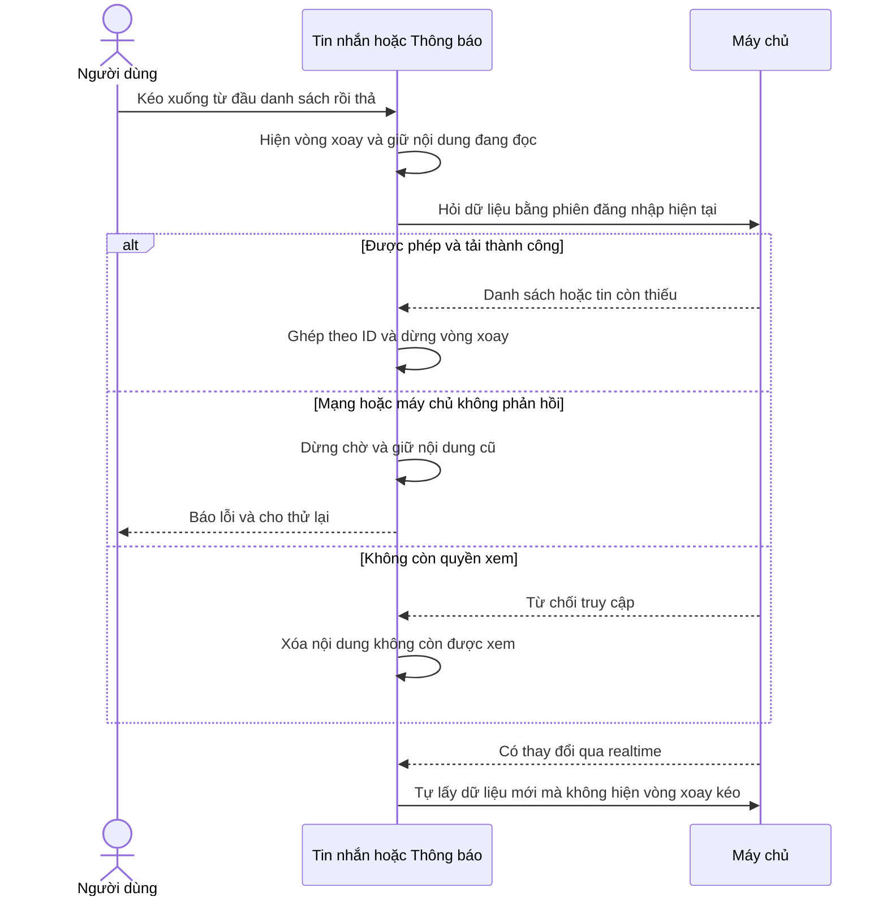
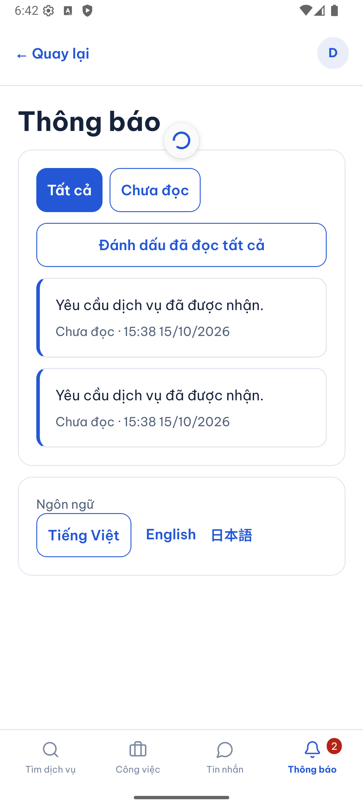
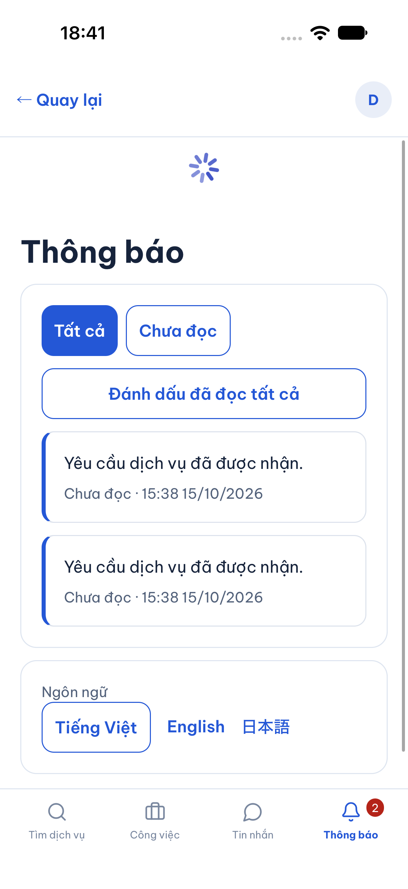
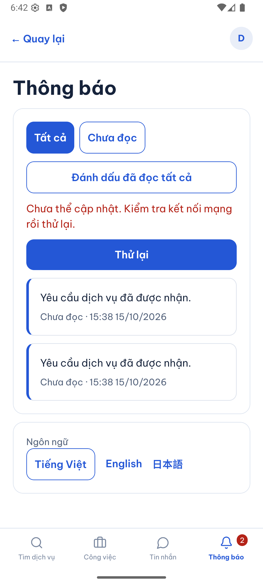
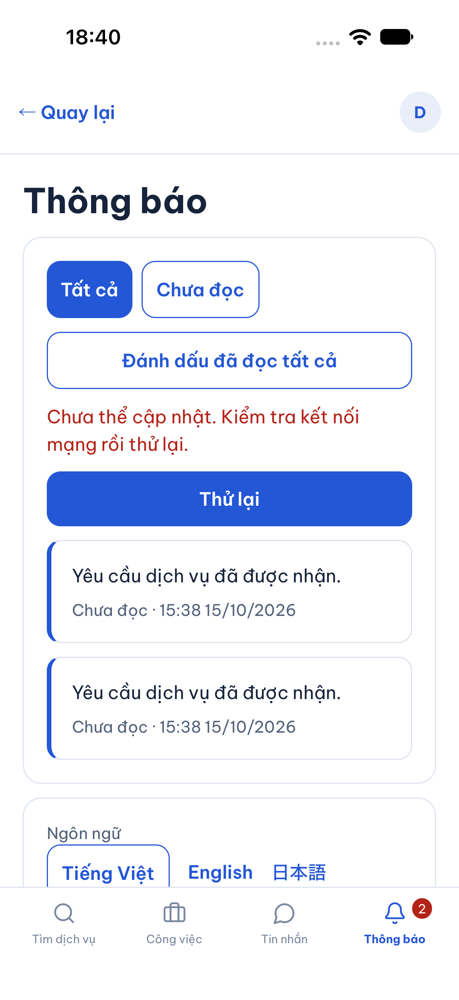
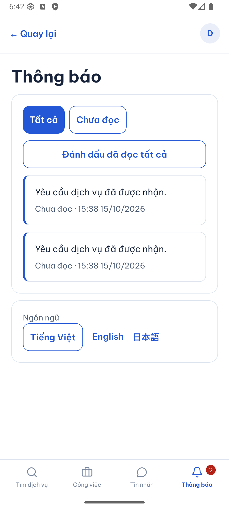
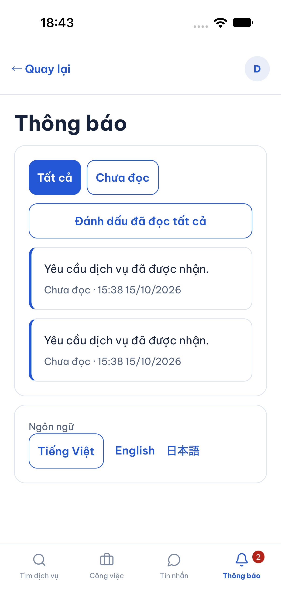
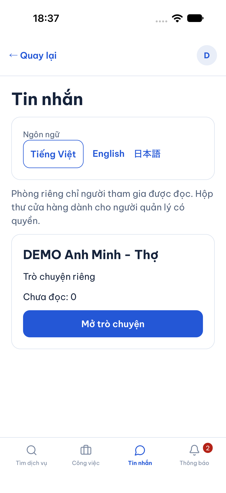

# B05-05 — Tự cập nhật và kéo xuống để làm mới

15/10/2026 · P1-2 / REFRESH-01 · [Mục lục](../README.md) · [Checklist](../01-checklist.md).

## Bạn sẽ thấy gì?

Mở **Tin nhắn** hoặc **Thông báo**, dữ liệu tự cập nhật khi có thay đổi. Không còn nút “Cập nhật tin nhắn”, “Tải lại danh sách” hoặc lời nhắc bấm nút để nhận tin. Trên Android/iOS, kéo xuống từ đầu danh sách rồi thả để kiểm tra lại ngay. Áp dụng cho danh sách phòng, nội dung phòng chat và danh sách thông báo.

Vòng xoay xuất hiện khi bạn kéo làm mới và dừng khi tải xong hoặc lỗi. Những lần cập nhật tự động giữ nguyên nội dung đang đọc, không xóa danh sách để hiện màn trắng. Nếu tải không được, app giữ nội dung đã tải trong phiên và hiện “Chưa thể cập nhật. Kiểm tra kết nối mạng rồi thử lại.” cùng nút **Thử lại**. Lỗi gửi tin được xử lý riêng, tránh vô tình gửi lại một tin chỉ vì muốn tải lại danh sách.

Chủ dự án yêu cầu tham khảo ứng dụng lớn và áp dụng trong cuộc trao đổi ngày 15/10. Đây là thay đổi tương tác đã được giao; không thay contract dữ liệu/quyền. Chưa đồng bộ tài liệu nghiệp vụ trong `ui-ux`/Drive theo AGENTS hiện hành.

## Tham khảo và cách áp dụng

- [Gmail Help](https://support.google.com/mail/answer/6383854?hl=en): kéo từ đầu hộp thư xuống để đồng bộ thủ công; biểu tượng làm mới xuất hiện rồi biến mất. Áp dụng thao tác này bằng điều khiển native, không thêm nút thường trực.
- [Signal Support](https://support.signal.org/hc/en-us/articles/360027913252-Troubleshoot-receiving-messages): nhận tin cần kết nối Internet. Điều này không chứng minh mọi lỗi tải là mất mạng; app dùng câu “chưa thể cập nhật”, không khẳng định thiết bị đang offline khi chỉ nhận lỗi máy chủ.
- [Apple HIG — Loading](https://developer.apple.com/design/human-interface-guidelines/loading): phản hồi tiến trình khi việc tải cần thời gian. Trong app này, tải lần đầu có chỉ báo; tải nền sau khi đã có dữ liệu không chiếm màn hình.
- [React Native RefreshControl](https://reactnative.dev/docs/refreshcontrol): dùng trong vùng cuộn, kích hoạt khi kéo tại đầu danh sách; trạng thái vòng xoay phải được cập nhật ngay trong sự kiện kéo.

Các nguồn trên là tài liệu công khai đã đọc, không phải kiểm trực tiếp mọi phiên bản Gmail/Signal. Cách giữ bản nháp, bảo vệ quyền và ghép trang bên dưới là cách triển khai cho app này. Giữ màu xanh `#2457D6`, font và bố cục hiện hành.

## Một lần kéo làm mới đi qua đâu?

**API** là đường app hỏi dữ liệu từ máy chủ. **Realtime** là tín hiệu cho biết có thay đổi; app vẫn hỏi lại API để nhận dữ liệu và quyền hiện hành.



## Thứ tự đọc code

| Bước | File và hàm thật | Nhận gì, làm gì, trả gì? |
|---|---|---|
| 1 | [AccountPage.tsx](../../../apps/mobile/src/features/accounts/components/AccountPage.tsx), `useAccountRefresh`, `AccountPage` | Màn con đăng ký thao tác tải và trạng thái bận. Trang gắn `RefreshControl` vào vùng cuộn hiện có, bật vòng xoay ngay khi thao tác được nhận. Không tạo vùng cuộn lồng nhau. |
| 2 | [ProductShell.tsx](../../../apps/mobile/src/app/layout/ProductShell.tsx), `ProductShell`; [Screen.tsx](../../../apps/mobile/src/components/ui/Screen.tsx), `Screen` | Chuyển điều khiển kéo xuống vào `ScrollView`; danh sách ngắn trên iOS vẫn kéo được. Những trang khác giữ hành vi cũ. |
| 3 | [ConversationsScreen.tsx](../../../apps/mobile/src/features/chat/screens/ConversationsScreen.tsx), `List` | Lấy lại số trang người dùng đã mở, ghép ID trùng và chỉ thay danh sách sau khi đọc xong. Bỏ kết quả đến trễ của lần tải cũ. |
| 4 | [ConversationScreen.tsx](../../../apps/mobile/src/features/chat/screens/ConversationScreen.tsx), `Room` | Lấy tin sau mốc đã đọc, ghép theo ID và thứ tự. Giữ ô đang soạn; lỗi tải không kích hoạt gửi lại. Mất quyền thì xóa tin. |
| 5 | [NotificationsProvider.tsx](../../../apps/mobile/src/features/notifications/NotificationsProvider.tsx), `refresh`; [NotificationsScreen.tsx](../../../apps/mobile/src/features/notifications/screens/NotificationsScreen.tsx), `Inbox` | Lấy đủ trang thông báo, giữ mốc đọc đã xác nhận, dừng vòng xoay cả khi lỗi. Tải nền không khóa nút mở một thông báo chỉ vì đang đọc danh sách. |
| 6 | [request.ts](../../../apps/mobile/src/lib/http/request.ts), `requestJson` | Mỗi yêu cầu HTTP có giới hạn chờ 10 giây hiện hành; trả lỗi thay vì chờ vô hạn. Một lần tải nhiều trang có thể dài hơn 10 giây tổng cộng. |
| 7 | [RealtimeProvider.tsx](../../../apps/mobile/src/app/providers/RealtimeProvider.tsx), `useRealtimeRefresh`; [Feedback.tsx](../../../apps/mobile/src/components/ui/Feedback.tsx), `RefreshError` | Giữ cơ chế realtime, lấy bù và thử lại tự động hiện hành; lỗi đọc có thông báo và nút thử riêng. Không thêm thư viện hay API. |

## Dữ liệu, quyền và lỗi

Dữ liệu giữ trong bộ nhớ phiên, không phải kho offline tồn tại sau khi đóng app. Đăng xuất/đổi tài khoản không được hiện nội dung tài khoản cũ. Khi máy chủ trả không đủ quyền, nội dung bị xóa; khi lỗi mạng/timeout, nội dung đã tải được giữ. Bộ lọc Chưa đọc và bản nháp chat không bị đặt lại chỉ vì cập nhật.

Một thao tác tải đang chạy chặn thao tác kéo trùng. Danh sách phòng giữ các trang đã mở khi cập nhật, nhưng đây không phải ảnh chụp nguyên tử của nhiều trang trong DB. Cursor lặp được coi là lỗi. Lỗi quyền và lỗi gửi tin giữ cơ chế riêng; không tự gửi lại tin chưa rõ kết quả với khóa mới.

App vẫn tự kiểm tra khi realtime gián đoạn: chu kỳ nền hiện hành khoảng 15 giây khi chưa nối realtime, 60 giây để đối chiếu khi đang nối, có thời gian lùi khi lỗi. Kết nối lại phát tín hiệu lấy bù; không cam kết mọi thiết bị vừa có Internet là cập nhật ngay lập tức. Không thêm thông báo push khi app đã đóng.

## Ảnh native và điều đã kiểm

Dữ liệu DEMO, ngày 15/10/2026. Android 16 emulator và iPhone 18 Pro iOS 27 simulator, không phải thiết bị vật lý. Đã mở danh sách phòng/chat/thông báo và thao tác kéo. Tạm dừng API DEMO local để kiểm vòng xoay, timeout và giữ nội dung; sau đó khôi phục API và kéo lại thành công. Đây là mô phỏng máy chủ không phản hồi, không phải bài kiểm sóng mạng ngoài thực tế.

| Android: đang làm mới | iOS: đang làm mới |
|---|---|
|  |  |

| Android: dừng khi lỗi | iOS: dừng khi lỗi |
|---|---|
|  |  |

| Android: đã hồi phục | iOS: đã hồi phục |
|---|---|
|  |  |



Trong lượt kiểm native đã phát hiện vòng xoay bị tắt quá sớm khi đợi màn con truyền trạng thái lên trang. Đã sửa bằng cập nhật ngay trong sự kiện kéo, rồi chụp lại Android/iOS có vòng xoay thật. Ảnh không thay thế các bài kiểm quyền và gửi tin.

## Lỗi hồi quy phát hiện trong khi kiểm

Lượt SDD đầu đạt mobile nhưng API có 104/105 bài đạt: hai tài khoản đổi lịch đồng thời đôi lúc trả `[200,500]` thay vì `[200,409]`. Log PostGIS test xác nhận vòng chờ giữa khóa partner và `UPDATE jobs SET version=version+1`. Đây là lỗi code có sẵn, không được bỏ assertion hoặc gọi lượt đó là đạt.

Đã thêm bài `two actors reschedule after acquiring their own locks without deadlocking the customer foreign key`: giữ tạm khóa partner, cho provider xếp hàng trước rồi khách, xác nhận cả hai giao dịch đã tới khóa tài nguyên trước khi thả. Bài này thất bại trên khóa cũ và đạt sau sửa. [AccountTransaction.run](../../../services/api/src/modules/accounts/account-transaction.ts) dùng `FOR NO KEY UPDATE` cho hàng tài khoản thay `FOR UPDATE`: vẫn tuần tự hóa các thao tác cùng tài khoản nhưng cho phép giao dịch khác kiểm tra khóa ngoại tới người đó. ID tài khoản không bị thay đổi. [Quy tắc khóa PostgreSQL](https://www.postgresql.org/docs/17/explicit-locking.html) giải thích tính tương thích này. Không đổi quyền, transaction, kiểm phiên, idempotency hoặc xử lý version conflict.

16 bài API về tài khoản, xác thực và công việc đã kiểm lại sau sửa. Test mới được nối vào JOB-AC-03, giữ mọi tiêu chí cũ; log tái hiện và sửa ở `.local/calendar/concurrency-red.log` và `concurrency-green.log`. Không suy ra toàn bộ khả năng deadlock của mọi chức năng đã được loại bỏ.

## Kiểm thử và giới hạn

- 21 bài mobile thuộc `Work.test.tsx` và `Notifications.test.tsx`: kéo làm mới, kết thúc khi timeout/lỗi mạng, giữ dữ liệu/bản nháp, thử lại, xóa khi mất quyền; gồm hồi quy công việc và lịch của đợt trước.
- Hai hành trình web `jobs-chat.spec.mjs`, `realtime.spec.mjs` đạt với API/DB test thật: nhận tin không bấm tải lại, lấy bù offline, đọc ở phiên khác và giữ hai badge độc lập. Web không giả lập cử chỉ kéo native.
- SDD toàn dự án: xem bằng chứng của lượt cuối tại `test-results/sdd/SDD-PROJECT/evidence.json`. Checklist tách kết quả SDD khỏi native/UAT. Mermaid được parse và render trước bàn giao.
- Chưa commit/push, CI mới, thiết bị vật lý hoặc UAT của chủ dự án. Không thay Drive, Excel hoặc `ui-ux`; không mở provider, chi phí hay production.

<details>
<summary>Lệnh kiểm tra lại</summary>

```sh
npm test -w apps/mobile -- --runInBand Work.test Notifications.test
npx playwright test --config tests/e2e/web/playwright.config.mjs realtime.spec.mjs jobs-chat.spec.mjs
npm run sdd:run -- --change SDD-PROJECT
npm run sdd:check -- --change SDD-PROJECT --phase verify
```

Các log riêng của lượt này ở `.local/calendar/refresh-*.log` (ignored). Inventory giữ toàn bộ tiêu chí cũ, bổ sung REFRESH-01, không đổi hash nguồn spec hoặc nâng các QA partial thành hoàn tất.

</details>

## Tự thử để hiểu

1. Mở Tin nhắn, kéo xuống: thấy vòng xoay rồi tự dừng. Nhờ tài khoản DEMO khác gửi tin: nhận được mà không kéo.
2. Đang soạn một tin, kéo làm mới: nội dung đang soạn phải còn nguyên.
3. Khi tải lỗi, nội dung cũ còn nhưng chưa chắc mới nhất. Thử lại sau khi có kết nối. Vì sao lỗi mất quyền lại phải xóa dữ liệu? Vì quyền xem do máy chủ quyết định, không phải do app đã từng tải được.
