# B05-06 — Cập nhật hỗ trợ, xác minh, đánh giá và push Expo

Cập nhật 21/10/2026 · P1-06 · Code trên nền `f7eb929`, chưa commit/push đợt này. Android đã cấu hình Firebase/FCM và nhận push thật qua Internet trên Emulator; iOS vẫn thiếu APNs. [Quyết định](../de-xuat/P1-06-hoan-thien-cung-dot.md).

## Bạn dùng được gì và phần nào chưa gửi thật?

Khi báo cáo hỗ trợ, hồ sơ xác minh hoặc đánh giá thay đổi, người tham gia đúng quyền nhận cập nhật tối thiểu để app tải lại dữ liệu. Inbox giữ lịch sử riêng; nội dung trao đổi, giấy tờ, ghi chú nội bộ và địa chỉ không nằm trong sự kiện. Người đang sửa bản nháp không bị thay nội dung đang gõ.

App iOS/Android có nút bật thông báo trên thiết bị trong Cài đặt thông báo. App chỉ xin quyền hệ điều hành khi bấm nút; đăng nhập sau đó có thể đăng ký lại nếu đã cấp quyền. Thiết bị đăng xuất hoặc mất phiên không được tiếp tục nhận từ hàng đợi. Web giải thích cần dùng app native.

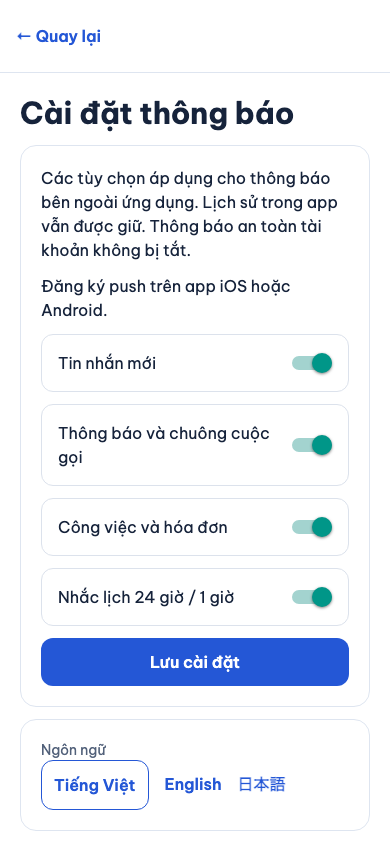

Ảnh web thật ngày 20/10/2026 với tài khoản DEMO. **Chưa có gửi/nhận push trên điện thoại thật.** Các bài kiểm tự động dùng HTTP transport giả lập. Lượt 20/10 bên dưới là mốc lịch sử; lượt 21/10 đã chuyển phát thành công qua Expo/FCM tới Android Emulator. APNs chưa đạt.

Expo project ID là mã nhận diện app, không phải mật khẩu. FCM của Google và APNs của Apple chuyển thông báo tới Android/iPhone. Cần liên kết đúng dự án và bản cài native trước khi kiểm thật; không gửi khóa bí mật qua hội thoại.

## Gửi thật tới Android Emulator ngày 21/10/2026

Bạn đã tải hai file Firebase về máy. Đã kiểm chúng cùng dự án `dichvuquanhban`, đúng mã app `vn.dichvuquanhban.app`, khóa riêng đọc được và hợp lệ về cấu trúc. File `google-services.json` chứa cấu hình phía app được đặt trong `apps/mobile`; khóa service account giữ ngoài repo và tải trực tiếp lên Expo bằng EAS CLI. Đã xác nhận Expo gắn khóa cho đúng mã app, không cần tạo keystore/cloud build hoặc bật billing.

Khi app ở nền, bộ xử lý `PushWorker` gửi cập nhật báo cáo DEMO tới Expo; Expo chuyển sang FCM rồi Android hiện “Bạn có cập nhật mới.” Bấm thông báo đã mở đúng báo cáo và đối chiếu mã trên giao diện với mã API tạo. Đây là chuyển phát qua Internet, không dùng thông báo local hoặc payload chèn bằng shell.

| Bước | Bằng chứng 21/10 |
|---|---|
| Cấu hình và build | `googleServicesFile` trỏ file cùng Firebase project; EAS CLI báo gắn khóa FCM V1 thành công; Android `assembleDebug` đạt và APK đã cài |
| Đăng ký thiết bị | Nút app báo đã đăng ký; DB có thiết bị Android còn hiệu lực, không in token |
| Gửi và receipt | 4 lần gửi DEMO qua worker thật có ticket; cả 4 receipt thành công, DB `delivered`, không có `error_code` |
| Nhận và mở ở nền | Notification shade hiện thông báo của app; bấm mở đúng mã báo cáo DEMO |
| Nhận khi tiến trình đã dừng | Đã kiểm PID vắng trước gửi bằng cách dừng tiến trình debug; Android vẫn nhận thông báo |
| Mở sau khi tiến trình dừng | Lần đầu mở trang chủ, chưa xác định nguyên nhân. Lượt chẩn đoán và lượt kiểm lại sau gỡ log đều mở đúng báo cáo. Giữ đây là điểm cần theo dõi, chưa chứng nhận ổn định toàn ma trận cold-start |
| Hồi quy | `test:native-config` đạt. Kết quả đầy đủ cùng phiên bản đọc ở `test-results/sdd/SDD-PROJECT/evidence.json`; không dùng bằng chứng CI cũ |

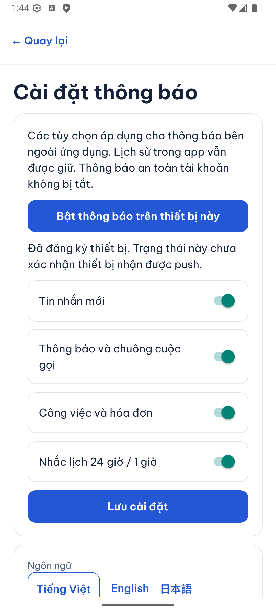
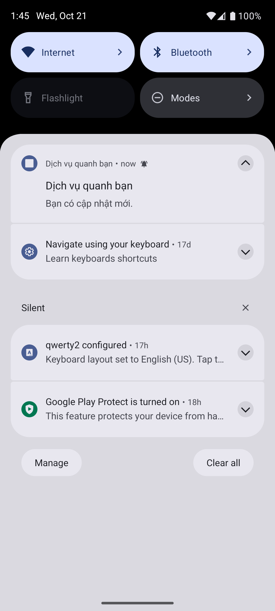
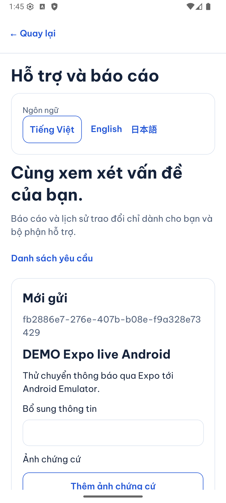
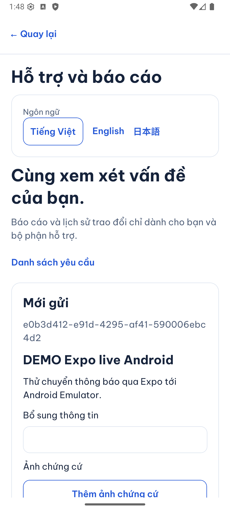

Ảnh 21/10/2026: Android Emulator `DVQB_API_36`, Android 16/API 36, tài khoản DEMO và API/schema riêng trong `dvqb_test`. Không phải điện thoại vật lý. Dừng tiến trình để thử khởi động lại khác thao tác **Buộc dừng** trong cài đặt Android. Chưa kiểm Doze, mất mạng, mọi nhánh quyền/logout trên provider thật, bản release, APNs, thiết bị vật lý hoặc UAT. Log chẩn đoán tạm đã gỡ; không sửa logic sản phẩm trong lượt cấu hình này.

### Cách đọc thay đổi cấu hình

- [app.json](../../../apps/mobile/app.json): nhận đường dẫn `googleServicesFile`; Expo prebuild đưa cấu hình Firebase vào bản Android.
- [google-services.json](../../../apps/mobile/google-services.json): mã dự án/mã app công khai để SDK đăng ký thiết bị, không chứa khóa service account.
- [eas.json](../../../apps/mobile/eas.json): profile `development` cho công cụ quản lý credentials; thêm file không tự chạy build trên cloud.
- [.gitignore](../../../.gitignore): bỏ qua file có tên `firebase-adminsdk` để tránh đưa nhầm khóa riêng vào Git. Không đổi tên rồi chép khóa vào repo.
- Sau cấu hình: đọc `PushControl.register` → `AuthSession.registerPushDevice` → API thiết bị → `queuePush` → `PushWorker.process` → `PushListener` → `AppNavigator.openPush`.

Bài tự thử: đưa app xuống nền rồi tạo một báo cáo DEMO, bấm thông báo và so mã báo cáo. Vì sao chỉ thấy `delivered` trong DB chưa đủ? Receipt chứng minh nhà cung cấp đã nhận; vẫn cần quan sát Android hiển thị và kiểm thao tác mở. Vì sao khóa JSON không đặt trong app? App chỉ cần cấu hình đăng ký, quyền gửi do Expo giữ.

## Thử trên máy giả lập ngày 20/10/2026

**Có thể kiểm thông báo trên cả Android Emulator và iOS Simulator hiện có.** Người dùng đã bấm thông báo và app tải đúng báo cáo DEMO từ API. Đây là bằng chứng chạy app native; phần chuyển qua Internet được ghi riêng.

| Bước | Android Emulator | iOS Simulator |
|---|---|---|
| Môi trường | `DVQB_API_36`, Android 16/API 36, có Google Play services | iPhone 18 Pro, iOS 27.0; Xcode 27.1/macOS 27.0.1 |
| Build và cài native | `assembleDebug` thành công | `xcodebuild` Debug Simulator thành công, có chữ ký ad-hoc local |
| Xin quyền hệ điều hành | Đã cấp quyền từ nút trong app | Đã cấp quyền từ nút trong app |
| Token Expo | Chưa lấy được: `Default FirebaseApp is not initialized`, thiếu `googleServicesFile` | Đã lấy token và đăng ký với API; nút báo đăng ký thành công |
| Hiện thông báo mô phỏng | Đã hiện thông báo local của chính app, qua `expo-notifications` | Đã hiện payload đưa qua `simctl push` |
| Bấm mở đúng báo cáo | Đã kiểm khi app ở nền | Đã kiểm khi app ở nền và sau `simctl terminate` |
| Gửi qua Expo thật | Chưa tới bước gửi do thiếu cấu hình Firebase | Backend dùng `PushWorker` thật; Expo trả `InvalidCredentials`, DB ghi `failed`, không có ticket |

Dự án [@anhthai010702/dich-vu-quanh-ban](https://expo.dev/accounts/anhthai010702/projects/dich-vu-quanh-ban) đã được tạo và liên kết; project ID `128de9c8-0139-449b-9b0e-51b3fa203fdf` trong `app.json` là mã công khai. Không bật billing hoặc dùng cloud build. Để chuyển phát qua Internet, Android còn cần Firebase/FCM; iOS cần credentials APNs cho dự án Expo. Đổi sang điện thoại thật không tự giải quyết phần cấu hình này.

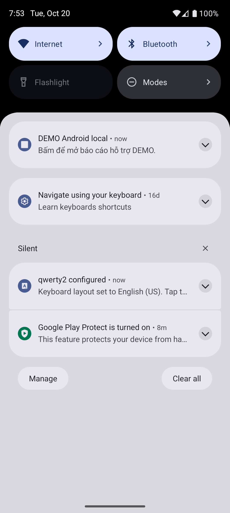
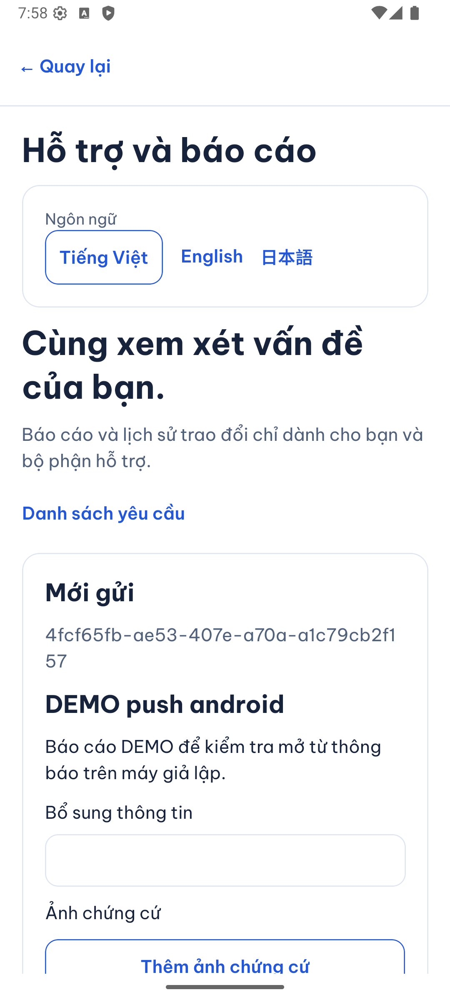
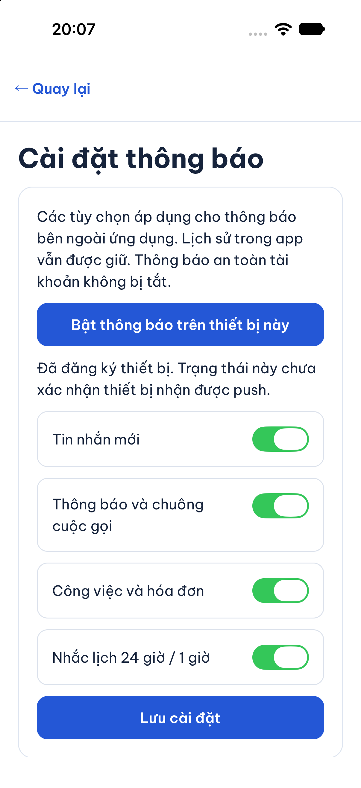
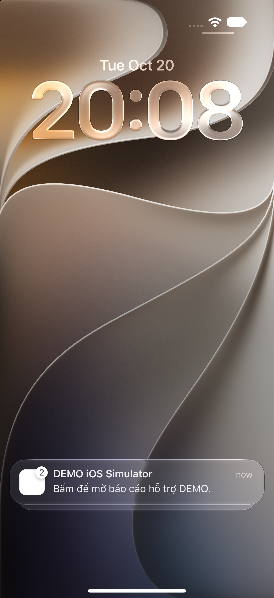
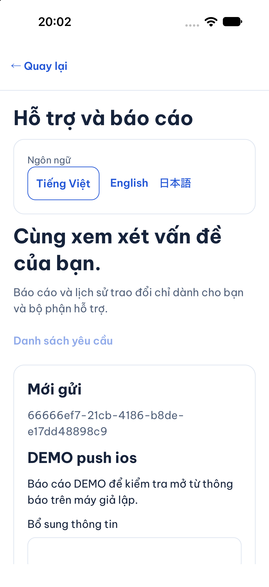
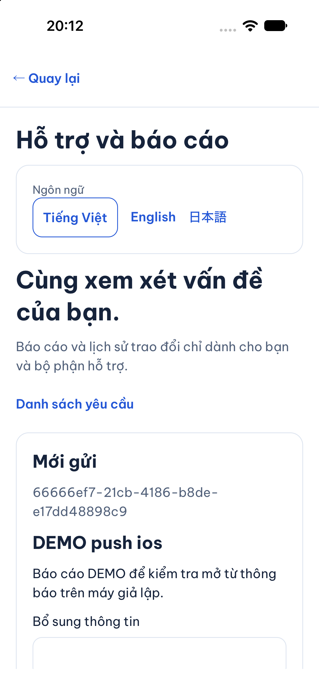

Tất cả ảnh chụp ngày 20/10/2026, dữ liệu DEMO, **máy giả lập**, không phải điện thoại thật. Android dùng harness local tạm để gọi SDK thông báo của app; iOS dùng payload APNs mô phỏng. Harness và log chẩn đoán đã được gỡ khỏi code sản phẩm. Không dùng thông báo do shell Android tạo để chứng nhận callback của app.

Lượt thử phát hiện và sửa hai lỗi: callback token iOS gọi lại việc xin token gây vòng lặp/`BUSY`; mở từ app đã đóng diễn ra trước khi phiên đăng nhập và điều hướng sẵn sàng. Listener nay dùng trực tiếp token nhận từ callback, bỏ qua token trùng và giữ thông báo chờ tới lúc app sẵn sàng. Hai bài hồi quy mới đã thất bại trước sửa và đạt sau sửa; 5 bài Jest push native và typecheck mobile đạt. Không dùng kết quả này thay cho kiểm mất quyền/logout trên provider thật. Lượt SDD đầu qua 277 mobile/140 API và build, nhưng web có 23/24 đạt: luồng đánh giá bấm gỡ trùng lúc tải lại realtime, trace không có yêu cầu visibility tới API. Chạy lại riêng với nguyên bài kiểm đạt; đây vẫn là độ nhạy timing cần theo dõi, không phải bằng chứng lỗi provider. Lượt kiểm đầy đủ mới nhất được lưu trong evidence SDD.

Tra cứu kỹ thuật cho lần chạy lại

- `EXPO_USE_PRECOMPILED_MODULES=0 pod install` để tránh thư viện Expo dựng sẵn lệch Swift/Xcode; build lại `expo-modules-jsi/apple/scripts/build-xcframework.sh --clean` với `PLATFORM_NAME=iphonesimulator` và `PODS_ROOT` đúng repo. Sau đó clean/build app. Đây là xử lý cache/môi trường local, không sửa nguồn dependency.
- iOS Simulator cần chữ ký ad-hoc mặc định của Xcode để Keychain hoạt động; không dùng `CODE_SIGNING_ALLOWED=NO` cho lượt đăng nhập này.
- Metro iOS chạy với `node --dns-result-order=ipv4first`; API dùng schema DEMO riêng trong `dvqb_test`. Không chạy worker trên DB sản phẩm.
- Android: `./gradlew :app:assembleDebug -PreactNativeArchitectures=arm64-v8a`; cài APK rồi chạy app bằng dev client.
- iOS: `xcrun simctl push <UDID> vn.dichvuquanhban.app <payload.apns>`; phần `body` chứa `recipient_id`, `report_id`, `event_key`, cùng `aps.alert` chung. Simulator inject không đi qua Expo/APNs.
- Hồi quy toàn repo: `npm run sdd:run -- --change SDD-PROJECT`, sau đó `npm run sdd:check -- --change SDD-PROJECT --phase verify`; bằng chứng hiện hành ở `test-results/sdd/SDD-PROJECT/evidence.json`. Giữ 129 criterion và trạng thái QA partial/unmapped; các lượt native ở đây là bằng chứng bổ sung, không mở P2.
- Tham khảo điều kiện hỗ trợ hiện hành: [Expo push setup](https://docs.expo.dev/push-notifications/push-notifications-setup/) và [FCM credentials](https://docs.expo.dev/push-notifications/fcm-credentials/).

## Luồng cập nhật

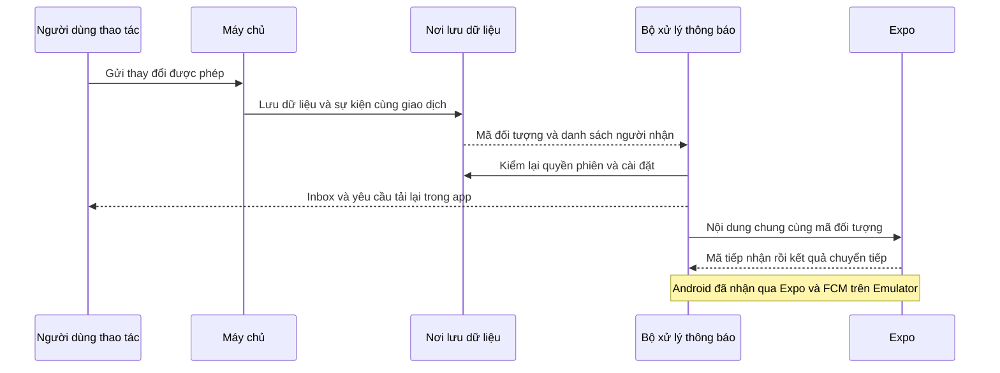

## Mở code theo thứ tự

| File / hàm | Nhận gì, làm gì và chuyển cho ai? |
|---|---|
| [event.store.ts](../../../services/api/src/common/events/event.store.ts), `event` | Ghi sự kiện cùng giao dịch nghiệp vụ, chốt người nhận cho realtime. Không chứa lời đánh giá/ghi chú/giấy tờ. |
| [notifications.store.ts](../../../services/api/src/modules/notifications/notifications.store.ts), `queueEventNotifications`, `queuePush` | Tách hàng đợi inbox và push. Chat chỉ dùng badge chat và push, không thêm vào chuông thông báo. |
| [realtime.access.ts](../../../services/api/src/modules/realtime/realtime.access.ts), `resourceAccess` | Báo cáo chỉ người gửi, xác minh chỉ người còn quyền quản lý hồ sơ, đánh giá theo quyền việc hiện hành. Admin vẫn đọc dữ liệu qua API MFA. |
| [notifications.worker.ts](../../../services/api/src/modules/notifications/notifications.worker.ts), `process` | Kiểm quyền lại trước tạo inbox và sự kiện tối thiểu. |
| [push.worker.ts](../../../services/api/src/modules/notifications/push.worker.ts), `allowed`, `process` | Kiểm tài khoản/phiên thiết bị/quyền/công tắc/phiên bản nhắc lịch; gửi Expo, lấy ticket và đọc receipt, xử lý lỗi. |
| [PushControl.native.tsx](../../../apps/mobile/src/features/notifications/PushControl.native.tsx), `register` | Xin quyền có chủ động, lấy Expo token rồi đăng ký với phiên hiện hành. |
| [PushListener.native.tsx](../../../apps/mobile/src/features/notifications/PushListener.native.tsx) và [AppNavigator.tsx](../../../apps/mobile/src/app/navigation/AppNavigator.tsx), `openPush` | Chỉ nhận thông báo đúng tài khoản, chống lặp mã sự kiện, gọi API kiểm quyền trước mở đúng đối tượng; không tự gửi thao tác tiền. |

## Khi lỗi hoặc đăng xuất

Hàng đợi lưu PostgreSQL nên không mất chỉ vì worker khởi động lại. Cùng thiết bị/sự kiện chỉ có một dòng. Mỗi lần xử lý lấy quyền xử lý tạm 30 giây; lỗi mạng thử lại có giãn cách, tối đa 8 lần. Lỗi `DeviceNotRegistered` thu hồi token. Token chuyển sang tài khoản khác không được nhận các dòng của tài khoản cũ. Công tắc push không xóa inbox.

Ticket nghĩa là Expo nhận yêu cầu; receipt thành công nghĩa là chuyển tiếp tới hệ thống push, **không chứng minh điện thoại đã hiển thị**. Trạng thái `delivered` trong DB chỉ ghi receipt này. Mất phản hồi HTTP có thể khiến cảnh báo hệ điều hành bị lặp; mở thông báo không cộng tiền hoặc gọi mutation nghiệp vụ. Ngày 20/10 kiểm mô phỏng hai nền tảng; ngày 21/10 kiểm chuyển phát Expo/FCM thật trên Android Emulator như bảng bên trên. Điện thoại vật lý và APNs chưa đạt; cold-start Android còn một lần không mở đúng đích cần theo dõi.

## Tự thử và bằng chứng

Tắt công tắc push dịch vụ rồi tạo cập nhật: inbox vẫn có. Đăng xuất trước khi worker xử lý: không gửi tới phiên cũ. Vì sao bấm thông báo phải gọi API lại? Quyền có thể đã bị thu hồi sau lúc tạo thông báo.

Integration `push.test.ts` kiểm đăng ký/retry, payload tối thiểu, đúng người nhận báo cáo, receipt giả lập, lỗi mạng, token hết hiệu lực, đổi chủ thiết bị và logout. Jest kiểm xin quyền có chủ động và nhánh từ chối/lỗi. API hỗ trợ/xác minh/đánh giá và web hai vai kiểm luồng nghiệp vụ; hồi quy toàn bộ qua `SDD-PROJECT`.

Cấu hình cho lần chạy lại

- Backend local/test: `EXPO_PUSH_ENABLED=1`; `EXPO_ACCESS_TOKEN` chỉ khi dự án bật bảo vệ truy cập. Không log giá trị.
- App: Expo project ID ưu tiên `Constants.expoConfig.extra.eas.projectId`, sau đó `Constants.easConfig.projectId` hoặc `EXPO_PUBLIC_EAS_PROJECT_ID`; plugin `expo-notifications`, dependencies tương thích Expo SDK 57. Cần tạo lại bản cài native sau khi thêm module.
- Cấu hình FCM/APNs nằm trong dự án sở hữu app; không tự tạo tài khoản hoặc bật billing.
- Bằng chứng phải tách: đăng ký token → Expo ticket → receipt → thiết bị nhận khi nền/đóng → bấm mở đúng đối tượng và kiểm mất quyền.
- Android đã rebuild với Firebase và nhận qua Expo/FCM thật trên Emulator ngày 21/10; iOS giữ mốc `InvalidCredentials` ngày 20/10 do chưa có APNs. Chưa thiết bị thật/CI mới/UAT/production.

Chọn tin nhắn làm chứng cứ và toàn bộ P2 vẫn ngoài đợt. Không đồng bộ Drive/Excel/ui-ux.
