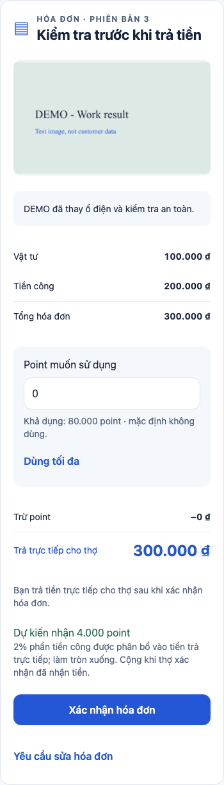
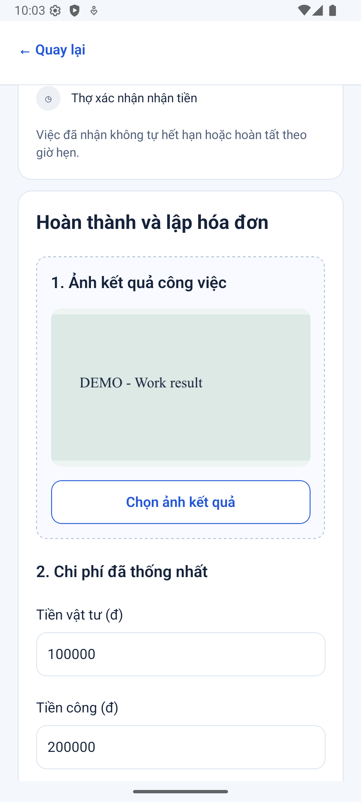
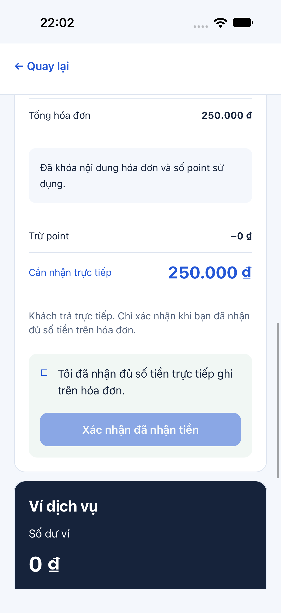
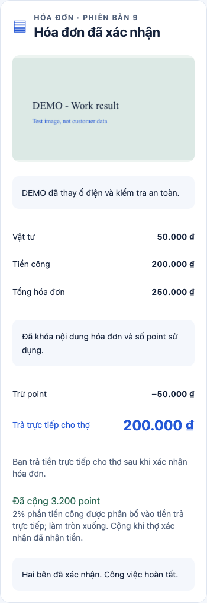
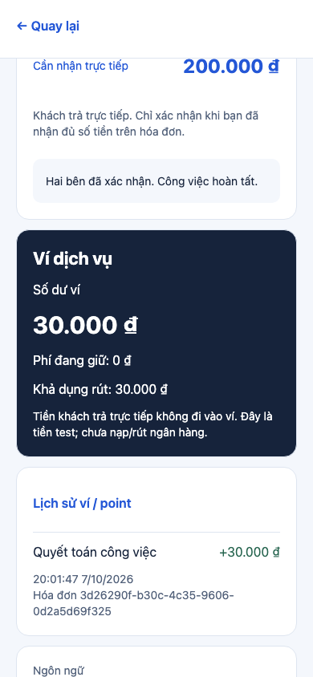
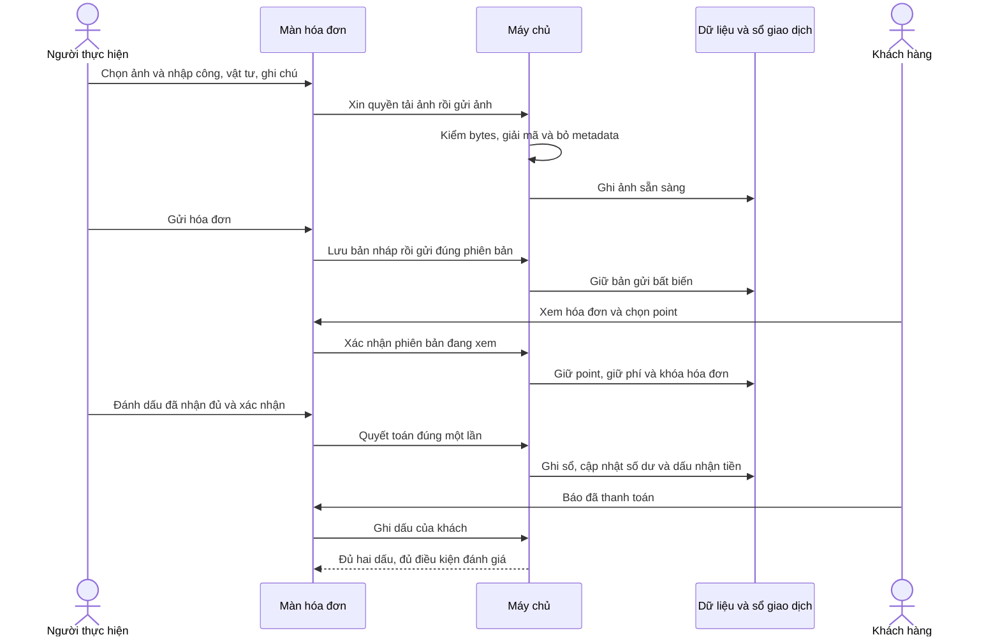

# B06-01 — Ảnh kết quả, hóa đơn và quyết toán bằng tiền test

P0-3 · B02-02 (ảnh kết quả), B06-01/02/03, B07-01/02/03 trong phạm vi dưới đây · 07/10/2026. Code đã push `d4828e2` ngày 08/10/2026; [CI từ xa đạt cả 3 job](https://github.com/anhthaingd/dich-vu-quanh-ban/actions/runs/37713859771). Chưa UAT (chủ dự án dùng và nghiệm thu). [Checklist](../01-checklist.md) · [Mục lục](../README.md).

## 1. Bạn đã dùng được những gì?

Sau khi nhận việc, mở **Công việc → chi tiết → Xem hóa đơn**. Người được giao việc chọn ảnh kết quả, nhập tiền vật tư, tiền công và ghi chú, rồi lưu nháp hoặc gửi cho khách. Khách xem đúng ảnh và nội dung đã gửi, yêu cầu sửa có lý do, hoặc chọn point rồi xác nhận. Người thực hiện sửa thành bản mới; bản đã gửi không bị ghi đè.

Khi khách xác nhận, số tiền và point được khóa. Khách bấm báo đã thanh toán; thợ đánh dấu đã nhận đủ rồi xác nhận nhận tiền. Hai dấu này độc lập: thợ có thể nhận trước khi khách bấm báo. Chỉ thao tác thợ nhận tiền mới ghi phí, bù point và thưởng; bấm lại không ghi lần hai. Điều kiện đánh giá chỉ mở khi có cả hai dấu; màn viết đánh giá chưa thuộc gói này.

Phía khách thấy point khả dụng. Người có quyền ví thấy số dư, khoản giữ phí, số có thể rút và lịch sử; không có nút chuyển tiền/ngân hàng thật. Mở **Lịch sử ví / point** để xem bút toán (một dòng tăng hoặc giảm số dư), thời gian và mã hóa đơn tham chiếu.

**Nguồn giao diện:** đã đọc và mở Storybook `MobileInvoice`, đối chiếu [Journey.jsx](../../../ui-ux/prototype/src/Journey.jsx), [Partner.jsx](../../../ui-ux/prototype/src/Partner.jsx) và [WalletPanel.jsx](../../../ui-ux/prototype/src/finance/WalletPanel.jsx). Thẻ hóa đơn giữ thứ tự ảnh → ghi chú → vật tư/công/tổng → point → tiền trực tiếp màu xanh → thưởng → xác nhận/yêu cầu sửa. Thẻ nhận tiền có nền xanh nhạt, checkbox và nút chỉ bật sau khi chọn. App sử dụng phần điều hướng native hiện hành; đây không phải bằng chứng so sánh từng pixel toàn màn với prototype web.

### Ảnh từ app chạy thật

Tất cả ảnh dưới đây chụp ngày 07/10/2026, dữ liệu DEMO/test. Web là Expo web phục vụ kiểm thử; Android là emulator API 36, iOS là simulator iPhone 18 Pro/iOS 27, không phải điện thoại thật.

| Màn | Ảnh |
|---|---|
| Khách kiểm hóa đơn — web, chụp toàn thẻ |  |
| Thợ lập hóa đơn — Android emulator |  |
| Thợ xác nhận nhận tiền — iOS simulator |  |
| Hai dấu hoàn tất — web |  |
| Ví và lịch sử — web |  |

[Ảnh iOS sau nhận tiền](anh/B06-01/ios-invoice-received.png) · [Ảnh Android nhận tiền](anh/B06-01/android-invoice-payment.png) · [Ảnh bản nháp web](anh/B06-01/web-editor.png).

## 2. Theo một hóa đơn từ đầu đến cuối

Ví dụ đã chạy: công **200.000đ**, vật tư **50.000đ**, tổng **250.000đ**, khách dùng **50.000 point**. Khách trả trực tiếp **200.000đ**. Phí bằng 10% công là **20.000đ**; ví thợ tăng **30.000đ** (= bù point 50.000 − phí 20.000). Thưởng khách là **3.200 point**, tính trên phần công được phân bổ vào tiền trả trực tiếp. Khách có sẵn 80.000 point test thì sau quyết toán còn **33.200 point**.

API là nơi app gửi yêu cầu xử lý. Transaction là nhóm thay đổi phải cùng thành công hoặc cùng hủy; nhờ vậy không xảy ra “đã trừ point nhưng chưa ghi hóa đơn”. Ledger là sổ giao dịch chỉ thêm dòng; số dư là kết quả cộng các dòng, không phải tiền mặt khách đưa cho thợ.

Sơ đồ minh họa thợ xác nhận trước khách. Chiều ngược lại cũng hợp lệ. Khi khách yêu cầu sửa, máy chủ ghi lý do và cho thợ tạo bản mới; point chọn ở bản mới mặc định về 0. Khi thợ đang lưu nháp sửa, khách vẫn thấy bản đã gửi gần nhất, không đọc được ghi chú nháp.

## 3. Mở code theo thứ tự nào?

| Bước | File và hàm thật | Nhận gì, xử lý gì, trả gì? |
|---|---|---|
| 1 | [JobDetailScreen.tsx](../../../apps/mobile/src/features/jobs/screens/JobDetailScreen.tsx), `JobDetailScreen` | Dùng quyền và `invoice_id` máy chủ trả để mở hóa đơn của đúng việc. |
| 2 | [InvoiceScreen.tsx](../../../apps/mobile/src/features/invoices/screens/InvoiceScreen.tsx), `InvoiceContent`, `picked`, `save`, `act` | Giữ ô đang nhập, tải ảnh, tính xem trước. `save` lưu draft trước rồi gửi; `act` gửi xác nhận/sửa/nhận tiền với phiên bản đang xem. |
| 3 | [auth-session.ts](../../../apps/mobile/src/features/auth/state/auth-session.ts), `getInvoice`, `saveInvoice`, `changeInvoice`, `getLedger` | Gắn phiên đăng nhập, làm mới phiên nếu cần, ngăn kết quả tài khoản cũ cập nhật tài khoản mới. UI không truy cập DB. |
| 4 | [invoices-api.ts](../../../apps/mobile/src/features/invoices/api/invoices-api.ts), `createInvoicesApi` | Chuyển thao tác thành HTTP và kiểm cấu trúc phản hồi. Với ảnh: grant → PUT bytes → complete → asset ready. |
| 5 | [invoices.controller.ts](../../../services/api/src/modules/invoices/invoices.controller.ts), `save`, `change`; [invoices.input.ts](../../../services/api/src/modules/invoices/invoices.input.ts), `draftInput`, `actionInput` | Kiểm ID, số nguyên, trường bắt buộc và từ chối trường ngoài contract; chuyển dữ liệu hợp lệ tới service. |
| 6 | [invoices.service.ts](../../../services/api/src/modules/invoices/invoices.service.ts), `save`, `change`, `read` | Kiểm người được giao/khách, trạng thái, phiên bản; lưu bản mới, giữ bản gửi cũ, khóa hóa đơn và ghi sự kiện cùng transaction. |
| 7 | [ledger.ts](../../../services/api/src/modules/invoices/ledger.ts), `lockAccounts`, `reserve`, `postSettlement`; [money.ts](../../../services/api/src/modules/invoices/money.ts), `invoiceAmounts` | Khóa tài khoản theo cùng thứ tự, kiểm tiền/point khả dụng, giữ khoản cần dùng; khi thợ nhận tiền mới ghi sổ cân bằng và tiêu khoản giữ. |
| 8 | [008_invoices_ledger.sql](../../../services/api/migrations/008_invoices_ledger.sql) | Tạo bảng phiên bản, ảnh, khoản giữ và sổ giao dịch; ràng buộc một quyết toán/hóa đơn, chặn sửa lịch sử và ghi thêm vào giao dịch đã chốt. |
| 9 | [assets.service.ts](../../../services/api/src/modules/assets/assets.service.ts), `grant`, `upload`, `complete`, `authorized`, `content` | Kiểm người tải, ảnh thật và quyền hiện tại. URL ký có hạn không thay việc kiểm quyền/phiên khi tải ảnh. |
| 10 | [format-amount.ts](../../../apps/mobile/src/features/invoices/format-amount.ts), `formatInteger` | Định dạng chữ số theo VI/EN/JA mà không ép tiền qua số thực hoặc đưa BigInt vào Intl của Hermes. Giữ chính xác số lớn trên native. |

`version` là số phiên bản tài nguyên để chống ghi đè, tăng theo thao tác. `version_id` xác định nội dung hóa đơn cụ thể. Vì vậy nhãn phiên bản có thể tăng hơn một sau lưu rồi gửi; đó không phải số lần thu tiền.

## 4. Dữ liệu, quyền và lỗi

Ô nhập và trạng thái checkbox nằm tạm trong màn hình. Nháp đã lưu, ảnh ready, các phiên bản gửi, lý do sửa, dấu thanh toán và sổ giao dịch nằm trong DB. Bytes ảnh nằm ở thư mục local cấu hình riêng; không được commit ảnh người dùng hoặc cung cấp thư mục đó công khai.

Chỉ người đang được giao và còn membership hợp lệ được lập/gửi/nhận tiền. Khách của việc được đọc bản gửi, yêu cầu sửa, xác nhận và báo đã trả. Xem ví cần `wallet.read`; người chỉ làm việc không tự có quyền đọc ví. Backend kiểm quyền lại cả khi gửi lại thao tác cũ. Khách chỉ nhận lỗi “partner cần bổ sung” khi thiếu khả dụng phí, không thấy số dư/nợ/thiếu bao nhiêu.

Khi xác nhận, phí và point được **giữ**, chưa ghi quyết toán. Hai hóa đơn tranh cùng số dư sẽ được xử lý tuần tự dưới khóa DB; hóa đơn không đủ bị từ chối. Thưởng chưa quyết toán chưa thể tiêu. Hóa đơn 0đ hoặc dùng toàn point vẫn cần hai dấu, không yêu cầu trả thêm tiền.

Nếu dừng có chi phí đã thỏa thuận, việc giữ `accepted` để tiếp tục lập hóa đơn. Dừng không có chi phí chuyển `stopped`; không được xác nhận hóa đơn/giữ tiền mới trên việc đó. Sau khóa, không sửa tiền hoặc dừng bằng luồng trước hóa đơn. Xử lý ngoại lệ/admin thuộc phần chưa triển khai.

Mất phản hồi sau khi máy chủ đã lưu: `Mutation` giữ nguyên dữ liệu và mã chống trùng (`Idempotency-Key`) để nút Thử lại truy vấn đúng thao tác. Lỗi xác định như sai phiên bản/không đủ point được trả về để người dùng tải lại và sửa. Nếu lưu nháp đã thành công nhưng gửi thất bại, lần thử lại dùng bản đã lưu, không tạo thêm nháp vô cớ. Hai dấu thanh toán không tạo hai quyết toán.

Nếu ghi sự kiện thất bại giữa lúc quyết toán, transaction hủy cả sổ giao dịch, khoản giữ và số dư. Thử lại cùng mã sau khi lỗi được khắc phục có thể thành công. Sự kiện được lưu trong outbox (hàng chờ bền vững); phát WebSocket/push vẫn chưa triển khai.

## 5. Tự thử và tự kiểm hiểu

1. Dùng hai tài khoản DEMO local đã có yêu cầu được nhận. Thợ mở hóa đơn, chọn PNG/JPEG/WebP, nhập công/vật tư và gửi. Khách mở cùng việc, kiểm ảnh/ghi chú.
2. Khách yêu cầu sửa vật tư; thợ sửa rồi gửi lại. Khách kiểm point mặc định 0 trước khi chọn lại.
3. Khách xác nhận; thử sửa tiền sẽ không còn nút. Thợ chọn ô đã nhận đủ và xác nhận. Nếu khách chưa bấm báo trả, app vẫn hiển thị đang chờ khách.
4. Khách bấm báo đã trả. Xem hai dấu hoàn tất, point khả dụng và lịch sử ví phía người có quyền. Đây là thao tác test, không đưa tiền thật.

- Vì sao xác nhận hóa đơn chưa tăng ví? `reserve` chỉ giữ khoản; `postSettlement` mới ghi sổ khi thợ nhận tiền.
- Vì sao khách dùng 50.000 point mà ví tăng 30.000đ? Đọc bút toán `invoice_net`: bù point trừ phí công 20.000đ.
- Vì sao thợ nhận tiền trước vẫn chưa đủ điều kiện đánh giá? `review_eligible` cần cả dấu khách và thợ; không suy từ `state=settled` riêng lẻ.

## 6. Đã kiểm và giới hạn

Đạt web hai tài khoản cho toàn luồng chọn ảnh → gửi → yêu cầu sửa → gửi lại → dùng point → mất phản hồi xác nhận và thử lại → thợ nhận tiền trước → khách báo trả → lịch sử. Kiểm DB thật chứng minh ledger cân bằng, không nhân đôi và rollback khi lỗi.

Android emulator/iOS simulator đạt mở ảnh từ API local, sửa/gửi, nhận tiền. **Ảnh native được fixture tải qua API và gắn vào nháp trước bài thử; chưa tự động kiểm trình chọn ảnh/thư viện ảnh native.** Khách xác nhận trong bài native qua API điều khiển test; thao tác khách bằng UI đã kiểm trên web. Chưa kiểm thiết bị vật lý, cỡ chữ hệ thống lớn hoặc tất cả trường hợp trợ năng. Có chuỗi VI/EN/JA và unit test formatter ba locale; chưa UAT nội dung dịch của gói.

Lệnh, số kiểm thử và bằng chứng kỹ thuật

| Kiểm | Kết quả local ngày 07/10/2026 | Bằng chứng |
|---|---|---|
| Lint và TypeScript | Đạt | `npm run lint`, `npm run typecheck` |
| Unit mobile | 38 suite / 179 ca đạt | `npm test`, gồm định dạng số vượt ngưỡng Number an toàn |
| Unit API | 19 ca đạt | `npm test`, gồm công thức 0/toàn point/chỉ vật tư/số lớn |
| Toàn bộ integration API | 62/62 đạt; sau đó 6/6 hóa đơn đạt khi thêm ca dừng việc | `npm run test:integration`; `node --import tsx --test test/integration/invoices.test.ts` trong `services/api` |
| Web hóa đơn | 1 hành trình hai tài khoản đạt | [invoices.spec.mjs](../../../tests/e2e/web/invoices.spec.mjs), `npx playwright test --config tests/e2e/web/playwright.config.mjs invoices.spec.mjs` |
| Android | Flow invoices đạt, development APK build/cài đạt | `DEVICE_ID=emulator-5554 npm run test:native -- android invoices` |
| iOS | Flow invoices đạt, development build/cài đạt | `DEVICE_ID=<simulator UUID> npm run test:native -- ios invoices` |
| API + Expo export Android/iOS/web | Đạt | `npm run build` |
| GitHub CI / UAT / production | CI P0-3 đạt ngày 08/10; UAT/production chưa duyệt | [Run 37713859771](https://github.com/anhthaingd/dich-vu-quanh-ban/actions/runs/37713859771), commit `d4828e2`, 3/3 job đạt |

Log cục bộ không commit nằm ở `.local/p0-3/`; native có `test-results/native/{ios,android}/invoices/{result.json,junit.xml,api.jsonl,metro.log}`. Các thư mục này có thể bị lượt chạy sau thay thế; ảnh báo cáo lưu trong Git. Fixture tạo schema test riêng và xóa sau chạy, không đổi dữ liệu thật.

Thêm `expo-image-picker` 57.0.20 để chọn ảnh, `sharp` 0.35.5 để giải mã và bỏ metadata ở máy chủ. Tham khảo chính thức: [Expo ImagePicker](https://docs.expo.dev/versions/latest/sdk/imagepicker/), [Sharp input](https://sharp.pixelplumbing.com/api-constructor/), [Sharp output](https://sharp.pixelplumbing.com/api-output/). Contract hiện hành [OpenAPI v0.1.10](../../technical-design/openapi.json).

DB phát triển local đã áp dụng migration 008; API local dùng `LOCAL_ASSET_DIRECTORY=../../.local/assets`, `LOCAL_ASSET_ORIGIN=http://127.0.0.1:3100`. Android dùng `adb reverse tcp:3100 tcp:3100` để mở URL ảnh localhost; cần làm lại sau khi emulator khởi động lại. Thiết bị thật cần origin API truy cập được từ thiết bị.

Chủ dự án đã duyệt `Invoice.note`, `Invoice.revision_reason` và kho ảnh local/test. Nguồn kỹ thuật, mirror, HTML và ZIP hiện hành cập nhật cùng phạm vi; sổ quản lý ghi P0-3 và các tài liệu không áp dụng có lý do. Luồng, quyền và công thức tài chính đã có trong spec nên không viết lại thành quyết định mới. Báo cáo/checklist chỉ ở repo.

## 7. Phần chưa làm

Kho ảnh local chưa có dọn ảnh mồ côi, backup/phân tán, quét nội dung hoặc provider production; chỉ bật ngoài production. Giới hạn thử là 10 MiB/ảnh, JPEG/PNG/WebP, 25 triệu pixel, URL 10 phút; hết hạn thì tải lại màn để xin URL đọc mới. Chưa kiểm thư viện ảnh native/HEIC. Chưa có nạp/rút/ngân hàng, xử lý giữ treo Q02, admin hoàn tất thay, review UI, worker phát thông báo hoặc WebSocket. Không coi nền ví và lịch sử quyết toán ở gói này là hoàn tất B08/B09 hay giao diện ví/ngân hàng đầy đủ.

Bước sau theo bảng ưu tiên là P1-1 đội ngũ/phân công đầy đủ; chỉ triển khai khi được giao. Gói này đã commit/push `d4828e2`; chưa triển khai production hoặc tiền thật.

## Kiểm trước push — 08/10/2026

Chủ dự án đã yêu cầu commit/push P0-3. Bổ sung 14 ca tự động ở [InvoiceScreen.test.tsx](../../../apps/mobile/src/features/invoices/screens/InvoiceScreen.test.tsx) và [invoices-api.test.ts](../../../apps/mobile/src/features/invoices/api/invoices-api.test.ts): kiểm point vượt giới hạn, lỗi thiếu phí/point, giữ nguyên mã thử lại, lưu nháp trước khi gửi, hai dấu thanh toán, thu hồi quyền, lịch sử phân trang và ảnh upload thử lại. Đây là kiểm với dữ liệu/mô-đun giả lập, không thay bằng chứng trình chọn ảnh native thật. Không đổi code nghiệp vụ hoặc ngưỡng coverage.

Lượt coverage mobile trước push đạt 40 suite / 193 ca; core 100% dòng / 94,35% nhánh, app 87,02% dòng / 80,72% nhánh. Lượt coverage API trước push đạt 82/82 ca; core 100% dòng / 93,13% nhánh, app 92,74% dòng / 85,83% nhánh. Lint, typecheck và tooling đạt. Bằng chứng local: `.local/p0-3/push-*.log`; code đã push `d4828e2` và [CI 37713859771](https://github.com/anhthaingd/dich-vu-quanh-ban/actions/runs/37713859771) đạt cả 3 job. Bản ghi trạng thái tài liệu được push riêng với `[skip ci]`; không thay mã sản phẩm đã kiểm.
