# B08-01 — Ví, ngân hàng và nạp/rút tiền test

21/10/2026 · P2-01 · Code đang sửa trong repo, chưa commit/push. [Quyết định đã duyệt](../de-xuat/P2-01-trien-khai-tron-dot.md).

## Bạn đã dùng được những gì?

Từ **Tài khoản → Hồ sơ dịch vụ → Ví**, chủ partner hoặc thành viên có quyền xem được số dư, tiền giữ cho hóa đơn, tiền đang chờ rút và số tiền thực sự được rút. Tiền khách trả trực tiếp không được cộng vào ví. Màn ví có Nạp tiền, Rút về ngân hàng, Ngân hàng nhận tiền và Lịch sử ví. Các yêu cầu và bút toán được lưu trong PostgreSQL, nên đóng app không làm mất lịch sử.

Khi gửi ngân hàng lần đầu hoặc đổi ngân hàng, người dùng nhập lại mật khẩu và gửi đề nghị. Admin xét bằng phiên xác thực hai yếu tố. Đề nghị mới giữ nguyên ngân hàng đã xác minh đang dùng, có thể hủy, và bị chặn khi còn lệnh rút đang giữ tiền. Số tài khoản được mã hóa trong DB, app chỉ nhận bốn số cuối.

Admin có hàng đợi Nạp/Rút/Ngân hàng trên web và app, tìm theo mã hoặc tên partner, lọc trạng thái, xem chi tiết/chứng từ riêng tư và nhật ký. Duyệt nạp cần đối chiếu một giao dịch có thật **trong ngân hàng mô phỏng local**. Một ảnh hoặc nút xác nhận từ phía khách không thể tự cộng tiền.

Đây là tiền test và ngân hàng mô phỏng local do dự án tự chạy. Chưa có ngân hàng bên ngoài, tiền thật, phát hành production, kiểm điện thoại thật hoặc UAT của chủ dự án trong bằng chứng riêng của lát này. Ảnh trình duyệt và bằng chứng native của đợt chung được ghi riêng bên dưới khi đã kiểm.

## Ảnh app đang chạy

Ảnh chụp 21/10/2026 bằng Playwright trên **bản web của app Expo** ở kích thước 390×844 và trang admin web desktop/390px, DB test cô lập. Đây không phải ảnh Android/iOS native hoặc điện thoại thật. Dữ liệu DEMO, ảnh chỉ chứng minh màn và lượt thao tác đã chạy trong bài E2E.

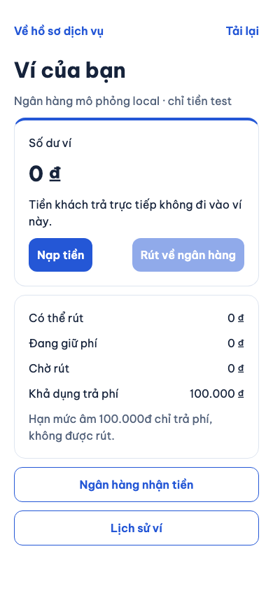

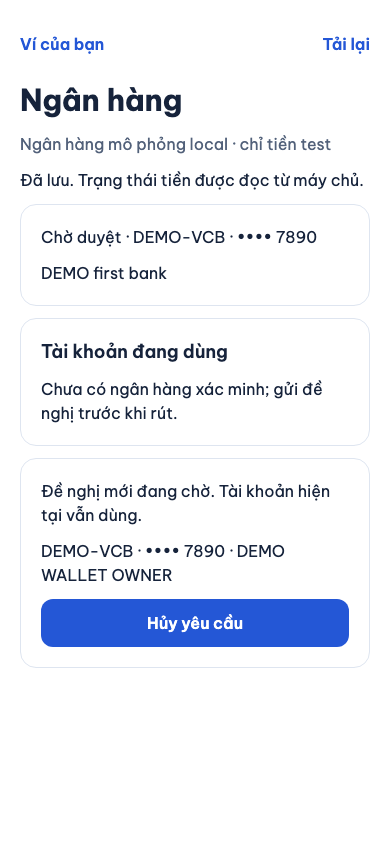

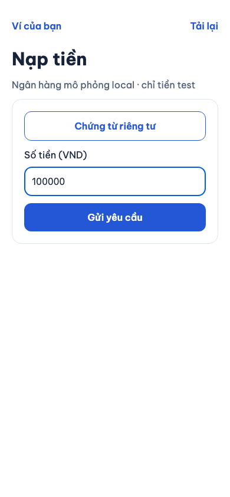

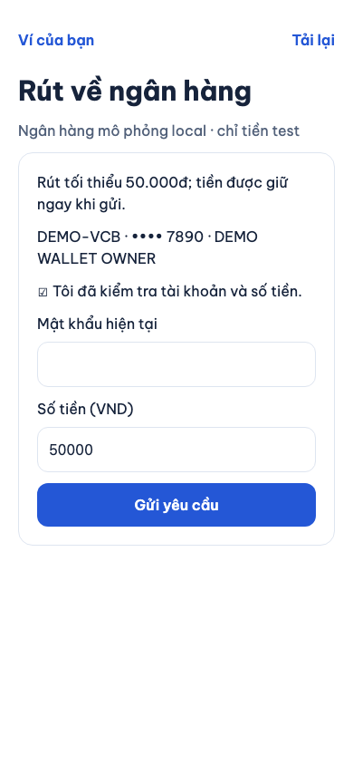

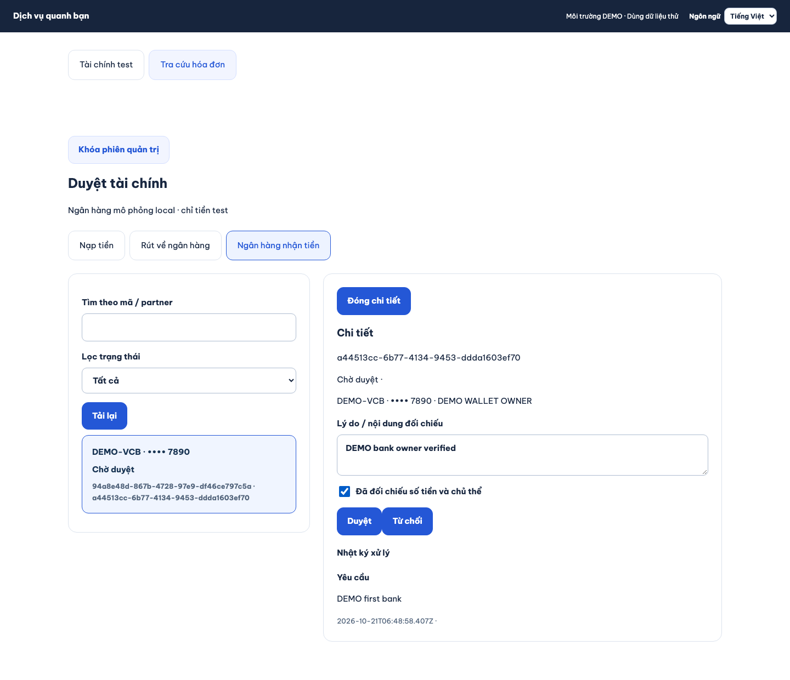

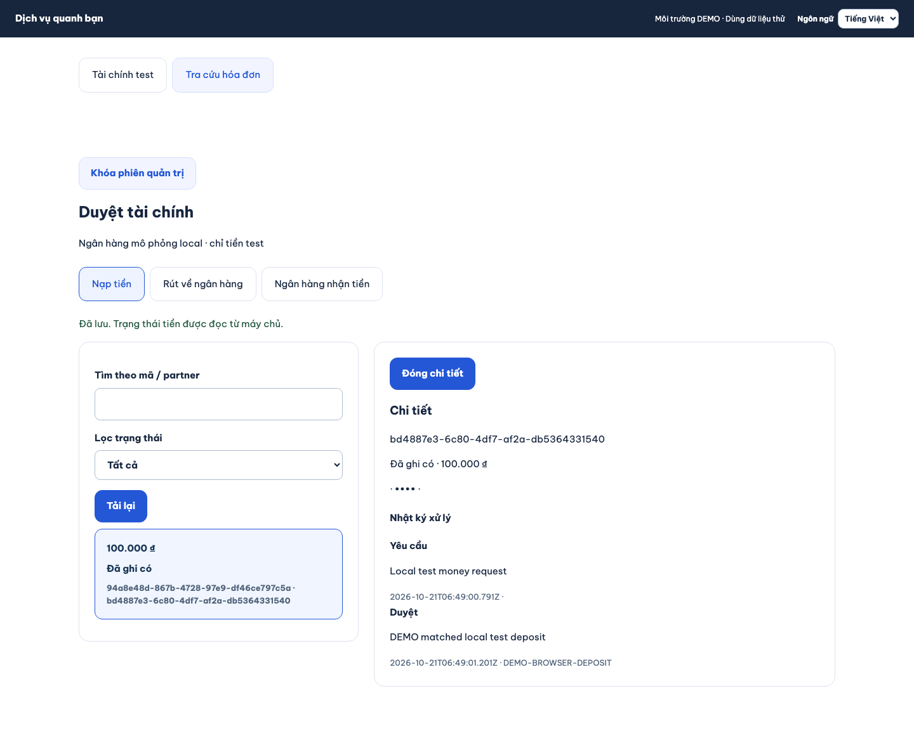

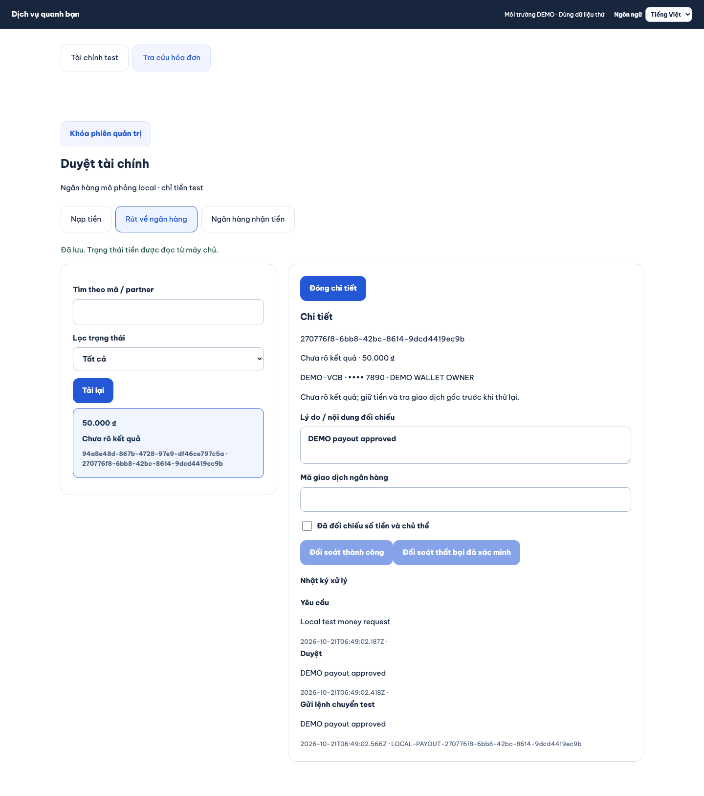

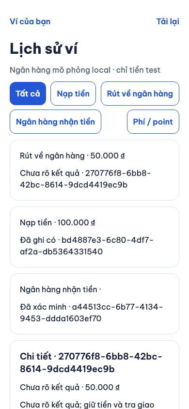

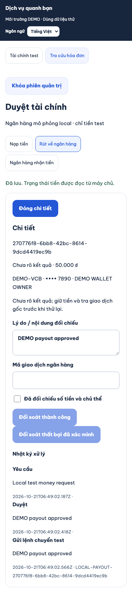

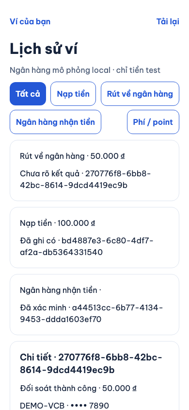

## Hiểu một lệnh rút 50.000đ

Ví có 100.000đ. Người dùng tạo lệnh rút 50.000đ: số dư vẫn 100.000đ, nhưng 50.000đ được **giữ** để không chi thêm. Admin duyệt chỉ đổi trạng thái sang chờ gửi. Sau khi gửi, nếu ngân hàng mô phỏng đã chuyển nhưng mất phản hồi, app hiện **Chưa rõ kết quả** và vẫn giữ tiền. Admin tra đúng giao dịch ban đầu rồi đối soát. Thành công mới trừ số dư và kết thúc khoản giữ, đúng một lần.

`Ledger` là sổ bút toán: mỗi lần ghi tiền vào ví có một bút toán đối ứng ngược dấu ở tài khoản hệ thống. Tổng hai phía bằng không. `Idempotency-Key` là mã nhận diện một lần thao tác: thử lại cùng mã và nội dung nhận lại kết quả đã lưu, không tạo thêm giao dịch.

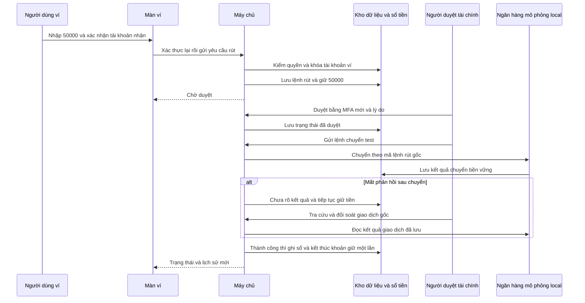

Nhánh thất bại chỉ giải phóng tiền giữ khi có kết quả thất bại đã xác minh từ giao dịch gốc, hoặc admin từ chối trước lúc gửi. Không cho gửi lệnh mới từ trạng thái chưa rõ kết quả. Hạn mức âm 100.000đ phục vụ phí hóa đơn và không thể rút. Số tiền rút tối thiểu là 50.000đ.

## Mở code theo thứ tự nào?

| Bước | File và hàm thật | Nhận gì, xử lý gì và chuyển cho ai? |
|---|---|---|
| 1 | [FinanceScreen.tsx — `FinanceContent`, `send`, `execute`](../../../apps/mobile/src/features/finance/screens/FinanceScreen.tsx) | Đọc số dư/quyền từ server, giữ form và mã retry. `send` lấy số tiền/ngân hàng hiện tại. `execute` giữ nguyên thao tác khi mất mạng, chỉ báo đã lưu sau phản hồi máy chủ. |
| 2 | [finance-api.ts — `FinanceApi.request`, `reauth`](../../../apps/mobile/src/features/finance/api/finance-api.ts) | Gửi yêu cầu HTTP qua `AuthSession.featureOperation`, dùng cơ chế refresh và loại phản hồi của tài khoản cũ. Không giữ access token trong màn hình. |
| 3 | [finance.controller.ts — `payout`, `bank`, `payoutDecision`](../../../services/api/src/modules/finance/finance.controller.ts) và [finance.input.ts](../../../services/api/src/modules/finance/finance.input.ts) | Nhận JSON, chỉ cho phép các trường đã khai báo, kiểm số tiền nguyên/ID/version và chuyển sang service. |
| 4 | [finance.service.ts — `create`, `consume`, `access`, `account`](../../../services/api/src/modules/finance/finance.service.ts) | Kiểm lại thành viên/quyền hiện hành, khóa partner và tài khoản ví, dùng quyền xác thực lại một lần, chụp ngân hàng, so tiền khả dụng và tạo khoản giữ cùng giao dịch DB. |
| 5 | [FinancePanel.tsx — `FinancePanel`, `decide`](../../../apps/admin/src/FinancePanel.tsx) và [AdminFinance.tsx — `AdminFinance`, `decide`](../../../apps/mobile/src/features/finance/screens/AdminFinance.tsx) | Admin xem hàng đợi/chi tiết, nhập lý do và xác nhận đối chiếu. Client giữ nguyên payload/key khi mất phản hồi, gọi lại luồng MFA chung khi hết quyền hoặc MFA cũ. |
| 6 | [finance.service.ts — `decision`, `deposit`, `post`, `endHold`](../../../services/api/src/modules/finance/finance.service.ts) | Admin cần `finance.review` và MFA trong năm phút. Đối chiếu nguồn nạp đã lưu, hoặc tạo/tra lệnh chuyển local gốc. `post` ghi hai phía sổ tiền. `endHold` chỉ kết thúc khoản giữ đang active. |
| 7 | [020_p2_finance.sql](../../../services/api/migrations/020_p2_finance.sql) và [008_invoices_ledger.sql](../../../services/api/migrations/008_invoices_ledger.sql) | Ràng buộc một ngân hàng hiện hành, một đề nghị pending, tham chiếu nạp unique và một lệnh chuyển mỗi payout. Trigger cũ bảo vệ lịch sử/sổ cân bằng và cập nhật số dư. |
| 8 | [invoices.service.ts — `ledger`](../../../services/api/src/modules/invoices/invoices.service.ts) | Đọc cả bút toán hóa đơn và nạp/rút, vẫn theo đúng quyền partner. Màn lịch sử phân biệt yêu cầu đang xử lý với bút toán đã ghi. |

## Dữ liệu và quyền

- `bank_change_requests` lưu đề nghị, lý do và phiên bản. `verified_bank_accounts` giữ ngân hàng đã xác minh theo lịch sử; chỉ một dòng `current=true` mỗi partner. Response không trả bản mã hoặc số đầy đủ.
- `finance_topups` lưu yêu cầu nạp. `local_bank_deposits` là giao dịch nguồn của bộ mô phỏng. Một mã giao dịch nguồn chỉ ghi có cho một yêu cầu, kể cả hai admin xử lý đồng thời với khóa retry khác nhau.
- `finance_payouts` lưu tiền, ngân hàng chụp lúc tạo và trạng thái. `holds` giữ tiền cùng tài khoản mà hóa đơn dùng giữ phí. Tạo lệnh rút cạnh tranh với xác nhận hóa đơn được tuần tự hóa dưới cùng khóa.
- `local_bank_transfers` lưu bền một lần chuyển, kết quả thật trong bộ mô phỏng và việc mất phản hồi. Khởi động lại API không cần đoán hay gửi lại tiền. Chứng cứ của bài mất phản hồi là dòng giao dịch đã thành công nhưng payout còn `unknown` và khoản giữ còn active.
- `finance_history` và `audit_events` lưu người làm, hành động, lý do và phiên bản, không ghi số ngân hàng đầy đủ, token hoặc mật khẩu. Chứng từ tải lên là asset riêng tư. Chỉ uploader hoặc admin có quyền và liên hệ tài chính tương ứng mới xem được; admin tài chính cần MFA mới khi đọc ảnh.
- Xem cần `wallet.read`; nạp thêm `wallet.topup`; rút thêm `wallet.withdraw`; sửa/hủy ngân hàng thêm `bank.manage`. Admin đọc cần `finance.read`, quyết định cần `finance.review`. Mọi quyền được kiểm lại cả khi trả lại kết quả retry cũ.

## Nếu có lỗi thì sao?

Mất mạng hoặc máy chủ đã commit nhưng phản hồi JSON hỏng/sai schema: form khóa, nút **Thử lại đúng thao tác** giữ nguyên số tiền, version và mã thao tác. Không tự gửi giao dịch thứ hai. Có xung đột version: tải lại dữ liệu hiện hành và xem lại trước quyết định. Quyền bị thu hồi: server từ chối cả retry cũ, app xóa dữ liệu riêng và quay lại bước xác thực phù hợp.

Mật khẩu cho ngân hàng/rút đổi thành grant dùng một lần, gắn user/family/loại thao tác và hết hạn sau năm phút. Dùng grant của sửa ngân hàng cho rút tiền, dùng lại grant, grant của phiên khác hoặc grant hết hạn đều không hợp lệ. Sai mật khẩu được tính vào giới hạn thử trong DB.

Nếu lỗi xảy ra giữa các bút toán, giao dịch DB rollback cả trạng thái, entries, history và kết quả retry. Bài kiểm cố tình làm hỏng trigger ghi sổ đã xác nhận điều này, rồi chạy lại cùng yêu cầu sau khi bỏ lỗi test.

## Sửa các phát hiện từ review cuối

Lượt Android native của đợt chung đã phát hiện lỗi `Cannot convert BigInt to number` khi mở ví. Màn ví và admin tài chính nay dùng `formatInteger` có sẵn: giữ toàn bộ chữ số tiền dưới dạng chuỗi, dùng `Intl` chỉ để biết dấu phân cách theo ngôn ngữ. Không chuyển khoản tiền lớn sang `Number`, không gọi `Intl.format` với `BigInt`. Bài test giả lập đúng giới hạn Hermes đã kiểm cả ví và admin với số `900719925474099312345`. Đây là bằng chứng regression trên code; lượt native chạy lại được đầu mối tích hợp ghi riêng.

Review cũng phát hiện admin có thể nhập tham chiếu giao dịch khi từ chối yêu cầu và vô tình giữ độc quyền mã của giao dịch hợp lệ khác. Máy chủ nay chỉ lưu tham chiếu nạp sau khi đối chiếu đúng nguồn ngân hàng local; lệnh rút chỉ nhận mã do lần chuyển thật trong bộ mô phỏng tạo ra hoặc kết quả tra lần chuyển gốc. [Migration 023](../../../services/api/migrations/023_p2_finance_reference_repair.sql) giải phóng các mã chưa có chứng cứ mà bản local trước đã lưu, giữ nguyên bút toán đã xác nhận, lệnh chuyển bền vững và nhật ký quyết định.

Khi phản hồi HTTP thành công không đọc được, cả màn ví, admin app và admin web giữ lại cùng payload/key/grant. Không mở khóa form để tạo một ý định tài chính thứ hai. Quyền thành viên của ví được tìm qua các trang danh sách tới đúng partner, nên thành viên ở trang thứ hai vẫn thấy những nút đã được cấp quyền.

## Tự thử và tự kiểm hiểu

1. Vào Ví, thêm ngân hàng lần đầu và chờ admin xác minh. Trong lúc chờ, không thể rút; nếu đổi ngân hàng lần sau, ngân hàng cũ vẫn dùng.
2. Gửi nạp 100.000đ. Kiểm số dư vẫn chưa đổi. Admin ghi nhận giao dịch nạp trong bộ mô phỏng bằng mã nguồn rồi duyệt đúng mã/số tiền/partner; số dư tăng một lần.
3. Rút 50.000đ. Admin duyệt rồi chọn **Đã chuyển nhưng mất phản hồi** khi gửi test. Ví giữ tiền và hiện chưa rõ kết quả. Đối soát thành công giao dịch gốc: số dư giảm 50.000đ, tiền giữ về không.
4. Thử dùng lại mã nạp cho yêu cầu khác hoặc đổi ngân hàng trong lúc payout chưa xong: server từ chối và số dư giữ nguyên.

Câu hỏi: Vì sao duyệt rút chưa giảm số dư? Vì đó mới là quyết định cho gửi, chưa có kết quả chuyển. Vì sao nạp có ảnh vẫn chưa ghi có? Vì ảnh không chứng minh giao dịch nguồn chưa được dùng. Vì sao không giải phóng khoản giữ khi timeout? Vì ngân hàng có thể đã chuyển, cần tra giao dịch gốc để tránh chi hai lần.

## Kiểm chứng và giới hạn

Lát này có kiểm tích hợp DB/HTTP thật trên `dvqb_test` và kiểm component/client. Chứng cứ browser/native, SDD/CI/UAT của toàn đợt được ghi rõ mức kiểm; không lấy code hoặc simulator local làm bằng chứng ngân hàng ngoài.

Lệnh và bằng chứng kỹ thuật

| Phần | Lệnh đã chạy ngày 21/10/2026 | Kết quả và giới hạn |
|---|---|---|
| Finance + hồi quy hóa đơn/assets | `cd services/api && node --import tsx --test --test-concurrency=1 test/integration/finance.test.ts test/integration/invoices.test.ts test/integration/assets.test.ts` | 14/14 đạt: ngân hàng, tham chiếu nạp, timeout/đối soát, release hold, fee race, rollback, thu hồi quyền, MFA và receipt riêng tư. |
| Mobile client/màn ví/admin | `npm test --workspace @dvqb/mobile -- --runTestsByPath src/features/finance/api/finance-api.test.ts src/features/finance/screens/FinanceScreen.test.tsx src/features/finance/screens/AdminFinance.test.tsx` | 7/7 đạt ở ba suite: validation, owner-aware wrapper, retry giữ nguyên key/payload, quyền chỉ đọc, admin đối soát unknown và lỗi MFA. |
| API/admin typecheck và lint miền tài chính | `npm run typecheck --workspace @dvqb/api`, `npm run typecheck --workspace @dvqb/admin`, ESLint các file finance | Đạt ở lượt kiểm riêng của miền; typecheck toàn workspace mobile cũng đạt sau chỉnh cuối. Native/SDD toàn đợt do đầu mối tích hợp kiểm lại sau các thay đổi song song. |
| Browser finance journey | `npx playwright test --config tests/e2e/web/playwright.config.mjs finance.spec.mjs` | 1/1 đạt (54,4 giây): ngân hàng → nạp 100.000đ → mất phản hồi/retry cùng mã → rút 50.000đ → ngân hàng chuyển nhưng mất phản hồi → unknown giữ tiền → đối soát gốc. Cuối bài: số dư 50.000đ, giữ 0đ, đúng một transfer, sổ cân bằng. Lượt đầu đã phát hiện và sửa xung đột đọc phiên BUSY. Phần đọc lịch sử quyết định ngân hàng bổ sung sau lượt E2E được kiểm API/component riêng và được đầu mối tích hợp kiểm lại toàn đợt. |
| Hồi quy bổ sung cuối review | `--test-name-pattern="bank proposal|pending bank approval|membership revocation"` | 3/3 đạt: đọc đề nghị/404 người khác, ngân hàng pending bị payout mới chặn, hủy giải phóng hold, snapshot cũ giữ nguyên, grant sai scope/dùng lại, số nguyên lớn và chứng từ gắn cả report/finance. |
| Hồi quy review tài chính cuối | `cd services/api && node --import tsx --test --test-concurrency=1 test/integration/finance.test.ts` | 9/9 đạt: bao gồm chặn chiếm mã giao dịch chưa xác minh và kiểm migration sửa dữ liệu local cũ, bảo toàn chứng cứ đã xác nhận. |
| Hermes, JSON sau commit và trang quyền thứ hai | Mobile finance API/screens + `format-amount.test.ts` | 17/17 đạt ở bốn suite: giữ từng chữ số, Hermes không nhận BigInt trong Intl, JSON hỏng/sai schema sau commit vẫn retry cùng body/key/grant, tìm quyền qua cursor. Full mobile/admin typecheck đạt. |
| E2E phản hồi hỏng/sai schema sau commit | `npx playwright test --config tests/e2e/web/playwright.config.mjs finance.spec.mjs --output=test-results/finance-review/artifacts` | 1/1 đạt (47,8 giây) sau review: request ngân hàng trên app và duyệt nạp admin đều commit DB thật rồi nhận JSON hỏng, JSON sai schema, sau đó replay đúng cùng ba payload/key. Grant ngân hàng giữ nguyên. Cuối luồng còn đúng một transfer, số dư 50.000đ, hold 0 và ledger cân bằng. |
| Native, remote CI, UAT | Xem báo cáo tổng đợt P2 | Không suy ra từ các test trên. |

Test nguồn: [finance.test.ts](../../../services/api/test/integration/finance.test.ts), [finance-api.test.ts](../../../apps/mobile/src/features/finance/api/finance-api.test.ts), [FinanceScreen.test.tsx](../../../apps/mobile/src/features/finance/screens/FinanceScreen.test.tsx), [finance.spec.mjs](../../../tests/e2e/web/finance.spec.mjs).

Cấu hình `FINANCE_LOCAL_SECRET` chỉ bật adapter local/test theo guard môi trường của `environment.ts`. Không cấu hình thì các route tài chính mới trả 503. Không gọi dịch vụ ngân hàng bên ngoài, không thu phí và không mở billing. Thư viện mới: không thêm riêng cho finance.

## Phần giữ nguyên phạm vi

Không có bút toán ngoại lệ Q02, tiền thật, ngân hàng production, chuyển chủ/đóng doanh nghiệp hoặc PROMO-02. Excel, Drive và `ui-ux` không được tự đồng bộ trong đợt code này. Đầu mối tích hợp cập nhật checklist/mục lục/SDD và báo cáo native riêng, chỉ đánh dấu những mức đã kiểm.

## Ảnh native đã kiểm ngày 21/10/2026

Android 16/API36 emulator và iOS27 simulator đã chạy luồng đăng nhập → bảo mật → ví → biểu mẫu ngân hàng qua API/schema test riêng. Đây là kiểm điều hướng/hiển thị và tải SDK native, chưa phải toàn bộ thao tác tài chính hoặc cuộc gọi native. Ảnh chỉ dữ liệu DEMO và biểu mẫu trống; không có mật khẩu/token.

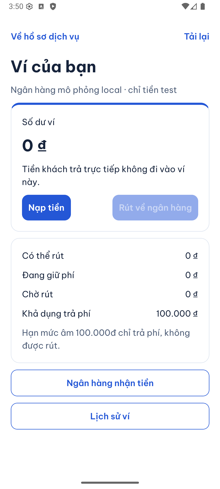

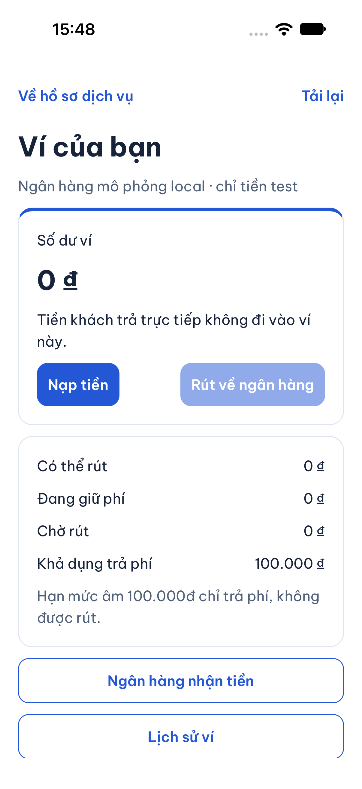

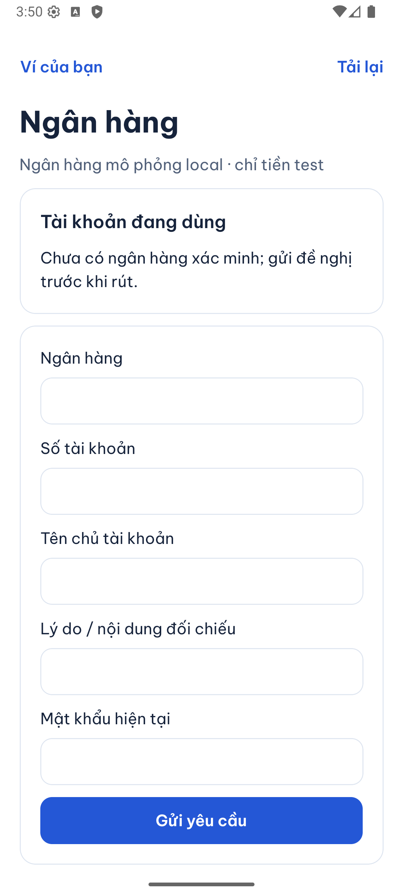

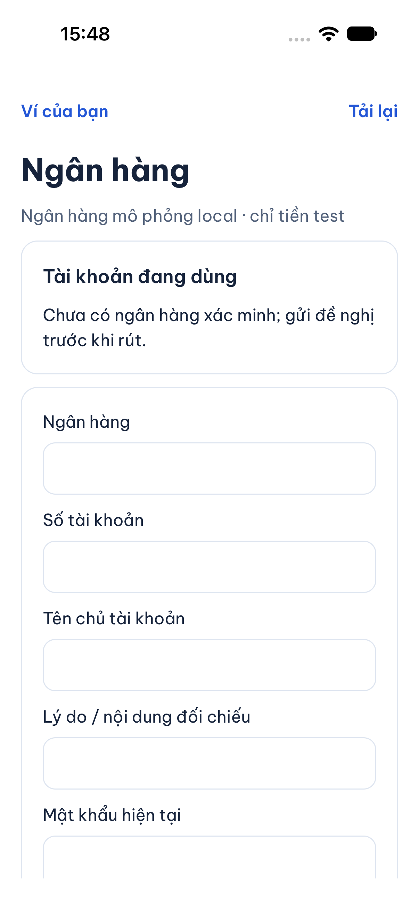
