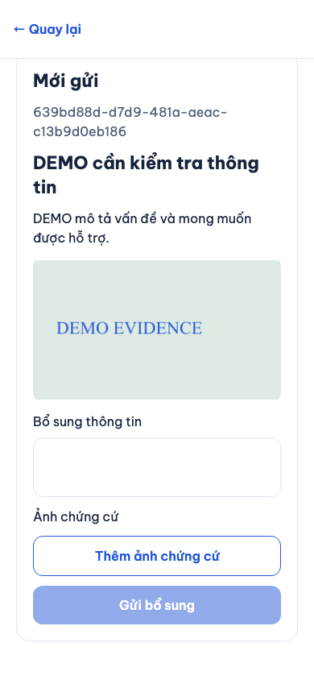
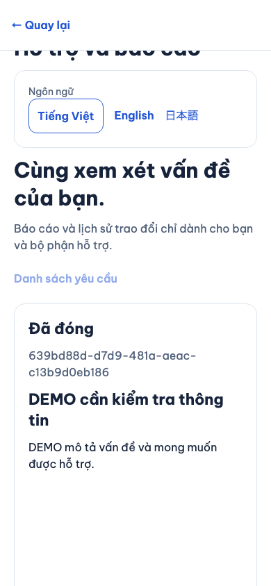
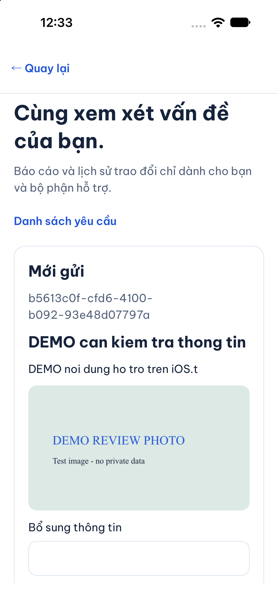
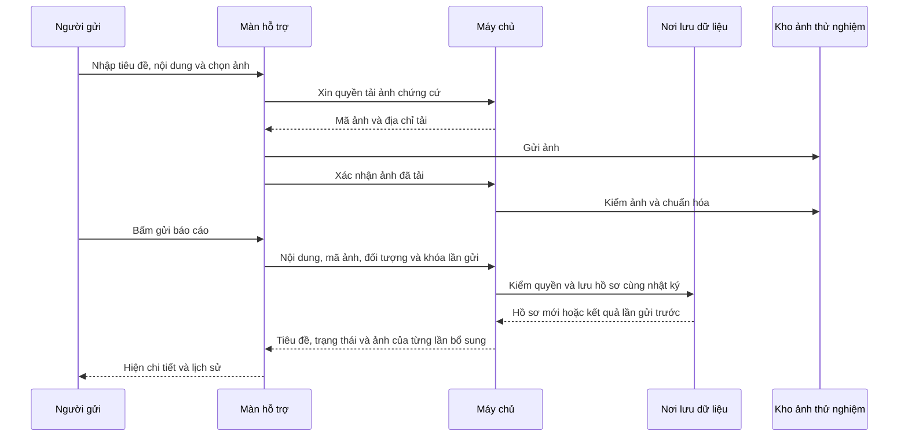

# B09-01 — Gửi và theo dõi báo cáo hỗ trợ

Ngày kiểm: 16/10/2026 · P1-2 · Code local/test, chưa UAT hoặc production. [Mục lục](../README.md) · [Checklist](../01-checklist.md).

## 1. Bạn đã dùng được những gì?

Trong **Tài khoản → Hỗ trợ và báo cáo**, bạn có thể nhập tiêu đề, nội dung, chọn ảnh rồi gửi. App hiện mã hồ sơ, trạng thái và lịch sử bổ sung. Bạn cũng mở form từ công việc, hóa đơn hoặc một đánh giá; app giữ đúng đối tượng cần báo cáo. Với hóa đơn, báo cáo gắn đúng phiên bản đang xem.

Người gửi xem được các báo cáo của mình, lọc theo trạng thái và bổ sung nội dung/ảnh. Nếu hồ sơ đang chờ chứng cứ, gửi bổ sung đưa hồ sơ về đang xem xét. Hồ sơ đã đóng chỉ còn lịch sử. Gửi báo cáo không dừng việc, sửa hóa đơn, trả tiền hoặc hoàn tiền.

Chủ dự án đã chốt ngày 16/10: **“Đồng ý bổ sung tiêu đề và ảnh local; admin để đợt riêng”**. Vì vậy đợt này mở rộng contract API v0.1.16 để đọc được tiêu đề và ảnh chứng cứ. Local nghĩa là ảnh nằm trong thư mục của máy chủ thử nghiệm, chưa phải dịch vụ lưu trữ production. Không đồng bộ Drive/Excel/ui-ux trong đợt code này.

**Phần chưa có:** người quản trị tiếp nhận, đổi trạng thái, xem chứng cứ và quyết định xử lý qua màn admin. Chưa có MFA — bước xác minh bổ sung cho người quản trị. Các trạng thái đóng/chờ bổ sung trong bài kiểm được tạo bằng dữ liệu test, không phải bằng một màn admin đã hoàn tất.

### Ảnh app chạy thật bằng dữ liệu DEMO

Web Chromium, 16/10/2026; app gọi API và PostGIS thật trong môi trường test. Đây là bằng chứng trình duyệt, không phải điện thoại thật.

iOS 27, iPhone 18 Pro **simulator**, 16/10/2026: đăng nhập DEMO, nhập tiêu đề/nội dung, mở picker hệ thống, tải ảnh local và gửi thành công. Ảnh dưới đây là chi tiết sau khi API đã lưu; không phải thiết bị thật.

## 2. Theo một lần gửi báo cáo từ đầu đến cuối

Giả sử bạn đang xem một hóa đơn và bấm nhờ hỗ trợ. App mang theo mã công việc, mã hóa đơn và mã phiên bản. **API** là cổng để app chuyển các mã này cùng nội dung đến máy chủ; quyền vẫn do máy chủ kiểm, không tin chỉ vì app đang hiện nút.

1. Bạn nhập tiêu đề/nội dung. Nếu chọn ảnh, app xin một địa chỉ tải ảnh, gửi file, rồi yêu cầu máy chủ kiểm ảnh và đánh dấu sẵn sàng. File sai loại/kích thước không được dùng làm chứng cứ.
2. Khi bấm gửi, app tạo một khóa cho lần gửi. **Idempotency key** là mã giúp máy chủ nhận ra bạn đang thử lại cùng một thao tác nếu mất mạng.
3. Máy chủ kiểm phiên đăng nhập, quyền với tài nguyên gốc và phiên bản hóa đơn. Ảnh phải thuộc người gửi, đúng mục đích chứng cứ và đã tải hoàn tất.
4. Máy chủ lưu hồ sơ, liên kết ảnh và nhật ký hành động trong cùng một giao dịch. **Giao dịch** nghĩa là các phần này cùng thành công hoặc cùng hủy nếu gặp lỗi.
5. Máy chủ trả hồ sơ vừa lưu. App bỏ bản nhập, mở chi tiết và lấy địa chỉ xem ảnh có thời hạn. Người khác không thể dùng mã hồ sơ/ảnh đó để đọc.

Sơ đồ là nhánh thành công. Khi mất mạng sau lúc máy chủ đã lưu, nút thử lại gửi đúng nội dung/khóa cũ, tránh tạo hai hồ sơ. Khi bị từ chối quyền, app xóa dữ liệu riêng trên màn. Lỗi xem ảnh có nút thử lại để lấy địa chỉ mới; không nhúng địa chỉ ảnh vĩnh viễn vào hồ sơ.

## 3. Mở code theo thứ tự nào?

Các đường dẫn dưới đây đi từ thư mục báo cáo tới code thật.

| Bước | File và hàm | Nhận gì, làm gì và trả gì? |
|---|---|---|
| 1 | [SupportScreen.tsx](../../../apps/mobile/src/features/support/screens/SupportScreen.tsx), `SupportScreen`, `Desk`, `pick`, `send`, `finish` | Nhận người đăng nhập và đối tượng từ màn trước; giữ bản nhập, chọn ảnh, gọi gửi/bổ sung; chỉ xóa nháp sau thành công. |
| 2 | [auth-session.ts](../../../apps/mobile/src/features/auth/state/auth-session.ts), `createReport`, `replyReport`, `uploadEvidence`, `evidenceAsset` | Gắn đúng phiên của tài khoản hiện hành. Đọc ảnh không chiếm khóa gửi form; kết quả từ tài khoản cũ không được trả cho tài khoản mới. |
| 3 | [support-api.ts](../../../apps/mobile/src/features/support/api/support-api.ts), `createSupportApi`, `upload`, `isReport` | Chuyển dữ liệu thành HTTP; kiểm cấu trúc trả về. Từ chối cả response có ghi chú nội bộ admin để không vô tình hiện ra app. |
| 4 | [support.controller.ts](../../../services/api/src/modules/support/support.controller.ts), `SupportController`; [support.input.ts](../../../services/api/src/modules/support/support.input.ts), `reportInput`, `reportReply` | Nhận request, kiểm trường được phép, UUID, tiêu đề/nội dung không trống và quan hệ loại báo cáo với tài nguyên. |
| 5 | [support.service.ts](../../../services/api/src/modules/support/support.service.ts), `resources`, `create`, `evidence`, `reply`, `own`, `dto`, `list` | Kiểm quyền hiện tại, lưu báo cáo/ảnh, chống gửi trùng, lấy đúng lịch sử dành cho người gửi và phân trang theo tài khoản. |
| 6 | [014_support_reports.sql](../../../services/api/migrations/014_support_reports.sql) | Tạo bảng hồ sơ, lần bổ sung và liên kết chứng cứ; khóa ngoại giữ đúng hóa đơn/phiên bản. Đây là bước chuẩn bị DB, không chạy lại mỗi lần bấm gửi. |
| 7 | [assets.service.ts](../../../services/api/src/modules/assets/assets.service.ts); [EvidencePhoto.tsx](../../../apps/mobile/src/features/support/screens/EvidencePhoto.tsx), `EvidencePhoto` | Backend chỉ cấp ảnh chứng cứ cho người tải; app lấy URL có thời hạn, hiện ảnh và xử lý tải lại. |

Điểm vào nằm ở [AccountScreen](../../../apps/mobile/src/features/auth/screens/AccountScreen.tsx), [JobDetailScreen](../../../apps/mobile/src/features/jobs/screens/JobDetailScreen.tsx), [InvoiceScreen](../../../apps/mobile/src/features/invoices/screens/InvoiceScreen.tsx) và [ReviewsScreen](../../../apps/mobile/src/features/reviews/screens/ReviewsScreen.tsx). [App.tsx](../../../apps/mobile/src/app/App.tsx) và [SupportModule](../../../services/api/src/modules/support/support.module.ts) nối các phần lúc khởi động.

## 4. Dữ liệu, quyền và trạng thái

Tiêu đề/nội dung chưa gửi và ảnh đang chọn chỉ được app nhớ tạm. Hồ sơ đã gửi, lịch sử và liên kết ảnh nằm trong DB nên tải lại vẫn còn. Bản thân file ảnh nằm trong kho local. Đợt này chưa có lưu nháp offline hoặc dọn ảnh tải xong nhưng người dùng bỏ form.

- Chỉ người gửi đọc danh sách, chi tiết và bổ sung hồ sơ của họ. Đối tác cùng công việc không tự được xem. Quyền với việc/hóa đơn/đánh giá được kiểm lúc tạo; rời đội ngũ sau đó không làm mất lịch sử báo cáo do chính mình gửi.
- Báo cáo hóa đơn kiểm cả hóa đơn lẫn phiên bản; khách không gửi báo cáo dựa trên bản nháp chưa được gửi cho mình. Người có quyền đánh giá/phản hồi có thể báo cáo đánh giá tương ứng.
- Ảnh JPEG/PNG/WebP, tối đa 10 MiB mỗi ảnh theo adapter hiện hành. Mã ảnh sai chủ, chưa sẵn sàng hoặc dùng mục đích khác làm cả lần gửi thất bại. Ảnh chứng cứ không xuất hiện ở hồ sơ đối tác công khai.
- `open` là mới gửi, `reviewing` là đang xem xét, `awaiting_evidence` là chờ bổ sung, `resolved` là đã giải quyết, `closed` là đã đóng. Đợt này người dùng không tự đổi trạng thái; chỉ việc bổ sung từ chờ chứng cứ trở lại đang xem xét được triển khai.
- Mỗi lần bổ sung tăng `version`, tức số phiên bản hồ sơ. Hai lần bổ sung đồng thời được xếp thứ tự ở DB, không mất một lần. Ghi chú `admin_only` luôn bị loại khi đọc cho người dùng.
- Lần thử lại đã thành công trước đó có thể trả kết quả cũ kể cả khi hồ sơ sau đó đã đóng. Một lần bổ sung mới sau khi đóng bị từ chối. Màn tải lại trạng thái để người dùng thấy hồ sơ chỉ còn đọc.

## 5. Bạn có thể tự thử và tự kiểm hiểu

1. Mở Tài khoản → Hỗ trợ và báo cáo → tạo hồ sơ. Gõ tiêu đề, nội dung và chọn một ảnh DEMO. Sau gửi phải thấy tiêu đề, trạng thái mới gửi và ảnh.
2. Thêm một đoạn giải thích cùng ảnh khác. Lịch sử phải hiện nội dung/ảnh của đúng lần bổ sung, không thay nội dung gốc.
3. Quay lại danh sách, lọc “Mới gửi”, mở lại hồ sơ. Đăng xuất rồi dùng tài khoản DEMO khác: hồ sơ vừa tạo không xuất hiện.
4. Mở từ một hóa đơn để so với mở từ Tài khoản: hồ sơ gửi từ hóa đơn giữ liên kết và phiên bản cụ thể. Không có bước tự sửa số tiền.

Câu hỏi học code:
- Vì sao chưa xóa bản nhập ngay lúc bấm gửi? Xem `finish`: phải có kết quả thành công trước, nếu không người dùng mất nội dung khi lỗi mạng.
- Nếu đã có mã ảnh thì đủ quyền xem chưa? Xem `AssetsService`: vẫn phải kiểm người tải và phiên đăng nhập ở backend.
- Vì sao thử lại không tạo hồ sơ thứ hai? Xem `AccountTransaction` và `Mutation`: giữ cùng khóa và payload của lần gửi chưa rõ kết quả.

## 6. Kiểm thử và giới hạn

**Cập nhật tiếp ngày 16/10:** lượt SDD local trên commit `e1664cd` đã đạt đầy đủ: 240 mobile, 118 API, 20 web, coverage, build, load, prototype/Storybook và verify (108 tiêu chí). Giữ ghi nhận lượt lỗi danh mục phía dưới như lịch sử kiểm, chưa khẳng định đã tìm được nguyên nhân của lỗi gián đoạn đó.

[CI 38847707687](https://github.com/anhthaingd/dich-vu-quanh-ban/actions/runs/38847707687) trên cùng commit đạt 19 web, lỗi hóa đơn khi bấm gửi lại sau yêu cầu sửa. Trace không có request gửi lần hai. Test mới tái hiện bằng cách giữ lượt đọc nền và bấm gửi trong lúc đó. Bản sửa ở `InvoiceContent`, `afterRead` giữ nội dung/khóa gửi, chờ cả lượt đọc xong rồi gọi API; vẫn kiểm phiên bản cũ đã xem, xử lý conflict và hủy lần gửi chưa bắt đầu nếu rời màn. Background vẫn kiểm phiên bản, không giảm kiểm quyền/tiền và không tăng timeout. `invoice-send` không bị tải nền làm mất click. Test web chủ động giữ request đọc, xác nhận chưa có ghi trước khi nhả đọc, rồi chỉ có một draft đúng số tiền. Kiểm tập trung sau sửa: 11 test InvoiceScreen và 3/3 lượt web hóa đơn đạt; lint, typecheck và SDD prepare đạt.

Kiểm riêng hỗ trợ: 5 test API với PostgreSQL/PostGIS, 5 test mobile/API client và 1 hành trình web đã đạt. Web kiểm chọn ảnh thật, mất response sau khi đã lưu, thử lại không trùng, người ngoài bị chặn, bổ sung chứng cứ và lịch sử đóng. Dữ liệu trạng thái do fixture test tạo; chưa chứng minh thao tác admin.

SDD local sau sửa kỳ vọng migration 14 đã qua lint, typecheck, tooling, 240 test mobile, 118 test API, hai coverage gate và build app/API. Toàn web: **19 đạt, 1 thất bại** ở hành trình danh mục (API 200 nhưng UI hiện lỗi tải); ba lượt kiểm riêng có log fetch/JSON sau đó đều đạt, chưa xác định nguyên nhân gián đoạn. Vì vậy **không đánh dấu SDD local/verify đạt**; bước load/prototype/Storybook trong lượt này chưa chạy. CI phải chạy lại toàn bộ trên commit mới, không bỏ test hoặc tăng timeout.

Trong lúc kiểm hồi quy, CI của B10-03 `38843555641` thất bại ở bước mở form đổi lịch sau chat. HTTP trong trace vẫn trả thành công, nhưng việc đọc nền khóa nút nhập. Test mới ở `Work.test.tsx` tái hiện khóa nháp trước sửa và đạt sau sửa: cho mở/nhập nháp khi đang tải, vẫn khóa xác nhận đến khi xong. Hai lượt liên tiếp hành trình web jobs/chat/đổi lịch đã đạt. Không tăng timeout hoặc bỏ tiêu chí.

Tra cứu lệnh và bằng chứng

| Phần | Bằng chứng / cách chạy lại | Giới hạn |
|---|---|---|
| API | `cd services/api && node --import tsx --test test/integration/support.test.ts` — 5 đạt | DB test riêng từng fixture, không DB thật |
| Mobile | `npm test -w apps/mobile -- --runInBand --runTestsByPath src/features/support/screens/Support.test.tsx src/features/support/api/support-api.test.ts` — 5 đạt | Kiểm component/client bằng Jest |
| Web | `npx playwright test --config tests/e2e/web/playwright.config.mjs support.spec.mjs` — 1 đạt | Chromium nối API/DB test |
| Hồi quy form | `Work.test.tsx` — 20 đạt; `jobs-chat.spec.mjs --repeat-each=2` — 2 đạt | Bao gồm test mới thất bại trước sửa |
| Native | iOS simulator: tạo tiêu đề/nội dung, picker/upload và đọc ảnh đã lưu đạt. Android mở app được, chưa kiểm xong hỗ trợ do Maestro AndroidDriverTimeoutException | Không tính Android đạt hoặc thiết bị thật/UAT |
| SDD local | 240 mobile, 118 API, coverage/build đạt; web 19 đạt/1 lỗi danh mục, kiểm riêng 3/3 đạt | Verify local chưa đạt; xem đoạn kết quả phía trên |
| SDD-PROJECT | 108 tiêu chí, QA 69 `partial`, 28 `unmapped`; giữ toàn bộ tiêu chí cũ | Danh mục đầy đủ không chứng nhận toàn bộ nghiệp vụ |

Nguồn đã đối chiếu: [prototype support](../../../ui-ux/prototype/src/support/SupportDesk.jsx), [UI-19](../../../ui-ux/specs/support-moderation.md), [OpenAPI](../../technical-design/openapi.json), QA-047. Các test nằm tại [support.test.ts](../../../services/api/test/integration/support.test.ts), [Support.test.tsx](../../../apps/mobile/src/features/support/screens/Support.test.tsx), [support-api.test.ts](../../../apps/mobile/src/features/support/api/support-api.test.ts) và [support.spec.mjs](../../../tests/e2e/web/support.spec.mjs).

Không thêm thư viện/framework. Giữ kiến trúc module hiện hành; UI không gọi DB. Inventory đăng ký ba tiêu chí SUP-01, bốn route support và file mới, bỏ hai placeholder đã có code thay. Hash OpenAPI chỉ cập nhật sau review diff v0.1.16 đã duyệt; baseline và tiêu chí cũ giữ nguyên. QA-047 vẫn partial vì admin/MFA và chọn tin nhắn làm chứng cứ chưa có.

## 7. Phần chưa làm và bước sau

Admin queue/MFA, quyết định xử lý và chọn đoạn chat làm chứng cứ cần đợt riêng. Chưa chứng nhận thiết bị thật, UAT, production, kho ảnh cloud, provider hoặc chi phí. Chưa đóng toàn B09/P1-2. Code phía người gửi không mở quyền quản trị hoặc thay đổi luồng tiền hiện hành.
