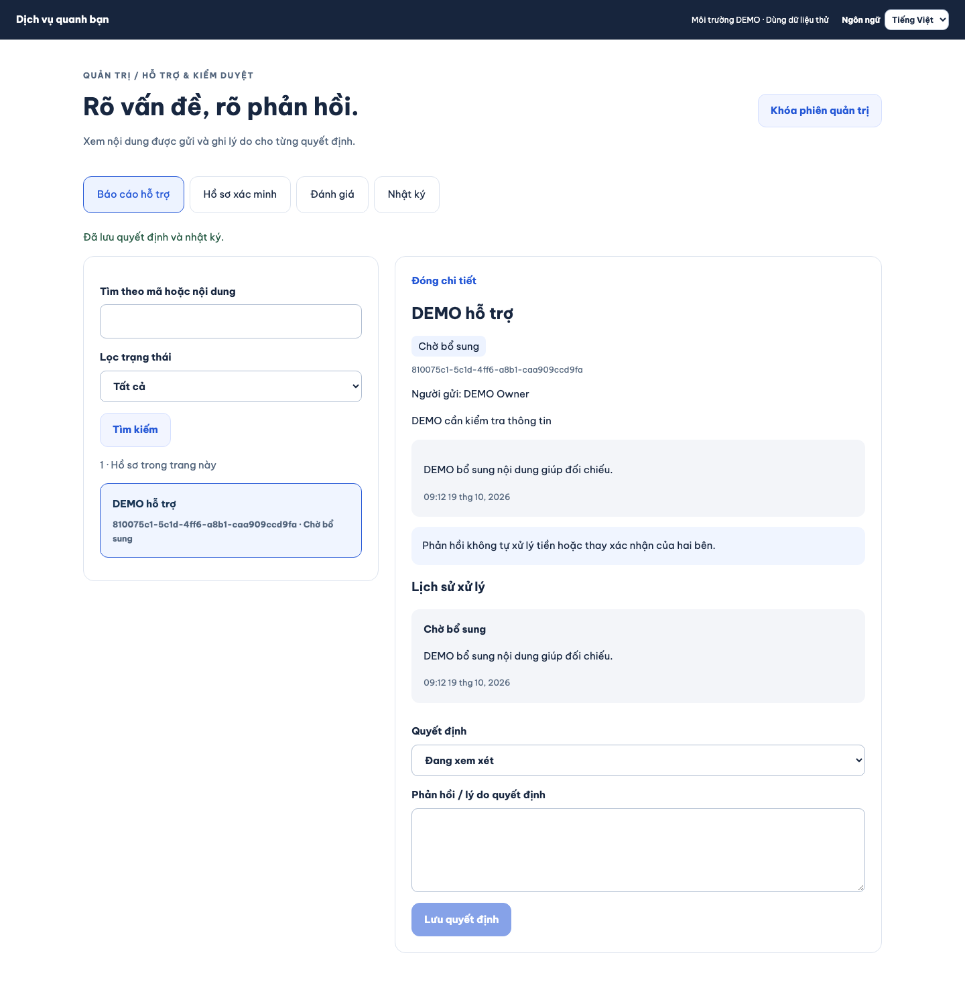
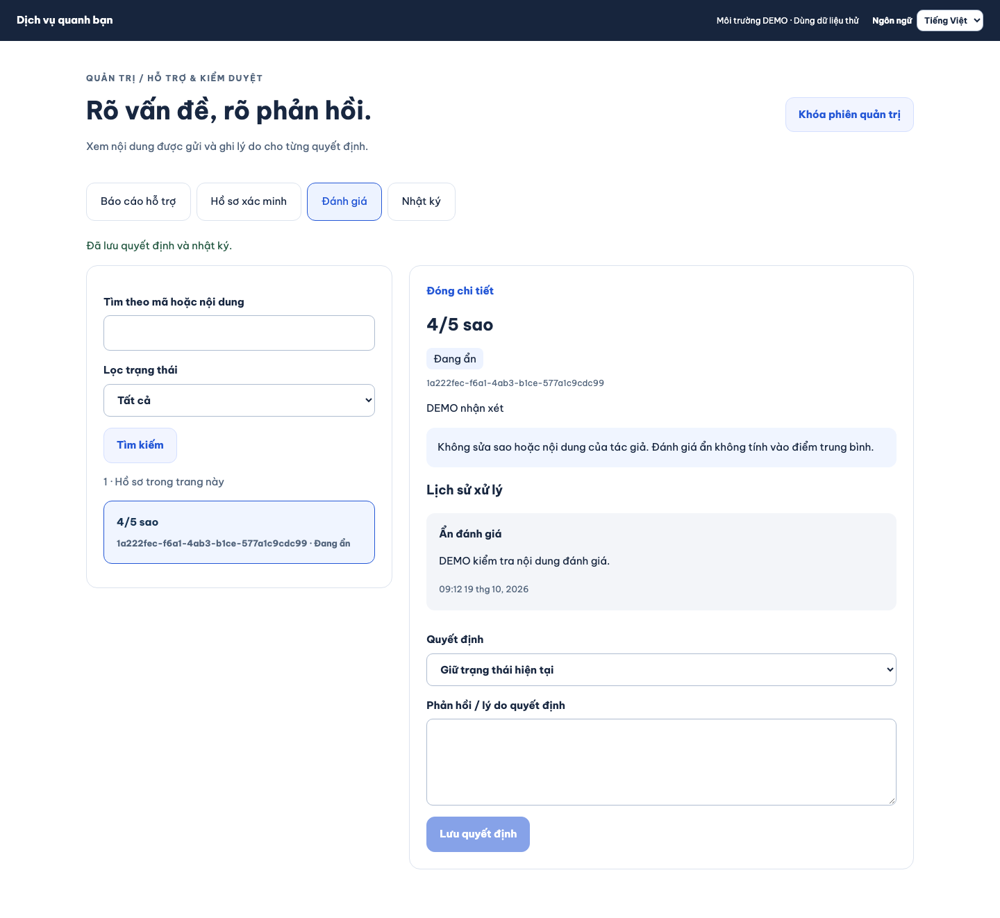
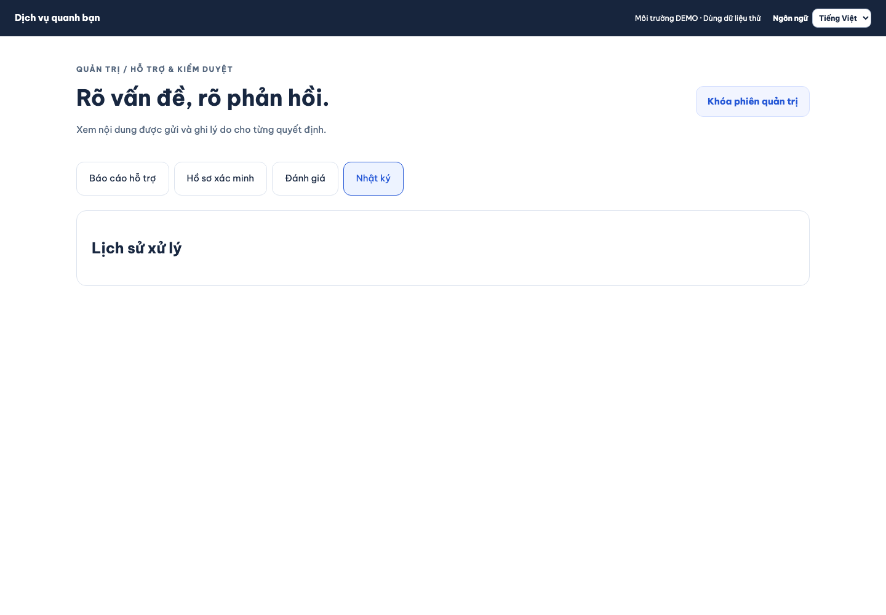
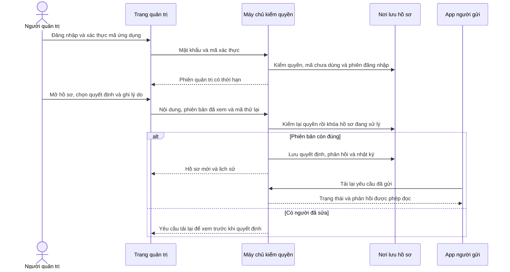

# B09-02 — Admin hỗ trợ và kiểm duyệt

19/10/2026 · P1-03, thuộc P1-2 · Code đang sửa trên nền `7545890`, chưa commit/push. [Quyết định đã duyệt](../de-xuat/P1-03-admin-ho-tro-va-kiem-duyet.md) · [Checklist](../01-checklist.md).

**Bổ sung 19/10:** khu quản trị riêng trên điện thoại được triển khai trong [B09-03](B09-03-admin-tren-dien-thoai.md). Các bằng chứng desktop của báo cáo này giữ nguyên phạm vi.

## Bạn đã dùng được gì?

Admin DEMO đăng nhập bằng mật khẩu và mã từ ứng dụng xác thực. Sau đó mở **Báo cáo hỗ trợ**, **Hồ sơ xác minh**, **Đánh giá** hoặc **Nhật ký** theo quyền được cấp. Hàng đợi có tìm kiếm, lọc và xem thêm; bấm một hồ sơ để đọc nội dung, ảnh được nộp và lịch sử trước khi ghi lý do xử lý.

Với báo cáo hỗ trợ, phản hồi của admin xuất hiện trong lịch sử của người gửi. Với đánh giá, admin giữ trạng thái, ẩn hoặc khôi phục; số sao và nội dung gốc vẫn giữ nguyên. Xử lý hỗ trợ không thay xác nhận thanh toán hay tự chuyển tiền. Luồng nộp và duyệt xác minh có [báo cáo B02-04](B02-04-nop-va-xet-xac-minh.md).

Ảnh dưới đây là ứng dụng sản phẩm chạy trên Chromium desktop với API/PostgreSQL test, ngày 19/10/2026; không phải Storybook hay production. Chỉ dùng dữ liệu DEMO và chụp sau khi hoàn tất màn mật khẩu/MFA.

## Một quyết định đi qua code thế nào?

“MFA” là bước xác thực bằng mật khẩu và mã 6 số từ ứng dụng. Mã đổi mỗi 30 giây; không gửi SMS. “Phiên bản” là số tăng sau mỗi lần hồ sơ đổi, giúp phát hiện admin khác đã xử lý trước mình. “Mã thử lại” nhận diện cùng một thao tác khi mạng mất phản hồi.

## Mở code theo thứ tự nào?

Các đường dẫn dưới đây tính từ thư mục báo cáo này.

| Bước | File và hàm thật | Nhận gì, làm gì, trả gì? |
|---|---|---|
| 1 | [App.tsx](../../../apps/admin/src/App.tsx), `App`, `Desk`, `Decision` | Nhận thao tác nhập liệu. `Desk` tải hàng đợi/chi tiết; `Decision` giữ phiên bản và nội dung khi cần thử lại. |
| 2 | [client.ts](../../../apps/admin/src/client.ts), `login`, `verify`, `decision` | Gửi HTTP đến API, thêm phiên đăng nhập/MFA và mã thử lại. Kiểm dạng dữ liệu trả về trước khi hiển thị. |
| 3 | [admin-auth.service.ts](../../../services/api/src/modules/admin-auth/admin-auth.service.ts), `enroll`, `verify`, `check` | Kiểm mật khẩu, quyền còn hiệu lực và TOTP. Khóa thiết lập được mã hóa; mã đã dùng bị chặn. `check` chạy lại trên từng lần đọc/ghi. |
| 4 | [moderation.controller.ts](../../../services/api/src/modules/moderation/moderation.controller.ts) và [moderation.input.ts](../../../services/api/src/modules/moderation/moderation.input.ts) | Chọn đúng miền báo cáo/xác minh/đánh giá, từ chối trường lạ, quyết định lạ hoặc thiếu phiên bản/lý do. |
| 5 | [moderation.service.ts](../../../services/api/src/modules/moderation/moderation.service.ts), `list`, `get`, `decide` | Đọc đúng hàng đợi, ghi audit truy cập; khóa hồ sơ và so phiên bản trước khi lưu. Báo cáo đóng không sửa tiếp. |
| 6 | [history.ts](../../../services/api/src/modules/moderation/history.ts), `recordDecision` | Ghi người xử lý, hành động, lý do, phiên bản và thời điểm trong cùng giao dịch DB. |
| 7 | [assets.service.ts](../../../services/api/src/modules/assets/assets.service.ts), `adminContent` | Kiểm quyền hiện tại và ảnh đã gắn vào hồ sơ trước khi trả ảnh; ghi audit đọc chứng cứ. Không cấp quyền đọc chat riêng. |

`main.tsx` chỉ khởi tạo trang lúc mở. `AccountTransaction.run` là nơi gom thay đổi thành một giao dịch: tất cả cùng thành công hoặc cùng hủy. Kết quả thử lại chứa dữ liệu riêng được mã hóa trong DB, thay vì lưu nội dung hồ sơ dưới dạng chữ rõ.

## Dữ liệu và lỗi

- `admin_grants` giữ quyền độc lập với quyền đội ngũ. Đăng ký tài khoản thông thường không cấp admin. `support.read` cho đọc, `support.manage` cho xử lý báo cáo; `moderation.manage` cho xét xác minh/đánh giá; `audit.read` cho nhật ký quyết định.
- `admin_factors` giữ khóa TOTP đã mã hóa và bộ đếm mã cuối. `admin_auth_attempts` giới hạn 10 lần xác thực trong 15 phút. Thiết lập cần xác nhận mã trong 5 phút và đúng phiên đăng nhập ban đầu.
- Phiên quản trị dài 15 phút; ghi quyết định cần xác thực trong 5 phút gần nhất. Token chỉ giữ trong bộ nhớ trang. Khóa phiên/đăng xuất/thu hồi quyền đều được máy chủ kiểm lại; tải lại trang cần đăng nhập lại.
- Mất phản hồi khi lưu: form giữ nguyên nội dung và mã thử lại. Khi hai admin lưu cùng phiên bản, chỉ một người thành công; người còn lại phải tải lại.
- Quyền/MFA không còn hiệu lực: bỏ dữ liệu hàng đợi và chuyển về xác thực. Ảnh được tải bằng quyền hiện hành, không lưu URL admin công khai.
- Nhật ký quyết định không cho sửa/xóa bằng thao tác DB thông thường. Nhật ký truy cập ghi mã tài nguyên, không chép nội dung chứng cứ, mật khẩu, mã TOTP hoặc khóa thiết lập.

## Tự chạy thử

Dùng DB `dvqb_p1_demo` riêng trên loopback, đã migrate/seed. Trong môi trường API, đặt `NODE_ENV=development`, `ADMIN_LOCAL_SECRET` riêng tối thiểu 32 ký tự, `AUTH_SECRET`, `CURSOR_SECRET`, cấu hình ảnh local và `CORS_ORIGIN` có `http://127.0.0.1:5180`. Giữ khóa mã hóa ổn định để đọc dữ liệu DEMO đã tạo. Không dùng DB hoặc giấy tờ thật.

1. Chạy `npm run db:demo-admin -w services/api`. Công cụ chỉ tạo tài khoản mới trên DB DEMO cho phép; thông tin đăng nhập ghi vào `.local/demo-admin.json` quyền file 0600, không in ra log. Không tự cấp quyền cho tài khoản có sẵn. Nếu file đã tồn tại, công cụ dừng để không ghi đè.
2. Chạy API, rồi `VITE_API_URL=http://127.0.0.1:3100/v1 npm run admin`. Mở cổng 5180, đăng nhập tài khoản DEMO và thiết lập khóa trong ứng dụng xác thực.
3. Từ app người dùng gửi báo cáo. Admin mở, ghi lý do “DEMO cần bổ sung” và lưu; người gửi tải lại để thấy phản hồi.
4. Mở cùng hồ sơ trong hai phiên admin. Lưu một bên rồi lưu bên kia với phiên bản cũ: bên thứ hai phải tải lại. Khóa phiên admin và kiểm trang không còn nội dung riêng.

Câu hỏi tự kiểm: Vì sao tắt nút trên giao diện chưa đủ bảo vệ hồ sơ? Xem `check`. Vì sao thử lại không tạo hai quyết định? Xem `AccountTransaction.run`. Vì sao khôi phục đánh giá không hồi sinh bản tác giả đã gỡ? `hidden_at` và `removed_at` là hai trạng thái khác nhau.

## Bằng chứng và giới hạn

Bốn bài tích hợp trong [admin-moderation.test.ts](../../../services/api/test/integration/admin-moderation.test.ts) đã đạt với PostGIS thật, gồm quyền/MFA/replay/rate limit, hai admin cạnh tranh, thử lại, ảnh riêng, mã hóa và bất biến tiền. TOTP đối chiếu vector RFC 6238. API trả về được kiểm bằng OpenAPI. Hai bài client kiểm dạng phản hồi, cùng nội dung/key khi retry, refresh giữ MFA theo family và xóa phiên khi refresh bị từ chối. Workspace admin có `test:coverage` riêng cho client; số này không bao phủ toàn bộ giao diện React. Hành trình Chromium hai vai đã đạt với 1 bài E2E mới. Đã sửa lỗi gọi fetch trong browser, tên truy cập ô chọn và hàng đợi cũ khi tìm lại sau khi tái hiện. SDD toàn dự án được đọc theo evidence cuối trong `test-results/sdd/SDD-PROJECT/`; kết quả kiểm riêng không thay toàn bộ hồi quy.

Báo cáo này ghi code local đang sửa, chưa CI trên commit mới, chưa chủ dự án nghiệm thu, chưa production. Chưa có quản lý toàn bộ tài khoản/grant qua UI, khôi phục TOTP, chọn đoạn chat làm chứng cứ, quản trị tài chính/danh mục hay hoàn tất công việc thay. Không mở Q02, PROMO-02, SMS/provider hoặc tiền thật. Quyết định bổ sung contract đã ghi trong P1-03 và OpenAPI; chưa đồng bộ Drive/Excel/ui-ux theo quy tắc dự án.
