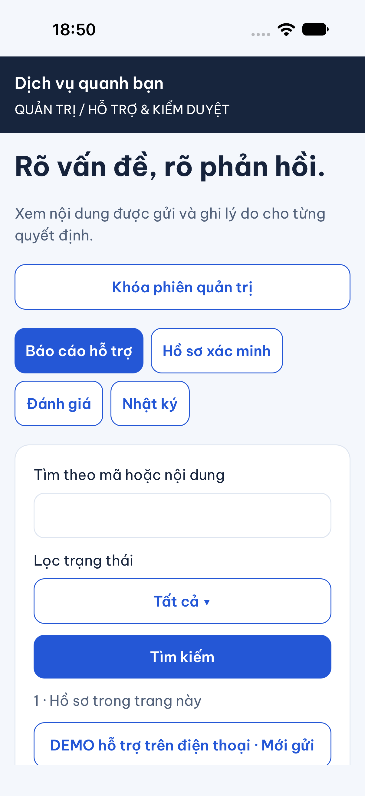
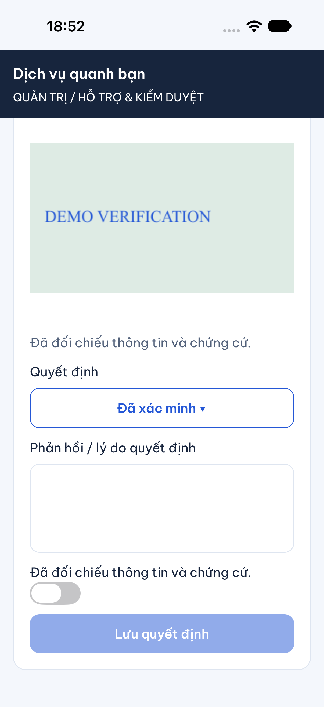
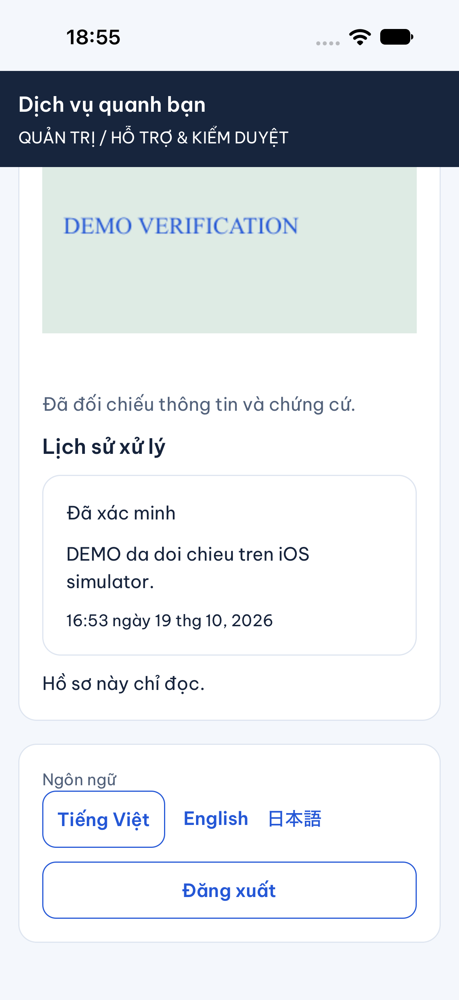
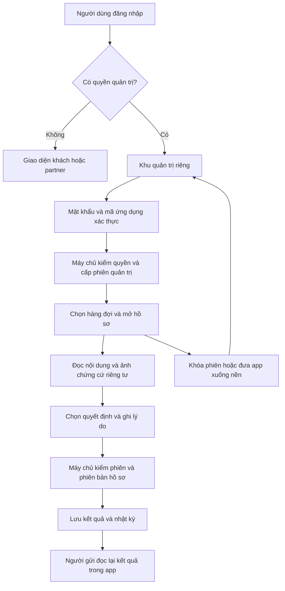

# B09-03 — Quản trị trên điện thoại

19/10/2026 · P1-03 mobile · Code local trên nền `7545890`, chưa commit/push.

## Người quản trị dùng thế nào?

Đăng nhập bằng tài khoản admin đã được cấp quyền. App chuyển sang khu quản trị riêng, yêu cầu mật khẩu và mã 6 số của ứng dụng xác thực trước khi mở dữ liệu. Không có các tab Tìm dịch vụ, Công việc, Tin nhắn hoặc Thông báo của khách trong khu này. Đăng ký tài khoản thông thường không cấp quyền quản trị.

Admin chọn **Báo cáo hỗ trợ**, **Hồ sơ xác minh**, **Đánh giá** hoặc **Nhật ký** theo quyền hiện hành. Tìm và lọc hàng đợi, chọn hồ sơ để mở nội dung cùng ảnh chứng cứ. Trên điện thoại, chi tiết thay danh sách; nút Đóng chi tiết quay lại hàng đợi. Các mục trạng thái/quyết định mở danh sách lựa chọn gọn cho màn hình nhỏ.

Chọn quyết định, ghi lý do rồi lưu. Duyệt xác minh còn yêu cầu bật công tắc đã đối chiếu. Kết quả và lịch sử được lưu qua API hiện hành, phía người gửi đọc lại trong app. Khóa phiên hoặc đưa app xuống nền xóa dữ liệu quản trị khỏi màn hình và yêu cầu MFA lại; đăng xuất trở về giao diện chưa đăng nhập.

## Quyết định và phạm vi đã duyệt

Chủ dự án ngày 19/10 yêu cầu “admin thì giao diện chỉ mục đích là quản lý”, sau đó “làm mobile cho admin đi”. Đây là triển khai giao diện quản trị riêng theo [thiết kế quản trị mobile](../../../ui-ux/specs/admin-operations.md) và [hỗ trợ/kiểm duyệt](../../../ui-ux/specs/support-moderation.md). Bổ sung này thay giới hạn chỉ web của P1-03 trong phạm vi bốn mục trên; không sửa contract API, không mở các chức năng quản trị khác chưa có backend. Không đồng bộ Drive/Excel/ui-ux.

MFA nghĩa là xác thực bằng mật khẩu cùng mã từ ứng dụng xác thực. Phiên admin và quyền được server kiểm lại ở mỗi thao tác; ẩn tab chỉ là cách trình bày, không phải cơ chế bảo vệ dữ liệu.

## Ảnh app chạy thật

iPhone 18 Pro, iOS 27 **simulator**, ngày 19/10/2026; dữ liệu và ảnh DEMO trên database local `dvqb_p1_demo`. Không phải thiết bị thật hoặc ảnh Storybook. Không chụp mật khẩu, khóa MFA hay token.





## Thao tác đi qua code thế nào?



| Thứ tự đọc | Nhận gì, làm gì, chuyển gì |
|---|---|
| [AppNavigator.tsx](../../../apps/mobile/src/app/navigation/AppNavigator.tsx), `AppNavigator` | Nhận người dùng sau đăng nhập/khôi phục phiên. Có `admin_permissions` thì chỉ dựng `AdminScreen`; không giữ stack màn khách phía sau. |
| [AdminScreen.tsx](../../../apps/mobile/src/features/admin/screens/AdminScreen.tsx), `submit`, `clear` | Nhận mật khẩu/mã, thiết lập hoặc xác thực MFA. Khi khóa/nền/hết hạn, bỏ khóa thiết lập, mã, mật khẩu và nội dung quản trị. |
| [AdminDesk.tsx](../../../apps/mobile/src/features/admin/screens/AdminDesk.tsx), `load`, `open`, `Photo` | Nhận nhóm, bộ lọc, cursor và mã hồ sơ. Tải hàng đợi/chi tiết, bỏ phản hồi cũ khi chuyển màn; tải ảnh bằng quyền hiện hành và giữ ảnh trong bộ nhớ. |
| [AdminDecision.tsx](../../../apps/mobile/src/features/admin/screens/AdminDecision.tsx), `submit` | Gửi quyết định, lý do, phiên bản đã xem và một mã chống gửi trùng. Mất phản hồi thì giữ nguyên nội dung/mã khi thử lại. |
| [admin-api.ts](../../../apps/mobile/src/features/admin/api/admin-api.ts), `AdminApi` | Giữ token MFA riêng trong bộ nhớ, kiểm dữ liệu API trả về, nối header quyền và từ chối kết quả đến muộn sau khi khóa. |
| [auth-session.ts](../../../apps/mobile/src/features/auth/state/auth-session.ts), `adminOperation` | Dùng cùng phiên đăng nhập và đường refresh của app; không tạo một phiên đăng nhập cạnh tranh với phiên khách. Kiểm chủ phiên trước/sau request. |
| [moderation.service.ts](../../../services/api/src/modules/moderation/moderation.service.ts) | API hiện hành kiểm quyền/MFA, khóa hồ sơ, đối chiếu phiên bản, lưu quyết định và nhật ký trong cùng giao dịch. Không thay đổi tiền. |

## Quyền, lỗi và thử lại

- `support.read` xem báo cáo; `support.manage` xử lý báo cáo. `moderation.manage` mở xác minh/đánh giá; `audit.read` xem nhật ký. Tài khoản chỉ đọc không thấy form quyết định.
- Báo cáo đóng và hồ sơ xác minh không còn chờ chỉ đọc. Đánh giá giữ nguyên sao/nội dung của tác giả khi ẩn/khôi phục.
- Mất mạng hoặc chưa đọc được kết quả: giữ nội dung và mã gửi trùng; không tự gửi lại quyết định. Xung đột phiên bản: yêu cầu tải lại để đọc trước khi quyết định.
- Khi chuyển sang ứng dụng xác thực để lấy mã trong lúc thiết lập, khóa bí mật và ô mật khẩu/mã bị xóa khỏi màn hình; cờ chờ xác nhận vẫn giữ để nhập mã cho đúng khóa vừa thiết lập, không tự tạo khóa mới. Có thể bắt đầu lại thiết lập nếu đã hết hạn.
- Quyền/MFA không còn hiệu lực: bỏ dữ liệu đang xem, trở lại xác thực. Hết 15 phút khóa màn; quyết định vẫn cần MFA trong 5 phút gần nhất theo API.
- Ảnh được lấy qua `/assets/:id/admin-content`, chuyển thành dữ liệu ảnh trong bộ nhớ; không đặt token vào URL, không ghi ảnh chứng cứ ra file bằng code app. Khóa màn tháo thành phần ảnh.
- VI/EN/JA dùng mã trạng thái trong state, dịch khi hiển thị; dùng font và thành phần giao diện hiện có.

## Kiểm thử và bằng chứng

- Jest: 8 bài mới kiểm chuyển vào khu admin không có tab khách, xác thực/thiết lập MFA, nền/khóa xóa dữ liệu, quyền chỉ đọc, xác minh có đối chiếu, kiểm duyệt, nhật ký, retry cùng payload/key, xung đột phiên bản và refresh cùng family. Các trường hợp này không chứng nhận mọi tổ hợp thiết bị/quyền.
- Chromium 390px: đăng nhập admin → thiết lập TOTP → xử lý báo cáo → API người gửi nhận trạng thái mới → nhật ký → khóa → đăng xuất. Test tại [admin-moderation.spec.mjs](../../../tests/e2e/web/admin-moderation.spec.mjs), tên `mobile admin uses a dedicated console with MFA, decisions and locking without customer tabs`.
- iOS simulator: đăng nhập DEMO → MFA thật → hàng đợi → xem ảnh riêng → đối chiếu và duyệt hồ sơ. Đọc database xác nhận `approved`, phiên bản `2`, nhật ký `approve` với lý do nhập trên iOS; ảnh ở trên. Công cụ nhập liệu Maestro ban đầu điền nhầm ô do bàn phím đổi bố cục; đã dừng lượt đó, thực hiện lại theo trạng thái màn hình và xác nhận ở server.
- Hồi quy phát hiện test `LocationField` phụ thuộc thời gian thật: gợi ý đã xuất hiện trong snapshot nhưng truy vấn chờ hết hạn khi máy bận. Test dùng đồng hồ giả để chạy đúng khoảng chờ 400 ms; giữ nguyên assertions và hành vi app.
- SDD-PROJECT: chạy lại toàn bộ gói cho code đợt này. Kết quả chính thức nằm trong `test-results/sdd/SDD-PROJECT/`; dùng kết quả verify cuối của lượt chạy, không dùng bằng chứng đợt trước. Danh mục/test/criterion mới được review, không giảm scope hoặc đổi threshold.

## Mở lại môi trường DEMO đang dùng trên máy này

Database DEMO lưu bền, tách khỏi `dvqb_local`. API chính cổng 3100 và dữ liệu cũ giữ nguyên. API admin DEMO dùng cổng **3119**, Metro dùng **8099** và namespace lưu phiên `native-test`. Không tự cấp quyền admin cho tài khoản thật hoặc database chính.

Thông tin đăng nhập nằm trong `.local/demo-admin.json` (quyền file 0600); khóa TOTP DEMO đã thiết lập trong lượt kiểm nằm ở `.local/admin-mobile/totp-secret` (0600), nhập vào ứng dụng xác thực nếu tự dùng thử. Không đưa các file này vào Git hoặc báo cáo. Đây là các file local của máy hiện tại, không phải cấu hình production hoặc fixture tự có ở máy clone mới.

Nếu tiến trình đã dừng, mở hai terminal:

```sh
# Terminal API, từ thư mục gốc repo
cd services/api
node --env-file=../../.local/admin-mobile/api.env --import tsx src/main.ts
```

```sh
# Terminal Metro, từ thư mục gốc repo
EXPO_NO_DOTENV=1 EXPO_PUBLIC_API_URL=http://127.0.0.1:3119/v1 EXPO_PUBLIC_AUTH_STORAGE_NAMESPACE=native-test NODE_OPTIONS=--dns-result-order=ipv4first npm exec -w apps/mobile -- expo start --dev-client --localhost --port 8099
```

Mở iOS simulator vào đúng Metro:

```sh
xcrun simctl openurl booted 'exp+dich-vu-quanh-ban://expo-development-client/?url=http%3A%2F%2F127.0.0.1%3A8099'
```

## Giới hạn và bài thử để hiểu code

Chưa kiểm native Android, thiết bị thật hoặc UAT của chủ dự án. Chưa commit/push/CI mới/production. Không triển khai quản lý tài khoản, đình chỉ partner, danh mục, tài chính, cấp grant hoặc khôi phục MFA trong lát này. Nền tảng Android dùng cùng code React Native nhưng chưa được xác nhận chạy bằng lượt native.

Bài thử: đăng nhập admin có quyền chỉ đọc và tìm nút lưu; khóa khi đang xem ảnh; đổi bộ lọc khi request cũ chưa về; mở cùng hồ sơ ở web và mobile rồi lưu lần lượt. Vì sao nút bị ẩn không thay kiểm quyền server? Vì sao retry phải giữ cùng mã và cùng nội dung? Vì sao không dùng web test để kết luận iOS/Android đều đã đạt?
