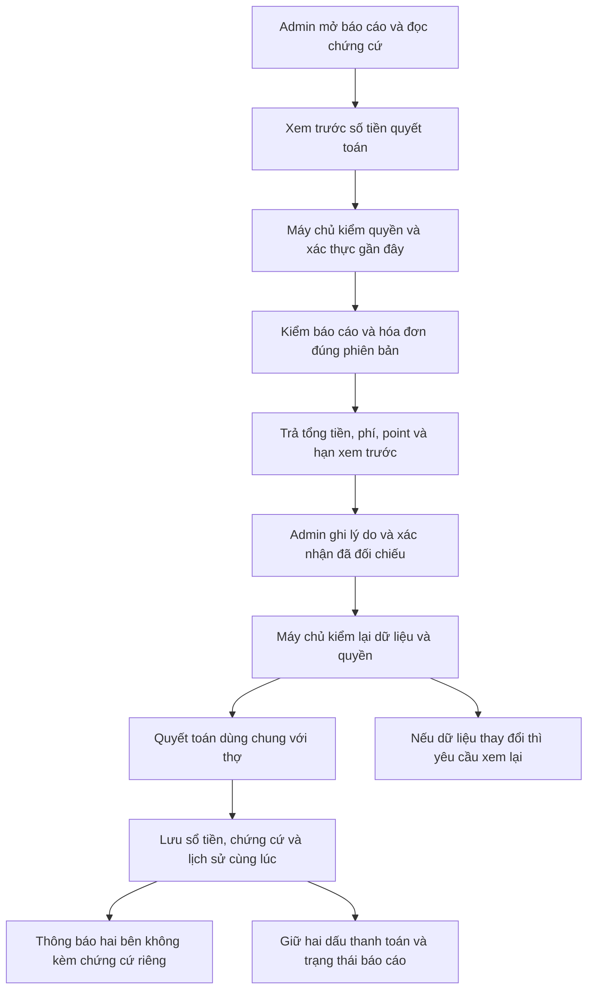
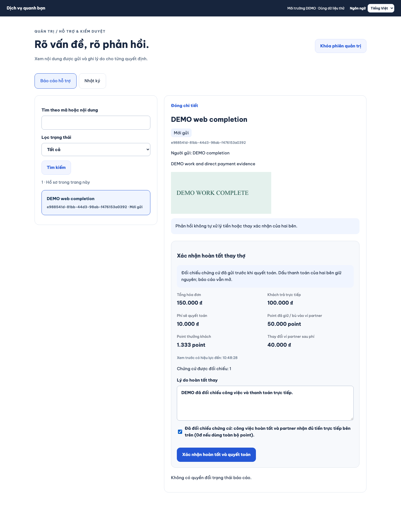
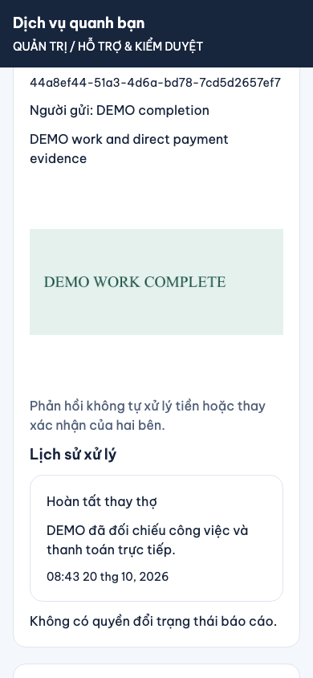
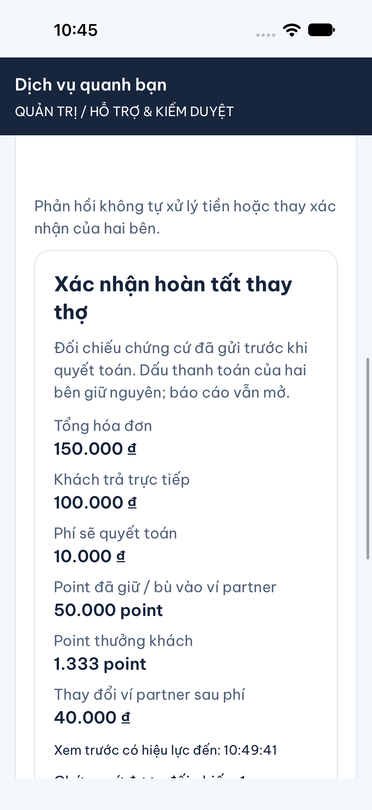
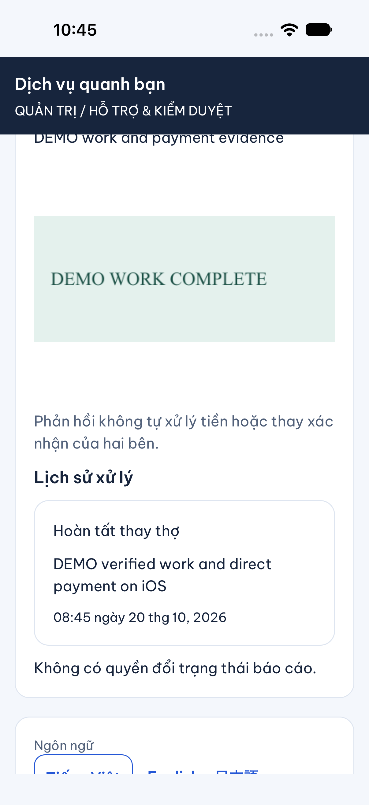
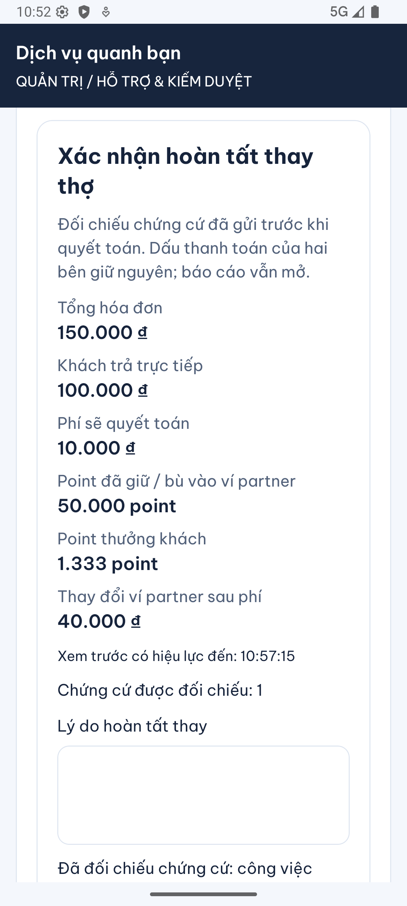
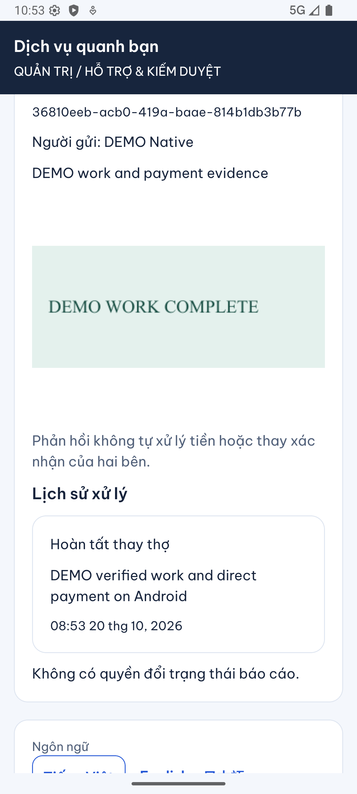

# B09-04 — Admin hoàn tất thay thợ bằng tiền test

20/10/2026 · P1-04, phần còn lại P1-2 · Code đang sửa trên nền `9bf1281`, chưa commit/push.

## Người quản trị dùng được gì?

Mở **Báo cáo hỗ trợ**, chọn báo cáo có liên kết hóa đơn và chứng cứ. Người có quyền tài chính bấm **Xem trước quyết toán**, đọc số tiền, ghi lý do, xác nhận đã đối chiếu công việc hoàn tất và tiền trực tiếp đã được nhận đủ, rồi bấm **Xác nhận hoàn tất và quyết toán**. Máy chủ ghi sổ một lần và lưu lịch sử hoàn tất thay. Quyền xử lý tài chính không tự cho phép đổi trạng thái báo cáo.

Ví dụ hóa đơn gồm 100.000đ tiền công, 50.000đ vật tư và dùng 50.000 point: khách trả trực tiếp 100.000đ, phí 10.000đ, ví partner tăng 40.000đ sau bù point và trừ phí, khách được 1.333 point thưởng. Tiền khách trả trực tiếp không đi vào hệ thống. Đây là tiền test.

Công việc chuyển sang hoàn tất, nhưng **dấu khách báo trả và dấu thợ nhận tiền giữ nguyên**. Admin không đóng vai thợ để đánh dấu nhận tiền; đánh giá vẫn cần đủ hai dấu theo Q01. Báo cáo hỗ trợ vẫn giữ trạng thái cũ, đóng báo cáo là thao tác riêng.

## Quyết định và phạm vi

Chủ dự án ngày 20/10 chọn “Đồng ý bổ sung và triển khai” cho API xem trước có phiên bản hóa đơn/tổng tiền/tiền trả trực tiếp, trường xác nhận đối chiếu và luồng DB/API → admin web/mobile → test. [P1-04](../de-xuat/P1-04-admin-hoan-tat-thay.md) ghi thiết kế, thứ tự triển khai và ranh giới. Nguồn đối chiếu là QA-034/039, `previewCompletion`/`completeOnBehalf`, wireframe `adminSettlementOpen` và UX v0.23. Bố cục hàng đợi giữ thiết kế `AdminOperationsQueue` đã dùng ở B09-03.

MFA là xác thực bằng mật khẩu và mã từ ứng dụng xác thực. Người quyết toán cần `finance.review` và `support.read`, với MFA trong 5 phút gần nhất. Không tự cấp thêm quyền cho tài khoản hiện có. Cấu hình admin pilot vẫn chỉ cho database local/test. Không cập nhật Drive, Excel hoặc `ui-ux`.

## Thao tác đi qua code thế nào?



1. App nhận mã báo cáo đang xem, gửi yêu cầu xem trước. Máy chủ khóa các dòng dữ liệu liên quan để thao tác khác không đổi chúng giữa lúc kiểm. Chưa ghi tiền ở bước này.
2. Máy chủ lấy số tiền từ bản hóa đơn đã được khách xác nhận, trả các khoản tiền cùng một mã xem trước có hạn 5 phút. Mã này gắn với admin, báo cáo, phiên bản và chứng cứ nên không dùng lại cho người hay hóa đơn khác.
3. App gửi lý do, xác nhận đối chiếu, danh sách ảnh đã gửi trong báo cáo, phiên bản đã xem và một mã chống gửi trùng. Nếu mất mạng, app giữ nguyên cả nội dung và mã này để thử lại.
4. Máy chủ kiểm lại quyền, MFA, trạng thái, phiên bản và chứng cứ. Hàm quyết toán chung ghi phí, point dùng và thưởng; chỉ tiêu thụ khoản giữ của hóa đơn này. Mọi thay đổi nằm trong một giao dịch: lỗi ở bước sau sẽ hoàn tác cả bước trước.
5. Máy chủ lưu người xử lý, lý do, mã báo cáo, phiên bản hóa đơn và ảnh được đối chiếu. Công việc hoàn tất và thông báo được xếp hàng cho hai bên. App tải lại báo cáo để hiển thị lịch sử, không tự đóng báo cáo.

## Mở code theo thứ tự

| Bước | File và hàm | Nhận gì, làm gì, chuyển gì? |
|---|---|---|
| 1 | [AdminCompletion.tsx](../../../apps/mobile/src/features/admin/screens/AdminCompletion.tsx), `load`, `submit`; web [Completion.tsx](../../../apps/admin/src/Completion.tsx) | Nhận báo cáo và ảnh đã gửi, mở bảng số tiền, thu lý do/xác nhận; khóa nội dung khi kết quả gửi chưa rõ. |
| 2 | [admin-api.ts](../../../apps/mobile/src/features/admin/api/admin-api.ts), `completionPreview`, `complete`; web [client.ts](../../../apps/admin/src/client.ts) | Gửi API với phiên đăng nhập, phiên admin và mã chống trùng. Kiểm hình dạng response trước khi dùng. |
| 3 | [completion.controller.ts](../../../services/api/src/modules/moderation/completion.controller.ts), `preview`, `complete` | Đọc header, mã báo cáo và input; chuyển dữ liệu đã kiểm sang service. |
| 4 | [completion.service.ts](../../../services/api/src/modules/moderation/completion.service.ts), `context`, `preview`, `complete` | Kiểm quyền/MFA, báo cáo chưa đóng, đúng hóa đơn khóa, trạng thái tài khoản và ảnh ready. Mã xem trước mã hóa chứa dấu băm của dữ liệu đã xem; đối chiếu lại trước khi ghi. |
| 5 | [settlement.ts](../../../services/api/src/modules/invoices/settlement.ts), `settleLockedInvoice` | Cùng đường với thao tác thợ nhận tiền: khóa tài khoản tiền, kiểm khoản giữ, gọi ghi sổ; chỉ đường worker mới ghi dấu thợ. |
| 6 | [ledger.ts](../../../services/api/src/modules/invoices/ledger.ts), `postSettlement` | Ghi các bút toán cân bằng, tiêu thụ giữ phí/point của đúng hóa đơn, tạo một settlement. Settlement là bản ghi quyết toán cuối cùng. |
| 7 | [account-transaction.ts](../../../services/api/src/modules/accounts/account-transaction.ts), `run` | Kiểm quyền hiện hành trước trả kết quả thử lại. Lưu kết quả và thay đổi nghiệp vụ cùng giao dịch; bấm lại không ghi lần hai. |
| 8 | [016_admin_completion.sql](../../../services/api/migrations/016_admin_completion.sql) và [history.ts](../../../services/api/src/modules/moderation/history.ts), `recordDecision` | Quyền tài chính riêng, liên kết chứng cứ bất biến; lưu lịch sử/lý do. Report tăng version nhưng giữ state. |
| 9 | [InvoiceScreen.tsx](../../../apps/mobile/src/features/invoices/screens/InvoiceScreen.tsx) | Hóa đơn đã quyết toán nhưng chưa có dấu thợ hiển thị thông báo riêng; không báo đủ điều kiện đánh giá. |

Không thêm thư viện hoặc framework. Chỉ OpenAPI chính thay đổi contract đã duyệt; các mirror nghiệp vụ bên ngoài chưa được đồng bộ vì không nằm trong yêu cầu.

## Lỗi và dữ liệu được giữ

- Không có quyền hoặc MFA hết hạn: server từ chối; giao diện bỏ dữ liệu quản trị và yêu cầu xác thực lại. Token xem trước không thay quyền.
- Hóa đơn/báo cáo đổi phiên bản, báo cáo đóng, partner đình chỉ, tài khoản không còn active, ảnh không thuộc chứng cứ hoặc mã xem trước hết hạn: không quyết toán; cần đọc lại hồ sơ.
- Mất response sau khi server lưu: nút Thử lại gửi đúng payload/key cũ. Không tạo giao dịch hoặc thông báo thứ hai. Mã thử lại chỉ giữ trong bộ nhớ của màn; rời/khóa app sẽ bỏ dữ liệu màn. Khi quay lại phải đọc trạng thái hiện hành.
- Thợ và admin cùng xác nhận: khóa cùng hóa đơn, chỉ một bên thành công. Unique settlement là lớp bảo vệ dữ liệu bổ sung. Khoản giữ của việc khác không bị tiêu thụ.
- Ngay cả khi hóa đơn 0đ hoặc dùng toàn bộ point, vẫn cần chứng cứ và xác nhận đối chiếu; không tạo bút toán giá trị 0 và không giả dấu thanh toán.
- Chứng cứ nằm trong vùng ảnh local đã có; không gửi vào payload thông báo. Nhật ký lưu liên kết chứng cứ và phiên bản để lần lại quyết định.

## Ảnh và kiểm thử

Ảnh dưới đây là app sản phẩm chạy trên Chromium với API/PostgreSQL test ngày 20/10/2026, dữ liệu DEMO. “Mobile web” là giao diện Expo trong trình duyệt 390px, không phải Android/iOS native.




Ảnh native iOS: iPhone 18 Pro simulator, iOS 27.0, ngày 20/10/2026; app debug kết nối API và PostgreSQL test. Đã mở ảnh chứng cứ, xem trước, nhập lý do/đối chiếu và gửi thành công. Đọc lại DB: actor admin, invoice settled, hai dấu null, report open.




Ảnh native Android: emulator DVQB_API_36, Android 16/API 36, ngày 20/10/2026. Đã build/cài debug từ dependency hiện có vì bản cài cũ thiếu ExponentImagePicker. Driver Maestro không khởi động được; dùng ADB và đọc cây giao diện để thực hiện đăng nhập/MFA, mở ảnh, xem trước, nhập lý do/đối chiếu và gửi. Kết quả DB giống ca iOS; đây không phải thiết bị thật hoặc UAT.




- PostgreSQL tập trung: 5 bài admin mới và 6 bài hóa đơn hồi quy đạt. Đã kiểm tiền/point, một settlement, hai dấu giữ nguyên, state báo cáo, khoản giữ việc khác, audit/chứng cứ, cạnh tranh thợ/admin, rollback, token/phiên bản/MFA/quyền/chứng cứ sai và hóa đơn 0.
- UI/client tập trung và hồi quy: 27 bài đạt cho số tiền, checkbox, giữ request thử lại, conflict, hết hạn và lỗi MFA; bổ sung kiểm hóa đơn đã quyết toán không giả dấu thợ trong suite hồi quy.
- Hành trình Chromium desktop và Expo mobile web đạt: đăng nhập/MFA, xem ảnh/xem trước, xác nhận, cố ý mất response sau commit rồi retry, lịch sử và đọc DB. Có ca dùng toàn bộ point. Lượt đầu chưa chạy được do sandbox chặn Chromium; lượt tiếp theo lộ bước test nhập mật khẩu trước khi form login chuyển xong. Đã thêm chờ đúng heading MFA; không đổi luồng sản phẩm để né test.
- Kiểm ảnh thực tế phát hiện mobile web gọi `fetch` sai ngữ cảnh Window: đã bind hàm mặc định và thêm assert ảnh hiển thị trong E2E. iOS phát hiện `Intl.NumberFormat` không nhận BigInt trên Hermes: đã dùng `formatInteger` hiện hành, kiểm lại số tiền và toàn hành trình. Không coi component test là bằng chứng native.
- PostgreSQL test ban đầu dừng; đã khởi động OrbStack và container `db-test`. Không dùng kết quả lỗi kết nối làm bằng chứng nghiệp vụ.
- SDD toàn repo: kết quả cuối của bộ file nằm ở `test-results/sdd/SDD-PROJECT/evidence.json` và `result.json`; dùng `npm run sdd:check -- --change SDD-PROJECT --phase verify` để kiểm đúng phiên bản. Không dùng lượt tập trung thay toàn gói, không giảm coverage/scope hoặc bỏ test.
- Lượt SDD đầu: 263 mobile đạt; API có 128 đạt, 1 lỗi vì bài kiểm migration cũ vẫn kỳ vọng 15 thay vì 16. Đã sửa đúng số migration, giữ kiểm chạy lặp/bảo toàn dữ liệu và chạy lại toàn bộ 12 bước; không bỏ bài kiểm.

<details>
<summary>Lệnh tra cứu và bằng chứng</summary>

```sh
npm run sdd:check -- --change SDD-PROJECT --phase prepare
npm run sdd:run -- --change SDD-PROJECT
npm run sdd:check -- --change SDD-PROJECT --phase verify
# Từ services/api, kiểm tập trung
node --import tsx --test --test-concurrency=1 test/integration/admin-completion.test.ts test/integration/invoices.test.ts
# Từ gốc repo
npx playwright test --config tests/e2e/web/playwright.config.mjs tests/e2e/web/admin-completion.spec.mjs
```

Mermaid trong báo cáo đã parse/render bằng Chromium, kích thước 860 × 816; không lưu file sơ đồ ngoài Markdown.

QA-034/039 chuyển sang partial sau review các nhánh liên kết, không thành chứng nhận toàn nghiệp vụ. Giữ 114 criterion trước, baseline cũ và mọi bước kiểm toàn gói. Không tự làm mới hash: chỉ API 0.1.18 được review cho trường mới, header phiên admin và quyền của hai operation. File code/test/report mới được đăng ký riêng.

</details>

## Tự thử để hiểu code

1. Mở báo cáo hóa đơn có ảnh, xem trước rồi đổi trạng thái báo cáo ở phiên khác. Khi xác nhận ở phiên cũ, phải đọc lại thay vì ghi đè.
2. Dùng admin có `support.read` nhưng không có `finance.review`: đọc được chứng cứ, không có hành động hoàn tất thay. Quyền trên UI không thay kiểm quyền API.
3. Sau admin quyết toán, nhìn hai dấu trong hóa đơn: vì sao công việc hoàn tất mà chưa đánh giá được? Vì Q01 kiểm hai dấu thật, không coi admin là thợ nhận tiền.

Câu hỏi học code: mã chống gửi trùng và số phiên bản khác nhau ở đâu? Mã chống trùng nhận biết cùng một lần gửi, còn số phiên bản ngăn quyết định dựa trên dữ liệu đã cũ. Hàm `AccountTransaction.run` và `CompletionService.complete` xử lý hai việc riêng này.

## Giới hạn và phần tiếp theo

Chưa commit/push, CI mới, thiết bị thật, UAT hoặc production. Không nối tiền thật/ngân hàng, xử lý hủy/hoàn/đảo, Q02, khôi phục MFA hay chọn đoạn chat chứng cứ. Sau admin quyết toán, endpoint settle hiện chỉ nhận hóa đơn locked nên chưa có đường bổ sung riêng dấu thợ; không âm thầm mở thêm contract này. Không đóng toàn B09/P1-2 từ lát local/test.
