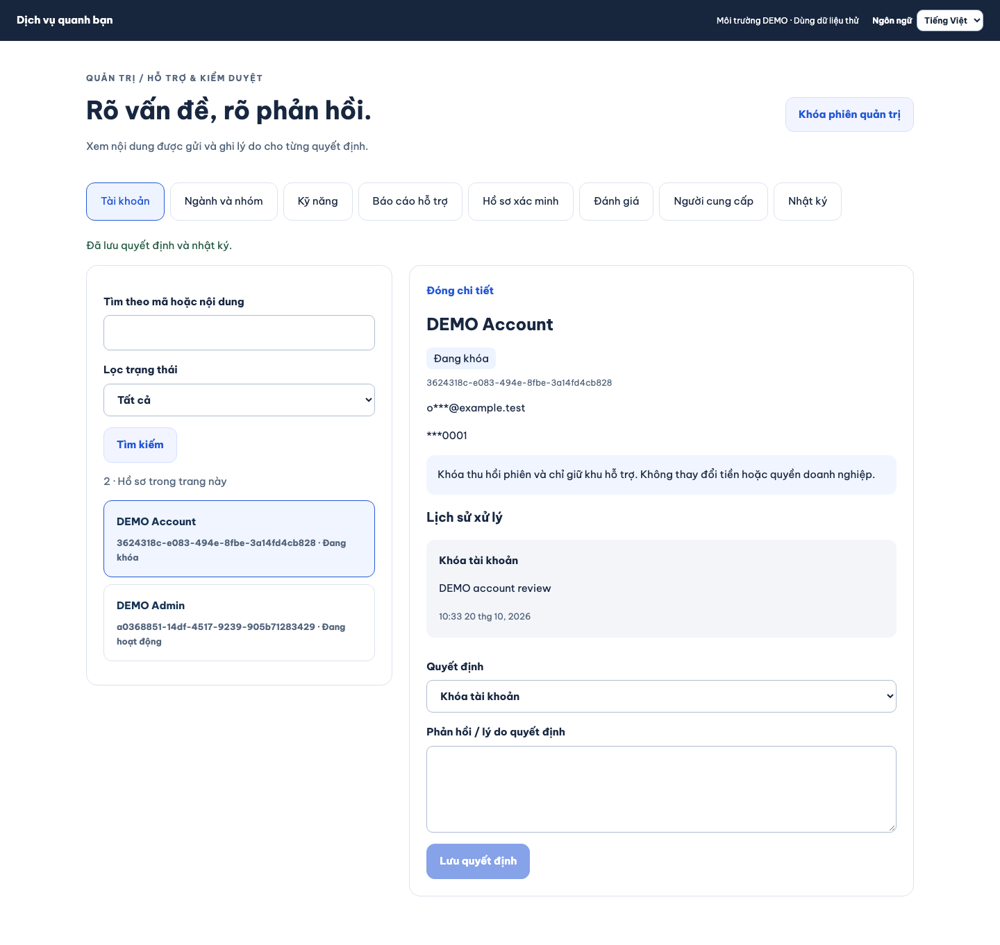
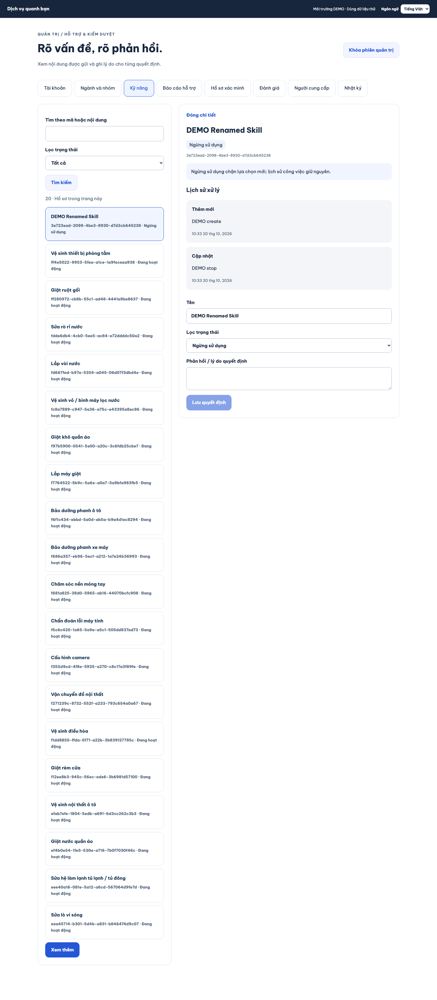
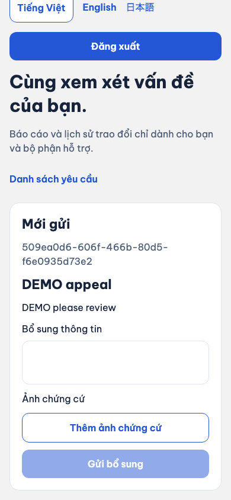
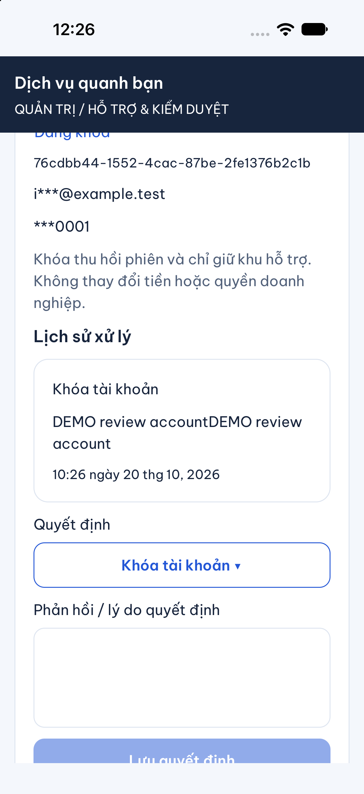
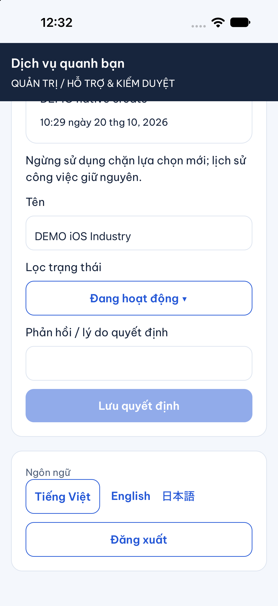
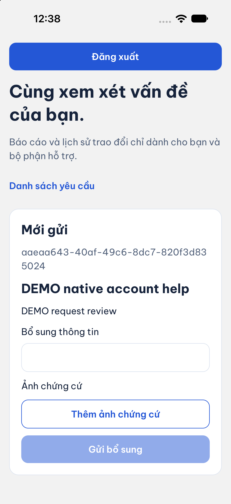
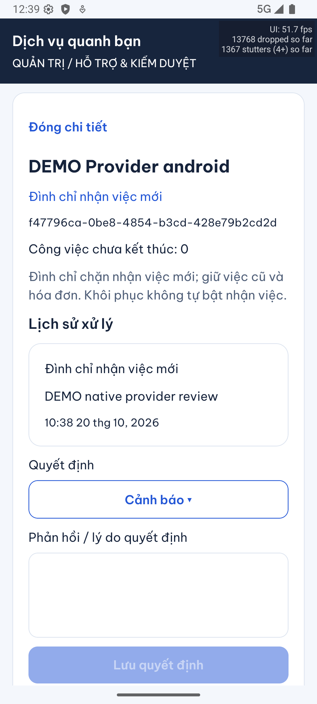
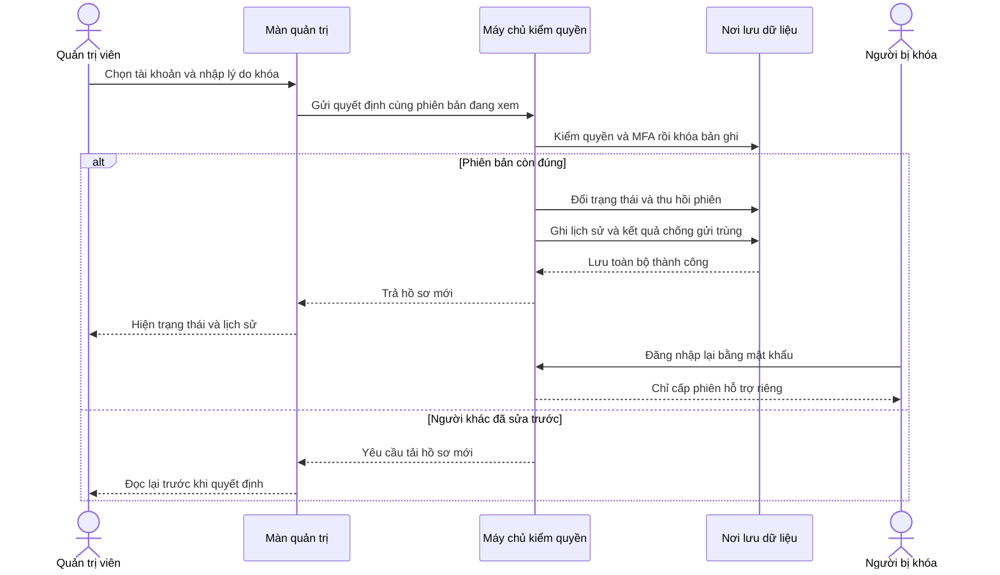

# B09-05 — Admin tài khoản, người cung cấp và danh mục

P1-05 · 20/10/2026 · Code local đang sửa trên nền `807f71b`, chưa commit/push. [Checklist](../01-checklist.md) · [Ba bổ sung đã được chủ dự án duyệt](../de-xuat/P1-05-admin-tai-khoan-partner-danh-muc.md).

## 1. Bạn đã dùng được những gì?

Admin đăng nhập bằng mật khẩu và mã ứng dụng xác thực, rồi mở **Tài khoản**, **Người cung cấp**, **Ngành và nhóm** hoặc **Kỹ năng**. Các mục chỉ hiện khi tài khoản có quyền tương ứng. Máy chủ kiểm lại quyền ở mỗi lần đọc hoặc lưu, nên ẩn nút không phải lớp bảo vệ duy nhất.

- **Tài khoản:** tìm theo tên/mã hoặc email/số điện thoại chính xác, lọc trạng thái, xem liên hệ đã che và lịch sử. Khóa hoặc mở lại cần lý do. Không cho tự khóa hoặc xử lý tài khoản admin khác trong luồng này.
- **Người cung cấp:** xem trạng thái, tình trạng nhận việc và số việc chưa kết thúc; cảnh báo, đình chỉ nhận việc mới hoặc khôi phục. Việc cũ, hóa đơn và tiền giữ nguyên. Khôi phục không tự bật nhận việc.
- **Danh mục:** thêm ngành, nhóm thuộc ngành và kỹ năng thuộc nhóm; đổi tên, ngừng hoặc khôi phục. Có thể tìm cả mục đang ngừng. Mã và quan hệ cha của bản ghi đã tạo giữ ổn định; tên lưu trong công việc cũ không bị đổi theo.
- **Người bị khóa:** phiên cũ hết quyền. Đăng nhập lại chỉ thấy khu hỗ trợ để gửi, xem và bổ sung báo cáo của chính mình cùng ảnh chứng cứ. Không có các tab tìm dịch vụ, công việc, chat hoặc quản trị; không tự mở khóa.

Các màn hỗ trợ, xác minh, kiểm duyệt đánh giá, nhật ký và hoàn tất thay tiền test từ B09-02–04 tiếp tục được giữ trong khu admin. Chọn tin nhắn làm chứng cứ vẫn để sau theo yêu cầu. Việc khôi phục **trạng thái bị khóa** ở đây khác với nghiệp vụ **khôi phục tài khoản bị mất quyền đăng nhập** đang ngoài đợt.

### Ảnh app và web chạy thật

Ảnh dưới dùng dữ liệu DEMO/test ngày 20/10/2026. Web nối API/PostgreSQL test thật; iOS là simulator, không phải điện thoại thật. Ảnh không thay bằng chứng kiểm thử hoặc chứng nhận production.

## 2. Theo một lần khóa tài khoản

**Phiên đăng nhập** là giấy phép tạm giúp app gọi máy chủ sau khi nhập mật khẩu. **MFA** là bước kiểm thêm mã từ ứng dụng xác thực. **Phiên bản** là số tăng sau mỗi lần sửa hồ sơ; nhờ đó hai admin không ghi đè quyết định của nhau.

1. Admin chọn một tài khoản. App nhận tên, trạng thái, phiên bản và lịch sử; email/điện thoại đã được máy chủ che bớt.
2. Admin chọn khóa, nhập lý do rồi lưu. App gửi mã tài khoản, phiên bản đang xem, quyết định và một mã chống gửi trùng.
3. Máy chủ kiểm phiên đăng nhập, quyền `accounts.manage` và MFA vừa xác thực trong năm phút. Sau đó khóa bản ghi cần sửa để hai người không sửa cùng một phiên bản.
4. Trong cùng một lần lưu dữ liệu, máy chủ đổi trạng thái, tăng phiên bản, thu hồi các phiên cũ và ghi lịch sử cùng nhật ký. Nếu một bước lỗi, toàn bộ lần lưu được hoàn tác.
5. App chỉ đổi sang “Đang khóa” sau khi có phản hồi thành công. Các kết nối realtime cũ bị ngắt. Người bị khóa đăng nhập lại nhận phiên chỉ dành cho hỗ trợ.

Sơ đồ mô tả hành trình đã có trong code; đăng nhập hỗ trợ không trao lại quyền thực hiện công việc.

## 3. Mở code theo thứ tự nào?

Các link tính từ báo cáo này. Hãy đọc theo một thao tác, rồi mới xem phần chi tiết của nhánh khác.

| Bước | File và hàm thật | Nhận gì, làm gì, trả cho ai? |
|---|---|---|
| 1 | [AppNavigator](../../../apps/mobile/src/app/navigation/AppNavigator.tsx), `AppNavigator` | Đọc trạng thái tài khoản. Người bị khóa vào navigator chỉ có hỗ trợ; admin vào khu quản trị riêng. |
| 2 | [AdminDesk](../../../apps/mobile/src/features/admin/screens/AdminDesk.tsx), `load`, `open`; [web App](../../../apps/admin/src/App.tsx), `Desk` | Chọn miền, từ khóa và trạng thái; gọi API lấy trang hoặc hồ sơ, rồi hiện dữ liệu đúng miền. |
| 3 | [AdminDecision](../../../apps/mobile/src/features/admin/screens/AdminDecision.tsx), `submit`; [CatalogEditor](../../../apps/mobile/src/features/admin/screens/CatalogEditor.tsx), `send` | Giữ tạm lý do và nội dung nhập. Chụp nguyên yêu cầu trước khi gửi để lần thử lại không thành quyết định mới. |
| 4 | [AdminApi](../../../apps/mobile/src/features/admin/api/admin-api.ts), `decision`, `saveCatalog`; [web client](../../../apps/admin/src/client.ts) | Thêm phiên đăng nhập, MFA và mã chống trùng vào HTTP. Kiểm cấu trúc phản hồi trước khi giao cho màn hình. |
| 5 | [OperationsController](../../../services/api/src/modules/moderation/operations.controller.ts); [operationInput](../../../services/api/src/modules/moderation/operations.input.ts) | Chọn miền từ route cố định; kiểm mã, lý do, số phiên bản, loại hành động và tên trước khi xử lý. |
| 6 | [OperationsService](../../../services/api/src/modules/moderation/operations.service.ts), `list`, `get`, `save` | Đọc có kiểm quyền; lưu theo phiên bản, kiểm cấu trúc danh mục, bảo toàn việc cũ và ghi quyết định. |
| 7 | [AccountTransaction](../../../services/api/src/modules/accounts/account-transaction.ts), `run`; [history](../../../services/api/src/modules/moderation/history.ts), `recordDecision` | Gom sửa dữ liệu, lịch sử và kết quả chống trùng thành một giao dịch; kiểm quyền cả khi trả lại kết quả cũ. |
| 8 | [AuthService](../../../services/api/src/modules/auth/auth.service.ts), `login`, `issue`, `authenticate`, `refresh`, `accessChanged` | Cấp đúng loại phiên, kiểm trạng thái hiện hành và ngắt kết nối đã mất quyền. |
| 9 | [SupportScreen](../../../apps/mobile/src/features/support/screens/SupportScreen.tsx), `RestrictedSupportScreen`; [SupportService](../../../services/api/src/modules/support/support.service.ts), `create`, `get`, `reply` | Chỉ mở báo cáo thuộc người đăng nhập. Báo cáo mới từ phiên hạn chế thuộc loại tài khoản, không gắn công việc/hóa đơn/đánh giá. |
| 10 | [AssetsService](../../../services/api/src/modules/assets/assets.service.ts), `grant`, `verify`, `complete`, `get` | Phiên hạn chế chỉ dùng ảnh chứng cứ của chính người gửi; đường dẫn ảnh cũng kiểm phiên khi tải. |

## 4. Danh mục và người cung cấp thay đổi thế nào?

Ngành và nhóm cùng nằm trong `categories`: ngành không có cha, nhóm có cha là ngành. `skills` lưu kỹ năng; `skill_categories` nối mỗi kỹ năng tạo mới với một nhóm đang hoạt động. Tên tiếng Việt được nhập; giao diện VI/EN/JA không có nghĩa tên do admin nhập được tự dịch.

Khi ngừng một ngành, mục con không bị xóa. Luồng chọn dịch vụ mới kiểm cả mục đó và cha đang hoạt động. [JobsService.eligible](../../../services/api/src/modules/jobs/jobs.service.ts) cùng dùng khóa giao dịch với quản trị danh mục để lần tạo việc không vượt qua quyết định ngừng sử dụng đang được lưu. `job_skills.name_snapshot` là tên đã chụp lúc tạo việc và giữ nguyên. Sửa tên/trạng thái không sửa `schema_version` của biểu mẫu kỹ năng.

Với người cung cấp, cảnh báo chỉ ghi nhận quyết định. Đình chỉ đổi `moderation_status` và tắt `accepting_jobs`. Khôi phục đổi trạng thái về hoạt động nhưng người cung cấp vẫn phải tự bật nhận việc khi đủ điều kiện. Những thao tác này không gọi quyết toán và không tạo bút toán ví.

## 5. Dữ liệu và lỗi được xử lý ở đâu?

| Tình huống | Kết quả và cách thử lại |
|---|---|
| Mất phản hồi sau khi bấm lưu | Giữ nguyên nội dung và mã chống trùng; bấm thử lại trả cùng kết quả, không thêm lịch sử lần hai. |
| Một admin khác sửa trước | Máy chủ báo xung đột phiên bản. Nút tải lại lấy hồ sơ mới và xóa lý do cũ để admin đọc lại trước khi gửi. |
| Hết quyền hoặc MFA quá cũ | Không lưu. Màn quản trị bỏ dữ liệu riêng đang mở và yêu cầu xác thực lại. |
| Rời màn khi còn tải | Kết quả cũ không ghi đè màn mới; bộ đếm lượt tải và cờ màn còn sống kiểm việc cập nhật UI. |
| Trùng mã/tên trong cùng nhánh, cha sai cấp hoặc cha ngừng | Máy chủ từ chối tạo. Không sinh bản ghi nửa chừng. |
| Khóa/mở tài khoản | Thu hồi cả phiên app và phiên hỗ trợ cũ. Người dùng đăng nhập lại để nhận đúng loại phiên. |
| Phiên hỗ trợ gọi API công việc/chat/admin | Bị từ chối ở máy chủ, kể cả gọi trực tiếp ngoài giao diện. |

Dữ liệu nhập đang sửa chỉ ở bộ nhớ màn hình. Trạng thái, phiên bản, lịch sử và mã chống trùng ở PostgreSQL nên đóng app không làm mất quyết định đã lưu. Migration [017_admin_operations.sql](../../../services/api/migrations/017_admin_operations.sql) thêm phạm vi phiên, quyền và phiên bản; không tự gán quyền mới cho tài khoản có sẵn. Lệnh tạo **tài khoản DEMO mới** [demo-admin.ts](../../../services/api/src/database/demo-admin.ts) có hai quyền mới, chỉ chạy trong DB local riêng đã được bảo vệ.

## 6. Bạn có thể tự thử và tự kiểm hiểu

1. Dùng admin DEMO có quyền tài khoản và MFA. Mở một tài khoản thường, nhập lý do khóa. Lịch sử xuất hiện và phiên cũ của tài khoản đó mất quyền.
2. Đăng nhập lại bằng tài khoản vừa khóa. Chỉ thấy hỗ trợ; gửi một báo cáo về tài khoản và đọc lại. Không được thấy báo cáo của người khác.
3. Tạo ngành DEMO, nhóm con và kỹ năng con. Ngừng ngành, kiểm lựa chọn dịch vụ mới, rồi khôi phục. Mã mục và lịch sử công việc cũ giữ nguyên.
4. Mở cùng hồ sơ ở hai cửa sổ admin; cửa sổ thứ hai lưu với phiên bản cũ phải yêu cầu tải lại.

Câu hỏi: Vì sao cần kiểm quyền khi thử lại? Vì quyền có thể bị thu hồi sau lần đầu (`AccountTransaction.run`). Vì sao khôi phục người cung cấp không bật nhận việc? Vì trạng thái kiểm duyệt và lựa chọn sẵn sàng nhận việc là hai thông tin khác nhau. Vì sao sửa tên kỹ năng không đổi việc cũ? Vì việc giữ `name_snapshot`.

## 7. Bằng chứng và giới hạn

Các bài kiểm tập trung đã chạy local: API quản trị, quyền/phiên hỗ trợ, kiểm đồng thời và danh mục; giao diện admin kiểm retry/xung đột/điều hướng; web đi qua API và DB thật với tài khoản DEMO. Hành trình web gồm khóa tài khoản → gửi hỗ trợ hạn chế → đình chỉ người cung cấp → tạo ngành/nhóm/kỹ năng → ngừng kỹ năng với mất phản hồi và thử lại → đọc nhật ký.

Lệnh và bằng chứng kỹ thuật

- API: [admin-operations.test.ts](../../../services/api/test/integration/admin-operations.test.ts), 4 bài tổng hợp; hồi quy auth/catalog/admin chạy cùng SDD.
- Mobile: [Admin.test.tsx](../../../apps/mobile/src/features/admin/screens/Admin.test.tsx), 12 bài; bao gồm hồ sơ phiên bản cũ phải tải lại trước khi lưu.
- Web: [admin-operations.spec.mjs](../../../tests/e2e/web/admin-operations.spec.mjs), 1 hành trình mới, cùng các hành trình admin trước trong toàn suite.
- `npm run typecheck` đã đạt sau sửa luồng tải lại; kết quả lint/build/coverage cuối được kiểm lại trong SDD.
- SDD mới đăng ký `P1-05-AC-01`–`05`, giữ toàn bộ 117 tiêu chí cũ và baseline. Thêm QA-103 cho người cung cấp, giữ nguyên 102 ca QA cũ; QA-048/049/103 chỉ `partial`, không công nhận toàn nghiệp vụ.
- OpenAPI 0.1.19 chỉ thay contract đã duyệt. Hash nguồn API cập nhật sau đối chiếu diff; nguồn QA chỉ bổ sung QA-103, đã đọc diff trước cập nhật hash; không sửa các nguồn khác hoặc bỏ tiêu chí.
- Bằng chứng toàn gói: `test-results/sdd/SDD-PROJECT/`; kiểm bằng `npm run sdd:check -- --change SDD-PROJECT --phase verify`. Bằng chứng chỉ có giá trị khi cùng dấu băm code/tài liệu; thư mục này không lưu trong Git.
- Chạy lại: `npm run sdd:check -- --change SDD-PROJECT --phase prepare`, `npm run sdd:run -- --change SDD-PROJECT`, rồi `--phase verify`. DB test dùng schema riêng trong `dvqb_test`.

iPhone 18 Pro/iOS 27 simulator đã qua đăng nhập MFA, khóa tài khoản, tạo ngành và đăng nhập lại bằng tài khoản bị khóa để gửi báo cáo hỗ trợ. Android 16/API 36 emulator đã qua MFA, xem người cung cấp, chọn đình chỉ nhận việc mới, lưu và đọc lịch sử. MFA quá năm phút bị từ chối trước khi xác thực lại. Đối chiếu DB native: tài khoản iOS `suspended` phiên bản 2; ngành mới `active` phiên bản 1; báo cáo mới loại `account` trạng thái `open`; người cung cấp Android `new_work_suspended`, tắt nhận việc, phiên bản 2; không có bút toán. Bằng chứng tạm `test-results/native/p1-05/result.json`, ảnh lưu trong repo. Sơ đồ Mermaid đã parse và render ở kích thước 1264 × 743. Đây là các hành trình chọn lọc; chưa chứng minh toàn bộ nhánh trên từng nền tảng hay thiết bị thật. Bộ kiểm tự động không thay nghiệm thu của chủ dự án.

Lần kiểm native phát hiện bộ tải thông báo/chat nền vẫn gọi API ngoài phạm vi của phiên hỗ trợ rồi làm app mất đăng nhập. Đã sửa `NotificationsProvider`, `MessageUnreadProvider` và `AuthSession.bindRealtime` để chỉ hoạt động với tài khoản `active`; navigator hỗ trợ có khóa riêng. Bài hồi quy `restricted support disables notification chat polling and realtime without expiring its session` giữ phiên hỗ trợ qua nhiều nhịp nền và kiểm không phát sinh các lời gọi này. Hai bộ test admin/chat đạt 16 bài sau sửa.

## 8. Phần chưa làm

Chọn tin nhắn làm chứng cứ được hoãn. Khôi phục tài khoản mất đăng nhập/xóa tài khoản, giao diện cấp quyền admin, tài chính P2/Q02, chuyển chủ/đóng doanh nghiệp, trình thiết kế form kỹ năng, provider/production/chi phí và PROMO-02 vẫn ngoài đợt. Chưa commit/push, chưa CI trên commit mới, chưa UAT hoặc phát hành. Không đồng bộ Drive/Excel/ui-ux; quyết định contract mới đã ghi trong thiết kế và OpenAPI, các hồ sơ nghiệp vụ bên ngoài còn chờ yêu cầu đồng bộ riêng.
