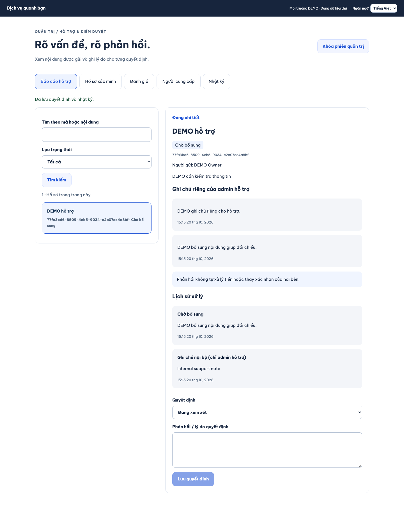
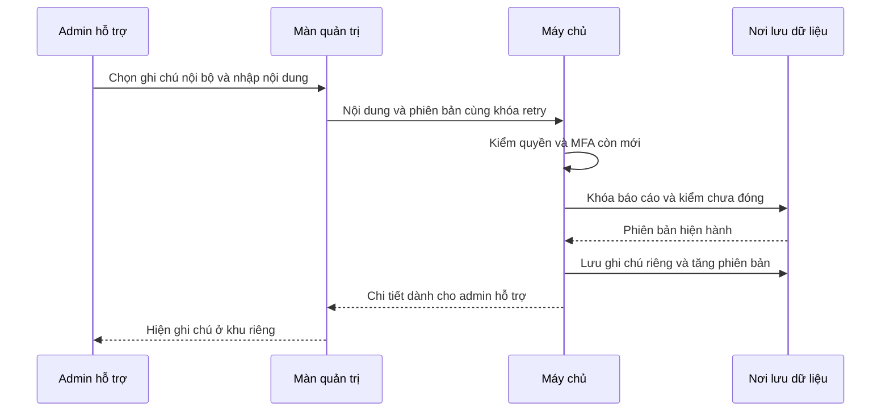

# B09-06 — Ghi chú nội bộ của admin hỗ trợ

20/10/2026 · P1-06 · Code đang sửa trên nền `f7eb929`, chưa commit/push đợt này. [Quyết định đã duyệt](../de-xuat/P1-06-hoan-thien-cung-dot.md).

## Bạn dùng được gì?

Trong báo cáo hỗ trợ, admin chọn **Ghi chú nội bộ (chỉ admin hỗ trợ)**, nhập nội dung rồi lưu. Ghi chú hiện ở khu riêng; trạng thái báo cáo và phản hồi gửi khách giữ nguyên. App điện thoại và web admin cùng dùng API này.

Ảnh web admin chạy thật, Chromium desktop, 20/10/2026. API/PostGIS test thật, dữ liệu DEMO. Đây không phải ảnh điện thoại thật.

## Theo một lần bấm Lưu

“Phiên bản” cho biết màn đang xem bản nào. “Khóa retry” là mã giữ nguyên khi gửi lại một thao tác chưa rõ kết quả. MFA là bước xác thực thêm bằng mã ứng dụng.

## Mở code theo thứ tự

| File và hàm thật | Nhận gì, xử lý và trả gì? |
|---|---|
| [AdminDecision.tsx](../../../apps/mobile/src/features/admin/screens/AdminDecision.tsx), `submit` | Giữ nội dung/phiên bản/khóa cùng loại thao tác, để retry không đổi sang phản hồi công khai. |
| [admin-api.ts](../../../apps/mobile/src/features/admin/api/admin-api.ts), `note` | Gửi POST `/admin/reports/{id}/notes` kèm phiên đăng nhập và MFA. |
| [moderation.input.ts](../../../services/api/src/modules/moderation/moderation.input.ts), `noteInput` | Chỉ nhận phiên bản dương và nội dung không trống, tối đa 4.000 ký tự. |
| [moderation.service.ts](../../../services/api/src/modules/moderation/moderation.service.ts), `note`, `detail` | Kiểm `support.manage` + `support.read`, MFA mới trong 5 phút, khóa dòng và kiểm phiên bản. Lưu `report_updates.visibility=admin_only`; chỉ DTO admin có `internal_notes`. |
| [history.ts](../../../services/api/src/modules/moderation/history.ts), `recordDecision` | Nhật ký chung chỉ ghi thao tác và lý do chung, không chứa nội dung ghi chú. |
| [support.service.ts](../../../services/api/src/modules/support/support.service.ts), `dto` | Dữ liệu khách vẫn lọc `participants`, không đưa ghi chú riêng vào danh sách hoặc chi tiết. |

Ghi chú nằm trong PostgreSQL, còn sau khi đóng app. Kết quả retry được mã hóa trong bản lưu thao tác. API vẫn kiểm quyền trước khi trả lại kết quả cũ. Báo cáo đã đóng không nhận ghi chú mới. Không phát sự kiện chứa ghi chú, không gọi nghiệp vụ tiền.

## Lỗi và cách tự thử

Mất mạng sau khi lưu: bấm Thử lại, cùng khóa không tạo ghi chú thứ hai. Hai admin cùng sửa một phiên bản: một người thắng, người còn lại phải tải lại. Mất quyền hoặc MFA hết hạn: không được đọc/lưu thêm.

Tự thử bằng hai tài khoản DEMO: admin thêm ghi chú, khách tải lại báo cáo; khách không thấy nội dung đó. Đổi sang admin chỉ có `audit.read`: nhật ký cũng không chứa nội dung. Vì sao cần cả quyền đọc và quản lý? Để người chỉ được thao tác không nhận dữ liệu chi tiết ngoài quyền đọc.

## Bằng chứng và giới hạn

- Integration `admin-moderation.test.ts`: MFA/quyền, CAS, retry, khách/ngoại cuộc/audit-only không nhận nội dung, đóng báo cáo và không đổi ledger.
- Jest `Admin.test.tsx`: thao tác riêng, giữ nguyên request sau mất phản hồi, hiển thị đúng khu riêng.
- Playwright `admin-moderation.spec.mjs`: web admin lưu thật, API khách không chứa ghi chú; ảnh phía trên.
- Hồi quy toàn repo dùng `npm run sdd:run -- --change SDD-PROJECT` rồi `sdd:check -- --change SDD-PROJECT --phase verify`; evidence ở `test-results/sdd/SDD-PROJECT/`, không track Git. Không dùng CI của `f7eb929` để chứng nhận code này.
- Native Android/iOS của thay đổi mới, UAT, CI mới và production chưa được xác nhận. Chọn tin nhắn làm chứng cứ vẫn hoãn. Chưa đồng bộ Drive/Excel/ui-ux.
