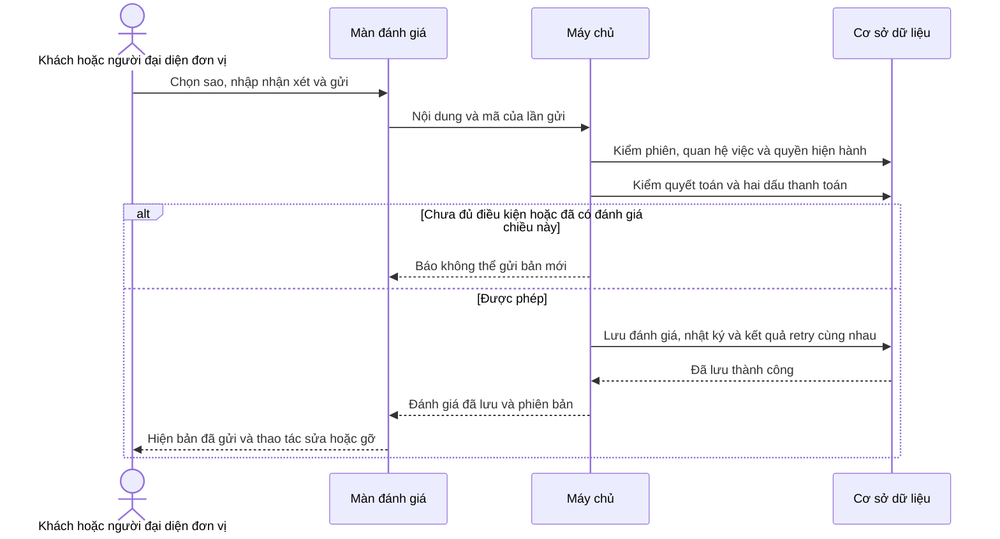
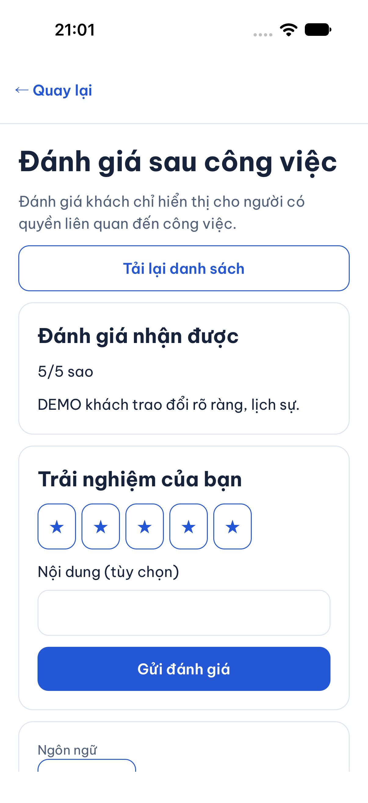
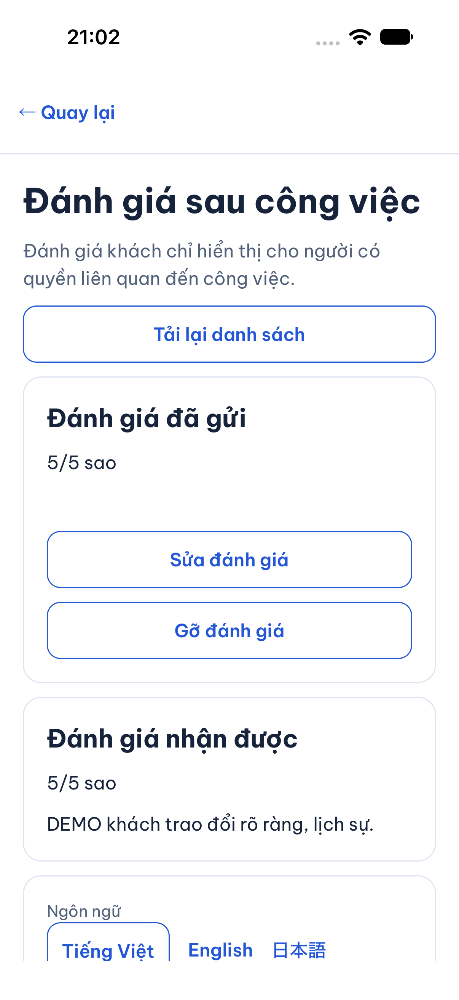
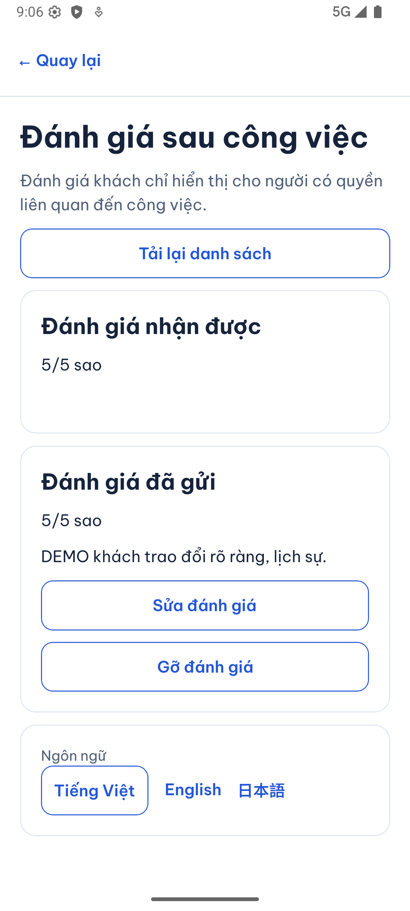
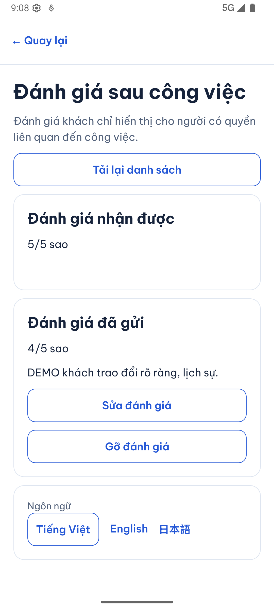

# B10-01 — Đánh giá sau công việc

15/10/2026 · P1-2 · working tree chưa commit · [Checklist](../01-checklist.md) · [Mục lục](../README.md).

## Bạn sẽ thấy gì?

Vào **Công việc → công việc đã hoàn tất → Đánh giá sau công việc**. Khi đã quyết toán và cả hai bên đã xác nhận thanh toán, khách chọn 1–5 sao, viết nhận xét tùy chọn rồi gửi. Đơn vị cung cấp cũng có thể đánh giá khách theo quyền hiện hành. Hai bên không phải chờ nhau viết trước.

Mỗi chiều chỉ có một đánh giá. Tác giả có thể sửa, gỡ và hiện lại chính bản đó. Gỡ không xóa lịch sử. Nếu quản trị viên đã ẩn, tác giả sửa hoặc hiện lại vẫn không làm đánh giá công khai trở lại. Khách đọc đánh giá công khai trên hồ sơ đơn vị; điểm ở kết quả tìm kiếm lấy từ những đánh giá khách → đơn vị còn hiển thị.

Đánh giá khách chỉ xuất hiện trong công việc cho người có quyền liên quan; không đưa vào hồ sơ tìm kiếm công khai. Nhân viên cần quyền `reviews.write` (Viết đánh giá) để viết thay mặt đơn vị; quyền xem công việc không tự cấp quyền viết. Người rời đơn vị không được dùng yêu cầu cũ để vượt quyền.

## Phạm vi của đợt này

Yêu cầu “triển khai phần tiếp theo” được nối vào B10-01 trong gói P1-2. Đây là triển khai phần sao/nội dung/gỡ theo contract hiện hành, không đổi nghiệp vụ hay OpenAPI. Đã đọc Storybook `BothReviews`, `ReviewAfterPayment`, component `activity/JobExtras.jsx`, quy tắc Q01 và QA-044/045/046. Giao diện dùng cùng thẻ, sao, ô nhận xét và phần đánh giá nhận được; không đưa nút mô phỏng của prototype vào app.

**Ảnh, phản hồi và quyền thao tác trong response đang chờ quyết định bổ sung contract.** `ReviewInput` có `asset_id` nhưng schema `Review` không trả ảnh/phản hồi; upload local hiện chỉ mở ảnh kết quả công việc. Vì vậy đợt này không hiện điều khiển ảnh, phản hồi hoặc báo cáo giả. API viết đánh giá kiểm ảnh được gửi phải thuộc tác giả, purpose review và đã ready, nhưng chưa có luồng upload ảnh review qua app. Quyết định về schema đã được hỏi, chưa coi là duyệt. Admin kiểm duyệt, báo cáo hỗ trợ và đọc toàn bộ lịch sử đánh giá khách từ quan hệ công việc khác vẫn là phần sau; không đóng toàn B10-01.

## Một lần gửi đánh giá đi qua đâu?

API là đường app trao đổi dữ liệu với máy chủ. Transaction là nhóm thao tác được lưu cùng nhau: hoặc tất cả thành công, hoặc không lưu phần nào. Khóa idempotency là mã của một lần gửi; nếu mất phản hồi, gửi lại cùng mã giúp máy chủ trả kết quả đã lưu.



Nếu app chưa nhận được phản hồi, ô nhập bị khóa và nút Thử lại dùng lại chính nội dung/mã vừa gửi. Nếu hai phiên cùng sửa, phiên dùng số phiên bản cũ bị từ chối; người dùng tải lại để xem bản mới trước khi sửa tiếp. Dữ liệu tải muộn sau khi rời màn bị bỏ. Đổi tài khoản tạo lại màn, không giữ đánh giá của tài khoản cũ.

## Thứ tự đọc code và input/output

| Bước | File, hàm thật | Nhận gì → làm gì → trả gì |
|---|---|---|
| 1 | [JobDetailScreen.tsx](../../../apps/mobile/src/features/jobs/screens/JobDetailScreen.tsx), `Detail` | Nhận công việc; khi completed mở màn Reviews với ID việc. Trạng thái completed chỉ mở đường vào, chưa đủ để gửi đánh giá. |
| 2 | [ReviewsScreen.tsx](../../../apps/mobile/src/features/reviews/screens/ReviewsScreen.tsx), `Content`, `save` | Đọc việc, hóa đơn, membership của mình và đủ các trang đánh giá. Nhận thao tác sao/nội dung; giữ phiên bản lúc bắt đầu sửa. Không lưu câu dịch trong state. |
| 3 | [auth-session.ts](../../../apps/mobile/src/features/auth/state/auth-session.ts), `jobReviews`, `createReview`, `editReview`, `reviewVisibility` | Kiểm đúng tài khoản và phiên; chuyển ý định sang client API. [Mutation](../../../apps/mobile/src/features/jobs/state/mutation.ts) giữ mã và payload khi chưa rõ kết quả. |
| 4 | [reviews-api.ts](../../../apps/mobile/src/features/reviews/api/reviews-api.ts), `createReviewsApi` | Nhận token/ID/input/key; gọi HTTP và kiểm cấu trúc response trước khi trả về màn. |
| 5 | [reviews.controller.ts](../../../services/api/src/modules/reviews/reviews.controller.ts), [reviews.input.ts](../../../services/api/src/modules/reviews/reviews.input.ts) | Đọc đường dẫn, phân trang, mã retry; chỉ nhận field đã có trong contract, sao nguyên 1–5 và phiên bản hợp lệ. |
| 6 | [reviews.service.ts](../../../services/api/src/modules/reviews/reviews.service.ts), `access`, `eligible`, `create`, `edit`, `visibility`, `list` | Máy chủ quyết định quyền và chiều đánh giá; kiểm cả trước khi trả kết quả retry. Lưu bản đánh giá cùng audit, không sửa ledger hoặc dấu thanh toán. |
| 7 | [012_reviews.sql](../../../services/api/migrations/012_reviews.sql) | Lưu đánh giá trong DB, unique việc + chiều, sao 1–5. `hidden_at` và `removed_at` độc lập để khôi phục của tác giả không vượt kiểm duyệt. |
| 8 | [PartnerReviews.tsx](../../../apps/mobile/src/features/reviews/screens/PartnerReviews.tsx), [search.service.ts](../../../services/api/src/modules/search/search.service.ts), `list` | Hồ sơ đọc từng trang public. Tìm kiếm tính trung bình/số lượng trên bản đang hiển thị, trả null/0 nếu không còn bản hợp lệ; giữ thứ tự khoảng cách. |

## Dữ liệu, quyền và lỗi

Bản nháp chỉ ở bộ nhớ màn hình. Bản đã gửi, sửa/gỡ và nhật ký nằm trong PostgreSQL, còn sau khi đóng app. Unique và khóa theo đơn vị/công việc ngăn hai người đại diện cùng tạo hai đánh giá một chiều. Sửa kiểm số phiên bản; retry kiểm quyền hiện hành trước khi đọc kết quả cũ. Đăng xuất hoặc bị thu hồi quyền không được dựa vào snapshot để lấy lại nội dung.

Tải lỗi mạng giữ dữ liệu/bản nháp đang có và báo lỗi; mất quyền xóa nội dung riêng. Mỗi bước đọc chờ tác vụ phiên đang chạy; nếu gặp BUSY do tranh lượt thì chờ và thử lại tối đa hai lần. Không tự gửi lại mutation. Một lần tải nhiều trang không phải snapshot DB nguyên tử. Màn đánh giá cập nhật khi vào lại hoặc tải lại/kéo xuống; chưa có sự kiện realtime dành riêng cho đánh giá. Ẩn/gỡ không tác động tiền, point, trạng thái công việc hay đánh giá chiều còn lại.

## Kiểm thử và ảnh

- API/PostGIS: 5 bài mới kiểm Q01, hai chiều, gửi đồng thời, retry, quyền hiện hành, CAS, audit, gỡ/ẩn/khôi phục, dữ liệu sai, phân trang và điểm công khai. Ẩn admin được thiết lập trong fixture DB; chưa phải kiểm màn hay endpoint admin.
- Mobile: 8 bài tập trung ở API client và màn; kiểm giữ payload sau lỗi, sửa/gỡ, mất quyền, khóa trước đủ dấu, xung đột phiên bản và trang public. Quay lại hồ sơ luôn tải từ trang đầu, bỏ các trang cũ để nhận trạng thái gỡ/ẩn mới.
- Web: hành trình hai tài khoản qua API/DB thật đã đạt; giả lập mất phản hồi sau khi máy chủ đã lưu để kiểm retry. Dữ liệu DEMO, hóa đơn 0đ test, không giao dịch thật.
- iOS simulator / Android emulator và SDD toàn gói: kết quả cuối xem checklist cùng bằng chứng của lượt này; chưa dùng kết quả cũ để chứng nhận code mới.
- Chưa commit/push/remote CI, thiết bị vật lý hoặc UAT. Không cập nhật Drive, Excel hay `ui-ux`. Không mở provider/chi phí/production.

### Ảnh app native

Dữ liệu DEMO, ngày 15/10/2026. iPhone 18 Pro / iOS 27 simulator đã mở việc, chọn 5 sao và gửi qua API thật; không phải điện thoại vật lý. Nội dung được để trống để kiểm nhánh tùy chọn.

| iOS: trước khi gửi | iOS: đã gửi |
|---|---|
|  |  |

Android 16 emulator đã vào phạm vi đơn vị, mở hai chiều đánh giá và sửa từ 5 xuống 4 sao thành công qua API DEMO. Binary trong snapshot emulator ban đầu thiếu ImagePicker; đã cài lại APK debug local đã có trước khi kiểm. Lần vào đầu gặp phiên đang bận; đã bổ sung chờ phiên giữa các bước đọc và test BUSY, rồi kiểm lại sửa/lưu trên native. Đây không phải kiểm thiết bị vật lý hoặc bộ keyboard/ảnh review.

| Android: hai chiều | Android: đã sửa xuống 4 sao |
|---|---|
|  |  |

Mermaid đã parse/render trong Chromium (1264 × 699); không tạo file ảnh sơ đồ riêng. Lượt SDD trước sửa làm mới danh sách public đã đạt 228 bài mobile và 111 bài API cùng coverage. Kiểm API toàn bộ phát hiện assertion đếm migration cũ 11; đã cập nhật thành 12 theo migration mới, giữ kiểm rerun/seed và checksum. Lượt SDD cuối kiểm lại toàn bộ sau sửa làm mới danh sách public và cập nhật báo cáo; chỉ kết quả khớp fingerprint cuối được dùng làm bằng chứng bàn giao.

## Tự thử để hiểu code

1. Người cung cấp đã nhận tiền nhưng khách chưa bấm đã trả: mở màn đánh giá phải thấy giải thích chưa đủ điều kiện. Vì sao completed chưa đủ? Xem `eligible` và dấu thanh toán của hóa đơn.
2. Sau khi gửi, sửa từ 5 xuống 4 sao, gỡ rồi hiện lại. Kiểm bản cũ được cập nhật, không có đánh giá thứ hai. Xem unique của migration và `visibility`.
3. Mở cùng đánh giá ở hai phiên, sửa phiên thứ nhất rồi thử lưu bản cũ ở phiên thứ hai: phải báo xung đột. Máy chủ không tin số sao hay quyền do UI tự suy ra.
4. Đánh giá khách không xuất hiện trong danh sách public của đơn vị. Gỡ hết các bản khách → đơn vị: tìm kiếm hiện chưa có đánh giá, không lấy 0 sao làm điểm trung bình.

<details>
<summary>Lệnh và bằng chứng để tra cứu</summary>

```sh
npm test -w apps/mobile -- --runInBand Reviews.test reviews-api.test
# Từ services/api
node --import tsx --test --test-concurrency=1 test/integration/reviews.test.ts
# Từ gốc repo
npx playwright test --config tests/e2e/web/playwright.config.mjs reviews.spec.mjs
npm run sdd:run -- --change SDD-PROJECT
npm run sdd:check -- --change SDD-PROJECT --phase verify
```

Log tập trung `.local/reviews-*.log` và `.local/reviews/`; ảnh native đã lưu cạnh báo cáo. Evidence toàn gói ở `test-results/sdd/SDD-PROJECT/`, chỉ dùng khi fingerprint khớp working tree cuối. Artifact local bị ignore; các bài kiểm trong repo cho phép tạo lại. Không đổi hash nguồn spec hoặc bỏ tiêu chí cũ để lấy kết quả xanh.

</details>
