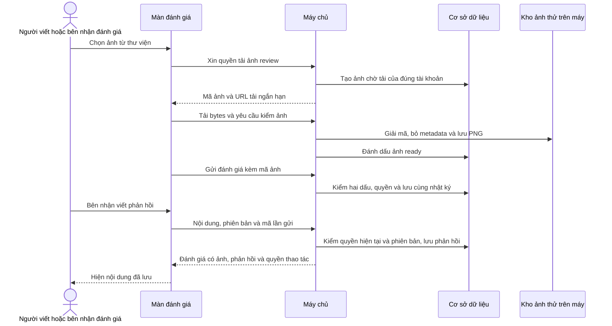
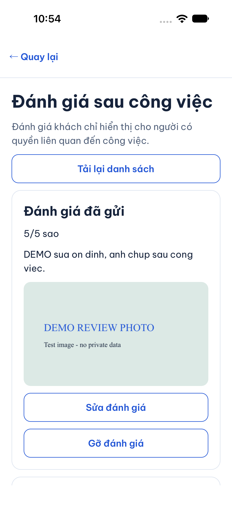
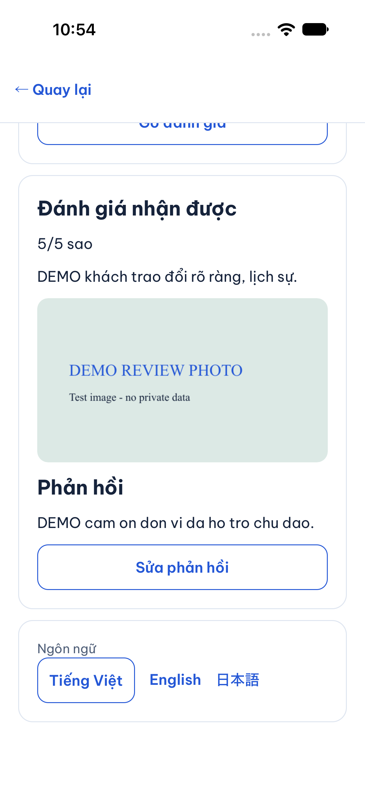

# B10-03 — Ảnh và phản hồi đánh giá

16/10/2026 · P1-2 · API v0.1.15 · code đang sửa sau `bc90978` · [Checklist](../01-checklist.md).

## Bạn dùng được gì?

Trong **Công việc → việc đã hoàn tất → Đánh giá sau công việc**, bạn có thể chọn một ảnh khi viết đánh giá. Sau khi gửi, ảnh được lưu ở máy chủ thử nghiệm và bên có quyền đọc được. Khi sửa đánh giá, bạn có thể thay hoặc gỡ ảnh. Không chọn lại ảnh không làm mất ảnh đã lưu.

Bên nhận đánh giá bấm **Trả lời đánh giá**, nhập nội dung và lưu. Phản hồi hiện ngay dưới đánh giá; lần sau có thể sửa chính phản hồi đó. Ví dụ khách viết “Đến hơi muộn”, đơn vị trả lời “Xin lỗi anh/chị, lần sau chúng tôi sẽ báo trước”. Khách cũng có thể trả lời đánh giá của đơn vị về mình. Phản hồi không thay số sao.

“Local” nói về nơi chạy máy chủ, không có nghĩa phản hồi giả lập: nội dung lưu thật trong PostgreSQL, ảnh lưu thành file đã xử lý trên máy phát triển. Chưa phát hành cho người dùng thật, chưa dùng dịch vụ lưu ảnh trả phí.

## Quyết định và phạm vi

Chủ dự án chốt ngày 16/10: “bổ sung dữ liệu phản hồi/ảnh vào API để app hiển thị được. ok”, sau khi làm rõ phạm vi ảnh/phản hồi local và quyền thao tác do máy chủ tính. Đợt này cập nhật contract API cần thiết và báo cáo/checklist trong repo; chưa đồng bộ Drive, Excel, `ui-ux`, bản xuất hay toàn bộ schema thiết kế.

- `Review` thêm `asset_id`, `reply` và `allowed_actions`. Trường sau cùng là danh sách thao tác tài khoản hiện tại được phép dùng; danh sách public luôn rỗng.
- Giữ một `asset_id` tùy chọn của contract hiện hành. Prototype cho chọn nhiều tên file mẫu; đợt này không tự mở rộng sang nhiều ảnh.
- `PUT /reviews/{id}/reply` tạo/sửa một phản hồi, dùng chung số phiên bản của đánh giá. Chỉ bên nhận đúng hướng hoặc đại diện đơn vị có `reviews.respond` hiện hành được viết.
- Khi sửa đánh giá, thiếu `asset_id` nghĩa là giữ ảnh, `null` là gỡ, UUID là thay bằng ảnh đã tải xong của tác giả.
- `GET /assets/{id}` cho phép không đăng nhập chỉ với ảnh đang gắn đánh giá khách → đơn vị còn công khai, đơn vị published/active. Ảnh đánh giá khách, ảnh chưa gắn và ảnh chứng cứ không được công khai theo nhánh này.

B10-02 vẫn là mã cuộc gọi trong kế hoạch, nên phần bổ sung này dùng B10-03. Admin/support, lịch sử đánh giá khách qua công việc khác, gọi và production chưa mở.

## Một lần chọn ảnh và phản hồi đi qua đâu?

API là đường app gửi yêu cầu đến máy chủ. “Ready” nghĩa là máy chủ đã kiểm và xử lý được ảnh, không chỉ tin việc app báo đã tải xong. URL ký là đường dẫn ảnh có thời hạn và thông tin kiểm chứng; khi mở vẫn phải kiểm quyền hiện hành.



Khi đọc ảnh công khai, máy chủ kiểm đánh giá còn hiển thị và hồ sơ đơn vị còn công khai. Nếu đánh giá bị gỡ/ẩn hoặc ảnh bị thay, URL cũ không tiếp tục mở được ảnh từ đánh giá đó. Ảnh riêng kiểm phiên và quan hệ công việc; nhân viên bị gỡ khỏi đơn vị không giữ quyền chỉ nhờ URL đã nhận.

## Mở code theo thứ tự nào?

| Bước | File và hàm thật | Nhận → xử lý → chuyển tiếp |
|---|---|---|
| 1 | [ReviewsScreen.tsx](../../../apps/mobile/src/features/reviews/screens/ReviewsScreen.tsx), `pick`, `save`, `saveReply` | Nhận ảnh hoặc nội dung từ người dùng; giữ bản nháp, mã lần gửi và phiên bản lúc bắt đầu sửa. Gửi qua bộ quản lý phiên. |
| 2 | [auth-session.ts](../../../apps/mobile/src/features/auth/state/auth-session.ts), `uploadReview`, `replyReview` | Kiểm đúng tài khoản/phiên trước khi chuyển token và dữ liệu cho API client. |
| 3 | [reviews-api.ts](../../../apps/mobile/src/features/reviews/api/reviews-api.ts), `upload`, `reply`, `isReview` | Tải ảnh theo grant → bytes → complete. Nếu lần trước đã complete thì đọc ảnh ready để không tải lại. Kiểm cấu trúc response trước khi đưa vào màn. |
| 4 | [reviews.controller.ts](../../../services/api/src/modules/reviews/reviews.controller.ts), `reply`; [reviews.input.ts](../../../services/api/src/modules/reviews/reviews.input.ts), `replyInput` | Nhận ID, key, nội dung và phiên bản; từ chối phản hồi rỗng hoặc field không thuộc contract. |
| 5 | [reviews.service.ts](../../../services/api/src/modules/reviews/reviews.service.ts), `recipient`, `reply`, `actions`, `currentResult` | Máy chủ kiểm bên nhận/quyền hiện hành, đối chiếu phiên bản, lưu phản hồi cùng audit. Kết quả retry giữ nội dung/phiên bản gốc nhưng tính lại quyền; snapshot cũ được bổ sung các trường nullable. |
| 6 | [013_review_replies.sql](../../../services/api/migrations/013_review_replies.sql) | Thêm nội dung và tác giả phản hồi; hai trường cùng có hoặc cùng rỗng, dùng version chung của review. |
| 7 | [assets.service.ts](../../../services/api/src/modules/assets/assets.service.ts), `grant`, `complete`, `authorized`, `publicAsset`, `content` | Chỉ mở thêm purpose review bên cạnh result. Kiểm file và quyền; tạo URL ngắn hạn, kiểm lại khi đọc bytes. |
| 8 | [ReviewPhoto.tsx](../../../apps/mobile/src/features/reviews/screens/ReviewPhoto.tsx), [PartnerReviews.tsx](../../../apps/mobile/src/features/reviews/screens/PartnerReviews.tsx) | Nhận mã ảnh, lấy URL đúng quyền, hiển thị ảnh/phản hồi. URL lỗi có nút tải lại; quay lại hồ sơ tải từ trang đầu để bỏ danh sách cũ. |

## Dữ liệu, quyền và lỗi

Bản nháp nằm trong bộ nhớ màn; dữ liệu đã lưu nằm trong DB/kho ảnh của máy chủ. Đổi tài khoản tạo lại màn. Mất quyền khi gửi hoặc tải lại xóa nội dung riêng trong màn. Phản hồi không sửa sao, không bỏ ẩn/gỡ và không thay giao dịch tiền/point.

Hai người cùng sửa sẽ dùng cùng số phiên bản ban đầu; chỉ người lưu trước thành công, người còn lại phải tải lại. Kéo làm mới khi đang viết không âm thầm thay phiên bản bản nháp. Nếu mất phản hồi sau khi máy chủ đã lưu, nút Thử lại dùng cùng mã và cùng nội dung để tránh ghi thêm lần nữa. Không tự gửi lại mutation.

Ảnh tải lỗi giữ thao tác để thử lại. Nếu grant đã hết hạn và ảnh chưa ready, người dùng chọn lại ảnh để xin grant mới; không lặp tự động bằng URL hết hạn. Ảnh hiển thị bị lỗi hoặc hết URL có nút **Tải lại ảnh**. Quyền được kiểm lại trước khi trả URL mới.

## Ảnh app chạy thật

iOS 27, iPhone 18 Pro simulator, ngày 16/10/2026; tài khoản và ảnh DEMO, API/PostgreSQL local thật. Đã viết và đọc lại phản hồi; chọn/tải/gửi ảnh từ Photos. Đã sửa Blob thiếu MIME bằng MIME từ trình chọn và bỏ khoảng trắng JSX gây cảnh báo native. Đây là máy ảo, không phải điện thoại vật lý. Android chưa xác nhận lát này do công cụ đọc cây giao diện không trả kết quả.





## Kiểm thử và giới hạn

- 8 bài API tập trung (7 review + 1 ảnh hiện có) đạt: Q01, hai chiều, CAS, retry, quyền hiện hành, audit; phản hồi không đổi sao/ẩn/gỡ; ảnh chưa gắn, ảnh riêng, URL public cũ, thu hồi thành viên, giữ/thay/gỡ ảnh.
- 11 bài app/API client tập trung đạt (bài thu hồi quyền chờ response FORBIDDEN và thông báo lỗi hoàn tất trước khi kiểm bản nháp đã xóa): payload retry, phiên bản bản nháp, mất quyền, phân trang public, tải ảnh một lần, gắn/gỡ ảnh và phản hồi.
- Web hai tài khoản qua API/DB thật đạt: chọn file, gửi/sửa/gỡ/hiện đánh giá có ảnh, đọc ảnh bên kia, phản hồi hai chiều và retry sau mất response.
- SDD toàn repo: dùng `result.json`, `evidence.json` trong `test-results/sdd/SDD-PROJECT/` và `sdd:check --phase verify` trên bộ file cuối; số bài tập trung không thay bằng chứng toàn gói.
- B10-01 đã push `bc90978`, [CI nhánh đạt](https://github.com/anhthaingd/dich-vu-quanh-ban/actions/runs/38833862011). CI main lượt đầu lỗi timeout ở jobs-chat (nút gửi bị vô hiệu khi trường nhập vẫn rỗng), sau đó toàn web chạm 10 phút. Lượt hai cùng commit qua jobs-chat nhưng lỗi ở realtime: vừa nhập tin đầu tiên thì nút gửi vẫn bị vô hiệu; trace dừng ngay sau fill/click, cùng tình huống khóa ô nhập khi cập nhật đã đọc. Hồi quy local cũng phát hiện tranh khóa khi từ chat quay lại hồ sơ. Bản sửa local thêm chờ/retry BUSY có giới hạn ở [PartnerProfileScreen.tsx](../../../apps/mobile/src/features/partners/screens/PartnerProfileScreen.tsx), hàm `Profile`, và giữ ô nháp chat nhập được trong [ConversationScreen.tsx](../../../apps/mobile/src/features/chat/screens/ConversationScreen.tsx), hàm `Room`, khi đang đánh dấu đã đọc; nút gửi vẫn chờ khóa. Hai bài tái hiện đỏ trước sửa, sau sửa cả 19 bài Work.test đạt; hành trình jobs-chat web qua 3 lần liên tiếp (22–26 giây/lần). CI của commit cũ vẫn thất bại; bản sửa mới chưa push. Bằng chứng B10-01 không chứng nhận B10-03 đang sửa.

Chưa có realtime dành riêng cho review; vào lại/tải lại mới lấy thay đổi của bên kia. Bộ ảnh thử giữ JPEG/PNG/WebP, 10 MiB, 25 triệu pixel, 100 grant/tài khoản/giờ và URL 10 phút. Chưa dọn ảnh mồ côi, chưa có storage phân tán/quét nội dung/production. Không tuyên bố UAT hoặc kiểm điện thoại vật lý.

## Tự thử để hiểu code

1. Khách chọn ảnh, gửi đánh giá; đăng nhập bên đơn vị để xem ảnh và trả lời. Quay lại khách, tải lại: phải thấy phản hồi.
2. Sửa nội dung nhưng không chọn lại ảnh: ảnh còn. Bấm Gỡ ảnh rồi lưu: ảnh không còn. Vì sao thiếu field và `null` có ý nghĩa khác nhau? Xem `edit`.
3. Mở hai phiên cùng sửa phản hồi; lưu phiên một rồi lưu phiên hai: phiên hai phải báo xung đột. Vì sao sửa phản hồi cũng tăng version review?
4. Gỡ đánh giá công khai rồi dùng URL ảnh cũ: máy chủ từ chối. Vì sao URL có chữ ký vẫn phải đọc lại DB? Xem `publicAsset` và `content`.

<details>
<summary>Lệnh và bằng chứng kỹ thuật</summary>

```sh
npm test -w apps/mobile -- --runInBand Reviews.test reviews-api.test
# Trong services/api
node --import tsx --test --test-concurrency=1 test/integration/reviews.test.ts test/integration/assets.test.ts
# Từ gốc repo
npm run build
npx playwright test --config tests/e2e/web/playwright.config.mjs reviews.spec.mjs
npm run sdd:run -- --change SDD-PROJECT
npm run sdd:check -- --change SDD-PROJECT --phase verify
```

Log tập trung tại `.local/reviews-next/` (ignore Git). SDD tạo lại từ code/test đã đăng ký. Đã review diff API: chỉ version, metadata Review, sửa ảnh nullable/giữ ảnh, mô tả reply và quyền đọc ảnh public; giữ các nguồn/tiêu chí cũ. Bản mirror/Excel/Drive/ui-ux chưa đồng bộ theo phạm vi đã chốt.

</details>
