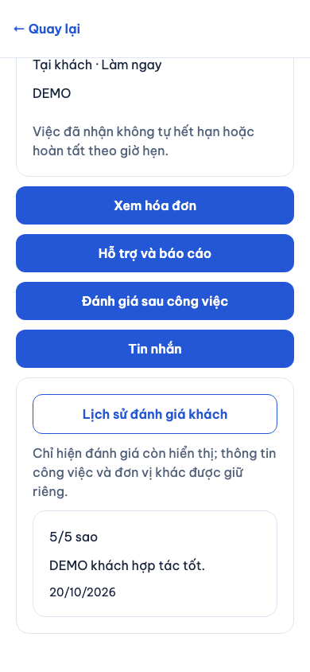
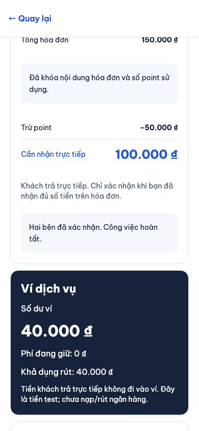
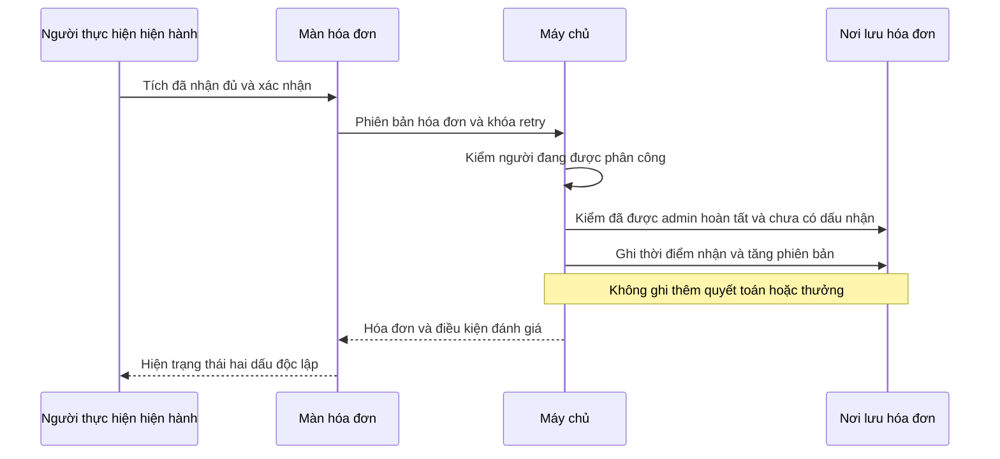

# B10-04 — Lịch sử đánh giá khách và bổ sung dấu nhận tiền

20/10/2026 · P1-06 · Working tree trên `f7eb929`, chưa commit/push đợt này. [Quyết định](../de-xuat/P1-06-hoan-thien-cung-dot.md).

## Bạn dùng được gì?

Người cung cấp mở chi tiết một yêu cầu thuê rồi bấm **Lịch sử đánh giá khách**. Chỉ người còn quyền xem việc đó được đọc. Danh sách chỉ có sao, lời đánh giá, phản hồi và ngày; không có việc, địa chỉ hay danh tính đơn vị khác.

Sau khi admin hoàn tất thay, người đang được phân công có thể vào hóa đơn, xác nhận đã nhận đủ rồi bấm **Xác nhận đã nhận đủ tiền**. Đây là bổ sung dấu của người thực hiện. Tiền đã được quyết toán trước đó không được ghi lần nữa. Đánh giá chỉ mở khi khách cũng đã báo thanh toán.

Ảnh app Expo web chạy thật, Chromium khung 390×844, 20/10/2026, API và PostGIS test, dữ liệu DEMO. Không phải ảnh iOS/Android hoặc bằng chứng tiền thật.

## Luồng nhận tiền

## Mở code theo thứ tự

| File / hàm | Nhận gì và chuyển tiếp ra sao? |
|---|---|
| [CustomerReviews.tsx](../../../apps/mobile/src/features/reviews/screens/CustomerReviews.tsx), `load` | Chỉ tải khi người dùng mở mục, đọc thêm bằng cursor, bỏ phản hồi cũ và xóa dữ liệu khi mất quyền. |
| [reviews.service.ts](../../../services/api/src/modules/reviews/reviews.service.ts), `customerHistory` | Nhận mã việc làm căn cứ; `jobAccess` kiểm quan hệ/quyền hiện hành rồi tìm đánh giá `partner_to_customer` còn hiển thị của khách. |
| [InvoiceScreen.tsx](../../../apps/mobile/src/features/invoices/screens/InvoiceScreen.tsx), `act` | Yêu cầu tích xác nhận, giữ phiên bản/khóa retry, gọi `receipt-confirmed` cho hóa đơn đã quyết toán. |
| [invoices.service.ts](../../../services/api/src/modules/invoices/invoices.service.ts), `change` | Kiểm phân công ở mỗi lần gọi và retry; khóa partner → việc → hóa đơn, ghi dấu nhận một lần. |
| [invoice-view.ts](../../../services/api/src/modules/invoices/invoice-view.ts), `readInvoice` | Trả `review_eligible` chỉ khi quyết toán và đủ hai dấu. |

Cursor là mã trang tiếp theo được máy chủ ký, gắn với người đọc và việc làm căn cứ. Dùng cursor ở tài khoản hoặc việc khác bị từ chối. Đánh giá bị admin ẩn hoặc tác giả gỡ không nằm trong lịch sử khách.

Dấu nhận lưu trong `invoices.worker_receipt_confirmed_at/worker_receipt_by`. Nhánh mới không gọi `settleLockedInvoice`; không sửa settlement, holds, ledger hoặc thưởng. Cùng khóa retry trả lại kết quả, khóa mới sau khi đã có dấu bị từ chối. Sai phiên bản phải tải lại; mất phân công thì không được xác nhận.

## Tự thử và kiểm hiểu

1. Admin hoàn tất một hóa đơn DEMO nhưng chưa có dấu người thực hiện. Mở bằng khách: không có nút nhận tiền của thợ.
2. Mở bằng người thực hiện, tích đã nhận đủ rồi xác nhận; số quyết toán và số dư không tăng thêm.
3. Chưa có dấu khách: đánh giá vẫn khóa. Khách báo trả tiền: đủ hai dấu và mở đánh giá.

Vì sao admin hoàn tất chưa đủ mở đánh giá? Quyết toán và hai xác nhận thực tế là ba điều khác nhau. Vì sao không cho nhập mã khách để xem lịch sử? Máy chủ cần một quan hệ việc hiện hành để kiểm quyền.

## Bằng chứng và giới hạn

Integration `admin-completion.test.ts` so sánh nguyên ledger/settlements trước-sau, retry, phiên bản, ngoại cuộc và mất membership. `reviews.test.ts` kiểm quan hệ, dữ liệu tối thiểu và ẩn/gỡ. Jest kiểm checkbox/thao tác riêng và lịch sử tải theo yêu cầu. Playwright thực hiện admin hoàn tất → khách báo trả → thợ xác nhận → mở lịch sử khách qua API/app thật.

SDD toàn repo dùng gói `SDD-PROJECT`; evidence không track ở `test-results/sdd/SDD-PROJECT/`. Code mới chưa có xác nhận native hai nền tảng, thiết bị thật, CI mới hoặc UAT. Toàn bộ tiền là test. Không đồng bộ tài liệu Drive/ui-ux hoặc mở P2.
