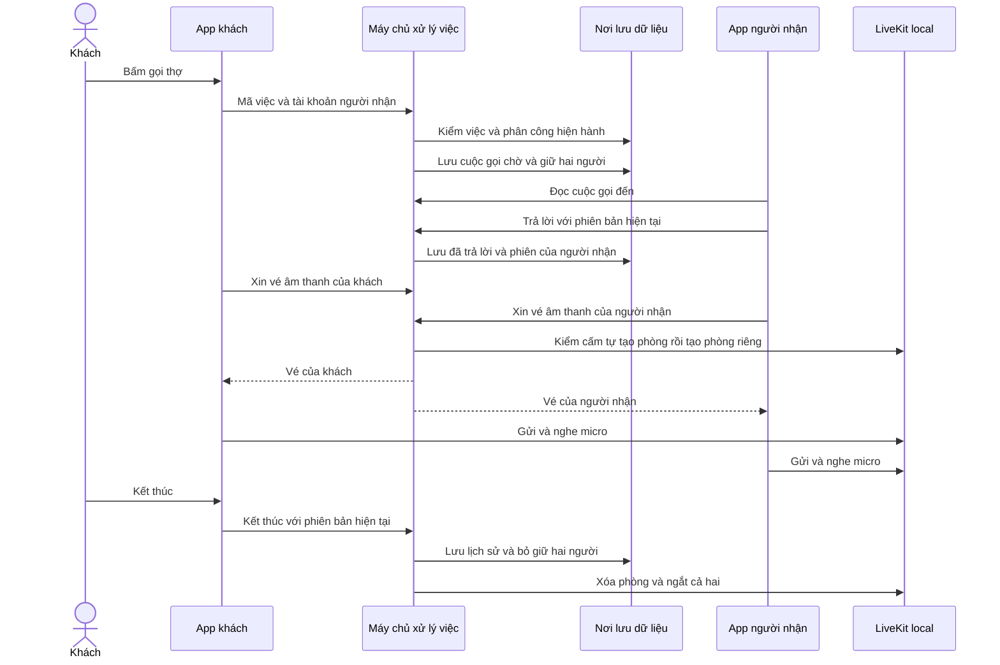
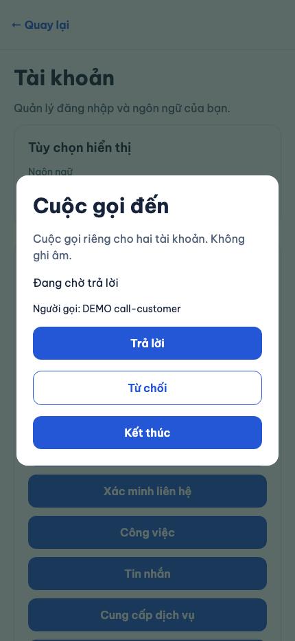
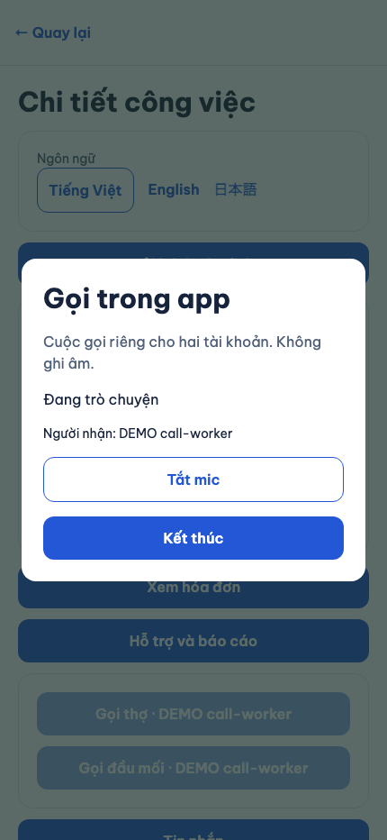
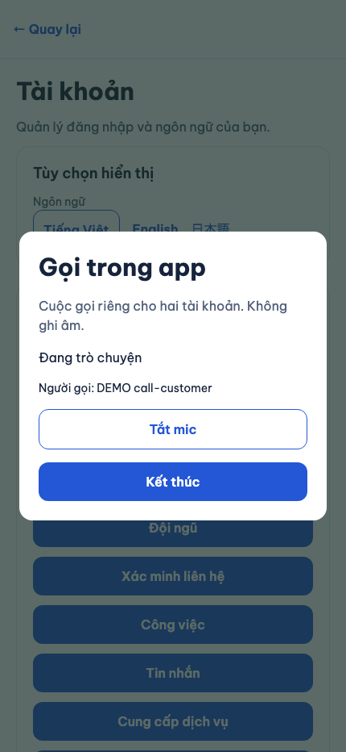
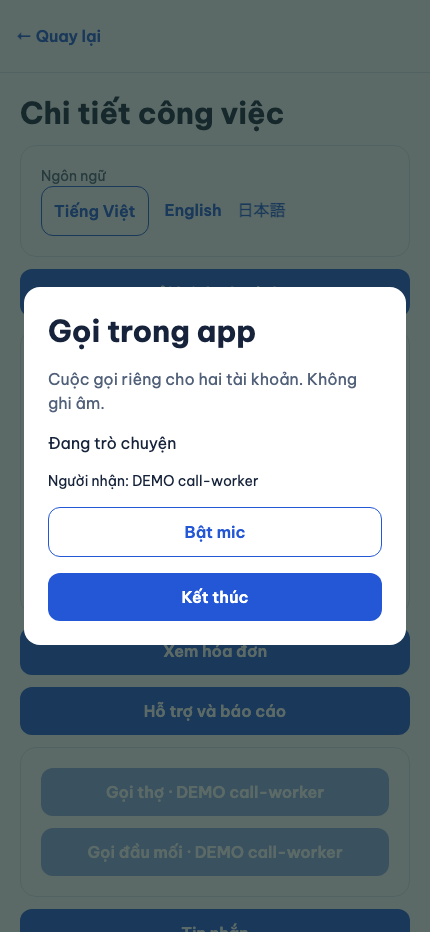
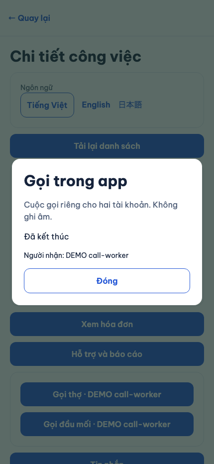

# B10-05 — Gọi âm thanh qua LiveKit local

B10-02 / P2-01 · 21/10/2026 · Code đang sửa trong repo, chưa commit/push/phát hành. Quyết định đã chốt: LiveKit tự chạy trên máy phát triển, âm thanh thật, không ghi âm, không bật chi phí/production.

## 1. Bạn đã dùng được những gì?

Trong chi tiết một việc đã nhận hoặc hoàn tất, khách bấm **Gọi thợ** hoặc **Gọi đầu mối**. Người đang được phân công và đầu mối hiện hành cũng có thể gọi ngược lại khách. App còn đăng nhập hiển thị cuộc gọi đến, cho nhận/từ chối. Chỉ sau khi người nhận trả lời, hai app mới được lấy vé vào phòng âm thanh. Trong cuộc gọi có tắt/bật mic, đổi loa trên điện thoại và kết thúc. Lịch sử nằm trong cuộc trò chuyện riêng của đúng hai tài khoản.

Đã kiểm âm thanh thật qua LiveKit local bằng hai trình duyệt độc lập: mỗi bên gửi một tiếng thử khác nhau và bên kia giải mã, đo được đúng tần số. Đây là tín hiệu âm thanh tạo bằng máy đi qua đường truyền thật; chưa phải bằng chứng hai người nói bằng micro điện thoại. Đã kiểm tín hiệu im khi tắt mic, trở lại khi bật mic, cả hai trình duyệt bị ngắt khi kết thúc hoặc đăng xuất. Ảnh native và kết quả build từng nền tảng thuộc lượt kiểm tích hợp chung, không lấy màn hình gọi làm bằng chứng micro hoạt động.

## 2. Những khái niệm cần biết

| Từ trong code | Nghĩa ở đây |
|---|---|
| LiveKit | Chương trình chuyển âm thanh giữa hai app. NestJS vẫn quyết định ai được gọi. |
| Media token | Vé vào một phòng, dành cho đúng một tài khoản. Vé khởi tạo sống 30 giây và chỉ cho gửi micro, nghe âm thanh. |
| Idempotency key | Mã của một lần bấm. Gửi lại cùng mã và nội dung không tạo cuộc gọi hoặc nhận việc lần thứ hai. |
| Heartbeat | App định kỳ báo vẫn đang ở cuộc gọi. Mất liên lạc lâu thì máy chủ kết thúc và ngắt phòng. |
| auto_create: false | Chỉ máy chủ có khóa riêng được tạo phòng. Vé người dùng giữ lại không thể tự dựng lại phòng đã xóa. |

## 3. Theo một thao tác từ đầu đến cuối

Ví dụ khách gọi đúng thợ đang được phân công:

Nếu người nhận đã ở cuộc khác, khách thấy **Máy bận**, có lịch sử, không lấy chỗ của cuộc đang diễn ra. Nếu 45 giây chưa trả lời, máy chủ ghi **Không trả lời**. Nếu mất quyền theo việc, đổi phân công, tài khoản bị vô hiệu hoặc đăng xuất khỏi nhóm phiên đang gọi, máy chủ chuyển cuộc gọi về **Quyền gọi không còn hiệu lực** và xóa phòng. Lịch sử riêng đã có vẫn được giữ.

## 4. Mở code theo thứ tự nào?

| Bước | File và hàm thật | Nhận gì, làm gì, chuyển gì? |
|---|---|---|
| 1 | [CallsProvider.tsx](../../../apps/mobile/src/features/calls/CallsProvider.tsx), `CallButton`, `execute` | Đọc người liên hệ hợp lệ, xin quyền mic, giữ mã retry rồi gửi thao tác qua phiên đăng nhập hiện hành. |
| 2 | [calls-api.ts](../../../apps/mobile/src/features/calls/api/calls-api.ts), `createCallsApi` | Chuyển mã việc/người nhận và phiên bản thành HTTP request. Kiểm hình dạng response trước khi đưa vào UI. |
| 3 | [calls.controller.ts](../../../services/api/src/modules/calls/calls.controller.ts), `create`, `action`, `media` | Kiểm ID/body và chuyển thao tác cho phần xử lý cuộc gọi. Không cấp vé từ route tạo cuộc gọi. |
| 4 | [calls.access.ts](../../../services/api/src/modules/calls/calls.access.ts), `callTargets`, `callRelation` | Đọc việc accepted/completed, phân công chưa kết thúc và đầu mối hiện hành. Quyền quản trị không tự biến thành quyền nghe phòng riêng. |
| 5 | [calls.service.ts](../../../services/api/src/modules/calls/calls.service.ts), `create`, `change`, `mediaToken`, `process`, `cleanup` | Khóa giao dịch, giữ mỗi người ở tối đa một cuộc, lưu phiên bản/kết quả retry. Chỉ người nhận nhận/từ chối. Đọc lại quyền trước retry và trước cấp vé. Worker hết hạn và xóa phòng được thử lại bền trong DB. |
| 6 | [livekit.adapter.ts](../../../services/api/src/integrations/livekit/livekit.adapter.ts), `requireExplicitRooms`, `token`, `close` | Dùng khóa máy chủ kiểm `auto_create:false`, tạo phòng tối đa hai người, cấp vé chỉ micro và xóa phòng. Không đưa khóa hoặc vé vào outbox/snapshot retry. |
| 7 | [media.native.ts](../../../apps/mobile/src/features/calls/media.native.ts), `prepareMicrophone`, `createMediaSession` | Khởi động/giải phóng phiên âm thanh điện thoại, gửi micro, tắt mic và đổi loa đúng ID của iOS/Android. |
| 8 | [media.ts](../../../apps/mobile/src/features/calls/media.ts), `createMediaSession` | Bản web gắn âm thanh nhận vào phần tử phát, cho bật lại âm thanh nếu trình duyệt chặn, dừng track và gỡ phần tử khi thoát. |
| 9 | [CallHistory.tsx](../../../apps/mobile/src/features/calls/CallHistory.tsx) | Đọc lịch sử chỉ theo đúng người tham gia và phòng riêng, có phân trang/thử lại. |

## 5. Dữ liệu được nhớ ở đâu và nếu có lỗi thì sao?

[Migration 021](../../../services/api/migrations/021_p2_calls.sql) thêm `calls` và `active_call_users`. Bảng thứ hai dùng tài khoản làm khóa duy nhất, nên một người không thể vừa là người gọi ở cuộc này vừa là người nhận ở cuộc khác. Giao dịch lưu cuộc gọi và kết quả retry cùng lúc. Bản trả lời retry không có vé media, khóa LiveKit hoặc nhóm phiên.

Vé media chỉ có trong bộ nhớ lúc kết nối. Cả hai phải dùng nhóm phiên đăng nhập đã bắt đầu/nhận cuộc gọi; đăng nhập ở cửa sổ khác không được lấy vé để chiếm cuộc đang gọi. Refresh bình thường vẫn cùng nhóm phiên nên không làm rớt cuộc gọi. Đăng xuất hoặc thu hồi phiên ngắt quyền. Mất mạng quá 15 giây không kiểm lại được quyền thì client dừng media; máy chủ cũng kết thúc khi heartbeat quá 45 giây.

Tên người gọi/người nhận được đọc qua danh sách liên hệ đúng việc, không hiển thị mã UUID. Khi chưa đọc được tên, app dùng nhãn Người liên hệ theo ngôn ngữ đang chọn. Phản hồi tên đến trễ bị bỏ nếu đã đổi cuộc gọi hoặc tài khoản. App giữ nguyên mã lỗi thay vì câu tiếng Việt trong state. VI/EN/JA được dịch ở lúc vẽ. Nếu gửi thao tác rồi mất phản hồi hoặc nhận JSON không hợp lệ sau khi máy chủ có thể đã lưu, nút thử lại giữ nguyên nội dung, phiên bản và mã retry. Nếu từ chối quyền mic thì không gửi nhận cuộc gọi. Hết quyền hoặc đổi tài khoản xóa thông tin/âm thanh đang giữ và bỏ phản hồi trễ của tài khoản cũ.

`call_push` chỉ điều khiển chuông/push. Tắt nó không cấm cuộc gọi đang đủ điều kiện và không xóa lịch sử. Màn foreground đọc lại trạng thái qua HTTP kể cả khi realtime chưa sẵn sàng. Chưa có bằng chứng cuộc gọi đến ở nền/app đóng hoặc APNs.

## 6. Bạn có thể tự thử và tự kiểm hiểu

1. Dùng hai tài khoản DEMO, một khách và thợ đang được phân công, mở cùng việc accepted. Gọi, trả lời rồi thử tắt mic/đổi loa/kết thúc. Chỉ dùng LiveKit local cấu hình bên dưới.
2. Bấm nhận hai lần hoặc tạm ngắt mạng sau khi bấm, rồi thử lại. Một cuộc chỉ nhận một lần. Đăng xuất bên đang gọi: bên kia phải thấy quyền không còn và âm thanh bị ngắt.
3. Đổi người thực hiện hoặc đầu mối: người cũ vẫn thấy lịch sử riêng nhưng không xin được vé mới theo việc cũ. Người quản lý ngoài hai bên không được xem/chui vào cuộc gọi.

Câu hỏi tự kiểm: Vì sao tạo cuộc gọi chưa trả ngay vé? Tìm `mediaToken` và trạng thái `accepted`. Vì sao vé cũ không dựng lại phòng sau kết thúc? Đọc `requireExplicitRooms` và `room.auto_create`. Vì sao retry không lấy câu trả lời của tài khoản khác? Tìm `featureOperation`, `ownerRef` và scope actor của `AccountTransaction`.

## 7. Đã kiểm tra gì và còn giới hạn nào?

- API/DB: kiểm quyền hai chiều, người nhận duy nhất được accept/decline, một cuộc/người qua cạnh tranh, bận, hết giờ, mất heartbeat, quyền thay đổi, phiên khác, refresh, logout, replay và cleanup khi media lỗi. Bộ này dùng adapter thử có kiểm soát; không phải bằng chứng âm thanh.
- UI: nhận cuộc gọi, quyền mic bị từ chối, giữ key/version khi mất phản hồi, mute/speaker/end, đổi chủ tài khoản và bỏ media response trễ, lỗi kết nối, tải lại lịch sử.
- Plugin native: `expo prebuild --no-install` thành công. Android cho RECORD_AUDIO, chặn CAMERA, không có SYSTEM_ALERT_WINDOW trong main; debug giữ overlay của Expo. iOS có mô tả micro, không có quyền camera. Đây là cấu hình sinh native, không chứng minh build/micro trên điện thoại.
- Media thật: hai trình duyệt Chromium dùng LiveKit 1.13.10, client 2.23.0, tín hiệu 440/880 Hz được đo phía nhận khoảng 433,59/878,91 Hz. Tắt/bật mic làm tín hiệu mất/trở lại. End và logout ngắt cả hai. Cả vé ban đầu và vé LiveKit đã refresh bị từ chối khi thử nối lại phòng đã xóa, với `auto_create:false`.

[Số đo và kết quả local](anh/B10-05/am-thanh-local.json) là artifact tái tạo được, không chứa vé/khóa hay âm thanh riêng của người dùng.

Lệnh, contract và nguồn chính thức

| Kiểm | Lệnh từ repo root | Mức bằng chứng |
|---|---|---|
| API/DB | `TSX_TSCONFIG_PATH=services/api/tsconfig.json node --import tsx --test services/api/test/integration/calls.test.ts` | 9 bài kiểm miền calls, DB test cô lập; thêm kiểm call_push và cuộc gọi đã hết hạn/kết thúc |
| Adapter/policy | `TSX_TSCONFIG_PATH=services/api/tsconfig.json node --import tsx --test services/api/test/unit/livekit.adapter.test.ts` | Chặn server tự tạo phòng, grant microphone, xóa phòng |
| UI/native lifecycle | `npm run test --workspace @dvqb/mobile -- --runTestsByPath src/features/calls/CallsProvider.test.tsx src/features/calls/media.native.test.ts src/features/calls/api/calls-api.test.ts` | 13 bài kiểm tự động, media boundary được điều khiển trong test |
| Sinh native | `npm run native:generate --workspace @dvqb/mobile` | Prebuild thành công, kiểm AndroidManifest/Info.plist |
| Chạy media | `.local/p2/livekit/livekit/1.13.10/bin/livekit-server --config infra/livekit-local.yaml` | Binary tải local, không cài toàn hệ thống |
| Âm thanh thật | `TSX_TSCONFIG_PATH=services/api/tsconfig.json LIVEKIT_TEST_URL=ws://127.0.0.1:7880 node --import tsx --test services/api/test/manual/calls-media.manual.ts` | 2 browser contexts, giải mã/đo tín hiệu và thử rejoin ác ý |

`LIVEKIT_URL=ws://127.0.0.1:7880`, `LIVEKIT_API_KEY=devkey`, `LIVEKIT_API_SECRET=secret` là khóa thử công khai của cấu hình local, không dùng production. Dùng file [livekit-local.yaml](../../../infra/livekit-local.yaml), **không chạy riêng `--dev` với auto_create mặc định**. Adapter từ chối cấp vé nếu phép thử phòng chưa tạo không bị server trả 404 đúng chính sách. Token của người tham gia không có roomCreate.

API giữ `POST /calls` với `target=worker|business` và `POST /calls/:id/actions`; mở thêm `recipient_id` cho hướng gọi ngược, targets/list/detail/media/heartbeat. Thay `CallGrant` trả token lúc tạo bằng dữ liệu cuộc gọi; endpoint media riêng kiểm accepted nhằm không lưu token trong retry. Đây là contract triển khai bảo mật theo kế hoạch P2 đã chốt; root tích hợp OpenAPI/SDD, không tự đồng bộ Excel/Drive/ui-ux.

Nguồn chính thức: [Expo quickstart](https://docs.livekit.io/transport/sdk-platforms/expo/) yêu cầu development build và hai config plugins; [cấu hình v1.13.10](https://github.com/livekit/livekit/blob/v1.13.10/config-sample.yaml) có `room.auto_create:false`; [room allocator](https://github.com/livekit/livekit/blob/v1.13.10/pkg/service/roomallocator.go) kiểm phòng hiện hữu khi không có quyền create; [token lifecycle](https://docs.livekit.io/frontends/reference/tokens-grants/) mô tả token refresh và giới hạn blacklist của self-host. Chính sách không tự tạo phòng + server xóa phòng được kiểm thực tế để giải quyết việc dùng lại vé, không suy ra từ TTL 30 giây.

## 8. Phần chưa làm và bước sau

Chưa có bằng chứng hai người nói/nghe qua micro của thiết bị vật lý, nhận cuộc gọi ở nền/đã đóng app, CallKit/Android Telecom, APNs, production, provider trả phí hay UAT của chủ dự án. Expo Go không hỗ trợ native WebRTC. Android emulator chuyển loopback thành 10.0.2.2; thiết bị vật lý cần cấu hình mạng/địa chỉ media riêng trước thử, không lấy localhost làm bằng chứng thiết bị thật.

Android emulator/iOS simulator đã build và tải SDK native qua luồng bảo mật/ví; chưa đo media native. Mermaid đã render. SDD tổng xem B11-03; chưa commit/push/CI mới/deploy.

## 9. Ảnh app web chạy thật ngày 21/10/2026

Chromium với khung430×932, hai tài khoản DEMO và một việc đã nhận trong schema riêng. Bấm từ danh sách việc → chi tiết → gọi → nhận; cả hai nối LiveKit local, thử tắt mic và kết thúc. Browser dùng microphone giả của Chromium, không phải giọng người hoặc điện thoại thật. [Bằng chứng UI](anh/B10-05/ui-evidence.json) tách khỏi phép đo tần số ở trên.

