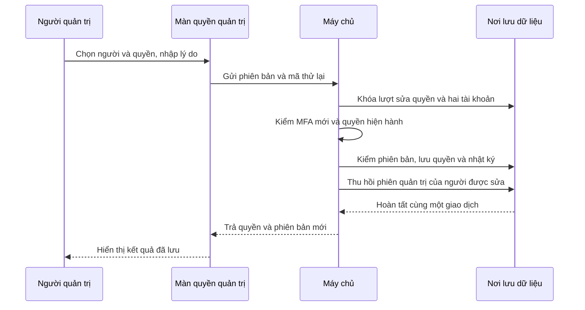
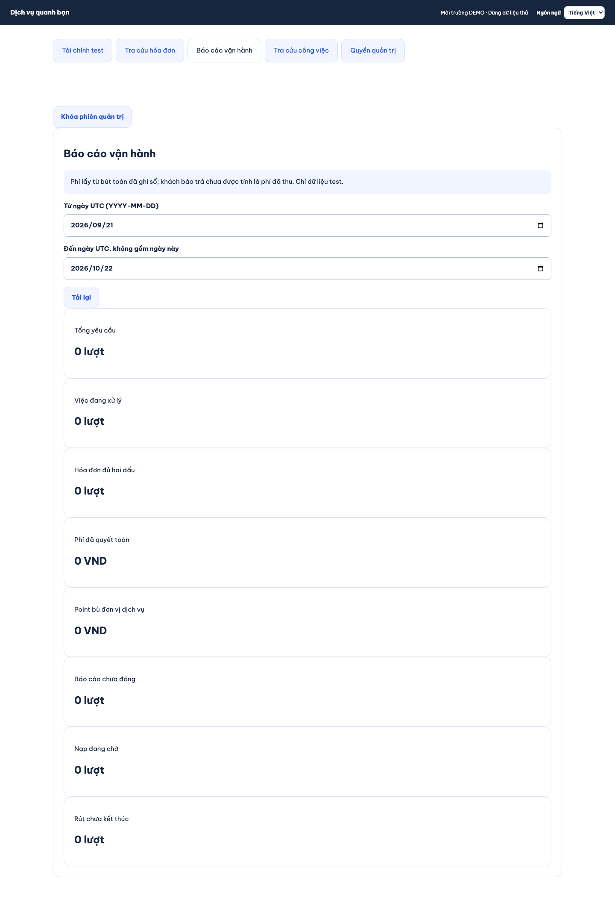
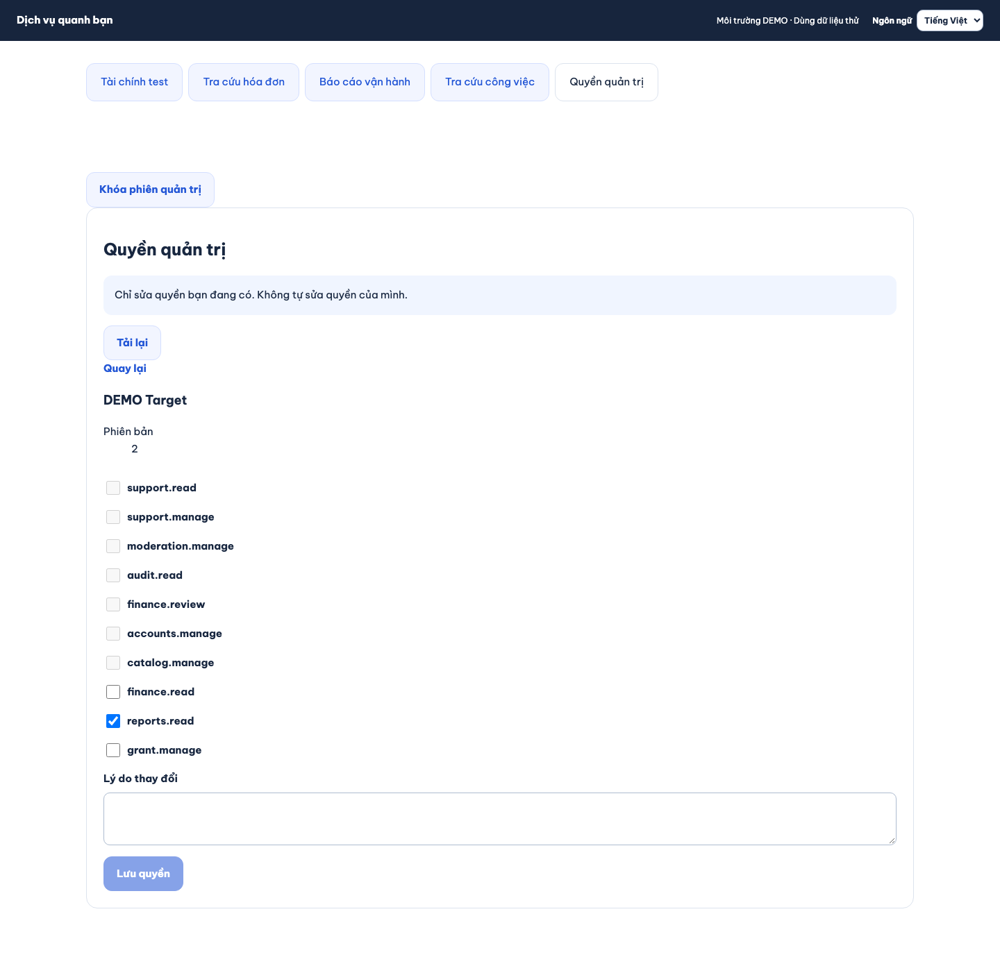

# B11-01 — Phân quyền, tra cứu và báo cáo vận hành

21/10/2026 · P2 đã duyệt · Code đang sửa trong repo, chưa commit/push. [Kế hoạch](../de-xuat/P2-01-trien-khai-tron-dot.md).

## Bạn đã dùng được gì?

Trong khu vực quản trị, người có quyền tương ứng mở **Báo cáo vận hành**, **Tra cứu công việc**, **Tra cứu hóa đơn** hoặc **Quyền quản trị**. Mỗi phần có cửa kiểm quyền riêng. Màn tra cứu chỉ đọc dữ liệu; nó không có nút quyết toán hoặc sửa tiền.

Báo cáo chọn khoảng ngày UTC, từ ngày đầu đến trước ngày cuối. Phí đã quyết toán lấy từ sổ tiền đã ghi nhận. Việc khách bấm “đã trả” không tự làm tăng con số đó. Các khoản tiền được giữ dưới dạng chuỗi số nguyên để không làm tròn khi giá trị lớn.

Quản trị quyền yêu cầu MFA, nghĩa là xác minh bằng ứng dụng tạo mã ngoài mật khẩu. Admin chỉ thay quyền mình có, không sửa chính mình, không làm mất người quản trị quyền cuối cùng. Khi lưu, server thu hồi phiên quản trị cũ của người được sửa để quyền mới được kiểm lại.

## Một lần cấp quyền đi như thế nào?

Khóa lượt sửa quyền giúp hai admin không ghi đè nhau. Nếu hai người cùng mở phiên bản 1, chỉ một quyết định được lưu; người còn lại nhận yêu cầu tải dữ liệu mới. Mã thử lại (*idempotency key*) giúp lần bấm lại sau mất mạng nhận kết quả đã lưu, thay vì tạo một thay đổi nữa. Server vẫn kiểm lại quyền và MFA trước khi trả kết quả cũ.

## Đọc code theo thứ tự

| Bước | File và hàm | Nhận gì, làm gì, chuyển gì? |
|---|---|---|
| 1 | [P2Desk mobile](../../../apps/mobile/src/features/admin/screens/P2Desk.tsx), [P2Desk web](../../../apps/admin/src/P2Desk.tsx) | Nhận quyền tài khoản và chọn nhóm màn phù hợp. |
| 2 | [BackofficePanel mobile](../../../apps/mobile/src/features/backoffice/BackofficePanel.tsx), [web](../../../apps/admin/src/BackofficePanel.tsx), `GrantEditor.submit` | Giữ lựa chọn, lý do và phiên bản đang xem. Khi lỗi mạng giữ nguyên nội dung và mã thử lại. |
| 3 | [AdminApi.request](../../../apps/mobile/src/features/admin/api/admin-api.ts) | Gửi API có phiên đăng nhập và phiên MFA; hủy phản hồi nếu phiên màn đã đổi. |
| 4 | [BackofficeController](../../../services/api/src/modules/backoffice/backoffice.controller.ts), [grantsInput/metricsInput](../../../services/api/src/modules/backoffice/backoffice.input.ts) | Kiểm mã tài nguyên, danh sách quyền, phiên bản, lý do và khoảng thời gian. |
| 5 | [BackofficeService](../../../services/api/src/modules/backoffice/backoffice.service.ts), `saveGrants`, `metrics`, `list`, `operation` | Quyết định quyền thật ở server, đọc sổ tiền, giới hạn phân trang theo người/bộ lọc, tra thao tác đúng người gửi. |
| 6 | [Migration 022](../../../services/api/migrations/022_p2_backoffice.sql) | Mở ba quyền tách biệt `finance.read`, `reports.read`, `grant.manage`; không tự cấp chúng cho tài khoản đang có. |

## Dữ liệu, lỗi và cách tự thử

Danh sách và chi tiết chỉ nằm tạm trong màn. Quyền, nhật ký và kết quả thao tác được lưu trong PostgreSQL. Đóng màn hoặc khóa MFA bỏ nội dung riêng tư. Phản hồi đến trễ không được ghi vào màn mới. Nhật ký giữ người sửa, lý do và quyền trước/sau, không ghi mật khẩu hoặc mã MFA.

Có thể thử bằng hai tài khoản DEMO: mở cùng một người ở hai cửa sổ, lưu quyền ở cửa sổ đầu rồi lưu ở cửa sổ còn lại. Cửa sổ thứ hai phải yêu cầu tải lại. Thử chọn quyền mà admin không có: UI khóa lựa chọn và API vẫn từ chối nếu gửi thủ công. Thử khóa phiên quản trị: chi tiết phải biến mất.

Tự kiểm hiểu: vì sao MFA còn hạn 15 phút nhưng thao tác sửa có thể yêu cầu xác minh lại sau 5 phút? Vì đọc và thay đổi nhạy cảm có giới hạn khác nhau (`AdminAuthService.check`). Vì sao khách báo trả chưa tính là phí đã quyết toán? Vì `metrics` đọc bút toán `fee_revenue`, không đọc riêng dấu khách đã trả.

## Kiểm chứng và giới hạn

Đã chạy bài kiểm API về cạnh tranh sửa quyền, tự cấp/vượt quyền, thu hồi quyền trước retry, MFA và tra thao tác khác người. Bài kiểm UI kiểm giữ nguyên retry và không mất độ chính xác số lớn. Hành trình web thực tế đã kiểm xem báo cáo, cấp quyền sau mất phản hồi và khóa màn. Bài API kiểm biên khoảng ngày và cursor; bài web kiểm lỗi mạng rồi lưu lại không còn báo lỗi cũ.

Ảnh Chromium desktop ngày21/10/2026, dữ liệu DEMO, API/PostgreSQL thật. Kiểm web1/1 đạt; không thay nghiệm thu admin trên thiết bị thật hoặc UAT.

Tra cứu kỹ thuật

- [API test](../../../services/api/test/integration/backoffice.test.ts), [UI test](../../../apps/mobile/src/features/backoffice/BackofficePanel.test.tsx), [web E2E](../../../tests/e2e/web/backoffice.spec.mjs).
- `GET /operations/{key}` chỉ trả operation/state/resource_id/thời điểm của actor hiện tại. Không trả `response_snapshot`; nếu một key dùng cho nhiều operation thì cần chỉ rõ operation.
- Nguồn thiết kế hiện hành: [admin operations](../../../ui-ux/specs/admin-operations.md). Tài liệu thiết kế này không được sửa trong đợt code.
- Các số đang xử lý là trạng thái **lúc đọc**, với đối tượng được tạo trong kỳ. Không gọi chúng là ảnh chụp trạng thái lịch sử tại cuối kỳ.
- `from` bao gồm, `to` không bao gồm; phí và point bù lọc theo thời điểm bút toán, đủ hai dấu lọc theo thời điểm dấu thứ hai.

