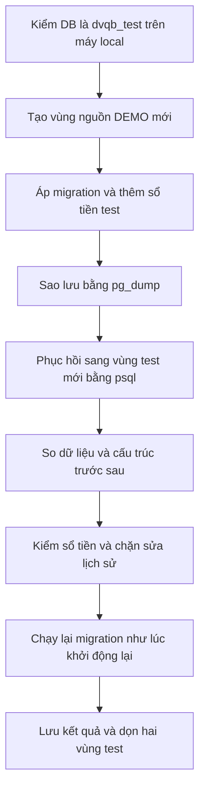

# B11-02 — Diễn tập phục hồi dữ liệu local

21/10/2026 · B11-03 / QA-055 · Chỉ dữ liệu DEMO trong `dvqb_test`. [Kế hoạch P2](../de-xuat/P2-01-trien-khai-tron-dot.md).

## Kết quả nhìn thấy

Đã tạo một vùng dữ liệu test mới, sao lưu rồi phục hồi sang vùng test khác. Sau phục hồi, dữ liệu 75 bảng giống hệt nguồn, 368 ràng buộc, 183 chỉ mục và 18 trigger vẫn còn. *Trigger* là đoạn kiểm tự chạy trong DB, chẳng hạn không cho xóa lịch sử tiền. Tổng các bút toán vẫn cân bằng và số dư khớp tổng bút toán.

Đây là diễn tập trên máy phát triển. Nó chưa phải sao lưu production, chưa chứng minh khôi phục tệp ảnh hoặc bí mật mã hóa, và chưa có cam kết thời gian phục hồi/RPO/RTO cho hệ thống thật.

## Luồng thực tế



Công cụ không nhận tên schema người dùng để ghi đè. Tên vùng dữ liệu (*schema*) do công cụ tạo ngẫu nhiên và kiểm mẫu trước khi dùng. Nó chỉ cho phép DB `dvqb_test` qua địa chỉ loopback. Dù bài kiểm lỗi, khối `finally` vẫn dọn hai vùng do chính lượt kiểm tạo.

## Cách đọc và chạy

| Bước | File/hàm | Ý nghĩa |
|---|---|---|
| 1 | [localTestDatabase, drillSchema](../../../scripts/ops/local-safety.mjs) | Từ chối DB từ xa, DB thật và tên vùng không thuộc diễn tập. |
| 2 | [restore-drill](../../../scripts/ops/restore-drill.mjs), `snapshot` | Đếm/hash từng bảng, kiểm cấu trúc và tổng sổ tiền. Hash là dấu vân tay dữ liệu dùng so trước/sau. |
| 3 | [migrate](../../../services/api/src/database/migrate.ts) | Áp mỗi migration một lần, kiểm checksum; chạy lại không thay lịch sử. |
| 4 | [restore-safety.test](../../../scripts/test/restore-safety.test.mjs) | Kiểm công cụ từ chối mục tiêu nguy hiểm trước khi đụng DB. |

Lệnh từ thư mục repo:

```sh
npm run build -w services/api
node scripts/ops/restore-drill.mjs
```

Cần dịch vụ `db-test` của `infra/compose.yaml` đã chạy. Kết quả tại `test-results/ops/restore-drill.json` (artifact local, không chứa dữ liệu riêng tư). Lượt kiểm đã đạt mất khoảng 1,47 giây sao lưu và 0,95 giây phục hồi/kiểm trên dữ liệu rất nhỏ; số này **không** là cam kết hiệu năng production.

## Phục hồi và rollback khi vận hành P2 local

Giữ nguyên các khóa mã hóa local khi khởi động lại API; đổi khóa tùy tiện khiến số ngân hàng và MFA cũ không giải mã được. Không đưa khóa, dump DB hay mật khẩu vào Git. Khởi động LiveKit theo [cấu hình local](../../../infra/livekit-local.yaml), API theo `.env.example`, rồi dùng `/v1/ready` trước mở app.

Khi API ngắt lúc rút tiền: yêu cầu `unknown` vẫn giữ tiền. Mở lại ứng dụng và đối soát giao dịch ngân hàng mô phỏng đã lưu, không tạo chuyển tiền khác để đoán kết quả. Hướng dẫn chi tiết ở [B08-01](B08-01-ngan-hang-va-nap-rut-test.md). Cuộc gọi dùng worker kiểm timeout và quyền sau khởi động lại, không lưu media token trong DB.

Rollback ứng dụng cần bản code còn hiểu schema mới. Không chạy migration ngược hoặc xóa bảng ledger để quay về bản cũ. Khi thay đổi không tương thích, dừng thao tác liên quan và sửa tiến (*forward fix*) trong local trước. Bản backup DB thật còn cần các tệp private asset, khóa mã hóa, cấu hình phiên bản và bài thử end-to-end riêng; lượt diễn tập này chưa kiểm các phần đó.

## Bài tự thử và giới hạn

Chạy diễn tập hai lần: cả hai phải thành công và không để schema `drill_*` tồn đọng. Thay `TEST_DATABASE_URL` sang `dvqb_local`: công cụ phải từ chối trước khi sao lưu. Vì sao chỉ so số dòng chưa đủ? Một giá trị tiền sai vẫn giữ cùng số dòng, nên `snapshot` còn so hash và tổng bút toán.

Không có ảnh UI vì đây là công cụ vận hành. Không có deploy, restore vào DB người dùng hoặc phê duyệt production. Kết quả kiểm tổng mới nhất nằm trong báo cáo tổng P2.
