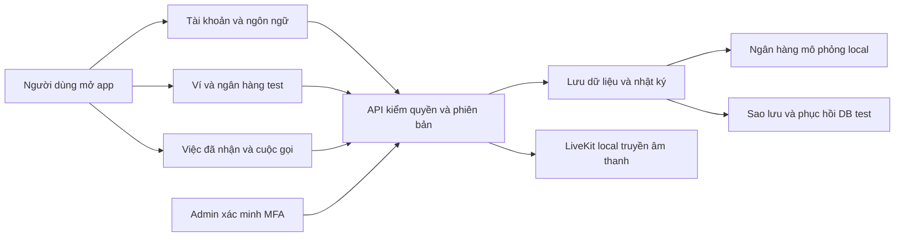

# B11-03 — P2 trong một đợt: cách chạy, kiểm và đọc code

21/10/2026 · Theo [P2-01 đã duyệt](../de-xuat/P2-01-trien-khai-tron-dot.md). Phạm vi: máy phát triển, DEMO và tiền test. Chủ dự án đã yêu cầu push ngày 21/10/2026. Trạng thái CI phải đọc trên đúng commit ở [GitHub Actions](https://github.com/anhthaingd/dich-vu-quanh-ban/actions/workflows/quality.yml); chưa UAT hoặc phát hành.

## Người dùng nhìn thấy gì?

Từ **Tài khoản**, bạn có thể dùng OTP local, đặt lại/đổi mật khẩu, đổi liên hệ và gửi yêu cầu xóa. Người mất mọi kênh có luồng khôi phục riêng; admin duyệt xong vẫn phải chứng minh kênh mới. Chọn tiếng khi đã đăng nhập lưu vào tài khoản; khi đăng xuất, app trở lại lựa chọn khách trên máy.

Từ hồ sơ cung cấp dịch vụ hoặc thành viên có quyền ví, bạn mở **Ví**, xem tiền và khoản giữ, đề nghị ngân hàng, nạp/rút test. Admin duyệt và đối soát với dữ liệu ngân hàng mô phỏng được lưu bền. Một giao dịch đã chuyển nhưng mất phản hồi giữ trạng thái chưa rõ và khoản giữ; đối soát tra giao dịch gốc.

Từ việc đã nhận, hai bên đủ quyền có thể gọi bằng LiveKit local. Luồng có nhận/từ chối, mic/loa, kết thúc và lịch sử. Khu quản trị có tra cứu việc/hóa đơn, báo cáo trong kỳ và cấp quyền theo MFA. Công cụ vận hành sao lưu/phục hồi vào hai vùng DB test do chính lượt chạy tạo.



## Đọc từng luồng

| Thao tác | Báo cáo học code | Điểm cần nhớ |
|---|---|---|
| Bảo mật, khôi phục, xóa | [B01-08](B01-08-bao-mat-khoi-phuc-va-xoa.md) | Admin duyệt không đăng nhập thay; xóa giữ chứng từ và kiểm lại nghĩa vụ. |
| Chọn tiếng | [I18N-05](I18N-05-ngon-ngu-tai-khoan.md) | Phản hồi cũ không được đè phiên bản tài khoản mới. |
| Ví, ngân hàng, nạp/rút | [B08-01](B08-01-ngan-hang-va-nap-rut-test.md) | Chỉ tiền test; ảnh hoặc mã chưa xác minh không tự tạo số dư. |
| Cuộc gọi | [B10-05](B10-05-cuoc-goi-livekit-local.md) | Quyền việc và phiên đăng nhập quyết định quyền vào phòng. |
| Quản trị quyền, tra cứu, metrics | [B11-01](B11-01-quyen-tra-cuu-va-bao-cao.md) | Tra cứu chỉ đọc; tiền lấy từ sổ tiền, không suy từ dấu khách báo trả. |
| Phục hồi DB | [B11-02](B11-02-dien-tap-phuc-hoi-local.md) | Hai schema test riêng, không ghi đè DB người dùng. |

Các báo cáo trên chỉ tới file/hàm thật, mô tả đầu vào/đầu ra, lỗi/thử lại, quyền và ảnh đã kiểm. Điểm tích hợp chung là [AppNavigator](../../../apps/mobile/src/app/navigation/AppNavigator.tsx), [AuthProvider](../../../apps/mobile/src/app/providers/AuthProvider.tsx), [AppModule](../../../services/api/src/app.module.ts) và [environment](../../../services/api/src/config/environment.ts).

## Những lỗi review đã yêu cầu kiểm lại

- Phản hồi HTTP thành công nhưng JSON hỏng vẫn là **chưa biết kết quả**: giữ nguyên nội dung và khóa thử lại, không tạo yêu cầu nạp/rút khác.
- Từ chối hoặc mới duyệt một yêu cầu không được giữ độc quyền mã giao dịch ngân hàng chưa xác minh.
- Quyền ví có thể nằm ở trang thành viên thứ hai; tải đủ trước khi quyết định nút thao tác.
- Sau mất mạng, quyết định admin có nút thử lại ghi rõ quyết định cũ, khóa các lựa chọn khác. Không cho nút “Từ chối” âm thầm gửi lại “Duyệt”.
- Web và API khác cổng cần cho phép header `X-Recovery-Token` ở CORS; bài preflight kiểm lại header và origin, không bỏ xác minh receipt.
- Một phản hồi lưu ngôn ngữ cũ không được thắng dữ liệu tài khoản mới hơn vừa đọc lại.
- Hermes không định dạng `BigInt` trực tiếp: dùng chuỗi chữ số chính xác với ký hiệu phân cách của VI/EN/JA. Bản iOS simulator cần chữ ký ad-hoc để dùng Keychain thật.
- E2E ngôn ngữ/hồ sơ phải tính các lần lưu locale vào tài khoản. E2E đánh giá phải chờ bản sửa đã lưu và danh sách tải lại; chữ còn trong ô nhập chưa chứng minh server đã lưu xong.
- Sau mất mạng, bộ đếm tin nhắn phải đọc lại ngay khi có tín hiệu kết nối lại/tin mới, không tiếp tục chờ nhịp thử lại 30 giây của lỗi trước. Vẫn giữ giãn nhịp khi chưa có tín hiệu mới và dùng dữ liệu HTTP để tính số chưa đọc.

## Cách đọc bằng chứng

SDD là bộ kiểm nối yêu cầu → code → bài kiểm. Đợt này giữ 129 tiêu chí cũ, bổ sung 15 tiêu chí, tổng 144. QA-104–108 ghi các trường hợp mới theo quyết định đã duyệt; không sửa nội dung 103 QA cũ. QA còn `partial` hoặc `unmapped` vì bài kiểm local không đại diện toàn bộ nghiệp vụ hoặc nhà cung cấp.

Chuỗi kiểm tổng bắt buộc gồm lint, typecheck, tooling, mobile và coverage, API/PostgreSQL và coverage, build ba workspace, web E2E, tải local, prototype và Storybook. Kết quả máy ở `test-results/sdd/SDD-PROJECT/evidence.json`; chỉ `sdd:check --phase verify` trên cùng dấu băm mới xác nhận bộ file đang mở. Log thất bại được giữ để sửa nguyên nhân, không giảm coverage hoặc bỏ tiêu chí.

Ngoài bộ kiểm này: bản native Android/iOS và ảnh màn có bằng chứng riêng trong các báo cáo; bài LiveKit thật dùng hai browser với tín hiệu âm thanh 440/880Hz; diễn tập dump/restore kiểm cấu trúc, dữ liệu và sổ tiền. Các loại bằng chứng này không thay nhau.

```sh
npm run sdd:check -- --change SDD-PROJECT --phase prepare
npm run sdd:run -- --change SDD-PROJECT
npm run sdd:check -- --change SDD-PROJECT --phase verify
```

## Phần còn ngoài bằng chứng hiện tại

Chưa xác nhận microphone hai điện thoại thật, nhận cuộc gọi khi app nền/đóng, APNs và UAT của chủ dự án. Chưa tích hợp ngân hàng ngoài, email/SMS thương mại, tiền thật hoặc production. Xóa vật lý và thời hạn giữ dữ liệu chưa được chốt; giữ chứng từ không đồng nghĩa mọi bản sao thông tin cá nhân đã biến mất. Diễn tập DB chưa gồm private assets và bộ khóa mã hóa, chưa cam kết RPO/RTO.

Dependency được khóa phiên bản; `npm audit` vẫn báo advisory tồn tại trong cây dependency (có mục critical có sẵn trước đợt). Không tự nâng hàng loạt Expo/MapLibre để làm báo cáo xanh. Cần xử lý bằng đợt nâng cấp tương thích trước phát hành; việc build/test đạt không chứng nhận cây dependency sạch advisory.

Tài liệu quyết định và báo cáo này nằm trong repo. Drive, Excel, prototype/spec trong `ui-ux` không được đồng bộ trong đợt code. PROMO-02, Q02 và chuyển chủ/đóng doanh nghiệp vẫn giữ phạm vi hoãn trước đó.

## Bài tự thử

Dùng hai tài khoản DEMO, đổi tiếng ở cửa sổ thứ hai rồi đưa cửa sổ thứ nhất về foreground: app phải đọc lựa chọn mới. Tạo một yêu cầu rút test, mô phỏng mất phản hồi sau chuyển rồi đối soát: giải thích vì sao giữ tiền tốt hơn tự gửi thêm lần nữa. Kết thúc cuộc gọi rồi thử dùng token đã cấp: máy chủ phải từ chối vào lại phòng cũ.

## Rà soát phần còn thiếu trước push — 21/10/2026

Luồng cốt lõi đã có code nối dữ liệu → API → app: tìm người cung cấp, gửi/nhận việc, phân công, chat/lịch/thông báo, hóa đơn, point/quyết toán test, đánh giá và hỗ trợ/admin. P2 bổ sung tài khoản, locale, ví/ngân hàng mô phỏng, gọi local và tra cứu vận hành. Đây chưa phải xác nhận toàn bộ sản phẩm đã hoàn tất hoặc sẵn sàng production.

Các mục dưới đây được đối chiếu lại với code, không lấy câu “chưa làm” trong mốc checklist cũ làm kết luận hiện tại:

| Phần còn thiếu | Hiện trạng và điểm đối chiếu |
|---|---|
| Ảnh năng lực trên hồ sơ người cung cấp | `partners.input.ts`/`PartnerEditorScreen.tsx` chưa có trường và luồng gallery; `AssetsService.grant` mới nhận result/review/evidence/verification. Ảnh kết quả, đánh giá và chứng cứ local đã có. |
| Điều hướng riêng theo vai khách/partner/nhân viên | `ProductShell.tsx` vẫn dùng bốn tab khách chung. Ví đã mở được từ hồ sơ/đội ngũ; chưa có đầy đủ bộ tab riêng theo UI-16. Admin đã có khu riêng. |
| Trở lại đúng thao tác và liên kết ngoài app | `AccountDestination` mới giữ tên một số màn; `JobCreateScreen` mở Account không giữ đích thuê qua `returnTo`. `NavigationContainer` chưa có cấu hình liên kết ngoài app. Push đã có đường mở đích và kiểm quyền riêng. |
| Tra nhật ký toàn hệ thống | OpenAPI `GET /admin/audit` chưa có controller. `GET /admin/moderation-audit` hiện chỉ đọc `moderation_history`; các luồng khác đã ghi `audit_events` nhưng chưa có màn tra tổng hợp theo contract này. |
| Khôi phục MFA admin | `AdminAuthController` có thiết lập/xác nhận/verify/lock; chưa có luồng khôi phục khi mất thiết bị TOTP. Khôi phục tài khoản thường P2 đã có và là luồng khác. |
| Contract ngừng hồ sơ partner | `POST /partners/{id}/deactivation` chưa có controller. Bật/tắt nhận việc qua availability đã hoạt động; cần đối chiếu vai trò endpoint còn thiếu trước khi triển khai, không coi việc tắt nhận việc là chưa làm. |
| Nhà cung cấp và môi trường thật | OTP còn Mailpit/SMS mô phỏng; ngân hàng là mô phỏng local, không phải sandbox ngân hàng ngoài; ảnh lưu local. Push Android đã có bằng chứng Expo/FCM trên emulator theo B05-06; APNs/điện thoại thật còn mở. |
| Cuộc gọi native và nền/app đóng | SDK/native build đã có; bằng chứng media là âm thanh tổng hợp qua hai browser. Chưa kiểm hai micro điện thoại thật, cuộc gọi nền/đóng, CallKit/Android Telecom và triển khai media ngoài máy phát triển. |
| Vận hành và kiểm nghiệm trước phát hành | Chưa UAT toàn hành trình/từng vai/VI-EN-JA trên thiết bị thật; cần rà accessibility/offline và đủ ma trận native. Backup/restore mới diễn tập DB test, chưa gồm private assets/khóa; chưa production, giám sát/cảnh báo, RPO/RTO hoặc realtime nhiều API instance. Dependency còn cảnh báo từ npm audit cần xử lý trước phát hành. |
| Chính sách xóa dữ liệu | Đã vô hiệu phiên/ẩn danh theo quyết định P2; chưa chốt thời hạn lưu và xóa vật lý trên toàn bộ bản sao. |

Phần đang hoãn hoặc cần quyết định riêng: chọn đoạn chat làm chứng cứ; Q02/khoản giữ treo/đảo tiền và cổng tiền thật; chuyển chủ/đóng doanh nghiệp; đăng nhập Google/Facebook; chặn liên lạc/tranh chấp nâng cao; PROMO-02 (banner/quảng cáo/voucher); website khách theo kế hoạch riêng. Không biến danh sách này thành phê duyệt mở triển khai.

Kiểm trước push: giữ nguyên 129 tiêu chí cũ, thêm 15 tiêu chí P2; giữ nguyên 103 QA cũ, thêm QA-104–108. Inventory có 181 operation triển khai và 2 operation chưa triển khai nêu trên; số endpoint không phải tỷ lệ hoàn thành sản phẩm. SDD giữ 95 QA partial và 13 unmapped. Lượt chạy sandbox đạt 329 mobile, 173 API và 53 tooling; Chromium bị macOS từ chối khởi động (`MachPortRendezvous`, permission denied), nên lượt đó không đạt toàn gói. Kết quả chạy lại và CI phải kiểm đúng dấu băm/commit; không giảm tiêu chí hoặc lấy số kiểm riêng thay bằng chứng tổng.

## Kiểm CI khi push — 22/10/2026

Chủ dự án đã đồng ý công khai `a2a6a50`; commit được push lên `feat/p2-local-workflows`. Bộ SDD local trên commit đó đạt đủ 12 bước, gồm 329 mobile, 173 API, 53 tooling và 28 web. Đây chưa phải kết quả CI hoặc UAT.

[CI run 39706934174](https://github.com/anhthaingd/dich-vu-quanh-ban/actions/runs/39706934174) thất bại hai lượt. Lượt đầu có luồng đánh giá timeout: trace ghi nhận bấm gỡ trùng tải lại realtime nhưng không có request gỡ gửi tới API; chưa coi nguyên nhân lỗi thời điểm này đã được sửa. Kiểm riêng luồng đánh giá local sau đó đạt 3/3 lần. Lượt CI thứ hai đạt luồng đánh giá và toàn bộ 25 bài đã chạy, rồi runner dừng ở đúng 900 giây trước khi hoàn tất 28 bài. Log/artifact của hai lượt được giữ; không lấy lần chạy lại đạt riêng để xóa bằng chứng lỗi đầu.

Giới hạn tổng 15 phút được đặt khi bộ web có 20 hành trình. Sau khi đọc log lượt hai, tăng ngân sách cả bộ lên 20 phút (`scripts/sdd/run.mjs`) và job lên 40 phút (`.github/workflows/quality.yml`) để còn thời gian kiểm API, build và lưu bằng chứng. Không đổi timeout từng bài, retries=0, assertion, coverage, inventory hoặc 144 tiêu chí. Không đổi hành vi sản phẩm hay spec. Cần `sdd:run`/`verify` và CI mới trên commit chứa điều chỉnh này trước khi fast-forward `main`.
