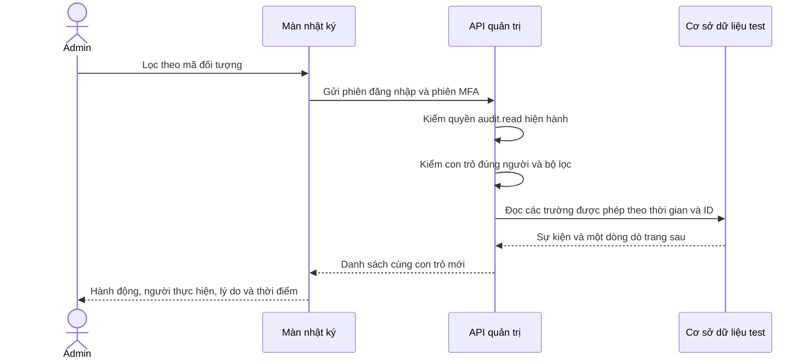
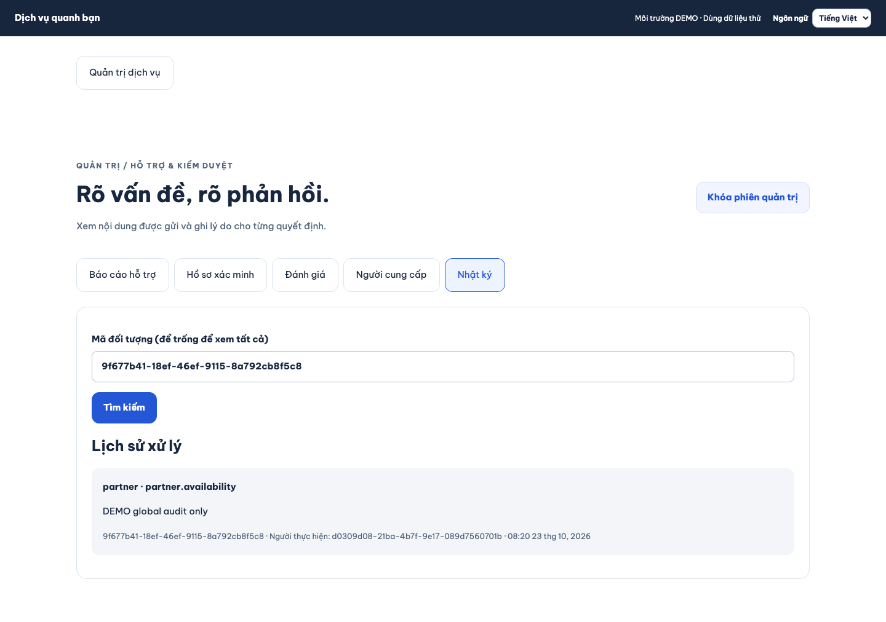

# B11-04 — Nhật ký admin tổng hợp

23/10/2026 · LOCAL-01 · [Mục lục](../README.md).

## Admin thấy gì?

Trong Nhật ký, admin có thể xem các sự kiện đã được ghi trong `audit_events`, gồm hỗ trợ/kiểm duyệt, tài khoản, thành viên, tài chính và thao tác quản trị. Nhập mã đối tượng để chỉ xem sự kiện của đối tượng đó; để trống xem tất cả. Xem thêm lấy trang kế tiếp trong cùng bộ lọc. Giao diện có VI/EN/JA; mã hành động là dữ liệu kỹ thuật để đối chiếu, lý do là nội dung đã được ghi.

Trước đây màn này chỉ đọc `moderation_history`, tức lịch sử xử lý kiểm duyệt. Nay nó gọi `GET /admin/audit` đã có trong hợp đồng API. Endpoint `/admin/moderation-audit` cũ vẫn tồn tại cho tương thích. Không đổi schema hay ghi thêm sự kiện cho nghiệp vụ chưa có audit; “tổng hợp” nghĩa là đọc bảng hiện có, không chứng nhận mọi thao tác toàn sản phẩm đã được ghi.

## Luồng đọc một trang

“Phiên MFA” là bằng chứng admin đã qua bước xác thực hai yếu tố. “Con trỏ” là mã trang do máy chủ ký, chứa vị trí đọc tiếp; app không tự tạo hoặc sửa được.

## Đọc code theo thứ tự

| Bước | File/hàm thật | Giải thích |
|---|---|---|
| 1 | [AdminDesk.tsx](../../../apps/mobile/src/features/admin/screens/AdminDesk.tsx), `load`; [App.tsx](../../../apps/admin/src/App.tsx), `load` | Nhận mã đối tượng; đổi bộ lọc thì xóa trang cũ và con trỏ. Không dùng con trỏ của bộ lọc cũ. |
| 2 | [admin-api.ts](../../../apps/mobile/src/features/admin/api/admin-api.ts), `audit`; [client.ts](../../../apps/admin/src/client.ts), `audit` | Gắn phiên/MFA qua client hiện hành; kiểm cấu trúc danh sách trả về trước khi hiển thị. |
| 3 | [backoffice.controller.ts](../../../services/api/src/modules/backoffice/backoffice.controller.ts), `audit` | Route GET chỉ đọc và trả `Cache-Control: no-store`; không cho cache nhật ký nhạy cảm. |
| 4 | [backoffice.input.ts](../../../services/api/src/modules/backoffice/backoffice.input.ts), `auditInput` | Chỉ nhận `resource_id`, `cursor`, `limit`; ID phải là UUID, giới hạn trang 1–100, mặc định 20. |
| 5 | [admin-auth.service.ts](../../../services/api/src/modules/admin-auth/admin-auth.service.ts), `read` | Kiểm tài khoản, phiên MFA gắn đúng phiên đăng nhập và quyền `audit.read` chưa bị thu hồi. |
| 6 | [backoffice.service.ts](../../../services/api/src/modules/backoffice/backoffice.service.ts), `auditLog` | Chọn đúng 7 trường hợp đồng. Sắp theo mili giây và ID giảm dần; con trỏ gắn actor và bộ lọc để ngăn dùng chéo. |

`resource_type` được suy ra từ namespace của mã hành động có sẵn, vì bảng lịch sử chưa có cột loại đối tượng riêng. `details`, khóa bí mật, ảnh và nội dung chứng cứ không được chọn trong SQL. `reason` là lý do lịch sử theo hợp đồng; người có quyền audit vẫn được xem lý do đã ghi, không phải bản xuất công khai.

## Khi có lỗi

MFA hết hạn hoặc quyền bị thu hồi: API từ chối ngay ở lần đọc tiếp, màn xóa dữ liệu riêng và trở về bước xác thực. Con trỏ sai chữ ký/sai tài khoản/sai bộ lọc hoặc ID sai dạng trả lỗi kiểm tra đầu vào. Mất mạng giữ khả năng tải lại; đây là GET nên không tạo một quyết định hay chuyển tiền khi thử lại.

## Đã kiểm gì?

- Test PostgreSQL local đã chứng minh: thiếu MFA/thiếu quyền bị chặn; thu hồi quyền có hiệu lực ngay; phân trang ở cùng timestamp không lặp ID; đổi actor/bộ lọc không dùng lại được con trỏ; `details` không nằm trong JSON.
- Web desktop và mobile chạy với API/DB test: sự kiện `partner.availability` ngoài moderation xuất hiện trong nhật ký tổng; lọc theo mã và khóa phiên đều hoạt động. 3 hành trình web tập trung (gồm vai trò) đã đạt.
- Đây là UI/API local, không phải bằng chứng production, audit retention, xuất dữ liệu hoặc UAT. Đợt này chưa commit/push/CI mới.

## Tự thử và kiểm hiểu

Ảnh web desktop chạy với API/DB local ngày 23/10/2026, dữ liệu DEMO: lọc đúng đối tượng và thấy sự kiện ngoài kiểm duyệt. Không phải ảnh điện thoại thật.

Mở Nhật ký bằng admin có `audit.read`, lọc một mã đối tượng rồi xóa bộ lọc. Vì sao không dùng con trỏ vừa có cho đối tượng khác? Vì nó được ký gắn với bộ lọc cũ. Vì sao chỉ ẩn nút chưa đủ? Vì người dùng vẫn có thể gọi API trực tiếp, nên quyền phải được kiểm trên server ở mỗi trang.

Tra cứu bằng chứng

- [Test API](../../../services/api/test/integration/backoffice.test.ts): `global audit requires live MFA grant and binds pagination to actor and resource without exposing details`.
- [Hành trình web](../../../tests/e2e/web/admin-moderation.spec.mjs): hai màn desktop/mobile, API thật trong DB test cô lập.
- [Contract](../../technical-design/openapi.json): `/admin/audit`, schema `Audit`, không sửa spec trong đợt này.
- Kiểm toàn bộ theo `SDD-PROJECT`: dùng `evidence.json` và `sdd:check --phase verify` đúng fingerprint. Giữ các tiêu chí trước, không lấy lượt tập trung thay toàn bộ hồi quy.

