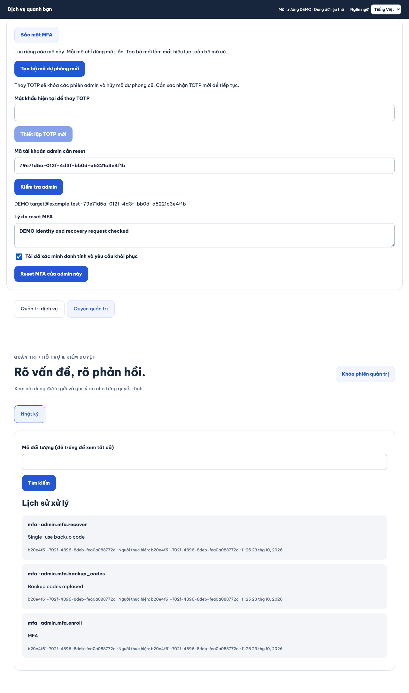
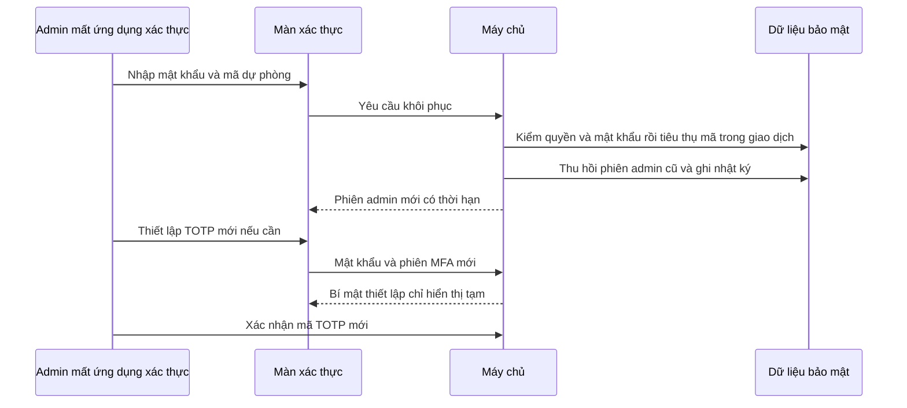
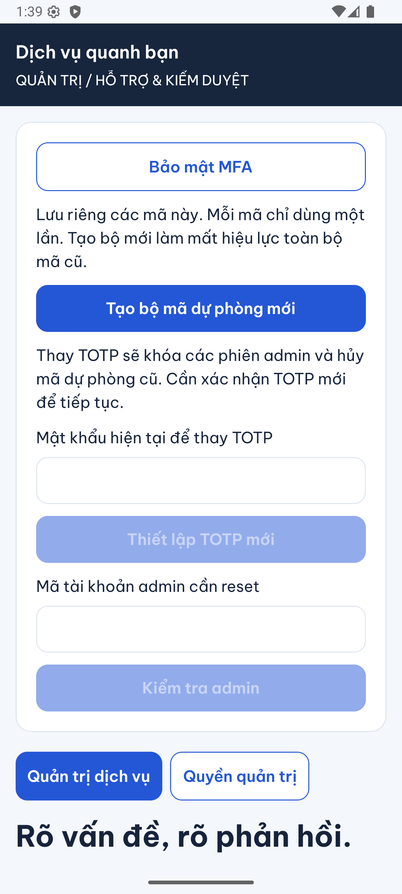
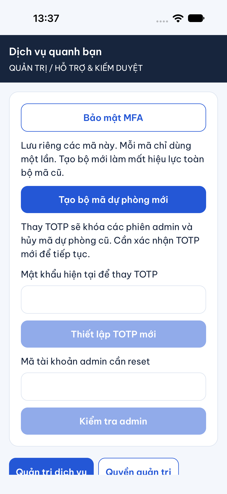

# B11-05 — Khôi phục MFA bằng mã dự phòng và duyệt chéo

23/10/2026 · LOCAL-01 · Theo [nhóm quyết định đã duyệt](../de-xuat/LOCAL-01-hoan-thien-luong-local.md). Chỉ kiểm local/DEMO, chưa vận hành production.

## Admin thao tác thế nào?

MFA là bước xác thực thứ hai sau mật khẩu. TOTP là mã ngắn do ứng dụng xác thực tạo theo thời gian. Sau khi vào console, mở **Bảo mật MFA → Tạo bộ mã dự phòng mới**. Màn hình hiển thị 10 mã để tự lưu riêng; mỗi mã dùng một lần. Tạo bộ mới hủy toàn bộ bộ cũ. Mã chỉ ở bộ nhớ màn hình, bị bỏ khi khóa/thoát; mobile còn xóa khi app ra nền.

Mất TOTP nhưng còn mã: ở màn xác thực chọn **Dùng mã dự phòng**, nhập mật khẩu và một mã. Vào được console thì có thể **Thiết lập TOTP mới**, xác nhận mã của ứng dụng mới và tạo lại bộ mã dự phòng. Thay TOTP khóa các phiên admin và hủy mã dự phòng cũ trước khi thiết lập lại.

Mất cả hai: một admin khác có `grant.manage` và MFA mới trong 5 phút kiểm danh tính/yêu cầu, tải đúng tài khoản, ghi lý do và xác nhận reset. Người được reset phải thiết lập TOTP lại; không tự được cấp thêm quyền.

## Theo một lần khôi phục

## Đọc code và dữ liệu

| File, hàm | Nhận gì và kết quả |
|---|---|
| [AdminScreen.tsx](../../../apps/mobile/src/features/admin/screens/AdminScreen.tsx), `submit`, `clear`; [App.tsx](../../../apps/admin/src/App.tsx), `submit` | Chọn TOTP hay mã dự phòng, gửi đúng đường xác thực; khóa màn xóa dữ liệu tạm. |
| [MfaSecurity mobile](../../../apps/mobile/src/features/admin/screens/MfaSecurity.tsx), `run`, `finish`; [desktop](../../../apps/admin/src/MfaSecurity.tsx), `reset` | Tạo/ẩn mã, thay TOTP, đọc target và gửi lý do + phiên bản để reset. Mất phản hồi reset giữ cùng key/body. |
| [AdminApi](../../../apps/mobile/src/features/admin/api/admin-api.ts), `verify`, `backupCodes`, `replace` | Gửi token đăng nhập và phiên admin hiện hành; hủy kết quả đến muộn khi đổi phiên. |
| [admin-auth.service.ts](../../../services/api/src/modules/admin-auth/admin-auth.service.ts), `backupCodes`, `recover`, `reset`, `enroll` | Kiểm quyền/MFA/password, xử lý một lần và thu hồi phiên cũ. `password` lưu số lần thử sai, giới hạn 10 lần/15 phút. |
| [Migration](../../../services/api/migrations/024_local_gallery_mfa.sql) | `admin_backup_codes` chỉ lưu SHA-256 của mã ngẫu nhiên 128 bit và thời điểm đã dùng. Không lưu mã gốc vào audit/idempotency. |
| [demo-mfa-rescue.mjs](../../../scripts/ops/demo-mfa-rescue.mjs), `rescueTarget`, `rescueDemoMfa` | Cứu hộ admin cuối trên DB loopback `dvqb_test`, schema disposable; phải có danh tính DEMO và audit bootstrap. Không chấp nhận DB ứng dụng bình thường. |

Hai yêu cầu dùng cùng mã chạy đồng thời chỉ một yêu cầu thành công. Reset chéo khóa hai tài khoản theo thứ tự cố định và cùng khóa điều phối với đổi quyền; kiểm lại quyền/MFA trước cả retry. Reset tăng phiên bản tài khoản, giữ quyền và dữ liệu nghiệp vụ.

Nếu mất phản hồi **tạo bộ mã**, không lấy lại plaintext từ DB: xác thực lại nếu cần rồi chủ động tạo bộ mới. Nếu mất phản hồi **khôi phục**, mã có thể đã tiêu thụ: dùng mã khác; không tự gửi lại mutation. Nếu mất bí mật khi đang thay TOTP, đăng nhập tài khoản vẫn cần mật khẩu và có thể bắt đầu thiết lập lại phần chưa xác nhận. Mất cả hai yếu tố không mở đường self-reset qua API.

## Đã kiểm và tự thử

API kiểm mật khẩu sai, mã bị dùng hai lần, thay bộ mã, thu hồi phiên, thay TOTP, quyền/fresh MFA, chống tự reset và công cụ DEMO không nhận tài khoản thiếu bootstrap. Kiểm logs/DB không chứa mã gốc. Web đi trọn tạo mã → ẩn → khóa → đăng nhập bằng mã → duyệt reset admin khác. Mobile kiểm lựa chọn mã dự phòng và xóa mã khi khóa.

Android emulator API 36 và iOS 27 simulator đã PASS ngày 23/10/2026: đổi sang tài khoản admin DEMO, đăng nhập bằng mã dự phòng và mở màn bảo mật. Lượt native này chưa gửi thao tác reset chéo/thay TOTP; các nhánh đó được kiểm riêng qua API, mobile test và web.

Tự thử khóa console rồi dùng một mã hai lần. Lần hai phải bị từ chối. Đặt câu hỏi: vì sao reset cần tải phiên bản? Để quyết định không áp vào hồ sơ đã thay đổi. Vì sao không đưa plaintext vào kết quả idempotency? Vì DB không được trở thành nơi lấy lại mã dự phòng.

Lệnh và giới hạn kỹ thuật

- API bổ sung: `POST /admin/auth/{backup-codes,recover,replacement}`, `POST /admin/auth/users/{id}/reset`. Quyết định và implementation được ghi tại repo; bộ OpenAPI/Drive/ui-ux chưa đồng bộ.
- [Integration](../../../services/api/test/integration/mfa-recovery.test.ts), [mobile](../../../apps/mobile/src/features/admin/screens/Admin.test.tsx), [web](../../../tests/e2e/web/local-gallery-mfa.spec.mjs).
- Cứu hộ: `node scripts/ops/demo-mfa-rescue.mjs <test_32hex_schema> <DEMO_admin_uuid>`. Chỉ dùng fixture disposable đã có; không đổi database guard để chạy lên DB thật. Nhật ký ghi rõ `actor_kind=local_operator`.
- Native: `test-results/native/{android,ios}/local-approved/result.json`. Không chụp màn đang hiện mã, mật khẩu hoặc secret.
- Chưa kiểm quy trình con người xác minh danh tính, điện thoại vật lý, UAT hay production. Đây không phải cơ chế cứu hộ production.

