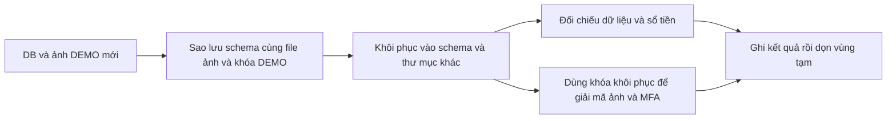

# B11-06 — Diễn tập backup DB, ảnh riêng tư và khóa DEMO

23/10/2026 · LOCAL-01 · Mở rộng [B11-02](B11-02-dien-tap-phuc-hoi-local.md) theo phê duyệt mới. Không đọc khóa hay ảnh riêng thật của chủ dự án.

## Kết quả nhìn thấy

Lệnh diễn tập tạo một vùng dữ liệu test, ảnh DEMO và khóa ngẫu nhiên mới; sao lưu, khôi phục sang vùng khác, kiểm dữ liệu rồi tự dọn cả hai. Kết quả nằm ở `test-results/ops/restore-drill.json`. Lượt kiểm 23/10 đạt **77 bảng, 376 ràng buộc, 186 index, 18 trigger và 3 file riêng tư**. Ảnh khôi phục mở được bằng khóa khôi phục; khóa sai hoặc thiếu khóa không thành công.

Index giúp tra dữ liệu; ràng buộc ngăn quan hệ sai; trigger là kiểm tự động khi ghi DB. Kiểm số lượng các thành phần này đi cùng kiểm toàn bộ hàng dữ liệu, không chỉ đếm bảng.



## Mở file theo thứ tự

| File và hàm | Nhận gì → làm gì → kết quả |
|---|---|
| [local-safety.mjs](../../../scripts/ops/local-safety.mjs), `localTestDatabase`, `drillSchema`, `remapDump` | Chỉ nhận DB loopback `dvqb_test` và hai schema `drill_..._source/restored`; không cho mục tiêu thông thường hoặc remote. |
| [restore-drill.mjs](../../../scripts/ops/restore-drill.mjs), `snapshot` | Tạo fixture đầy đủ migration, sổ tiền cân bằng, hold, audit, idempotency, ảnh xác minh mã hóa và factor MFA mã hóa. `pg_dump` chỉ schema fixture rồi nạp sang schema khác. |
| [backup-files.mjs](../../../scripts/ops/backup-files.mjs), `fileManifest`, `restoreFiles` | Ghi danh sách hash/kích thước của file trong `assets/keys`; kiểm quyền 0600, từ chối symlink và file thay đổi; sao chép vào thư mục mới. |
| [local-messages.ts](../../../services/api/src/integrations/local-messages.ts), `MessageSecrets` | Dùng khóa DEMO đã khôi phục để giải mã cả ảnh lẫn factor DB; khóa khác phải thất bại. |

## Lỗi, bằng chứng và giới hạn

Mọi bảng được so hash của nội dung hàng; migration chạy lại không đổi dữ liệu. Bài kiểm còn thử xóa ledger/audit để chắc cơ chế bất biến vẫn hoạt động sau restore; thử foreign key sai, kiểm tổng bút toán và số dư. Sai file, symlink, quyền file quá rộng, khóa sai và thiếu khóa đều có kiểm âm. Dữ liệu gốc của người dùng không tham gia. Khối `finally` đóng kết nối và xóa schema/thư mục tạm ngay cả khi kiểm thất bại.

Manifest là danh sách đối chiếu tính toàn vẹn trong diễn tập, không phải chữ ký chống người có thể sửa cả bundle và manifest. Khóa backup DEMO được giữ trong file 0600 trong vùng tạm; chưa thiết kế dịch vụ quản lý khóa, lịch sao lưu, lưu ngoài máy, retention hoặc RPO/RTO production. Thời gian chạy local không phải cam kết thời gian phục hồi production.

Tự học: nếu chỉ có DB mà mất khóa, vì sao vẫn không đọc ảnh/factor? Dữ liệu lưu là bản mã. Nếu ảnh mất nhưng DB còn mã ảnh thì sao? Chức năng xem ảnh vẫn hỏng, nên phải kiểm file riêng bên cạnh DB. Nếu đổi sai schema đích, guard nào chặn? Xem `drillSchema` và `remapDump`.

<details><summary>Lệnh và bài kiểm</summary>

```sh
npm run build -w services/api
node scripts/ops/restore-drill.mjs
node --test scripts/test/backup-files.test.mjs scripts/test/restore-safety.test.mjs
```

- [Kiểm file](../../../scripts/test/backup-files.test.mjs), [kiểm guard](../../../scripts/test/restore-safety.test.mjs).
- Báo cáo JSON runtime là bằng chứng riêng; SDD tooling kiểm các guard/file âm, không tự thay cho lần chạy restore DB thực tế.
- Không commit/push, CI mới hay diễn tập production trong đợt này.

</details>
