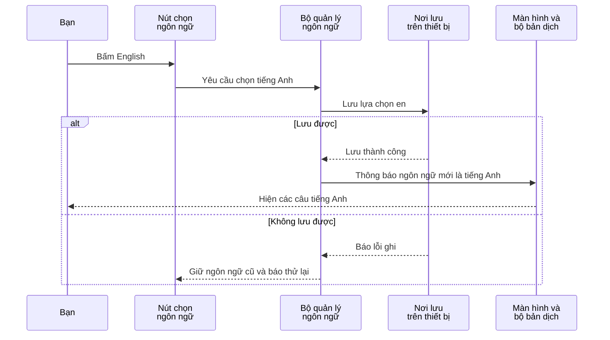

# I18N-01/02 — App đổi tiếng Việt, Anh, Nhật như thế nào?

01/10/2026 · Phần code mới dựa trên phiên bản `50d184a`, chưa lưu thành commit và chưa đẩy lên GitHub tại mốc báo cáo. [Mục lục](../README.md) · [Checklist](../01-checklist.md).

**I18N** là tên viết tắt thường dùng cho việc chuẩn bị ứng dụng dùng nhiều ngôn ngữ. Bạn không cần nhớ từ này để hiểu chức năng. Bản báo cáo được viết lại cho người mới; số kiểm thử ở cuối giữ nguyên bằng chứng đã ghi nhận.

## Bạn đã dùng được những gì?

Trên các màn danh mục và tài khoản hiện có, bạn chọn Việt, Anh hoặc Nhật để đổi chữ trên nút, tiêu đề chung và thông báo lỗi. App nhớ lựa chọn trên thiết bị để lần mở sau dùng lại. Đổi tiếng không xóa email/mật khẩu đang nhập và không làm bạn đăng xuất.

**Tên ngành, nhóm và kỹ năng vẫn là tiếng Việt.** Chúng là dữ liệu lấy từ máy chủ và chưa có bản dịch đầy đủ. Phần đã làm là dịch chữ thuộc giao diện, chưa phải dịch toàn bộ nội dung app. Tên người dùng, thương hiệu và nội dung người dùng viết không tự được dịch.

Lựa chọn ngôn ngữ hiện chỉ được lưu trên thiết bị. Đổi trên một điện thoại chưa làm điện thoại khác của cùng tài khoản tự đổi theo. Bản dịch Anh/Nhật vẫn cần người đọc thành thạo kiểm lại trước phát hành.

## Thay vì viết cứng một câu, code gọi câu đó bằng tên

Trước đây một nút có thể ghi thẳng chữ “Thử lại” trong màn hình. Nay màn hình gọi:

```ts
t('common.retry')
```

`t` là hàm lấy bản dịch. `common.retry` là **khóa bản dịch**, tức tên để tra đúng câu trong bộ chữ của ngôn ngữ đang chọn. Khi chọn tiếng Anh, cùng một dòng code sẽ lấy câu tiếng Anh. Không cần làm ba màn hình riêng.

Ba file [vi.ts](../../../apps/mobile/src/lib/i18n/messages/vi.ts), [en.ts](../../../apps/mobile/src/lib/i18n/messages/en.ts), [ja.ts](../../../apps/mobile/src/lib/i18n/messages/ja.ts) chứa các câu tương ứng. `locale` trong code nghĩa là **ngôn ngữ đang chọn**, với `vi`, `en`, `ja` lần lượt là Việt, Anh, Nhật.

## Khi bấm English, chuyện gì xảy ra?



Thao tác này diễn ra ngay trên thiết bị, không cần gửi yêu cầu đổi tiếng tới máy chủ. Nhánh `alt/else` trong sơ đồ có nghĩa là “nếu lưu được / nếu không lưu được”.

## Mở code theo thứ tự này

| Bước | File và đoạn cần tìm | Nhận gì, làm gì, chuyển tiếp gì? |
|---|---|---|
| 1 | [LanguageSettings.tsx](../../../apps/mobile/src/features/accounts/components/LanguageSettings.tsx), `selectLocale` | Nhận thao tác bấm English, gửi lựa chọn `en` cho bộ quản lý ngôn ngữ |
| 2 | [locale-state.ts](../../../apps/mobile/src/lib/i18n/locale-state.ts), `select` | Kiểm xem đã đọc xong lựa chọn cũ chưa và có đang lưu lần khác không. Nếu được phép, bắt đầu lưu lựa chọn mới |
| 3 | [locale-storage.ts](../../../apps/mobile/src/lib/i18n/locale-storage.ts), `write` | Ghi `en` vào thiết bị. Android/iOS dùng SecureStore, nơi lưu được bảo vệ; bản xem trên trình duyệt dùng nơi lưu cục bộ của trình duyệt |
| 4 | Quay lại `locale-state.ts`, `update` | Sau khi lưu được, đổi thông tin đang ghi nhớ sang `en`, báo cho các màn cần dùng biết có thay đổi |
| 5 | [LocaleProvider.tsx](../../../apps/mobile/src/app/providers/LocaleProvider.tsx), `useLocale` | Giúp các màn đọc chung lựa chọn mới và lấy hàm dịch đúng tiếng. Không tạo lại toàn bộ màn từ đầu |
| 6 | [index.ts](../../../apps/mobile/src/lib/i18n/index.ts), `createTranslator`; ba file bản dịch ở trên | Chọn bộ chữ theo ngôn ngữ, dùng tên khóa để tìm câu cần hiện. Nếu thiếu bản dịch, có cơ chế quay về tiếng Việt |
| 7 | [CatalogScreen.tsx](../../../apps/mobile/src/features/catalog/screens/CatalogScreen.tsx) và [AccountScreen.tsx](../../../apps/mobile/src/features/auth/screens/AccountScreen.tsx) | Gọi `t(...)` và hiển thị chữ mới cho người dùng |

[AppProviders.tsx](../../../apps/mobile/src/app/providers/AppProviders.tsx) đặt `LocaleProvider` bao quanh các màn hình để chúng cùng dùng một lựa chọn ngôn ngữ. **Provider** là phần cung cấp dữ liệu/công cụ dùng chung, không phải một màn hình mới.

## Vì sao đổi tiếng không làm mất nội dung đang nhập?

App cập nhật phần chữ cần hiển thị, thay vì đóng màn cũ và tạo màn mới từ đầu. Email, tên và mật khẩu đang nhập vẫn nằm trong thông tin màn hình đang ghi nhớ, nên không bị xóa chỉ vì đổi ngôn ngữ.

Trong code, thông tin đang ghi nhớ thường được gọi là **state**. Khi state thay đổi, React tính lại giao diện cần hiện, gọi là **render**. Render lại không đồng nghĩa xóa toàn bộ màn hình và mọi dữ liệu đang nhập.

## Vì sao thông báo lỗi cũng đổi tiếng được?

[auth-session.ts](../../../apps/mobile/src/features/auth/state/auth-session.ts) lưu mã lỗi như `UNAUTHENTICATED`, thay vì lưu sẵn cả câu tiếng Việt. [AccountScreen.tsx](../../../apps/mobile/src/features/auth/screens/AccountScreen.tsx) tìm câu phù hợp với mã đó và ngôn ngữ đang chọn.

Ví dụ bạn đăng nhập sai rồi bấm 日本語: app vẫn giữ cùng lỗi, chỉ tra câu tiếng Nhật để hiển thị. Không cần gửi lại email/mật khẩu lên máy chủ chỉ để đổi chữ. Đây là lý do tách **việc gì đã xảy ra** khỏi **câu chữ để mô tả việc đó**.

## Lưu lựa chọn và xử lý lỗi

Khi mở app, `restore()` trong `locale-state.ts` đọc lại lựa chọn đã lưu. Trong lúc chưa đọc xong hoặc đang ghi lựa chọn mới, app chặn thao tác chọn chồng nhau để tránh lần ghi trước ghi đè lần sau. `busy` nghĩa là đang bận xử lý, `ready` nghĩa là đã đọc xong lựa chọn ban đầu.

Nếu đọc lỗi, app dùng tiếng Việt và cho phép chọn lại. Nếu ghi lỗi, app giữ ngôn ngữ cũ và báo thử lại. Ngôn ngữ được lưu bằng tên riêng `dvqb.locale.v1`, tách khỏi token đăng nhập. Vì vậy đổi tiếng không thay quyền, không xác minh email và không cấp hay hủy phiên đăng nhập.

## Ví dụ có con số trong câu

```ts
t('auth.passwordHint', { min: 15, max: 128 })
```

Dòng này chọn câu hướng dẫn mật khẩu, rồi điền 15 và 128 vào hai vị trí dành sẵn. Phần `{ min: 15, max: 128 }` là dữ liệu đưa vào câu. Nhờ vậy không phải ghép từng mảnh chữ bằng tay ở mỗi màn.

[formatters.ts](../../../apps/mobile/src/lib/i18n/formatters.ts) chuẩn bị cách trình bày số/ngày theo ngôn ngữ. Đơn vị tiền vẫn là VND, múi giờ nghiệp vụ vẫn là Việt Nam. Phần này đã có kiểm thử riêng nhưng chưa có màn tiền/lịch sử dụng nó.

## Bạn có thể tự thử và tự kiểm hiểu

1. Mở danh mục, chọn 日本語 rồi English: nút/thông báo đổi tiếng, tên ngành hiện vẫn tiếng Việt.
2. Mở đăng ký, nhập tên/email thử rồi đổi tiếng: thông tin nhập vẫn còn.
3. Đăng nhập sai một lần rồi đổi tiếng: thông báo lỗi đổi theo, không gửi lại yêu cầu đăng nhập.
4. Chọn tiếng Nhật, đóng/mở app: lựa chọn được nhớ trên thiết bị nếu lưu thành công.

Muốn sửa một câu tiếng Anh, mở `en.ts`. Muốn sửa cách lưu lựa chọn, mở `locale-storage.ts`. Muốn hiểu vì sao phải chờ lưu xong mới đổi ngôn ngữ, đọc `select` trong `locale-state.ts`: nếu báo thành công quá sớm nhưng lưu bị lỗi, lần mở app sau có thể quay về tiếng cũ.

## Kết quả kiểm tra và phần tra cứu kỹ thuật

Đã ghi nhận 81 bài kiểm tra phía app, 3 hành trình kiểm lại chức năng cũ và 1 hành trình đổi tiếng trên web đạt. Trên máy ảo Android/iOS, đã kiểm đổi tiếng, mở lại app, đăng nhập và chữ cỡ lớn. Đây chưa phải kiểm trên điện thoại thật hoặc nghiệm thu của bạn.

**Cách đọc:** `unit/component test` kiểm từng phần code/màn hình; `E2E` chạy một chuỗi thao tác như người dùng; `coverage` đo phần code đã được chạy qua khi kiểm thử, không chứng minh app hết lỗi; `CI` là kiểm tra tự động trên GitHub; `UAT` là bước chủ dự án nghiệm thu. Bản code ở mốc báo cáo này chưa được đẩy lên GitHub để chạy CI mới.

<details>
<summary>Mở thay đổi kỹ thuật, sự cố đã xử lý và bằng chứng kiểm thử</summary>

## Nguồn thiết kế và phạm vi

Nguồn triển khai: phần ngôn ngữ trong [UX hiện hành](../../../ui-ux/specs/ux-scope-current.md), bước 1 của [thứ tự triển khai](../03-thu-tu-trien-khai.md), yêu cầu triển khai tuần tự ngày 01/10. Đây là triển khai I18N-01/02 đã giao, không đổi hợp đồng API, migration hoặc nghiệp vụ.

## Thay đổi kỹ thuật đã ghi nhận


- Thêm `i18n-js@4.5.3`, pin trong manifest/lock. Tham khảo [Expo localization](https://docs.expo.dev/guides/localization/) và [tài liệu i18n-js](https://github.com/fnando/i18n). Không thêm native module hoặc cần build binary chỉ vì dependency JS này.
- Thêm từ điển, kiểu khóa/params, locale state/storage/provider, formatter và `features/accounts/components/LanguageSettings` có consumer thật ở màn catalog/account.
- `AppProviders` nối LocaleProvider; UI chung `ErrorState` nhận `retryLabel`, `ActionCard` nhận `actionLabel` đã dịch qua prop, không phụ thuộc auth/catalog.
- `ApiError.message` trở thành mã kỹ thuật; `AuthSession` chuyển từ câu đã dịch sang mã lỗi. Test API client kiểm code thay vì chuỗi tiếng Việt.
- Native runner thêm `i18n` và `i18n-layout`; flow layout tạm tăng cỡ chữ rồi khôi phục, vẫn dọn schema/Metro khi test lỗi. Web có hành trình i18n dùng API/DB thật.
- Không thay spec nghiệp vụ hoặc contract. Chỉ cập nhật checklist, báo cáo và quy tắc repo-only đã được chủ dự án yêu cầu; không tải Drive.

Review ảnh cũng phát hiện nhãn hành động của ActionCard còn tiếng Việt; đã đưa vào dictionary và thêm assertion unit/web. Trên iOS, thẻ được accessibility gộp thành một node mang tên danh mục; nhãn con kiểm qua ảnh, còn Maestro kiểm nhãn độc lập và luồng thao tác. Trên web, selector phải nằm trong thẻ ở màn đang hiển thị vì màn trước vẫn giữ trong stack.

Trong lần native đầu, `Intl.PluralRules` không tồn tại trên Hermes Android hiện tại, mặc dù unit/web pass. Đã bỏ phụ thuộc runtime đó: dùng quy tắc tiếng Anh của i18n-js, đăng ký VI/JA cardinal `other`. Có test hồi quy giả lập thiếu `Intl.PluralRules`. Một lượt Android sau đó bị ANR ở bước mở lại app trên AVD 2GB; cold boot cùng AVD với RAM 4GB, giữ dữ liệu, đã qua lại luồng i18n và auth. Cấu hình RAM trong file AVD không bị sửa; tham số 4GB chỉ dùng cho lần mở emulator này.

## 6. Kiểm thử và bằng chứng

Các lượt kiểm dưới đây chạy ngày 01/10/2026 trên working tree, không lấy số test ở baseline làm bằng chứng mới.

| Lớp kiểm | Lệnh/kịch bản | Kết quả · thời điểm | Bằng chứng / giới hạn |
|---|---|---|---|
| Mobile unit/component | `npm run test:coverage -w apps/mobile` | 81 test / 14 suite PASS · 01/10 | `test-results/mobile/junit.xml`, `i18n-coverage-run.log`; core lines 100%, branches 94%; app lines 99.07%, branches 90.95% |
| Web + API/DB thật | Playwright: 3 hồi quy auth/catalog + 1 i18n | Cả 4 hành trình đạt; test i18n chạy lại riêng sau sửa selector · 01/10 | `test-results/web/regression-before-i18n-selector-fix.log` giữ 3 pass + lỗi selector; `i18n-final.log` và `results.json` ghi lượt i18n cuối pass |
| Native android / i18n | `DEVICE_ID=… node scripts/test/native.mjs android i18n` | PASS · `2026-10-01T05:08:08.570Z` | `test-results/native/android/i18n/result.json` |
| Native android / i18n-layout | `DEVICE_ID=… node scripts/test/native.mjs android i18n-layout` | PASS · `2026-10-01T05:01:17.937Z` | `test-results/native/android/i18n-layout/result.json` |
| Native android / auth | `DEVICE_ID=… node scripts/test/native.mjs android auth` | PASS · `2026-10-01T05:05:41.347Z` | `test-results/native/android/auth/result.json` |
| Native ios / i18n | `DEVICE_ID=… node scripts/test/native.mjs ios i18n` | PASS · `2026-10-01T05:05:01.238Z` | `test-results/native/ios/i18n/result.json` |
| Native ios / i18n-layout | `DEVICE_ID=… node scripts/test/native.mjs ios i18n-layout` | PASS · `2026-10-01T04:55:05.888Z` | `test-results/native/ios/i18n-layout/result.json` |
| Native ios / auth | `DEVICE_ID=… node scripts/test/native.mjs ios auth` | PASS · `2026-10-01T04:57:50.312Z` | `test-results/native/ios/auth/result.json` |
| Chữ lớn / review ảnh | Android font scale 1.5; iOS extra-extra-extra-large | Hai nền tảng PASS; xem ảnh Anh/Nhật, chữ dài xuống hàng và form cuộn được | `test-results/native/{android,ios}/i18n-layout/…/takeScreenshot/`; sau test đã đọc lại Android 1.0, iOS large |
| Build/static | `npm run build`, build mobile cuối; `npm run typecheck`; `npm run lint` | PASS · 01/10 | `test-results/mobile/i18n-build.log`; export cả Android/iOS/web, API build; không phải release build |
| Tooling/native config | `npm run test:tooling`; `npm run test:native-config` | 3 tooling test PASS; native config PASS · 01/10 | Scene lifecycle/ATS, app ID, Android policy; không thay UI E2E |
| Remote CI / UAT | Chưa push / chủ dự án chưa nghiệm thu | Chưa chạy CI cho working tree; chưa UAT | CI ở baseline vẫn là bằng chứng cũ, không gán cho code mới |


Artifact nằm trong `test-results/` và `coverage/`, không track Git. Native test dùng DB `dvqb_test`, schema riêng mỗi lượt và Metro 8083/8084; không ghi tài khoản thử vào DB phát triển. Bằng chứng native là simulator/emulator, chưa phải điện thoại thật hay UAT chủ dự án. Chưa có remote CI cho working tree này.


</details>

## Phần chưa làm

Còn thiếu bản dịch tên ngành/nhóm/kỹ năng và việc đồng bộ ngôn ngữ giữa các thiết bị của một tài khoản. Hai phần đó cần chốt cách lưu, cách trả dữ liệu và nguồn bản dịch trước khi triển khai.

B01-02 — OTP/xác minh — vẫn **Pending theo yêu cầu của bạn**, gồm cả bản thử trên máy phát triển và gửi thật. Không bắt đầu lại khi chưa có yêu cầu. Xem [checklist](../01-checklist.md) để biết tiến độ từng phần.
