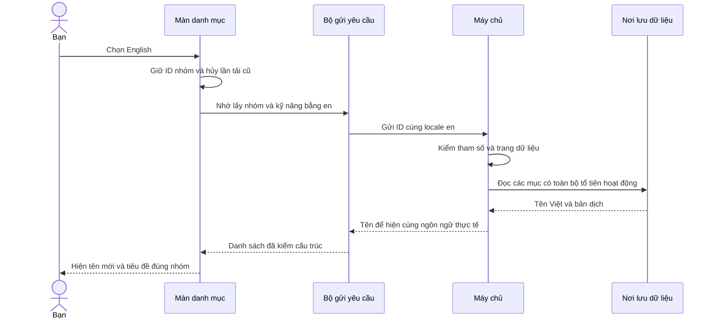

# I18N-04 — Đọc danh mục bằng Việt, Anh và Nhật

> **Cập nhật sau yêu cầu clear ngày 05/10:** bộ 50 nhóm/140 kỹ năng được phân tích bên dưới đã được xóa khỏi DB local và thay bằng [39 nhóm/128 kỹ năng](B02-01-thay-du-lieu-danh-muc.md). Nội dung bên dưới giữ làm bằng chứng đợt trước; các dòng “chưa sửa DB” và phương án giữ dữ liệu cũ là trạng thái tại thời điểm đó, đã được yêu cầu clear mới thay thế.

05/10/2026 · Theo quyết định I18N-04 được chủ dự án duyệt cùng ngày. Code local sau `7ded50c`; chưa commit/push, chưa có CI cho thay đổi này, chưa UAT. [Checklist](../01-checklist.md).

> **Đính chính sau rà soát 05/10:** các số lượng và kết quả test bên dưới là bằng chứng dữ liệu/API chạy được, không phải xác nhận cách chia nhóm đã hợp lý. Giữ công khai 10 nhóm chung cũ cạnh nhóm chuyên biệt gây chồng chéo; còn kỹ năng khác tên nhưng giao nhau về nghĩa. Xem [báo cáo rà soát toàn bộ 50 nhóm/140 kỹ năng](B02-01-ra-soat-danh-muc.md). Phương án làm sạch chưa áp dụng vào DB; không coi I18N-04 đã đạt chất lượng danh mục.

## Bạn thấy gì trên app?

Chọn **English**: “Làm đẹp không y tế” đổi thành “Beauty (non-medical)”. Chọn **日本語**: đổi thành “美容（医療行為を除く）”. Khi đang mở một nhóm, cả tiêu đề, nhóm con và kỹ năng đổi tiếng; bạn vẫn ở cùng nhóm đó.

DB (nơi lưu dữ liệu của máy chủ) đã có **10 ngành, 50 nhóm, 140 kỹ năng**, với đầy đủ tên VI/EN/JA. Đây là các bản ghi thật được API đọc từ PostgreSQL, không phải danh sách giả gắn trong màn hình. Chưa có nhà cung cấp, giá hay giao dịch đi kèm chỉ vì danh mục đã có.

## Dữ liệu gồm những gì?

Giữ 10 ngành đã chốt, thêm 4 nhóm chuyên biệt cho mỗi ngành. 10 nhóm chung cũ vẫn còn để giữ nguyên ID và liên kết đang dùng; chúng chứa các dịch vụ tổng quát đã có. Tổng cộng mỗi ngành có 5 nhóm. Không tự xóa/đổi tên/reparent dữ liệu cũ. Kỹ năng “Lắp camera” vẫn dùng chung giữa hai ngành bằng cùng một ID.

| Ngành | 4 nhóm chuyên biệt bổ sung |
|---|---|
| Điện nước | Điện dân dụng; cấp nước và thiết bị vệ sinh; thoát nước; máy bơm |
| Điện lạnh / gia dụng | Điều hòa; tủ lạnh/tủ đông; máy giặt/máy sấy; thiết bị bếp/nước nóng |
| Vệ sinh | Nhà ở; sofa/nệm/thảm; văn phòng/cửa hàng; bếp/phòng tắm/kính |
| Điện thoại / máy tính | Linh kiện điện thoại; linh kiện laptop; bảo dưỡng máy tính; máy tính bảng |
| Xe máy / ô tô | Bảo dưỡng xe máy; bảo dưỡng ô tô; lốp/ắc quy; vệ sinh/chăm sóc xe |
| Thú cưng | Tắm/vệ sinh; chăm sóc lông; trông giữ; đưa đón |
| Làm đẹp không y tế | Tóc; móng tay/móng chân; trang điểm theo dịp; uốn/duỗi/nhuộm |
| Chuyển nhà / bốc xếp | Nhà ở; văn phòng; đóng gói/tháo lắp; bốc xếp/vận chuyển đồ |
| Giặt / chăm sóc đồ | Quần áo/giặt khô; chăn/ga/gối; rèm/đồ vải; giày/túi |
| Lắp đặt thiết bị | Camera; mạng/Wi-Fi; tivi/âm thanh; máy lọc nước |

Nguồn tham khảo là danh mục công khai của [bTaskee](https://www.btaskee.com/vi-VN/app/), [1Fix](https://1fix.vn/tho-dien-nuoc), [Điện Thoại Vui](https://dienthoaivui.com.vn/), [Honda](https://www.honda.com.vn/xe-may/dich-vu-sau-ban-hang/bao-duong-dinh-ky), [Pet Mart](https://www.petmart.vn/), [30Shine](https://30shine.com/), [360đẹp](https://www.360dep.vn/), [Kiến Vàng](https://chuyennhatrongoikienvang.vn/), [FPT](https://fpt.vn/tin-tuc/lap-dat-camera-tron-bo-10150.html) và [Điện máy Xanh](https://www.dienmayxanh.com/). Cách chia nhóm và tên ngắn do Codex biên soạn cho dự án. Đây là tổng hợp định tính, không phải bảng xếp hạng hay số liệu nhu cầu tại Hà Nội. Xem [nguồn và phạm vi](../../../services/api/seeds/catalog-sources.json) nếu cần đối chiếu; các file dữ liệu cũng nằm trong bảng đọc code bên dưới.

Bản dịch EN/JA do Codex soạn ban đầu, cần bạn review nội dung trước phát hành. Không gọi dịch vụ dịch trả phí. Không thêm y tế, thẩm mỹ xâm lấn, điều trị thú y hoặc nhóm quảng cáo/voucher đã hoãn.

## Một lần bấm English đi qua đâu?

Ví dụ bạn đang mở ngành Điện nước và chọn English. App nhớ **mã ngôn ngữ `en`**, yêu cầu máy chủ đọc lại dữ liệu của đúng ID đang mở. Máy chủ lấy tên Anh nếu có; nếu thiếu thì trả tên Việt và báo rõ tên đó đang là tiếng Việt.



Đây là nhánh tải thành công. Tải thất bại thì hiện lỗi và **Thử lại**; không lấy danh sách giả thay cho lỗi. Mục không có tên dịch dùng tên Việt và hiện một thông báo, thay vì thông báo “tất cả danh mục chỉ có tiếng Việt” như trước.

## Mở code theo thứ tự nào?

Các đường dẫn dưới đây trỏ tới code thật từ vị trí báo cáo này.

| Bước | File / hàm | Nhận gì, làm gì, chuyển đi đâu? |
|---|---|---|
| Chuẩn bị dữ liệu | [catalog.json](../../../services/api/seeds/catalog.json) | Danh sách tên, mã và quan hệ. `parent_code` cho biết nhóm thuộc ngành nào; `category_codes` cho biết kỹ năng nằm ở nhóm nào. |
| Lưu vào DB | [seed.ts — seed, stableId](../../../services/api/src/database/seed.ts) | Tạo ID cố định từ mã. Chèn bản ghi còn thiếu; chỉ bổ sung khóa bản dịch chưa có. Chạy lại không đổi tên/ẩn-hiện do bạn sửa. |
| Chuẩn bị cột | [003_catalog_translations.sql](../../../services/api/migrations/003_catalog_translations.sql) | Thêm nơi lưu bản dịch cho kỹ năng. Đây là migration: một bước nâng cấu trúc DB có lịch sử, không sửa hai bước cũ. |
| Nhận thao tác | [CatalogScreen.tsx — CatalogScreen](../../../apps/mobile/src/features/catalog/screens/CatalogScreen.tsx) | Khi locale đổi, hủy yêu cầu cũ và lấy lại danh sách con, kỹ năng, danh sách cùng cha để tìm tên mới của mục đang mở. |
| Gửi yêu cầu | [catalog-api.ts — createCatalogApi, all](../../../apps/mobile/src/features/catalog/api/catalog-api.ts) | Gắn `locale` vào mỗi trang; đọc đủ các trang. Kiểm tên và ngôn ngữ trả về trước khi đưa lên màn hình. |
| Nhận ở máy chủ | [catalog.controller.ts](../../../services/api/src/modules/catalog/catalog.controller.ts), [catalog.query.ts — parseQuery, Cursor](../../../services/api/src/modules/catalog/catalog.query.ts) | Controller nhận HTTP; `parseQuery` chỉ cho vi/en/ja. Cursor là dấu mốc lấy trang tiếp theo, có chữ ký; không dùng trang tiếng Anh nối vào trang tiếng Nhật. |
| Đọc và chọn tên | [catalog.service.ts — CatalogService.list](../../../services/api/src/modules/catalog/catalog.service.ts) | Đọc DB, lọc mục ngừng và tổ tiên ngừng. Trả `name`, `name_locale`; vẫn giữ `name_vi` để code cũ dùng. Không trả toàn bộ bản dịch ra public. |
| Giữ đúng trang | [routes.ts](../../../apps/mobile/src/app/navigation/routes.ts) | Route giữ `categoryId` và `parentId`, không giữ tên đã dịch. Vì vậy đổi tiếng không làm mất vị trí hoặc giữ tiêu đề Việt cũ. |

### Ví dụ dữ liệu trả về

Rút gọn, bỏ các trường khác:

```json
{
  "code": "beauty",
  "name_vi": "Làm đẹp không y tế",
  "name": "Beauty (non-medical)",
  "name_locale": "en"
}
```

`name` là chữ app hiện. `name_locale` là ngôn ngữ thật của chữ đó. Nếu bản dịch Anh bị thiếu, `name` dùng tên Việt và `name_locale` là `vi`; app biết để hiện thông báo. `id` và `code` không đổi khi đổi tiếng.

## Nếu thao tác nhanh, lỗi mạng hoặc dữ liệu đã được sửa?

- Đổi EN rồi JA khi mạng chậm: yêu cầu EN bị hủy; dù nó trả về sau, màn hình vẫn giữ JA. Rời màn cũng hủy yêu cầu. Khi quay lại sẽ tải lại để không giữ mục vừa bị ngừng.
- Lỗi tải: hiện lỗi theo ngôn ngữ đang chọn và có Thử lại. Không trả danh mục giả. Dữ liệu sai cấu trúc/ngôn ngữ không mong đợi bị từ chối.
- Bản dịch trong DB là chuỗi rỗng, chỉ khoảng trắng, số hoặc object: máy chủ dùng tên Việt. Giá trị thủ công vẫn được giữ khi seed, kể cả giá trị cố ý để rỗng.
- Seed là thao tác nạp dữ liệu, chạy trong một giao dịch: nếu một bước lỗi, toàn bộ lần nạp đó được hoàn lại. Seed không sửa active, name_vi, cha, biểu mẫu hoặc khóa bản dịch đã có.
- API đọc danh mục là public; DB quyết định mục nào đang hoạt động. Không có quyền sửa danh mục mới được mở cho app trong lát này.
- Lựa chọn ngôn ngữ vẫn lưu local theo I18N-02. Chưa đồng bộ ngôn ngữ tài khoản/đa thiết bị. Tên do người dùng nhập và chat không tự dịch.

## Bạn tự thử thế nào?

1. Chạy API và hai Metro theo README. Mở app, chọn English rồi mở **Beauty (non-medical)**.
2. Mở **Hair treatments & colouring**, chọn 日本語. Kiểm tiêu đề đổi thành **パーマ・ストレート・カラー**, các kỹ năng đổi Nhật; nút quay lại vẫn về ngành làm đẹp.
3. Đổi lại Tiếng Việt. Kiểm **Uốn / duỗi / nhuộm tóc** và ba kỹ năng tương ứng. Thử cả một ngành khác như giặt đồ.

Câu hỏi học code: Vì sao route giữ ID mà không giữ tên? Vì tên đổi theo ngôn ngữ, ID vẫn chỉ cùng bản ghi. Vì sao cần `name_locale`? Để biết đã dịch hay đang dùng tiếng Việt thay thế. Vì sao không sửa migration 001? DB đã lưu checksum lịch sử; thay migration đã chạy sẽ làm mất tính kiểm chứng của lần nâng DB.

## Kiểm tra và giới hạn

Đã kiểm API với PostgreSQL/PostGIS thật, mobile tự động và trình duyệt nối API thật. Native kiểm riêng trên Android Emulator và iPhone Simulator; đây chưa phải điện thoại vật lý. Chủ dự án chưa nghiệm thu bộ tên dịch. Không dùng CI `c120062` làm bằng chứng cho phần mới.

<details>
<summary>Lệnh, bằng chứng và phần cần tra sâu</summary>

| Phạm vi | Lệnh / bằng chứng | Kết quả ngày 05/10/2026 |
|---|---|---|
| Mobile | `npm run test:coverage -w apps/mobile`; `test-results/mobile`, `coverage/mobile` | 86 test đạt; core lines 100%, branches 94,29% |
| API/DB | `npm run test:coverage -w services/api`; `test-results/api/junit.xml` | 34 test đạt; kiểm locale/fallback/cursor/cây active, đủ ngành/nhóm, giữ sửa thủ công, migration nâng DB cũ và rollback |
| Trình duyệt | `npm run test:e2e`; `test-results/web` | 5 hành trình đạt, gồm auth/danh mục/i18n/khung màn hình |
| Android | `DEVICE_ID=emulator-5554 node scripts/test/native.mjs android i18n` và `i18n-layout` | Xem result.json trong `test-results/native/android/`; chữ lớn 1.5, tên Anh/Nhật, lỗi/retry/lưu locale |
| iOS | `DEVICE_ID=9B485B08-15C4-40BB-9E29-03816068E6AC node scripts/test/native.mjs ios i18n` và `i18n-layout` | Xem result.json trong `test-results/native/ios/`; cỡ chữ extra-extra-extra-large, tên Anh/Nhật, lỗi/retry/lưu locale |
| DB phát triển | `npm run db:migrate`, `npm run db:seed`; đếm SQL trực tiếp | 10 ngành, 50 nhóm, 140 kỹ năng; API local trả tên Nhật đúng |
| Kiểm tĩnh / build | typecheck, lint, tooling, build | Đạt; không thêm thư viện |
| GitHub CI / UAT | Chưa push phần này | Chưa chạy / chưa nghiệm thu |

Artifact local không track Git. Chạy lại lệnh nếu không còn. Lần iOS đầu thất bại vì kịch bản gõ form chưa đóng bàn phím; đã sửa thao tác theo luồng auth hiện có rồi chạy lại đạt. Lần Playwright sandbox đầu bị macOS chặn khởi động Chromium; chạy với quyền local cần thiết rồi 5 ca đạt. Không coi những lần thất bại đó là lỗi dịch tên trong app.

Nguồn chuẩn: [OpenAPI](../../technical-design/openapi.json), [dữ liệu](../../technical-design/01-data-design.md), QA-067…069 trong [QA](../../technical-design/qa-cases.json). Đồng bộ spec I18N-04 đã đọc lại: PRD/SRS/UX, FR-CAT-001/002 và NFR-I18N-001 trên Drive; API/data/QA, HTML/ZIP và bản phục vụ localhost; sổ quản lý v1.41. Chín file spec và sổ Excel được tải lại đối chiếu bytes, các đoạn native Docs/Sheets được đọc lại. Bố cục Google Sheets chỉ kiểm qua dữ liệu định dạng WRAP/Arial hiện có, chưa kiểm trực quan bản Google-rendered. Báo cáo học code này chỉ lưu Git.

</details>

I18N-04 **một phần** ở checklist tổng vì tìm kiếm đa ngôn ngữ thuộc B03 chưa triển khai. Lát **đọc danh mục và mở rộng dữ liệu** đã được kiểm riêng. Không thay đổi trạng thái Pending của OTP; không triển khai production/tiền thật.
