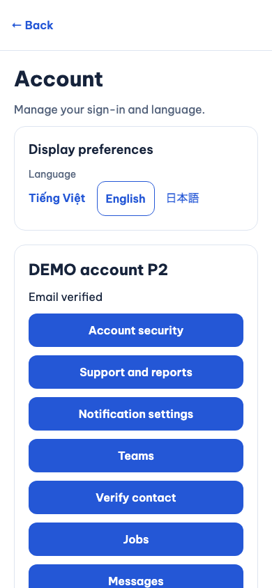
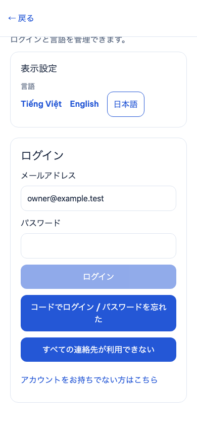
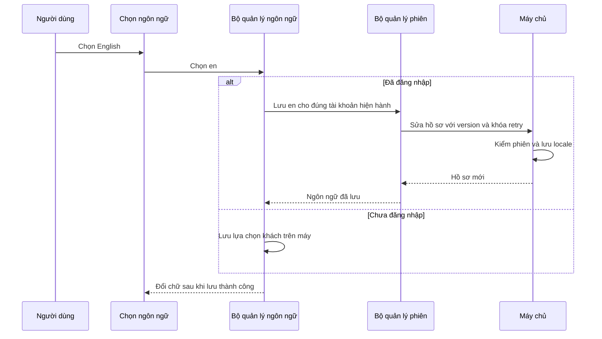

# I18N-05 — Ngôn ngữ theo tài khoản và khách

21/10/2026 · P2-01 · [Quyết định đã chốt](../de-xuat/P2-01-trien-khai-tron-dot.md) · Code đang sửa trong repo, chưa commit/push.

## Bạn đã dùng được những gì?

Khách chọn VI/EN/JA trên máy. Khi đăng nhập, app lấy ngôn ngữ tài khoản trên server. Đổi tiếng khi đã đăng nhập chỉ hiển thị sau khi server lưu thành công. Đăng xuất trở lại lựa chọn khách; lựa chọn khách không tự đè lên tài khoản mới đăng nhập.

Ví dụ đã chạy thật trên app web: khách chọn Nhật, tài khoản đang dùng Việt. Sau đăng nhập, app hiện Việt; chọn Anh rồi đăng xuất thì màn khách quay về Nhật. Đăng nhập bằng mã lần tiếp theo lấy lại tiếng Anh đã lưu trên tài khoản.

**Ảnh Chromium local, viewport 390 × 844, ngày 21/10/2026, dữ liệu DEMO; không phải native hoặc thiết bị thật.**

## Theo thao tác chọn English

“Locale” là mã ngôn ngữ `vi`, `en` hoặc `ja`. “Version” là số lần hồ sơ thay đổi, để hai thiết bị không ghi đè âm thầm lên nhau.

Nếu lưu lỗi, app giữ ngôn ngữ đang dùng và cho thử lại. Phản hồi của tài khoản trước bị bỏ qua sau khi chuyển tài khoản. Khi app trở lại foreground, đường kiểm phiên đọc lại hồ sơ và cập nhật lựa chọn đã lưu từ thiết bị khác.

## Mở code theo thứ tự nào?

| Bước | File và hàm thật | Nhận gì và vì sao? |
|---|---|---|
| 1 | [LanguageSettings](../../../apps/mobile/src/features/accounts/components/LanguageSettings.tsx) | Người dùng chọn một mã locale. Nút khóa trong lúc lưu để tránh gửi chồng. |
| 2 | [LocaleState](../../../apps/mobile/src/lib/i18n/locale-state.ts), `select`, `bindAccount` | Nhớ riêng lựa chọn khách, chủ hiện hành và thế hệ yêu cầu. Chỉ áp dụng phản hồi còn đúng thế hệ. |
| 3 | [AuthProvider](../../../apps/mobile/src/app/providers/AuthProvider.tsx) | Nối hồ sơ hiện hành với LocaleState, giữ input/khóa retry nếu mất phản hồi và đọc lại hồ sơ khi version xung đột. |
| 4 | [AuthSession](../../../apps/mobile/src/features/auth/state/auth-session.ts), `editProfile`, `profileOperation`, `verify` | Dùng đường phiên hiện hành và kiểm chủ/version trước khi cập nhật. Không cho kết quả tài khoản khác lọt vào UI. |
| 5 | [AccountsService](../../../services/api/src/modules/accounts/accounts.service.ts), `edit` | Khóa user, kiểm lại phiên/version, lưu `locale` và kết quả retry cùng giao dịch. |
| 6 | [profile.input](../../../services/api/src/modules/accounts/profile.input.ts), `profileInput`; [migration 019](../../../services/api/migrations/019_p2_accounts.sql) | Chỉ cho ba ngôn ngữ đã chốt; DB cũng chặn ngôn ngữ khác. |

`Me` và bộ kiểm response client được mở từ `vi` sang VI/EN/JA. State vẫn giữ mã lỗi; bản dịch được lấy lúc render. Vì vậy đổi tiếng không xóa form, route hoặc ID đang chọn.

## Dữ liệu được nhớ ở đâu và thử lại thế nào?

Khách dùng [locale-storage](../../../apps/mobile/src/lib/i18n/locale-storage.ts) trên máy. Tài khoản dùng cột `users.locale` của server. Đăng nhập không gọi sửa locale bằng lựa chọn khách. Đăng xuất không ghi locale tài khoản vào lựa chọn khách. Tài khoản đang bị đình chỉ vẫn được lưu riêng ngôn ngữ trong phiên hỗ trợ hạn chế; không được đổi tên hoặc lấy lại quyền dùng sản phẩm từ thao tác này.

Một lần lưu tài khoản bị mất phản hồi giữ nguyên khóa retry và version. Nếu server đã lưu, lần thử lại lấy kết quả cũ; không tạo thay đổi thứ hai. Nếu thiết bị khác đã sửa hồ sơ và gây xung đột version, app đọc lại hồ sơ; lần thử tiếp theo dùng version mới. Rời tài khoản trong lúc lưu tăng thế hệ locale, nên phản hồi cũ không thay tiếng của tài khoản tiếp theo. Khi replay trả locale cũ hơn hồ sơ đã đọc từ server, callback lấy locale của hồ sơ hiện hành; không lấy locale trong response cũ.

## Tự thử và kiểm hiểu

1. Ở màn khách chọn Nhật, đăng nhập tài khoản đang Việt: màn phải về Việt.
2. Chọn Anh khi có phiên, đăng xuất: khách phải về Nhật. Đăng nhập lại: tài khoản phải về Anh.
3. Mở form sửa tên, nhập bản nháp rồi đổi VI/EN/JA: tên đang nhập vẫn giữ.
4. Tắt mạng khi chọn tiếng khác: app giữ lựa chọn trước đó và hiện lỗi. Có mạng lại thì thử lại.

Câu hỏi: Vì sao đăng nhập không gửi lựa chọn khách lên server? Xem `bindAccount()`. File nào chặn phản hồi cũ sau khi đổi chủ? `LocaleState.generation` và kiểm owner trong `AuthSession`. Vì sao hai thiết bị cần version? Để tránh ghi đè hồ sơ vừa sửa trên thiết bị còn lại.

## Bằng chứng và giới hạn

- Jest locale/auth/accounts API và state: 37/37 đạt. Trong đó có khách/hai tài khoản, lỗi lưu server, phản hồi cũ và khôi phục local tới muộn.
- Jest form bảo mật/ngôn ngữ/profile: 9/9 đạt. Kiểm form còn sau đổi ngôn ngữ, lưu locale qua server và phiên vẫn giữ.
- PostgreSQL: bài `server locale is per-account, version/idempotency protected and reloaded by fresh session` đạt trong lượt 19 bài auth/account. User khác giữ `vi`; đăng nhập mới đọc được `ja` đã lưu; version cũ và locale ngoài danh sách bị từ chối.
- Jest `AuthLocale.test.tsx`: 2/2 đạt, bao gồm tài khoản bị đình chỉ lưu locale vẫn giữ phiên hỗ trợ. Bài còn lại đã tái hiện mất phản hồi EN v2, đọc JA v3 rồi replay EN v2; hồ sơ và màn hình giữ JA v3.
- App web E2E `p2-account-security.spec.mjs`: 1/1 đạt; chụp ảnh ở trên, có đổi khách/tài khoản và OTP login.

Nguồn: [locale-state test](../../../apps/mobile/src/lib/i18n/locale-state.test.ts), [LanguageSettings test](../../../apps/mobile/src/features/accounts/components/LanguageSettings.test.tsx), [PostgreSQL test](../../../services/api/test/integration/account-security.test.ts), [web E2E](../../../tests/e2e/web/p2-account-security.spec.mjs).

Chưa xác nhận Android/iOS, thiết bị thật, remote CI hay UAT cho lát này. Root tích hợp tiếp kiểm SDD và toàn bộ repo. Không thay tài liệu nghiệp vụ/Drive/Excel/`ui-ux`; báo cáo này ghi đúng triển khai theo quyết định đã chốt.
