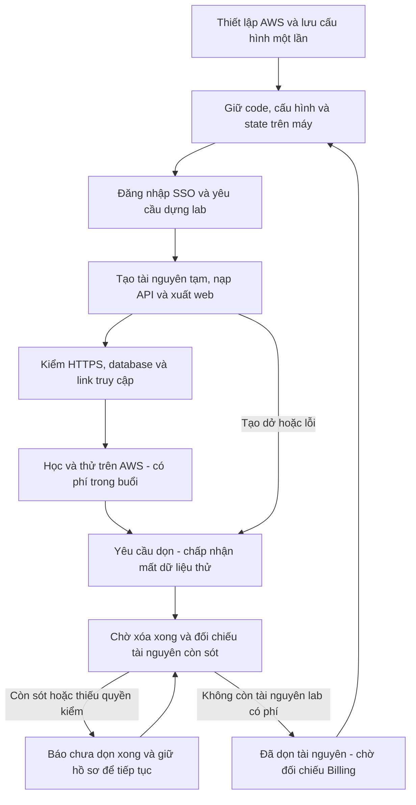
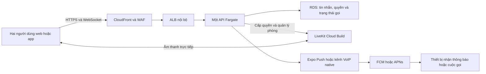

# AWS-02 — Deploy để học, dọn hết tài nguyên có phí sau mỗi buổi

**06/11 — bổ sung đã triển khai theo duyệt của chủ dự án:** tài chính mô phỏng trên lab bằng `finance_test: true`, key riêng, admin/MFA, audit và sửa lỗi tải Ví; xem [B00-23](../bao-cao/B00-23-tien-test-tren-lab.md). Không kết nối ngân hàng hoặc chuyển tiền thật; chưa deploy/kiểm AWS live. Các mô tả chỉ hỗ trợ tài chính local bên dưới là trạng thái trước đợt này.

**06/11/2026:** chủ dự án đã yêu cầu triển khai phần realtime/LiveKit/push. Code và guard được ghi tại [B00-22](../bao-cao/B00-22-realtime-livekit-push-lab.md); các mô tả “chưa triển khai” ngày 05/11 dưới đây là mốc lịch sử. Provider live, native incoming-call UI, âm thanh/push trên thiết bị và Billing vẫn chưa nghiệm thu.

05/11/2026 · Cập nhật kế hoạch ngày 29/10: học triển khai AWS, dữ liệu thử có thể xóa, lần sau dựng lại thuận tiện và không giữ khoản phí nền khi nghỉ. Theo yêu cầu mới, bổ sung chat realtime, gọi thoại và thông báo nền với chi phí thấp. [Mục lục](../README.md) · [Code lab và bằng chứng B00-20](../bao-cao/B00-20-lab-aws02.md) · [Hướng dẫn hiện hành](../../../infra/aws/lab/README.md).

**Trạng thái:** root `infra/aws/lab` và lệnh `lab:init/up/down/status/admin` đã có code, kiểm local/mock; chưa deploy AWS thật. Chat hiện gửi/đọc qua HTTP và kiểm tin mới khoảng 15 giây khi màn chat đang mở; realtime, calls và push cloud chưa triển khai. Mục 8–10 là phần bổ sung **đang lập kế hoạch**, chưa được tính là chức năng đã chạy. Yêu cầu cập nhật plan/giá không tự cho phép tạo tài nguyên, đăng ký gói trả phí hoặc gửi thông báo thật. Giữ nguyên pilot, không commit/push hoặc đồng bộ Drive/Excel/`ui-ux`.

## 1. Có đạt yêu cầu tắt là không có phí không?

**Có thể thiết kế để không phát sinh phí tài nguyên của lab sau khi đã dọn hoàn tất.** Đổi lại, “tắt” phải là **xóa tài nguyên và dữ liệu thử trên AWS**, không phải chỉ Stop máy hoặc giảm task về 0. Code, cấu hình và bản build giữ trên máy để lần sau tạo lại.

Không thể hứa hóa đơn AWS bằng 0 ngay khi bấm tắt: phí sử dụng trước đó, thời gian AWS đang xóa tài nguyên, mức tính tối thiểu, thuế và khoản đã cam kết vẫn có thể được ghi nhận sau. Cost Explorer cập nhật ít nhất mỗi 24 giờ và một số dữ liệu có thể trễ hơn. Phân biệt **ngừng phát sinh phí mới** với **chưa thấy phí trên màn hình**. [Nguồn AWS về độ trễ và phí API Cost Explorer](https://docs.aws.amazon.com/cost-management/latest/userguide/ce-what-is.html).

| Điều kiện | Kết luận |
|---|---|
| Không giữ compute, DB, ảnh, backup, image, log, IP hoặc dịch vụ thuê bao có phí trên AWS sau khi dọn | Có cơ sở đạt mục tiêu không có phí lab mới khi nghỉ |
| Giữ RDS ở trạng thái Stop, giữ snapshot/S3/ECR hoặc bucket state S3 | Không đáp ứng yêu cầu nghiêm ngặt này |
| Tài khoản còn dịch vụ khác, support trả phí, domain, reservation, Savings Plans hoặc Marketplace subscription | Không thể kết luận toàn bộ tài khoản không còn phí từ việc dọn lab |
| Chỉ dùng credit/Free Tier để bù hóa đơn | Không được dùng làm căn cứ thiết kế; tài nguyên vẫn có giá và credit có thể hết |

Nên dùng tài khoản AWS riêng cho việc học nếu có thể. Chọn hỗ trợ Basic và dịch vụ trả theo sử dụng, không cam kết dài hạn, không đăng ký gói CDN cố định hoặc sender/dedicated IP thuê theo tháng. Chủ dự án đã mua `iimissher.com` ở Cloudflare: giữ domain ngoài lab, tính phí gia hạn riêng. Nếu có các khoản thuê bao khác, phải rà soát riêng; xóa lab không hoàn lại phí đã phát sinh và không tự hủy hợp đồng khác.

**Chỉ tiêu nghiệm thu:** không còn tài nguyên lab có phí hoặc có khả năng tự bật lại; sau đó đối chiếu kỳ sử dụng sau thời điểm dọn trong Billing. Đây là mục tiêu cần kiểm AWS thật, chưa phải cam kết đã chứng minh.

## 2. Giữ gì để lần sau không phải cấu hình từ đầu?

| Giữ ở đâu | Nội dung | Khi tạo lại |
|---|---|---|
| Git trên máy | Code, Terraform, script, phiên bản dependency, cấu hình mẫu không có secret | Dùng lại cùng quy trình đã kiểm |
| Thư mục quản trị riêng trên máy, không commit | Account/region, email thử, state local, danh sách tài nguyên, tiến độ tạo/xóa | Biết đúng môi trường để tiếp tục hoặc dọn nếu lỗi |
| Keychain/kho mật khẩu hoặc bản sao mã hóa ngoài AWS | Geoapify key và thông tin quản trị cần dùng lại | Nạp lại khi dựng lab, không đưa secret vào Git |
| Máy local | Docker image hoặc nguồn để build lại; có thể lưu bản export web nếu còn tương thích | Không cần giữ image trên ECR giữa hai buổi |
| AWS: phần không có phí riêng | Tài khoản, IAM/SSO/MFA dùng directory mặc định và khóa AWS quản lý; identity email SES đã xác minh nếu không kèm dịch vụ trả phí | Không phải đăng ký AWS/xác minh quyền sở hữu email lại mỗi lần |
| Cloudflare/ACM | Domain đã mua, CNAME xác minh và chứng chỉ public không export ở us-east-1; ba DNS app/admin/api chỉ tồn tại khi dựng lab | Giữ địa chỉ ổn định; chi phí domain ở ngoài ngân sách lab |
| Provider ngoài AWS, sau khi triển khai mục 8 | Project LiveKit Build miễn phí, project Expo/FCM/APNs; khóa giữ trong kho mật khẩu | Không giữ phòng gọi đang hoạt động, không tự nâng gói hoặc gửi push khi lab nghỉ |

IAM Identity Center không có phí riêng; không dùng AD trả phí hoặc KMS customer-managed key để thiết lập đăng nhập cho lab. [AWS Identity Center FAQ](https://aws.amazon.com/iam/identity-center/faqs/). SES tính phí theo tính năng/sử dụng: không bật dedicated IP, gói bổ sung hoặc tự gửi thư khi lab đã nghỉ. [Giá SES](https://aws.amazon.com/ses/pricing/).

Terraform state là hồ sơ tài nguyên, **không phải bản sao database**. Lab dùng backend local, không dùng bucket bootstrap/state S3 của pilot. State/config riêng cần quyền file hạn chế, ổ đĩa/bản sao mã hóa và khóa chống hai lệnh triển khai chạy đồng thời; không chia sẻ state qua chat. Không xóa state/nhật ký triển khai trước khi đã dọn và đối chiếu xong tài nguyên.

Dữ liệu app mặc định tạo mới mỗi buổi. Nếu muốn giữ một lần thử, xuất DB/ảnh và khóa mã hóa tương ứng về máy trước khi dọn, kiểm bản xuất rồi mới xóa AWS. Không tự tạo final snapshot hoặc giữ automated backup trên AWS. Mất DB thử và phải đăng ký/MFA lại là đánh đổi được chọn để không có phí lưu trữ khi nghỉ; không dùng cách này cho dữ liệu người dùng thật.

## 3. Kiến trúc lab khi bật

Giữ NestJS, PostgreSQL/PostGIS, container và kiểm quyền hiện hành để học đúng các phần đã chuẩn bị. Lab vẫn ở Singapore. Không chuyển sang một dịch vụ khác chỉ vì có credit miễn phí.

- **Web/admin:** S3 private + CloudFront, dùng `app.iimissher.com` và `admin.iimissher.com`. DNS Cloudflare ở chế độ DNS only, chứng chỉ ACM đã chuẩn bị ngoài lab; không tạo Route 53 hosted zone hoặc bucket state.
- **API:** CloudFront riêng cho `api.iimissher.com`, nối tới ALB nội bộ qua VPC origin. Singapore được AWS hỗ trợ cho VPC origins. VPC cần internet gateway, subnet private cho origin/ENI và security group đúng giới hạn. [Điều kiện VPC origins](https://docs.aws.amazon.com/AmazonCloudFront/latest/DeveloperGuide/private-content-vpc-origins.html).
- **Đường đi bên trong:** chọn CloudFront → ALB bằng HTTP trên đường private VPC origin, ALB → API trên mạng VPC; HTTPS ở phía người dùng và TLS API → RDS vẫn bắt buộc. Đây là lựa chọn riêng cho dữ liệu thử, không tuyên bố TLS từ đầu đến cuối hoặc tái sử dụng nguyên cấu hình ACM/domain của pilot.
- **API/database:** một Fargate task khi học, RDS nhỏ private. Task có đường gọi provider bằng public IP với ingress chỉ từ ALB, không NAT Gateway; ALB không public. RDS lab cho phép xóa có chủ đích, không giữ snapshot/automated backup sau xóa. Bảo vệ dữ liệu của pilot giữ nguyên.
- **Tường lửa:** WAF gắn vào CloudFront API, có giới hạn request; dùng provider alias `us-east-1` cho tài nguyên WAF scope CloudFront. Các tài nguyên global/vùng phụ cũng thuộc danh sách phải dọn, không chỉ Singapore.
- **Email — cập nhật 05/11:** config mẫu dùng Resend với domain đã xác minh; OTP email mở điều kiện tạo nhà cung cấp/gửi/nhận việc trong lab. SMS mặc định tắt; `phone_verified` giữ đúng trạng thái thật. Allowlist tester và MFA quản trị giữ nguyên. Cấu hình SES cũ vẫn hỗ trợ. [B00-21](../bao-cao/B00-21-otp-email-lab.md) ghi quyết định, code và bằng chứng; chưa gửi thư thật.
- **Bản đồ:** Geoapify Free trong quota, không bật billing; key nạp từ máy mỗi lần dựng, kiểm origin đã cấu hình. Realtime/calls/push bổ sung ở mục 8, chưa có code cloud; ngân hàng thật và PROMO-02 vẫn ngoài phạm vi.

CloudFront API phải tắt cache cho toàn bộ API, cho phép đủ HTTP methods và chuyển tiếp Authorization/query/body cần thiết; không cache phản hồi đăng nhập, ảnh riêng hoặc dữ liệu theo tài khoản. CORS và URL build được tạo từ output thật của lần deploy.

Đường proxy mới là CloudFront → ALB → API. Trước khi sử dụng phải kiểm lại IP client/hạn mức, `X-Forwarded-Proto` và chống giả header với security group chặn mọi đường bypass. Không giữ `trust proxy=1` của pilot rồi coi hạn mức theo IP đã đúng; không tự phân tích chuỗi header ở controller. Test phải chứng minh hai người sau proxy có quota riêng và header giả không vượt giới hạn.

URL CloudFront có thể đổi khi tạo lại, nhưng script cập nhật ba CNAME có dấu sở hữu nên địa chỉ app/admin/api giữ nguyên. Web được build/publish lại. Bản native cần build với API domain ổn định; thay domain vẫn cần cập nhật cấu hình/build. Xóa DB làm mất tài khoản/MFA và đăng ký push của app; địa chỉ ổn định không giữ lại dữ liệu đó.

## 4. Một buổi học sẽ diễn ra thế nào?

Các lệnh dưới đây **đã có trong code**, bằng chứng local ở B00-20; phần LiveKit/push bổ sung chưa được tích hợp:

| Thao tác dự kiến | Việc tự động phải làm | Kết quả được phép báo |
|---|---|---|
| `lab:init` | Kiểm định dạng và lưu cấu hình local; chưa gọi AWS/Cloudflare. `up` mới kiểm account/ACM/SES/DNS | Sẵn sàng lập plan, chưa kết nối hoặc tạo hạ tầng |
| `lab:up` | Kiểm phiên bản code, plan/duyệt tài nguyên và chi phí, tạo lab, build/push image tạm, bootstrap DB/secret, xuất web, smoke | Có URL và trạng thái sẵn sàng thử; không chứng nhận mọi nghiệp vụ |
| `lab:down` | Hiện account/lab ID, xem plan xóa, xác nhận mất dữ liệu thử, dọn và kiểm độc lập với state | Chỉ báo đã dọn khi đủ bằng chứng; lỗi/thiếu quyền phải trả thất bại |
| `lab:status` | Mặc định đọc hồ sơ local; kiểm AWS theo yêu cầu, phân biệt tài nguyên với Billing | Không suy ra hóa đơn bằng 0 từ danh sách rỗng hoặc một tag |

Sau khi dựng lần đầu, chủ dự án vẫn đăng ký/xác minh tài khoản app và thiết lập MFA quản trị theo quyền hiện hành. Công cụ có thể hướng dẫn tiếp bootstrap admin sau khi email đã xác minh; không tạo mật khẩu admin mặc định hoặc bỏ MFA cho nhanh. Mỗi DB mới cần bước này lại.

Tạo/xóa không tức thì; RDS, CloudFront và VPC origin cần chờ AWS hoàn tất. Không đặt thời gian cố định rồi báo xong. AWS yêu cầu disable distribution trước khi xóa. [Quy trình xóa CloudFront](https://docs.aws.amazon.com/AmazonCloudFront/latest/DeveloperGuide/HowToDeleteDistribution.html).

Nếu SSO hết hạn, máy mất mạng hoặc người dùng dừng giữa chừng, tài nguyên AWS vẫn có thể còn chạy và tính phí. Lưu tiến độ sau từng tài nguyên, chạy lại dọn phải tiếp tục được, không bắt đầu một lab mới để che lỗi. Cần cảnh báo thời gian học ngay trên máy; không coi hẹn giờ local là bảo đảm dọn khi máy đã tắt.

## 5. Checklist dọn để không giữ phí nền

Mỗi lần tạo phải lưu ID/ARN thật và quan hệ phụ thuộc vào hồ sơ local. Chỉ xóa tài nguyên thuộc lab, kiểm account trước mọi thao tác; không xóa theo tiền tố/tag đơn lẻ hoặc quét rồi xóa tài nguyên tài khoản khác. Audit có thể phát hiện khoản ngoài lab để báo, không tự xóa chúng.

| Nhóm | Điều kiện phải kiểm sau dọn |
|---|---|
| Compute | ECS service/tasks kể cả ops không còn chạy, autoscaling/trigger không thể tự tạo task mới; ECR images/repository tạm được xóa |
| Database | RDS đã xóa hoàn tất, không phải Stop; không còn read replica, manual/final snapshot hoặc retained automated backup của lab |
| Giao diện/API | CloudFront distributions được disable/xóa, VPC origins/ENI liên quan giải phóng, ALB/listener/target group và WAF/rule riêng được dọn |
| File | S3 xóa cả phiên bản cũ/delete markers và multipart upload chưa hoàn tất rồi xóa bucket; không giữ state bucket trên AWS |
| Log/secret | Xóa log groups/archive/snapshot riêng; runtime secret và secret DB do AWS quản lý đã xóa hoặc ở trạng thái không bị tính phí theo quy định của dịch vụ |
| Mạng/tài nguyên phụ | Không còn public IPv4/EIP, NAT, interface endpoint, volume, alarm, schedule, subscription hoặc tài nguyên trả phí do lab tạo; gỡ các IAM/network resource tạm theo phụ thuộc |
| Dịch vụ khác | Không có gói CDN cố định, KMS customer-managed key, SMS sender thuê, SES dedicated IP, support/Marketplace/commitment được tạo cho lab và còn tính phí |
| LiveKit/push — phần cần bổ sung | Trước destroy, ngừng cấp token và phát push, kết thúc/thu hồi quyền các cuộc gọi của lab, đóng phòng đúng project/lab, kiểm không còn phiên media; không để provider tiếp tục dùng quota sau khi API đã xóa |

Không áp dụng “đang chờ xóa là hết phí” cho mọi dịch vụ. Riêng Secrets Manager công bố không tính phí secret đã đánh dấu xóa; chỉ chấp nhận ngoại lệ đó nếu API xác nhận trạng thái, không có replica còn hoạt động và lần tạo sau dùng tên/ID không vướng recovery window. [AWS Secrets Manager](https://docs.aws.amazon.com/secretsmanager/latest/userguide/manage_delete-secret.html).

Audit diễn ra trong giai đoạn dọn; mọi request có phí phục vụ export/audit cũng là chi phí buổi học. Khi nghỉ, không chạy cron, truy vấn metrics hoặc API Cost Explorer trả phí để tự kiểm liên tục. Đối chiếu Billing bằng giao diện Console, không thêm S3 billing export tồn tại giữa các buổi. Danh sách tài nguyên rỗng trong state không thay cho việc kiểm dịch vụ thực tế và các tài nguyên AWS tự tạo.

Ghi hai kết quả riêng: **đã dọn tài nguyên có phí** và **Billing đã đối chiếu cho khoảng nghỉ**. Nếu thiếu quyền, thiếu vùng kiểm, chưa giải phóng IP/ENI, còn snapshot hoặc lỗi provider, giữ trạng thái chưa đạt và đưa ID còn sót. Không hiển thị “0 phí” chỉ vì lệnh Terraform thoát 0.

## 6. Thứ tự triển khai và tiêu chí hoàn thành

Đây là thay đổi phương thức vận hành môi trường học, không tự đổi quyền/nghiệp vụ của sản phẩm. Các bước 1–5 và 7 đã có code/hướng dẫn, kiểm local ở B00-20; bước 6 chưa chạy AWS thật. Bảng giữ tiêu chí nghiệm thu, không dùng trạng thái code thay bằng chứng live. Phần mở rộng realtime/calls/push ở mục 10 chưa triển khai.

| Đợt | Phần cần làm | Điều kiện đạt |
|---|---|---|
| 1. Root lab độc lập | Tạo cấu hình Terraform lab/backend local/state riêng; tái sử dụng module phù hợp, tách dữ liệu disposable khỏi pilot | Plan không chạm tài nguyên/state pilot; guard của pilot giữ nguyên. Không dùng `prevent_destroy=var...` vì lifecycle này cần giá trị tĩnh |
| 2. HTTPS với domain đã mua | CloudFront API/VPC origin/internal ALB, WAF global, SES email identity, ACM ngoài lab và Cloudflare DNS only; không Route 53/bucket state | HTTPS và auth thật hoạt động, không có API bypass, cache riêng tư hoặc sai IP proxy |
| 3. Tạo lại tự động | `lab:init/up`, cấu hình local, image tạm, DB mới, web và hướng dẫn admin | Lần sau không cấu hình từng dịch vụ bằng Console; DNS ổn định cập nhật đúng lab, giữ giới hạn native rõ ràng |
| 4. Dọn có thể tiếp tục | `lab:down/status`, danh sách tài nguyên, retry, xóa dữ liệu theo lab và kiểm còn sót | Dọn được cả deploy thất bại; không nhầm account/lab; không báo thành công khi thiếu quyền kiểm |
| 5. Kiểm local | Terraform validate/mock, test sai account, khóa đồng thời, deploy dở, ngắt mạng/SSO, secret/state và proxy/cache | Test fail trước lỗi rồi đạt sau sửa, giữ toàn bộ criterion/QA gap, chỉ đổi hash nguồn sau review diff được phép; SDD toàn repo đạt |
| 6. Kiểm AWS do chủ tài khoản thực hiện | Dựng → thử → dọn → đối chiếu Billing; lặp lần hai từ dữ liệu local | Không còn tài nguyên có phí của lab, không tự tái tạo, không có phí mới thuộc khoảng nghỉ sau khi dữ liệu Billing hoàn chỉnh; ghi thời gian và chi phí thực |
| 7. Hướng dẫn bàn giao | Viết lại hướng dẫn từng bước cho lab, xuất kết quả dọn rõ ràng | Người mới làm lần hai qua các thao tác ngắn, không chạy nhầm lệnh pilot; có bằng chứng, giới hạn và cách tự kiểm |

Không thực hiện migration state/đổi bảo vệ pilot bằng replace chuỗi hoặc sửa tay để “destroy cho qua”. Nếu đã có pilot thật, kiểm state/tài nguyên và kế hoạch di chuyển riêng trước; không coi yêu cầu sửa plan là cho phép xóa dữ liệu trên tài khoản thật.

## 7. Bạn làm gì bây giờ và giới hạn còn lại?

Bạn có thể chuẩn bị AWS/MFA/SSO, ACM, email thử, Cloudflare và công cụ local theo hướng dẫn hiện hành. Nếu muốn thử chat tức thì và gọi thoại trong lần deploy đầu, hoàn thiện mục 10 trước; chạy nguyên code lab hiện tại chưa đáp ứng mục tiêu này. Không áp dụng bộ pilot cũ để thay cho lab.

Giữ AWS-01 và B00-12 làm bằng chứng pilot trước đây. Dự toán cập nhật và giả định nằm ở mục 9; đây là tính từ giá công bố, chưa đo hóa đơn thật. AWS tính tiền cả thời gian tài nguyên đang tạo/xóa. Budget chỉ cảnh báo, không tự giới hạn tiền. Dự toán AWS không trừ credit/Free Tier; phần gọi thoại chọn gói miễn phí có hạn mức và điều kiện riêng.

Chưa có bằng chứng AWS live rằng phương án tạo/xóa thành công hoặc khoảng nghỉ thực sự không phát sinh phí. Nếu hiểu yêu cầu là **hóa đơn không bao giờ có thêm dòng tiền nào sau thời điểm nhấn nút**, điều đó không thể cam kết do độ trễ/tối thiểu tính phí; kế hoạch đáp ứng theo thời điểm **AWS đã dọn xong** và kỳ sử dụng thực tế. Đợt cập nhật plan này không sửa Terraform/script/API, không publish native hoặc chạy CI remote.

Hai câu tự kiểm: **Vì sao lần sau không cần cấu hình lại AWS nhưng tài khoản app cũ có thể mất?** Vì cấu hình được lưu trên máy, DB thử đã xóa. **Vì sao giảm API về 0 chưa đạt mục tiêu?** Vì DB, kho file/image/log và lớp mạng/tường lửa vẫn có thể tính phí.

## 8. Bổ sung chat realtime, gọi thoại và thông báo nền

Chủ dự án ngày 05/11 yêu cầu thêm các chức năng này vào plan và tính chi phí càng thấp càng tốt. Phạm vi được giao ở đợt này là **lập kế hoạch và dự toán**. Phương án ưu tiên dưới đây chưa phải code đã triển khai hoặc phê duyệt mua dịch vụ. Đây là lựa chọn ít phí bổ sung cho kiến trúc AWS-02 hiện có, không khẳng định rẻ nhất trong mọi mô hình hosting.

| Người dùng muốn làm | Code cloud hiện tại | Phần cần thêm |
|---|---|---|
| Gửi/đọc tin nhắn | Có HTTP API; màn chat kiểm tin mới khoảng 15 giây khi chưa kết nối realtime | Giữ HTTP làm nguồn dữ liệu chính và đường lấy bù |
| Tin nhắn hiện ngay ở máy bên kia | `REALTIME_ENABLED=0`; backend chặn bật trong cloud | Cho phép chế độ lab một API, nối WebSocket, kiểm reconnect/quyền/hết phiên |
| Hai người gọi thoại khi đang mở app | Chưa có media cloud, trả `CALLS_UNAVAILABLE` | LiveKit Cloud Build và adapter cloud đã kiểm quyền |
| Có thông báo khi app ở nền | `EXPO_PUSH_ENABLED=0` | Expo Push, credentials FCM/APNs, xử lý token/receipt/retry và mở đúng màn |
| Nhận cuộc gọi khi khóa màn hình/app đã đóng | Chưa có bằng chứng | Luồng native nhận cuộc gọi và bảng kiểm riêng; không suy ra từ push thông thường |

### Chat realtime: dùng chung API, chưa thêm Redis

Đề xuất một Fargate API, không autoscaling và không thêm dịch vụ Redis ở giai đoạn học. Socket.IO hiện chỉ dùng WebSocket. CloudFront đã công bố hỗ trợ WebSocket qua VPC origins từ 01/05/2026, không thu phụ phí riêng cho khả năng này; phí CloudFront/ALB sử dụng vẫn áp dụng. Vì vậy giữ đường CloudFront → ALB private và kiểm handshake/header/idle timeout, chưa cần public ALB hoặc domain realtime riêng. [AWS công bố hỗ trợ](https://aws.amazon.com/about-aws/whats-new/2026/05/amazon-cloudfront-websockets-vpc-origins/).

**Không chỉ đổi biến 0 thành 1.** `realtime.worker.ts` lấy từng delivery từ DB nhưng gateway giữ kết nối trong bộ nhớ tiến trình. Nếu hai API chạy cùng lúc, worker có thể lấy sự kiện của người đang nối tới API khác. Code ECS hiện có `maximum_percent=200`, nên desired count bằng 1 chưa bảo đảm chỉ một tiến trình trong lúc triển khai.

Lát triển khai phải bảo đảm tối đa một gateway/worker hoạt động, kể cả restart/rollback: dùng khóa độc quyền có vòng đời theo kết nối PostgreSQL, dừng task cũ trước khi task mới phục vụ, kiểm mất khóa và ngăn chạy worker trong task ops. Chấp nhận gián đoạn ngắn khi cập nhật lab; reconnect phải tải bù qua HTTP, không mất tin đã lưu. Nếu sau này cần nhiều task hoặc cập nhật không gián đoạn, lập thiết kế phân phối sự kiện liên tiến trình riêng rồi mới thêm Redis hoặc giải pháp tương đương. Không coi polling 15 giây là đạt realtime.

### Gọi thoại: ưu tiên LiveKit Cloud Build miễn phí

API AWS vẫn quyết định ai được gọi/nhận theo công việc và cấp token; âm thanh đi trực tiếp giữa thiết bị và LiveKit, không truyền qua NestJS/CloudFront API. Gói Build niêm yết 0 USD/tháng, không cần thẻ; tại thời điểm tra có 5.000 participant-minutes và 50 GB tải xuống mỗi tháng. Hai người gọi 10 phút dùng 20 participant-minutes; 5.000 tương đương khoảng 41,7 giờ gọi đôi nếu chưa chạm hạn mức khác. [Giá LiveKit](https://livekit.com/pricing).

Free Build chặn yêu cầu mới khi hết hạn mức, không tự tính overage; quota miễn phí được chia sẻ giữa các free project của cùng người dùng. Dùng phòng audio hai người, không ghi âm/video, AI agent, SIP hay thuê số điện thoại. Không tự chuyển sang Ship (giá khởi điểm hiện tại 50 USD/tháng). [Hạn mức và cách xử lý vượt quota](https://docs.livekit.io/deploy/admin/quotas-and-limits/).

**Điều kiện khả thi phải kiểm trước khi chốt triển khai:** adapter hiện tại gọi `/rtc/validate` và yêu cầu chính xác chính sách phòng local; `environment.ts` chỉ cho LiveKit loopback. Cần adapter/config cloud riêng, giữ local, xác minh project có thể bảo đảm phòng chỉ do backend tạo và chặn token cũ tái tạo/vào lại phòng sau kết thúc. Không bỏ kiểm `LIVEKIT_EXPLICIT_ROOMS_REQUIRED` chỉ để kết nối được. Nếu Cloud không đáp ứng được quyền hiện hành, báo điểm chặn và đánh giá self-host theo giờ; không tự hạ chính sách quyền hoặc chuyển gói trả phí.

LiveKit Cloud có cơ chế thu hồi token khi remove participant; phải kiểm cả người đã rời phòng, token được refresh trong cuộc gọi, thứ tự revoke/đóng phòng và retry khi provider lỗi. TTL ngắn không tự ngắt người đang kết nối. Dùng hạn mức quyền chỉ microphone, tối đa hai người, không camera/data/screen share; không đưa API secret vào client. [Vòng đời và thu hồi token](https://docs.livekit.io/frontends/reference/tokens-grants/).

### Push và cuộc gọi ở nền

Expo Push không thu phí gửi thông báo. Đề xuất dùng Android APK build local và web trước để không phát sinh phí build thuê bao hoặc tài khoản store cho lượt thử đầu; vẫn cần project/credentials FCM và máy thật. iOS/TestFlight/APNs cần kiểm điều kiện tài khoản, ký app và thiết bị riêng. [Giá và hạn mức Expo Push](https://docs.expo.dev/push-notifications/faq/), [cấu hình push](https://docs.expo.dev/push-notifications/push-notifications-setup/).

Tách hai tiêu chí: (1) thông báo hiện, người dùng chạm để mở app và kiểm lại trạng thái cuộc gọi; (2) giao diện cuộc gọi đến ở màn khóa/nền theo cơ chế native. Push thông thường không tự tạo trải nghiệm (2). Cần thiết kế CallKit/PushKit phía iOS và cơ chế cuộc gọi/thông báo phù hợp Android, kiểm quyền mic, hủy/hết giờ, đổi mạng, tiết kiệm pin, logout, nền/đóng/force-stop. Hệ điều hành không bảo đảm chạy JavaScript nền cho mọi lần gửi. [Expo về các trạng thái app](https://docs.expo.dev/push-notifications/what-you-need-to-know/), [Apple về VoIP notifications](https://developer.apple.com/documentation/pushkit/responding-to-voip-notifications-from-pushkit).

Chưa được đánh dấu gọi điện đầy đủ nếu mới kiểm hai người mở app. Ghi từng trạng thái Android/iOS đạt hoặc còn thiếu; Android trước là thứ tự tiết kiệm để thử, không loại iOS hay gọi nền khỏi backlog đã bổ sung. API luôn kiểm lại quyền và trạng thái khi người dùng chạm thông báo; không đưa token media hoặc nội dung riêng tư vào push.

Sơ đồ này là **phần mở rộng dự kiến**. Ảnh màu ở B00-20 mô tả hạ tầng cơ sở, chưa có LiveKit/push; review ảnh trước đó không chứng nhận khả năng realtime/cuộc gọi mới.

## 9. Dự toán tiết kiệm — tra ngày 05/11/2026

Đơn vị USD, Singapore, giá theo sử dụng; không trừ credit/Free Tier AWS. Giả định 2–5 người thử, một API 0,25 vCPU/1 GB, RDS `db.t4g.micro` Single-AZ/20 GB gp3, không NAT Gateway/Redis, một IPv4 cho API; LiveKit còn quota Build. Âm thanh không đi qua API. Chỉ tiêu lưu lượng để dùng các khoảng dự toán: tối đa 100.000 request HTTP/tháng, 1 GB web/ảnh truyền ra, 1 GB file thử, image khoảng 1 GB, log dưới 100 MB; không benchmark tải lớn hoặc recording. Đây là giả định, chưa phải giới hạn được code tự cưỡng chế.

| Thành phần AWS | Cách tính niêm yết/giả định | Khoảng USD mỗi giờ tồn tại |
|---|---|---:|
| Fargate API x86 | 0,25 × 0,05056 + 1 × 0,00553 | 0,01817 |
| RDS PostgreSQL | db.t4g.micro | 0,02500 |
| RDS storage | 20 × 0,138 / 730 | 0,00378 |
| ALB | 0,0252 + giả định 0–1 LCU × 0,008 | 0,02520–0,03320 |
| IPv4 API | 1 × 0,005 | 0,00500 |
| WAF | 1 ACL + 2 rate rules + 1 managed rule group: (5 + 3) / 730; request tính riêng | 0,01096 |
| Secrets Manager | Khoảng 2 secret × 0,40 / 730; khóa bổ sung gộp runtime, API calls tính riêng | 0,00110 |
| CloudWatch alarms | Dự phòng 7 standard metric alarm × 0,10 / 730; log tính riêng | 0,00096 |
| **Nền AWS quy đổi** | Chưa gồm lưu lượng/file/log/ops và làm tròn giờ | **khoảng 0,09–0,10** |

730 giờ là mẫu quy đổi tháng, không phải số giờ AWS luôn dùng để phân bổ phí. Các tài nguyên không được tạo/xóa đồng thời; khi tính thực tế phải cộng thời gian từng tài nguyên. Giá compute/storage lấy lại từ AWS Price List: [Fargate Singapore](https://pricing.us-east-1.amazonaws.com/offers/v1.0/aws/AmazonECS/current/ap-southeast-1/index.json), [ALB Singapore](https://pricing.us-east-1.amazonaws.com/offers/v1.0/aws/AWSELB/current/ap-southeast-1/index.json), [RDS Singapore](https://pricing.us-east-1.amazonaws.com/offers/v1.0/aws/AmazonRDS/current/ap-southeast-1/index.json). Bản trích và phép tính lưu tại [bằng chứng giá](../bao-cao/bang-chung/B00-20-aws02-gia.json). Các mục phụ: [IPv4](https://aws.amazon.com/vpc/pricing/), [WAF](https://aws.amazon.com/waf/pricing/), [Secrets](https://aws.amazon.com/secrets-manager/pricing/), [CloudWatch](https://aws.amazon.com/cloudwatch/pricing/).

| Cách học | Tổng giờ tài nguyên giả định, đã cộng dựng/dọn | Nền AWS quy đổi | Ngân sách dự kiến gồm phần dự phòng sử dụng nhỏ |
|---|---:|---:|---:|
| 10 buổi × (2 giờ thử + 1 giờ dựng/dọn) | 30 giờ/tháng | 2,70–3,00 | **5–10 USD/tháng** |
| 20 buổi × (3 giờ thử + 1 giờ dựng/dọn) | 80 giờ/tháng | 7,20–8,00 | **10–15 USD/tháng** |
| Để chạy cả tháng | 730 giờ/tháng | 65,70–73,00 | **75–95 USD/tháng** |

Phần chênh lệch là khoản dự phòng dự toán cho task ops/IP tạm, S3/ECR, CloudFront/WAF requests và truyền dữ liệu, log/SES/SNS, làm tròn mức tính và retry nhỏ; không phải giá trọn gói hoặc trần hóa đơn. Một giờ dựng/dọn chỉ là giả định dự phòng, chưa đo: nếu mất lâu hơn phải cộng thêm. RDS CPU credits, tự tăng storage từ 20 GB (code cho tối đa 100 GB), tải cao, retry nhiều hoặc tài nguyên dọn sót có thể vượt bảng. Chi phí lao động triển khai không nằm trong bảng.

**Chi phí bổ sung cho realtime/gọi/push:** trong tải thử này, không thêm máy chat, LiveKit Build và Expo Push có thể là **0 USD tiền dịch vụ bổ sung**; CPU/traffic/secret vẫn nằm trong AWS. Ví dụ 10 buổi, mỗi buổi gọi đôi 20 phút dùng 400 participant-minutes/tháng. Điều kiện là adapter cloud vượt kiểm quyền ở mục 8 và quota còn đủ; không gọi đây là cuộc gọi đã chạy miễn phí.

Ngoài bảng: thuế, gia hạn `iimissher.com`, SMS thật, gọi ra số điện thoại, AI/ghi âm, và phí tài khoản phân phối ứng dụng. Apple Developer Program niêm yết **99 USD/năm** (giá địa phương có thể khác); nếu đã có thì không tính mua thêm, nếu chưa có hãy tách khoản này khi thử iOS/TestFlight/push. [Apple Developer](https://developer.apple.com/programs/enroll/). Không cần trả gói EAS chỉ để bắt đầu nếu build local; quota build miễn phí và cách ký/phân phối cần kiểm khi thực hiện.

**Đề xuất bắt đầu:** dự phòng 10 USD cho tháng đầu với khoảng 30 giờ tài nguyên, cảnh báo sớm ở 5 USD và 8 USD; đây là cấu hình cần thêm, Budget hiện có không tự chặn tiền. Nếu dùng ngưỡng cảnh báo, vẫn phải theo dõi thời gian và chủ động dọn. Giữ WAF/TLS/quyền hiện hành; tiết kiệm bằng giảm giờ tồn tại, không thuê máy media/Redis, không chạy qua đêm và không nâng gói LiveKit. Sau khi dọn AWS và đóng mọi phiên LiveKit, mục tiêu phí sử dụng mới của lab trong khoảng nghỉ là 0; phí domain/Apple và phí cũ ghi nhận muộn vẫn riêng.

## 10. Lát triển khai tiếp theo và điều kiện nghiệm thu

Bảng dưới là tiêu chí nghiệm thu gốc ngày 05/11. Ngày 06/11 đã bổ sung code cho runtime, cloud adapter có guard, push và lifecycle ở B00-22; các tiêu chí provider live/thiết bị/gọi nền chưa đạt và không được đánh dấu hoàn tất chỉ vì local test qua.

| Thứ tự | Công việc và file chính | Bằng chứng cần có |
|---|---|---|
| 1. Kiểm khả thi provider | `integrations/livekit/livekit.adapter.ts`, config, project Build; đối chiếu explicit rooms/token revoke; chọn thiết bị thử | Phòng/token cũ không dùng lại sau kết thúc/hủy/thu hồi quyền, quota/policy phù hợp. Nếu không đạt, báo chặn; không bỏ guard |
| 2. Realtime cloud một task | `environment.ts`, `bootstrap.ts`, `modules/realtime/*`, `infra/aws/lab/compute.tf`, `api-edge.tf`, build env frontend | Hai tài khoản/máy nhận tin khi đang mở app theo mục tiêu thử ≤2 giây; đo rõ mạng. Restart/rollback/mất khóa không có hai worker tranh delivery; HTTP lấy bù đủ, auth/ACL/rate limit giữ nguyên |
| 3. Gọi thoại foreground | Cloud adapter, `modules/calls/*`, native/web media, secret injection và ops cleanup | Hai thiết bị khác mạng nghe hai chiều, nhận/từ chối/hủy/mute/end/busy, lỗi/quota hết và reconnect; không gọi ngoài quyền công việc, không camera, token cũ bị từ chối |
| 4. Push và gọi nền | `modules/notifications/*`, Expo/FCM/APNs, `CallsProvider` và tích hợp native | Kiểm Android/iOS thật theo foreground/background/khóa màn/terminated/force-stop; thông báo trễ không khôi phục cuộc gọi đã hết; receipt/retry/token/logout đúng. Thiếu nền tảng giữ pending |
| 5. Dựng/dọn cả provider | `scripts/aws/lab*.mjs`, cấu hình project sở hữu, journal/audit | Chặn cấp token/phát push khi dọn; revoke/đóng đúng phòng lab, kiểm AWS và media riêng; provider lỗi phải ghi partial và có đường retry bằng cấu hình local, không báo dọn hoàn tất chỉ vì AWS đã xóa |
| 6. Bàn giao và chi phí thật | Hướng dẫn, B00-20/báo cáo lát mới, checklist, SDD inventory/QA/criterion sau khi code | SDD local đúng snapshot; kiểm hai chu kỳ AWS và quota LiveKit/Billing; cập nhật sơ đồ/ảnh sau khi phương án đã chốt và triển khai, tách rõ CI/native/UAT |

Phụ thuộc nghiệp vụ vẫn giữ: gọi theo job cần đúng quan hệ khách/người cung cấp và điều kiện xác minh hiện hành. Theo B00-21, lab dùng email đã xác minh để mở điều kiện tạo/nhận job; vẫn không giả `phone_verified` hoặc sửa DB để tuyên bố gọi thật đầy đủ. Phương án này gọi giữa hai tài khoản trong app, không gọi ra mạng điện thoại PSTN.
