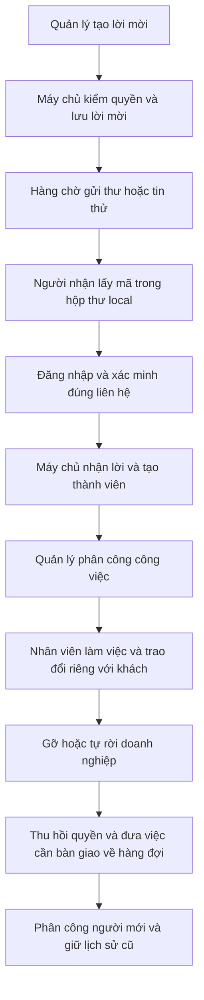

# P1-01 Kế hoạch đội ngũ và xác thực miễn phí ở local

**Đã duyệt A/B ngày 13/10/2026:** chủ dự án yêu cầu “ok hãy làm như đề xuất”. Mở xác minh liên hệ local/test bằng Mailpit + SMS mô phỏng và bổ sung contract đội ngũ/xác thực lại ở mục 5. Đã triển khai local/test; xem [B04-01](../bao-cao/B04-01-doi-ngu-va-xac-thuc-local.md), [B04-02](../bao-cao/B04-02-quyen-va-ban-giao-doi-ngu.md) và checklist để phân biệt local/native/CI/UAT. Nhóm C gửi email thật để riêng sau local; chưa mở SMS thật, OTP login/recover, MFA admin, tiền thật hoặc production. Các nhãn “đề xuất/chưa duyệt” bên dưới ghi lại trạng thái bản lập ngày 09/10 và được thay bằng quyết định này trong phạm vi A/B.

09/10/2026 · Thuộc bộ kế hoạch DELIVERY-01 · Liên quan B01-02/B01-05, B04-01/B04-02. **Đề xuất, chưa duyệt triển khai các bổ sung dưới đây.** Chủ dự án yêu cầu tìm phương án OTP/email/SMS miễn phí và lập đề xuất contract cả nhóm. OTP vẫn Pending cho tới khi chốt phạm vi mở lại. Chỉ lưu trong repo; chưa đổi spec, OpenAPI, DB, Excel, Drive hoặc bản xuất.

## 1. Hướng đề xuất

**Làm trọn luồng đội ngũ bằng Mailpit và bộ gửi SMS giả lập trên máy trước.** Người quản lý mời nhân viên; nhân viên xác minh liên hệ thử, nhận lời mời, được giao việc; quản lý sửa quyền hoặc nhân viên rời; công việc được bàn giao và chat riêng được giữ. Sau đó, nếu cần thư tới hộp thư thật, nối thêm Resend Free. SMS tới SIM thật để đợt riêng có lựa chọn nhà cung cấp và hạn mức chi phí.

OTP là mã dùng một lần. Email/SMS là cách chuyển mã đó tới người nhận. Tạo và kiểm mã trên máy không mất phí nhà cung cấp; gửi SMS qua nhà mạng là phần có thể phát sinh phí. Mailpit hiển thị thư trong trình duyệt trên máy, không chứng minh thư đã đến Gmail hoặc người dùng sở hữu số điện thoại thật.

Điểm cần giữ: xác minh email **không** được làm `phone_verified=true`. Các điều kiện điện thoại đã xác minh khi tạo hồ sơ/gửi/nhận việc vẫn giữ nguyên. Kiểm SMS giả lập chỉ được ghi là xác minh thử trong DB DEMO local/test tách biệt, không thay bằng chứng số điện thoại thật.

## 2. Phương án miễn phí đã tra ngày 09/10/2026

| Phương án | Gửi tới đâu | Miễn phí và điều kiện | Đề nghị cho dự án |
|---|---|---|---|
| Mailpit | Hộp thư trên máy | Mã nguồn mở MIT; có SMTP, giao diện đọc thư và API kiểm thử; chạy binary hoặc Docker. Không cần tài khoản nhà cung cấp/tên miền để bắt thư local | Dùng mặc định cho OTP email và lời mời thử. [Mailpit](https://mailpit.axllent.org/), [Docker](https://mailpit.axllent.org/docs/install/docker/), [giấy phép](https://github.com/axllent/mailpit/blob/develop/LICENSE) |
| Resend Free | Email thật | 3.000 email/tháng, tối đa 100/ngày. Domain thử `resend.dev` chỉ gửi tới email của chính tài khoản Resend; gửi cho người khác cần domain do mình sở hữu và xác minh DNS | Lựa chọn đầu tiên khi muốn thử thư thật. Chưa có domain thì vẫn thử hộp thư của chủ tài khoản; mua domain là chi phí riêng nếu cần. [Giá](https://resend.com/pricing), [quota](https://resend.com/docs/knowledge-base/account-quotas-and-limits), [giới hạn domain thử](https://resend.com/docs/knowledge-base/403-error-resend-dev-domain) |
| Brevo Free | Email thật | 300 email/ngày, không cần thẻ và không giới hạn thời gian theo tài liệu hiện tại; có transactional email. Hạn mức chưa dùng không cộng dồn; cần cấu hình người gửi và đáp ứng kiểm tra tài khoản | Dự phòng cho email, không nối hai provider ngay đợt đầu. Free email không đồng nghĩa SMS miễn phí. [Gói và điều kiện](https://help.brevo.com/hc/en-us/articles/208589409-About-Brevo-s-pricing-plans) |
| Bộ gửi SMS local của dự án | Hộp nhận thử trên máy | Không gọi nhà mạng, không có phí gửi; cần viết adapter và bài kiểm trong dự án | Phù hợp kiến trúc NestJS/auth hiện có. Hiển thị rõ “SMS mô phỏng”, chỉ nhận liên hệ DEMO được cho phép |
| Firebase Auth Emulator / số điện thoại giả | Mô phỏng xác thực | Emulator không gửi SMS thật, có cách lấy mã cho test. SMS xác minh thật của Firebase chỉ có trên gói Blaze bật billing | Không đưa Firebase vào chỉ để giả lập vì dự án đã tự quản lý auth. Giữ làm lựa chọn nếu sau này đổi kiến trúc. [Emulator](https://firebase.google.com/docs/emulator-suite/connect_auth), [giới hạn SMS](https://firebase.google.com/docs/auth/limits) |
| Twilio trial | SMS thật có giới hạn | Tài liệu trial hiện nêu 100 SMS, hết hạn sau 30 ngày, tối đa 5 số nhận đã xác minh; console mới giới hạn quốc gia theo số đăng ký. Còn phụ thuộc quốc gia được hỗ trợ | Chỉ thử riêng khi xác định số nhận/quốc gia phù hợp; không coi là gói SMS miễn phí lâu dài cho Việt Nam. [Trial](https://www.twilio.com/docs/usage/tutorials/how-to-use-your-free-trial-account) |
| TOTP bằng ứng dụng xác thực | Mã tạo trên thiết bị, không gửi thư/tin | Thuật toán tạo mã theo thời gian, không có phí SMS/email; cần đăng ký bí mật và xử lý mất thiết bị | Có thể nghiên cứu cho MFA sau; không xác minh quyền sở hữu số điện thoại/email. Chưa cần để mở luồng P1-1 local. [RFC 6238](https://www.rfc-editor.org/info/rfc6238/) |

Twilio test credentials mô phỏng API mà không gửi tới số thật, nhưng tài liệu mới nói không tạo được test credentials trong console mới; khóa legacy đã có vẫn hoạt động. Vì vậy không chọn làm phụ thuộc bắt buộc cho local. [Tài liệu chính thức](https://www.twilio.com/docs/iam/test-credentials).

**Kết luận chi phí:** có thể làm toàn bộ kiểm thử local với phí nhà cung cấp bằng 0. Có gói email thật miễn phí trong quota. Chưa xác nhận được dịch vụ SMS thật miễn phí lâu dài phù hợp cho dự án. “Chạy app trên localhost” không miễn phí cước nếu backend gọi dịch vụ SMS thật. Các con số trên là điều kiện công bố, chưa phải tài khoản đã đăng ký hay bằng chứng gửi thành công.

## 3. Hiện trạng đã đối chiếu trong repo

| Nền hiện có | Khoảng thiếu cần xử lý |
|---|---|
| [B06-01](../bao-cao/B06-01-hoa-don-va-quyet-toan-test.md) đã nối vòng việc → hóa đơn → quyết toán test; [thứ tự hiện hành](../03-thu-tu-trien-khai.md) đặt P1-1 sau P0-3 | Mở gói đội ngũ, không quay lại tiện ích tài khoản không liên quan |
| [AuthService](../../../services/api/src/modules/auth/auth.service.ts) có email/mật khẩu, phiên và xác minh phiên; [password.ts](../../../services/api/src/modules/auth/password.ts) có hàm kiểm mật khẩu | Chưa có controller/service chạy OTP, gửi email/SMS hoặc chứng nhận xác thực lại |
| [JobsService](../../../services/api/src/modules/jobs/jobs.service.ts), [jobs.access.ts](../../../services/api/src/modules/jobs/jobs.access.ts), [MembersController](../../../services/api/src/modules/jobs/members.controller.ts) có list thành viên và phân công | Chưa có quản trị lời mời, cấp/thu hồi quyền, gỡ/tự rời. Cần kiểm bổ sung xóa nháp khi bàn giao và lịch sử người thực hiện |
| [Me trong OpenAPI](../../technical-design/openapi.json) chỉ có `partner_ids`; `Member` không có `partner_id` hoặc tên partner | Nhân viên không có `members.manage/jobs.assign` chưa có API lấy membership của chính mình để tự rời |
| OpenAPI đã có `inviteMember`, `acceptInvitation`, `editGrants`, `deactivateMember`, `leavePartner`, `setCallContact` | Thiếu list/gửi lại/thu hồi lời mời, xem trước ảnh hưởng khi rời và đọc đầu mối hiện tại. `GrantsEdit` thiếu lý do/xác thực lại theo mẫu UI |
| [Data model](../../technical-design/data-model.json) đã mô tả lời mời, đầu mối, audit, challenge | Migrations thực tế đến 008 chưa tạo các bảng này; thiếu một số trường vòng đời/đưa thư vào hàng chờ |
| Đã mở Storybook “Mobile · đội ngũ”; [partner-journey](../../../ui-ux/specs/partner-journey.md) và [finance-batch](../../../ui-ux/specs/finance-batch.md) mô tả mời, gỡ, tự rời, quyền | Prototype dùng dữ liệu/mã xác thực mẫu. Không mang mã `123456` hoặc nút giả lập nhận lời vào app sản phẩm |

## 4. Luồng người dùng sau khi triển khai đề xuất

1. Quản lý mở avatar → Tài khoản → Đội ngũ. Xem Thành viên, Lời mời, Đã rời và Quyền truy cập; chỉ thấy doanh nghiệp và thao tác mình có quyền.
2. Mời bằng email hoặc số điện thoại, mặc định chỉ thực hiện việc được giao. API nhận yêu cầu giống nhau dù liên hệ đã đăng ký hay chưa; lời mời tồn tại 7 ngày. Không trả mã bí mật cho người quản lý.
3. Người nhận mở app, đăng nhập/đăng ký bằng luồng hiện có, nhập token từ hộp thư thử. Nếu liên hệ được mời chưa được xác minh cho tài khoản này, hoàn thành OTP đúng liên hệ rồi bấm nhận. Mã lời mời không thay OTP và không tự tạo phiên đăng nhập.
4. Máy chủ kiểm lời mời, liên hệ, quyền người mời còn hiệu lực rồi tạo/kích hoạt lại membership. Người mới chỉ được xem/thực hiện công việc đã giao, không tự có quyền ví/quản lý.
5. Quản lý phân công. Người mới mở việc và phòng chat riêng với khách; đổi nhân viên không sao chép lịch sử chat.
6. Sửa quyền cần lý do và xác thực lại. Đề xuất nhập lại mật khẩu hiện hành trong đợt local; không gọi việc nhập lại mật khẩu là MFA. Không tự sửa quyền, sửa chủ hoặc thay quyền vượt phạm vi người cấp.
7. Gỡ/tự rời: xem trước việc cần bàn giao, nhập lý do, xác nhận. Máy chủ kiểm lại dưới khóa DB; việc chưa xác nhận nhận tiền về chờ phân công, bỏ nháp chưa gửi, giữ hóa đơn đã gửi/khóa và các khoản tiền. Người đã rời giữ phòng chat cá nhân, mất quyền doanh nghiệp ngay.

Nhập token thủ công cho local trước; liên kết mở app cần kiểm riêng cả web/Android/iOS. Không tự nhận lời chỉ vì người dùng bấm link hoặc vừa đăng nhập thành công.

## 5. Đề xuất bổ sung contract API

Contract là quy định app gửi gì và máy chủ trả gì. Bảng dưới là đề xuất để duyệt trước khi sửa [OpenAPI hiện hành](../../technical-design/openapi.json). Mọi đường dẫn có tiền tố `/v1`. Mutation quản trị dùng `Idempotency-Key`, nghĩa là thử lại cùng thao tác không tạo kết quả lần hai; thao tác trên bản có sẵn dùng `expected_version` để chặn ghi đè dữ liệu mới.

### 5.1 Lời mời và thành viên

| API / operationId đề xuất | Input → output | Quyền và quy tắc |
|---|---|---|
| Giữ `POST /partners/{id}/invitations` / `inviteMember` | `Invite {contact, permissions}` → `Ack {id,version,state}` | `members.manage`; giữ response không tiết lộ liên hệ có tài khoản hay chưa. Không trả token hoặc user ID được suy từ liên hệ |
| Thêm `GET /partners/{id}/invitations` / `listInvitations` | `status?, cursor?, limit?` → trang `InvitationSummary` | Chỉ `members.manage`, không mở cho người chỉ có `jobs.assign`; cursor ký gắn actor/partner/filter |
| Thêm `POST /invitations/{id}/resend` / `resendInvitation` | `{expected_version}` → `InvitationSummary` của lời mời mới | Tạo token mới, hạn 7 ngày tính lại; đánh dấu bản cũ đã thay thế. Không gửi lại bản đã nhận hoặc người đã là thành viên active |
| Thêm `POST /invitations/{id}/revoke` / `revokeInvitation` | `{expected_version,reason}` → `InvitationSummary` | Vô hiệu token, giữ lịch sử; kiểm quyền và cạnh tranh với nhận lời |
| Giữ `POST /invitations/accept` / `acceptInvitation` | `{token}` → `Member` | Bắt buộc phiên đăng nhập và đúng liên hệ đã xác minh; kiểm lại grant người mời hiện hành; kích hoạt lại cùng membership đã rời để giữ định danh |
| Thêm `GET /me/memberships` / `listMyMemberships` | `active?, cursor?, limit?` → trang `MyMembership` | Chỉ của chính mình, gồm đã rời; không dùng list toàn đội để phục vụ nhân viên thường |
| Giữ `GET /partners/{id}/members` / `listMembers` | Trang `Member` hiện có | `members.manage` hoặc `jobs.assign`; không bổ sung số điện thoại thô chỉ để giống prototype |
| Thêm `GET /memberships/{id}/departure-preview` / `previewDeparture` | Trang việc cần bàn giao + `membership_version` + tổng số | Chính member hoặc `members.manage`; chỉ dữ liệu tối thiểu, không mở phòng chat riêng/chi tiết ví. Kết quả xem trước không phải khóa hoặc quyền phê duyệt |
| Giữ `POST /memberships/{id}/deactivate`, `/leave` | `ReasonInput` → `Member` / `Ack` như hiện tại | Gỡ cần `members.manage`; tự rời chỉ chính mình; không áp dụng owner. Recheck toàn bộ việc trong transaction, không tin danh sách preview |
| Thêm `GET /partners/{id}/call-contact` / `getCallContact` | → `{partner_id,membership_id,version}`, `membership_id` có thể null | Chỉ `members.manage`; null là đầu mối cửa hàng |
| Sửa `PUT /partners/{id}/call-contact` / `setCallContact` | Giữ `expected_version`; cho `membership_id:null` để quay về cửa hàng → `Ack` | Dùng chung `Partner.version` để tránh hai chuẩn version; thành viên được chọn phải active cùng partner. Rời thì reset về null và tăng version nếu cấu hình đổi |

`InvitationSummary` đề xuất: `id, partner_id, contact_masked, permissions, status, created_at, expires_at, version, replacement_id`. `status` gồm `pending, accepted, expired, revoked, replaced`; trạng thái hết hạn được tính theo giờ máy chủ, không phụ thuộc worker đã chạy hay chưa. Không trả token/hash hay việc liên hệ đã đăng ký. Trạng thái chuyển thư là trường riêng `delivery_state: queued | submitted | failed | unknown`; `submitted` chỉ là dịch vụ đã nhận yêu cầu, không có nghĩa người nhận đã đọc.

`MyMembership` đề xuất: `id, partner_id, partner_name, partner_kind, is_owner, active, permissions, version, left_at`. `permissions` là quyền được cấp rõ ràng; `is_owner` riêng, không thêm quyền admin. Trang lịch sử vẫn hiển thị tên doanh nghiệp sau khi rời mà không mở quyền đọc tài nguyên riêng của doanh nghiệp.

Quy tắc chống trùng: cùng partner + liên hệ chuẩn hóa chỉ có một lời mời còn hiệu lực. Gửi lại phải tạo bản thay thế trong cùng transaction. Nếu người được mời đã active, giữ phản hồi trung tính với người mời; không trả “email này đã có tài khoản”. Trạng thái và lỗi chỉ phản ánh quan hệ đội ngũ mà quản lý có quyền xem.

Đề xuất pilot chỉ mời người thực hiện với `permissions=[]`; quyền quản trị/ví cấp sau bằng `editGrants` có xác thực lại và lý do, tránh dùng lời mời để vượt bước bảo vệ cấp quyền. Nếu muốn mời kèm quyền ngay, phải mở rộng `Invite` bằng cùng cơ chế xác thực lại trước khi bật. Khi nhận lời lại sau khi rời, không khôi phục các grant đã bị thu hồi.

### 5.2 OTP và xác thực lại

| API / schema | Đề xuất |
|---|---|
| `POST /auth/challenges` / `requestOtp` đã có trong spec | Đợt này mở `purpose=verify` cho liên hệ gắn với tài khoản đang đăng nhập; context ràng buộc user + loại liên hệ + mục đích. `login/recover` chưa triển khai trong gói, trả lỗi rõ cho purpose chưa hỗ trợ |
| `POST /auth/challenges/verify` / `verifyOtp` | `{challenge_id,code}`; với purpose verify bắt buộc đúng phiên/chủ thể, consume một lần trong transaction; trả Ack hiện hành. Sau đó app tải lại `/me` |
| Xác minh email | Chỉ email thuộc chính user; không chiếm identity đã thuộc user khác. Chuẩn hóa theo auth hiện có, không tự bỏ dấu chấm hoặc phần `+` của địa chỉ |
| Xác minh số điện thoại | Chuẩn hóa E.164. Khi thành công mới liên kết identity nếu chưa có ai sở hữu. Số mới khác số hiện hành phải đi luồng thay định danh riêng, không dùng verify để bỏ qua `changeIdentity` |
| Thêm `POST /auth/reauthenticate` / `reauthenticate` | Bearer hiện hành + `{password}` → `{grant,expires_at}`. Grant ngắn hạn ràng buộc user + session family + scope `membership.grants`, không cấp login session hay quyền admin |
| Sửa riêng schema cấp quyền doanh nghiệp | Tạo `MembershipGrantsEdit {expected_version,permissions,reason,reauth_grant}` cho `editGrants`; không sửa schema `GrantsEdit` dùng chung rồi vô tình đổi API admin |

Đề xuất thông số **chỉ cho pilot local**: OTP ngẫu nhiên 6 số, hết hạn 5 phút, tối đa 5 lần nhập sai/challenge; gửi lại sau 60 giây, tối đa 5 yêu cầu/giờ/liên hệ và 20/giờ/tài khoản, thêm giới hạn IP. Mỗi lần gửi lại vô hiệu mã cũ và không reset hạn mức cộng dồn. `reauth_grant` sống 5 phút, dùng cho một mutation cấp quyền; retry cùng key sau commit được trả kết quả cũ sau kiểm quyền, không consume lần hai. Rate limit dùng DB để có hiệu lực sau restart và qua nhiều worker.

Mã OTP dùng hàm ngẫu nhiên mật mã, lưu HMAC kèm secret server để chống dò mã từ DB; không ghi mã/token/mật khẩu vào log, ảnh, response công khai hoặc dữ liệu audit. Raw mật khẩu/token xác thực lại cũng không được lưu trong snapshot idempotency. Worker chỉ giữ nội dung gửi dưới dạng mã hóa tạm thời, dọn sau gửi/hết hạn. Refresh không tự gia hạn thời gian xác thực lại; logout/thu hồi family/khóa tài khoản làm grant mất hiệu lực.

Đây là **đề xuất mở lại phần tối thiểu B01-02**, không phải quyết định đã mở OTP. Nhập lại mật khẩu giúp xác thực gần thời điểm cấp quyền nhưng không thay yêu cầu MFA admin. Tài khoản không có mật khẩu chưa dùng luồng cấp quyền này; cần phương thức step-up riêng trước khi hỗ trợ.

### 5.3 Lỗi, quyền và các cạnh tranh phải xử lý

- Giữ lỗi chung `VALIDATION`, `FORBIDDEN`, `NOT_FOUND`, `VERSION_CONFLICT`, `STATE_CONFLICT`, `IDEMPOTENCY_MISMATCH`, `RATE_LIMITED` của dự án. Đề xuất thêm mã có thể xử lý trên UI: `CHALLENGE_INVALID`, `CHALLENGE_EXPIRED`, `REAUTH_REQUIRED`; lời mời không hợp lệ/hết hạn/đã dùng không được lộ liên hệ.
- `members.manage` không cho cấp vượt quyền mình. Chỉ các quyền bị thêm/bớt phải nằm trong phạm vi người cấp; giữ quyền khác nguyên trạng. Cấm tự sửa và sửa owner. Quyền thao tác ví yêu cầu `wallet.read`, theo mẫu hiện hành; việc cấp quyền không tự triển khai nạp/rút/ngân hàng.
- Đề xuất enum quyền doanh nghiệp từ ma trận hiện hành: `jobs.accept`, `jobs.assign`, `jobs.manage`, `profile.manage`, `members.manage`, `wallet.read`, `wallet.topup`, `wallet.withdraw`, `bank.manage`, `reviews.respond`, `reviews.write`. UI giải thích những chức năng còn Pending; không cho truyền `admin.*` hoặc chuỗi tùy ý. Cần đối chiếu lần cuối toàn ma trận khi duyệt contract.
- Người mời bị thu hồi quyền trước khi người nhận accept: từ chối lời mời nếu không còn quyền quản lý hoặc không còn đủ quyền sẽ cấp. Không âm thầm hạ/bổ sung quyền khác với lời mời.
- Gỡ thành viên, phân công, gửi hóa đơn và quyết toán cùng khóa partner → job → invoice theo thứ tự thống nhất. Hai bên đồng thời nhận/gửi lại/thu hồi lời mời chỉ một chuyển trạng thái thắng. Retry kiểm quyền hiện hành trước trả snapshot.
- Người đang là khách của một việc không được phân công làm người thực hiện chính việc đó, kể cả vừa tham gia doanh nghiệp sau khi gửi thuê. Chat riêng không thành phòng cả đội.
- Việc đã có dấu nhận tiền giữ người thực hiện lịch sử. Khi gỡ/rời trên việc chưa nhận tiền, chỉ bỏ bản nháp chưa gửi; không xóa phiên bản đã gửi, lý do yêu cầu sửa, hóa đơn khóa, khoản giữ, ledger hoặc hai dấu thanh toán.

## 6. Thay đổi dữ liệu và cách tổ chức code dự kiến

| Thành phần | Cách làm sau khi duyệt |
|---|---|
| Migration mới sau 008 | Tạo `auth_challenges`, `member_invitations`, `partner_contacts`, `audit_events` theo data model đã duyệt và bổ sung vòng đời cần thiết; không sửa migration cũ |
| Lời mời | Bổ sung `version`, `replacement_id`, trạng thái chuyển thư và liên hệ mã hóa để gửi lại; HMAC liên hệ để đối chiếu; token chỉ có hash trong bản ghi nghiệp vụ |
| Hàng chờ gửi | Lưu cùng transaction nghiệp vụ, worker nhận việc có khóa/lease, retry giới hạn, không gửi mã đã hết hạn/thay thế. Nội dung chứa bí mật mã hóa tạm thời, không đưa vào event/audit chung |
| Xác thực lại | Bản ghi grant có hash, user, family, scope, expiry và consumed mutation key; không chứa mật khẩu |
| Audit | Ghi actor, request ID, trước/sau quyền, lý do và các việc bàn giao. Không sửa/xóa lịch sử; không ghi nội dung chat/bí mật |
| Backend | Mở module `organizations` khi triển khai; auth giữ challenge/reauth. Tách adapter gửi vào `integrations`; dùng AccountTransaction, kiểm quyền và luật hóa đơn đang có |
| App | Feature `organizations`: API/models/state/screens; nối AuthSession và navigation hiện có. UI chỉ gửi ý định, backend quyết định quyền; VI/EN/JA, lỗi/retry và đổi tài khoản xóa dữ liệu riêng |
| Công cụ local | Compose profile riêng cho Mailpit, bind `127.0.0.1:8025` và `127.0.0.1:1025`; không relay email ra ngoài. Hộp SMS local ở máy chủ phát triển, không nằm trong bundle mobile hoặc API production |

Phân biệt **gửi lại do người dùng** với **retry vận chuyển**: người dùng gửi lại tạo token mới và vô hiệu bản cũ; worker thử lại cùng một thư giữ nguyên token/delivery ID. Timeout không đủ để khẳng định chưa gửi; đánh dấu `unknown` và dùng cơ chế chống trùng của adapter nếu có. SMTP không bảo đảm gửi đúng một lần, nên thư có thể trùng nhưng token chỉ nhận lời một lần.

Tất cả thông số `disabled / local / resend` là cấu hình dự kiến. Mặc định disabled; profile local phải kiểm DB local/test riêng, tách secrets và chặn khi production. Không chỉ dựa vào `NODE_ENV` để cho phép giả lập. Unit/integration có fault injection cho SMTP lỗi, quota, timeout và restart.

## 7. Thứ tự triển khai sau khi duyệt

Một đợt hoạt động là **P1-1 đội ngũ với xác thực local**, chia các bước kỹ thuật dưới đây nhưng bàn giao bằng hành trình trọn vẹn.

| Bước | Kết quả và điều kiện qua bước |
|---|---|
| 0. Chốt phạm vi và contract | Chốt ba nhóm quyết định ở mục 9. Khi trở thành thay đổi spec, đọc sổ quản lý mới nhất và đồng bộ đúng tài liệu ảnh hưởng theo AGENTS; hiện chỉ là đề xuất |
| 1. Kênh local và xác minh liên hệ | Mailpit + SMS giả lập, OTP hết hạn/sai/gửi lại/rate limit, identity đúng user; test không gọi internet hoặc sửa tài khoản thật |
| 2. Lời mời và gia nhập | DB → API → app: mời/list/gửi lại/thu hồi/nhận; người được mời mới và đã rời; chống trùng, hết hạn, cạnh tranh; không lộ token |
| 3. Quyền và bàn giao | Xác thực lại mật khẩu, sửa quyền có audit, đầu mối, preview/gỡ/tự rời; phân công lại, mất quyền ngay, giữ hóa đơn/tiền/chat |
| 4. Kiểm trọn hành trình | Khách + chủ + quản lý giới hạn + hai nhân viên + người ngoài; DB thật, web hai/nhiều tài khoản, Android emulator và iOS simulator |
| 5. Bàn giao học code | Báo cáo B04-01/B04-02, sơ đồ Mermaid đã render, ảnh app DEMO, thứ tự đọc hàm/file và input/output; cập nhật checklist đúng mức local/native/CI/UAT |
| Tùy chọn sau bước 4 | Nối Resend Free cho tập email test cho phép. Ghi bằng chứng email thật nhận được; không xem API 2xx là thư đã đến hộp thư |

Đường dẫn test dự kiến: `services/api/test/integration/organizations.test.ts`, các test auth challenge/reauth, test màn/API cạnh feature mobile, `tests/e2e/web/organizations.spec.mjs` và flow native tương ứng. Chưa tạo các file code/test này trong đợt lập đề xuất.

### Các tiêu chí không được bỏ qua

- Nhận token sai/hết hạn/thay thế hoặc bằng tài khoản khác bị từ chối; email được xác minh không mở guard điện thoại.
- Gửi lại liên tục, chạy hai worker, process chết sau gửi và retry không tạo hai membership hoặc hai lần đổi quyền.
- Cấp quyền trái phép, quản lý dùng grant cũ, replay sau thu hồi, logout/refresh/khóa tài khoản khi đang reauth đều được kiểm.
- Gỡ/rời khi có nháp, hóa đơn đang sửa, đã khóa, đã nhận tiền; giữ cân bằng ledger và bảo toàn lịch sử. Đổi người từ tab cũ không gửi/nhận tiền được.
- Nhân viên bị gỡ vẫn nhắn phòng riêng theo quyền tài khoản, quản lý không đọc được phòng đó; người được giao mới có phòng riêng của mình.
- Không lộ chéo doanh nghiệp, cursor, preview, lời mời, lịch sử; ảnh/báo cáo không có OTP/token/mật khẩu.
- Mất mạng giữ dữ liệu và key thử lại; đổi locale giữ form; đổi tài khoản loại dữ liệu riêng. Kiểm cả nhánh người dùng hủy ở màn preview.

## 8. Phạm vi đồng bộ khi đề xuất được duyệt

Chỉ lúc duyệt mới đọc bản Excel hiện hành, tra `Anh huong` và tìm chéo các nguồn để chốt danh sách thực tế. Dự kiến ảnh hưởng: OpenAPI/operations, data model/schema, QA/RTM/backlog, luồng và quyền xác minh/đội ngũ, UX màn mời/nhận/quyền/rời, quyết định phương thức xác thực lại và kênh local. Các bản mirror/HTML/ZIP/Drive thuộc phạm vi spec phải có phiên bản rõ và cập nhật cùng ID theo quy trình.

Bộ kế hoạch/báo cáo DELIVERY-01 vẫn chỉ ở repo. Lập đề xuất này không tự sửa sổ Excel hoặc đăng ký một quyết định nghiệp vụ đã chốt. Chưa mua domain, đăng ký provider, gửi email/SMS thật, bật billing hoặc triển khai production.

## 9. Ba nhóm quyết định cần chốt

| Nhóm | Phương án khuyến nghị để duyệt |
|---|---|
| A. Mở lại OTP đến đâu | Chỉ xác minh liên hệ local/test bằng Mailpit + SMS giả lập, giữ guard điện thoại và tách DB DEMO; chưa OTP login/recover, chưa SMS thật |
| B. Contract đội ngũ và xác thực lại | Duyệt hướng bổ sung mục 5: lời mời/list/resend/revoke, membership của chính mình, preview rời, đọc/reset đầu mối, lý do + grant xác thực lại mật khẩu riêng cho quyền doanh nghiệp |
| C. Email thật | Chưa cần để nghiệm thu local. Nếu muốn thử ngay sau local: Resend Free; trước tiên dùng hộp thư chính tài khoản, hoặc domain đã sở hữu để gửi tới tester khác. Brevo là lựa chọn thay thế, không bật song song |

Khi chốt A/B mới chuyển sang đồng bộ contract và triển khai. Chọn C là bước gửi thật riêng, không tự mở SMS trả phí, MFA admin, tiền thật hoặc production.

## 10. Trạng thái rà soát khi lập đề xuất ngày 09/10

Đã đọc kế hoạch/checklist, code auth/jobs/chat/invoices, contract/data model và mở Storybook đội ngũ trong phiên 09/10. Đã tra tài liệu chính thức các lựa chọn ở mục 2. Đây là bản kế hoạch, chưa có bằng chứng gửi email/SMS hoặc kiểm tính năng P1-1 mới.

Đã kiểm các liên kết local và `git diff --check`; sơ đồ Mermaid đã parse và render bằng Chromium, 11 nút/10 cạnh. Bằng chứng kỹ thuật local: `.local/p1-01/mermaid-check.json`. Không tạo ảnh/sơ đồ phụ trong bộ tài liệu.

Thay đổi bàn giao chỉ là kế hoạch và liên kết trạng thái; không có thay đổi code hoặc migration được áp dụng trong phiên. Không commit/push.
