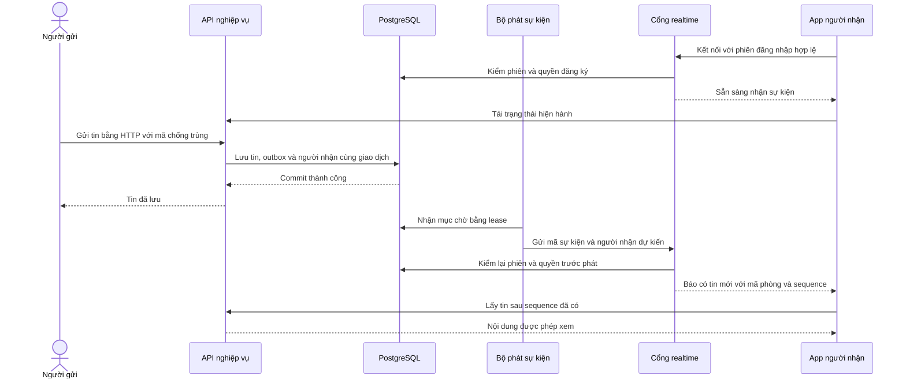

# RT-01 Kế hoạch realtime cho inbox và chat

14/10/2026 · Thuộc bộ kế hoạch DELIVERY-01 · B05-02, P1-2. **RT-01A đã được chủ dự án duyệt: “ok bắt đầu làm đi”.** Contract đã đồng bộ realtime v0.2 / API v0.1.13. Báo cáo kết quả và giới hạn tại [B05-02](../bao-cao/B05-02-realtime-inbox-va-chat.md). RT-01B vẫn là đề xuất, chưa mở Redis/multi-instance hoặc production.

Các phần “hiện trạng” và “đề nghị” dưới đây giữ bối cảnh lúc lập kế hoạch; không dùng chúng thay bằng chứng triển khai trong báo cáo.

## 1. Hướng đề nghị

**Chọn WebSocket qua Socket.IO, dùng một kết nối chung cho inbox và chat; giữ HTTP cho gửi tin, đánh dấu đọc và mọi thao tác nghiệp vụ.** Khi máy chủ báo có thay đổi, app tải lại phần dữ liệu liên quan qua API có kiểm quyền. Giai đoạn đầu chạy trong NestJS hiện có với một instance (một tiến trình API), không dựng microservice hoặc Redis ngay.

SSE phù hợp nếu chỉ cần máy chủ báo thông báo tới app. Chat văn bản cũng làm được bằng SSE để nhận và HTTP để gửi; không phải cứ có chat là bắt buộc WebSocket. Tuy nhiên, với hướng mở rộng nhiều loại tương tác của dự án, Socket.IO giúp dùng chung cơ chế kết nối lại, đăng ký nhận sự kiện và quản lý các kết nối. Đây là đánh giá kiến trúc cho repo hiện tại, không phải kết luận WebSocket luôn nhanh hơn hoặc chịu tải tốt hơn SSE.

Socket.IO là thư viện có protocol riêng chạy trên WebSocket; client phải dùng `socket.io-client`, không kết nối bằng `new WebSocket()` thông thường. Nó hỗ trợ tự kết nối lại, nhưng không tự bảo đảm nhận đủ sự kiện khi mất mạng. Xem [giới thiệu](https://socket.io/docs/v4/), [delivery guarantees](https://socket.io/docs/v4/delivery-guarantees/) và [Nest adapters](https://docs.nestjs.com/websockets/adapter).

## 2. Hiện trạng đã đối chiếu

| Phần hiện có | Bằng chứng trong repo | Hệ quả cho kế hoạch |
|---|---|---|
| Inbox HTTP tải mỗi khoảng 15 giây khi app không ở nền | [NotificationsProvider](../../../apps/mobile/src/features/notifications/NotificationsProvider.tsx), `refresh` | Thay lần tải thường xuyên bằng sự kiện; giữ đường phục hồi HTTP. |
| Worker inbox chạy mỗi giây, ghi thông báo riêng từng người | [NotificationsWorker](../../../services/api/src/modules/notifications/notifications.worker.ts), `process` | Phải phát sự kiện sau khi ghi inbox thành công, kể cả nhắc lịch. |
| Chat tải khi mở màn, quay về foreground, bấm tải lại hoặc sau gửi; chưa nhận tức thời khi đứng yên trong phòng | [ConversationScreen](../../../apps/mobile/src/features/chat/screens/ConversationScreen.tsx), `Room` | Làm cả inbox và chat trong một đợt để người nhận thấy thông báo và nội dung mới nhất. |
| Gửi tin/read đã dùng HTTP, sequence và khóa chống trùng | [ChatService](../../../services/api/src/modules/chat/chat.service.ts), `send`, `read` | Tái sử dụng nghiệp vụ, không thêm đường ghi tin thứ hai qua socket. |
| Có `outbox_events` cùng transaction với việc/chat/hóa đơn | [Migration 007](../../../services/api/migrations/007_jobs_chat.sql), [hàm event](../../../services/api/src/modules/chat/chat.store.ts) | Dùng sự kiện đã lưu; không phát từ UI hay trước commit. Chưa có consumer realtime. |
| Spec có envelope, ACL và `notification.created.v1`; thư viện chưa chốt | [realtime.json](../../technical-design/realtime.json), [API/realtime](../../technical-design/02-api-realtime.md) | Quyết định Socket.IO và các event/subscribe bổ sung phải được duyệt rồi đồng bộ. |
| ADR-05 ưu tiên DB outbox, Redis bổ sung khi scale | [ADR](../../project-docs/architecture/08-kien-truc-ADR.md) | Giữ kiến trúc hiện có, không coi Redis là điều kiện cho bản local đầu tiên. |
| Access token ngắn hạn, refresh thay session cũ, có thu hồi family | [AuthService](../../../services/api/src/modules/auth/auth.service.ts), [SessionsService](../../../services/api/src/modules/accounts/sessions.service.ts) | Socket phải theo đúng vòng đời phiên; kiểm JWT lúc kết nối là chưa đủ. |

Nền hiện tại: NestJS 12.1.0, Expo 57.0.26, React Native 0.86.3. Chưa chọn phiên bản dependency realtime; bước đầu triển khai phải kiểm tương thích và pin phiên bản vào lockfile, không mặc định cài `latest`.

## 3. SSE và WebSocket khác nhau ở điểm nào?

| Tiêu chí | SSE + HTTP | WebSocket qua Socket.IO |
|---|---|---|
| Hướng truyền | Máy chủ → app; app gửi thao tác bằng HTTP | Hai chiều trên kết nối; đợt đầu vẫn giữ thao tác ghi qua HTTP |
| Inbox riêng lẻ | Gọn, rất phù hợp | Có thêm thư viện và quản lý kết nối |
| Chat hiện tại | Đủ dùng với HTTP gửi tin | Đủ dùng; thuận tiện nếu sau này có tương tác hai chiều thường xuyên |
| Expo/native/web | Có thể dùng streaming `expo/fetch`; cần parser SSE, reconnect, hủy stream và kiểm native | React Native hỗ trợ WebSocket; Socket.IO thêm client chung và cơ chế reconnect |
| Xác thực bearer đang dùng | `EventSource` chuẩn trên web không có tùy chọn header Authorization; fetch streaming có thể thêm header | Dùng packet `auth` của Socket.IO; không dựa vào custom header chỉ hoạt động ở native |
| Phục hồi mất mạng | Event ID/Last-Event-ID chỉ hữu ích nếu server có lưu và replay; dùng fetch phải tự điều khiển | Mặc định không tự phát lại toàn bộ sự kiện đã bỏ lỡ; vẫn phải phục hồi qua REST |
| Proxy | HTTP streaming; cần tránh buffering và idle timeout; HTTP/1.1 có hạn chế số kết nối mỗi origin | Cần hỗ trợ Upgrade và timeout phù hợp; cấu hình Origin riêng |
| Nhiều API instance | Vẫn cần chia sẻ sự kiện và kiểm quyền ở từng nơi phát | Có hệ adapter; vẫn cần chia sẻ sự kiện, kiểm quyền và chiến lược phục hồi |
| App nền/đóng | Không thay push của hệ điều hành | Không thay push của hệ điều hành |

Nguồn: [Expo streaming fetch](https://docs.expo.dev/versions/latest/sdk/expo/#streaming-fetch), [React Native networking](https://reactnative.dev/docs/network), [EventSource constructor](https://developer.mozilla.org/en-US/docs/Web/API/EventSource/EventSource), [SSE](https://developer.mozilla.org/en-US/docs/Web/API/Server-sent_events/Using_server-sent_events), [Socket.IO client options](https://socket.io/docs/v4/client-options/). Khả năng thư viện phải được thử trên bản Expo của repo trước khi coi native đã đạt.

WebSocket thuần với `ws` là lựa chọn thứ ba: ít lớp protocol hơn, nhưng nhóm phải tự làm reconnect, điều khiển subscription và các quy ước kết nối. Nest có `WsAdapter`; kế hoạch ưu tiên Socket.IO vì mục tiêu dễ triển khai/bảo trì, không dùng hai transport song song ngay từ đầu.

## 4. Phạm vi một đợt bàn giao trọn luồng

**RT-01A đề nghị thực hiện trước:** hai tài khoản đang mở app nhận tin mới và inbox tự cập nhật, badge đọc đồng bộ giữa hai phiên, reconnect lấy bù dữ liệu, đổi người/thu hồi quyền có hiệu lực với kết nối đang mở. Các màn việc/hóa đơn đang mở tải lại khi nhận các event đã có và được ánh xạ rõ. Không xóa nội dung form đang nhập khi có thay đổi từ bên kia; nếu phiên bản khác thì báo cần tải lại trước submit.

Chỉ phát những sự kiện thuộc miền đang có code, đã đối chiếu payload. Cuộc gọi, presence/typing, provider push, live location, admin/report và giao dịch tiền thật không nằm trong RT-01A. Các chức năng đó có thể dùng lại kết nối sau khi có quyết định và contract riêng. Media cuộc gọi sau này dùng WebRTC/provider phù hợp, không truyền âm thanh/video qua kênh giao dịch này.

**RT-01B là bước scale riêng:** chạy từ hai API instance, bổ sung bus/adapter và kiểm qua proxy. Chưa coi một instance đã kiểm là bằng chứng hệ thống nhiều instance hoạt động đúng.

## 5. Luồng đề xuất



`Lease` là quyền xử lý một mục trong thời gian có hạn, giúp worker khác tiếp tục nếu worker trước dừng. `Commit` là lúc giao dịch đã lưu thành công. Sơ đồ không hứa dữ liệu đến thiết bị đúng một lần: app phải chịu được trùng, lệch thứ tự và mất kết nối.

### Kết nối và xác thực

- Một `RealtimeClient` trong vòng đời app đã đăng nhập, dùng chung cho các màn. Socket.IO path đề xuất `/v1/realtime/socket.io`, namespace `/`; phải cấu hình path rõ vì Nest global prefix không tự chứng minh socket có prefix này.
- Client gửi **access token** qua `auth` khi mở kết nối. Không đưa access/refresh token vào URL, query, tên room hoặc log. `AuthSession` cung cấp callback nội bộ lấy token hợp lệ; UI không cầm token. Refresh token chỉ dùng qua HTTP như hiện tại.
- Server kiểm bằng cùng quy tắc `AuthService.authenticate`; lưu user/session/expiry đã kiểm. Mỗi reconnect/subscribe đều kiểm lại. Middleware kết nối Socket.IO chỉ chạy một lần cho mỗi kết nối, nên phải kiểm phiên/quyền trước mỗi lần phát dữ liệu riêng. [Socket.IO middleware](https://socket.io/docs/v4/middlewares/).
- Refresh HTTP làm session cũ hết hiệu lực: app đóng socket cũ, kết nối bằng token mới và tải bù. Timer hết hạn đóng kết nối; không giữ socket bằng JWT đã hết hạn. Logout/đổi account dọn listener, buffer, cache và kết nối trước khi khởi tạo tài khoản mới.
- Thu hồi session/family hoặc membership phải vô hiệu hóa quyền phía server ngay theo transaction hiện hành; đóng/unsubscribe kết nối liên quan sau commit. Không chỉ chờ heartbeat và không dùng room membership làm bằng chứng còn quyền. Kiểm race giữa revoke và dispatch bằng cùng thứ tự khóa hiện tại; frame đã rời server trước commit thu hồi không thể thu lại.
- Web dùng Origin allowlist ở handshake/upgrade, không coi CORS HTTP là hàng rào cho WebSocket. Native không gửi Origin vẫn phải qua auth. Từ chối unauthenticated socket trong thời gian hữu hạn, giới hạn số kết nối và số subscription; TLS khi ra ngoài local.

### Contract cần chốt ở bước đầu

Giữ envelope hiện hành: `event_id`, `type`, `occurred_at`, `aggregate_version`, `correlation_id`, `data`. Event data chỉ có mã/phiên bản/sequence; nội dung chat, địa chỉ riêng, balance, token và chứng cứ không đi vào broadcast.

| Luồng | Đề xuất |
|---|---|
| Server → client | Channel `domain.event` mang envelope chuẩn. Client không tự apply tiền/trạng thái nghiệp vụ từ payload. |
| Client → server | `subscribe`/`unsubscribe` với loại tài nguyên và UUID, request ID; server trả ACK allow/deny sau kiểm quyền. Không nhận room name hoặc user_id để tự join. Inbox chính mình được gắn server-side. |
| Inbox mới | Emit `notification.created.v1` sau khi NotificationsWorker commit notification. Nhắc lịch đi cùng đường này. |
| Đồng bộ đã đọc | Bổ sung **đề xuất** `notification.read.v1` với notification_id; chỉ tạo event lần đầu chuyển chưa đọc → đã đọc. Không nhân event khi HTTP retry. |
| Chat | Dùng `conversation.message_created.v1` và `conversation.read.v1`; HTTP response sau commit vẫn là xác nhận gửi tin thành công. |
| Việc/hóa đơn | Dùng các event hiện có trong `realtime.json`; đối chiếu các event code đang phát nhưng thiếu khai báo, như `invoice.revision_requested.v1`, trước khi đưa vào allowlist. |
| Mất quyền/không bắt kịp | Control message đề xuất `access.revoked` và `resync.required`, không giả làm sự kiện nghiệp vụ mới; chỉ cho chính kết nối liên quan và tham chiếu đã đăng ký. |

Bốn công tắc notification hiện hành chỉ điều khiển kênh ngoài app. Tắt `message_push` hay `reminder_push` **không** tắt realtime inbox/chat khi đang mở app. Không thay quyền đọc tài nguyên.

### Dữ liệu bền vững và worker

1. Dùng `outbox_events` hiện có làm nguồn event ID/type/payload. Bổ sung correlation được lưu cùng event nếu thiếu; giữ nguyên ID khi retry. Đưa phần tạo domain event dùng chung ra khỏi file chat nếu cần để notification và các module khác không phụ thuộc vòng.
2. Đề xuất migration tiếp theo thêm `realtime_deliveries`: event_id + user_id unique, lease, attempts, next_attempt_at, trạng thái dispatch. Chụp người nhận trong cùng transaction với sự kiện; kết hợp quyền hiện hành khi phát. Không kéo người vừa gia nhập đội vào sự kiện cũ.
3. `NotificationsWorker` ghi notification và event `notification.created.v1` trong **cùng transaction**; không emit từ giữa transaction. Bộ tạo event không được quay lại tạo notification lần nữa. `readNotification` chỉ thêm event khi thực sự đổi read_at.
4. Consumer realtime có trạng thái xử lý riêng; không dùng `notification_deliveries.processed_at` hoặc global `outbox_events.processed_at` để kết luận mọi kênh đã xử lý. Outbox lịch sử chưa có snapshot người nhận không được tự đoán audience để phát lại; app lấy lịch sử bằng HTTP.
5. Worker nhận lease trong transaction ngắn, phát bên ngoài transaction, rồi ghi kết quả. Nếu crash sau phát trước ghi kết quả thì retry cùng event_id; client dedupe. Không giữ transaction/khóa DB trong lúc chờ socket/network ACK.
6. Khi không có người nhận online, kết thúc lần dispatch này; điều đó không có nghĩa mọi thiết bị đã nhận. Khi app quay lại sẽ phục hồi dữ liệu từ API. Không tạo hàng chờ vô hạn theo từng thiết bị.
7. Lỗi tạm thời retry có backoff/jitter; mục lỗi kéo dài được cô lập và có metric để không chặn các mục sau. Không xóa notification gốc hay sửa trạng thái công việc vì lỗi realtime.

### Reconnect và tải bù

Đề nghị dùng `transports: ['websocket']` ở RT-01A; khi WebSocket bị chặn, fallback là **HTTP của ứng dụng**, không tự bật Engine.IO long-polling. Hai loại polling này khác nhau. Nếu về sau bật Engine.IO polling, phải bổ sung sticky-session khi chạy nhiều node. [Hướng dẫn nhiều node](https://socket.io/docs/v4/using-multiple-nodes/).

Đăng ký listener trước khi connect. Khi đã authenticate/subscribe thành công, tải snapshot/HTTP catch-up; sự kiện đến trong lúc fetch đặt cờ dirty để chạy thêm một lượt sau khi fetch xong. Không fetch trước rồi mới subscribe khiến lọt sự kiện giữa hai bước.

Chat lấy `after_sequence`, phân trang đến hết rồi gộp theo message_id/sequence. `last_sequence` đã đọc chỉ tăng. Không so `aggregate_version` của read receipt giữa hai người như cùng một bộ đếm: read cursor theo từng conversation/user. Inbox tải lại theo API hiện có, không cộng badge từ số event nhận được. Notification read đồng bộ giữa các phiên bằng fetch lại, không làm mục đã đọc quay về chưa đọc do response cũ tới muộn. Job/invoice bỏ phiên bản cũ; một luồng fetch mỗi tài nguyên, có cờ dirty và generation theo account.

Khi kết nối tốt, dừng polling 15 giây thường xuyên. Đề xuất giữ kiểm tra đối chiếu nhẹ tối đa mỗi 60 giây khi foreground để sửa sai do event bị mất mà socket vẫn còn; mất kết nối thì dùng fallback HTTP khoảng 15 giây và backoff khi mạng lỗi. Các mốc này là giá trị thử local, không phải SLA production. Nếu tài khoản có inbox dài, đo số trang trước khi tối ưu thêm count/delta API; thay API cần quyết định riêng, không giấu vào việc đổi transport.

Reconnect dùng backoff với jitter; token lỗi thì refresh theo cơ chế single-flight của AuthSession, không tạo vòng refresh vô hạn. Vào background dừng kết nối/timer phù hợp AppState; trở lại active kết nối và lấy bù. Phải thử iOS/Android thay vì dựa vào kết quả web. Socket.IO recovery tự động để tắt ở lượt đầu; REST là đường phục hồi chính, tránh phục hồi room cũ đã mất quyền. [Giới hạn recovery](https://socket.io/docs/v4/connection-state-recovery/).

## 6. Thứ tự triển khai sau khi được duyệt

| Bước | Đầu ra và file chính dự kiến | Điều kiện hoàn thành |
|---|---|---|
| 1. Chốt contract và gói phụ thuộc | Review diff `docs/technical-design/realtime.json`, `02-api-realtime.md`, QA/RTM và reference schema; mirror/exports, sổ/Drive theo ảnh hưởng. Kiểm compatible `@nestjs/websockets`, `@nestjs/platform-socket.io`, `socket.io`, `socket.io-client`. | Chủ dự án chốt RT-01A và các bổ sung ở mục 5; không mở call/presence/production. Có mapping từng event, audience và recovery; không cài dependency chưa kiểm tương thích. |
| 2. Lưu sự kiện để phát | Migration tiếp theo trong `services/api/migrations/`; `common/events/` dùng chung; `modules/realtime/realtime-delivery.store.ts`, `realtime.worker.ts`; sửa hooks chat/job/invoice và notifications store/service/worker. | Rollback không phát; duplicate/crash retry cùng event_id; người nhận đúng snapshot; notification worker không đệ quy; sự kiện cũ không tự phát cho người mới. |
| 3. Gateway và session | `modules/realtime/realtime.module.ts`, `realtime.gateway.ts`, `realtime.access.ts`; nối `app.module.ts`/`bootstrap.ts`, config/logging và hook revoke. | Handshake, subscribe, expiry/refresh/logout/revoke, Origin và giới hạn kết nối đều kiểm bằng integration test thật; không dùng auth giả cho kết luận. |
| 4. Một client chung trong app | `apps/mobile/src/lib/realtime/{realtime-client,realtime-state}.ts`, provider trong `app/providers/`; callback token/lifecycle trong `AuthSession`; gắn `App.tsx`. | Web/native dùng một client mỗi app session; không rò listener khi đổi màn, không trả dữ liệu account cũ; reconnect/backoff/catch-up hoạt động. |
| 5. Nối luồng người dùng | `NotificationsProvider`, `ConversationScreen`, `ConversationsScreen`; subscription ở `JobsScreen`, `JobDetailScreen`, `InvoiceScreen` đúng phạm vi event. | B nhận tin đang đứng trong phòng; inbox/badge và read hai phiên cập nhật; việc/hóa đơn mới tải đúng quyền; giữ form và idempotency HTTP. Không dừng bàn giao chỉ sau khi socket connect thành công. |
| 6. Kiểm và bàn giao RT-01A | `services/api/test/integration/realtime.test.ts`, mobile tests cho lifecycle/invalidation, `tests/e2e/web/realtime.spec.mjs`, native flows, thử tải kết nối; báo cáo `B05-02-realtime-inbox-va-chat.md`. | Các tiêu chí mục 7 đạt đúng nền tảng, Mermaid render/ảnh app, checklist/SDD có evidence mới; ghi rõ một instance. |
| 7. RT-01B khi cần nhiều instance | Bus/adapter sau interface gateway; Redis profile local, proxy cấu hình Upgrade/timeout/drain; test hai node và lỗi bus. | Chỉ mở scale sau gate mục 8; không tự triển khai production hoặc đăng ký provider. |

Các file mới là vị trí dự kiến, không phải file đã có. Không tạo package rỗng. Ghi test hành vi lỗi trước phần tương ứng; giữ test tên literal để liên kết SDD. Commit/push chỉ khi chủ dự án yêu cầu.

## 7. Tiêu chí nghiệm thu RT-01A

| Mã đề xuất | Kịch bản phải thử | Bằng chứng cần có |
|---|---|---|
| RT-AC-01 | A gửi tin, B đang đứng trong phòng nhận tin và inbox/badge tự cập nhật; việc/hóa đơn mở cũng cập nhật theo event mapped | Hai tài khoản API thật + web; Android emulator và iOS simulator riêng |
| RT-AC-02 | Mất mạng, server restart, mất event, event trùng/lệch thứ tự; event tới giữa snapshot và subscribe ACK | Không thiếu tin sau catch-up, không trùng tin/badge, không gọi lại mutation từ event |
| RT-AC-03 | Logout/đổi account, hết token, refresh thay session, thu hồi family ở thiết bị khác | Socket cũ ngừng phát private data; cache cũ dọn, reconnect chỉ bằng phiên hợp lệ |
| RT-AC-04 | Thử tự join phòng người khác, sửa user/partner ID, gỡ thành viên hoặc đổi người khi socket vẫn mở | Từ chối; người bị gỡ không nhận sự kiện mới của việc; direct chat riêng vẫn theo đúng quy tắc hiện hành |
| RT-AC-05 | Transaction rollback, worker crash trước/sau emit, hai worker tranh lease, mục lỗi lâu | Không phát dữ liệu chưa commit, retry không nhân nghiệp vụ; mục lỗi không chặn hàng chờ |
| RT-AC-06 | Đọc trên thiết bị A, thiết bị B đang mở inbox; tắt cả bốn push settings | Read/badge đồng bộ; inbox/chat realtime trong app vẫn hoạt động |
| RT-AC-07 | Socket/subscribe flood, client chậm, packet malformed/lớn, DB lỗi, Origin không cho phép | Giới hạn và buffer hữu hạn; đóng kết nối chậm + phục hồi HTTP; log không token/chat/địa chỉ/số dư |
| RT-AC-08 | Đổi VI/EN/JA, background → foreground, qua lại nhiều màn, gọi lại fetch khi auth đang bận | Không mất form, không tích lũy listener/kết nối, không bỏ refresh vì lock bận; lên lịch lại khi đã rảnh |

Mốc thử tải **đề xuất cho local**: 100 kết nối đồng thời, 10 sự kiện/giây trong 5 phút; p95 từ DB commit đến UI của client foreground khỏe ≤ 2 giây, đo riêng outbox lag/dispatch/fetch/render. Kiểm thêm burst và client chậm. Đây là mục tiêu để đo, chưa phải năng lực đã chứng minh hoặc chỉ tiêu production; nếu không đạt phải phân tích worker interval, truy vấn ACL và số trang inbox, không âm thầm giảm tải test.

Lệnh kiểm dự kiến khi triển khai (chưa tạo các bài realtime trong lần lập kế hoạch):

```sh
npm run sdd:check -- --change SDD-PROJECT --phase prepare
npm run typecheck
npm run lint
npm run test:integration -w services/api
npm test -w apps/mobile -- --runInBand
npm exec -- playwright test --config tests/e2e/web/playwright.config.mjs realtime.spec.mjs
npm run sdd:run -- --change SDD-PROJECT
npm run sdd:check -- --change SDD-PROJECT --phase verify
```

Đăng ký file/route/QA/criterion sau review thực tế; không đánh dấu RT-AC đã có test chỉ từ bảng kế hoạch. Local, từng nền tảng native, CI và UAT là bốn mức bằng chứng khác nhau.

## 8. Mở rộng nhiều instance và vận hành

Transport không tự giải quyết chia tải. Trước khi bật instance thứ hai, phải giải quyết sự kiện được xử lý ở node A nhưng socket người nhận nằm ở node B. **Không** để mỗi node cạnh tranh chung hàng chờ rồi chỉ emit cho socket local và đánh dấu đã xong.

Giữ interface `RealtimePublisher` để chuyển từ publisher local sang bus. Hướng RT-01B: Socket.IO Redis adapter hoặc bus tương đương truyền **event ID và người nhận dự kiến** giữa node; mỗi gateway lấy phiên/quyền hiện hành cho kết nối local trước khi emit. Nếu dùng `serverSideEmit`, node phát tự xử lý local và các node khác xử lý thông báo liên server; không broadcast payload riêng tới room chỉ dựa trên ACL lúc join. Shared bus chỉ là lớp truyền, DB event/inbox vẫn là nguồn phục hồi.

Redis Pub/Sub adapter không tự cung cấp durable replay hoặc connection-state recovery. Mất bus phải chuyển degraded/fallback, phục hồi REST khi bus/kết nối trở lại và đối chiếu định kỳ; nếu cần replay bền qua broker thì đánh giá Redis Streams riêng. [Redis adapter](https://socket.io/docs/v4/redis-adapter/).

Gate RT-01B bắt buộc: client ở hai node nhận đúng event; node chết hoặc bus mất không làm mất dữ liệu HTTP; revoke ở A chặn phát tại B; retry không tạo tin/read/tiền trùng; drain khi restart không nhận thêm kết nối, client nối lại và lấy bù. Với websocket-only không cần sticky session cho Engine.IO polling; vẫn cần load balancer hỗ trợ kết nối dài. Nếu mở polling transport, thêm sticky session theo tài liệu Socket.IO.

Chưa có mục tiêu concurrent users, môi trường hosting/proxy hoặc SLA production được chốt. Chọn thông số production sau khi biết ba yếu tố đó; không dùng benchmark local để cam kết số người dùng thật.

## 9. Cách bật thử và quay lại HTTP

Đề nghị config server `REALTIME_ENABLED` và lựa chọn client dùng chung, mặc định tắt trước khi đủ test. Bật local/test trước; cả client cũ và mới vẫn dùng được HTTP. Khi socket lỗi kéo dài, UI nói đang kết nối lại và dùng fallback; không hiển thị tên Redis/Socket.IO cho người dùng sản phẩm.

Quay lại HTTP bằng config không xóa notification, message, settings hoặc outbox. Worker/publisher realtime dừng độc lập; inbox worker vẫn chạy. Theo dõi số kết nối, reconnect/auth denied, delivery retry/age, thời gian commit→receive, số fetch và buffer/client chậm. Log chỉ mã lỗi và định danh kỹ thuật an toàn, không log auth packet hoặc event body.

## 10. Nhóm quyết định cần chủ dự án duyệt

Đề nghị duyệt **RT-01A** gồm: Socket.IO/websocket-only trong NestJS hiện có; HTTP giữ vai trò ghi và phục hồi; inbox + chat + invalidation việc/hóa đơn theo event được review; bổ sung subscribe/control/read-event và snapshot người nhận; một API instance local/test, chưa Redis. Duyệt này mới cho phép bước 1 cập nhật spec liên quan và triển khai, không bao gồm RT-01B/production/provider.

Nếu mục tiêu chỉ là inbox một chiều và muốn giảm dependency, có thể chọn **SSE + HTTP** thay thế: dùng `expo/fetch`/web fetch streaming với Authorization, parser SSE, heartbeat/reconnect/catch-up chung. Các bước outbox, quyền, lifecycle và test vẫn cần; chỉ thay gateway/client transport. Không triển khai cả SSE lẫn WebSocket trong cùng đợt đầu.
