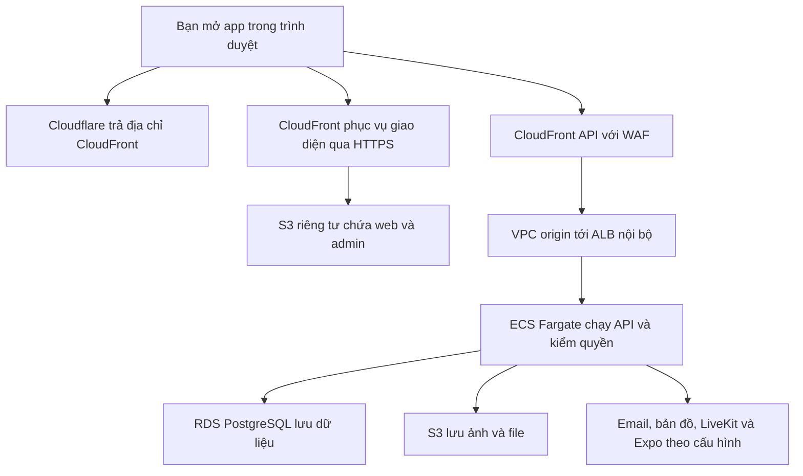

# Kiến trúc và vai trò dịch vụ AWS trong lab

[Mục lục](README.md) · Phần 01 · 09/11/2026

## Kết quả bạn muốn có

Bạn mở `app.iimissher.com`, trình duyệt tải giao diện. Khi đăng nhập hoặc tạo yêu cầu dịch vụ, giao diện gọi `api.iimissher.com`; API kiểm quyền và ghi database. Trang `admin.iimissher.com` dùng API đó với quyền quản trị. Sau deploy, máy Mac chỉ cần cho thao tác phát triển và vận hành, không phải máy chủ phục vụ người dùng.

**Deploy** là đưa phiên bản chương trình cùng cấu hình của nó lên môi trường chạy. Việc tạo account, đăng nhập CLI hay cấp chứng chỉ chỉ là chuẩn bị; chúng chưa đưa code ứng dụng lên mạng.

## Vì sao chọn nhiều dịch vụ khi một EC2 cũng làm được

EC2 là máy tính ảo. Bạn có thể cài API, web và PostgreSQL lên cùng máy, nhưng phải tự vận hành hệ điều hành, tiến trình, database, sao lưu và cập nhật. Một máy gặp sự cố có thể làm cả hệ thống dừng.

Bạn đã chọn AWS-02 để học nhiều dịch vụ. Hướng này chia trách nhiệm: dịch vụ lưu file không phải nơi xử lý đăng nhập; dịch vụ chạy API không phải nơi giữ database lâu dài. Bạn học cách nối quyền, mạng, dữ liệu và quan sát hệ thống. Đổi lại, có nhiều cấu hình và nhiều khoản chi phí hơn; một người dùng không có nghĩa các tài nguyên đang chạy đều miễn phí.

| Thành phần | Làm gì trong project? | Vì sao cần ở hướng này? |
|---|---|---|
| Cloudflare DNS | Trả lời tên miền trỏ đi đâu | Dùng domain đã có, giữ quản lý DNS hiện hành |
| ACM | Cấp chứng chỉ cho HTTPS | Trình duyệt kiểm tra đúng tên máy chủ và tạo kết nối mã hóa |
| CloudFront | Nhận truy cập Internet, phục vụ web và chuyển API | Một lớp truy cập HTTPS phía ngoài; cache file tĩnh |
| S3 | Ba bucket chứa web, admin và ảnh/file | Lưu đối tượng độc lập với vòng đời container API |
| WAF | Lọc yêu cầu tới CloudFront API | Có luật chặn đầu vào xấu và giới hạn tần suất; API vẫn phải kiểm quyền |
| ALB | Chuyển yêu cầu từ CloudFront tới task API | Theo dõi sức khỏe task và định tuyến tới container |
| ECS và Fargate | ECS quản lý task; Fargate cung cấp compute để chạy container | Chạy API mà không tự quản lý máy EC2 bên dưới |
| ECR | Lưu image container | Giữ gói chương trình để ECS tải đúng phiên bản |
| RDS PostgreSQL | Lưu tài khoản, công việc, chat, tiền test | Database tách khỏi task; PostGIS phục vụ dữ liệu địa lý |
| VPC, subnet, security group | Chia mạng và kiểm đường kết nối | Chỉ cho các thành phần cần thiết nói chuyện với nhau |
| IAM roles | Quyền của người deploy và từng task | Tránh dùng một bộ quyền quản trị cho mọi thành phần |
| Secrets Manager | Giữ cấu hình bí mật cho runtime | Không nhúng key vào web hoặc commit Git |
| CloudWatch, SNS, Budgets | Log, chỉ số, thông báo và cảnh báo chi phí | Biết lỗi ở đâu và theo dõi mức sử dụng |
| Terraform | Mô tả và quản lý hạ tầng bằng code | Dựng/dọn lặp lại theo cấu hình đã review |

Đây là vai trò trong **code lab hiện hành**, xem [network.tf](../../../infra/aws/lab/network.tf), [storage.tf](../../../infra/aws/lab/storage.tf), [compute.tf](../../../infra/aws/lab/compute.tf), [api-edge.tf](../../../infra/aws/lab/api-edge.tf), [waf.tf](../../../infra/aws/lab/waf.tf) và [observability.tf](../../../infra/aws/lab/observability.tf).

## Theo một lần mở app và gửi yêu cầu

Sơ đồ là kiến trúc dự kiến sau deploy, chưa phải bằng chứng môi trường đã chạy. Cloudflare chỉ phân giải DNS; lưu lượng HTTP không đi xuyên qua Cloudflare khi dùng DNS only.

CloudFront phục vụ file HTML/JavaScript trước. JavaScript chạy trên trình duyệt mới gửi yêu cầu nghiệp vụ đến API. Vì vậy web có thể mở được nhưng đăng nhập vẫn lỗi nếu API/database hoặc cấu hình địa chỉ API chưa đúng.

API kiểm phiên đăng nhập, quyền và dữ liệu đầu vào trước khi truy cập RDS/S3. Với database, lab yêu cầu TLS và kiểm CA trong cấu hình kết nối. Với đường API, HTTPS kết thúc tại CloudFront; code hiện dùng HTTP bên trong VPC từ CloudFront VPC origin tới ALB và từ ALB tới API. Không mô tả thành mã hóa TLS mọi chặng.

## Tại sao tài nguyên riêng tư vẫn có thể phục vụ Internet

ALB đặt `internal = true`, không làm đầu vào công khai trực tiếp. CloudFront dùng VPC origin để tới ALB; listener còn kiểm header bí mật. Security group của API chỉ nhận cổng 3100 từ ALB. RDS chỉ nhận cổng 5432 từ nhóm API và không có public endpoint được phép truy cập từ Internet.

Task Fargate có public IPv4 để đi ra ngoài qua Internet Gateway, ví dụ tải image hoặc gọi provider. Điều đó **không tự mở truy cập vào task**: security group quyết định chiều vào. Cách này tránh NAT Gateway trong lab; vẫn có chi phí public IPv4 và compute cần tính. S3 gateway endpoint cung cấp đường truy cập S3 cho subnet task.

Hai subnet database ở hai Availability Zone phục vụ bố trí mạng. RDS trong code vẫn `multi_az = false`, API một task: đây không phải triển khai chịu lỗi đa vùng sẵn sàng cho production. Khi chỉ có một task realtime, không tự tăng số task trước khi giải quyết chia sẻ trạng thái giữa các tiến trình.

## Những cấu hình cần hiểu trước khi chạy

| Cấu hình code | Tác dụng và đánh đổi |
|---|---|
| Fargate `cpu = 256`, `memory = 1024` | Task 0,25 vCPU và 1 GiB RAM; phải đo thực tế, không suy ra đủ tải production |
| RDS `db.t4g.micro`, PostgreSQL 17 | Database nhỏ cho lab; image API x86 không cần cùng kiến trúc CPU với DB qua mạng |
| RDS storage 20 GiB, tối đa 100 GiB | Có khả năng tự tăng storage trong code lab; khác hướng dẫn onboarding tạm thời tắt autoscaling |
| Backup retention 0, bỏ final snapshot | Phù hợp lab dữ liệu thử bị xóa; không phải cấu hình giữ dữ liệu người dùng thật |
| S3 private + Origin Access Control | Web qua CloudFront; bucket không cần mở đọc công khai |
| Image theo digest | Định danh đúng nội dung image, tránh một tag bị đổi sang code khác |
| State local | Không giữ bucket state AWS cho lab; bạn phải bảo vệ và backup file trên Mac |

## Tự kiểm hiểu

1. **Tắt Mac sau deploy, app có tắt không?** Không, nếu AWS/provider vẫn chạy. Mac không nằm trong đường phục vụ ở sơ đồ.
2. **Web mở được đã chứng minh database ổn chưa?** Chưa. Cần gọi API và thử luồng có ghi/đọc dữ liệu.
3. **Có WAF rồi có bỏ xác thực API được không?** Không. WAF lọc lưu lượng; API quyết định ai được đọc/sửa dữ liệu nào.

Tiếp: [Tài khoản, credit và chi phí](02-tai-khoan-credit.md).
