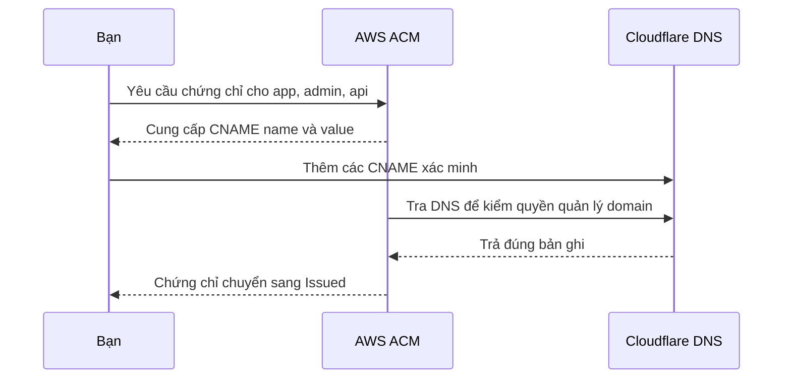

# Domain DNS và chứng chỉ HTTPS

[Mục lục](README.md) · Phần 04 · 09/11/2026

## Ba việc khác nhau cần nối lại

**Domain** là tên dễ nhớ, ví dụ `app.iimissher.com`. **DNS** giúp tìm nơi tên đó trỏ tới. **Chứng chỉ TLS** giúp trình duyệt xác minh máy chủ cho tên đó và tạo kết nối HTTPS. Có domain không tự có máy chủ; có chứng chỉ không tự có nội dung website.

Trong lab, Cloudflare giữ DNS, ACM cấp chứng chỉ, CloudFront dùng chứng chỉ khi phục vụ người dùng. Giữ cách quản lý domain hiện có nên chưa cần tạo hosted zone Route 53 hoặc đổi nameserver.



## Cấu hình ACM đã chọn và lý do

| Trường | Cấu hình của lab | Vì sao? |
|---|---|---|
| Account | `857146995969` | Cùng account triển khai CloudFront |
| Region | `us-east-1` | CloudFront yêu cầu ACM ở N. Virginia |
| Loại | Public certificate | Dùng với trình duyệt truy cập Internet |
| Domain names | `app.iimissher.com`, `admin.iimissher.com`, `api.iimissher.com` | Một chứng chỉ bao phủ đúng ba tên sử dụng |
| Validation | DNS | Chứng minh bạn kiểm soát DNS của domain |
| Key algorithm | RSA 2048 | Lựa chọn tương thích với cấu hình lab |
| Export | Disable export | CloudFront dùng trực tiếp chứng chỉ ACM, không cần tải private key |

Chứng chỉ dùng với CloudFront phải ở `us-east-1`. [Yêu cầu CloudFront](https://docs.aws.amazon.com/AmazonCloudFront/latest/DeveloperGuide/cnames-and-https-requirements.html). ACM public certificate không export dùng với dịch vụ tích hợp không có phí cấp chứng chỉ riêng; dịch vụ phục vụ lưu lượng vẫn tính phí. Exportable certificate có mô hình phí khác. [Giá ACM](https://aws.amazon.com/certificate-manager/pricing/).

Ảnh cuối của bạn xác nhận ARN:

```text
arn:aws:acm:us-east-1:857146995969:certificate/1539ee40-146d-4a04-b3f0-051b04fe89b4
```

Ảnh chứng minh đúng account, region, ba domain và trạng thái **Pending validation**. Ảnh chưa hiển thị đủ mục Export, nên kiểm lại Details nếu cần; không mặc định mọi lựa chọn đã khớp chỉ từ ARN.

## Bước tiếp theo tại Cloudflare

1. Giữ tab ACM mở. Trong bảng **Domains**, kéo thanh cuộn ngang sang phải để thấy **CNAME name** và **CNAME value** đầy đủ. Copy bằng nút bên cạnh từng giá trị.
2. Mở Cloudflare → zone **iimissher.com** → **DNS → Records → Add record**.
3. Với từng cặp ACM cung cấp, điền:

| Trường Cloudflare | Giá trị |
|---|---|
| Type | `CNAME` |
| Name | CNAME name từ ACM, bắt đầu bằng `_` |
| Target | CNAME value từ ACM, thường kết thúc bằng `.acm-validations.aws` |
| Proxy status | **DNS only**, đám mây xám |
| TTL | `Auto` |

4. Lưu và đối chiếu từng dòng app/api/admin. Nếu đã có đúng bản ghi thì kiểm value thay vì tạo bản trùng. Giữ nguyên `_` và đủ phần subdomain; bảo đảm Cloudflare không lưu tên bị lặp `.iimissher.com.iimissher.com`.
5. Trở lại ACM và refresh định kỳ. Hoàn tất khi certificate **Issued** và các domain xác minh thành công.

Ảnh trong hội thoại bị cắt các chuỗi CNAME nên tài liệu không chép đoán giá trị. Copy từ Console hoặc dùng truy vấn chỉ đọc bên dưới. [Thao tác DNS trên Cloudflare](https://developers.cloudflare.com/dns/manage-dns-records/how-to/create-dns-records/).

ACM dùng CNAME để kiểm quyền quản lý domain. Giữ bản ghi cho các lần xác minh/gia hạn; việc tự gia hạn còn cần chứng chỉ đáp ứng điều kiện như đang được sử dụng. Nếu lab bị dọn và để lâu, kiểm hạn chứng chỉ trước lần dựng tiếp. [AWS DNS validation](https://docs.aws.amazon.com/acm/latest/userguide/dns-validation.html).

## CNAME xác minh khác CNAME phục vụ app

| Loại | Ví dụ minh họa, không dùng làm giá trị thật | Ai quản lý trong lab? |
|---|---|---|
| Xác minh ACM | `_ma-xac-minh.app.iimissher.com` trỏ tới `_gia-tri.acm-validations.aws` | Bạn thêm và giữ ngoài vòng đời lab |
| Phục vụ website | `app.iimissher.com` trỏ tới tên CloudFront | Runner tạo sau khi hạ tầng sẵn sàng, dọn theo lab |

Thêm CNAME xác minh không làm app truy cập được ngay. Chưa tự tạo ba record app/admin/api với một giá trị đoán. Runner kiểm dấu sở hữu `dvqb-lab:ACCOUNT:LAB_ID` và từ chối ghi đè record không thuộc lab.

DNS only giữ đường truy cập dự kiến tới CloudFront. Nếu bật proxy cam, Cloudflare trở thành thêm một lớp HTTP phía trước; đường IP/header khác cấu hình proxy đã kiểm của ứng dụng. Giữ DNS only cho các record lab theo runbook.

## Kiểm bằng terminal khi cần

Lệnh này chỉ đọc chứng chỉ và bản ghi xác minh:

```sh
aws acm describe-certificate \
  --certificate-arn arn:aws:acm:us-east-1:857146995969:certificate/1539ee40-146d-4a04-b3f0-051b04fe89b4 \
  --region us-east-1 \
  --profile dvqb-learn \
  --query 'Certificate.{Status:Status,Export:Options.Export,Domains:DomainValidationOptions[].{Domain:DomainName,Status:ValidationStatus,Record:ResourceRecord}}' \
  --output json \
  --no-cli-pager
```

Muốn kiểm DNS, thay `TEN_CNAME_THAT` bằng tên vừa copy rồi chạy `dig +short CNAME TEN_CNAME_THAT`. Kết quả mong đợi là target ACM. Nếu rỗng/sai, đối chiếu zone, name, target, DNS only và nameserver; đợi DNS cập nhật rồi kiểm lại. Nếu DNS đúng nhưng ACM vẫn lỗi, đọc trạng thái/lý do, kiểm CAA nếu có; không xóa các bản ghi web/email đang dùng để thử mò.

## Checklist của phần này

- [x] Certificate đúng account, `us-east-1`, ba domain, đang Pending theo ảnh.
- [ ] Kiểm Export disabled trong Details.
- [ ] Thêm và kiểm các CNAME xác minh Cloudflare.
- [ ] ACM chuyển Issued.
- [ ] Lưu ARN vào config riêng khi tới phần 05.

Tiếp: [Chuẩn bị và chạy deploy](05-chuan-bi-deploy.md).
