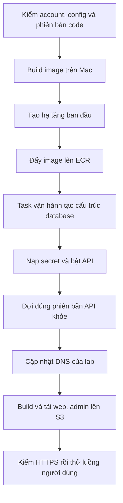

# Chuẩn bị cấu hình và chạy deploy

[Mục lục](README.md) · Phần 05 · 09/11/2026

**Các bước trong phần này là lộ trình phía trước, chưa được đánh dấu đã thực hiện.** Chỉ chuyển sang khi ACM đã Issued. Tài liệu giải thích lệnh, không tự tạo tài nguyên AWS.

## Những thứ giữ lâu và những thứ dựng theo buổi

Giữ domain, DNS xác minh, account/MFA, ACM không export, provider và cấu hình/state trên Mac. Mỗi buổi lab tạo compute, database, bucket, image, mạng, log và các tài nguyên đi kèm; dọn xong dữ liệu thử trong lab sẽ mất. Tách như vậy giúp dùng lại tên miền và cách cấu hình nhưng vẫn học được vòng đời dựng/dọn.

## Chuẩn bị công cụ trên Mac

Kiểm Node theo `.nvmrc`, dependencies repo, Docker đang chạy, AWS CLI hỗ trợ đăng nhập và Terraform phù hợp lock file. Terraform code chấp nhận `>=1.10, <2.0`; runbook dùng 1.13.3. Không nâng phiên bản tùy tiện giữa lúc đang giữ state.

```sh
node --version
aws --version
terraform version
docker info
```

Nếu dependencies chưa cài hoặc lock thay đổi, dùng `npm ci` từ root repo. Docker dùng để build image `linux/amd64` dù Mac có thể là Apple Silicon. ECR chỉ lưu image; ECS/Fargate mới chạy image đó.

## Chuẩn bị dịch vụ ngoài AWS

Các bước chi tiết hiện hành nằm ở [runbook mục 2 và 3](../../../infra/aws/lab/README.md). Phân biệt cấu hình công khai và secret:

| Dịch vụ | Cần chuẩn bị | Mục đích và điều kiện đạt |
|---|---|---|
| Cloudflare | Zone ID; API token phạm vi zone `iimissher.com`, DNS Edit và Zone Read | Runner quản lý ba DNS record của lab; không cấp quyền toàn account nếu không cần |
| Resend | Domain Verified, sender `no-reply@iimissher.com`, sending API key | Gửi mã xác minh email; sender phải khớp domain đã xác minh |
| Geoapify | Server key và public map key riêng | API gọi tra cứu; app dùng key công khai để hiển thị bản đồ, giới hạn origin/quota phù hợp |
| LiveKit Cloud | Project riêng, URL WSS, API key/secret, chính sách không tự tạo phòng | API tạo phòng có kiểm quyền; `lab:media-check` phải qua trước khi dựng media |
| Expo/FCM/APNs | Project ID, token gửi push, credentials từng nền tảng | Cần cho push native; website chạy được không chứng minh push đã hoạt động |

Phần email lab hiện theo mẫu **Resend**. SES là nhánh tương thích được runbook mô tả, không phải yêu cầu phải làm đồng thời. Email xác minh của app khác MFA đăng nhập AWS và khác MFA của trang quản trị sản phẩm.

LiveKit và Expo cần được cấu hình theo tài khoản/provider thực tế trước khi bật đủ tính năng. Nếu chủ động dựng phần còn lại trước, mẫu hỗ trợ `livekit_url: ""` và `expo_push: false`; ghi rõ gọi/push chưa bật, không coi là hoàn tất toàn bộ kế hoạch. Không tắt guard kiểm phòng chỉ để đi qua lỗi.

## Tạo file config riêng

Từ root repo, kiểm file đã tồn tại chưa trước khi copy để không ghi đè thông tin bạn đã điền:

```sh
mkdir -p .local/aws-lab-input
test -e .local/aws-lab-input/config.json || cp infra/aws/lab/config.example.json .local/aws-lab-input/config.json
chmod 600 .local/aws-lab-input/config.json
```

Mở `.local/aws-lab-input/config.json`. Dưới đây là cách điền từng trường của [mẫu thật](../../../infra/aws/lab/config.example.json):

| Trường | Giá trị / lý do |
|---|---|
| `lab_id` | `learn`; khóa để nhận đúng state và tài nguyên của lab |
| `expected_account_id` | `857146995969`; chặn deploy nhầm account |
| `profile` | `dvqb-learn`; thay tên `dvqb-lab` trong mẫu bằng profile đã dùng |
| `region` | `ap-southeast-1`; phạm vi đã review trong Terraform và cleanup |
| `domain` | `iimissher.com` |
| `cloudflare_zone_id` | Zone ID thật, không phải API token |
| `certificate_arn` | ARN ở phần 04, chỉ dùng sau Issued |
| `alert_email` | Email bạn thường kiểm tra để nhận cảnh báo |
| `pilot_emails` | Mảng email người thử, gồm bạn, chữ thường; giới hạn người đăng ký lab |
| `monthly_budget_usd` | `20` nếu giữ ngưỡng cảnh báo; không phải trần chặn phí |
| `email_provider` / `email_from` | `resend` / sender đã Verified |
| `realtime` | `true` cho chat cập nhật trực tiếp trên kiến trúc một API |
| `livekit_url` | URL `wss://...livekit.cloud` của project đã kiểm |
| `expo_push` / `expo_project_id` | Cờ và UUID đúng project Expo đã chuẩn bị |
| `finance_test` | `true` cho ví/ngân hàng mô phỏng; không chuyển tiền thật |

Config không chứa secret. `chmod 600` hạn chế quyền đọc file trên máy; vẫn cần ổ mã hóa và backup phù hợp. Không commit thư mục `.local` hoặc state vào Git.

## Nạp secret mà không đưa vào lịch sử lệnh

Trong zsh, mỗi lệnh `read -rs` cho nhập ẩn. Thực hiện trong cùng cửa sổ terminal sẽ chạy deploy:

```sh
read -rs 'CLOUDFLARE_API_TOKEN?Cloudflare token: '
export CLOUDFLARE_API_TOKEN
read -rs 'RESEND_API_KEY?Resend sending key: '
export RESEND_API_KEY
read -rs 'GEOAPIFY_API_KEY?Geoapify server key: '
export GEOAPIFY_API_KEY
read -rs 'EXPO_PUBLIC_GEOAPIFY_MAPS_KEY?Public map key: '
export EXPO_PUBLIC_GEOAPIFY_MAPS_KEY
```

Khi bật media/push, nạp thêm:

```sh
read -rs 'LIVEKIT_API_KEY?LiveKit API key: '
export LIVEKIT_API_KEY
read -rs 'LIVEKIT_API_SECRET?LiveKit secret: '
export LIVEKIT_API_SECRET
read -rs 'EXPO_ACCESS_TOKEN?Expo push token: '
export EXPO_ACCESS_TOKEN
```

Đóng terminal sẽ mất các biến của phiên đó. Runner không tự đọc `.env` mobile. Biến `EXPO_PUBLIC_*` được đưa vào app và người dùng có thể xem; không dùng tiền tố này cho secret. Runner lọc cloud/provider secret khỏi môi trường build web, rồi nạp secret server qua stdin vào Secrets Manager.

## Thứ tự lệnh và tác động

Chạy từng bước, đọc kết quả trước bước kế tiếp:

| Lệnh | Làm gì? | Tác động |
|---|---|---|
| `npm run lab:init -- --config .local/aws-lab-input/config.json` | Kiểm config và lưu `.local/aws-lab/learn/` | Chỉ local |
| `npm run lab:status -- --lab learn` | Đọc journal tiến độ | Chỉ local |
| `npm run lab:media-check -- --lab learn` | Kiểm chính sách LiveKit khi cấu hình media | Gọi provider probe, không tạo phòng |
| `npm run lab:up -- --lab learn` | Kiểm account/DNS/ACM/provider và Terraform plan | Đọc cloud, tải provider/ghi plan local; chưa tạo hạ tầng/DNS |

**Terraform plan** cho biết dự kiến thêm/đổi/xóa; **apply** mới thực hiện. Plan đầu API ở 0 task để chuẩn bị nơi chứa image và database. Toàn bộ runner còn có các plan sau để đưa API lên 1 task. Không kết luận cả quy trình không chạy API từ riêng plan đầu.

Trước apply, cần code đã review thành commit, Git working tree sạch và SDD verify khớp nguồn. Việc viết bộ tài liệu này làm working tree thay đổi; commit/push vẫn là bước riêng theo quyền chủ dự án cho phép. Không bỏ kiểm sạch hoặc kiểm SDD để chạy nhanh.

## Lệnh tạo tài nguyên tính phí

Chỉ chạy sau khi đã xem plan, chuẩn bị đủ key/provider và chấp nhận chi phí cho buổi học:

```sh
npm run lab:up -- --lab learn --apply --confirm 857146995969/learn
```



Giữ Mac/terminal hoạt động trong quá trình chạy. Database migration là thay đổi cấu trúc bảng theo code; bootstrap chuẩn bị role/secret/catalog cần thiết. Task API dùng quyền runtime, task vận hành có quyền phục vụ bootstrap riêng. Runner không seed tài khoản/mật khẩu DEMO hoặc số dư giả tự động.

`Ready for lab checks` là điểm bắt đầu nghiệm thu thực tế, không bảo đảm mọi chức năng người dùng đã qua. Lưu commit, giờ chạy và kết quả kiểm vào checklist.

## Tạo quản trị viên đầu tiên

Mở app, đăng ký email thuộc allowlist, nhận thư thật và xác minh. Sau đó thay `EMAIL_DA_XAC_MINH` bằng email đó:

```sh
npm run lab:admin -- --lab learn --email EMAIL_DA_XAC_MINH --apply --confirm 857146995969/learn
```

Runner chỉ bootstrap quản trị ban đầu theo kiểm soát hiện hành. Vào trang admin, thiết lập MFA trong app. Có quyền AWS không tự có quyền admin sản phẩm. Không sửa SQL để bỏ xác minh hoặc cấp quyền lại vượt luồng quản trị hiện có.

## Nếu muốn dùng Android hoặc iPhone

Web chạy độc lập với lượt build native. APK phải dùng API URL thật, project Expo đúng và bản native chứa các thay đổi mới. Profile EAS `lab` đọc environment `preview`; biến export trên Mac không tự xuất hiện trong EAS. Làm theo mục Android trong [runbook](../../../infra/aws/lab/README.md), gồm `GOOGLE_SERVICES_JSON` dạng File và FCM credentials.

iOS cần signing/APNs và nghiệm thu riêng. Không suy ra gọi đến lúc khóa màn hình từ thử gọi foreground; xem giới hạn [B00-24](../bao-cao/B00-24-cuoc-goi-android.md).

Tiếp: [Vận hành và dọn lab](06-van-hanh.md).
