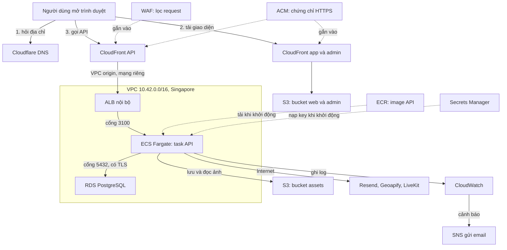
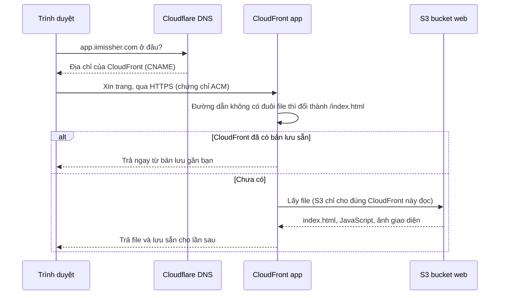
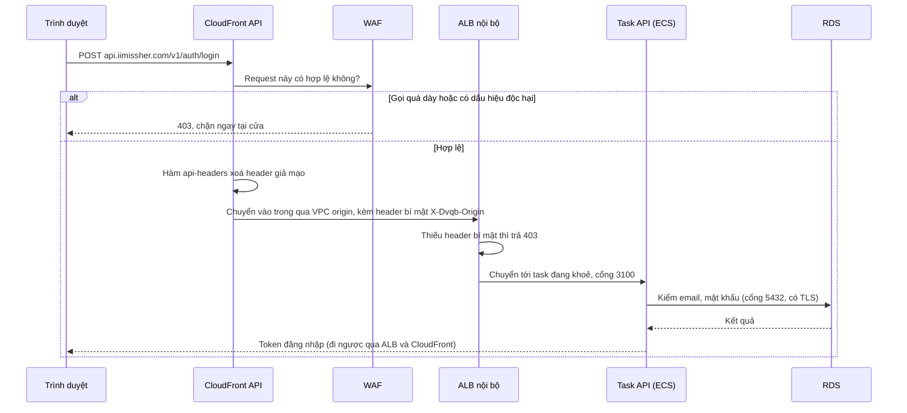
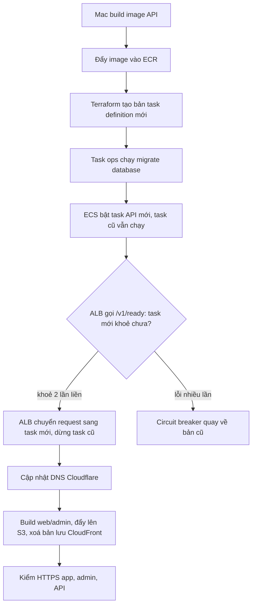
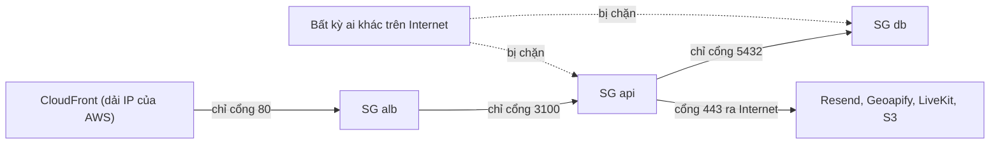

# Các dịch vụ AWS của lab: để làm gì, nối với nhau thế nào và xem ở đâu trên Console

[Mục lục](README.md) · Phần 07 · 17/11/2026 · Đối chiếu với Terraform ở commit `4625a9a`.

Phần [01](01-kien-truc.md) giới thiệu ngắn vai trò từng dịch vụ. Phần này đi sâu hơn. Bạn sẽ:

- hiểu mỗi dịch vụ làm gì trong app của bạn;
- biết một thao tác trên app đi qua những dịch vụ nào;
- biết mở đúng màn hình trên AWS Console để xem tình trạng và chi phí, không cần đọc Terraform.

Tên tài nguyên trong bài là tên thật của lab `learn`, account `857146995969`.

## 1. Đọc nhanh: muốn biết điều này thì mở đâu?

| Bạn muốn biết | Mở trên Console | Mục |
|---|---|---|
| API có đang chạy không? | ECS → cluster `dvqb-lab-learn` → service `dvqb-lab-learn-api` | [9](#9-ecs-và-fargate-nơi-chạy-api) |
| API vừa báo lỗi gì? | CloudWatch → Log groups → `/ecs/dvqb-lab-learn` | [14](#14-cloudwatch-log-chỉ-số-và-cảnh-báo) |
| Database có quá tải, sắp đầy không? | RDS → Databases → `dvqb-lab-learn` → tab Monitoring | [11](#11-rds-postgresql-database) |
| Có ai đang tấn công hoặc gọi API quá nhiều không? | WAF & Shield → Web ACLs (chọn Global) → `dvqb-lab-learn` | [7](#7-waf-tường-lửa-cho-api) |
| Tháng này tốn bao nhiêu, vào dịch vụ nào? | Billing and Cost Management → Cost Explorer | [16](#16-billing-cost-explorer-budgets-và-credits) |
| Còn bao nhiêu credits? | Billing and Cost Management → Credits (tài khoản quản lý `…0804`) | [16](#16-billing-cost-explorer-budgets-và-credits) |
| Có cảnh báo nào đang kêu không? | CloudWatch → Alarms | [14](#14-cloudwatch-log-chỉ-số-và-cảnh-báo) |
| Toàn bộ tài nguyên của lab gồm những gì? | Resource Groups & Tag Editor, lọc tag `LabId = learn` | [3](#3-trước-khi-mở-console) |

## 2. Bức tranh toàn cảnh

### Hình dung bằng một cửa hàng

Hãy coi cả hệ thống như một cửa hàng dịch vụ:

| Dịch vụ | Vai trò trong cửa hàng | Vai trò thật |
|---|---|---|
| Cloudflare DNS (ngoài AWS) | Biển chỉ đường | Cho trình duyệt biết `app.iimissher.com` nằm ở đâu |
| ACM | Giấy phép kinh doanh treo ở cửa | Chứng chỉ HTTPS, chứng minh đúng là trang của bạn |
| CloudFront | Cửa ra vào và quầy lễ tân | Nhận mọi truy cập từ Internet, trả giao diện web, chuyển yêu cầu API vào trong |
| WAF | Bảo vệ đứng ở cửa API | Chặn người gọi quá dày hoặc gửi dữ liệu độc hại |
| VPC, subnet, security group | Toà nhà, các phòng, ổ khoá từng cửa | Mạng riêng; quy định ai được nói chuyện với ai, qua cổng nào |
| ALB | Người điều phối ở sảnh trong | Nhận yêu cầu từ CloudFront, chuyển cho máy chạy API đang khoẻ |
| ECS + Fargate | Nhà bếp và đầu bếp | Chạy chương trình API |
| ECR | Kho công thức đã đóng gói | Lưu "image" (gói chương trình API) để ECS lấy ra chạy |
| RDS PostgreSQL | Sổ sách | Database: tài khoản, công việc, chat, tiền test |
| S3 | Kho chứa đồ | Ba "bucket": giao diện app, giao diện admin, ảnh người dùng tải lên |
| Secrets Manager | Két sắt | Mật khẩu database, khoá ký token, API key của Resend/Geoapify/LiveKit |
| IAM role | Thẻ ra vào cho từng nhân viên | Mỗi phần chỉ được làm đúng việc của nó |
| CloudWatch | Camera và sổ nhật ký | Log, biểu đồ chỉ số, cảnh báo |
| SNS | Loa báo động | Gửi email khi cảnh báo kêu |
| Budgets, Cost Explorer | Sổ chi tiêu | Theo dõi tiền và báo khi sắp vượt mức |

### Sơ đồ nối các dịch vụ



Đường liền là dữ liệu đi qua khi người dùng thao tác. Đường chấm là thứ được "gắn" hoặc "nạp" một lần, ví dụ chứng chỉ, tường lửa, image và key.

## 3. Trước khi mở Console

### Đăng nhập đúng tài khoản

Có hai tài khoản liên quan, xem thêm [phần 02](02-tai-khoan-credit.md):

| Tài khoản | Xem gì ở đây |
|---|---|
| `857146995969` (tài khoản lab) | Mọi tài nguyên của app: ECS, RDS, S3, CloudFront… |
| `215009180804` (tài khoản quản lý) | Credits, hoá đơn chung, SCP của tổ chức |

Góc trên bên phải Console hiện tên role và số tài khoản. Hãy kiểm tra số này trước khi đọc bất cứ thứ gì: rất nhiều lần "không thấy tài nguyên" chỉ vì đang đứng nhầm tài khoản.

### Chọn đúng region

Region là "vùng địa lý" của AWS. Nút chọn region nằm ở góc trên bên phải, cạnh tên tài khoản. Nếu không chọn đúng, màn hình hiện trống dù tài nguyên vẫn tồn tại.

| Dịch vụ | Chọn region |
|---|---|
| ECS, ECR, RDS, S3, VPC, EC2 (ALB, security group), Secrets Manager, CloudWatch, SNS | **Asia Pacific (Singapore) `ap-southeast-1`** |
| ACM (chứng chỉ của CloudFront) | **US East (N. Virginia) `us-east-1`** |
| WAF cho CloudFront | Trong màn WAF chọn **Global (CloudFront)** |
| CloudFront, IAM, Billing, Budgets, Cost Explorer | Dịch vụ toàn cầu, không cần chọn region |

**Singapore không có trong menu region.** Tài khoản này ở chế độ advanced mode. Ban đầu chế độ này chỉ hiển thị Sydney, N. Virginia và Oregon. Singapore được mở sau bằng cách sửa SCP ([phần 03](03-cli-region.md)), nên quyền dùng có, nhưng Console vẫn xếp Singapore vào **Restricted Regions** và không hiện nó trong menu. Kiểm ngày 18/11/2026:

1. Mở thẳng link có ghi region. Ví dụ ECS: `https://ap-southeast-1.console.aws.amazon.com/ecs/v2/clusters?region=ap-southeast-1`. Với dịch vụ khác, thay phần `ecs/v2/clusters` bằng đường dẫn của dịch vụ đó, và giữ `?region=ap-southeast-1`.
2. Console hiện hộp thoại **"Region Asia Pacific (Singapore) restricted"**. Bấm dấu **X** để đóng; dữ liệu phía sau vẫn xem được.
3. Không bấm **Take me back** (về Sydney). Chưa bấm **Edit visible Regions** khi chưa trao đổi: nếu AWS sinh lại SCP, hai quyền chỉ-đọc thêm ngày 12/11 có thể mất và `lab:status --live` lỗi 254 ([B00-30](../bao-cao/B00-30-tong-ket-deploy-aws02.md)).

Cách tìm dịch vụ nhanh nhất: gõ tên vào ô tìm kiếm trên cùng (phím tắt `Alt+S` trên Windows, `Option+S` trên Mac).

### Xem toàn bộ tài nguyên của lab trên một màn

Terraform gắn bốn nhãn (tag) vào mọi tài nguyên của lab: `Project = dvqb`, `Environment = lab`, `LabId = learn`, `ManagedBy = terraform`.

1. Mở **Resource Groups & Tag Editor** → **Tag Editor**.
2. Regions: chọn `ap-southeast-1` và `us-east-1`. Resource types: **All supported resource types**.
3. Tags: key `LabId`, value `learn` → **Search resources**.

Kết quả là danh sách đầy đủ. Đây cũng là cách nhanh để kiểm sau khi dọn lab xem còn sót gì không.

### Quy tắc vàng: chỉ xem, không sửa trên Console

Hạ tầng được Terraform quản lý. Nếu bạn sửa tay trên Console, lần `lab:up` sau Terraform sẽ thấy khác với bản mô tả, rồi đổi ngược lại hoặc báo lỗi. Tệ hơn, có thao tác làm mất dữ liệu ngay.

Những nút **không bấm** khi chưa trao đổi:

| Nơi | Nút nguy hiểm | Hậu quả |
|---|---|---|
| RDS | Delete, Modify, Reboot, Stop | Mất database (lab không giữ backup), hoặc API mất kết nối |
| ECS | Update service, Delete service, Stop task | API ngừng hoặc chạy sai bản |
| S3 | Delete, Empty, Upload, Permissions | Mất ảnh/giao diện, hoặc vô tình mở bucket ra Internet |
| CloudFront | Disable, Edit, Delete | App/admin/API không truy cập được |
| WAF | Edit rules, Delete | Mất lớp chặn tấn công, hoặc chặn nhầm người dùng thật |
| Secrets Manager | **Retrieve secret value**, Delete, Rotate | Lộ key trên màn hình, hoặc API không khởi động được |
| Security group | Edit inbound/outbound rules | Mở cửa database ra Internet, hoặc cắt đường API |
| Organizations | Disable service control policies; gỡ policy `BudgetsSpendLimit…` | Mất lớp giới hạn của tổ chức |

Mọi thay đổi làm qua code rồi `lab:up`, hoặc dọn bằng `lab:down`.

## 4. Ba hành trình đi qua các dịch vụ

### Hành trình 1: mở `app.iimissher.com`



Lúc này trình duyệt mới chỉ có **giao diện**. Chưa có dữ liệu nào từ database.

### Hành trình 2: đăng nhập hoặc gọi bất kỳ API nào



Điểm quan trọng:

- ALB là **nội bộ**, Internet không gọi thẳng được. Chỉ CloudFront API có đường vào (VPC origin) và biết header bí mật.
- Task API không nhận kết nối nào từ ngoài; chỉ ALB được gọi vào cổng 3100.
- RDS chỉ nhận kết nối từ task API.

### Hành trình 3: tải ảnh xác minh lên

1. Trình duyệt gửi ảnh tới API, đi đúng đường của hành trình 2.
2. Task API kiểm quyền, xử lý ảnh, rồi ghi vào bucket `dvqb-lab-learn-assets-…` dưới thư mục `assets/`.
3. Đường tới S3 đi qua **S3 gateway endpoint** trong VPC, không vòng ra Internet.
4. Khi xem ảnh, API đọc từ S3 rồi trả về. Bucket assets không mở cho Internet và không qua CloudFront.

Task API được phép ghi/đọc S3 nhờ **IAM role** `dvqb-lab-learn-api-task`. Role này chỉ cho đọc/ghi đúng thư mục `assets/*` của bucket đó.

### Hành trình 4: một lần `lab:up` deploy bản mới



"Circuit breaker" là cơ chế tự ngắt của ECS: bản mới không khoẻ thì quay về bản cũ, người dùng không bị mất dịch vụ. Khi điều này xảy ra, bản mới **chưa** được deploy thành công.

## 5. Cloudflare DNS (ngoài AWS)

**Để làm gì:** chuyển tên dễ nhớ (`app.iimissher.com`) thành địa chỉ của CloudFront. Cloudflare chỉ "chỉ đường", không đứng giữa đường đi của dữ liệu (chế độ **DNS only**, đám mây màu xám).

**Trong lab:** ba bản ghi CNAME `app`, `admin`, `api` trỏ tới ba distribution CloudFront, có comment `dvqb-lab:857146995969:learn`. Ngoài ra còn các CNAME xác minh chứng chỉ ACM và bản ghi email của Resend; cả hai phải giữ lâu dài.

**Xem ở đâu:** Cloudflare → zone `iimissher.com` → **DNS** → **Records**.

**Đừng:** bật proxy (đám mây màu cam) cho ba bản ghi của lab, hoặc xoá CNAME xác minh ACM. Bật proxy làm đổi đường đi; xoá CNAME xác minh khiến chứng chỉ không gia hạn được.

## 6. ACM: chứng chỉ HTTPS

**Để làm gì:** chứng chỉ cho phép trình duyệt kết nối HTTPS và hiện ổ khoá. Thiếu chứng chỉ hợp lệ, trình duyệt cảnh báo "không an toàn".

**Trong lab:** một chứng chỉ cho cả ba tên `app`, `admin`, `api`. Chứng chỉ này nằm **ngoài** Terraform, tạo tay từ trước, và được giữ lại khi dọn lab. Nó phải ở `us-east-1` vì CloudFront chỉ nhận chứng chỉ ở region đó.

**Liên kết:** gắn vào cả ba distribution CloudFront.

**Tiền:** miễn phí.

**Xem trên Console:**

1. Chọn region **US East (N. Virginia)** → **Certificate Manager** → **List certificates**.
2. Status phải là **Issued**. Cột **In use** là **Yes**.
3. Bấm vào chứng chỉ: **Renewal eligibility** nên là Eligible; mục **Associated resources** liệt kê ba distribution.

## 7. WAF: tường lửa cho API

**Để làm gì:** chặn request xấu **trước** khi chúng vào tới API, để API không phải tốn sức xử lý.

**Trong lab:** web ACL `dvqb-lab-learn`, gắn vào CloudFront API (không gắn vào app/admin). Có ba luật:

| Luật | Chặn khi |
|---|---|
| `ip-rate` | Một IP gửi quá 1.000 request trong 5 phút |
| `auth-rate` | Một IP gửi quá 100 request vào `/v1/auth/` trong 5 phút (chống dò mật khẩu) |
| `known-bad-inputs` | Bộ luật của AWS nhận ra mẫu tấn công đã biết |

Người bị chặn nhận lỗi 403. Request không bị chặn thì được cho qua.

**Tiền:** dòng **WAF** trên biểu đồ. Khoảng 5 USD/tháng cho ACL và 1 USD/tháng mỗi luật, cộng 0,60 USD cho mỗi triệu request. Đây là phí cố định, có người dùng hay không cũng tính.

**Xem trên Console:**

1. Mở **WAF & Shield** → **Web ACLs** → ô chọn region: **Global (CloudFront)** → `dvqb-lab-learn`.
2. Tab **Traffic overview**: biểu đồ request được cho qua (Allowed) và bị chặn (Blocked), theo từng luật.
3. Tab **Rules**: ba luật ở trên. Tab **Associated AWS resources**: phải có đúng distribution API.

**Đọc thế nào:** bình thường gần như toàn bộ là Allowed. Có Blocked lẻ tẻ là bình thường vì Internet luôn có máy quét dò. Nếu chính bạn bị 403 khi test, có thể bạn vừa đăng nhập sai quá nhiều lần: đợi 5 phút.

Lab tắt "sampled requests" để không lưu mẫu request (có thể chứa dữ liệu cá nhân), nên Console không hiện danh sách request cụ thể. Chỉ có số đếm.

## 8. CloudFront: cửa vào từ Internet

**Để làm gì:**

- phục vụ HTTPS cho ba tên miền;
- lưu sẵn (cache) giao diện ở máy chủ gần người dùng (có điểm ở Singapore, Việt Nam) để tải nhanh;
- chuyển request API vào mạng riêng mà không cần mở ALB ra Internet.

**Trong lab:** ba distribution. Cột **Description** hiện tên để phân biệt.

| Description | Tên miền | Lấy dữ liệu từ đâu (origin) | Có cache không? |
|---|---|---|---|
| `dvqb-lab-learn-web` | `app.iimissher.com` | S3 bucket web | Có |
| `dvqb-lab-learn-admin` | `admin.iimissher.com` | S3 bucket admin | Có |
| `dvqb-lab-learn-api` | `api.iimissher.com` | ALB nội bộ qua VPC origin | **Không** (dữ liệu luôn mới) |

Ngoài ra còn hai **CloudFront Functions** (đoạn code nhỏ chạy tại cửa):

- `dvqb-lab-learn-spa`: đổi đường dẫn như `/jobs/123` thành `/index.html`, để F5 ở trang con không bị lỗi 404.
- `dvqb-lab-learn-api-headers`: xoá các header người gọi tự điền để giả IP, và xoá header bí mật nếu ai cố gửi kèm.

**Tiền:** nằm trong **Others**. CloudFront có mức miễn phí hằng tháng (1 TB dữ liệu và 10 triệu request), lab dùng chưa tới.

**Xem trên Console:**

1. Mở **CloudFront** → **Distributions**. Ba dòng phải có Status **Enabled**, Last modified **Deployed**.
2. Bấm vào một distribution:
   - **General**: tên miền, chứng chỉ, WAF đang gắn (với API);
   - **Origins**: nơi lấy dữ liệu;
   - **Behaviors**: quy tắc cache;
   - **Invalidations**: các lần xoá cache, mỗi lần `lab:up` publish web sẽ có một dòng `/*`.
3. Bên trái chọn **Monitoring** (hoặc **Telemetry → Monitoring**), chọn distribution để xem:
   - **Requests**: số request;
   - **Error rate**: tỉ lệ lỗi 4xx/5xx;
   - **Cache hit rate** (với app/admin): cao là tốt.
4. Bên trái **VPC origins**: có `dvqb-lab-learn`, Status **Deployed**. Đây là "đường hầm" từ CloudFront vào ALB nội bộ.

**Đọc thế nào:** 5xx tăng trên distribution API nghĩa là API hoặc ALB có vấn đề; xem tiếp [mục 10](#10-alb-và-target-group-người-điều-phối) và [mục 14](#14-cloudwatch-log-chỉ-số-và-cảnh-báo). 4xx trên API thường là lỗi bình thường của người dùng: sai mật khẩu, hết phiên, không có quyền.

## 9. ECS và Fargate: nơi chạy API

**Để làm gì:**

- **ECS** quản lý việc chạy chương trình: chạy bao nhiêu bản, bản nào, tự khởi động lại khi chết.
- **Fargate** cho mượn "máy" (CPU, RAM) để chạy mà bạn không phải quản lý máy chủ.

**Các khái niệm, từ lớn đến nhỏ:**

| Khái niệm | Nghĩa | Trong lab |
|---|---|---|
| Cluster | Nhóm chứa các service | `dvqb-lab-learn` |
| Service | "Luôn giữ N bản API chạy" | `dvqb-lab-learn-api`, giữ đúng 1 bản |
| Task definition | Bản mô tả cách chạy: image nào, bao nhiêu CPU/RAM, biến môi trường, key | `dvqb-lab-learn-api` (API) và `dvqb-lab-learn-ops` (chạy migrate database lúc deploy) |
| Revision | Mỗi lần sửa task definition sinh số mới: `:7`, `:8`… | Mỗi lần deploy tăng một số |
| Task | Một bản đang chạy thật của task definition | 1 task API; task ops chỉ chạy vài phút lúc deploy rồi tự dừng |

Kích thước task API: **0,5 vCPU, 1 GB RAM** theo B00-32. Bản này có hiệu lực từ lần deploy sau 12/11; trước đó là 0,25 vCPU. Task ops dùng 0,25 vCPU.

**Liên kết:**

- Lấy image từ ECR.
- Lấy key từ Secrets Manager lúc khởi động.
- Đăng ký địa chỉ IP của mình vào target group của ALB.
- Gọi RDS và S3.
- Ghi log vào CloudWatch.
- Dùng IP công khai để **đi ra** Internet (gọi Resend, Geoapify, LiveKit). Không ai gọi vào task qua IP này được, vì security group không cho.

**Tiền:** dòng **Elastic Container Service**. Tính theo giờ task chạy:

| Kích thước | Mỗi ngày | Mỗi tháng |
|---|---:|---:|
| 0,25 vCPU, 1 GB | ≈ 0,44 USD | ≈ 13 USD |
| 0,5 vCPU, 1 GB | ≈ 0,74 USD | ≈ 22 USD |

**Xem trên Console** (region Singapore):

1. Mở **Elastic Container Service** → **Clusters** → `dvqb-lab-learn`.
2. Tab **Services** → `dvqb-lab-learn-api`. Phần trên cùng cần thấy:
   - **Status** Active;
   - **Desired tasks** 1, **Running tasks** 1.
3. Tab **Deployments**:
   - Lần deploy gần nhất phải là **Completed**.
   - Nếu thấy **Rolled back**, bản mới đã lỗi và ECS đã quay về bản cũ.
   - Cột **Task definition** cho biết revision đang chạy.
4. Tab **Tasks**:
   - Task đang chạy có Last status **Running**, Health status **Healthy**.
   - Bấm vào task để xem CPU/RAM được cấp, IP riêng (`10.42.0.x` hoặc `10.42.1.x`), image digest.
   - Muốn xem task đã dừng, đổi bộ lọc sang **Stopped**. Cột **Stopped reason** cho biết vì sao task chết, ví dụ health check fail, hết RAM hoặc bị thay bằng bản mới.
5. Tab **Health and metrics** (hoặc **Metrics**):
   - **CPU utilization**: phần trăm so với 0,5 vCPU.
   - **Memory utilization**: có cảnh báo khi trên 75%.
6. Tab **Logs**: xem nhanh log gần nhất. Muốn tìm kỹ, dùng CloudWatch.
7. Bên trái **Task definitions** → `dvqb-lab-learn-api` → chọn revision mới nhất → tab **JSON** hoặc **Containers**:
   - xem biến môi trường như `PUBLIC_EMAIL_REGISTRATION`;
   - xem danh sách key lấy từ Secrets Manager. Chỉ thấy **tên** key, không thấy giá trị.

**Đọc thế nào:**

- CPU thường xuyên trên 80% hoặc có đỉnh 100% khi tải ảnh: task đang thiếu sức. Đây chính là sự cố ngày 12/11 dẫn tới tăng lên 0,5 vCPU.
- RAM tăng dần mãi không giảm: có thể rò bộ nhớ.
- Task chết rồi tự khởi động lại nhiều lần: xem Stopped reason rồi đọc log của task đó.

## 10. ALB và target group: người điều phối

**Để làm gì:** ALB (Application Load Balancer) nhận request từ CloudFront và chuyển cho task API đang khoẻ. Khi deploy, ALB chỉ chuyển sang task mới sau khi task đó khoẻ, nên người dùng không bị gián đoạn.

**Trong lab:**

- Load balancer `dvqb-lab-learn`, loại **internal**: không có IP công khai, nằm trong hai subnet database.
- Listener cổng 80, có hai quy tắc:
  - có header `X-Dvqb-Origin` đúng giá trị bí mật thì chuyển tới target group;
  - còn lại trả **403 Forbidden**.
- Target group `dvqb-lab-learn`:
  - đích là IP của task, cổng 3100;
  - **health check** gọi `/v1/ready` mỗi 30 giây;
  - 2 lần đạt liền thì là khoẻ, 3 lần lỗi liền thì là không khoẻ;
  - `/v1/ready` chỉ trả 200 khi API kết nối được database và đọc được danh mục dịch vụ.

**Tiền:** dòng **Elastic Load Balancing**, khoảng 0,0252 USD/giờ (≈ 18 USD/tháng) cộng phí theo lưu lượng (LCU). Tính tiền **cả khi không có ai dùng**.

**Xem trên Console** (region Singapore, dịch vụ **EC2**):

1. Bên trái **Load Balancing** → **Load Balancers** → `dvqb-lab-learn`:
   - State **Active**, Scheme **Internal**;
   - tab **Listeners and rules**: listener HTTP:80 và hai quy tắc. Giá trị header bí mật hiện ở đây; đừng chụp màn hình gửi đi đâu.
   - tab **Monitoring**:
     - **Requests**;
     - **HTTP 5XXs (target)**: lỗi do API, có cảnh báo khi quá 5 lỗi/phút trong 3 phút liền;
     - **Target response time**: thời gian API trả lời, có cảnh báo khi trung bình trên 2 giây;
     - **Healthy/Unhealthy hosts**.
2. Bên trái **Target Groups** → `dvqb-lab-learn` → tab **Targets**:
   - Bình thường có 1 dòng, Health status **Healthy**.
   - Lúc deploy có thể thấy 2 dòng: một **Healthy**, một **Initial** hoặc **Draining**.
   - **Unhealthy** kèm Health status details cho biết vì sao, ví dụ `Health checks failed with these codes: [503]` là API không tới được database.

## 11. RDS PostgreSQL: database

**Để làm gì:** lưu mọi dữ liệu lâu dài: tài khoản, hồ sơ đối tác, công việc, tin nhắn, ví tiền test. AWS lo cài đặt, vá lỗi và theo dõi máy chạy database.

**Trong lab:**

| Thuộc tính | Giá trị | Ý nghĩa |
|---|---|---|
| DB identifier | `dvqb-lab-learn` | Tên trên Console |
| Engine | PostgreSQL 17 | Có PostGIS cho dữ liệu bản đồ |
| Class | `db.t4g.micro` | 2 vCPU "burst", 1 GB RAM: rất nhỏ, đủ cho lab |
| Storage | 20 GB gp3, tự tăng tới 100 GB | |
| Public access | **No** | Internet không kết nối thẳng được |
| Multi-AZ | No | Chỉ một máy; máy lỗi thì database tạm dừng |
| Backup | **0 ngày, không snapshot khi xoá** | Dọn lab là mất dữ liệu, đúng thiết kế cho lab |
| Bắt buộc TLS | `rds.force_ssl = 1` | Kết nối không mã hoá bị từ chối |

Mật khẩu chủ database do **RDS tự tạo và giữ trong Secrets Manager** (secret tên bắt đầu bằng `rds!db-`). Không ai phải gõ hay biết mật khẩu này.

"Burst" nghĩa là máy chạy nền ở mức thấp và tích "CPU credits"; khi cần thì chạy nhanh hơn bằng cách tiêu credits. Hết credits thì máy chậm lại. Đây là CPU credits của máy, khác hẳn credits tiền của tài khoản.

**Tiền:** dòng **Relational Database Service**, khoản lớn nhất: máy ≈ 0,025 USD/giờ (≈ 18 USD/tháng) cộng ổ đĩa ≈ 2,8 USD/tháng.

**Xem trên Console** (region Singapore):

1. Mở **Aurora and RDS** (tên cũ: RDS) → **Databases** → `dvqb-lab-learn`. Status phải là **Available**.
2. Tab **Connectivity & security**:
   - Endpoint (địa chỉ nội bộ, chỉ dùng được trong VPC);
   - Publicly accessible **No**;
   - security group `dvqb-lab-learn-db-…`.
3. Tab **Monitoring**:

   | Chỉ số | Bình thường | Có cảnh báo khi |
   |---|---|---|
   | **CPUUtilization** | Dưới 20% | Trên 70% trong 3 phút liền |
   | **DatabaseConnections** | Vài chục | |
   | **FreeableMemory** | Vài trăm MB | Dưới 128 MB |
   | **FreeStorageSpace** | Gần 20 GB | Dưới 5 GB |
   | **CPUCreditBalance** | Không cạn về 0 | |
   | **Read/Write IOPS** | | |

4. Tab **Configuration**: class, engine version, storage, parameter group.
5. Tab **Maintenance & backups**: cửa sổ bảo trì Chủ nhật 19:30–20:30 UTC, tức **2:30–3:30 sáng thứ Hai** giờ Việt Nam. AWS có thể khởi động lại database trong khung này để vá lỗi.
6. Tab **Logs & events**: sự kiện như khởi động lại, bảo trì, tăng dung lượng.

**Không có trên Console:** xem dữ liệu bảng. Database không mở ra Internet, nên không dùng được công cụ trên máy tính hay Query Editor. Muốn xem dữ liệu, dùng chức năng của app/admin.

## 12. S3: kho file

**Để làm gì:** lưu file. Mỗi "bucket" là một kho riêng có quyền riêng.

**Trong lab:** ba bucket, tên có dạng `dvqb-lab-learn-<loại>-857146995969-ap-southeast-1`.

| Bucket | Chứa | Ai đọc được |
|---|---|---|
| `…-web-…` | Giao diện app (HTML, JavaScript) | Chỉ distribution CloudFront app |
| `…-admin-…` | Giao diện trang admin | Chỉ distribution CloudFront admin |
| `…-assets-…` | Ảnh người dùng tải lên (thư mục `assets/`) | Chỉ task API |

Cả ba bucket:

- chặn mọi truy cập công khai (**Block all public access: On**);
- mã hoá file khi lưu;
- bật **Versioning**: ghi đè vẫn giữ bản cũ; bản cũ tự xoá sau 30 ngày;
- từ chối mọi kết nối không HTTPS.

**Tiền:** nằm trong **Others**, vài cent mỗi tháng ở mức sử dụng lab.

**Xem trên Console:**

1. Mở **S3** → **General purpose buckets** → gõ `dvqb-lab-learn` để lọc.
2. Bấm bucket, tab **Objects**:
   - web/admin thấy `index.html`, thư mục `_expo` hoặc `assets`;
   - bucket assets thấy thư mục `assets/` chứa ảnh, tên là mã ngẫu nhiên, không phải tên người dùng.
3. Tab **Metrics**: tổng dung lượng và số object. Số liệu cập nhật mỗi ngày một lần.
4. Tab **Permissions**: Block public access **On**; Bucket policy có `DenyInsecureTransport`, và với web/admin có thêm `CloudFrontOnly`.
5. Tab **Management**: luật vòng đời xoá bản cũ sau 30 ngày.

**Đừng:** bấm **Open** hay tải ảnh người dùng xuống máy chỉ để xem cho biết. Đó là dữ liệu cá nhân, dù lab chỉ dùng dữ liệu DEMO.

## 13. ECR, Secrets Manager và IAM: gói chương trình, két sắt và thẻ ra vào

### ECR: kho image

**Để làm gì:** lưu "image": gói chứa chương trình API cùng mọi thứ nó cần để chạy. ECS lấy image từ đây.

**Trong lab:**

- Repository `dvqb-lab-learn-api`.
- Tag không đổi được (**Immutable**): đã đẩy bản nào thì tên đó luôn là bản đó.
- Tự quét lỗ hổng bảo mật khi đẩy (**Scan on push**).
- Image không có tag tự xoá sau 14 ngày. Image có tag được giữ để quay về bản cũ khi cần.

**Xem trên Console:**

1. Mở **Elastic Container Registry** → **Private registry** → **Repositories** → `dvqb-lab-learn-api`.
2. Danh sách image: thời điểm đẩy, kích thước, digest `sha256:…`. Digest của task đang chạy (xem trong ECS Task) phải trùng một dòng ở đây.
3. Cột **Vulnerabilities** hoặc **Scan status**: bấm để xem lỗ hổng theo mức Critical/High/Medium.

### Secrets Manager: két sắt

**Để làm gì:** giữ các giá trị bí mật ngoài code và ngoài Git. Khi task khởi động, ECS lấy giá trị ra và đưa vào chương trình dưới dạng biến môi trường.

**Trong lab:** hai secret.

- `dvqb-lab-learn/runtime` chứa các khoá: `DATABASE_URL`, `AUTH_SECRET`, `CURSOR_SECRET`, `MESSAGE_SECRET`, `ADMIN_SECRET`, `GEOAPIFY_API_KEY`, `RESEND_API_KEY`, và các khoá LiveKit nếu có.
- `rds!db-…`: mật khẩu chủ database, do RDS tự quản lý. Chỉ task ops dùng khi migrate.

**Tiền:** 0,40 USD/secret/tháng, nằm trong **Others**.

**Xem trên Console:**

1. Mở **Secrets Manager** → **Secrets**.
2. Bấm vào secret để xem **ngày tạo**, **Last retrieved** (lần cuối được đọc, mỗi lần task khởi động là một lần) và **Resource permissions**.
3. **Không bấm "Retrieve secret value"** khi đang chia sẻ màn hình hoặc có người khác nhìn. Lab không cần bạn đọc giá trị.

### IAM: thẻ ra vào

**Để làm gì:** quy định mỗi thành phần được làm gì. Lab có bốn role:

| Role | Ai dùng | Được làm gì |
|---|---|---|
| `dvqb-lab-learn-api-execution` | ECS, lúc khởi động task API | Tải image từ ECR, ghi log, đọc secret runtime |
| `dvqb-lab-learn-api-task` | Chương trình API khi đang chạy | Đọc/ghi `assets/*` trong bucket assets |
| `dvqb-lab-learn-ops-execution` | ECS, lúc khởi động task ops | Tải image, ghi log, đọc mật khẩu chủ database |
| `dvqb-lab-learn-ops-task` | Chương trình migrate | Đọc/ghi secret runtime. Lần khởi tạo đầu, nó tạo tài khoản database riêng cho API, sinh các khoá ký ngẫu nhiên rồi ghi vào secret |

Tách "execution" (việc của ECS khi dựng task) khỏi "task" (việc của chương trình khi chạy) giúp: nếu API bị lừa chạy lệnh xấu, nó vẫn không đọc được mật khẩu chủ database.

**Xem trên Console:** **IAM** → **Roles** → gõ `dvqb-lab-learn` → bấm role → tab **Permissions** → mở policy để đọc dạng JSON. Tab **Last activity** cho biết role được dùng gần nhất lúc nào.

## 14. CloudWatch: log, chỉ số và cảnh báo

**Để làm gì:** ba việc.

1. **Logs:** lưu mọi dòng log của API và task ops trong 14 ngày.
2. **Metrics:** mọi dịch vụ AWS tự gửi chỉ số (CPU, request, lỗi…) về đây. Các biểu đồ ở ECS/RDS/ALB thực chất lấy từ CloudWatch.
3. **Alarms:** khi một chỉ số vượt ngưỡng, alarm chuyển sang trạng thái **In alarm** và báo qua SNS.

### Đọc log

1. Region Singapore → **CloudWatch** → **Logs** → **Log groups** → `/ecs/dvqb-lab-learn`.
2. Mỗi **log stream** là một task:
   - `api/api/<mã task>`: log của API;
   - `ops/ops/<mã task>`: log của một lần migrate.
3. Bấm stream mới nhất để xem từng dòng. Mỗi dòng là JSON có:
   - `level` (info/warn/error);
   - `event`: tên sự việc, ví dụ `http.completed`, `db.slow`, `http.exception`;
   - `route`, `status_code`, `duration_ms`;
   - `request_id`: mã để lần theo một request.

Log được thiết kế **không chứa** mật khẩu, token, nội dung request hay header.

### Tìm log bằng Logs Insights

**CloudWatch** → **Logs** → **Logs Insights** → chọn log group `/ecs/dvqb-lab-learn` → chọn khoảng thời gian → dán truy vấn → **Run query**.

Lỗi máy chủ (5xx) gần đây:

```text
fields @timestamp, event, route, status_code, request_id
| filter level = "error" or status_code >= 500
| sort @timestamp desc
| limit 50
```

Các API chậm nhất:

```text
fields @timestamp, method, route, status_code, duration_ms
| filter event = "http.completed"
| sort duration_ms desc
| limit 20
```

Số request và thời gian trung bình theo từng API:

```text
filter event = "http.completed"
| stats count(*) as so_lan, avg(duration_ms) as tb_ms by route
| sort so_lan desc
```

Lần khởi động và dừng của API, để biết task có bị khởi động lại không:

```text
fields @timestamp, event, @logStream
| filter event in ["app.started", "app.stopped", "app.start_failed"]
| sort @timestamp desc
```

Logs Insights tính tiền theo dung lượng quét (0,005 USD/GB). Log của lab nhỏ nên mỗi lần chạy gần như bằng 0.

### Cảnh báo (alarms)

**CloudWatch** → **Alarms** → **All alarms**, gõ `dvqb-lab-learn`. Có bảy alarm, mỗi alarm xét 3 phút liền:

| Alarm | Kêu khi | Nghĩa là gì |
|---|---|---|
| `…-unhealthy` | ALB có dưới 1 task khoẻ | **API đang không phục vụ được** |
| `…-errors` | Hơn 5 lỗi 5xx mỗi phút | API đang lỗi hàng loạt |
| `…-latency` | Thời gian trả lời trung bình trên 2 giây | API chậm |
| `…-db_cpu` | CPU database trên 70% | Database quá tải |
| `…-db_storage` | Ổ database còn dưới 5 GB | Sắp đầy ổ |
| `…-db_memory` | RAM trống của database dưới 128 MB | Database thiếu bộ nhớ |
| `…-api_memory` | RAM của API trên 75% | API sắp hết bộ nhớ |

Ba trạng thái: **OK** (bình thường), **In alarm** (đang có sự cố), **Insufficient data** (chưa đủ số liệu, thường gặp khi không có request nào).

Bấm vào alarm để xem biểu đồ và tab **History**, biết đã kêu khi nào.

## 15. VPC: mạng riêng

**Để làm gì:** tạo một mạng riêng, cô lập với Internet. Trong đó tự đặt các "phòng" (subnet) và "ổ khoá" (security group).

**Trong lab:**

| Thành phần | Giá trị | Vai trò |
|---|---|---|
| VPC | `10.42.0.0/16` | Toàn bộ mạng riêng |
| 2 subnet "public" | `10.42.0.0/24`, `10.42.1.0/24` | Nơi đặt task API. Có đường ra Internet |
| 2 subnet "database" | `10.42.10.0/24`, `10.42.11.0/24` | Nơi đặt RDS và ALB. **Không** có đường ra Internet |
| Internet gateway | 1 | Cổng ra Internet cho subnet public |
| Route table | 2 | Bảng chỉ đường: public đi Internet qua gateway; database chỉ đi trong VPC |
| S3 gateway endpoint | 1 | Đường tắt tới S3 không qua Internet. Miễn phí |

Hai subnet mỗi loại nằm ở hai **Availability Zone** (hai khu trung tâm dữ liệu khác nhau ở Singapore), vì ALB và RDS yêu cầu như vậy. Lab vẫn chỉ có 1 task và 1 database, nên **chưa** chịu được sự cố mất một khu.

**Security group** là ổ khoá gắn vào từng tài nguyên. Nó ghi rõ ai được vào, vào cổng nào:



**Tiền:** dòng **Virtual Private Cloud** chủ yếu là IP công khai của task API: 0,005 USD/giờ, khoảng 3,6 USD/tháng. VPC, subnet, route table, gateway và S3 endpoint đều miễn phí. Lab cố ý **không** dùng NAT Gateway, khoản này tốn khoảng 45 USD/tháng.

**Xem trên Console** (region Singapore, dịch vụ **VPC**):

1. **Your VPCs**: lọc theo tag `LabId: learn` → VPC `10.42.0.0/16`. Bỏ qua VPC mặc định của AWS (`172.31.0.0/16`), lab không dùng.
2. **Subnets**: bốn subnet ở trên.
3. **Route tables**: bấm bảng của subnet public → tab **Routes**: `0.0.0.0/0 → igw-…`.
4. **Endpoints**: một endpoint `com.amazonaws.ap-southeast-1.s3`, loại **Gateway**.
5. **Security groups**: gõ `dvqb-lab-learn` → ba nhóm `…-alb-…`, `…-api-…`, `…-db-…`. Tab **Inbound rules** và **Outbound rules** phải khớp sơ đồ trên. Đặc biệt nhóm db chỉ có **một** inbound rule, nguồn là nhóm api.
6. Muốn biết phí IP: **VPC** → **IP Address Manager** (IPAM) → **Public IP insights**, nếu tài khoản đã bật.

## 16. Billing, Cost Explorer, Budgets và Credits

### Biểu đồ "Cost and usage" ở trang chủ Console

Biểu đồ ở trang chủ là **tổng của cả tài khoản từ đầu tháng tới nay**. Nó không phải chi phí của riêng một lần deploy. Số liệu trễ khoảng 24 giờ.

| Dòng trên biểu đồ | Đến từ | Cố định hay theo lưu lượng |
|---|---|---|
| Relational Database Service | Máy RDS + ổ đĩa | Cố định theo giờ |
| Elastic Load Balancing | ALB | Phần lớn cố định theo giờ |
| Elastic Container Service | Task Fargate (API, và ops lúc deploy) | Theo giờ task chạy |
| WAF | Web ACL + 3 luật + request | Phần lớn cố định |
| Virtual Private Cloud | IP công khai của task | Theo giờ |
| Others | S3, CloudFront, ECR, Secrets Manager, CloudWatch, SNS | Rất nhỏ |

Ước tính khi chạy cả ngày lẫn đêm: khoảng **2,1 USD/ngày** với 0,25 vCPU, khoảng **2,4 USD/ngày** sau khi lên 0,5 vCPU. Phần lớn là phí cố định: dù không có ai dùng app, RDS, ALB và WAF vẫn tính.

### Cost Explorer: xem chi tiết

1. Mở **Billing and Cost Management** → **Cost Explorer** (hoặc **Cost and usage analysis**).
2. Khung bên phải:
   - **Date range**: tháng này;
   - **Granularity**: **Daily**, để thấy mỗi ngày tốn bao nhiêu;
   - **Group by**: **Service**.
3. Muốn biết tiền rơi vào khoản nhỏ nào, đổi **Group by** thành **Usage type**. Ví dụ `APS1-PublicIPv4:InUseAddress` là IP công khai, `APS1-InstanceUsage:db.t4g.micro` là máy RDS.
4. Muốn chỉ xem lab: **Filters** → **Tag** → `LabId` → `learn`. Thẻ phải được bật ở **Cost allocation tags** thì mới lọc được. Một số khoản như IP công khai không mang tag, nên lọc theo tag có thể thấp hơn tổng thật.
5. Credits xuất hiện như một khoản âm, loại phí **Credit**. Muốn biết biểu đồ đang tính trước hay sau credits, xem bộ lọc **Charge type**: đang loại trừ Credit thì là số **trước** khi trừ credits. Số tiền thật phải trả xem ở trang **Bills**. Biểu đồ ở trang chủ ngày 12/11 khớp đúng số credits đã dùng, tức là số trước khi trừ credits.

### Credits: ai trả tiền

Credits thuộc **tài khoản quản lý `…0804`**. Mở **Billing and Cost Management** → **Credits** khi đăng nhập tài khoản đó:

- **Amount used**: đã tiêu;
- **Amount remaining**: còn lại;
- **Expiration date**: ngày hết hạn từng credit.

Ngày 12/11, credits đang trả toàn bộ phí lab. Xem thêm [B00-30](../bao-cao/B00-30-tong-ket-deploy-aws02.md).

### Budgets: chuông báo khi tiêu nhiều

Lab có budget `dvqb-lab-learn`, mức **20 USD/tháng**, tính cho **cả tài khoản**. Budget gửi email tới địa chỉ cảnh báo trong cấu hình lab khi:

- chi phí thật vượt **80%** (16 USD);
- dự báo cuối tháng vượt **100%** (20 USD).

**Budget chỉ báo, không tự tắt gì cả.** Với tốc độ hiện tại, email 16 USD sẽ tới trong khoảng 20–21/11. Đó là chuông báo đúng thiết kế, không phải sự cố. Nếu muốn mốc báo hợp với chi phí thật (khoảng 70 USD/tháng), đổi `monthly_budget_usd` trong cấu hình lab rồi `lab:up`. Đừng sửa budget trên Console.

Khác với budget này, tài khoản quản lý còn các policy `BudgetsSpendLimit…` trong Organizations. Chúng **có thể chặn** tạo tài nguyên mới khi vượt giới hạn. Không gỡ các policy đó.

**Xem trên Console:** **Billing and Cost Management** → **Budgets** → `dvqb-lab-learn`. Màn này hiện Actual (đã tiêu), Forecasted (dự báo) và các mức báo.

## 17. SNS: loa báo động

**Để làm gì:** nhận tín hiệu từ CloudWatch alarm rồi gửi email.

**Trong lab:** topic `dvqb-lab-learn-alerts`, một subscription kiểu email. Mỗi alarm gửi email khi chuyển sang **In alarm** và khi trở về **OK**.

**Xem trên Console:** region Singapore → **Simple Notification Service** → **Topics** → `dvqb-lab-learn-alerts` → tab **Subscriptions**. Status phải là **Confirmed**.

Nếu là **Pending confirmation**, email xác nhận chưa được bấm và bạn sẽ **không nhận được cảnh báo nào**. Tìm thư "AWS Notification - Subscription Confirmation" trong hộp thư (kể cả Spam) rồi bấm Confirm.

## 18. Kiểm tra sức khoẻ 5 phút

Làm theo thứ tự này mỗi khi muốn chắc lab ổn, hoặc sau mỗi lần deploy:

1. **CloudWatch → Alarms**: bảy alarm đều **OK** (riêng alarm `unhealthy` không bao giờ được In alarm).
2. **ECS → service `dvqb-lab-learn-api`**: Running 1/1, deployment mới nhất Completed.
3. **EC2 → Target Groups → `dvqb-lab-learn` → Targets**: Healthy.
4. **RDS → `dvqb-lab-learn` → Monitoring**: CPU thấp, FreeStorageSpace còn nhiều.
5. **Trình duyệt**: mở `https://api.iimissher.com/v1/ready`, thấy `{"status":"ready"}`.
6. **Cost Explorer**, Daily theo Service: không có dịch vụ lạ, không có ngày tăng vọt.

Từ terminal, `npm run lab:status -- --lab learn --live` kiểm phần lớn các mục trên cùng lúc.

## 19. Có sự cố thì nhìn vào đâu

| Dấu hiệu | Nhìn trước | Thường do |
|---|---|---|
| App không mở được, lỗi chứng chỉ | ACM (us-east-1): còn Issued? Cloudflare: CNAME đúng, DNS only? | Chứng chỉ hết hạn, DNS sai |
| App mở được nhưng trắng trang | CloudFront app → Invalidations; S3 web có `index.html` không | Publish web dở dang |
| App mở được, đăng nhập lỗi kết nối | CloudFront API → Monitoring, rồi Target group → Targets | API không có task khoẻ |
| Lỗi 403 khi gọi API | WAF → Traffic overview: luật nào đang chặn | Gọi quá dày (đặc biệt `/v1/auth/`) |
| Lỗi 502/503/504 | Target group → Targets; ECS → Tasks → Stopped reason | Task chết, đang khởi động lại, hoặc quá tải |
| API rất chậm, tải ảnh treo | ECS → Metrics CPU; Logs Insights "API chậm nhất"; RDS CPU | Thiếu CPU (như sự cố 12/11), truy vấn chậm |
| Deploy báo rollback | ECS → Deployments; task Stopped; log stream của task mới | Bản mới lỗi lúc khởi động, sai secret, migrate lỗi |
| Nhận email từ SNS | CloudWatch → Alarms → alarm vừa kêu → History | Theo bảng alarm ở mục 14 |
| Tiền tăng bất thường | Cost Explorer Daily, Group by Usage type | Task ops không dừng, lưu lượng lạ, tài nguyên ngoài lab |

## 20. Tự kiểm hiểu

1. Vì sao không ai trên Internet gọi thẳng được ALB, dù ALB nhận request của người dùng?
2. Task API có IP công khai. Vì sao người ngoài vẫn không gọi vào task được?
3. Bạn thấy target group **Unhealthy** với mã 503. Nên kiểm database hay CloudFront trước? Vì sao?
4. Tắt hết người dùng một tuần, dòng nào trên biểu đồ chi phí gần như không giảm?
5. Nhận email budget 80% có nghĩa là app sắp bị tắt không?
6. Muốn đổi CPU của API, vì sao không sửa trực tiếp trong ECS Console?

<details>
<summary>Gợi ý đáp án</summary>

1. ALB là loại internal, không có IP công khai, chỉ CloudFront tới được qua VPC origin. Request còn phải có header bí mật.
2. Security group của API chỉ cho vào cổng 3100 và chỉ từ ALB. IP công khai chỉ dùng để task đi ra.
3. Database trước. `/v1/ready` trả 503 khi API không truy vấn được database; CloudFront không nằm trong đường health check.
4. RDS, ELB, WAF và VPC: tính theo giờ tồn tại. ECS cũng gần như không đổi vì task vẫn chạy 24/7.
5. Không. Budget chỉ gửi email.
6. Terraform sẽ đổi ngược lại ở lần `lab:up` sau. Sửa trong [compute.tf](../../../infra/aws/lab/compute.tf) rồi deploy, như B00-32.

</details>

## Tra cứu: tên tài nguyên của lab `learn`

| Dịch vụ | Region | Tên |
|---|---|---|
| ECS cluster / service | Singapore | `dvqb-lab-learn` / `dvqb-lab-learn-api` |
| Task definition | Singapore | `dvqb-lab-learn-api`, `dvqb-lab-learn-ops` |
| ECR | Singapore | `dvqb-lab-learn-api` |
| RDS | Singapore | `dvqb-lab-learn`, database `dvqb` |
| ALB / target group | Singapore | `dvqb-lab-learn` / `dvqb-lab-learn` |
| S3 | Singapore | `dvqb-lab-learn-{web,admin,assets}-857146995969-ap-southeast-1` |
| Secrets Manager | Singapore | `dvqb-lab-learn/runtime`, `rds!db-…` |
| Log group | Singapore | `/ecs/dvqb-lab-learn`, giữ 14 ngày |
| Alarms | Singapore | `dvqb-lab-learn-{unhealthy,errors,latency,db_cpu,db_storage,db_memory,api_memory}` |
| SNS | Singapore | `dvqb-lab-learn-alerts` |
| Security groups | Singapore | `dvqb-lab-learn-alb-…`, `-api-…`, `-db-…` |
| IAM roles | Toàn cầu | `dvqb-lab-learn-{api,ops}-{execution,task}` |
| CloudFront | Toàn cầu | Description `dvqb-lab-learn-{web,admin,api}`; functions `dvqb-lab-learn-spa`, `dvqb-lab-learn-api-headers`; VPC origin `dvqb-lab-learn` |
| WAF | Global (CloudFront) | `dvqb-lab-learn` |
| ACM | us-east-1 | Chứng chỉ cho `app`, `admin`, `api.iimissher.com` (ngoài Terraform) |
| Budget | Toàn cầu | `dvqb-lab-learn`, 20 USD/tháng |

Nguồn trong code: [network.tf](../../../infra/aws/lab/network.tf), [api-edge.tf](../../../infra/aws/lab/api-edge.tf), [compute.tf](../../../infra/aws/lab/compute.tf), [storage.tf](../../../infra/aws/lab/storage.tf), [waf.tf](../../../infra/aws/lab/waf.tf), [observability.tf](../../../infra/aws/lab/observability.tf), [api-headers.js](../../../infra/aws/lab/api-headers.js), [versions.tf](../../../infra/aws/lab/versions.tf).

Giá trong bài là giá công bố của AWS tại Singapore, đối chiếu trong [B00-12](../bao-cao/B00-12-ha-tang-aws.md) ngày 28/10/2026. Chưa trừ credits và free tier.

Tên tab và nút trên Console có thể thay đổi khi AWS cập nhật giao diện. Nếu không thấy đúng tên, dùng ô tìm kiếm trên cùng hoặc tìm tab có nội dung tương tự.

Quay lại: [Phần 06 Vận hành](06-van-hanh.md) · [Mục lục](README.md).
