# User Flow v0.2 — Dịch vụ quanh bạn

Baseline đồng bộ 22/09/2026. Chỉ mở đánh giá hai chiều khi khách báo đã thanh toán, thợ xác nhận nhận tiền và hóa đơn đã quyết toán thành công. Admin hoàn tất thay không phải xác nhận của thợ.

Khoản giữ treo, hủy/đảo/điều chỉnh tiền vẫn pending; bắt buộc thiết kế cách xử lý qua báo cáo/admin trước khi chạy tiền thật (Q02). Anh/Nhật, chuyển chủ/đóng doanh nghiệp và mục 10/15/16/17 tiếp tục tạm hoãn.

## UF-01 — Tìm và trao đổi trước thuê

Mục tiêu: Khách tìm đúng người phục vụ được tại vị trí cần làm.

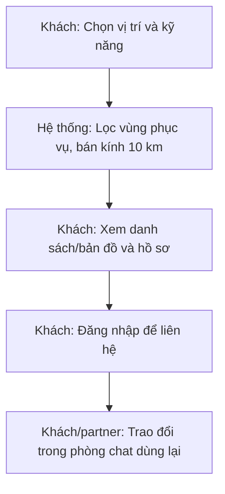

| Điều kiện / nhánh | Cách đi tiếp |
|---|---|
| Không cho GPS | Nhập vị trí bằng tay → tìm lại |
| Không có kết quả | Đổi kỹ năng/vị trí hoặc mở rộng bán kính; không tự đưa thợ ngoài vùng phục vụ |
| Chưa muốn trao đổi | Từ hồ sơ gửi yêu cầu thuê trực tiếp → UF-03 |
| Gọi trước thuê | Dùng số/kênh đã khai báo; gọi trong app theo UF-06 |

Nguồn: SRS-SEARCH-005; UX-HIRE-001

## UF-02 — Đăng nhập và tiếp tục hành động

Mục tiêu: Khôi phục đúng hành động nhắn tin/thuê đang chờ.

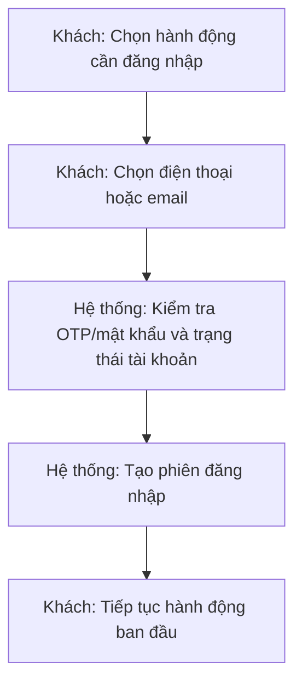

| Điều kiện / nhánh | Cách đi tiếp |
|---|---|
| OTP sai/hết hạn | Ở lại xác minh; sửa mã hoặc gửi lại theo hạn mức sẽ đặc tả |
| Quên mật khẩu | Yêu cầu đặt lại → xác minh → tạo mật khẩu → đăng nhập |
| Tài khoản bị khóa | Thông báo hạn chế và đường hỗ trợ; không tự mở khóa |
| Thuê bằng tài khoản email chưa xác minh điện thoại | Xác minh điện thoại trước khi gửi yêu cầu |

Nguồn: SRS nhóm tài khoản; UX v0.14–v0.16

## UF-03 — Thuê ngay hoặc hẹn trước

Mục tiêu: Nối khách–partner–công việc mà không bắt buộc gọi trước.

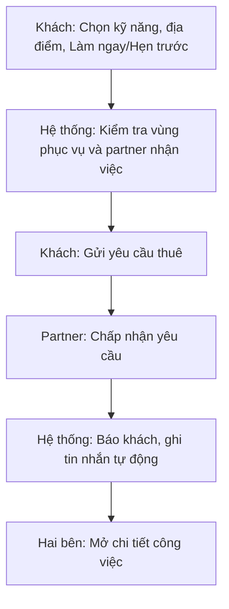

| Điều kiện / nhánh | Cách đi tiếp |
|---|---|
| Làm ngay | Partner nhập ngày giờ dự kiến đến khi nhận; không đoán ETA |
| Hẹn trước | Khách chọn ngày giờ tương lai; nhắc trước 24 giờ/1 giờ nếu mốc còn ở tương lai |
| Partner từ chối/khách rút khi chờ | Ghi trạng thái và báo bên kia; khách có thể tìm người khác |
| Partner tắt nhận việc/bị đình chỉ trước khi gửi | Chặn yêu cầu mới; công việc cũ giữ nguyên |
| Có nhiều công việc | Mỗi việc có mã riêng và dữ liệu hóa đơn/phân công riêng |

Nguồn: SRS luồng yêu cầu thuê; wireframe v0.22

## UF-04 — Doanh nghiệp phân công nhân viên

Mục tiêu: Doanh nghiệp nhận việc, người có quyền giao cho nhân viên thực hiện.

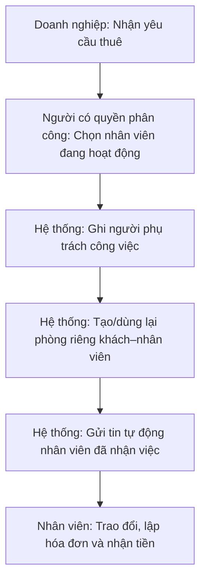

| Điều kiện / nhánh | Cách đi tiếp |
|---|---|
| Cửa hàng nhỏ | Một quản lý có thể kiêm nhận đơn và phân công; không bắt buộc thêm điều phối |
| Đổi nhân viên | Gỡ quyền công việc của người cũ; mở/dùng lại phòng khách–người mới |
| Nhân viên nghỉ | Giữ lịch sử chat riêng; thu hồi quyền công việc, chuyển liên hệ công việc về doanh nghiệp |
| Quản lý xem chat riêng | Không được truy cập chỉ vì là quản lý |
| Giao lại người cũ | Dùng lại đúng phòng và lịch sử cũ |

Nguồn: SRS-ORG-005; SRS-CHAT-003; FR-ORG/CHAT

## UF-05 — Đổi lịch và dừng việc

Mục tiêu: Cập nhật thỏa thuận của hai bên với ít thao tác.

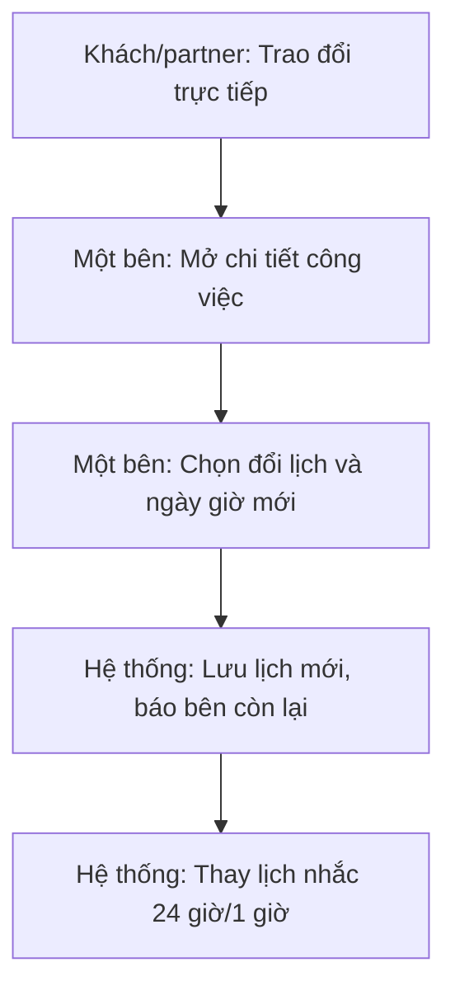

| Điều kiện / nhánh | Cách đi tiếp |
|---|---|
| Đổi lịch | Không cần bên kia bấm chấp nhận lần nữa; giữ lịch sử thay đổi |
| Dừng khi chưa phát sinh chi phí và chưa khóa hóa đơn | Theo luồng hủy/dừng đã chốt, ghi lý do và thông báo |
| Đã phát sinh tiền công | Thống nhất phần phải trả → ảnh kết quả/phần đã làm → hóa đơn; không xóa nghĩa vụ |
| Hóa đơn đã xác nhận | Không tự sửa/hủy/hoàn; báo cáo → UF-10 |

Nguồn: SRS yêu cầu/đổi lịch/hủy-dừng; UX nhóm B

## UF-06 — Nhắn tin, gọi và thông báo

Mục tiêu: Giữ liên lạc trước thuê và sau hoàn tất.

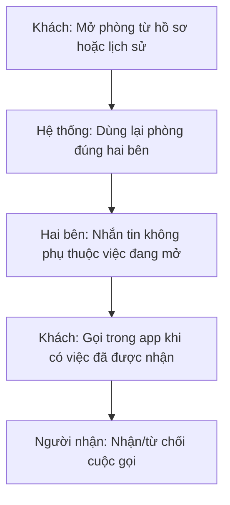

| Điều kiện / nhánh | Cách đi tiếp |
|---|---|
| Doanh nghiệp chưa phân công | Gọi đầu mối do doanh nghiệp chỉ định |
| Doanh nghiệp đã phân công | Khách chọn gọi nhân viên phụ trách hoặc cửa hàng |
| Sau hoàn tất | Vẫn gọi theo quan hệ được phép; người đã nghỉ mất quyền gọi công việc |
| Tắt thông báo | Trong cài đặt tài khoản, tắt tin nhắn/cuộc gọi; không xóa lịch sử hoặc chặn người |
| Gửi tin thất bại | Giữ nội dung và cho gửi lại; không nhân đôi tin |

Nguồn: SRS-CALL-001; SRS-NOT-002; FR-CHAT

## UF-07 — Lập, sửa và xác nhận hóa đơn

Mục tiêu: Thống nhất hóa đơn cuối cùng và khóa đúng số tiền.

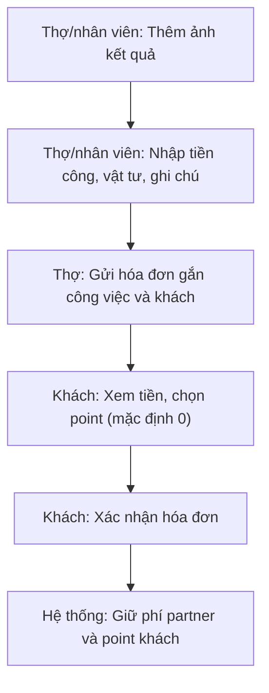

| Điều kiện / nhánh | Cách đi tiếp |
|---|---|
| Thiếu ảnh | Giữ bản nháp/số tiền; bổ sung ảnh trước khi gửi |
| Khách yêu cầu sửa trước xác nhận | Thợ gửi phiên bản mới → khách kiểm tra lại; point về 0 |
| Không đủ phí trong hạn mức -100.000đ | Partner thấy số cần nạp; khách chỉ thấy chờ partner bổ sung → thử lại |
| Đã xác nhận | Khóa sửa thường; yêu cầu có vấn đề chuyển UF-10 |
| Doanh nghiệp | Nhân viên được giao gửi trực tiếp; không cần quản lý duyệt |
| Hóa đơn chờ | Không tự hết hạn; theo dõi mốc 24 giờ sau xác nhận |

Nguồn: FR-INV-002/003/004/005; SRS-FIN-011

## UF-08 — Thanh toán trực tiếp và quyết toán

Mục tiêu: Hoàn tất phí/point đúng một lần.

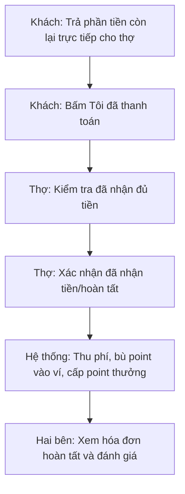

| Điều kiện / nhánh | Cách đi tiếp |
|---|---|
| Khách bấm đã thanh toán | Chỉ là lời xác nhận của khách, không tự quyết toán |
| Toàn bộ bằng point | Tiền trực tiếp bằng 0; thợ xác nhận công việc hoàn tất; không bắt chuyển tiền |
| Bấm lại/mất phản hồi | Đọc trạng thái giao dịch, không thu/cộng lần hai |
| Thợ không thể xác nhận | Khách/thợ gửi báo cáo → admin UF-10 |
| Công thức | T=L+M; F=floor(L/10); R≤T và point khả dụng; Q=floor(L×(T−R)/(50×T)), Q=0 nếu T=0. Ví partner +R−F; hoàn tất chỉ cấp Q, không trừ R lần hai |
| Điều kiện đánh giá | Chỉ mở đánh giá hai chiều khi khách báo đã thanh toán, thợ xác nhận nhận tiền và hóa đơn đã quyết toán thành công. Admin hoàn tất thay không phải xác nhận của thợ. |
| Thợ nhận tiền trước khách báo đã trả | Quyết toán một lần; chờ khách báo đã thanh toán để mở đánh giá. |
| Toàn point / 0đ | Hai bên vẫn xác nhận, không trả thêm tiền. |

Nguồn: FR-INV-007; SRS tài chính; v0.23

## UF-09 — Ngân hàng, nạp và rút ví

Mục tiêu: Quản lý tiền partner với đối soát thủ công ban đầu.

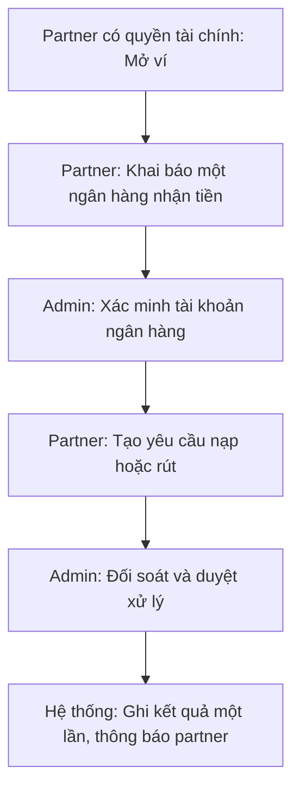

| Điều kiện / nhánh | Cách đi tiếp |
|---|---|
| Nạp | Tạo mã tham chiếu → chuyển tiền → xác minh tiền thực nhận → ghi có; ảnh không đủ để cộng ví |
| Rút | Kiểm tra số dư khả dụng/nghĩa vụ → giữ tiền → admin duyệt → chuyển → đối soát |
| Chưa rõ chuyển thành công | Giữ trạng thái chưa rõ, không gửi lại hoặc giải phóng tiền trước đối soát |
| Hủy/từ chối rút hợp lệ | Giải phóng đúng khoản giữ một lần; partner chỉ hủy khi còn chờ duyệt |
| Hạn mức âm | Dùng trả phí tối đa -100.000đ; không dùng để rút |
| Đổi ngân hàng khi lệnh đang xử lý | Không sửa tài khoản đã chốt trên lệnh rút |

Nguồn: SRS nạp/rút; FR-WAL; UX ngân hàng v0.20

## UF-10 — Báo cáo và admin hoàn tất thay thợ

Mục tiêu: Giải quyết thiếu xác nhận khi công việc đã xong và đã trả đủ.

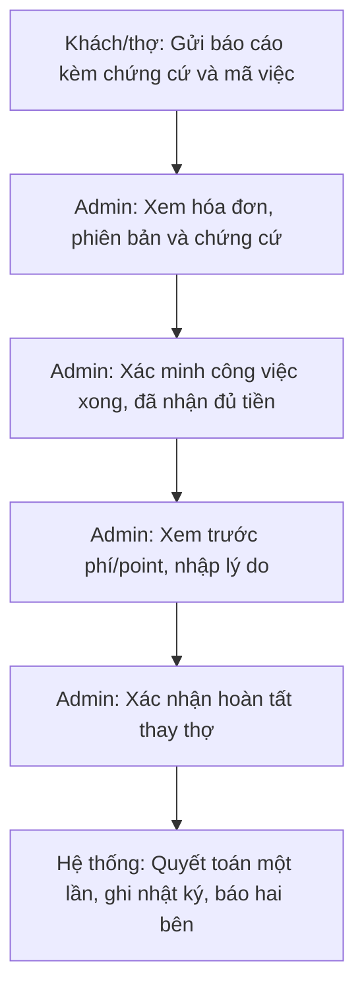

| Điều kiện / nhánh | Cách đi tiếp |
|---|---|
| Chưa đủ chứng cứ | Yêu cầu bổ sung; không tự thay đổi phí/point |
| Sai phiên bản/đã quyết toán/báo cáo đóng | Chặn thao tác, cập nhật trạng thái mới |
| Chỉ ghi kết luận/đóng báo cáo | Không tự quyết toán; đây là thao tác riêng |
| Hủy/hoàn/đảo/sửa tiền sau khóa | Tạm hoãn; không suy diễn quyền admin hoàn tất thành quyền sửa tiền |
| Thông báo | Thông báo kết quả và mã liên quan; không phát tán chứng cứ riêng tư |
| Q02 trước tiền thật | Khoản giữ treo, hủy/đảo/điều chỉnh tiền vẫn pending; bắt buộc thiết kế cách xử lý qua báo cáo/admin trước khi chạy tiền thật (Q02). Anh/Nhật, chuyển chủ/đóng doanh nghiệp và mục 10/15/16/17 tiếp tục tạm hoãn. |

Nguồn: SRS-FIN-011; FR-ADM-012; wireframe v0.23

## UF-11 — Đăng ký và quản lý partner

Mục tiêu: Công khai năng lực phù hợp và quản lý nhận việc.

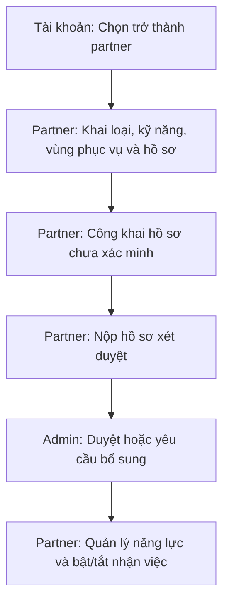

| Điều kiện / nhánh | Cách đi tiếp |
|---|---|
| Tắt nhận việc | Ẩn khỏi tìm kiếm/nhận mới; vẫn xử lý việc cũ và liên lạc |
| Chưa xác minh | Có thể xuất hiện với nhãn thật; không tự cấp huy hiệu chuyên môn |
| Thay đổi thông tin cần xác minh | Đánh giá lại hạng mục liên quan; không mặc nhiên giữ xác minh cũ |
| Partner bị đình chỉ | Ngăn nhận mới; xử lý nghĩa vụ cũ theo quyền; khác khóa tài khoản |
| Địa chỉ riêng | Chỉ công khai khu phục vụ; không lộ điểm hoạt động riêng tư |

Nguồn: UC-PAR-01/02; SRS-SEARCH-005; UX onboarding

## UF-12 — Đánh giá hai chiều

Mục tiêu: Chỉ mở đánh giá hai chiều khi khách báo đã thanh toán, thợ xác nhận nhận tiền và hóa đơn đã quyết toán thành công. Admin hoàn tất thay không phải xác nhận của thợ.

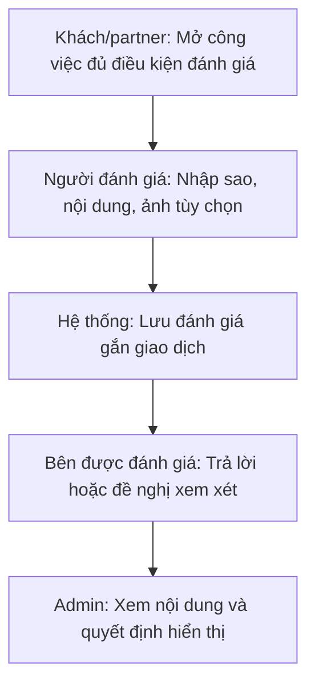

| Điều kiện / nhánh | Cách đi tiếp |
|---|---|
| Chưa đủ hai dấu xác nhận hoặc chưa quyết toán | Chưa mở đánh giá; khách có thể báo đã thanh toán sau khi thợ nhận tiền. |
| Toàn point / 0đ | Vẫn cần hai dấu xác nhận, không trả thêm tiền. |
| Admin hoàn tất thay | Không tự mở đánh giá. |
| Đánh giá bị ẩn/gỡ | Không tính vào sao trung bình công khai |
| Gửi lại/sửa | Không tăng số lượng đánh giá; lưu phiên bản theo đặc tả |
| Quyền doanh nghiệp nâng cao | Mục 17 vẫn pending; không tự mở rộng ai được đại diện đánh giá |

Nguồn: Q01 đã chốt; SRS v0.14; FR-REV-001/004

## UF-13 — Khôi phục, khóa và xóa tài khoản

Mục tiêu: Quản lý tài khoản không làm mất nghĩa vụ tồn.

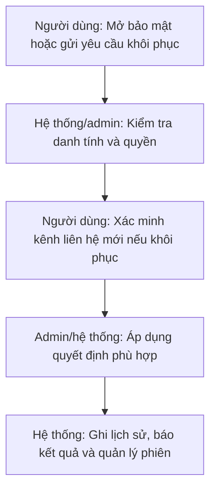

| Điều kiện / nhánh | Cách đi tiếp |
|---|---|
| Mất toàn bộ kênh | Gửi chứng cứ → admin xem → yêu cầu bổ sung/duyệt bước xác minh/từ chối |
| Yêu cầu xóa | Kiểm tra công việc, số dư/khoản giữ, yêu cầu tồn và sở hữu doanh nghiệp trước khi xóa |
| Còn nghĩa vụ | Giữ yêu cầu chờ và hướng dẫn giải quyết; không tự xóa ví |
| Khóa truy cập | Không tự hủy công việc hoặc chuyển tiền; khác đình chỉ hồ sơ partner |
| Đổi chủ/đóng doanh nghiệp | Pending; phải ghi rõ đây là phụ thuộc có thể chặn xóa |

Nguồn: SRS tài khoản; UX v0.16

## UF-14 — Quản trị, tra cứu và vận hành

Mục tiêu: Admin xử lý đúng hồ sơ và theo dõi dấu vết.

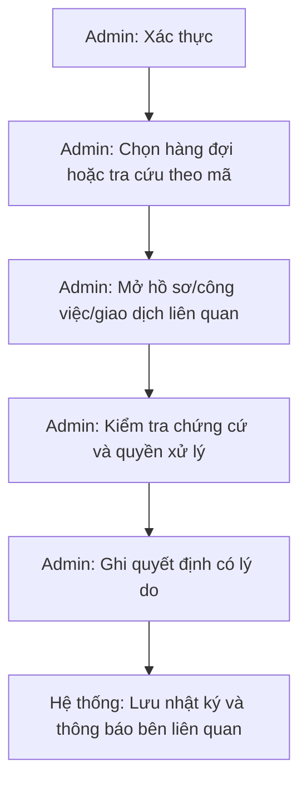

| Điều kiện / nhánh | Cách đi tiếp |
|---|---|
| Danh mục ngành/kỹ năng | Tạo/sửa/ngừng dùng, bảo toàn lịch sử dịch vụ cũ |
| Báo cáo vận hành | Lọc thời gian → chỉ số → tra cứu nguồn; funnel và sổ đối soát tổng thể còn thiếu |
| Nhật ký | Lọc người/thời gian/đối tượng; bao phủ toàn bộ hành động và chống sửa cần thiết kế kỹ thuật |
| Admin ≠ quản lý doanh nghiệp | Quyền riêng, không đăng nhập giả tài khoản khách |
| Hỗ trợ | Giờ vận hành 08:00–22:00; ngoài giờ vẫn tiếp nhận, không hứa xử lý tức thì |

Nguồn: FR-ADM; NFR-AUD; audit v0.21 với cập nhật v0.23

### Quy tắc hiện hành 23/09 — công việc

Đã chốt 23/09/2026: chặn thuê chính mình hoặc doanh nghiệp đang là thành viên. Đổi lịch chỉ để thay đổi ngày/giờ hẹn sau khi hai bên trao đổi, không bắt buộc vì công việc kéo dài. Công việc đã nhận không tự hết hạn, tự hủy hoặc tự hoàn tất theo thời gian; có thể kéo dài nhiều ngày. Luồng hoàn tất bình thường cần khách báo đã trả và thợ xác nhận đã nhận; xác nhận hóa đơn riêng chưa kết thúc công việc. Giữ quy tắc quyết toán một lần và ngoại lệ admin đã chốt. Không tạo luồng đổi lịch qua báo cáo/admin. Sau xác nhận hóa đơn không còn hành động đổi lịch; hỗ trợ/bảo hành vẫn trao đổi trong chat.

## P0-1 — Nguồn cung và tìm dịch vụ

P0-1 đã duyệt 06/10/2026: tài khoản có điện thoại xác minh tạo hồ sơ draft, owner và ví 0 cùng giao dịch. Công bố cần tên, kỹ năng active và nơi phục vụ cho mọi mode; ảnh chưa bắt buộc trong gói này. Công bố không tự bật nhận việc. Chuyển draft tắt nhận việc; sửa published mất điều kiện bị từ chối. Chủ/profile.manage dùng management riêng, shared version và key retry kiểm lại quyền. Public không lộ địa chỉ riêng/giấy tờ/ví; liên hệ cần đăng nhập. Tìm sort=distance dùng shop công khai hoặc tâm vùng tròn với cả điều kiện phủ khách và bán kính; mỗi hồ sơ một kết quả, cursor gắn bộ lọc và distance/created_at/id. OTP, bản đồ/GPS, polygon và ranking khác giữ Pending. DEMO local/test được phép tạo mới riêng, không sửa tài khoản có sẵn hoặc nạp tiền. Chuẩn chi tiết: technical-design v0.1.6, openapi.json và schema.sql.

Phần này ưu tiên cho gói P0-1 nếu mô tả cũ khác; các luồng công việc/tài chính đầy đủ giữ nguyên và không được coi đã triển khai.

## MAP-01 — chọn địa điểm, thử local ngày 07/10/2026

Theo yêu cầu triển khai tiếp sau khi chốt MapLibre + Geoapify Free: bộ chọn chung cho tìm dịch vụ, sổ địa chỉ, cửa hàng và tâm vùng. Có nhập địa chỉ/gợi ý, tìm cả chuỗi, chạm/kéo bản đồ, GPS khi bấm nút và địa chỉ đã lưu. Theo yêu cầu MAP-03 ngày 07/10/2026, bỏ nút và ô nhập tọa độ thủ công ở cả bốn nơi; tọa độ vẫn được lấy từ địa điểm đã chọn để tìm/lưu theo API hiện có. Người dùng chọn kết quả và xác nhận; không tự lấy dòng đầu. Gõ truy vấn khác hủy lựa chọn cũ, sửa mô tả tầng/phòng giữ ghim. Hủy không sửa form. Đổi tài khoản xóa bản nháp riêng; phản hồi cũ không ghi đè điểm mới.

Ba POST `/v1/locations/autocomplete`, `/geocode`, `/reverse` nhận JSON body theo OpenAPI v0.1.7. Query 3–300 ký tự, locale vi/en/ja, tối đa 5 gợi ý. Tra ngược giữ chính điểm yêu cầu, rỗng/lỗi vẫn cho nhập mô tả sau khi có điểm. Khách chưa đăng nhập được tra cứu với hạn mức IP; bearer hợp lệ dùng tài khoản. Pilot một tiến trình: 4 lookup/giây, 30/actor/phút, 1000/24h; restart reset bộ đếm. 429 có Retry-After; timeout provider 6 giây trả 504 TIMEOUT. Các giới hạn này không bao gồm tile và không phải bảo đảm chặn chi phí toàn project.

Key tra cứu ở server; key tile công khai ở app. Chưa billing/production, chưa dùng Google. Không ghi log địa chỉ/tọa độ/key, không lưu lịch sử GPS. Geoapify và OpenStreetMap được ghi nguồn. Bản đồ nền do app tải trực tiếp; không gửi token dự án tới Geoapify.

Không migration: giữ `{text, point}` và quyền/version/idempotency của API lưu hiện hành. `source` chỉ ở state app, ID gợi ý chỉ tạm. Tâm vùng không thành vị trí thợ công khai; chỉ điểm cửa hàng đã công khai được vẽ trong hồ sơ. Polygon, gom ghim toàn bộ kết quả, routing/ETA và theo dõi thợ ngoài đợt. Bằng chứng code/local/native ở báo cáo B03-01 trong repo; không suy ra UAT/production.

## MAP-02 — bản đồ kết quả, API v0.1.8

MAP-02 — 07/10/2026, quyết định đã chốt: chỉ ghim địa điểm đã đánh dấu công khai; người chưa có điểm công khai vẫn hiện trong danh sách. Mở rộng bản đồ kết quả sau MAP-01, trước P0-2; thay phần loại trừ bản đồ kết quả của MAP-01. Giữ MapLibre + Geoapify Free, chưa billing/production.

Sau khi tìm, khách chuyển Danh sách/Bản đồ trên cùng kết quả và bộ lọc. Điểm cần dịch vụ màu xanh lá, địa điểm công khai màu xanh dương; bấm ghim xem tên, địa chỉ và mở hồ sơ. Ghim trùng tọa độ gom chung nhưng vẫn chọn được từng người. Người không có ghim nằm trong danh sách bên dưới; có thể chuyển về danh sách đầy đủ. Chỉ vẽ các kết quả đã tải; Xem thêm bổ sung cả danh sách và ghim. Đổi điểm hoặc gửi tìm mới bỏ kết quả cũ. Lỗi nền bản đồ cho thử lại hoặc chuyển danh sách.

OpenAPI v0.1.8: GET /v1/partners thêm PartnerCard.map_location bắt buộc, giá trị Address {text, point} hoặc null. Với mỗi người đủ điều kiện tìm kiếm, lấy địa điểm active=true, public=true gần điểm tìm nhất và nằm trong bán kính; hòa khoảng cách chọn created_at rồi id. Không có điểm phù hợp trả null, không loại người khỏi kết quả. Giữ nguyên điều kiện công bố/nhận việc/kiểm duyệt, thứ tự, bộ lọc và cursor. distance_m/distance_kind tiếp tục phục vụ xếp hạng theo cửa hàng hoặc tâm vùng, không suy ra khoảng cách tới ghim.

Không dùng hoặc trả service_areas.center làm ghim; không lộ địa điểm private/đã lưu trữ. Đây là địa điểm khai báo công khai, không phải GPS trực tiếp của thợ. Không migration, không đổi quyền ghi public/private. Không thêm tra cứu provider theo từng thợ, routing, ETA hoặc tracking. Bằng chứng và ảnh chạy app ở báo cáo B03-02 trong repo; kiểm local/simulator không thay UAT hoặc phê duyệt production.

## MAP-03 / P0-2 — phạm vi đã duyệt ngày 07/10/2026

MAP-03 và P0-2 — quyết định chủ dự án ngày 07/10/2026, API v0.1.9.
Bỏ nút và ô nhập tọa độ thủ công trong tìm kiếm, sổ địa chỉ, cửa hàng, vùng phục vụ và form thuê. Người dùng chọn địa chỉ/gợi ý, ghim bản đồ, GPS theo nút hoặc địa chỉ đã lưu; tọa độ vẫn là dữ liệu nội bộ/API. Phần mô tả nhập tọa độ trong các mốc trước là lịch sử đã được thay thế.
Job bổ sung service_mode, time_mode, location_id (null ngoài cửa hàng), note và eta (null trước nhận/hẹn trước). Làm ngay bắt buộc ETA khi nhận; lưu thời điểm dự kiến đến và lịch ban đầu, không thêm nút Bắt đầu. Đổi lịch cập nhật scheduled_at, giữ eta ban đầu và tăng schedule_version/lịch sử. PartnerProfile bổ sung public_locations gồm id + address chỉ cho địa điểm active/public, và service_modes theo skill_id; không trả tâm vùng hoặc điểm riêng. Máy chủ đối chiếu location_id với cửa hàng hiện hành và lấy địa chỉ từ DB, không tin địa chỉ cửa hàng do client gửi.
Gói P0-2 local/test: khách tạo/đọc/rút yêu cầu, partner nhận/từ chối, đổi lịch/dừng trước hóa đơn khóa, phân công theo quyền. Có chi phí đã thỏa thuận thì dừng vẫn giữ accepted để tiếp tục hóa đơn ở P0-3; lưu cờ và lý do, không tạo hóa đơn giả. Không có chi phí chuyển stopped. Không tự hết hạn, hủy hay hoàn tất theo giờ. Giữ xác minh điện thoại ở backend khi gửi/nhận; chỉ dùng tài khoản DEMO local/test đã được duyệt, OTP thật Pending.
Chat tối thiểu dùng API HTTP: tạo/mở lại phòng trước thuê, gửi/đọc tin văn bản, thứ tự sequence, chống trùng client_message_id và idempotency, mốc đã đọc chỉ tăng, tải lại khi quay lại màn/app hoặc bấm cập nhật. Khách–cửa hàng/doanh nghiệp tách khách–nhân viên; phân công thêm tin hệ thống trong phòng riêng. Đổi người không sao chép lịch sử; người cũ giữ chat của mình nhưng mất quyền việc sau thu hồi/phân công lại. Ghi sự kiện bền vững cùng transaction; WebSocket/worker phát sự kiện, push/nhắc lịch, gọi và file đính kèm chưa nghiệm thu trong gói HTTP này. Các yêu cầu sản phẩm đầy đủ vẫn giữ, không coi phần chưa triển khai đã hoàn tất.
Bằng chứng code/local, web và native nằm trong báo cáo B03-03/B03-04 ở repo; không thay CI từ xa, UAT, production hoặc tiền thật.

## P1-01 A/B hiện hành — 13/10/2026

P1-01 A/B đã được chủ dự án duyệt ngày 13/10/2026. Chuẩn hiện hành cho đội ngũ và xác minh local/test là OpenAPI v0.1.11; các đoạn trước mô tả OTP Pending hoặc mã mẫu là lịch sử/phạm vi production, không phủ quyết phần local này.
Chỉ mở OTP purpose=verify trong phiên đăng nhập: email qua Mailpit trên máy, SMS qua hộp nhận mô phỏng. Mã ngẫu nhiên 6 số, hạn 5 phút, tối đa 5 lần sai; gửi lại sau 60 giây, 5 lần/liên hệ/giờ, 20 lần/tài khoản/giờ và 100 lần/IP/giờ. Mã gắn tài khoản, liên hệ và lần đăng nhập; gửi lại vô hiệu mã cũ. Xác minh email không xác minh điện thoại. Không thay email/điện thoại đã có hoặc chiếm liên hệ tài khoản khác. Chỉ DB DEMO/test cô lập và liên hệ cho phép; disabled mặc định, chặn production. Chưa mở OTP login/recover, MFA admin, email/SMS thật, billing hoặc tiền thật.
Chủ hoặc members.manage mời bằng email hoặc điện thoại, permissions=[]; lời mời 7 ngày, không trả token cho quản lý. Người nhận đăng nhập, xác minh đúng liên hệ rồi chủ động nhập token nhận lời. List/gửi lại/thu hồi kiểm quyền hiện hành; gửi lại thay token cũ. Nhận lời kiểm lại người mời; gia nhập lại dùng cùng membership nhưng không khôi phục quyền cũ. Lịch sử trạng thái pending/accepted/expired/revoked/replaced tách queued/submitted/failed/unknown của việc chuyển thư; submitted không chứng minh người nhận đã đọc.
GET /me/memberships phục vụ cả nhân viên thường và lịch sử đã rời. Cấp/thu hồi quyền dùng lý do, expected_version, Idempotency-Key và grant nhập lại mật khẩu qua POST /auth/reauthenticate. Grant hạn 5 phút, một lần, gắn user/family và scope membership.grants; refresh không gia hạn. Cấm tự sửa/sửa chủ/cấp vượt quyền; quyền thao tác ví cần wallet.read. Không coi nhập lại mật khẩu là MFA, không mở nghiệp vụ ngân hàng từ enum quyền.
Gỡ/tự rời: xem trước số việc cần bàn giao và version; xác nhận có lý do, máy chủ kiểm lại dưới khóa partner → job → invoice. Việc chưa có dấu nhận tiền về chờ phân công, chỉ bỏ nháp chưa gửi; giữ bản đã gửi/khóa, ledger, khoản giữ và dấu thanh toán. Việc đã nhận tiền giữ người thực hiện lịch sử. Thu hồi quyền ngay, giữ phòng chat cá nhân và không sao chép cho người mới. Đầu mối dùng Partner.version, có thể null để về cửa hàng; rời sẽ reset nếu đang là đầu mối. Gọi Internet vẫn chưa triển khai.
OTP/token lưu HMAC; liên hệ và nội dung hàng chờ mã hóa, xóa payload sau gửi/hết hạn. Worker khóa bản ghi để tránh hai lần gửi đồng thời; crash sau gửi vẫn có thể gây thư trùng, token chỉ dùng một lần. Audit bất biến ghi actor/lý do/quyền trước-sau/việc bàn giao, không ghi mật khẩu, token, OTP hay nội dung chat. Snapshot retry không chứa bí mật thô. UI Việt/Anh/Nhật đi từ Tài khoản → Xác minh liên hệ hoặc Đội ngũ → Thành viên/Lời mời/Đã rời/Quyền truy cập. Mất mạng giữ thao tác để thử lại; đổi tài khoản loại dữ liệu riêng. Bằng chứng code/native/CI/UAT được ghi riêng trong báo cáo repo, không coi spec là nghiệm thu.
