# User Flow v0.2 — Dịch vụ quanh bạn

Baseline đồng bộ 22/09/2026. Chỉ mở đánh giá hai chiều khi khách báo đã thanh toán, thợ xác nhận nhận tiền và hóa đơn đã quyết toán thành công. Admin hoàn tất thay không phải xác nhận của thợ.

Khoản giữ treo, hủy/đảo/điều chỉnh tiền vẫn pending; bắt buộc thiết kế cách xử lý qua báo cáo/admin trước khi chạy tiền thật (Q02). Anh/Nhật, chuyển chủ/đóng doanh nghiệp và mục 10/15/16/17 tiếp tục tạm hoãn.

## UF-01 — Tìm và trao đổi trước thuê

Mục tiêu: Khách tìm đúng người phục vụ được tại vị trí cần làm.

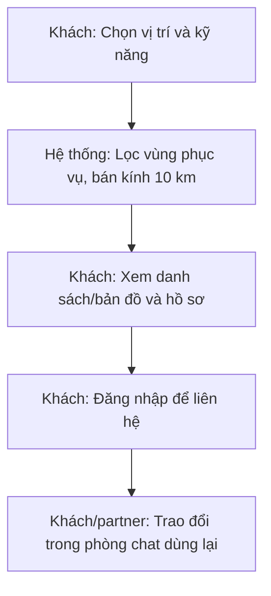

| Điều kiện / nhánh | Cách đi tiếp |
|---|---|
| Không cho GPS | Nhập vị trí bằng tay → tìm lại |
| Không có kết quả | Đổi kỹ năng/vị trí hoặc mở rộng bán kính; không tự đưa thợ ngoài vùng phục vụ |
| Chưa muốn trao đổi | Từ hồ sơ gửi yêu cầu thuê trực tiếp → UF-03 |
| Gọi trước thuê | Dùng số/kênh đã khai báo; gọi trong app theo UF-06 |

Nguồn: SRS-SEARCH-005; UX-HIRE-001

## UF-02 — Đăng nhập và tiếp tục hành động

Mục tiêu: Khôi phục đúng hành động nhắn tin/thuê đang chờ.

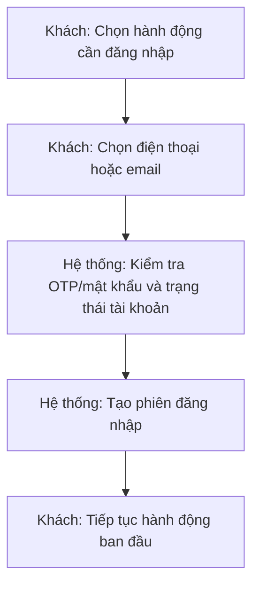

| Điều kiện / nhánh | Cách đi tiếp |
|---|---|
| OTP sai/hết hạn | Ở lại xác minh; sửa mã hoặc gửi lại theo hạn mức sẽ đặc tả |
| Quên mật khẩu | Yêu cầu đặt lại → xác minh → tạo mật khẩu → đăng nhập |
| Tài khoản bị khóa | Thông báo hạn chế và đường hỗ trợ; không tự mở khóa |
| Thuê bằng tài khoản email chưa xác minh điện thoại | Xác minh điện thoại trước khi gửi yêu cầu |

Nguồn: SRS nhóm tài khoản; UX v0.14–v0.16

## UF-03 — Thuê ngay hoặc hẹn trước

Mục tiêu: Nối khách–partner–công việc mà không bắt buộc gọi trước.

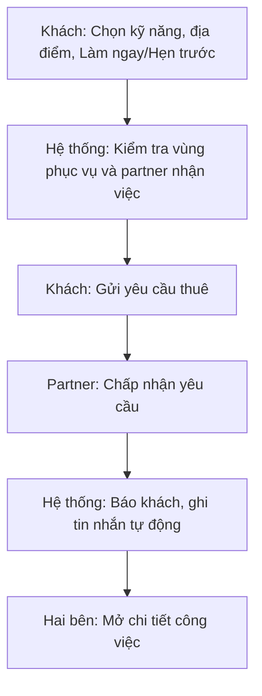

| Điều kiện / nhánh | Cách đi tiếp |
|---|---|
| Làm ngay | Partner nhập ngày giờ dự kiến đến khi nhận; không đoán ETA |
| Hẹn trước | Khách chọn ngày giờ tương lai; nhắc trước 24 giờ/1 giờ nếu mốc còn ở tương lai |
| Partner từ chối/khách rút khi chờ | Ghi trạng thái và báo bên kia; khách có thể tìm người khác |
| Partner tắt nhận việc/bị đình chỉ trước khi gửi | Chặn yêu cầu mới; công việc cũ giữ nguyên |
| Có nhiều công việc | Mỗi việc có mã riêng và dữ liệu hóa đơn/phân công riêng |

Nguồn: SRS luồng yêu cầu thuê; wireframe v0.22

## UF-04 — Doanh nghiệp phân công nhân viên

Mục tiêu: Doanh nghiệp nhận việc, người có quyền giao cho nhân viên thực hiện.

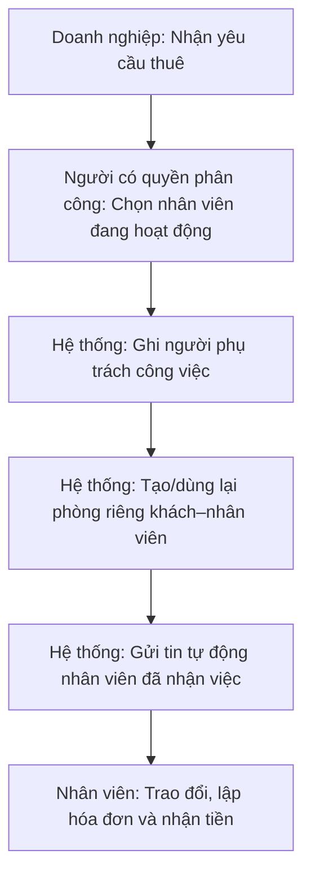

| Điều kiện / nhánh | Cách đi tiếp |
|---|---|
| Cửa hàng nhỏ | Một quản lý có thể kiêm nhận đơn và phân công; không bắt buộc thêm điều phối |
| Đổi nhân viên | Gỡ quyền công việc của người cũ; mở/dùng lại phòng khách–người mới |
| Nhân viên nghỉ | Giữ lịch sử chat riêng; thu hồi quyền công việc, chuyển liên hệ công việc về doanh nghiệp |
| Quản lý xem chat riêng | Không được truy cập chỉ vì là quản lý |
| Giao lại người cũ | Dùng lại đúng phòng và lịch sử cũ |

Nguồn: SRS-ORG-005; SRS-CHAT-003; FR-ORG/CHAT

## UF-05 — Đổi lịch và dừng việc

Mục tiêu: Cập nhật thỏa thuận của hai bên với ít thao tác.

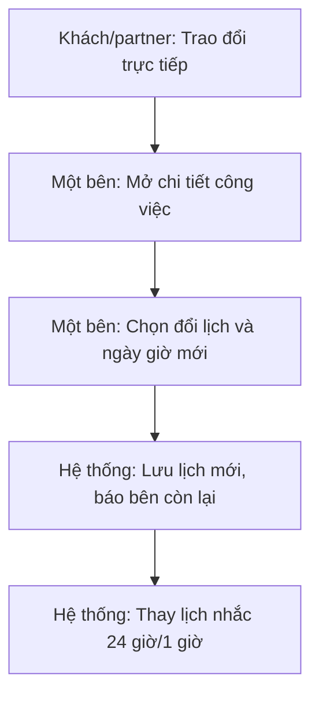

| Điều kiện / nhánh | Cách đi tiếp |
|---|---|
| Đổi lịch | Không cần bên kia bấm chấp nhận lần nữa; giữ lịch sử thay đổi |
| Dừng khi chưa phát sinh chi phí và chưa khóa hóa đơn | Theo luồng hủy/dừng đã chốt, ghi lý do và thông báo |
| Đã phát sinh tiền công | Thống nhất phần phải trả → ảnh kết quả/phần đã làm → hóa đơn; không xóa nghĩa vụ |
| Hóa đơn đã xác nhận | Không tự sửa/hủy/hoàn; báo cáo → UF-10 |

Nguồn: SRS yêu cầu/đổi lịch/hủy-dừng; UX nhóm B

## UF-06 — Nhắn tin, gọi và thông báo

Mục tiêu: Giữ liên lạc trước thuê và sau hoàn tất.

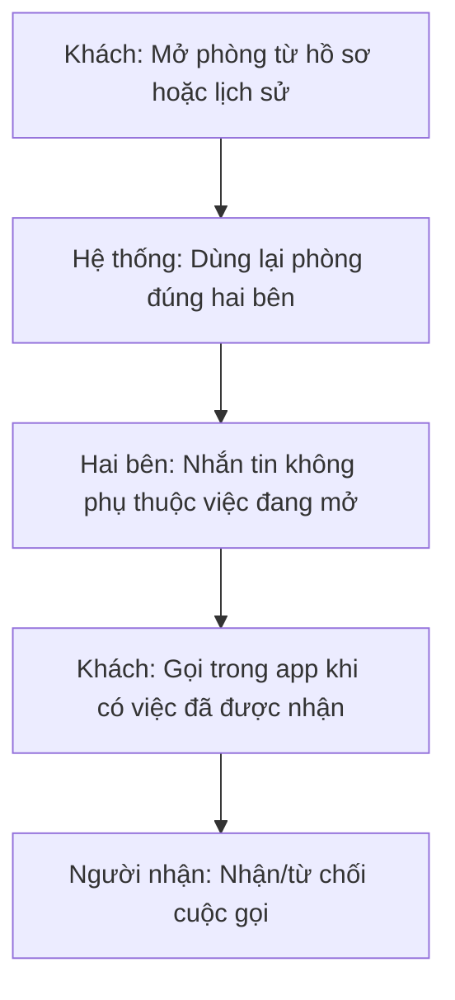

| Điều kiện / nhánh | Cách đi tiếp |
|---|---|
| Doanh nghiệp chưa phân công | Gọi đầu mối do doanh nghiệp chỉ định |
| Doanh nghiệp đã phân công | Khách chọn gọi nhân viên phụ trách hoặc cửa hàng |
| Sau hoàn tất | Vẫn gọi theo quan hệ được phép; người đã nghỉ mất quyền gọi công việc |
| Tắt thông báo | Trong cài đặt tài khoản, tắt tin nhắn/cuộc gọi; không xóa lịch sử hoặc chặn người |
| Gửi tin thất bại | Giữ nội dung và cho gửi lại; không nhân đôi tin |

Nguồn: SRS-CALL-001; SRS-NOT-002; FR-CHAT

## UF-07 — Lập, sửa và xác nhận hóa đơn

Mục tiêu: Thống nhất hóa đơn cuối cùng và khóa đúng số tiền.

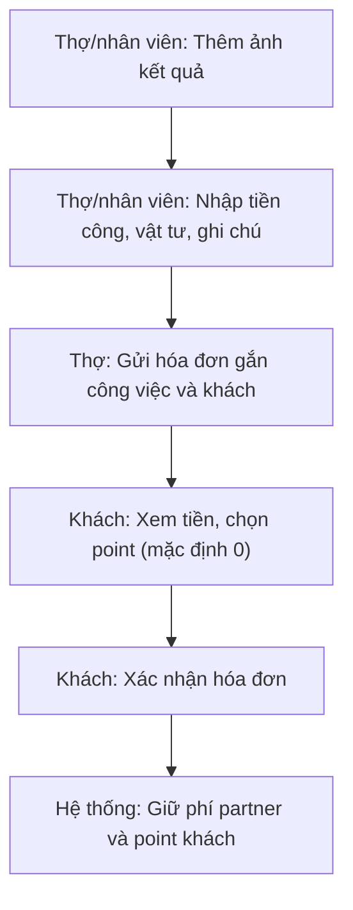

| Điều kiện / nhánh | Cách đi tiếp |
|---|---|
| Thiếu ảnh | Giữ bản nháp/số tiền; bổ sung ảnh trước khi gửi |
| Khách yêu cầu sửa trước xác nhận | Thợ gửi phiên bản mới → khách kiểm tra lại; point về 0 |
| Không đủ phí trong hạn mức -100.000đ | Partner thấy số cần nạp; khách chỉ thấy chờ partner bổ sung → thử lại |
| Đã xác nhận | Khóa sửa thường; yêu cầu có vấn đề chuyển UF-10 |
| Doanh nghiệp | Nhân viên được giao gửi trực tiếp; không cần quản lý duyệt |
| Hóa đơn chờ | Không tự hết hạn; theo dõi mốc 24 giờ sau xác nhận |

Nguồn: FR-INV-002/003/004/005; SRS-FIN-011

## UF-08 — Thanh toán trực tiếp và quyết toán

Mục tiêu: Hoàn tất phí/point đúng một lần.

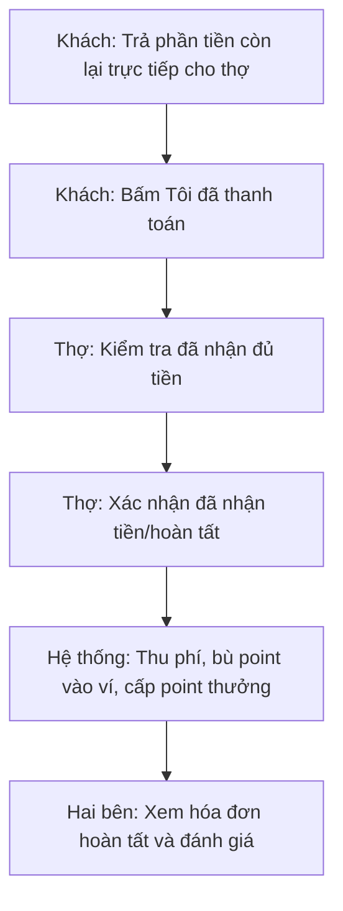

| Điều kiện / nhánh | Cách đi tiếp |
|---|---|
| Khách bấm đã thanh toán | Chỉ là lời xác nhận của khách, không tự quyết toán |
| Toàn bộ bằng point | Tiền trực tiếp bằng 0; thợ xác nhận công việc hoàn tất; không bắt chuyển tiền |
| Bấm lại/mất phản hồi | Đọc trạng thái giao dịch, không thu/cộng lần hai |
| Thợ không thể xác nhận | Khách/thợ gửi báo cáo → admin UF-10 |
| Công thức | T=L+M; F=floor(L/10); R≤T và point khả dụng; Q=floor(L×(T−R)/(50×T)), Q=0 nếu T=0. Ví partner +R−F; hoàn tất chỉ cấp Q, không trừ R lần hai |
| Điều kiện đánh giá | Chỉ mở đánh giá hai chiều khi khách báo đã thanh toán, thợ xác nhận nhận tiền và hóa đơn đã quyết toán thành công. Admin hoàn tất thay không phải xác nhận của thợ. |
| Thợ nhận tiền trước khách báo đã trả | Quyết toán một lần; chờ khách báo đã thanh toán để mở đánh giá. |
| Toàn point / 0đ | Hai bên vẫn xác nhận, không trả thêm tiền. |

Nguồn: FR-INV-007; SRS tài chính; v0.23

## UF-09 — Ngân hàng, nạp và rút ví

Mục tiêu: Quản lý tiền partner với đối soát thủ công ban đầu.

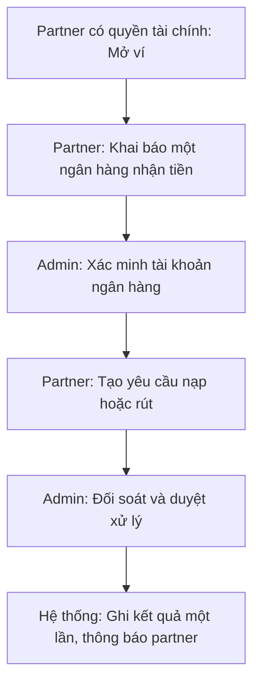

| Điều kiện / nhánh | Cách đi tiếp |
|---|---|
| Nạp | Tạo mã tham chiếu → chuyển tiền → xác minh tiền thực nhận → ghi có; ảnh không đủ để cộng ví |
| Rút | Kiểm tra số dư khả dụng/nghĩa vụ → giữ tiền → admin duyệt → chuyển → đối soát |
| Chưa rõ chuyển thành công | Giữ trạng thái chưa rõ, không gửi lại hoặc giải phóng tiền trước đối soát |
| Hủy/từ chối rút hợp lệ | Giải phóng đúng khoản giữ một lần; partner chỉ hủy khi còn chờ duyệt |
| Hạn mức âm | Dùng trả phí tối đa -100.000đ; không dùng để rút |
| Đổi ngân hàng khi lệnh đang xử lý | Không sửa tài khoản đã chốt trên lệnh rút |

Nguồn: SRS nạp/rút; FR-WAL; UX ngân hàng v0.20

## UF-10 — Báo cáo và admin hoàn tất thay thợ

Mục tiêu: Giải quyết thiếu xác nhận khi công việc đã xong và đã trả đủ.

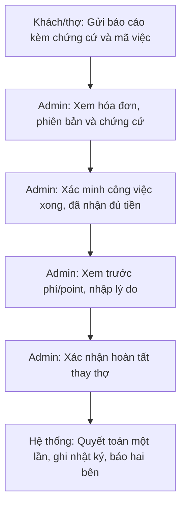

| Điều kiện / nhánh | Cách đi tiếp |
|---|---|
| Chưa đủ chứng cứ | Yêu cầu bổ sung; không tự thay đổi phí/point |
| Sai phiên bản/đã quyết toán/báo cáo đóng | Chặn thao tác, cập nhật trạng thái mới |
| Chỉ ghi kết luận/đóng báo cáo | Không tự quyết toán; đây là thao tác riêng |
| Hủy/hoàn/đảo/sửa tiền sau khóa | Tạm hoãn; không suy diễn quyền admin hoàn tất thành quyền sửa tiền |
| Thông báo | Thông báo kết quả và mã liên quan; không phát tán chứng cứ riêng tư |
| Q02 trước tiền thật | Khoản giữ treo, hủy/đảo/điều chỉnh tiền vẫn pending; bắt buộc thiết kế cách xử lý qua báo cáo/admin trước khi chạy tiền thật (Q02). Anh/Nhật, chuyển chủ/đóng doanh nghiệp và mục 10/15/16/17 tiếp tục tạm hoãn. |

Nguồn: SRS-FIN-011; FR-ADM-012; wireframe v0.23

## UF-11 — Đăng ký và quản lý partner

Mục tiêu: Công khai năng lực phù hợp và quản lý nhận việc.

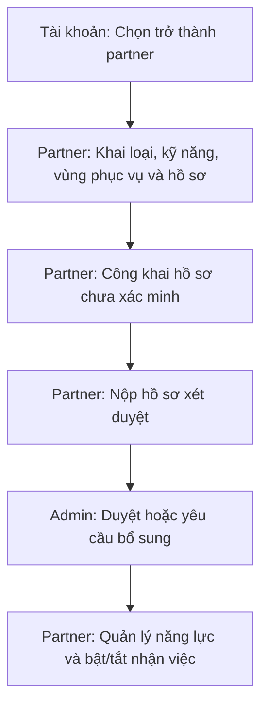

| Điều kiện / nhánh | Cách đi tiếp |
|---|---|
| Tắt nhận việc | Ẩn khỏi tìm kiếm/nhận mới; vẫn xử lý việc cũ và liên lạc |
| Chưa xác minh | Có thể xuất hiện với nhãn thật; không tự cấp huy hiệu chuyên môn |
| Thay đổi thông tin cần xác minh | Đánh giá lại hạng mục liên quan; không mặc nhiên giữ xác minh cũ |
| Partner bị đình chỉ | Ngăn nhận mới; xử lý nghĩa vụ cũ theo quyền; khác khóa tài khoản |
| Địa chỉ riêng | Chỉ công khai khu phục vụ; không lộ điểm hoạt động riêng tư |

Nguồn: UC-PAR-01/02; SRS-SEARCH-005; UX onboarding

## UF-12 — Đánh giá hai chiều

Mục tiêu: Chỉ mở đánh giá hai chiều khi khách báo đã thanh toán, thợ xác nhận nhận tiền và hóa đơn đã quyết toán thành công. Admin hoàn tất thay không phải xác nhận của thợ.

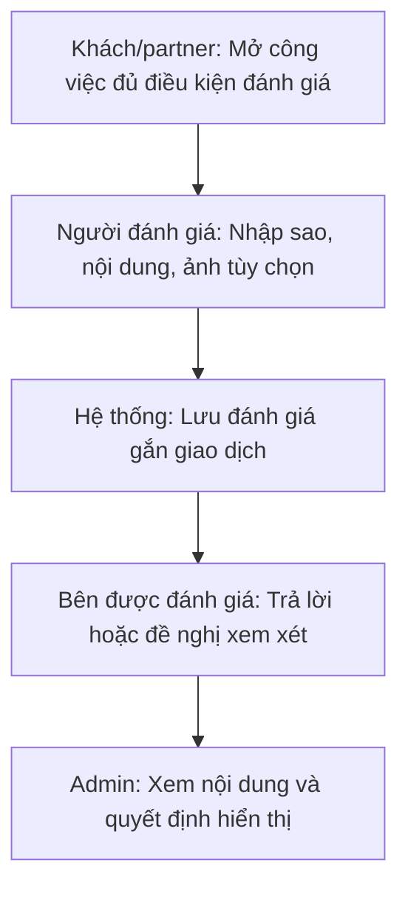

| Điều kiện / nhánh | Cách đi tiếp |
|---|---|
| Chưa đủ hai dấu xác nhận hoặc chưa quyết toán | Chưa mở đánh giá; khách có thể báo đã thanh toán sau khi thợ nhận tiền. |
| Toàn point / 0đ | Vẫn cần hai dấu xác nhận, không trả thêm tiền. |
| Admin hoàn tất thay | Không tự mở đánh giá. |
| Đánh giá bị ẩn/gỡ | Không tính vào sao trung bình công khai |
| Gửi lại/sửa | Không tăng số lượng đánh giá; lưu phiên bản theo đặc tả |
| Quyền doanh nghiệp nâng cao | Mục 17 vẫn pending; không tự mở rộng ai được đại diện đánh giá |

Nguồn: Q01 đã chốt; SRS v0.14; FR-REV-001/004

## UF-13 — Khôi phục, khóa và xóa tài khoản

Mục tiêu: Quản lý tài khoản không làm mất nghĩa vụ tồn.

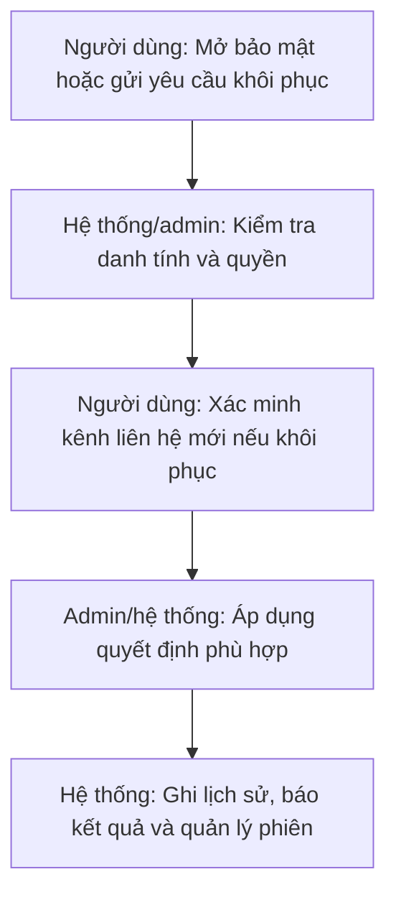

| Điều kiện / nhánh | Cách đi tiếp |
|---|---|
| Mất toàn bộ kênh | Gửi chứng cứ → admin xem → yêu cầu bổ sung/duyệt bước xác minh/từ chối |
| Yêu cầu xóa | Kiểm tra công việc, số dư/khoản giữ, yêu cầu tồn và sở hữu doanh nghiệp trước khi xóa |
| Còn nghĩa vụ | Giữ yêu cầu chờ và hướng dẫn giải quyết; không tự xóa ví |
| Khóa truy cập | Không tự hủy công việc hoặc chuyển tiền; khác đình chỉ hồ sơ partner |
| Đổi chủ/đóng doanh nghiệp | Pending; phải ghi rõ đây là phụ thuộc có thể chặn xóa |

Nguồn: SRS tài khoản; UX v0.16

## UF-14 — Quản trị, tra cứu và vận hành

Mục tiêu: Admin xử lý đúng hồ sơ và theo dõi dấu vết.

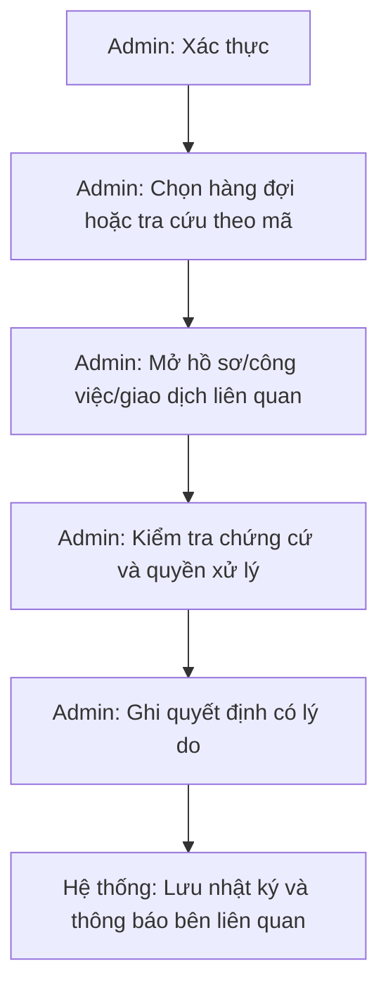

| Điều kiện / nhánh | Cách đi tiếp |
|---|---|
| Danh mục ngành/kỹ năng | Tạo/sửa/ngừng dùng, bảo toàn lịch sử dịch vụ cũ |
| Báo cáo vận hành | Lọc thời gian → chỉ số → tra cứu nguồn; funnel và sổ đối soát tổng thể còn thiếu |
| Nhật ký | Lọc người/thời gian/đối tượng; bao phủ toàn bộ hành động và chống sửa cần thiết kế kỹ thuật |
| Admin ≠ quản lý doanh nghiệp | Quyền riêng, không đăng nhập giả tài khoản khách |
| Hỗ trợ | Giờ vận hành 08:00–22:00; ngoài giờ vẫn tiếp nhận, không hứa xử lý tức thì |

Nguồn: FR-ADM; NFR-AUD; audit v0.21 với cập nhật v0.23

### Quy tắc hiện hành 23/09 — công việc

Đã chốt 23/09/2026: chặn thuê chính mình hoặc doanh nghiệp đang là thành viên. Đổi lịch chỉ để thay đổi ngày/giờ hẹn sau khi hai bên trao đổi, không bắt buộc vì công việc kéo dài. Công việc đã nhận không tự hết hạn, tự hủy hoặc tự hoàn tất theo thời gian; có thể kéo dài nhiều ngày. Luồng hoàn tất bình thường cần khách báo đã trả và thợ xác nhận đã nhận; xác nhận hóa đơn riêng chưa kết thúc công việc. Giữ quy tắc quyết toán một lần và ngoại lệ admin đã chốt. Không tạo luồng đổi lịch qua báo cáo/admin. Sau xác nhận hóa đơn không còn hành động đổi lịch; hỗ trợ/bảo hành vẫn trao đổi trong chat.

## P0-1 — Nguồn cung và tìm dịch vụ

P0-1 đã duyệt 06/10/2026: tài khoản có điện thoại xác minh tạo hồ sơ draft, owner và ví 0 cùng giao dịch. Công bố cần tên, kỹ năng active và nơi phục vụ cho mọi mode; ảnh chưa bắt buộc trong gói này. Công bố không tự bật nhận việc. Chuyển draft tắt nhận việc; sửa published mất điều kiện bị từ chối. Chủ/profile.manage dùng management riêng, shared version và key retry kiểm lại quyền. Public không lộ địa chỉ riêng/giấy tờ/ví; liên hệ cần đăng nhập. Tìm sort=distance dùng shop công khai hoặc tâm vùng tròn với cả điều kiện phủ khách và bán kính; mỗi hồ sơ một kết quả, cursor gắn bộ lọc và distance/created_at/id. OTP, bản đồ/GPS, polygon và ranking khác giữ Pending. DEMO local/test được phép tạo mới riêng, không sửa tài khoản có sẵn hoặc nạp tiền. Chuẩn chi tiết: technical-design v0.1.6, openapi.json và schema.sql.

Phần này ưu tiên cho gói P0-1 nếu mô tả cũ khác; các luồng công việc/tài chính đầy đủ giữ nguyên và không được coi đã triển khai.
