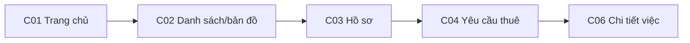
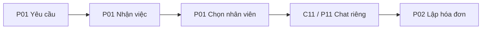
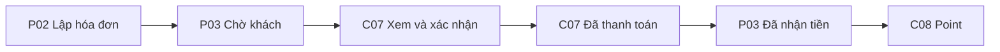
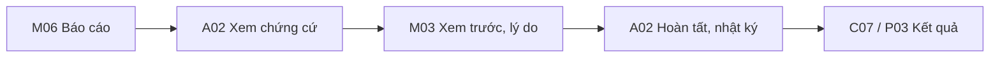
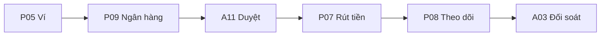
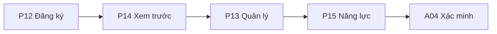

# Screen Flow v0.2 — Danh mục và điều hướng

Mã màn là mã tài liệu mới, không phải ID đã dùng trong FR. Các route/hàm là mốc đối chiếu mã wireframe, không phải URL deep-link. Một route có thể chứa nhiều trạng thái/modal; đây là bản nền, chưa phải kiểm kê hết tất cả trường và hộp thoại. Không có link giả trỏ đến màn chưa hỗ trợ deep-link.

## Cấu trúc điều hướng

Khách: Trang chủ / Tìm dịch vụ / Công việc / Tin nhắn / Point / Tài khoản. Partner: Công việc / Tin nhắn / Quản lý / Ví / Hồ sơ; thành viên chỉ thấy phần có quyền. Admin: các hàng đợi, tra cứu, báo cáo, nhật ký và quản trị. Nút đổi vai ở wireframe là công cụ review; không phải quyền admin cấp cho mọi tài khoản sản phẩm.

## Danh mục màn và điểm đối chiếu

| Mã | Vai | Màn / hộp thoại | Route hoặc hàm wireframe |
|---|---|---|---|
| C01 | Khách | Trang chủ | home |
| C02 | Khách | Danh sách / bản đồ | results |
| C03 | Khách | Hồ sơ partner | profile |
| C04 | Khách | Gửi yêu cầu thuê | hire |
| C05 | Khách | Danh sách công việc | jobs |
| C06 | Khách | Chi tiết công việc | bJobDetail |
| C07 | Khách | Hóa đơn | invoice |
| C08 | Khách | Point | points |
| C09 | Khách | Hộp thư | inbox |
| C10 | Khách | Chat partner/cửa hàng | chat |
| C11 | Khách | Chat riêng nhân viên | directChat |
| P01 | Partner | Công việc / chi tiết | pJobs |
| P02 | Partner | Lập hóa đơn | pInvoice |
| P03 | Partner | Hóa đơn đã gửi | pInvoice |
| P04 | Partner | Quản lý | pManage |
| P05 | Partner | Ví | pWallet |
| P06 | Partner | Nạp tiền | pTopup |
| P07 | Partner | Rút tiền | pWithdraw |
| P08 | Partner | Chi tiết giao dịch ví | pRequest |
| P09 | Partner | Ngân hàng nhận tiền | pBank |
| P10 | Partner | Chat công việc | pChat |
| P11 | Nhân viên | Chat riêng khách | pDirectChat |
| P12 | Partner | Đăng ký hồ sơ | onboarding |
| P13 | Partner | Quản lý hồ sơ | obManage |
| P14 | Partner | Xem trước hồ sơ | obPreview |
| P15 | Partner | Năng lực, kỹ năng và vùng phục vụ | pSkills |
| O01 | Doanh nghiệp | Thành viên và quyền | orgMembers |
| A01 | Admin | Tổng quan | adminHub |
| A02 | Admin | Hỗ trợ/báo cáo | adminSupport |
| A03 | Admin | Nạp/rút và đối soát | adminWallet |
| A04 | Admin | Xác minh partner | obAdmin |
| A05 | Admin | Trạng thái partner | adminAccounts |
| A06 | Admin | Truy cập tài khoản | accessAdmin |
| A07 | Admin | Ngành/kỹ năng | adminCatalog |
| A08 | Admin | Đánh giá | adminReviews |
| A09 | Admin | Tra cứu | adminLookup |
| A10 | Admin | Theo dõi hóa đơn | adminInvoices |
| A11 | Admin | Duyệt ngân hàng | adminBank |
| A12 | Admin | Báo cáo vận hành | adminReports |
| A13 | Admin | Nhật ký | adminAudit |
| S01 | Chung | Bảo mật tài khoản | security |
| S02 | Chung | Khôi phục tài khoản | securityRecovery |
| S03 | Chung | Danh sách hỗ trợ | support |
| S04 | Chung | Chi tiết hỗ trợ | supportDetail |
| S05 | Chung | Thông báo | notifications |
| M01 | Chung | Đăng nhập / xác minh | login |
| M02 | Chung | Đổi lịch | changeSchedule |
| M03 | Admin | Xác nhận hoàn tất thay thợ | adminSettlementOpen |
| M04 | Chung | Cài đặt thông báo | cSettings |
| M05 | Chung | Cuộc gọi | cStartCall |
| M06 | Chung | Báo cáo hóa đơn | fixReportInvoice |

| C13 | Khách | Đánh giá partner | customerReviews |
| P16 | Partner | Đánh giá khách / phản hồi | partnerReviews |

## Tuyến điều hướng

| Mã | Từ | Thao tác | Đến | Điều kiện | Nhánh lỗi / quay lại | User Flow |
|---|---|---|---|---|---|---|
| SF01 | C01 | Chọn vị trí/kỹ năng, tìm | C02 | Có vị trí; GPS bị từ chối thì nhập tay | Không kết quả → đổi bộ lọc | UF-01 |
| SF02 | C02 | Xem hồ sơ | C03 | Partner đáp ứng điều kiện tìm | Partner không còn nhận mới → xem nhưng chặn gửi thuê | UF-01 |
| SF03 | C03 | Nhắn tin | M01 → C10 | Cần đăng nhập; dùng phòng đã có | Hủy đăng nhập → C03 | UF-01/02/06 |
| SF04 | C03 hoặc C10 | Thuê dịch vụ | M01 → C04 | Đăng nhập, xác minh điện thoại nếu cần | Quay lại hồ sơ/chat | UF-02/03 |
| SF05 | C04 | Gửi yêu cầu | C06; báo P01 | Kỹ năng, vùng, địa chỉ, ngày giờ hợp lệ | Lỗi: giữ form, chưa tạo trùng việc | UF-03 |
| SF06 | P01 | Chấp nhận | P01; cập nhật C06/C10 | Làm ngay mở nhập ETA; hẹn trước dùng lịch | Từ chối → trạng thái kết thúc và báo khách | UF-03 |
| SF07 | P01 | Phân công | P01; mở C11/P11 | Người giao có quyền, nhân viên hoạt động | Đổi người → thu quyền cũ, giữ chat cũ | UF-04 |
| SF08 | C05 | Chọn công việc | C06 | Mở đúng mã và chủ thể | Không có quyền → thông báo, về danh sách | UF-03 |
| SF09 | C06 hoặc P01 | Đổi lịch | M02 → màn nguồn | Đã trao đổi; chọn ngày giờ hợp lệ | Hủy modal → giữ lịch cũ | UF-05 |
| SF10 | C09 | Chọn hội thoại | C10 hoặc C11 | Đúng thành viên phòng | Không phụ thuộc có công việc đang mở | UF-06 |
| SF11 | C10/C11/P10/P11 | Gọi trong app | M05 → phòng nguồn | Việc được nhận; đúng đầu mối hoặc nhân viên còn quyền | Từ chối/nhỡ/lỗi → lịch sử gọi | UF-06 |
| SF12 | P01 | Tạo hóa đơn | P02 | Người được giao/có quyền thực hiện | Chưa có ảnh → giữ nháp | UF-07 |
| SF13 | P02 | Gửi hóa đơn | P03; thông báo C07 | Ảnh và tiền công/vật tư hợp lệ | Mất mạng → giữ nội dung và gửi lại có kiểm tra trùng | UF-07 |
| SF14 | C07 | Yêu cầu sửa | C07 chờ sửa; P02 | Chỉ trước xác nhận | Sau khóa → M06 | UF-07 |
| SF15 | C07 | Xác nhận và dùng point | C07 đã khóa; P03 | Đủ point và hạn mức phí | Thiếu phí → partner P05/P06, khách chỉ thấy thông báo chung | UF-07 |
| SF16 | C07 | Tôi đã thanh toán | C07; P03 thấy thông báo | Sau xác nhận; tiền trả trực tiếp | Không tự quyết toán | UF-08 |
| SF17 | P03 | Đã nhận tiền / Hoàn tất | P03 hoàn tất; C07/C08 cập nhật | Đã khóa, chưa quyết toán | Bấm lại → giữ kết quả cũ | UF-08 |
| SF18 | C07 hoặc P03 | Báo cáo hóa đơn | M06 → màn nguồn; A02 nhận | Liên kết đúng việc, phiên bản, chứng cứ | Báo cáo không đổi tiền | UF-10 |
| SF19 | A02 | Xác nhận hoàn tất thay thợ | M03 → A02 | Admin, báo cáo mở, chứng cứ, hóa đơn khóa chưa xong | Thiếu lý do/quyền/trạng thái đổi → chặn | UF-10 |
| SF20 | P04 | Ví / ngân hàng | P05 → P09 | Quyền tài chính doanh nghiệp hoặc chủ ví | Ngân hàng chưa xác minh → A11 xét | UF-09 |
| SF21 | P05 | Nạp tiền | P06 → P08; A03 | Mã tham chiếu theo yêu cầu | Chưa thấy tiền → gửi đề nghị đối soát | UF-09 |
| SF22 | P05 | Rút tiền | P07 → P08; A03 | Một ngân hàng đã duyệt và đủ khả dụng | Chưa rõ chuyển → giữ tiền, không gửi lại | UF-09 |
| SF23 | P04 | Hồ sơ/năng lực | P13/P12 → P14; P15 sửa năng lực | Chủ/người có quyền quản lý hồ sơ | Nhãn xác minh không được khai giả | UF-11 |
| SF24 | P04 | Thành viên | O01 → P01 | Quyền quản lý/phân công độc lập, có thể kiêm nhiệm | Nhân viên nghỉ mất quyền công việc | UF-04 |
| SF25 | S03 | Mở báo cáo | S04 | Chủ thể có quyền xem nội dung | Chứng cứ riêng không chia sẻ mặc định | UF-10 |
| SF26 | S01 | Mất kênh / yêu cầu xóa | S02 hoặc hộp thoại xóa | Kiểm tra danh tính/nghĩa vụ | Còn sở hữu doanh nghiệp → phụ thuộc pending | UF-13 |
| SF27 | A01 | Chọn hàng đợi | A02/A03/A04/A05/A06/A08/A11 | Quyền admin theo tác vụ | Không dùng quyền quản lý DN thay admin | UF-14 |
| SF28 | A09/A10 | Mở đối tượng theo mã | Chi tiết tương ứng / A02 | Giữ đúng ngữ cảnh việc/partner | Không tìm thấy → kết quả rỗng, không mở nhầm | UF-14 |
| SF29 | A12/A13 | Lọc và tra cứu nguồn | A09 | Thời gian/mã/người xử lý hợp lệ | Thiếu dữ liệu → trạng thái rỗng; không coi 0 là chưa thu thập | UF-14 |
| SF30 | S05 | Mở thông báo | C06/C07/P01/P03/S04/P08 | Kiểm tra quyền và trạng thái mới trước mở | Mất quyền → giải thích, không lộ nội dung | UF-06 |
| SF31 | Tài khoản | Cài đặt thông báo | M04 → màn nguồn | Tắt tin nhắn và cuộc gọi độc lập | Không xóa chat/không chặn liên hệ | UF-06 |
| SF32 | C06/P01 sau đủ điều kiện | Đánh giá / trả lời | C13 / P16 → màn nguồn | Chỉ mở đánh giá hai chiều khi khách báo đã thanh toán, thợ xác nhận nhận tiền và hóa đơn đã quyết toán thành công. Admin hoàn tất thay không phải xác nhận của thợ. | Trạng thái bị ẩn không tính sao | UF-12 |

## Quy tắc xuyên suốt

- Nút quay lại modal giữ dữ liệu chưa gửi; gửi thành công có trạng thái rõ. Điều hướng sang công việc khác không làm mất hóa đơn/point giữ của việc cũ.
- Thông báo phải kiểm quyền và tải trạng thái hiện tại trước mở; không dùng snapshot thông báo làm quyền truy cập.
- Tất cả màn có trạng thái tải/rỗng/lỗi/không quyền và retry phù hợp; cụ thể hóa từng field ở D07.
- Screen flow không thay state machine: “đã thanh toán” do khách đánh dấu khác “đã quyết toán”.
- Chưa kiểm chứng toàn bộ 32 tuyến trên Browser trong lượt này; kiểm tra cấu trúc và đối chiếu mã không phải UAT.

## Sơ đồ Screen Flow theo nhóm

Mũi tên là tuyến chính; nhánh điều kiện và đường quay lại xem SF01–SF32. Tên màn có mã đối chiếu danh mục.

### Tìm và thuê

C03 → M01 đăng nhập → C10 chat là nhánh tùy chọn; không bắt buộc trao đổi trước thuê.

### Doanh nghiệp giao việc

Không thêm bước quản lý duyệt hóa đơn. Đổi nhân viên dùng lại phòng đúng cặp khách–nhân viên.

### Hóa đơn và tiền

C07 yêu cầu sửa → P02 trước khóa. Thiếu phí → P05/P06 rồi thử lại. Báo cáo sau khóa → M06/A02.

### Admin hoàn tất thay thợ

Thiếu chứng cứ → bổ sung. Đã quyết toán/sai phiên bản → chặn; đóng báo cáo không tự quyết toán.

### Ví và ngân hàng

Nhánh nạp: P05 → P06 → P08/A03. Hủy rút khi còn chờ → P08; chưa rõ kết quả giữ tiền.

### Quản trị hồ sơ

Partner bật/tắt nhận mới tại quản lý. Thành viên doanh nghiệp tại O01; quyền theo từng tác vụ.

## Điều kiện hiện hành 22/09/2026

Chỉ mở đánh giá hai chiều khi khách báo đã thanh toán, thợ xác nhận nhận tiền và hóa đơn đã quyết toán thành công. Admin hoàn tất thay không phải xác nhận của thợ.

Khoản giữ treo, hủy/đảo/điều chỉnh tiền vẫn pending; bắt buộc thiết kế cách xử lý qua báo cáo/admin trước khi chạy tiền thật (Q02). Anh/Nhật, chuyển chủ/đóng doanh nghiệp và mục 10/15/16/17 tiếp tục tạm hoãn.

### Quy tắc hiện hành 23/09 — công việc

Đã chốt 23/09/2026: chặn thuê chính mình hoặc doanh nghiệp đang là thành viên. Đổi lịch chỉ để thay đổi ngày/giờ hẹn sau khi hai bên trao đổi, không bắt buộc vì công việc kéo dài. Công việc đã nhận không tự hết hạn, tự hủy hoặc tự hoàn tất theo thời gian; có thể kéo dài nhiều ngày. Luồng hoàn tất bình thường cần khách báo đã trả và thợ xác nhận đã nhận; xác nhận hóa đơn riêng chưa kết thúc công việc. Giữ quy tắc quyết toán một lần và ngoại lệ admin đã chốt. Không tạo luồng đổi lịch qua báo cáo/admin. Sau xác nhận hóa đơn không còn hành động đổi lịch; hỗ trợ/bảo hành vẫn trao đổi trong chat.

## P0-1 — Nguồn cung và tìm dịch vụ

P0-1 đã duyệt 06/10/2026: tài khoản có điện thoại xác minh tạo hồ sơ draft, owner và ví 0 cùng giao dịch. Công bố cần tên, kỹ năng active và nơi phục vụ cho mọi mode; ảnh chưa bắt buộc trong gói này. Công bố không tự bật nhận việc. Chuyển draft tắt nhận việc; sửa published mất điều kiện bị từ chối. Chủ/profile.manage dùng management riêng, shared version và key retry kiểm lại quyền. Public không lộ địa chỉ riêng/giấy tờ/ví; liên hệ cần đăng nhập. Tìm sort=distance dùng shop công khai hoặc tâm vùng tròn với cả điều kiện phủ khách và bán kính; mỗi hồ sơ một kết quả, cursor gắn bộ lọc và distance/created_at/id. OTP, bản đồ/GPS, polygon và ranking khác giữ Pending. DEMO local/test được phép tạo mới riêng, không sửa tài khoản có sẵn hoặc nạp tiền. Chuẩn chi tiết: technical-design v0.1.6, openapi.json và schema.sql.

Phần này ưu tiên cho gói P0-1 nếu mô tả cũ khác; các luồng công việc/tài chính đầy đủ giữ nguyên và không được coi đã triển khai.

## MAP-01 — chọn địa điểm, thử local ngày 07/10/2026

Theo yêu cầu triển khai tiếp sau khi chốt MapLibre + Geoapify Free: bộ chọn chung cho tìm dịch vụ, sổ địa chỉ, cửa hàng và tâm vùng. Có nhập địa chỉ/gợi ý, tìm cả chuỗi, chạm/kéo bản đồ, GPS khi bấm nút và địa chỉ đã lưu. Theo yêu cầu MAP-03 ngày 07/10/2026, bỏ nút và ô nhập tọa độ thủ công ở cả bốn nơi; tọa độ vẫn được lấy từ địa điểm đã chọn để tìm/lưu theo API hiện có. Người dùng chọn kết quả và xác nhận; không tự lấy dòng đầu. Gõ truy vấn khác hủy lựa chọn cũ, sửa mô tả tầng/phòng giữ ghim. Hủy không sửa form. Đổi tài khoản xóa bản nháp riêng; phản hồi cũ không ghi đè điểm mới.

Ba POST `/v1/locations/autocomplete`, `/geocode`, `/reverse` nhận JSON body theo OpenAPI v0.1.7. Query 3–300 ký tự, locale vi/en/ja, tối đa 5 gợi ý. Tra ngược giữ chính điểm yêu cầu, rỗng/lỗi vẫn cho nhập mô tả sau khi có điểm. Khách chưa đăng nhập được tra cứu với hạn mức IP; bearer hợp lệ dùng tài khoản. Pilot một tiến trình: 4 lookup/giây, 30/actor/phút, 1000/24h; restart reset bộ đếm. 429 có Retry-After; timeout provider 6 giây trả 504 TIMEOUT. Các giới hạn này không bao gồm tile và không phải bảo đảm chặn chi phí toàn project.

Key tra cứu ở server; key tile công khai ở app. Chưa billing/production, chưa dùng Google. Không ghi log địa chỉ/tọa độ/key, không lưu lịch sử GPS. Geoapify và OpenStreetMap được ghi nguồn. Bản đồ nền do app tải trực tiếp; không gửi token dự án tới Geoapify.

Không migration: giữ `{text, point}` và quyền/version/idempotency của API lưu hiện hành. `source` chỉ ở state app, ID gợi ý chỉ tạm. Tâm vùng không thành vị trí thợ công khai; chỉ điểm cửa hàng đã công khai được vẽ trong hồ sơ. Polygon, gom ghim toàn bộ kết quả, routing/ETA và theo dõi thợ ngoài đợt. Bằng chứng code/local/native ở báo cáo B03-01 trong repo; không suy ra UAT/production.

## MAP-02 — bản đồ kết quả, API v0.1.8

MAP-02 — 07/10/2026, quyết định đã chốt: chỉ ghim địa điểm đã đánh dấu công khai; người chưa có điểm công khai vẫn hiện trong danh sách. Mở rộng bản đồ kết quả sau MAP-01, trước P0-2; thay phần loại trừ bản đồ kết quả của MAP-01. Giữ MapLibre + Geoapify Free, chưa billing/production.

Sau khi tìm, khách chuyển Danh sách/Bản đồ trên cùng kết quả và bộ lọc. Điểm cần dịch vụ màu xanh lá, địa điểm công khai màu xanh dương; bấm ghim xem tên, địa chỉ và mở hồ sơ. Ghim trùng tọa độ gom chung nhưng vẫn chọn được từng người. Người không có ghim nằm trong danh sách bên dưới; có thể chuyển về danh sách đầy đủ. Chỉ vẽ các kết quả đã tải; Xem thêm bổ sung cả danh sách và ghim. Đổi điểm hoặc gửi tìm mới bỏ kết quả cũ. Lỗi nền bản đồ cho thử lại hoặc chuyển danh sách.

OpenAPI v0.1.8: GET /v1/partners thêm PartnerCard.map_location bắt buộc, giá trị Address {text, point} hoặc null. Với mỗi người đủ điều kiện tìm kiếm, lấy địa điểm active=true, public=true gần điểm tìm nhất và nằm trong bán kính; hòa khoảng cách chọn created_at rồi id. Không có điểm phù hợp trả null, không loại người khỏi kết quả. Giữ nguyên điều kiện công bố/nhận việc/kiểm duyệt, thứ tự, bộ lọc và cursor. distance_m/distance_kind tiếp tục phục vụ xếp hạng theo cửa hàng hoặc tâm vùng, không suy ra khoảng cách tới ghim.

Không dùng hoặc trả service_areas.center làm ghim; không lộ địa điểm private/đã lưu trữ. Đây là địa điểm khai báo công khai, không phải GPS trực tiếp của thợ. Không migration, không đổi quyền ghi public/private. Không thêm tra cứu provider theo từng thợ, routing, ETA hoặc tracking. Bằng chứng và ảnh chạy app ở báo cáo B03-02 trong repo; kiểm local/simulator không thay UAT hoặc phê duyệt production.

## MAP-03 / P0-2 — phạm vi đã duyệt ngày 07/10/2026

MAP-03 và P0-2 — quyết định chủ dự án ngày 07/10/2026, API v0.1.9.
Bỏ nút và ô nhập tọa độ thủ công trong tìm kiếm, sổ địa chỉ, cửa hàng, vùng phục vụ và form thuê. Người dùng chọn địa chỉ/gợi ý, ghim bản đồ, GPS theo nút hoặc địa chỉ đã lưu; tọa độ vẫn là dữ liệu nội bộ/API. Phần mô tả nhập tọa độ trong các mốc trước là lịch sử đã được thay thế.
Job bổ sung service_mode, time_mode, location_id (null ngoài cửa hàng), note và eta (null trước nhận/hẹn trước). Làm ngay bắt buộc ETA khi nhận; lưu thời điểm dự kiến đến và lịch ban đầu, không thêm nút Bắt đầu. Đổi lịch cập nhật scheduled_at, giữ eta ban đầu và tăng schedule_version/lịch sử. PartnerProfile bổ sung public_locations gồm id + address chỉ cho địa điểm active/public, và service_modes theo skill_id; không trả tâm vùng hoặc điểm riêng. Máy chủ đối chiếu location_id với cửa hàng hiện hành và lấy địa chỉ từ DB, không tin địa chỉ cửa hàng do client gửi.
Gói P0-2 local/test: khách tạo/đọc/rút yêu cầu, partner nhận/từ chối, đổi lịch/dừng trước hóa đơn khóa, phân công theo quyền. Có chi phí đã thỏa thuận thì dừng vẫn giữ accepted để tiếp tục hóa đơn ở P0-3; lưu cờ và lý do, không tạo hóa đơn giả. Không có chi phí chuyển stopped. Không tự hết hạn, hủy hay hoàn tất theo giờ. Giữ xác minh điện thoại ở backend khi gửi/nhận; chỉ dùng tài khoản DEMO local/test đã được duyệt, OTP thật Pending.
Chat tối thiểu dùng API HTTP: tạo/mở lại phòng trước thuê, gửi/đọc tin văn bản, thứ tự sequence, chống trùng client_message_id và idempotency, mốc đã đọc chỉ tăng, tải lại khi quay lại màn/app hoặc bấm cập nhật. Khách–cửa hàng/doanh nghiệp tách khách–nhân viên; phân công thêm tin hệ thống trong phòng riêng. Đổi người không sao chép lịch sử; người cũ giữ chat của mình nhưng mất quyền việc sau thu hồi/phân công lại. Ghi sự kiện bền vững cùng transaction; WebSocket/worker phát sự kiện, push/nhắc lịch, gọi và file đính kèm chưa nghiệm thu trong gói HTTP này. Các yêu cầu sản phẩm đầy đủ vẫn giữ, không coi phần chưa triển khai đã hoàn tất.
Bằng chứng code/local, web và native nằm trong báo cáo B03-03/B03-04 ở repo; không thay CI từ xa, UAT, production hoặc tiền thật.

## P1-01 A/B hiện hành — 13/10/2026

P1-01 A/B đã được chủ dự án duyệt ngày 13/10/2026. Chuẩn hiện hành cho đội ngũ và xác minh local/test là OpenAPI v0.1.11; các đoạn trước mô tả OTP Pending hoặc mã mẫu là lịch sử/phạm vi production, không phủ quyết phần local này.
Chỉ mở OTP purpose=verify trong phiên đăng nhập: email qua Mailpit trên máy, SMS qua hộp nhận mô phỏng. Mã ngẫu nhiên 6 số, hạn 5 phút, tối đa 5 lần sai; gửi lại sau 60 giây, 5 lần/liên hệ/giờ, 20 lần/tài khoản/giờ và 100 lần/IP/giờ. Mã gắn tài khoản, liên hệ và lần đăng nhập; gửi lại vô hiệu mã cũ. Xác minh email không xác minh điện thoại. Không thay email/điện thoại đã có hoặc chiếm liên hệ tài khoản khác. Chỉ DB DEMO/test cô lập và liên hệ cho phép; disabled mặc định, chặn production. Chưa mở OTP login/recover, MFA admin, email/SMS thật, billing hoặc tiền thật.
Chủ hoặc members.manage mời bằng email hoặc điện thoại, permissions=[]; lời mời 7 ngày, không trả token cho quản lý. Người nhận đăng nhập, xác minh đúng liên hệ rồi chủ động nhập token nhận lời. List/gửi lại/thu hồi kiểm quyền hiện hành; gửi lại thay token cũ. Nhận lời kiểm lại người mời; gia nhập lại dùng cùng membership nhưng không khôi phục quyền cũ. Lịch sử trạng thái pending/accepted/expired/revoked/replaced tách queued/submitted/failed/unknown của việc chuyển thư; submitted không chứng minh người nhận đã đọc.
GET /me/memberships phục vụ cả nhân viên thường và lịch sử đã rời. Cấp/thu hồi quyền dùng lý do, expected_version, Idempotency-Key và grant nhập lại mật khẩu qua POST /auth/reauthenticate. Grant hạn 5 phút, một lần, gắn user/family và scope membership.grants; refresh không gia hạn. Cấm tự sửa/sửa chủ/cấp vượt quyền; quyền thao tác ví cần wallet.read. Không coi nhập lại mật khẩu là MFA, không mở nghiệp vụ ngân hàng từ enum quyền.
Gỡ/tự rời: xem trước số việc cần bàn giao và version; xác nhận có lý do, máy chủ kiểm lại dưới khóa partner → job → invoice. Việc chưa có dấu nhận tiền về chờ phân công, chỉ bỏ nháp chưa gửi; giữ bản đã gửi/khóa, ledger, khoản giữ và dấu thanh toán. Việc đã nhận tiền giữ người thực hiện lịch sử. Thu hồi quyền ngay, giữ phòng chat cá nhân và không sao chép cho người mới. Đầu mối dùng Partner.version, có thể null để về cửa hàng; rời sẽ reset nếu đang là đầu mối. Gọi Internet vẫn chưa triển khai.
OTP/token lưu HMAC; liên hệ và nội dung hàng chờ mã hóa, xóa payload sau gửi/hết hạn. Worker khóa bản ghi để tránh hai lần gửi đồng thời; crash sau gửi vẫn có thể gây thư trùng, token chỉ dùng một lần. Audit bất biến ghi actor/lý do/quyền trước-sau/việc bàn giao, không ghi mật khẩu, token, OTP hay nội dung chat. Snapshot retry không chứa bí mật thô. UI Việt/Anh/Nhật đi từ Tài khoản → Xác minh liên hệ hoặc Đội ngũ → Thành viên/Lời mời/Đã rời/Quyền truy cập. Mất mạng giữ thao tác để thử lại; đổi tài khoản loại dữ liệu riêng. Bằng chứng code/native/CI/UAT được ghi riêng trong báo cáo repo, không coi spec là nghiệm thu.
