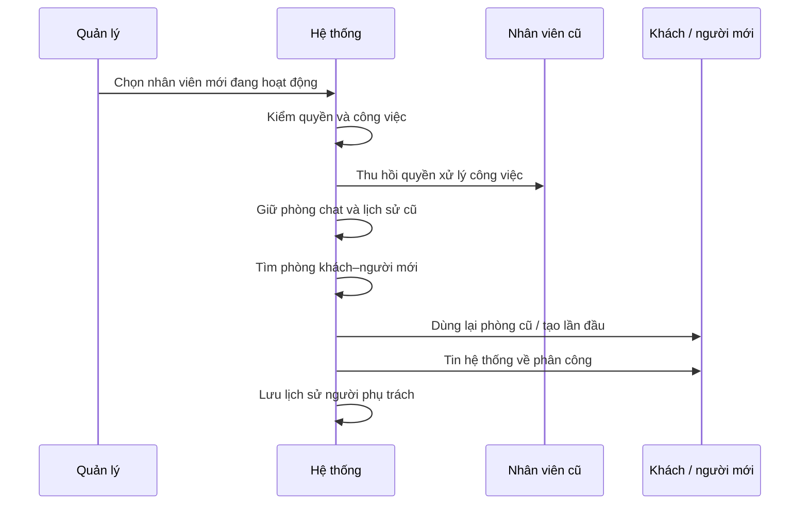

# Sequence Diagram — nguồn Mermaid v0.3

Baseline 22/09/2026. Khoản giữ treo, hủy/đảo/điều chỉnh tiền vẫn pending; bắt buộc thiết kế cách xử lý qua báo cáo/admin trước khi chạy tiền thật (Q02). Anh/Nhật, chuyển chủ/đóng doanh nghiệp và mục 10/15/16/17 tiếp tục tạm hoãn.

## Thuê & phân công

Doanh nghiệp nhận việc, rồi giao cho nhân viên. Phòng chat riêng được dùng lại.

```mermaid
sequenceDiagram
    participant A0 as Khách
    participant A1 as Hệ thống
    participant A2 as Doanh nghiệp
    participant A3 as Nhân viên
    A0->>A1: Gửi yêu cầu thuê
    A1->>A2: Báo yêu cầu mới
    A2->>A1: Chấp nhận; nhập ETA nếu làm ngay
    A1->>A0: Báo đã nhận việc
    A2->>A1: Phân công nhân viên
    A1->>A1: Tạo / dùng lại phòng đúng cặp khách–nhân viên
    A1->>A3: Cấp quyền công việc và thông báo
    A1->>A0: Tin tự động: nhân viên đã nhận việc
    A0->>A3: Trao đổi trong phòng riêng
```

Quản lý không được đọc phòng chat riêng chỉ vì có quyền phân công.

## Hóa đơn & point

Xác nhận hóa đơn, khách báo đã trả và thợ nhận tiền là các bước riêng.

```mermaid
sequenceDiagram
    participant A0 as Khách
    participant A1 as Thợ
    participant A2 as Hệ thống
    participant A3 as Ví / point
    A1->>A2: Ảnh kết quả + hóa đơn tiền công/vật tư
    A2->>A0: Gửi hóa đơn; point mặc định 0
    opt Nếu hóa đơn chưa đúng
    A0->>A1: Yêu cầu sửa trước xác nhận
    A1->>A2: Gửi phiên bản mới; khách kiểm tra lại
    end
    Note over A0,A3: Khi hóa đơn đã thống nhất
    A0->>A2: Xác nhận hóa đơn + số point dùng
    A2->>A3: Kiểm tra và giữ phí / point
    A2->>A0: Thông báo hóa đơn đã khóa
    A0->>A1: Trả tiền trực tiếp, ngoài hệ thống
    A0->>A2: Bấm “Tôi đã thanh toán”
    A1->>A2: Xác nhận đã nhận đủ tiền / hoàn tất
    A2->>A3: Quyết toán đúng một lần
    A2->>A0: Kết quả hóa đơn + point thưởng
    A2->>A1: Kết quả phí và bù point
    A2->>A2: Mở đánh giá khi đủ hai xác nhận và đã quyết toán
```

Toàn point → tiền trực tiếp bằng 0. Khách bấm đã thanh toán không tự quyết toán. Các bước ví là nghiệp vụ, chưa ấn định kiến trúc dịch vụ. Chỉ mở đánh giá hai chiều khi khách báo đã thanh toán, thợ xác nhận nhận tiền và hóa đơn đã quyết toán thành công. Admin hoàn tất thay không phải xác nhận của thợ. Toàn point/0đ vẫn cần cả hai xác nhận.

## Admin hoàn tất thay thợ

Chỉ dùng khi công việc xong, đã trả đủ và thợ không thể xác nhận.

```mermaid
sequenceDiagram
    participant A0 as Khách / thợ
    participant A1 as Admin
    participant A2 as Hệ thống
    participant A3 as Ví / point
    A0->>A2: Báo cáo + chứng cứ + mã hóa đơn
    A2->>A1: Đưa vào hàng đợi hỗ trợ
    A1->>A2: Xem hóa đơn, trạng thái và chứng cứ
    opt Nếu chưa đủ chứng cứ
    A1->>A0: Yêu cầu bổ sung; chưa thay đổi tiền
    end
    Note over A0,A3: Chỉ tiếp tục khi đã đối chiếu đủ
    A1->>A2: Xem trước phí/point; nhập lý do
    A1->>A2: Xác nhận hoàn tất thay thợ
    A2->>A2: Kiểm quyền, phiên bản, chưa quyết toán
    A2->>A3: Thực hiện quyết toán một lần
    A2->>A2: Lưu admin, lý do, thời gian và báo cáo
    A2->>A0: Thông báo kết quả, giữ riêng chứng cứ
```

Đã quyết toán hoặc trạng thái đổi → chặn lặp. Đóng báo cáo không tự quyết toán. Không có quyền hủy/hoàn/đảo từ luồng này. Chỉ mở đánh giá hai chiều khi khách báo đã thanh toán, thợ xác nhận nhận tiền và hóa đơn đã quyết toán thành công. Admin hoàn tất thay không phải xác nhận của thợ. Khoản giữ treo, hủy/đảo/điều chỉnh tiền vẫn pending; bắt buộc thiết kế cách xử lý qua báo cáo/admin trước khi chạy tiền thật (Q02). Anh/Nhật, chuyển chủ/đóng doanh nghiệp và mục 10/15/16/17 tiếp tục tạm hoãn.

## Rút tiền & đối soát

Admin duyệt thủ công ban đầu; kết quả chưa rõ không được coi là thất bại.

```mermaid
sequenceDiagram
    participant A0 as Partner
    participant A1 as Hệ thống
    participant A2 as Admin
    participant A3 as Ngân hàng
    A0->>A1: Gửi yêu cầu rút
    A1->>A1: Kiểm quyền, ngân hàng đã duyệt, tiền khả dụng
    A1->>A1: Giữ đúng khoản rút
    A1->>A2: Đưa vào hàng đợi
    A2->>A1: Duyệt và bắt đầu xử lý
    A2->>A3: Thực hiện chuyển tiền
    opt Kết quả chuyển chưa rõ
    A2->>A1: Ghi “Chưa rõ kết quả”; tiếp tục giữ
    A2->>A3: Đối soát trước khi quyết định
    end
    Note over A0,A3: Có kết quả đã xác minh
    A2->>A1: Ghi thành công / thất bại có chứng cứ
    A1->>A1: Quyết toán / giải phóng khoản giữ một lần
    A1->>A0: Thông báo trạng thái cuối
```

Không rút từ hạn mức âm. Không gửi lại lệnh khi chưa biết kết quả lần trước. Đây là luồng mô tả, chưa chọn tích hợp ngân hàng.

## Đổi nhân viên

Quyền công việc thay đổi, lịch sử chat cá nhân vẫn giữ.



Nhân viên cũ không tiếp tục lập hóa đơn hoặc nhận tiền cho việc đã chuyển. Quyền chat riêng không đồng nghĩa quyền công việc.


### Quy tắc hiện hành 23/09 — công việc

Đã chốt 23/09/2026: chặn thuê chính mình hoặc doanh nghiệp đang là thành viên. Đổi lịch chỉ để thay đổi ngày/giờ hẹn sau khi hai bên trao đổi, không bắt buộc vì công việc kéo dài. Công việc đã nhận không tự hết hạn, tự hủy hoặc tự hoàn tất theo thời gian; có thể kéo dài nhiều ngày. Luồng hoàn tất bình thường cần khách báo đã trả và thợ xác nhận đã nhận; xác nhận hóa đơn riêng chưa kết thúc công việc. Giữ quy tắc quyết toán một lần và ngoại lệ admin đã chốt. Không tạo luồng đổi lịch qua báo cáo/admin. Sau xác nhận hóa đơn không còn hành động đổi lịch; hỗ trợ/bảo hành vẫn trao đổi trong chat.


## P0-1 — Nguồn cung và tìm dịch vụ

P0-1 đã duyệt 06/10/2026: tài khoản có điện thoại xác minh tạo hồ sơ draft, owner và ví 0 cùng giao dịch. Công bố cần tên, kỹ năng active và nơi phục vụ cho mọi mode; ảnh chưa bắt buộc trong gói này. Công bố không tự bật nhận việc. Chuyển draft tắt nhận việc; sửa published mất điều kiện bị từ chối. Chủ/profile.manage dùng management riêng, shared version và key retry kiểm lại quyền. Public không lộ địa chỉ riêng/giấy tờ/ví; liên hệ cần đăng nhập. Tìm sort=distance dùng shop công khai hoặc tâm vùng tròn với cả điều kiện phủ khách và bán kính; mỗi hồ sơ một kết quả, cursor gắn bộ lọc và distance/created_at/id. OTP, bản đồ/GPS, polygon và ranking khác giữ Pending. DEMO local/test được phép tạo mới riêng, không sửa tài khoản có sẵn hoặc nạp tiền. Chuẩn chi tiết: technical-design v0.1.6, openapi.json và schema.sql.

Phần này ưu tiên cho gói P0-1 nếu mô tả cũ khác; các luồng công việc/tài chính đầy đủ giữ nguyên và không được coi đã triển khai.

## MAP-01 — chọn địa điểm, thử local ngày 07/10/2026

Theo yêu cầu triển khai tiếp sau khi chốt MapLibre + Geoapify Free: bộ chọn chung cho tìm dịch vụ, sổ địa chỉ, cửa hàng và tâm vùng. Có nhập địa chỉ/gợi ý, tìm cả chuỗi, chạm/kéo bản đồ, GPS khi bấm nút và địa chỉ đã lưu. Theo yêu cầu MAP-03 ngày 07/10/2026, bỏ nút và ô nhập tọa độ thủ công ở cả bốn nơi; tọa độ vẫn được lấy từ địa điểm đã chọn để tìm/lưu theo API hiện có. Người dùng chọn kết quả và xác nhận; không tự lấy dòng đầu. Gõ truy vấn khác hủy lựa chọn cũ, sửa mô tả tầng/phòng giữ ghim. Hủy không sửa form. Đổi tài khoản xóa bản nháp riêng; phản hồi cũ không ghi đè điểm mới.

Ba POST `/v1/locations/autocomplete`, `/geocode`, `/reverse` nhận JSON body theo OpenAPI v0.1.7. Query 3–300 ký tự, locale vi/en/ja, tối đa 5 gợi ý. Tra ngược giữ chính điểm yêu cầu, rỗng/lỗi vẫn cho nhập mô tả sau khi có điểm. Khách chưa đăng nhập được tra cứu với hạn mức IP; bearer hợp lệ dùng tài khoản. Pilot một tiến trình: 4 lookup/giây, 30/actor/phút, 1000/24h; restart reset bộ đếm. 429 có Retry-After; timeout provider 6 giây trả 504 TIMEOUT. Các giới hạn này không bao gồm tile và không phải bảo đảm chặn chi phí toàn project.

Key tra cứu ở server; key tile công khai ở app. Chưa billing/production, chưa dùng Google. Không ghi log địa chỉ/tọa độ/key, không lưu lịch sử GPS. Geoapify và OpenStreetMap được ghi nguồn. Bản đồ nền do app tải trực tiếp; không gửi token dự án tới Geoapify.

Không migration: giữ `{text, point}` và quyền/version/idempotency của API lưu hiện hành. `source` chỉ ở state app, ID gợi ý chỉ tạm. Tâm vùng không thành vị trí thợ công khai; chỉ điểm cửa hàng đã công khai được vẽ trong hồ sơ. Polygon, gom ghim toàn bộ kết quả, routing/ETA và theo dõi thợ ngoài đợt. Bằng chứng code/local/native ở báo cáo B03-01 trong repo; không suy ra UAT/production.

## MAP-02 — bản đồ kết quả, API v0.1.8

MAP-02 — 07/10/2026, quyết định đã chốt: chỉ ghim địa điểm đã đánh dấu công khai; người chưa có điểm công khai vẫn hiện trong danh sách. Mở rộng bản đồ kết quả sau MAP-01, trước P0-2; thay phần loại trừ bản đồ kết quả của MAP-01. Giữ MapLibre + Geoapify Free, chưa billing/production.

Sau khi tìm, khách chuyển Danh sách/Bản đồ trên cùng kết quả và bộ lọc. Điểm cần dịch vụ màu xanh lá, địa điểm công khai màu xanh dương; bấm ghim xem tên, địa chỉ và mở hồ sơ. Ghim trùng tọa độ gom chung nhưng vẫn chọn được từng người. Người không có ghim nằm trong danh sách bên dưới; có thể chuyển về danh sách đầy đủ. Chỉ vẽ các kết quả đã tải; Xem thêm bổ sung cả danh sách và ghim. Đổi điểm hoặc gửi tìm mới bỏ kết quả cũ. Lỗi nền bản đồ cho thử lại hoặc chuyển danh sách.

OpenAPI v0.1.8: GET /v1/partners thêm PartnerCard.map_location bắt buộc, giá trị Address {text, point} hoặc null. Với mỗi người đủ điều kiện tìm kiếm, lấy địa điểm active=true, public=true gần điểm tìm nhất và nằm trong bán kính; hòa khoảng cách chọn created_at rồi id. Không có điểm phù hợp trả null, không loại người khỏi kết quả. Giữ nguyên điều kiện công bố/nhận việc/kiểm duyệt, thứ tự, bộ lọc và cursor. distance_m/distance_kind tiếp tục phục vụ xếp hạng theo cửa hàng hoặc tâm vùng, không suy ra khoảng cách tới ghim.

Không dùng hoặc trả service_areas.center làm ghim; không lộ địa điểm private/đã lưu trữ. Đây là địa điểm khai báo công khai, không phải GPS trực tiếp của thợ. Không migration, không đổi quyền ghi public/private. Không thêm tra cứu provider theo từng thợ, routing, ETA hoặc tracking. Bằng chứng và ảnh chạy app ở báo cáo B03-02 trong repo; kiểm local/simulator không thay UAT hoặc phê duyệt production.

## MAP-03 / P0-2 — phạm vi đã duyệt ngày 07/10/2026

MAP-03 và P0-2 — quyết định chủ dự án ngày 07/10/2026, API v0.1.9.
Bỏ nút và ô nhập tọa độ thủ công trong tìm kiếm, sổ địa chỉ, cửa hàng, vùng phục vụ và form thuê. Người dùng chọn địa chỉ/gợi ý, ghim bản đồ, GPS theo nút hoặc địa chỉ đã lưu; tọa độ vẫn là dữ liệu nội bộ/API. Phần mô tả nhập tọa độ trong các mốc trước là lịch sử đã được thay thế.
Job bổ sung service_mode, time_mode, location_id (null ngoài cửa hàng), note và eta (null trước nhận/hẹn trước). Làm ngay bắt buộc ETA khi nhận; lưu thời điểm dự kiến đến và lịch ban đầu, không thêm nút Bắt đầu. Đổi lịch cập nhật scheduled_at, giữ eta ban đầu và tăng schedule_version/lịch sử. PartnerProfile bổ sung public_locations gồm id + address chỉ cho địa điểm active/public, và service_modes theo skill_id; không trả tâm vùng hoặc điểm riêng. Máy chủ đối chiếu location_id với cửa hàng hiện hành và lấy địa chỉ từ DB, không tin địa chỉ cửa hàng do client gửi.
Gói P0-2 local/test: khách tạo/đọc/rút yêu cầu, partner nhận/từ chối, đổi lịch/dừng trước hóa đơn khóa, phân công theo quyền. Có chi phí đã thỏa thuận thì dừng vẫn giữ accepted để tiếp tục hóa đơn ở P0-3; lưu cờ và lý do, không tạo hóa đơn giả. Không có chi phí chuyển stopped. Không tự hết hạn, hủy hay hoàn tất theo giờ. Giữ xác minh điện thoại ở backend khi gửi/nhận; chỉ dùng tài khoản DEMO local/test đã được duyệt, OTP thật Pending.
Chat tối thiểu dùng API HTTP: tạo/mở lại phòng trước thuê, gửi/đọc tin văn bản, thứ tự sequence, chống trùng client_message_id và idempotency, mốc đã đọc chỉ tăng, tải lại khi quay lại màn/app hoặc bấm cập nhật. Khách–cửa hàng/doanh nghiệp tách khách–nhân viên; phân công thêm tin hệ thống trong phòng riêng. Đổi người không sao chép lịch sử; người cũ giữ chat của mình nhưng mất quyền việc sau thu hồi/phân công lại. Ghi sự kiện bền vững cùng transaction; WebSocket/worker phát sự kiện, push/nhắc lịch, gọi và file đính kèm chưa nghiệm thu trong gói HTTP này. Các yêu cầu sản phẩm đầy đủ vẫn giữ, không coi phần chưa triển khai đã hoàn tất.
Bằng chứng code/local, web và native nằm trong báo cáo B03-03/B03-04 ở repo; không thay CI từ xa, UAT, production hoặc tiền thật.
