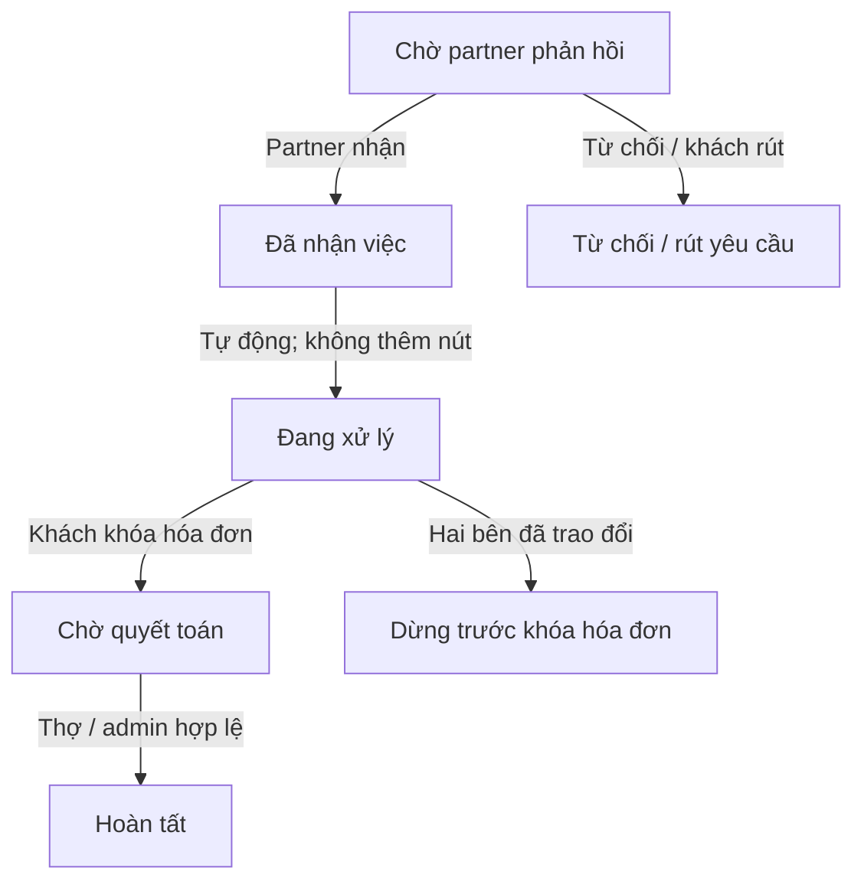
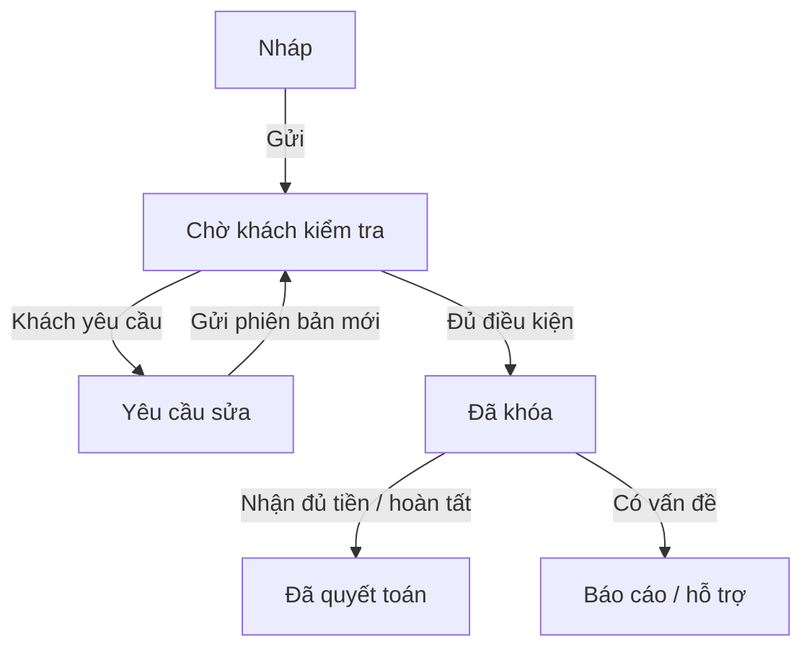
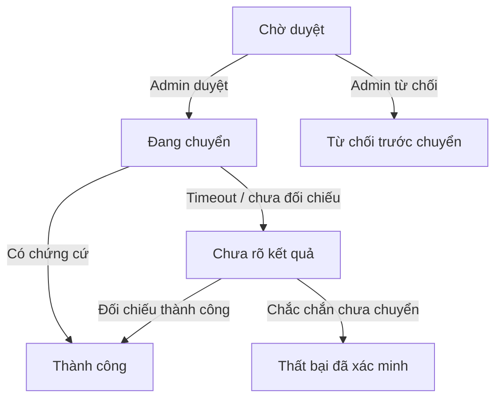
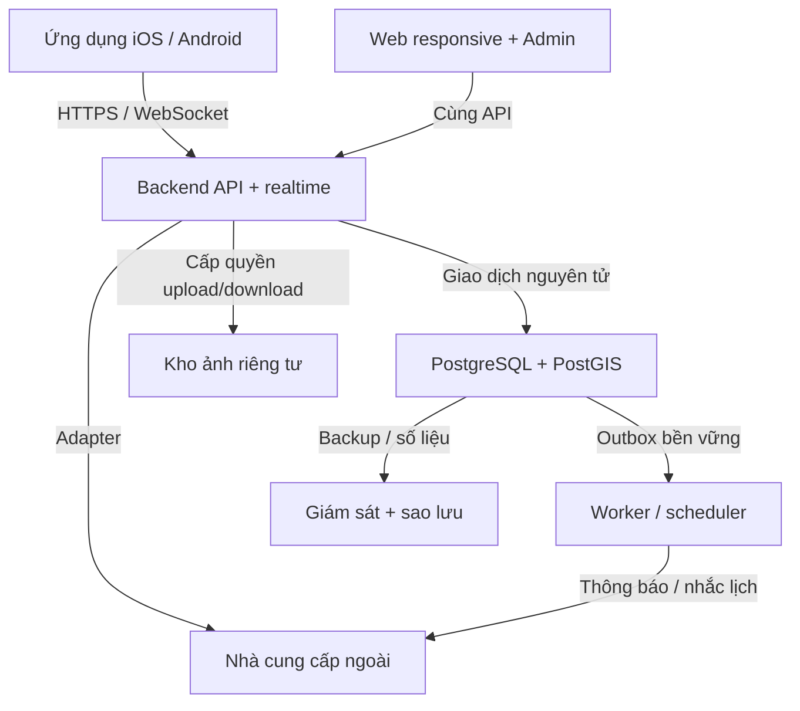
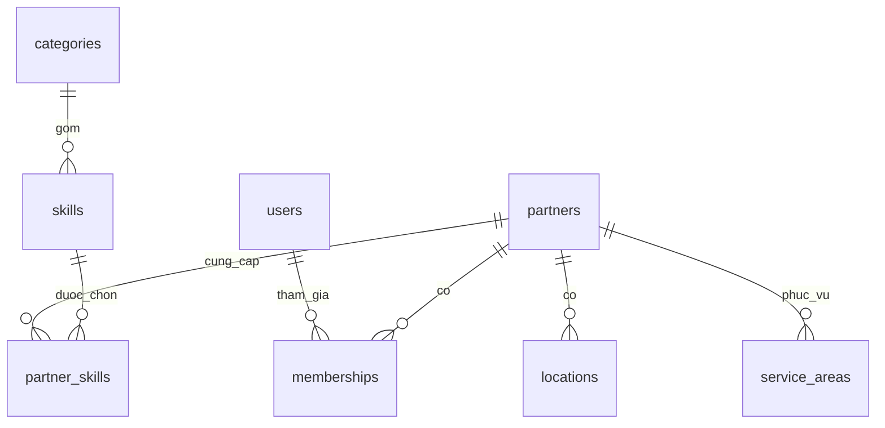
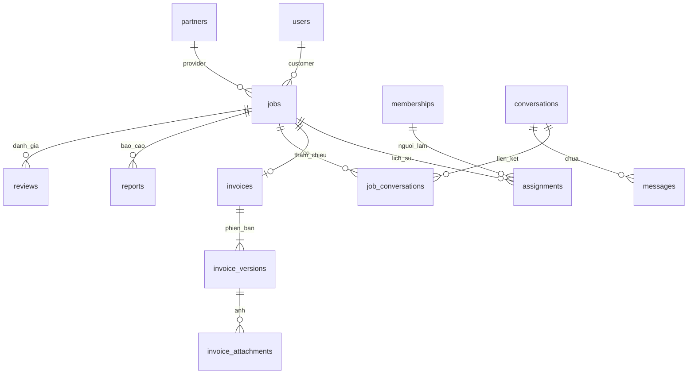
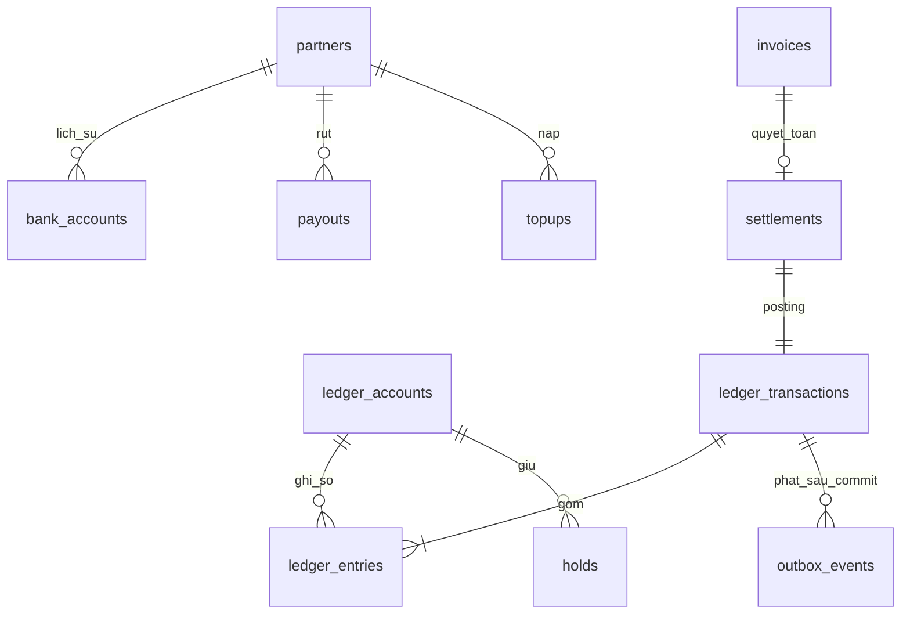

# Thiết kế hệ thống — bản review v0.1, cập nhật quyết định 22/09/2026

# Bản thiết kế để review

Kiến trúc v0.1 · 22/09/2026 · Dựa trên quyết định nghiệp vụ và wireframe v0.23. Chưa phải sản phẩm đã triển khai.

## Đọc theo thứ tự này

|Phần|Bạn sẽ hiểu|Trạng thái|
|---|---|---|
|01 · Trạng thái|Khi nào được nhận việc, sửa hóa đơn, thu phí, rút tiền|Quy tắc đã chốt + đề xuất kỹ thuật|
|02 · Phân quyền|Quản lý kiêm điều phối; nhân viên chỉ thao tác việc được giao|Bản ma trận để review|
|03 · Kiến trúc|Một backend chia module; app và web dùng chung API|Q03 đã chốt công nghệ; thiết kế chi tiết chờ review|
|04 · Dữ liệu|ERD chia cụm, khóa liên kết, lịch sử và tiền|Mô hình logic; chưa có migration|
|05 · Sequence|Bấm lặp, mất mạng, phân công và thanh toán|Thiết kế xử lý; chưa kiểm thử backend|
|06 · Quyết định|Q01–Q02 đã chốt; Q03 đã chốt; Q04 còn mở|Đã đồng bộ Q01/Q02 trong kiến trúc, SRS v0.14, FR/NFR v0.16 và UX v0.24|

Đã giữ nguyên: phí 10% tiền công; point dùng cho toàn hóa đơn; hạn mức âm 100.000đ chỉ trả phí; một ngân hàng nhận tiền/partner; không có nút Bắt đầu làm; không duyệt hóa đơn qua quản lý; chat trước thuê và dùng lại phòng riêng. Hủy/hoàn/đảo tài chính vẫn pending, ngoại trừ admin hoàn tất thay thợ từ báo cáo có chứng cứ.

Bộ này bổ sung D08–D12 ở mức thiết kế sơ bộ và mở danh sách tích hợp D13. Đã có OpenAPI và DDL tham chiếu v0.1; Đợt 1 ngày 28/09 đã triển khai migration/backend danh mục local; DOC-065 ghi bằng chứng và giới hạn. Các miền khác chưa triển khai. Chọn nhà cung cấp, dự toán, kế hoạch tải và kiểm thử bảo mật vẫn còn. Native SRS/FR/UX giữ nghiệp vụ đã chốt; Q03 được cập nhật, thiết kế chi tiết mới vẫn cần review.


---

# 01 · Trạng thái và điều kiện chuyển

Tách vòng đời công việc, hóa đơn và thanh toán. Không dùng một trạng thái “xong” cho tất cả.

## Yêu cầu thuê → công việc



“Đang xử lý” là trạng thái hệ thống sau nhận việc, không yêu cầu thợ bấm bắt đầu. Nếu dừng có tiền công: tiếp tục luồng hóa đơn trên cùng việc; sau khóa chỉ báo cáo, không tự hủy.

## Hóa đơn có phiên bản



Phiên bản đã gửi được giữ lịch sử; phiên bản thay thế không phải giao dịch mới. Sau khóa không sửa công, vật tư, point. Dấu “khách báo đã trả” lưu riêng, không tự quyết toán.

## Rút tiền và kết quả chưa rõ



Không suy ra thất bại từ timeout. Chỉ admin đối chiếu mới kết luận; một tài khoản ngân hàng nhận tiền đang hiệu lực, chặn thay khi còn yêu cầu rút chưa kết thúc.

## Các vòng đời còn lại

|Đối tượng|Trạng thái / chuyển|Điều kiện và tác động|
|---|---|---|
|Nạp tiền|Chờ đối chiếu → Đã ghi có / Từ chối|Admin đối chiếu sao kê/mã giao dịch; ảnh chuyển khoản đơn lẻ chưa đủ. Mã ngân hàng duy nhất chống ghi có hai lần.|
|Giữ phí / point|ACTIVE → CONSUMED|Tạo lúc khóa, dùng lúc quyết toán. Không tự giải phóng vì chờ lâu. Nhánh giải phóng hóa đơn đã khóa vẫn pending.|
|Giữ rút tiền|ACTIVE → CONSUMED / RELEASED|Chỉ kết quả xác minh; không đụng các khoản giữ công việc khác.|
|Xác minh partner|UNVERIFIED → PENDING → VERIFIED / REJECTED|Độc lập với duyệt hiển thị, bật nhận việc và đình chỉ. Chưa xác minh phải có nhãn. Chính sách sau xác minh thất bại cần đối chiếu SRS trước API.|
|Nhận việc|ON ↔ OFF|OFF ẩn tìm kiếm và chặn yêu cầu mới; việc cũ và chat còn. Không hiển thị huy hiệu đang nhận việc nếu không cần.|
|Partner bị đình chỉ|ACTIVE → SUSPENDED → ACTIVE|Chặn việc mới; quyền xử lý việc cũ theo phạm vi đình chỉ, không tự cắt đường xử lý hóa đơn đã khóa. Khóa tài khoản riêng có thể cần admin hỗ trợ.|
|Ngân hàng|Chờ xác minh → Hợp lệ / Từ chối; thay thế có lịch sử|Chỉ một tài khoản được dùng rút; số lưu mã hóa, giao diện che số.|
|Báo cáo|Mở → Đang xem / Chờ chứng cứ → Đã giải quyết → Đóng|Kết luận và đóng không tạo bút toán. Admin hoàn tất thay thợ là hành động tài chính riêng có điều kiện.|
|Đánh giá|Hiển thị ↔ Ẩn; lưu lý do và người kiểm duyệt|Điểm trung bình chỉ tính hiển thị. Chỉ mở khi khách đã báo thanh toán, thợ đã xác nhận nhận tiền và quyết toán thành công; xác nhận hóa đơn chưa đủ.|
|Phòng chat|Tồn tại theo cặp người; công việc là tham chiếu|Không kết thúc theo đơn. Đổi người giao chỉ đổi quyền việc, không chuyển lịch sử chat.|

## Guard: kiểm tra trước khi đổi trạng thái

|Hành động|Tác nhân|Điều kiện bắt buộc|Nếu không đạt|
|---|---|---|---|
|Nhận yêu cầu|Partner độc lập / người có jobs.accept|Yêu cầu pending; đúng partner; hoạt động; kỹ năng/địa điểm phù hợp; Làm ngay có ETA|409 trạng thái mới; không tạo thêm việc|
|Phân công / chuyển|Người có jobs.assign|Nhân viên thuộc đúng partner, membership active; việc chưa hoàn tất; kiểm phiên bản|409 tải lại; không thay phòng cũ|
|Đổi lịch|Khách / người có quyền việc|Đã trao đổi; trước khóa; thời gian tương lai; tăng schedule_version|Thông báo lỗi; giữ form|
|Gửi hóa đơn|Người thực hiện hiện tại|Đúng việc; ảnh đã tải xong; tiền nguyên không âm; phiên bản mới hợp lệ|Không gửi; giữ nháp|
|Khách xác nhận|Đúng khách của việc|Invoice version khớp, chưa yêu cầu sửa, point đủ, ví đủ phí, không khóa tài khoản|Không giữ một phần; khách không thấy số dư thợ|
|Thợ nhận tiền|Người thực hiện hiện tại|Hóa đơn khóa; công việc xong; đã nhận đủ trực tiếp hoặc cash=0|Không quyết toán|
|Admin hoàn tất|Admin tài chính + hồ sơ hỗ trợ|Báo cáo mở, chứng cứ, lý do, xác thực tăng cường, đúng version, chưa quyết toán|Từ chối; ghi audit|
|Rút tiền|Chủ / người có wallet.withdraw|Tài khoản hoạt động, ngân hàng hợp lệ, không lấy hạn mức âm, đủ tiền sau mọi hold|Không tạo hold hoặc yêu cầu dở dang|

Đề xuất kỹ thuật: đổi lịch trước khi hóa đơn khóa; nếu đã khóa thì cần báo cáo thay vì sửa lịch ngầm. Mốc nhắc 24h và 1h dùng Asia/Ho_Chi_Minh, lưu UTC; lịch mới vô hiệu hóa reminder phiên bản cũ; mốc đã qua không gửi bù. Việc nhận ngay trong tương lai gần chỉ có mốc còn phù hợp. Các chuyển bị cấm phải bị backend chặn, không chỉ ẩn nút.


---

# 02 · Quyền theo tài nguyên

Một quản lý có thể kiêm chủ, điều phối và tài chính. Đây là các quyền có thể gộp, không phải yêu cầu tuyển nhiều người.

## Ma trận quyền chính

|Thao tác|Khách|Thợ tự do|Chủ / quản lý được cấp quyền|Nhân viên được giao|Admin|
|---|---|---|---|---|---|
|Xem công việc|Của mình|Của mình|Của doanh nghiệp|Việc đang được giao|Qua nhiệm vụ hỗ trợ, có nhật ký|
|Nhận / từ chối thuê|Gửi / rút khi chờ|Có|jobs.accept|Không mặc định|Không nhận thay|
|Phân công nhân viên|Không|Không áp dụng|jobs.assign|Không mặc định|Không phân công thay|
|Đổi lịch|Việc của mình|Có|jobs.manage|Việc được giao|Không mặc định|
|Lập / gửi hóa đơn|Không|Có|Chỉ khi có quyền thực hiện việc|Có, không cần quản lý duyệt|Không tạo thay|
|Xác nhận hóa đơn / point|Đúng khách|Không ở vai thợ|Không|Không|Không xác nhận thay khách|
|Xác nhận nhận tiền|Chỉ báo đã trả|Có|Khi là người thực hiện|Có, người hiện tại|Chỉ nhánh báo cáo có chứng cứ|
|Xem ví / số dư partner|Không|Ví của mình|wallet.read|Không mặc định|finance.read khi cần|
|Nạp / rút / ngân hàng|Không ở vai khách|Ví của mình|wallet.topup / withdraw / bank.manage|Không mặc định|Duyệt/đối chiếu, không rút thay partner|
|Sửa năng lực / vùng / nhận việc|Không|Có|profile.manage|Không mặc định|Kiểm duyệt; không giả danh sửa|
|Xem chat riêng khách–thợ|Thành viên phòng|Thành viên phòng|Chỉ nếu chính mình là thành viên|Thành viên phòng|Không mặc định; chỉ chứng cứ được nộp|
|Gọi trong app|Theo việc đã nhận|Theo việc|Đầu mối doanh nghiệp được chỉ định|Người được giao hiện tại|Không nghe / tham gia cuộc gọi|
|Đánh giá bên kia|Một lượt/việc|Một lượt/việc|reviews.respond / reviews.write|Đề xuất đại diện partner nếu được cấp|Ẩn/khôi phục có lý do, không sửa sao|
|Đình chỉ / xét hồ sơ|Không|Không|Không|Không|moderation.manage|
|Nhật ký / báo cáo tổng|Lịch sử mình|Lịch sử mình|Trong doanh nghiệp theo quyền|Phần công việc được giao|audit.read / reports.read|
|Cấp quyền nhân viên|Không|Không|members.manage trong giới hạn mình được cấp|Không mặc định|Không tự trở thành thành viên doanh nghiệp|

Mặc định cửa hàng 1 quản lý + 2 thợ: quản lý có profile.manage, jobs.accept, jobs.assign, jobs.manage, members.manage và quyền ví; 2 thợ chỉ có quyền thực hiện việc được giao. Quản lý muốn tự làm việc thì tự phân công cho mình. Chủ có toàn quyền trong doanh nghiệp nhưng không có quyền đọc phòng riêng của người khác. Không ai tự nâng quyền vượt quyền cấp của mình.

Mỗi request kiểm tài khoản → membership hiện hành → quyền hành động → đúng tài nguyên/tenant → trạng thái/version. partner_id và user_id do server đối chiếu, không tin client. Chuyển chế độ khách/partner chỉ đổi giao diện; không cấp quyền. Một user có thể là khách và thành viên partner; point luôn thuộc user, ví doanh nghiệp thuộc partner, không thuộc nhân viên nhận tiền.

## Trường hợp cần kiểm thử quyền

|Tình huống|Kết quả bắt buộc|
|---|---|
|Nhân viên cũ gửi hóa đơn sau khi bàn giao|Bị từ chối dù tab cũ còn mở; chat riêng vẫn đọc/nhắn được khi tài khoản còn hoạt động|
|Quản lý đổi URL thành phòng khách–nhân viên|403; không trả metadata/nội dung riêng|
|Khách thiếu phí partner|Chỉ nhận thông báo chờ bổ sung; không có balance/debt/shortfall trong payload|
|Hai doanh nghiệp có cùng nhân viên|Mỗi việc kiểm đúng membership và partner; không rò dữ liệu giữa tenant|
|Người dùng có hai chế độ|Đề xuất chặn tự thuê/chốt với chính mình; quy tắc bên liên quan cần chốt trong chính sách chống gian lận trước tiền thật|
|Tài khoản nhân viên bị khóa|Không dùng token cũ để ghi nhận tiền; có thể chuyển người hoặc xử lý hỗ trợ theo chứng cứ|
|Admin xem chứng cứ|Ghi audit truy cập; link ảnh ngắn hạn; không đưa chứng cứ riêng vào thông báo chung|

Quy tắc mở đánh giá đã chốt: customer_payment_reported_at có giá trị VÀ worker_receipt_confirmed_at có giá trị VÀ settlement thành công. Thứ tự bấm có thể khác nhau; nếu thợ xác nhận trước thì chờ khách báo đã trả. Không dùng riêng invoice LOCKED hoặc job COMPLETED làm điều kiện. Admin hoàn tất thay thợ không tự giả lập dấu xác nhận của thợ và không tự mở đánh giá khi thiếu điều kiện.

Trường hợp thanh toán toàn bộ bằng point: không yêu cầu trả thêm tiền. Đề xuất nhãn xác nhận phía khách là “Xác nhận đã thanh toán bằng point”, phía thợ là “Xác nhận hoàn tất”; lưu các dấu xác nhận tương ứng, không tạo thêm giao dịch tài chính. Nhãn riêng này vẫn là đề xuất; wireframe v0.24 đã đồng bộ điều kiện hai dấu xác nhận, giữ nhãn chung Tôi đã thanh toán.


---

# 03 · Kiến trúc tổng thể

Đề xuất: TypeScript, một backend chia module và một cơ sở dữ liệu giao dịch. Tách tiến trình nền khi cần; chưa chia microservice.

## Các thành phần và đường kết nối



API là nguồn sự thật. Push/WebSocket chỉ báo thay đổi; client đọc lại trạng thái. Media cuộc gọi đi qua nhà cung cấp WebRTC, không chạy xuyên API giao dịch.

## Ranh giới module trong cùng backend

|Module|Sở hữu dữ liệu|Trách nhiệm|
|---|---|---|
|Identity & Access|users, identities, sessions, memberships|Đăng nhập, quyền, khóa tài khoản, xác thực tăng cường|
|Partners & Catalog|partners, locations, skills, service areas|Hồ sơ đa ngành, xác minh, tìm theo khoảng cách và vùng phục vụ|
|Jobs|jobs, assignments, schedule_history|Nhận việc, lịch hẹn, phân công|
|Messaging & Calls|conversations, messages, call_sessions|Phòng riêng dùng lại; quyền gọi; đồng bộ lịch sử|
|Billing|invoices, versions, photos|Số tiền đã chốt, ảnh, sửa trước khóa|
|Ledger & Wallet|accounts, entries, holds, payouts, topups|Giữ, quyết toán, đối soát; module khác không sửa trực tiếp số dư|
|Support & Moderation|cases, evidence, reviews|Xét chứng cứ, ẩn đánh giá, thao tác admin theo quyền|
|Notifications & Audit|outbox, notifications, audit_events|Gửi sau commit, nhắc lịch, nhật ký và truy vết|

## ADR — quyết định kiến trúc đề xuất

|Mã|Chọn|Lý do / giới hạn|
|---|---|---|
|ADR-01|Modular monolith + PostgreSQL|Ít thành phần cho một người; dễ giữ hóa đơn/point/phí trong một transaction. Cần kỷ luật ranh giới module; tách dịch vụ khi có nhu cầu đo được.|
|ADR-02|Expo / React Native cho mobile; web dùng chung API/types|Phù hợp Android+iOS; bố cục web riêng khi cần. Không cam kết mọi component dùng lại được; SDK gọi/bản đồ cần thử trên thiết bị thật.|
|ADR-03|NestJS / TypeScript backend; React admin|Một ngôn ngữ chính; module và guard rõ. Đây là lựa chọn đề xuất, chưa khóa phiên bản/dependency.|
|ADR-04|PostGIS cho vị trí; tìm trong DB trước|Geography tính mét; bán kính 10.000m, lọc vùng phục vụ theo chế độ đến nhà/cửa hàng; chỉ mục GiST. Không suy khoảng cách điểm neo là vị trí GPS trực tiếp của thợ.|
|ADR-05|DB outbox + worker; chưa cần Redis/Kafka|Commit nghiệp vụ và outbox cùng transaction. Worker lease/retry; unique event chống tin tự động trùng. Redis có thể thêm cho scale realtime sau.|
|ADR-06|Sổ append-only + holds; không UPDATE số dư tùy ý|Số dư có thể lưu projection để khóa nhanh, luôn đối soát lại từ entries. Cần test cạnh tranh/khôi phục trước tiền thật.|
|ADR-07|Tích hợp ngoài qua adapter|OTP, map, push, calls, bank thay nhà cung cấp được. Chưa chọn nhà cung cấp/hợp đồng/giá.|
|ADR-08|Dev / staging / production tách biệt|Không dùng dữ liệu và khóa production ở test. Quản lý secrets; migration có review; rollback app tương thích schema.|

## Tích hợp và triển khai tối thiểu

|Mảng|Thiết kế / phương án|Điều chưa chốt|
|---|---|---|
|Đăng nhập|Dịch vụ auth quản lý hoặc module auth với điện thoại/email; MFA admin, phiên có thu hồi|Nhà cung cấp SMS Việt Nam, chi phí, anti-abuse; không tự gắn tài khoản vì email trùng|
|Bản đồ|Geocoding + hiển thị map, PostGIS quyết định lọc|Độ phủ địa chỉ Hà Nội, quyền lưu tọa độ, giá và quota|
|Gọi trong app|WebRTC managed; API cấp token ngắn hạn sau kiểm quyền công việc|SDK iOS/Android, nhận cuộc gọi khi nền/khóa máy, push cuộc gọi; chưa ghi âm|
|Chat / push|Lưu message trong DB trước ACK; cursor đồng bộ khi kết nối lại|Push không đảm bảo đến; tắt nhận push/call theo cài đặt, không mất lịch sử chat|
|Nạp/rút|Admin đối chiếu ngân hàng; adapter API sẵn để tự động sau|Chưa cam kết ngân hàng/API cụ thể; cần kế hoạch nguồn tiền bù point|
|Ảnh|Object storage private; upload có kích thước/MIME allowlist, quét file|Đề xuất JPEG/PNG/WebP tối đa 10MB/file, 10 ảnh/lần; cần chốt trước API|
|Hạ tầng|Một API + một worker cùng repo; DB managed hỗ trợ PostGIS; kho ảnh; TLS|Chọn vùng đặt dữ liệu, ngân sách/tháng; chưa mua tài nguyên|
|Khôi phục|Đề xuất backup liên tục/PITR + kiểm restore trước mở|Đề xuất RPO 15 phút / RTO 4 giờ, chưa phải SLA cam kết; xác minh gói DB hỗ trợ|
|Giám sát|Lỗi API, outbox trễ, hold lâu, chênh sổ, chuyển tiền chưa rõ|Sự cố tiền ưu tiên cảnh báo; hỗ trợ người dùng 08–22h giờ Việt Nam|

Chưa áp mục tiêu 10.000 người đồng thời. Trước launch đo p95 và tải theo kịch bản chốt sau; không tự gán con số hiệu năng đã cam kết. Retention chứng cứ/chat/nhật ký và chính sách xóa cần chốt trước production, không xóa dây chuyền dữ liệu tài chính khi user yêu cầu xóa tài khoản.

Cơ sở kỹ thuật đã đối chiếu ngày 22/09/2026: Expo hỗ trợ Android/iOS/web; NestJS tổ chức module; PostGIS ST_DWithin geography dùng mét; PostgreSQL hỗ trợ khóa hàng và ràng buộc unique. Đề xuất chọn stack là đánh giá cho dự án, không phải kết luận từ nhà cung cấp.

## Mở rộng, triển khai và kiểm thử — phương án đề xuất

|Mục tiêu|Cách tổ chức cho dự án|Giới hạn cần hiểu|
|---|---|---|
|Mở rộng ngành / chức năng|Danh mục và kỹ năng là dữ liệu; modules jobs, chat, billing, ledger có ranh giới. Thêm ngành không cần dựng app mới.|Không hứa mở rộng vô hạn; ngành mới có quy trình khác vẫn cần thêm validation/luồng.|
|Mở rộng lưu lượng|API không lưu phiên/trạng thái quan trọng trong RAM; dùng DB bền vững, pagination/index; tăng tài nguyên rồi thêm replicas khi đo được nhu cầu.|Nhiều instance realtime cần cơ chế pub/sub chung; worker cần lease/idempotency; DB có thể là nút thắt.|
|Deploy backend / web|Build artifact cố định; backend/worker đóng Docker; web build riêng; cấu hình/secrets tách môi trường. Database có migration kiểm soát.|Cần pipeline, health check, backup và quy trình rollback tương thích schema; framework không tự làm hộ.|
|Build / phát hành mobile|Expo có EAS Build/Submit để hỗ trợ build và nộp app; giữ lựa chọn build local khi phù hợp.|iOS/Android vẫn có ký app, tài khoản store và quy trình xét duyệt; thay đổi native thường cần build lại.|
|Unit / integration test|Kiểm công thức, state guard, quyền bằng unit tests; tích hợp chạy PostgreSQL/PostGIS thật trong môi trường test tách biệt.|Mock DB không chứng minh row lock, unique constraint hoặc race condition.|
|Kiểm thử giao diện|Test component cho app/web; E2E cho thuê, hóa đơn, ví, phân công. Thiết bị thật kiểm push, gọi, quyền vị trí và app chạy nền.|Không thể dựa vào test JavaScript để kết luận phần native iOS/Android hoạt động.|
|Dùng chung code|Một repo đề xuất có mobile, web, api và packages cho API types/client, validation chung, design tokens.|React web và React Native không dùng nguyên xi mọi giao diện; bí mật và nghiệp vụ tài chính vẫn ở server.|
|Chưa có ngân sách|Tiếp tục đặc tả API/DB và thử tích hợp bằng sandbox/local; chỉ chọn gói trả phí sau khi có dự toán.|Không cam kết production miễn phí; OTP, gọi, ảnh, backup và ngân hàng còn chi phí theo sử dụng.|

Pipeline đề xuất: thay đổi mã → lint/typecheck → unit test → integration với DB test → build web/API/app → deploy staging → smoke/E2E → duyệt phát hành production. Với app, thêm build/ký/nộp store và kiểm thiết bị; với migration, kiểm tương thích trước khi deploy. Đây là kế hoạch, chưa tạo CI hoặc triển khai hạ tầng.


## Nguồn kỹ thuật

- [Expo core concepts](https://docs.expo.dev/core-concepts/): hỗ trợ Android, iOS và web.
- [NestJS modules](https://docs.nestjs.com/modules): tổ chức backend theo module.
- [PostGIS ST_DWithin](https://postgis.net/docs/ST_DWithin.html): geography với khoảng cách mét.
- [PostgreSQL row locking](https://www.postgresql.org/docs/current/explicit-locking.html): khóa hàng trong transaction.
- [PostgreSQL constraints](https://www.postgresql.org/docs/current/ddl-constraints.html): khóa ngoại và unique.

Đối chiếu 22/09/2026; lựa chọn kiến trúc là đề xuất riêng cho dự án.

Nguồn bổ sung về build/deploy/test (22/09/2026):
- [NestJS deployment](https://docs.nestjs.com/deployment)
- [NestJS testing](https://docs.nestjs.com/fundamentals/testing)
- [Expo EAS Build](https://docs.expo.dev/build/introduction/)
- [Expo unit testing](https://docs.expo.dev/develop/unit-testing/)
- [React Native testing](https://reactnative.dev/docs/testing-overview)


---

# 04 · ERD và dữ liệu

Mô hình logic mở rộng đa ngành. UUID cho khóa; tiền/point nguyên; UTC khi lưu, giờ Việt Nam khi hiển thị.

## ERD 1 · Người, doanh nghiệp và năng lực



Partner là bên cung cấp và sở hữu ví; membership là người làm thay partner. Mỗi user–partner một membership, có lịch sử quyền. Kỹ năng là bảng nối N–N, không tạo cột riêng cho mỗi ngành.

## ERD 2 · Việc, chat và hóa đơn



Mỗi việc có một hồ sơ hóa đơn và nhiều phiên bản. Phòng chat không thuộc vòng đời việc. Cặp user được sắp thứ tự trước unique; không tạo phòng mới khi thuê lại.

## ERD 3 · Tiền, point và đối soát



Sổ chỉ thêm, không sửa lịch sử. Holds giảm khả dụng nhưng chưa là phí đã thu. UNIQUE settlement(invoice_id) chống admin và thợ quyết toán trùng.

## Từ điển dữ liệu cốt lõi

|Bảng / nhóm|Trường quan trọng|Ràng buộc / lịch sử|
|---|---|---|
|users / identities / sessions|id; display_name; status; verified contact; provider_subject; revoked_at|UNIQUE(provider, subject); số điện thoại chuẩn E.164; email normalize; không lưu mật khẩu thô/OTP thô|
|partners / memberships|kind; verification_status; accepting_jobs; suspension_scope; user_id; grants|UNIQUE(user_id, partner_id); một owner hiệu lực đề xuất; quyền có lịch sử; bank và wallet theo partner|
|categories / skills / partner_skills|stable code; parent_id; translations; form_schema_version; skill_id|UNIQUE(partner_id, skill_id); ẩn thay vì xóa kỹ năng đã dùng; nhóm dịch vụ có thể thêm mà không đổi bảng việc|
|locations / service_areas|geography Point SRID4326; polygon/radius; service_mode|Chỉ mục GiST; điểm công khai phân biệt địa chỉ riêng; không lộ GPS thợ từ vùng phục vụ|
|jobs / job_skills|customer_id; partner_id; mode; scheduled_at; address_snapshot; state; version|FK; thời gian UTC; skill snapshot; JSONB ngành có schema version, không chứa trường tiền lõi|
|assignments / schedule_history|membership_id; effective_from/to; assigned_by; old/new schedule; reason|Một assignment active/việc bằng partial unique; bàn giao giữ lịch sử; schedule_version tăng|
|conversations / messages|pair_low/high; message_id; sender_id; client_message_id; sequence; job_ref|UNIQUE(pair_low,pair_high); UNIQUE(sender_id,client_message_id); participant ACL; tin hệ thống unique(event_key)|
|invoices / invoice_versions|job_id; current_version_id; locked_version_id; labor; materials; status; author|UNIQUE(job_id); UNIQUE(invoice_id,version_no); số nguyên >=0; version đã gửi bất biến|
|invoice_confirmation / settlements|invoice_id; version_id; point_used; fee; reward; cash; rule_version; actor|Một confirmation/settlement mỗi invoice; snapshot công thức; server tính lại, không nhận fee/reward từ client|
|attachments / evidence|object_key; uploader_id; mime; size; status; purpose; parent_ref|Không URL công khai; quét/xác minh trước attach; không cascade xóa ảnh hóa đơn lịch sử|
|ledger_accounts / entries / holds|owner_user hoặc owner_partner; unit; balance_projection; txn_key; amount|XOR owner hoặc tài khoản platform; ledger signed BIGINT/numeric nguyên; currency riêng; hold >=0|
|bank_accounts / topups / payouts|encrypted number; last4; status; provider_ref; bank_snapshot; payout_key|Một bank effective/partner; UNIQUE(provider,bank_txn_id); không dùng cùng chứng cứ ghi có nhiều lần|
|reviews|job_id; author; subject; stars; status; moderation_reason|Stars 1..5; UNIQUE(job_id,direction); chỉ hiển thị tính trung bình; Q01 đã chốt: khách báo đã trả + thợ xác nhận nhận tiền + quyết toán thành công|
|reports / admin_actions|job/version refs; reporter; evidence; case_status; action_type; reason|Xác nhận thay thợ gắn case và version; đóng case không gọi ledger|
|outbox / audit / notification_settings|event_id; aggregate/version; attempts; next_attempt; actor; correlation_id|Event unique; audit không sửa qua app; log không chứa OTP, token, nội dung chat; message/call opt-out riêng|

## Công thức và bất biến tài chính

|Ký hiệu / quy tắc|Thiết kế|
|---|---|
|L, M, T|Tiền công L, vật tư M; T=L+M. VND nguyên; không giới hạn nghiệp vụ giá trị hóa đơn, nhưng kiểm giới hạn lưu trữ số để không overflow.|
|F / R / C|F=floor(L/10); R là point khách chọn, mặc định 0; 0≤R≤T và point khả dụng; C=T−R trả trực tiếp.|
|Q thưởng|Q=floor(L×(T−R)/(50×T)) khi T>0; T=0 thì Q=0. Đây là công thức bản mẫu hiện tại, không tự đổi thành 2% tổng hóa đơn. Snapshot rule_version.|
|Khả dụng phí|B−Hf−Hw−F ≥ −100.000, với B số dư đã ghi sổ, Hf tổng phí giữ, Hw tổng rút giữ. Không tính R đang chờ bù là tiền có sẵn.|
|Có thể rút|max(0,B−Hf−Hw); không cộng 100.000. Khóa cùng account row khi tạo hold.|
|Point khả dụng|P−Hp; không dùng point thưởng dự kiến. Hai hóa đơn đồng thời phải khóa cùng tài khoản point.|
|Lúc xác nhận|Một transaction: khóa việc/version + hai account; kiểm tất cả; giữ F và R; ghi confirmation, trạng thái, outbox. Lỗi thì rollback toàn bộ.|
|Lúc hoàn tất|Một transaction: consume holds; partner B := B + R − F; customer P := P − R + Q; ghi settlement, entries, audit, outbox.|
|Sổ cân bằng theo đơn vị|VND: partner +R−F, platform fee +F, platform redemption −R. POINT: customer −R+Q, platform redemption +R, reward issuance −Q. Mỗi unit tổng delta=0; là sổ vận hành, chưa phải chuẩn ghi nhận doanh thu kế toán.|
|Nạp / rút|Nạp: partner +A, bank-clearing −A. Rút thành công: partner −A, bank-clearing +A; bút toán rút và consume hold cùng transaction. Không tự ghi nhận khách trả tiền ngoài app vào số dư platform.|
|Báo cáo có vấn đề|Không tự giải phóng hold hoặc đảo bút toán. Admin chỉ có nhánh hoàn tất thay thợ đã duyệt; các ngoại lệ khác vẫn pending.|
|Đối soát|Balance projection = tổng entries; holds khớp invoice/payout active; mỗi invoice tối đa một settlement; kiểm khoản bù point và nguồn tiền ngân hàng mỗi ngày.|

Ví dụ kiểm tra thiết kế: L=100.000, M=50.000, R=50.000 → T=150.000, C=100.000, F=10.000, Q=1.333; ví partner tăng ròng 40.000; point khách giảm ròng 48.667. Dùng toàn point → C=0, Q=0; vẫn cần xác nhận hoàn tất. Cộng ví là nghĩa vụ chi trả, không chứng minh platform đã có tiền mặt: cần dự trữ/đối soát nguồn tiền trước tiền thật.

Dữ liệu riêng: số ngân hàng/chứng cứ/địa chỉ làm việc được hạn chế theo vai. Địa chỉ công khai cửa hàng riêng với địa chỉ khách. Không lưu bản ghi âm mặc định. Thời hạn lưu chat, ảnh, audit, tiền và cách xử lý yêu cầu xóa sẽ đặc tả sau khi chọn hạ tầng/chính sách; không mặc định lưu vô hạn hoặc cascade delete.


---

# 05 · Sequence kỹ thuật

Các mũi tên mô tả thiết kế dự kiến, chưa chứng minh backend đã xử lý được cạnh tranh hoặc tích hợp thật.

## Thuê và nhận việc

```mermaid
sequenceDiagram
  participant A0 as Khách / Partner
  participant A1 as API
  participant A2 as PostgreSQL
  participant A3 as Worker / Push
  A0->>A1: Gửi yêu cầu thuê + Idempotency-Key
  A1->>A2: Kiểm khách, kỹ năng, vùng, partner; INSERT job + outbox
  A2->>A1: COMMIT → job_id + version
  A1->>A0: Trả trạng thái chờ
  A3->>A2: Đọc outbox đã commit; gửi thông báo
  A0->>A1: Partner chấp nhận + expected_version; ETA nếu làm ngay
  A1->>A2: Lock job, kiểm quyền; update accepted; room/event unique
  A2->>A1: COMMIT; chỉ một lần nhận
  A1->>A0: Kết quả mới nhất
  Note over A0,A3: Request lặp cùng key/body trả kết quả cũ; key cũ/body khác bị từ chối.

```

Mất mạng sau commit: client tra trạng thái theo key rồi retry cùng key. Không tạo yêu cầu mới chỉ vì không nhận được response.

## Phân công và phòng chat riêng

```mermaid
sequenceDiagram
  participant A0 as Quản lý
  participant A1 as API
  participant A2 as PostgreSQL
  participant A3 as Khách / nhân viên
  A0->>A1: Phân công người mới + job_version
  A1->>A2: Lock job; kiểm membership và jobs.assign
  A1->>A2: Kết thúc assignment cũ; tạo assignment mới
  A1->>A2: Upsert conversation theo cặp khách–nhân viên
  A1->>A2: Liên kết việc + system message unique + outbox
  A2->>A1: COMMIT toàn bộ
  A1->>A3: Báo người phụ trách mới; room_id dùng lại
  Note over A0,A3: Client nhân viên cũ ghi tiếp → API kiểm assignment mới và từ chối.
  A3->>A1: Đọc lịch sử riêng nếu là participant

```

Quản lý chỉ thấy việc và trạng thái bàn giao. Không copy chat cũ sang phòng người mới. Nếu đã khóa hóa đơn, bàn giao không đổi invoice author/history và không đổi tài chính.

## Khóa hóa đơn và giữ số dư

```mermaid
sequenceDiagram
  participant A0 as Khách
  participant A1 as API / Billing
  participant A2 as DB + Ledger
  participant A3 as Partner
  A0->>A1: Confirm(version, points, key)
  A1->>A2: BEGIN; khóa job/invoice và accounts theo thứ tự cố định
  A1->>A2: Kiểm quyền, version, point, phí sau mọi hold
  Note over A0,A3: Thiếu một điều kiện → ROLLBACK; không giữ phí hoặc point riêng lẻ.
  A1->>A2: INSERT holds F/R; confirmation + invoice LOCKED + outbox
  A2->>A1: COMMIT
  A1->>A0: Tổng, point dùng, tiền trực tiếp; không có số dư partner
  A1->>A3: Thông báo hóa đơn khóa; thông tin ví riêng theo quyền
  Note over A0,A3: Mất response: retry cùng key / GET trạng thái, không trừ lần nữa.

```

Request sửa hóa đơn chạy cạnh tranh với confirm cũng khóa cùng invoice/version. Chỉ một bên thắng; bên còn lại nhận 409 và xem bản mới.

## Quyết toán một lần

```mermaid
sequenceDiagram
  participant A0 as Thợ / Admin
  participant A1 as API
  participant A2 as DB + Ledger
  participant A3 as Worker
  A0->>A1: Xác nhận nhận đủ / admin hoàn tất có case + lý do
  A1->>A2: BEGIN; khóa invoice, job, accounts; kiểm quyền mới nhất
  A1->>A2: Nếu settlement đã có → trả kết quả đã có
  Note over A0,A3: Chưa có: phải LOCKED, đúng hold/version; admin phải có chứng cứ và xác thực.
  A1->>A2: INSERT settlement UNIQUE(invoice_id); consume holds
  A1->>A2: Posting phí / bù point / thưởng; cập nhật projection
  A1->>A2: Mark invoice/job hoàn tất + audit + outbox
  A2->>A1: COMMIT nguyên tử
  A1->>A0: Kết quả quyết toán
  A3->>A2: Đọc outbox; gửi thông báo có retry/dedupe

```

Admin và thợ bấm cùng lúc: dùng cùng operation quyết toán; unique invoice là hàng rào cuối. Không gọi nhà cung cấp push trong transaction giữ khóa.

## Rút tiền và mất kết quả

```mermaid
sequenceDiagram
  participant A0 as Partner / Admin
  participant A1 as API + DB
  participant A2 as Ngân hàng
  participant A3 as Đối soát
  A0->>A1: Partner gửi rút + key
  A1->>A1: Lock wallet; kiểm tiền/bank; tạo payout + hold
  A0->>A1: Admin duyệt và đánh dấu đang chuyển
  A0->>A2: Chuyển theo mã payout; ban đầu thao tác ngân hàng thủ công
  Note over A0,A3: Không biết chuyển thành công hay chưa → UNKNOWN; giữ tiền, không chuyển lại.
  A3->>A2: Đọc sao kê / xác minh mã ngân hàng
  A3->>A1: Ghi kết quả với chứng cứ; bank_ref duy nhất
  A1->>A1: Thành công: posting + consume; thất bại chắc chắn: release
  A1->>A0: Kết quả và lịch sử

```

Tự động hóa sau này cần provider idempotency hoặc truy vấn mã lệnh trước retry. Nếu nhà cung cấp không hỗ trợ, giữ đường đối soát thủ công.

## Đổi lịch và chống nhắc lịch cũ

```mermaid
sequenceDiagram
  participant A0 as Khách / Thợ
  participant A1 as API
  participant A2 as DB
  participant A3 as Worker
  A0->>A1: Đổi lịch đã thống nhất + expected_version
  A1->>A2: Kiểm thời gian/quyền; tăng schedule_version; lưu lịch sử
  A1->>A2: Outbox thông báo đổi lịch + mốc 24h/1h còn tương lai
  A2->>A1: COMMIT; không chờ bên kia xác nhận
  A3->>A2: Đến hạn: kiểm version hiện tại và job còn phù hợp
  Note over A0,A3: Version cũ hoặc việc đã đóng → bỏ reminder.
  A3->>A0: Gửi một reminder mỗi job/version/mốc

```

Worker chạy lại không gửi một sự kiện nghiệp vụ hai lần. Push có thể trùng/không đến ở nhà cung cấp; app dedupe notification_id và luôn đọc dữ liệu mới.

## Khung API để đặc tả tiếp

|Nhóm|Lệnh / đọc|Hợp đồng bắt buộc|
|---|---|---|
|Search / hồ sơ|GET /partners?location&radius=10000&skill&mode|Filter area + visibility; cursor; DTO công khai/đăng nhập riêng|
|Thuê / nhận|POST /jobs; POST /jobs/{id}/accept|Idempotency-Key + expected_version cho update; actor lấy từ session|
|Phân công / lịch|POST /jobs/{id}/assignments; POST /jobs/{id}/reschedule|Kiểm tenant/membership; lock/version; ghi lịch sử|
|Hóa đơn|POST /jobs/{id}/invoice-versions; POST /invoices/{id}/revision-requests|Ảnh hợp lệ; không UPDATE version đã gửi|
|Khóa / đã trả / nhận|POST /invoices/{id}/confirm; /payment-reported; /settle|Tiền là chuỗi số nguyên ở JSON để tránh mất chính xác; server tính; không settlement qua GET|
|Admin|POST /reports/{id}/complete-on-behalf|Fresh admin auth, reason, evidence refs, version; cùng hàm settle|
|Ví|POST /topups; /payouts; /payouts/{id}/decision|Idempotency + proof + state guards; bank snapshot|
|Chat / gọi|POST /conversations/direct; /messages; /calls/token|Participant/assignment check; client_message_id; token ngắn hạn|
|Lỗi / retry|401/403; 409 VERSION_CONFLICT; 422 INVALID; 429; 500 INTERNAL; 503 SERVICE_UNAVAILABLE|Lỗi có code, correlation_id, retryable; không lộ dữ liệu; mạng lỗi tra key trước retry|

Idempotency phải lưu trong DB với actor + operation + key + request_hash + result/resource_id. Unique bảo vệ cả request đang cạnh tranh; retry cùng payload trả trạng thái đã commit, khác payload báo conflict. Key vận chuyển không thay ràng buộc nghiệp vụ invoice/bank_ref. Retry deadlock chỉ giới hạn số lần, cùng key, và phải chạy lại toàn transaction.


---

# 06 · Quyết định và phần còn mở

Cập nhật 22/09/2026: Q01 và Q02 đã chốt; Q03 đã chốt công nghệ; Q04 chưa có ngân sách.

## Sổ quyết định sau phản hồi

|Mã / trạng thái|Nội dung|Tác động / phần còn mở|
|---|---|---|
|Q01 · Đã chốt|Khách báo đã trả và thợ xác nhận đã nhận tiền; quyết toán thành công mới mở đánh giá hai chiều|Chủ dự án xác nhận ngày 22/09/2026. Khóa hóa đơn chưa đủ. Cần kiểm cả hai dấu xác nhận, không chỉ trạng thái job hoàn tất.|
|Q02 · Đã chốt phạm vi|Tạm hoãn xử lý khoản giữ bị treo trong đợt hiện tại; bắt buộc thiết kế và kiểm chứng cách xử lý qua báo cáo/admin trước khi chạy tiền thật|Nếu việc không hoàn tất hoặc hai bên tranh chấp sau khóa, quyền hoàn tất thay thợ không giải quyết được. Cần chốt nhánh giải phóng có kiểm soát ở một đợt sau trước launch có tiền, hoặc chưa mở giao dịch thật. Không tự đưa hoàn tiền trở lại scope.|
|Q03 · Đã chốt|Expo/React Native + web React + NestJS + PostgreSQL/PostGIS, backend chia module|Chủ dự án đã đồng ý bộ công nghệ. Có bộ kỹ thuật v0.1 để review. Next.js/ORM/nhà cung cấp vẫn chưa chốt; chưa mua hạ tầng.|
|Q04 · Chưa có ngân sách|Chủ dự án chưa xác định ngân sách vận hành; chưa chọn gói trả phí hoặc nhà cung cấp|Chưa thể chọn nhà cung cấp hay dự toán đáng tin khi thiếu ngân sách/quy mô cuộc gọi. Có thể tiếp tục API độc lập nhà cung cấp trong khi chờ.|

## Kết quả rà soát thiết kế — không phải test sản phẩm

|Kịch bản|Thiết kế đã có|Còn cần kiểm chứng|
|---|---|---|
|Bấm xác nhận hai lần|Idempotency + row lock + unique confirmation|Test DB concurrency khi có backend|
|Hai việc dùng cùng point|Lock cùng point account, trừ tổng holds|Test song song đủ/thiếu tiền|
|Thợ và admin cùng quyết toán|Một service settle, unique invoice|Test cạnh tranh + crash ở mỗi bước|
|Nhân viên bị thay|Backend kiểm assignment mới; giữ phòng riêng|Test quyền nhiều tenant / thiết bị phiên cũ|
|Rút rồi mất mạng|UNKNOWN giữ tiền, mã ngân hàng unique|Thử nhà cung cấp thật + quy trình thao tác tay|
|Thông báo lỗi|Outbox retry, nghiệp vụ đã commit không rollback|Test mất worker/push, backlog, reconnect|
|Đổi lịch nhiều lần|Schedule version và reminder unique|Test timezone/mốc qua/worker cũ|
|Giao dịch khóa không thể hoàn tất|Đã chỉ rõ khoảng trống Q02|Không thể khẳng định toàn bộ ngoại lệ đã trơn tru|
|Nhập số tiền rất lớn|Số nguyên chính xác, kiểm overflow, không cap nghiệp vụ|Test BIGINT/numeric và client không dùng float cho công thức|

Đã có baseline BRD/PRD/FR-NFR/SRS/UX, các luồng và wireframe. Q03 đã chốt: Expo/React Native, React, NestJS, PostgreSQL/PostGIS. Đã soạn thiết kế kỹ thuật v0.1 gồm ERD vật lý/DDL tham chiếu, OpenAPI/realtime, kế hoạch QA/RTM/UAT và backlog; thiết kế ngoài Đợt 1 vẫn chờ review; backend danh mục local đã triển khai 28/09 theo DOC-065, chưa native/remote CI/production. Còn Design System/đặc tả field, runbook CI/CD/backup, runbook Q02 và tích hợp/dự toán. Q04 chưa có ngân sách; không tự chọn gói trả phí.


### Quy tắc hiện hành 23/09 — công việc

Đã chốt 23/09/2026: chặn thuê chính mình hoặc doanh nghiệp đang là thành viên. Đổi lịch chỉ để thay đổi ngày/giờ hẹn sau khi hai bên trao đổi, không bắt buộc vì công việc kéo dài. Công việc đã nhận không tự hết hạn, tự hủy hoặc tự hoàn tất theo thời gian; có thể kéo dài nhiều ngày. Luồng hoàn tất bình thường cần khách báo đã trả và thợ xác nhận đã nhận; xác nhận hóa đơn riêng chưa kết thúc công việc. Giữ quy tắc quyết toán một lần và ngoại lệ admin đã chốt. Không tạo luồng đổi lịch qua báo cáo/admin. Sau xác nhận hóa đơn không còn hành động đổi lịch; hỗ trợ/bảo hành vẫn trao đổi trong chat.


LOGTEST-01 · 28/09/2026: request ID/header và lỗi500/503 đã triển khai cho API danh mục/health local. Xem [DOC-071](../implementation/logging-testing.md). Chưa native/remoteCI/production.


## P0-1 — Nguồn cung và tìm dịch vụ

P0-1 đã duyệt 06/10/2026: tài khoản có điện thoại xác minh tạo hồ sơ draft, owner và ví 0 cùng giao dịch. Công bố cần tên, kỹ năng active và nơi phục vụ cho mọi mode; ảnh chưa bắt buộc trong gói này. Công bố không tự bật nhận việc. Chuyển draft tắt nhận việc; sửa published mất điều kiện bị từ chối. Chủ/profile.manage dùng management riêng, shared version và key retry kiểm lại quyền. Public không lộ địa chỉ riêng/giấy tờ/ví; liên hệ cần đăng nhập. Tìm sort=distance dùng shop công khai hoặc tâm vùng tròn với cả điều kiện phủ khách và bán kính; mỗi hồ sơ một kết quả, cursor gắn bộ lọc và distance/created_at/id. OTP, bản đồ/GPS, polygon và ranking khác giữ Pending. DEMO local/test được phép tạo mới riêng, không sửa tài khoản có sẵn hoặc nạp tiền. Chuẩn chi tiết: technical-design v0.1.6, openapi.json và schema.sql.

Phần này ưu tiên cho gói P0-1 nếu mô tả cũ khác; các luồng công việc/tài chính đầy đủ giữ nguyên và không được coi đã triển khai.

## MAP-01 — 07/10/2026

MAP-01: bộ chọn địa điểm thử local với MapLibre + Geoapify Free, theo yêu cầu triển khai sau kế hoạch MAP-01. Chưa bật billing hoặc production.

Người dùng có thể nhập địa chỉ, chọn một gợi ý, chạm/kéo bản đồ, dùng GPS một lần khi bấm nút hoặc chọn địa chỉ của chính mình đã lưu. Bộ chọn dùng ở tìm dịch vụ, sổ địa chỉ, cửa hàng và tâm vùng phục vụ. Người dùng luôn xác nhận ghim; không tự lấy kết quả đầu tiên. Gõ truy vấn mới bỏ lựa chọn cũ; sửa mô tả tầng/phòng giữ tọa độ; Hủy giữ nguyên form. Lỗi tra ngược vẫn giữ ghim để nhập mô tả. Đổi tài khoản xóa bản nháp riêng.

Ba API POST /v1/locations/autocomplete, /geocode và /reverse nhận JSON body. Locale vi/en/ja, query 3–300 ký tự, tối đa 5 kết quả. Tra ngược giữ tọa độ người dùng chọn. Khách chưa login có hạn mức IP, bearer hợp lệ có hạn mức tài khoản. 429 có Retry-After; provider timeout trả 504. Pilot một tiến trình có hạn mức tổng; bộ đếm reset khi restart và không bao gồm tile nên không là bảo đảm chặn chi phí.

Không đổi mô hình lưu: vẫn address.text + point, quyền/version/idempotency hiện hành. Không lưu lịch sử GPS hoặc provider ID. Source chỉ ở state app. Key tra cứu ở server, key tile công khai ở app; không log địa chỉ/tọa độ/key và không gửi token dự án tới provider. Hiển thị nguồn Geoapify và OpenStreetMap. Chỉ các điểm cửa hàng public được vẽ; không công khai tâm vùng làm vị trí thợ. Polygon, toàn bộ ghim kết quả, routing/ETA và tracking ngoài đợt. OpenAPI hiện hành v0.1.7; bằng chứng kiểm triển khai ở báo cáo B03-01 trong repo, không thay nghiệm thu UAT hoặc phê duyệt production.
