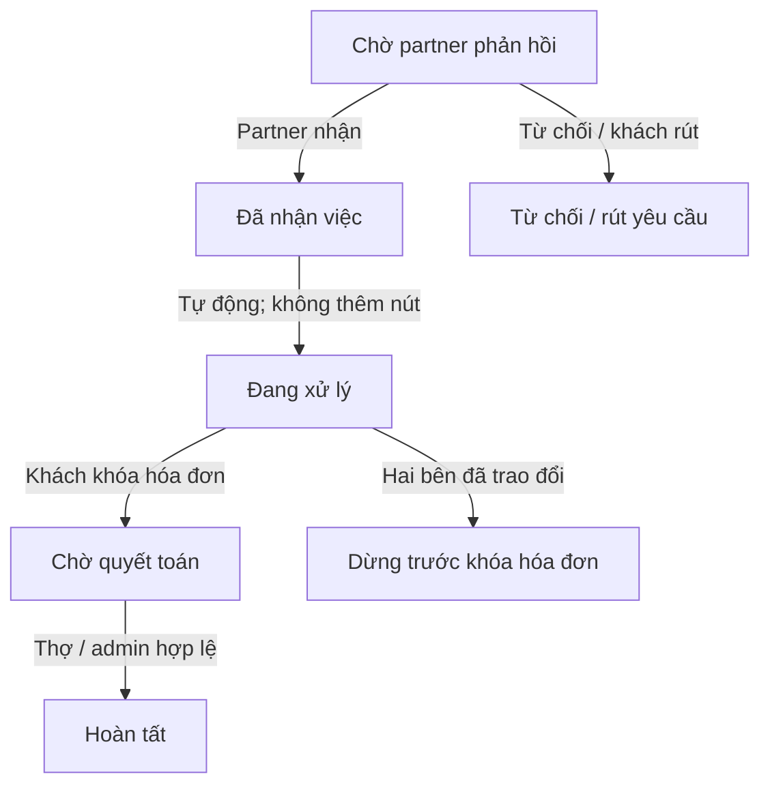
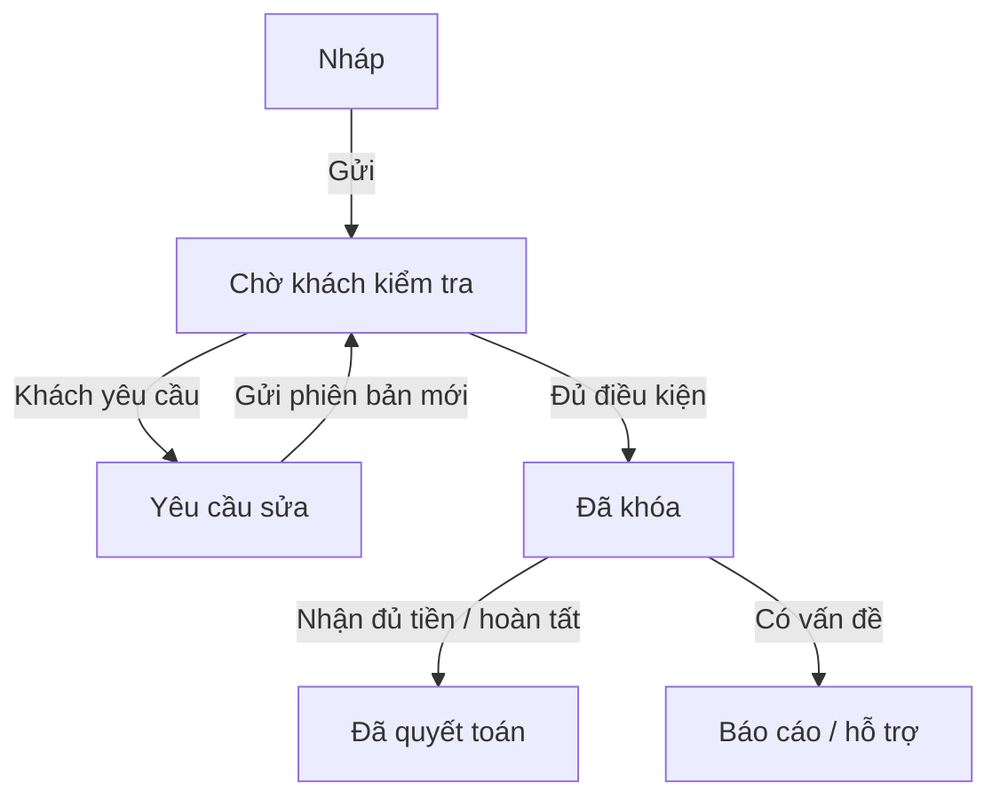
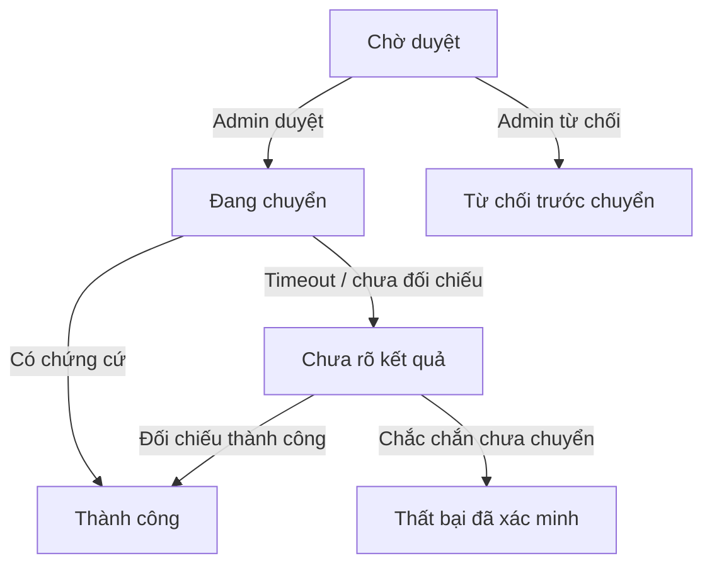

# 01 · Trạng thái và điều kiện chuyển

Tách vòng đời công việc, hóa đơn và thanh toán. Không dùng một trạng thái “xong” cho tất cả.

## Yêu cầu thuê → công việc

“Đang xử lý” là trạng thái hệ thống sau nhận việc, không yêu cầu thợ bấm bắt đầu. Nếu dừng có tiền công: tiếp tục luồng hóa đơn trên cùng việc; sau khóa chỉ báo cáo, không tự hủy.

## Hóa đơn có phiên bản

Phiên bản đã gửi được giữ lịch sử; phiên bản thay thế không phải giao dịch mới. Sau khóa không sửa công, vật tư, point. Dấu “khách báo đã trả” lưu riêng, không tự quyết toán.

## Rút tiền và kết quả chưa rõ

Không suy ra thất bại từ timeout. Chỉ admin đối chiếu mới kết luận; một tài khoản ngân hàng nhận tiền đang hiệu lực, chặn thay khi còn yêu cầu rút chưa kết thúc.

## Các vòng đời còn lại

|Đối tượng|Trạng thái / chuyển|Điều kiện và tác động|
|---|---|---|
|Nạp tiền|Chờ đối chiếu → Đã ghi có / Từ chối|Admin đối chiếu sao kê/mã giao dịch; ảnh chuyển khoản đơn lẻ chưa đủ. Mã ngân hàng duy nhất chống ghi có hai lần.|
|Giữ phí / point|ACTIVE → CONSUMED|Tạo lúc khóa, dùng lúc quyết toán. Không tự giải phóng vì chờ lâu. Nhánh giải phóng hóa đơn đã khóa vẫn pending.|
|Giữ rút tiền|ACTIVE → CONSUMED / RELEASED|Chỉ kết quả xác minh; không đụng các khoản giữ công việc khác.|
|Xác minh partner|UNVERIFIED → PENDING → VERIFIED / REJECTED|Độc lập với duyệt hiển thị, bật nhận việc và đình chỉ. Chưa xác minh phải có nhãn. Chính sách sau xác minh thất bại cần đối chiếu SRS trước API.|
|Nhận việc|ON ↔ OFF|OFF ẩn tìm kiếm và chặn yêu cầu mới; việc cũ và chat còn. Không hiển thị huy hiệu đang nhận việc nếu không cần.|
|Partner bị đình chỉ|ACTIVE → SUSPENDED → ACTIVE|Chặn việc mới; quyền xử lý việc cũ theo phạm vi đình chỉ, không tự cắt đường xử lý hóa đơn đã khóa. Khóa tài khoản riêng có thể cần admin hỗ trợ.|
|Ngân hàng|Chờ xác minh → Hợp lệ / Từ chối; thay thế có lịch sử|Chỉ một tài khoản được dùng rút; số lưu mã hóa, giao diện che số.|
|Báo cáo|Mở → Đang xem / Chờ chứng cứ → Đã giải quyết → Đóng|Kết luận và đóng không tạo bút toán. Admin hoàn tất thay thợ là hành động tài chính riêng có điều kiện.|
|Đánh giá|Hiển thị ↔ Ẩn; lưu lý do và người kiểm duyệt|Điểm trung bình chỉ tính hiển thị. Chỉ mở khi khách đã báo thanh toán, thợ đã xác nhận nhận tiền và quyết toán thành công; xác nhận hóa đơn chưa đủ.|
|Phòng chat|Tồn tại theo cặp người; công việc là tham chiếu|Không kết thúc theo đơn. Đổi người giao chỉ đổi quyền việc, không chuyển lịch sử chat.|

## Guard: kiểm tra trước khi đổi trạng thái

|Hành động|Tác nhân|Điều kiện bắt buộc|Nếu không đạt|
|---|---|---|---|
|Nhận yêu cầu|Partner độc lập / người có jobs.accept|Yêu cầu pending; đúng partner; hoạt động; kỹ năng/địa điểm phù hợp; Làm ngay có ETA|409 trạng thái mới; không tạo thêm việc|
|Phân công / chuyển|Người có jobs.assign|Nhân viên thuộc đúng partner, membership active; việc chưa hoàn tất; kiểm phiên bản|409 tải lại; không thay phòng cũ|
|Đổi lịch|Khách / người có quyền việc|Đã trao đổi; trước khóa; thời gian tương lai; tăng schedule_version|Thông báo lỗi; giữ form|
|Gửi hóa đơn|Người thực hiện hiện tại|Đúng việc; ảnh đã tải xong; tiền nguyên không âm; phiên bản mới hợp lệ|Không gửi; giữ nháp|
|Khách xác nhận|Đúng khách của việc|Invoice version khớp, chưa yêu cầu sửa, point đủ, ví đủ phí, không khóa tài khoản|Không giữ một phần; khách không thấy số dư thợ|
|Thợ nhận tiền|Người thực hiện hiện tại|Hóa đơn khóa; công việc xong; đã nhận đủ trực tiếp hoặc cash=0|Không quyết toán|
|Admin hoàn tất|Admin tài chính + hồ sơ hỗ trợ|Báo cáo mở, chứng cứ, lý do, xác thực tăng cường, đúng version, chưa quyết toán|Từ chối; ghi audit|
|Rút tiền|Chủ / người có wallet.withdraw|Tài khoản hoạt động, ngân hàng hợp lệ, không lấy hạn mức âm, đủ tiền sau mọi hold|Không tạo hold hoặc yêu cầu dở dang|

Đề xuất kỹ thuật: đổi lịch trước khi hóa đơn khóa; nếu đã khóa thì cần báo cáo thay vì sửa lịch ngầm. Mốc nhắc 24h và 1h dùng Asia/Ho_Chi_Minh, lưu UTC; lịch mới vô hiệu hóa reminder phiên bản cũ; mốc đã qua không gửi bù. Việc nhận ngay trong tương lai gần chỉ có mốc còn phù hợp. Các chuyển bị cấm phải bị backend chặn, không chỉ ẩn nút.

### Quy tắc hiện hành 23/09 — công việc

Đã chốt 23/09/2026: chặn thuê chính mình hoặc doanh nghiệp đang là thành viên. Đổi lịch chỉ để thay đổi ngày/giờ hẹn sau khi hai bên trao đổi, không bắt buộc vì công việc kéo dài. Công việc đã nhận không tự hết hạn, tự hủy hoặc tự hoàn tất theo thời gian; có thể kéo dài nhiều ngày. Luồng hoàn tất bình thường cần khách báo đã trả và thợ xác nhận đã nhận; xác nhận hóa đơn riêng chưa kết thúc công việc. Giữ quy tắc quyết toán một lần và ngoại lệ admin đã chốt. Không tạo luồng đổi lịch qua báo cáo/admin. Sau xác nhận hóa đơn không còn hành động đổi lịch; hỗ trợ/bảo hành vẫn trao đổi trong chat.

## P0-1 — Nguồn cung và tìm dịch vụ

P0-1 đã duyệt 06/10/2026: tài khoản có điện thoại xác minh tạo hồ sơ draft, owner và ví 0 cùng giao dịch. Công bố cần tên, kỹ năng active và nơi phục vụ cho mọi mode; ảnh chưa bắt buộc trong gói này. Công bố không tự bật nhận việc. Chuyển draft tắt nhận việc; sửa published mất điều kiện bị từ chối. Chủ/profile.manage dùng management riêng, shared version và key retry kiểm lại quyền. Public không lộ địa chỉ riêng/giấy tờ/ví; liên hệ cần đăng nhập. Tìm sort=distance dùng shop công khai hoặc tâm vùng tròn với cả điều kiện phủ khách và bán kính; mỗi hồ sơ một kết quả, cursor gắn bộ lọc và distance/created_at/id. OTP, bản đồ/GPS, polygon và ranking khác giữ Pending. DEMO local/test được phép tạo mới riêng, không sửa tài khoản có sẵn hoặc nạp tiền. Chuẩn chi tiết: technical-design v0.1.6, openapi.json và schema.sql.

Phần này ưu tiên cho gói P0-1 nếu mô tả cũ khác; các luồng công việc/tài chính đầy đủ giữ nguyên và không được coi đã triển khai.

## P1-01 A/B hiện hành — 13/10/2026

P1-01 A/B đã được chủ dự án duyệt ngày 13/10/2026. Chuẩn hiện hành cho đội ngũ và xác minh local/test là OpenAPI v0.1.11; các đoạn trước mô tả OTP Pending hoặc mã mẫu là lịch sử/phạm vi production, không phủ quyết phần local này.
Chỉ mở OTP purpose=verify trong phiên đăng nhập: email qua Mailpit trên máy, SMS qua hộp nhận mô phỏng. Mã ngẫu nhiên 6 số, hạn 5 phút, tối đa 5 lần sai; gửi lại sau 60 giây, 5 lần/liên hệ/giờ, 20 lần/tài khoản/giờ và 100 lần/IP/giờ. Mã gắn tài khoản, liên hệ và lần đăng nhập; gửi lại vô hiệu mã cũ. Xác minh email không xác minh điện thoại. Không thay email/điện thoại đã có hoặc chiếm liên hệ tài khoản khác. Chỉ DB DEMO/test cô lập và liên hệ cho phép; disabled mặc định, chặn production. Chưa mở OTP login/recover, MFA admin, email/SMS thật, billing hoặc tiền thật.
Chủ hoặc members.manage mời bằng email hoặc điện thoại, permissions=[]; lời mời 7 ngày, không trả token cho quản lý. Người nhận đăng nhập, xác minh đúng liên hệ rồi chủ động nhập token nhận lời. List/gửi lại/thu hồi kiểm quyền hiện hành; gửi lại thay token cũ. Nhận lời kiểm lại người mời; gia nhập lại dùng cùng membership nhưng không khôi phục quyền cũ. Lịch sử trạng thái pending/accepted/expired/revoked/replaced tách queued/submitted/failed/unknown của việc chuyển thư; submitted không chứng minh người nhận đã đọc.
GET /me/memberships phục vụ cả nhân viên thường và lịch sử đã rời. Cấp/thu hồi quyền dùng lý do, expected_version, Idempotency-Key và grant nhập lại mật khẩu qua POST /auth/reauthenticate. Grant hạn 5 phút, một lần, gắn user/family và scope membership.grants; refresh không gia hạn. Cấm tự sửa/sửa chủ/cấp vượt quyền; quyền thao tác ví cần wallet.read. Không coi nhập lại mật khẩu là MFA, không mở nghiệp vụ ngân hàng từ enum quyền.
Gỡ/tự rời: xem trước số việc cần bàn giao và version; xác nhận có lý do, máy chủ kiểm lại dưới khóa partner → job → invoice. Việc chưa có dấu nhận tiền về chờ phân công, chỉ bỏ nháp chưa gửi; giữ bản đã gửi/khóa, ledger, khoản giữ và dấu thanh toán. Việc đã nhận tiền giữ người thực hiện lịch sử. Thu hồi quyền ngay, giữ phòng chat cá nhân và không sao chép cho người mới. Đầu mối dùng Partner.version, có thể null để về cửa hàng; rời sẽ reset nếu đang là đầu mối. Gọi Internet vẫn chưa triển khai.
OTP/token lưu HMAC; liên hệ và nội dung hàng chờ mã hóa, xóa payload sau gửi/hết hạn. Worker khóa bản ghi để tránh hai lần gửi đồng thời; crash sau gửi vẫn có thể gây thư trùng, token chỉ dùng một lần. Audit bất biến ghi actor/lý do/quyền trước-sau/việc bàn giao, không ghi mật khẩu, token, OTP hay nội dung chat. Snapshot retry không chứa bí mật thô. UI Việt/Anh/Nhật đi từ Tài khoản → Xác minh liên hệ hoặc Đội ngũ → Thành viên/Lời mời/Đã rời/Quyền truy cập. Mất mạng giữ thao tác để thử lại; đổi tài khoản loại dữ liệu riêng. Bằng chứng code/native/CI/UAT được ghi riêng trong báo cáo repo, không coi spec là nghiệm thu.
