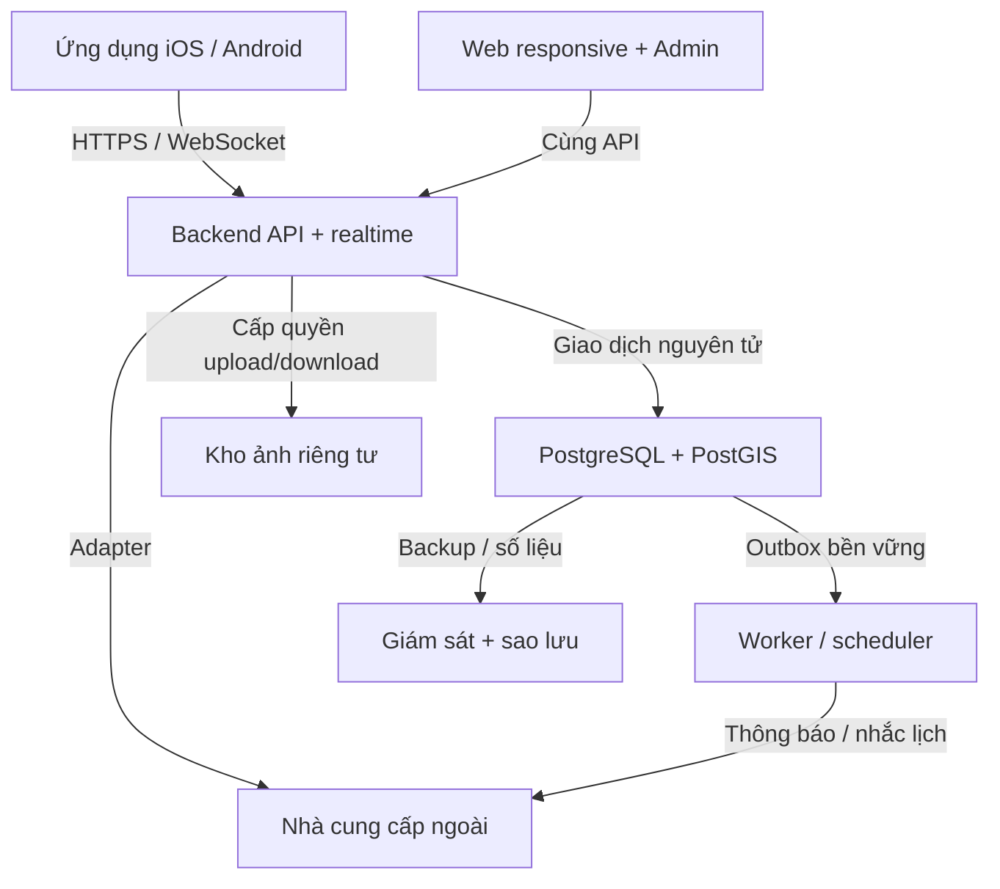

# 03 · Kiến trúc tổng thể

Đề xuất: TypeScript, một backend chia module và một cơ sở dữ liệu giao dịch. Tách tiến trình nền khi cần; chưa chia microservice.

## Các thành phần và đường kết nối

API là nguồn sự thật. Push/WebSocket chỉ báo thay đổi; client đọc lại trạng thái. Media cuộc gọi đi qua nhà cung cấp WebRTC, không chạy xuyên API giao dịch.

## Ranh giới module trong cùng backend

|Module|Sở hữu dữ liệu|Trách nhiệm|
|---|---|---|
|Identity & Access|users, identities, sessions, memberships|Đăng nhập, quyền, khóa tài khoản, xác thực tăng cường|
|Partners & Catalog|partners, locations, skills, service areas|Hồ sơ đa ngành, xác minh, tìm theo khoảng cách và vùng phục vụ|
|Jobs|jobs, assignments, schedule_history|Nhận việc, lịch hẹn, phân công|
|Messaging & Calls|conversations, messages, call_sessions|Phòng riêng dùng lại; quyền gọi; đồng bộ lịch sử|
|Billing|invoices, versions, photos|Số tiền đã chốt, ảnh, sửa trước khóa|
|Ledger & Wallet|accounts, entries, holds, payouts, topups|Giữ, quyết toán, đối soát; module khác không sửa trực tiếp số dư|
|Support & Moderation|cases, evidence, reviews|Xét chứng cứ, ẩn đánh giá, thao tác admin theo quyền|
|Notifications & Audit|outbox, notifications, audit_events|Gửi sau commit, nhắc lịch, nhật ký và truy vết|

## ADR — quyết định kiến trúc đề xuất

|Mã|Chọn|Lý do / giới hạn|
|---|---|---|
|ADR-01|Modular monolith + PostgreSQL|Ít thành phần cho một người; dễ giữ hóa đơn/point/phí trong một transaction. Cần kỷ luật ranh giới module; tách dịch vụ khi có nhu cầu đo được.|
|ADR-02|Expo / React Native cho mobile; web dùng chung API/types|Phù hợp Android+iOS; bố cục web riêng khi cần. Không cam kết mọi component dùng lại được; SDK gọi/bản đồ cần thử trên thiết bị thật.|
|ADR-03|NestJS / TypeScript backend; React admin|Một ngôn ngữ chính; module và guard rõ. Đây là lựa chọn đề xuất, chưa khóa phiên bản/dependency.|
|ADR-04|PostGIS cho vị trí; tìm trong DB trước|Geography tính mét; bán kính 10.000m, lọc vùng phục vụ theo chế độ đến nhà/cửa hàng; chỉ mục GiST. Không suy khoảng cách điểm neo là vị trí GPS trực tiếp của thợ.|
|ADR-05|DB outbox + worker; chưa cần Redis/Kafka|Commit nghiệp vụ và outbox cùng transaction. Worker lease/retry; unique event chống tin tự động trùng. Redis có thể thêm cho scale realtime sau.|
|ADR-06|Sổ append-only + holds; không UPDATE số dư tùy ý|Số dư có thể lưu projection để khóa nhanh, luôn đối soát lại từ entries. Cần test cạnh tranh/khôi phục trước tiền thật.|
|ADR-07|Tích hợp ngoài qua adapter|OTP, map, push, calls, bank thay nhà cung cấp được. Chưa chọn nhà cung cấp/hợp đồng/giá.|
|ADR-08|Dev / staging / production tách biệt|Không dùng dữ liệu và khóa production ở test. Quản lý secrets; migration có review; rollback app tương thích schema.|

## Tích hợp và triển khai tối thiểu

|Mảng|Thiết kế / phương án|Điều chưa chốt|
|---|---|---|
|Đăng nhập|Dịch vụ auth quản lý hoặc module auth với điện thoại/email; MFA admin, phiên có thu hồi|Nhà cung cấp SMS Việt Nam, chi phí, anti-abuse; không tự gắn tài khoản vì email trùng|
|Bản đồ|Geocoding + hiển thị map, PostGIS quyết định lọc|Độ phủ địa chỉ Hà Nội, quyền lưu tọa độ, giá và quota|
|Gọi trong app|WebRTC managed; API cấp token ngắn hạn sau kiểm quyền công việc|SDK iOS/Android, nhận cuộc gọi khi nền/khóa máy, push cuộc gọi; chưa ghi âm|
|Chat / push|Lưu message trong DB trước ACK; cursor đồng bộ khi kết nối lại|Push không đảm bảo đến; tắt nhận push/call theo cài đặt, không mất lịch sử chat|
|Nạp/rút|Admin đối chiếu ngân hàng; adapter API sẵn để tự động sau|Chưa cam kết ngân hàng/API cụ thể; cần kế hoạch nguồn tiền bù point|
|Ảnh|Object storage private; upload có kích thước/MIME allowlist, quét file|Đề xuất JPEG/PNG/WebP tối đa 10MB/file, 10 ảnh/lần; cần chốt trước API|
|Hạ tầng|Một API + một worker cùng repo; DB managed hỗ trợ PostGIS; kho ảnh; TLS|Chọn vùng đặt dữ liệu, ngân sách/tháng; chưa mua tài nguyên|
|Khôi phục|Đề xuất backup liên tục/PITR + kiểm restore trước mở|Đề xuất RPO 15 phút / RTO 4 giờ, chưa phải SLA cam kết; xác minh gói DB hỗ trợ|
|Giám sát|Lỗi API, outbox trễ, hold lâu, chênh sổ, chuyển tiền chưa rõ|Sự cố tiền ưu tiên cảnh báo; hỗ trợ người dùng 08–22h giờ Việt Nam|

Chưa áp mục tiêu 10.000 người đồng thời. Trước launch đo p95 và tải theo kịch bản chốt sau; không tự gán con số hiệu năng đã cam kết. Retention chứng cứ/chat/nhật ký và chính sách xóa cần chốt trước production, không xóa dây chuyền dữ liệu tài chính khi user yêu cầu xóa tài khoản.

Cơ sở kỹ thuật đã đối chiếu ngày 22/09/2026: Expo hỗ trợ Android/iOS/web; NestJS tổ chức module; PostGIS ST_DWithin geography dùng mét; PostgreSQL hỗ trợ khóa hàng và ràng buộc unique. Đề xuất chọn stack là đánh giá cho dự án, không phải kết luận từ nhà cung cấp.

## Mở rộng, triển khai và kiểm thử — phương án đề xuất

|Mục tiêu|Cách tổ chức cho dự án|Giới hạn cần hiểu|
|---|---|---|
|Mở rộng ngành / chức năng|Danh mục và kỹ năng là dữ liệu; modules jobs, chat, billing, ledger có ranh giới. Thêm ngành không cần dựng app mới.|Không hứa mở rộng vô hạn; ngành mới có quy trình khác vẫn cần thêm validation/luồng.|
|Mở rộng lưu lượng|API không lưu phiên/trạng thái quan trọng trong RAM; dùng DB bền vững, pagination/index; tăng tài nguyên rồi thêm replicas khi đo được nhu cầu.|Nhiều instance realtime cần cơ chế pub/sub chung; worker cần lease/idempotency; DB có thể là nút thắt.|
|Deploy backend / web|Build artifact cố định; backend/worker đóng Docker; web build riêng; cấu hình/secrets tách môi trường. Database có migration kiểm soát.|Cần pipeline, health check, backup và quy trình rollback tương thích schema; framework không tự làm hộ.|
|Build / phát hành mobile|Expo có EAS Build/Submit để hỗ trợ build và nộp app; giữ lựa chọn build local khi phù hợp.|iOS/Android vẫn có ký app, tài khoản store và quy trình xét duyệt; thay đổi native thường cần build lại.|
|Unit / integration test|Kiểm công thức, state guard, quyền bằng unit tests; tích hợp chạy PostgreSQL/PostGIS thật trong môi trường test tách biệt.|Mock DB không chứng minh row lock, unique constraint hoặc race condition.|
|Kiểm thử giao diện|Test component cho app/web; E2E cho thuê, hóa đơn, ví, phân công. Thiết bị thật kiểm push, gọi, quyền vị trí và app chạy nền.|Không thể dựa vào test JavaScript để kết luận phần native iOS/Android hoạt động.|
|Dùng chung code|Một repo đề xuất có mobile, web, api và packages cho API types/client, validation chung, design tokens.|React web và React Native không dùng nguyên xi mọi giao diện; bí mật và nghiệp vụ tài chính vẫn ở server.|
|Chưa có ngân sách|Tiếp tục đặc tả API/DB và thử tích hợp bằng sandbox/local; chỉ chọn gói trả phí sau khi có dự toán.|Không cam kết production miễn phí; OTP, gọi, ảnh, backup và ngân hàng còn chi phí theo sử dụng.|

Pipeline đề xuất: thay đổi mã → lint/typecheck → unit test → integration với DB test → build web/API/app → deploy staging → smoke/E2E → duyệt phát hành production. Với app, thêm build/ký/nộp store và kiểm thiết bị; với migration, kiểm tương thích trước khi deploy. Đây là kế hoạch, chưa tạo CI hoặc triển khai hạ tầng.

## Nguồn kỹ thuật

- [Expo core concepts](https://docs.expo.dev/core-concepts/): hỗ trợ Android, iOS và web.
- [NestJS modules](https://docs.nestjs.com/modules): tổ chức backend theo module.
- [PostGIS ST_DWithin](https://postgis.net/docs/ST_DWithin.html): geography với khoảng cách mét.
- [PostgreSQL row locking](https://www.postgresql.org/docs/current/explicit-locking.html): khóa hàng trong transaction.
- [PostgreSQL constraints](https://www.postgresql.org/docs/current/ddl-constraints.html): khóa ngoại và unique.

Đối chiếu 22/09/2026; lựa chọn kiến trúc là đề xuất riêng cho dự án.

Nguồn bổ sung về build/deploy/test (22/09/2026):
- [NestJS deployment](https://docs.nestjs.com/deployment)
- [NestJS testing](https://docs.nestjs.com/fundamentals/testing)
- [Expo EAS Build](https://docs.expo.dev/build/introduction/)
- [Expo unit testing](https://docs.expo.dev/develop/unit-testing/)
- [React Native testing](https://reactnative.dev/docs/testing-overview)

### Quy tắc hiện hành 23/09 — công việc

Đã chốt 23/09/2026: chặn thuê chính mình hoặc doanh nghiệp đang là thành viên. Đổi lịch chỉ để thay đổi ngày/giờ hẹn sau khi hai bên trao đổi, không bắt buộc vì công việc kéo dài. Công việc đã nhận không tự hết hạn, tự hủy hoặc tự hoàn tất theo thời gian; có thể kéo dài nhiều ngày. Luồng hoàn tất bình thường cần khách báo đã trả và thợ xác nhận đã nhận; xác nhận hóa đơn riêng chưa kết thúc công việc. Giữ quy tắc quyết toán một lần và ngoại lệ admin đã chốt. Không tạo luồng đổi lịch qua báo cáo/admin. Sau xác nhận hóa đơn không còn hành động đổi lịch; hỗ trợ/bảo hành vẫn trao đổi trong chat.

## P1-01 A/B hiện hành — 13/10/2026

P1-01 A/B đã được chủ dự án duyệt ngày 13/10/2026. Chuẩn hiện hành cho đội ngũ và xác minh local/test là OpenAPI v0.1.11; các đoạn trước mô tả OTP Pending hoặc mã mẫu là lịch sử/phạm vi production, không phủ quyết phần local này.
Chỉ mở OTP purpose=verify trong phiên đăng nhập: email qua Mailpit trên máy, SMS qua hộp nhận mô phỏng. Mã ngẫu nhiên 6 số, hạn 5 phút, tối đa 5 lần sai; gửi lại sau 60 giây, 5 lần/liên hệ/giờ, 20 lần/tài khoản/giờ và 100 lần/IP/giờ. Mã gắn tài khoản, liên hệ và lần đăng nhập; gửi lại vô hiệu mã cũ. Xác minh email không xác minh điện thoại. Không thay email/điện thoại đã có hoặc chiếm liên hệ tài khoản khác. Chỉ DB DEMO/test cô lập và liên hệ cho phép; disabled mặc định, chặn production. Chưa mở OTP login/recover, MFA admin, email/SMS thật, billing hoặc tiền thật.
Chủ hoặc members.manage mời bằng email hoặc điện thoại, permissions=[]; lời mời 7 ngày, không trả token cho quản lý. Người nhận đăng nhập, xác minh đúng liên hệ rồi chủ động nhập token nhận lời. List/gửi lại/thu hồi kiểm quyền hiện hành; gửi lại thay token cũ. Nhận lời kiểm lại người mời; gia nhập lại dùng cùng membership nhưng không khôi phục quyền cũ. Lịch sử trạng thái pending/accepted/expired/revoked/replaced tách queued/submitted/failed/unknown của việc chuyển thư; submitted không chứng minh người nhận đã đọc.
GET /me/memberships phục vụ cả nhân viên thường và lịch sử đã rời. Cấp/thu hồi quyền dùng lý do, expected_version, Idempotency-Key và grant nhập lại mật khẩu qua POST /auth/reauthenticate. Grant hạn 5 phút, một lần, gắn user/family và scope membership.grants; refresh không gia hạn. Cấm tự sửa/sửa chủ/cấp vượt quyền; quyền thao tác ví cần wallet.read. Không coi nhập lại mật khẩu là MFA, không mở nghiệp vụ ngân hàng từ enum quyền.
Gỡ/tự rời: xem trước số việc cần bàn giao và version; xác nhận có lý do, máy chủ kiểm lại dưới khóa partner → job → invoice. Việc chưa có dấu nhận tiền về chờ phân công, chỉ bỏ nháp chưa gửi; giữ bản đã gửi/khóa, ledger, khoản giữ và dấu thanh toán. Việc đã nhận tiền giữ người thực hiện lịch sử. Thu hồi quyền ngay, giữ phòng chat cá nhân và không sao chép cho người mới. Đầu mối dùng Partner.version, có thể null để về cửa hàng; rời sẽ reset nếu đang là đầu mối. Gọi Internet vẫn chưa triển khai.
OTP/token lưu HMAC; liên hệ và nội dung hàng chờ mã hóa, xóa payload sau gửi/hết hạn. Worker khóa bản ghi để tránh hai lần gửi đồng thời; crash sau gửi vẫn có thể gây thư trùng, token chỉ dùng một lần. Audit bất biến ghi actor/lý do/quyền trước-sau/việc bàn giao, không ghi mật khẩu, token, OTP hay nội dung chat. Snapshot retry không chứa bí mật thô. UI Việt/Anh/Nhật đi từ Tài khoản → Xác minh liên hệ hoặc Đội ngũ → Thành viên/Lời mời/Đã rời/Quyền truy cập. Mất mạng giữ thao tác để thử lại; đổi tài khoản loại dữ liệu riêng. Bằng chứng code/native/CI/UAT được ghi riêng trong báo cáo repo, không coi spec là nghiệm thu.

## RT-01A — cập nhật đã duyệt

RT-01A — 14/10/2026: chủ dự án đã duyệt triển khai Socket.IO 4, chỉ transport websocket, một NestJS instance. Path /v1/realtime/socket.io, namespace /; access token qua auth.token, không query URL. HTTP giữ thao tác ghi, ACK sau commit và lấy bù. Mỗi app một kết nối foreground, reconnect khi refresh, đóng khi logout/background; kiểm phiên và quyền hiện hành trước từng lần phát. Sự kiện là tín hiệu tải lại, không tự cộng tiền, unread hoặc quyết toán. Bốn công tắc push không tắt inbox/chat foreground. RT-01B/Redis, push ngoài app, gọi, presence/typing, provider/billing/production chưa mở.

Contract chi tiết: `docs/technical-design/realtime.json` v0.2, API v0.1.13. Dữ liệu thêm correlation_id và realtime_deliveries; unique theo event/user, lease riêng từng consumer; không dùng processed_at chung. QA-094–097 bổ sung kiểm realtime; không đổi trạng thái nghiệm thu của QA cũ. `notification.read.v1` chỉ lần đầu; thêm `invoice.revision_requested.v1`; invoice settled/payment_reported chuẩn hóa payload IDs/version, đọc eligibility/tiền bằng HTTP đúng quyền.
