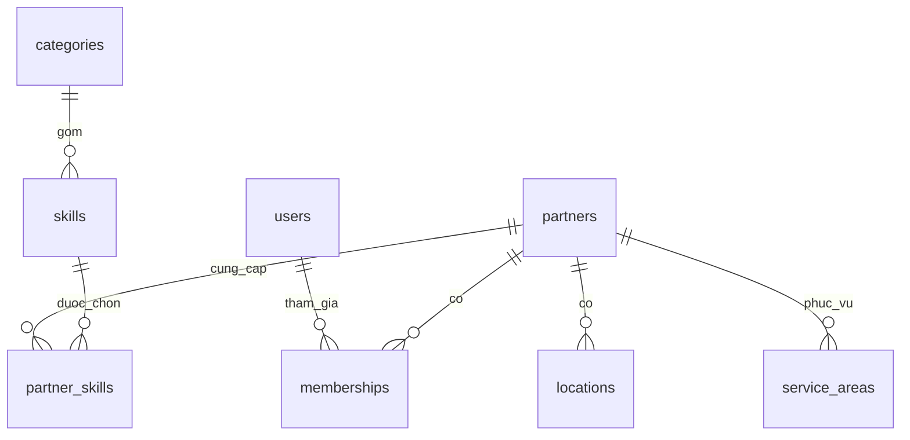
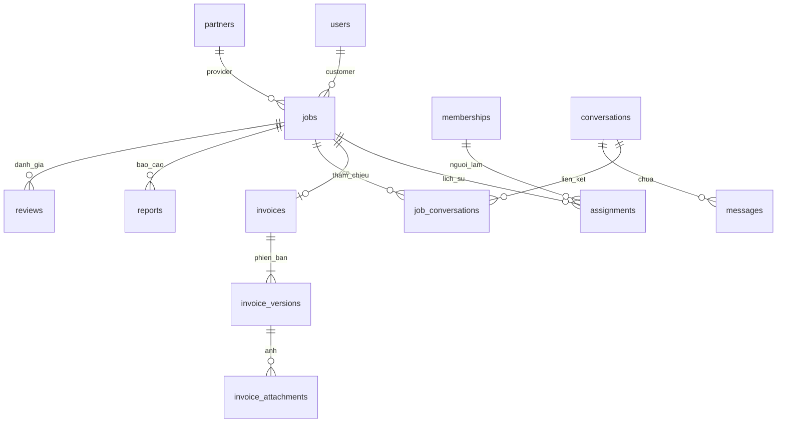
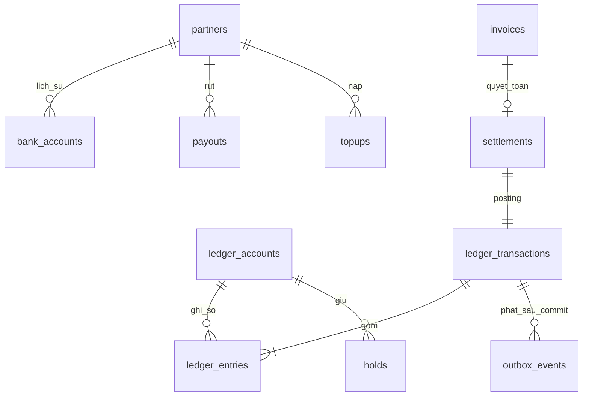

# 04 · ERD và dữ liệu

Mô hình logic mở rộng đa ngành. UUID cho khóa; tiền/point nguyên; UTC khi lưu, giờ Việt Nam khi hiển thị.

## ERD 1 · Người, doanh nghiệp và năng lực

Partner là bên cung cấp và sở hữu ví; membership là người làm thay partner. Mỗi user–partner một membership, có lịch sử quyền. Kỹ năng là bảng nối N–N, không tạo cột riêng cho mỗi ngành.

## ERD 2 · Việc, chat và hóa đơn

Mỗi việc có một hồ sơ hóa đơn và nhiều phiên bản. Phòng chat không thuộc vòng đời việc. Cặp user được sắp thứ tự trước unique; không tạo phòng mới khi thuê lại.

## ERD 3 · Tiền, point và đối soát

Sổ chỉ thêm, không sửa lịch sử. Holds giảm khả dụng nhưng chưa là phí đã thu. UNIQUE settlement(invoice_id) chống admin và thợ quyết toán trùng.

## Từ điển dữ liệu cốt lõi

|Bảng / nhóm|Trường quan trọng|Ràng buộc / lịch sử|
|---|---|---|
|users / identities / sessions|id; display_name; status; verified contact; provider_subject; revoked_at|UNIQUE(provider, subject); số điện thoại chuẩn E.164; email normalize; không lưu mật khẩu thô/OTP thô|
|partners / memberships|kind; verification_status; accepting_jobs; suspension_scope; user_id; grants|UNIQUE(user_id, partner_id); một owner hiệu lực đề xuất; quyền có lịch sử; bank và wallet theo partner|
|categories / skills / partner_skills|stable code; parent_id; translations; form_schema_version; skill_id|UNIQUE(partner_id, skill_id); ẩn thay vì xóa kỹ năng đã dùng; nhóm dịch vụ có thể thêm mà không đổi bảng việc|
|locations / service_areas|geography Point SRID4326; polygon/radius; service_mode|Chỉ mục GiST; điểm công khai phân biệt địa chỉ riêng; không lộ GPS thợ từ vùng phục vụ|
|jobs / job_skills|customer_id; partner_id; mode; scheduled_at; address_snapshot; state; version|FK; thời gian UTC; skill snapshot; JSONB ngành có schema version, không chứa trường tiền lõi|
|assignments / schedule_history|membership_id; effective_from/to; assigned_by; old/new schedule; reason|Một assignment active/việc bằng partial unique; bàn giao giữ lịch sử; schedule_version tăng|
|conversations / messages|pair_low/high; message_id; sender_id; client_message_id; sequence; job_ref|UNIQUE(pair_low,pair_high); UNIQUE(sender_id,client_message_id); participant ACL; tin hệ thống unique(event_key)|
|invoices / invoice_versions|job_id; current_version_id; locked_version_id; labor; materials; status; author|UNIQUE(job_id); UNIQUE(invoice_id,version_no); số nguyên >=0; version đã gửi bất biến|
|invoice_confirmation / settlements|invoice_id; version_id; point_used; fee; reward; cash; rule_version; actor|Một confirmation/settlement mỗi invoice; snapshot công thức; server tính lại, không nhận fee/reward từ client|
|attachments / evidence|object_key; uploader_id; mime; size; status; purpose; parent_ref|Không URL công khai; quét/xác minh trước attach; không cascade xóa ảnh hóa đơn lịch sử|
|ledger_accounts / entries / holds|owner_user hoặc owner_partner; unit; balance_projection; txn_key; amount|XOR owner hoặc tài khoản platform; ledger signed BIGINT/numeric nguyên; currency riêng; hold >=0|
|bank_accounts / topups / payouts|encrypted number; last4; status; provider_ref; bank_snapshot; payout_key|Một bank effective/partner; UNIQUE(provider,bank_txn_id); không dùng cùng chứng cứ ghi có nhiều lần|
|reviews|job_id; author; subject; stars; status; moderation_reason|Stars 1..5; UNIQUE(job_id,direction); chỉ hiển thị tính trung bình; Q01 đã chốt: khách báo đã trả + thợ xác nhận nhận tiền + quyết toán thành công|
|reports / admin_actions|job/version refs; reporter; evidence; case_status; action_type; reason|Xác nhận thay thợ gắn case và version; đóng case không gọi ledger|
|outbox / audit / notification_settings|event_id; aggregate/version; attempts; next_attempt; actor; correlation_id|Event unique; audit không sửa qua app; log không chứa OTP, token, nội dung chat; message/call opt-out riêng|

## Công thức và bất biến tài chính

|Ký hiệu / quy tắc|Thiết kế|
|---|---|
|L, M, T|Tiền công L, vật tư M; T=L+M. VND nguyên; không giới hạn nghiệp vụ giá trị hóa đơn, nhưng kiểm giới hạn lưu trữ số để không overflow.|
|F / R / C|F=floor(L/10); R là point khách chọn, mặc định 0; 0≤R≤T và point khả dụng; C=T−R trả trực tiếp.|
|Q thưởng|Q=floor(L×(T−R)/(50×T)) khi T>0; T=0 thì Q=0. Đây là công thức bản mẫu hiện tại, không tự đổi thành 2% tổng hóa đơn. Snapshot rule_version.|
|Khả dụng phí|B−Hf−Hw−F ≥ −100.000, với B số dư đã ghi sổ, Hf tổng phí giữ, Hw tổng rút giữ. Không tính R đang chờ bù là tiền có sẵn.|
|Có thể rút|max(0,B−Hf−Hw); không cộng 100.000. Khóa cùng account row khi tạo hold.|
|Point khả dụng|P−Hp; không dùng point thưởng dự kiến. Hai hóa đơn đồng thời phải khóa cùng tài khoản point.|
|Lúc xác nhận|Một transaction: khóa việc/version + hai account; kiểm tất cả; giữ F và R; ghi confirmation, trạng thái, outbox. Lỗi thì rollback toàn bộ.|
|Lúc hoàn tất|Một transaction: consume holds; partner B := B + R − F; customer P := P − R + Q; ghi settlement, entries, audit, outbox.|
|Sổ cân bằng theo đơn vị|VND: partner +R−F, platform fee +F, platform redemption −R. POINT: customer −R+Q, platform redemption +R, reward issuance −Q. Mỗi unit tổng delta=0; là sổ vận hành, chưa phải chuẩn ghi nhận doanh thu kế toán.|
|Nạp / rút|Nạp: partner +A, bank-clearing −A. Rút thành công: partner −A, bank-clearing +A; bút toán rút và consume hold cùng transaction. Không tự ghi nhận khách trả tiền ngoài app vào số dư platform.|
|Báo cáo có vấn đề|Không tự giải phóng hold hoặc đảo bút toán. Admin chỉ có nhánh hoàn tất thay thợ đã duyệt; các ngoại lệ khác vẫn pending.|
|Đối soát|Balance projection = tổng entries; holds khớp invoice/payout active; mỗi invoice tối đa một settlement; kiểm khoản bù point và nguồn tiền ngân hàng mỗi ngày.|

Ví dụ kiểm tra thiết kế: L=100.000, M=50.000, R=50.000 → T=150.000, C=100.000, F=10.000, Q=1.333; ví partner tăng ròng 40.000; point khách giảm ròng 48.667. Dùng toàn point → C=0, Q=0; vẫn cần xác nhận hoàn tất. Cộng ví là nghĩa vụ chi trả, không chứng minh platform đã có tiền mặt: cần dự trữ/đối soát nguồn tiền trước tiền thật.

Dữ liệu riêng: số ngân hàng/chứng cứ/địa chỉ làm việc được hạn chế theo vai. Địa chỉ công khai cửa hàng riêng với địa chỉ khách. Không lưu bản ghi âm mặc định. Thời hạn lưu chat, ảnh, audit, tiền và cách xử lý yêu cầu xóa sẽ đặc tả sau khi chọn hạ tầng/chính sách; không mặc định lưu vô hạn hoặc cascade delete.

### Quy tắc hiện hành 23/09 — công việc

Đã chốt 23/09/2026: chặn thuê chính mình hoặc doanh nghiệp đang là thành viên. Đổi lịch chỉ để thay đổi ngày/giờ hẹn sau khi hai bên trao đổi, không bắt buộc vì công việc kéo dài. Công việc đã nhận không tự hết hạn, tự hủy hoặc tự hoàn tất theo thời gian; có thể kéo dài nhiều ngày. Luồng hoàn tất bình thường cần khách báo đã trả và thợ xác nhận đã nhận; xác nhận hóa đơn riêng chưa kết thúc công việc. Giữ quy tắc quyết toán một lần và ngoại lệ admin đã chốt. Không tạo luồng đổi lịch qua báo cáo/admin. Sau xác nhận hóa đơn không còn hành động đổi lịch; hỗ trợ/bảo hành vẫn trao đổi trong chat.

## P0-1 — Nguồn cung và tìm dịch vụ

P0-1 đã duyệt 06/10/2026: tài khoản có điện thoại xác minh tạo hồ sơ draft, owner và ví 0 cùng giao dịch. Công bố cần tên, kỹ năng active và nơi phục vụ cho mọi mode; ảnh chưa bắt buộc trong gói này. Công bố không tự bật nhận việc. Chuyển draft tắt nhận việc; sửa published mất điều kiện bị từ chối. Chủ/profile.manage dùng management riêng, shared version và key retry kiểm lại quyền. Public không lộ địa chỉ riêng/giấy tờ/ví; liên hệ cần đăng nhập. Tìm sort=distance dùng shop công khai hoặc tâm vùng tròn với cả điều kiện phủ khách và bán kính; mỗi hồ sơ một kết quả, cursor gắn bộ lọc và distance/created_at/id. OTP, bản đồ/GPS, polygon và ranking khác giữ Pending. DEMO local/test được phép tạo mới riêng, không sửa tài khoản có sẵn hoặc nạp tiền. Chuẩn chi tiết: technical-design v0.1.6, openapi.json và schema.sql.

Phần này ưu tiên cho gói P0-1 nếu mô tả cũ khác; các luồng công việc/tài chính đầy đủ giữ nguyên và không được coi đã triển khai.

## MAP-03 / P0-2 — phạm vi đã duyệt ngày 07/10/2026

MAP-03 và P0-2 — quyết định chủ dự án ngày 07/10/2026, API v0.1.9.
Bỏ nút và ô nhập tọa độ thủ công trong tìm kiếm, sổ địa chỉ, cửa hàng, vùng phục vụ và form thuê. Người dùng chọn địa chỉ/gợi ý, ghim bản đồ, GPS theo nút hoặc địa chỉ đã lưu; tọa độ vẫn là dữ liệu nội bộ/API. Phần mô tả nhập tọa độ trong các mốc trước là lịch sử đã được thay thế.
Job bổ sung service_mode, time_mode, location_id (null ngoài cửa hàng), note và eta (null trước nhận/hẹn trước). Làm ngay bắt buộc ETA khi nhận; lưu thời điểm dự kiến đến và lịch ban đầu, không thêm nút Bắt đầu. Đổi lịch cập nhật scheduled_at, giữ eta ban đầu và tăng schedule_version/lịch sử. PartnerProfile bổ sung public_locations gồm id + address chỉ cho địa điểm active/public, và service_modes theo skill_id; không trả tâm vùng hoặc điểm riêng. Máy chủ đối chiếu location_id với cửa hàng hiện hành và lấy địa chỉ từ DB, không tin địa chỉ cửa hàng do client gửi.
Gói P0-2 local/test: khách tạo/đọc/rút yêu cầu, partner nhận/từ chối, đổi lịch/dừng trước hóa đơn khóa, phân công theo quyền. Có chi phí đã thỏa thuận thì dừng vẫn giữ accepted để tiếp tục hóa đơn ở P0-3; lưu cờ và lý do, không tạo hóa đơn giả. Không có chi phí chuyển stopped. Không tự hết hạn, hủy hay hoàn tất theo giờ. Giữ xác minh điện thoại ở backend khi gửi/nhận; chỉ dùng tài khoản DEMO local/test đã được duyệt, OTP thật Pending.
Chat tối thiểu dùng API HTTP: tạo/mở lại phòng trước thuê, gửi/đọc tin văn bản, thứ tự sequence, chống trùng client_message_id và idempotency, mốc đã đọc chỉ tăng, tải lại khi quay lại màn/app hoặc bấm cập nhật. Khách–cửa hàng/doanh nghiệp tách khách–nhân viên; phân công thêm tin hệ thống trong phòng riêng. Đổi người không sao chép lịch sử; người cũ giữ chat của mình nhưng mất quyền việc sau thu hồi/phân công lại. Ghi sự kiện bền vững cùng transaction; WebSocket/worker phát sự kiện, push/nhắc lịch, gọi và file đính kèm chưa nghiệm thu trong gói HTTP này. Các yêu cầu sản phẩm đầy đủ vẫn giữ, không coi phần chưa triển khai đã hoàn tất.
Bằng chứng code/local, web và native nằm trong báo cáo B03-03/B03-04 ở repo; không thay CI từ xa, UAT, production hoặc tiền thật.
