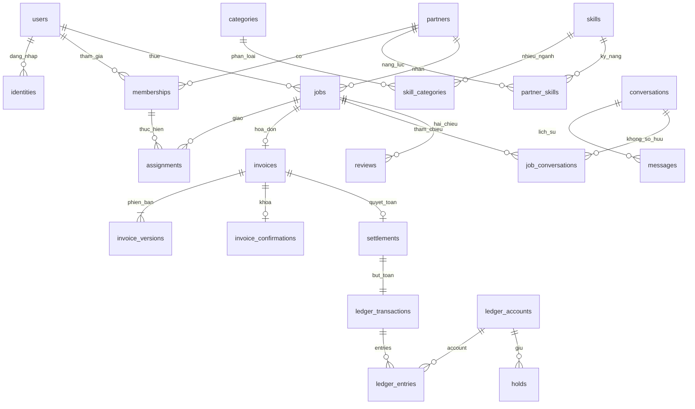

# Thiết kế dữ liệu và migration

> **P0-1 · 06/10/2026 · v0.1.6 · Đã duyệt: hồ sơ quản lý riêng có version; draft/published, công bố không tự bật nhận việc; phone_verified trước tạo partner, owner và ví rỗng cùng transaction. Tìm theo distance mặc định, vùng tròn đo tới tâm và phải bao phủ khách; cursor theo distance_m/created_at/id, gắn bộ lọc. Tài khoản/provider test tách biệt được phép tạo trực tiếp; OTP, polygon, bản đồ và xếp hạng recommended/rating chưa triển khai. Không production/tiền thật.**

> **B01-04A · 06/10/2026 · v0.1.5: chủ dự án duyệt gộp quản lý phiên và sổ địa chỉ. Một mục phiên đại diện một lần đăng nhập (id = family_id ổn định qua refresh), có created_at, last_seen_at, is_current; state active/expired/revoked; không trả IP, token/hash. Thu hồi chặn toàn bộ family và kiểm lại quyền trong transaction. Địa chỉ thêm is_default/version; địa chỉ đầu tiên khi sổ đang rỗng tự mặc định. Chọn mặc định mới bỏ mặc định cũ và tăng version bản cũ. Gỡ mặc định để chưa có mặc định, không tự chọn mục khác. PUT yêu cầu expected_version. Mọi mutation giữ Idempotency-Key khi retry, kiểm chủ sở hữu; archive giữ dữ liệu lịch sử, không đổi snapshot công việc. Nhập địa chỉ/tọa độ thủ công, chưa chọn GPS/map provider. OTP Pending; không production/chi phí.**

> **I18N-04 · 05/10/2026 · v0.1.3 (phạm vi danh mục đã duyệt):** Giữ 10 ngành đã chốt; bộ dữ liệu thực tế trong `services/api/seeds/catalog.json` có 50 nhóm (10 nhóm chung giữ tương thích + 40 nhóm chuyên biệt), 140 kỹ năng và 141 liên kết. Nguồn nghiên cứu ở `catalog-sources.json`; đây là phân loại dịch vụ, không phải provider/giá mẫu. Categories và skills lưu translations EN/JA. Migration mới 003 chỉ thêm skills.translations, không sửa checksum lịch sử. Seed giữ ID/code/name_vi/active/form và các khóa bản dịch đã có; chỉ chèn bản ghi, mapping và khóa dịch còn thiếu. Không reset DB.


Phiên bản 0.1.1 · 28/09/2026 · Đợt 1 triển khai local danh mục Expo/NestJS/PostgreSQL/PostGIS. Chi tiết và bằng chứng tại DOC-065; phần ngoài danh mục vẫn là thiết kế, chưa production/tiền thật.

## Phần đã triển khai Đợt 1

`services/api/migrations/001_catalog.sql` chỉ tạo categories, skills, skill_categories và PostGIS. Mã/UUID ổn định; FK RESTRICT; tên không rỗng, version dương, JSON object; trigger chống chu kỳ. Seed từ PRD §6–7 chỉ local/test, không ghi đè trường đã sửa. M00/M01 mới hoàn thành lát danh mục, không phải toàn bộ user/org/geo. Xem [DOC-065](../implementation/dot-1.md).

## Sơ đồ quan hệ theo cụm



Một `partner` sở hữu ví; `membership` là người có quyền thao tác. Không tạo ví riêng cho từng nhân viên chỉ vì họ nhận tiền trực tiếp. Phòng `direct` dùng cặp user đã sắp thứ tự; phòng `partner` dùng cặp khách–partner. `job_conversations` chỉ liên kết ngữ cảnh, không cấp quyền đọc phòng riêng.

## Chuẩn dữ liệu

| Quy tắc | Thiết kế |
|---|---|
| ID | UUID, ID do server sinh; không dùng ID đoán được để thay kiểm quyền |
| Tiền / point | NUMERIC nguyên, hữu hạn; JSON là chuỗi số; tính với số nguyên chính xác. Không dùng float. Không đặt trần nghiệp vụ hóa đơn; giới hạn kích thước lưu/request là giới hạn kỹ thuật cần kiểm |
| Thời gian | TIMESTAMPTZ UTC; hiển thị Asia/Ho_Chi_Minh; không lưu giờ địa phương thiếu offset |
| Version | CAS expected_version ở cập nhật; không dùng timestamp thay version |
| Xóa | Không cascade lịch sử tài chính/việc. Ẩn, thu hồi hoặc ẩn danh theo chính sách retention phải chốt trước production |
| Đa ngành | skills↔categories N–N; forms có schema version; snapshot answers/name/version ở job |
| Dữ liệu mở rộng | JSONB chỉ cho biểu mẫu ngành, metadata và snapshot; không thay cột lõi tiền, quyền, trạng thái |
| Riêng tư | Bank ciphertext; ảnh signed URL có ACL; log không token/OTP/chat; địa chỉ khách không công khai |

## Tìm gần và vùng phục vụ

Tại cửa hàng: lọc khoảng cách tới `partner_locations.point` theo bán kính tìm mặc định 10.000m. Tại khách: vị trí phải nằm trong ít nhất một vùng phục vụ và đáp ứng bán kính tìm đã chọn. P0-1 đã chốt khoảng cách hiển thị vùng tròn là tới tâm vùng; polygon dùng điểm đại diện riêng được xác định khi cấu hình, không giả là vị trí hiện tại của thợ. Cách hiển thị/xếp hạng polygon cần kiểm UX trước triển khai. Dùng ST_DWithin với geography để đo mét, GiST cho truy vấn không gian; polygon kiểm bằng phép phủ vị trí. Không lấy GPS cá nhân làm điểm công khai.

```sql
-- Ví dụ cho vùng tròn; $1 là geography vị trí cần làm, $2 là bán kính tìm.
SELECT DISTINCT p.id FROM partners p JOIN service_areas a ON a.partner_id=p.id
WHERE p.accepting_jobs AND p.moderation_status='active' AND a.active
AND a.center IS NOT NULL AND ST_DWithin(a.center,$1,a.radius_m)
AND ST_DWithin(a.center,$1,$2);
-- Bổ sung join kỹ năng/mode và policy xác minh trước xếp hạng.
```

## Ranh giới bảo vệ dữ liệu

| Invariant | DB | Service bắt buộc |
|---|---|---|
| Một invoice/việc; một settlement/invoice | UNIQUE | Kiểm actor, trạng thái, phiên bản |
| Một người đang được giao/việc | Partial UNIQUE, composite FK đúng partner | Membership active; thu hồi quyền người cũ ngay |
| Một phòng mỗi cặp | CHECK cấu trúc + UNIQUE | ACL direct độc lập org; upsert và gửi system event cùng transaction |
| Tiền không âm/không lẻ/NaN | Domain numeric | Parse chuỗi số; không dùng JavaScript Number tính tiền |
| Sổ cân bằng | Deferred trigger tổng delta theo transaction+unit=0 | Đúng bút toán công thức; zero invoice không tạo entries 0 |
| Sổ bất biến | Trigger chặn UPDATE/DELETE entries/transactions/audit | App role không phải schema owner; migration có quyền riêng |
| Projection | Trigger cộng delta vào account | Service KHÔNG tự cộng balance lần nữa; lock account UUID tăng dần trước insert |
| Hold/credit | Unique(kind,reference), chỉ amount>0 | Lock account; kiểm tổng ACTIVE holds, giới hạn âm và R; đúng loại reference |
| Bản invoice đã gửi | Trigger chặn sửa/xóa version | Assets/note đi kèm cũng bất biến theo phiên bản; cấm thay asset relation sau sent |
| Review Q01 | Unique(job,direction), sao1–5 | Khách đã báo trả + worker receipt + settlement; admin không giả receipt |

## Transaction và thứ tự khóa

Mọi transaction tài chính dùng thứ tự: job → invoice → report nếu có → account theo UUID tăng dần → holds/reference liên quan. Nhánh payout/topup không có job/invoice thì bắt đầu từ account; không khóa payout trước account rồi quay lại invoice. Report decision phải dùng cùng thứ tự khi có tài chính, không giữ report rồi chờ invoice theo chiều ngược. Không gọi mạng, push, ngân hàng hoặc provider trong transaction giữ khóa.

1. Confirm: reserve idempotency → lock job/invoice/accounts → kiểm version/ảnh/quyền → tính F/R/C/Q trên server → tạo hold F/R nếu >0 → confirmation + invoice locked + outbox → commit.
2. Settle: reserve key → lock theo thứ tự → kiểm unique settlement → kiểm actor/holds/version → ghi ledger transaction/entries (trigger cập nhật balance) → consume hold → invoice settled + audit/outbox → commit. Worker ghi receipt; admin chỉ ghi actor_kind=admin.
3. Customer payment-reported: lock invoice, kiểm đúng khách/version, ghi dấu một lần dù invoice đã settled; không ledger. Recompute review eligibility.
4. Retry deadlock/serialization: rollback toàn bộ, retry có giới hạn và cùng key. Nếu mất response sau commit: GET operation và resource; không đổi key rồi tạo lại.
5. Payout unknown: tiếp tục hold; chỉ kết quả được đối soát mới consume/release. Invoice locked không có route release ở đợt này.

## Số liệu kiểm công thức

| L | M | R | F | C | Q |
|---:|---:|---:|---:|---:|---:|
| 100000 | 50000 | 50000 | 10000 | 100000 | 1333 |
| 100000 | 50000 | 150000 | 10000 | 0 | 0 |
| 0 | 50000 | 0 | 0 | 50000 | 0 |
| 0 | 0 | 0 | 0 | 0 | 0 |
| 9 | 0 | 0 | 0 | 9 | 0 |

F=floor(L/10); Q=floor(L*(T-R)/(50*T)) khi T>0, còn lại0. VND: partner +(R-F), fee +F, redemption -R. POINT: customer -R+Q, redemption +R, issuance -Q. Không ghi C khách trả trực tiếp thành tiền vào platform. Khi net delta bằng0 không tạo entry0; vẫn giữ dấu hoàn tất invoice.

## Kế hoạch migration

| Mốc | Thay đổi | Kiểm trước khi đi tiếp |
|---|---|---|
| M00 | Pin PostgreSQL/PostGIS phiên bản được hỗ trợ; quyền extension, DB test biệt lập | Provider hỗ trợ PostGIS; connect/migrate/backup |
| M01 | users/identity/org/catalog/geo và seed10ngành | Unique identity, skill N–N, tenant FK, GiST |
| M02 | job/assignment/chat/invoice version/assets | Snapshot, pair uniqueness, role tests |
| M03 | Accounts/holds/ledger/settlements, trigger và DB grants | Cân bằng, append-only, projection, concurrency và crash; app không chạy schema owner |
| M04 | Reports/reviews/notifications/outbox/audit | Q01, report ACL, reminder version, retry |
| M05 | Backfill/index thay đổi schema | Expand→backfill→switch→contract; không drop cột đang được app cũ dùng |

`schema.sql` là DDL tham chiếu cho database trống. Chưa phải migration chạy production; migration local danh mục dùng runner SQL có checksum, không dùng ORM. Các miền còn lại chưa có migration runtime. M03 phải bổ sung/kiểm DB grants theo vai triển khai, bất biến invoice_assets và confirmation/settlement, trigger hold transition và restore; không đánh dấu sẵn sàng tiền thật chỉ vì parser SQL pass.

## Từ điển bảng / trường

### users · Tài khoản

Một người dùng có thể thuê và cung cấp dịch vụ.

| Trường | Kiểu | Ràng buộc | Ý nghĩa |
|---|---|---|---|
| id | uuid | PRIMARY KEY DEFAULT gen_random_uuid() | Khóa ổn định |
| display_name | text | NOT NULL | Tên hiển thị |
| status | text | NOT NULL DEFAULT 'active' | active / suspended / deletion_requested / anonymized |
| locale | text | NOT NULL DEFAULT 'vi' | vi hiện tại, en/ja về sau |
| version | integer | NOT NULL DEFAULT 1 | Khóa lạc quan |
| anonymized_at | timestamptz |  | Giữ ID lịch sử; không cascade tiền |
| created_at | timestamptz | NOT NULL DEFAULT now() | UTC |

Ràng buộc bảng: `CHECK (status IN ('active','suspended','deletion_requested','anonymized')), CHECK(version>0)`

Chỉ mục: `PK/UNIQUE tự tạo index; bổ sung theo kế hoạch truy vấn`

### identities · Tài khoản

Thông tin đăng nhập riêng với hồ sơ công khai.

| Trường | Kiểu | Ràng buộc | Ý nghĩa |
|---|---|---|---|
| id | uuid | PRIMARY KEY DEFAULT gen_random_uuid() | Khóa ổn định |
| user_id | uuid | NOT NULL REFERENCES users(id) | Chủ sở hữu |
| provider | text | NOT NULL | phone / email; provider xã hội để sau |
| subject | text | NOT NULL | E.164 hoặc email chuẩn hóa |
| password_hash | text |  | Chỉ dùng với mật khẩu; không lưu plaintext |
| verified_at | timestamptz |  | Xác minh liên hệ |
| created_at | timestamptz | NOT NULL DEFAULT now() | UTC |

Ràng buộc bảng: `UNIQUE(provider,subject)`

Chỉ mục: `
CREATE UNIQUE INDEX identities_one_contact ON identities(user_id,provider) WHERE provider IN ('phone','email');`

### auth_challenges · Tài khoản

OTP và khôi phục; không lưu OTP thô.

| Trường | Kiểu | Ràng buộc | Ý nghĩa |
|---|---|---|---|
| id | uuid | PRIMARY KEY DEFAULT gen_random_uuid() | Khóa ổn định |
| identity_id | uuid | REFERENCES identities(id) | Có thể null khi đăng ký |
| subject_hash | text | NOT NULL | Không log liên hệ thô |
| purpose | text | NOT NULL | login / verify / recover |
| secret_hash | text | NOT NULL | OTP hash có secret server |
| expires_at | timestamptz | NOT NULL | TTL cấu hình |
| attempts | integer | NOT NULL DEFAULT 0 | Kiểm giới hạn trong transaction |
| consumed_at | timestamptz |  | Một lần |
| created_at | timestamptz | NOT NULL DEFAULT now() | UTC |
| context | jsonb | NOT NULL DEFAULT '{}'::jsonb | Ngữ cảnh và chủ thể challenge; không lưu bí mật rõ |

Ràng buộc bảng: `CHECK(attempts>=0)`

Chỉ mục: `PK/UNIQUE tự tạo index; bổ sung theo kế hoạch truy vấn`

### sessions · Tài khoản

Refresh session có thể thu hồi và phát hiện dùng lại.

| Trường | Kiểu | Ràng buộc | Ý nghĩa |
|---|---|---|---|
| id | uuid | PRIMARY KEY DEFAULT gen_random_uuid() | Khóa ổn định |
| user_id | uuid | NOT NULL REFERENCES users(id) | Tài khoản |
| refresh_hash | text | NOT NULL UNIQUE | Hash refresh token |
| family_id | uuid | NOT NULL | Nhóm token rotation |
| expires_at | timestamptz | NOT NULL | TTL cấu hình |
| revoked_at | timestamptz |  | Thu hồi tức thời khi khóa |
| last_seen_at | timestamptz |  | Quản lý thiết bị |
| created_at | timestamptz | NOT NULL DEFAULT now() | UTC |

Ràng buộc bảng: `Khóa/FK theo trường; guard theo service`

Chỉ mục: `PK/UNIQUE tự tạo index; bổ sung theo kế hoạch truy vấn`

### saved_addresses · Tài khoản

Địa chỉ khách riêng tư.

| Trường | Kiểu | Ràng buộc | Ý nghĩa |
|---|---|---|---|
| id | uuid | PRIMARY KEY DEFAULT gen_random_uuid() | Khóa ổn định |
| user_id | uuid | NOT NULL REFERENCES users(id) | Chỉ chủ sở hữu |
| label | text | NOT NULL; trim không rỗng | Tên gợi nhớ |
| address_text | text | NOT NULL; trim không rỗng | Địa chỉ |
| point | geography(Point,4326) | NOT NULL | Tọa độ |
| is_default | boolean | NOT NULL DEFAULT false | Tối đa một mặc định đang hoạt động mỗi user |
| version | integer | NOT NULL DEFAULT 1 CHECK(version>0) | Tăng khi sửa/gỡ hoặc mất mặc định |
| archived_at | timestamptz |  | Không làm đổi snapshot việc |
| created_at | timestamptz | NOT NULL DEFAULT now() | UTC |

Ràng buộc bảng: `CHECK (archived_at IS NULL OR NOT is_default)`

Chỉ mục: `UNIQUE(user_id) WHERE is_default AND archived_at IS NULL`; index `(user_id,created_at,id) WHERE archived_at IS NULL`

### partners · Nguồn cung

Thợ tự do, cửa hàng, doanh nghiệp cùng một mô hình ví và dịch vụ.

| Trường | Kiểu | Ràng buộc | Ý nghĩa |
|---|---|---|---|
| id | uuid | PRIMARY KEY DEFAULT gen_random_uuid() | Khóa ổn định |
| kind | text | NOT NULL | solo / shop / company |
| name | text | NOT NULL | Tên công khai |
| bio | text | NOT NULL DEFAULT '' | Giới thiệu năng lực |
| verification_status | text | NOT NULL DEFAULT 'unverified' | Tách xác minh khỏi đình chỉ |
| publication_status | text | NOT NULL DEFAULT 'draft'; draft/published | P0-1 công bố tách nhận việc |
| accepting_jobs | boolean | NOT NULL DEFAULT false | Tắt: ẩn tìm kiếm, chặn yêu cầu mới |
| moderation_status | text | NOT NULL DEFAULT 'active' | active / new_work_suspended / suspended |
| profile | jsonb | NOT NULL DEFAULT '{}' | Kinh nghiệm, portfolio, kênh liên hệ; schema kiểm server |
| version | integer | NOT NULL DEFAULT 1 | Chống ghi đè |
| archived_at | timestamptz |  | Không cascade lịch sử |
| created_at | timestamptz | NOT NULL DEFAULT now() | UTC |

Ràng buộc bảng: `CHECK(kind IN ('solo','shop','company')), CHECK(verification_status IN ('unverified','pending','verified','rejected')), CHECK(moderation_status IN ('active','new_work_suspended','suspended'))`

Chỉ mục: `PK/UNIQUE tự tạo index; bổ sung theo kế hoạch truy vấn`

### memberships · Nguồn cung

Quyền có thể gộp; không bắt buộc chức danh điều phối.

| Trường | Kiểu | Ràng buộc | Ý nghĩa |
|---|---|---|---|
| id | uuid | PRIMARY KEY DEFAULT gen_random_uuid() | Khóa ổn định |
| partner_id | uuid | NOT NULL REFERENCES partners(id) | Tenant |
| user_id | uuid | NOT NULL REFERENCES users(id) | Người thao tác |
| is_owner | boolean | NOT NULL DEFAULT false | Chủ; chuyển chủ pending |
| active | boolean | NOT NULL DEFAULT true | Kiểm mỗi request |
| left_at | timestamptz |  | Giữ lịch sử |
| version | integer | NOT NULL DEFAULT 1 | Thu hồi quyền |
| created_at | timestamptz | NOT NULL DEFAULT now() | UTC |

Ràng buộc bảng: `UNIQUE(partner_id,user_id), UNIQUE(id,partner_id)`

Chỉ mục: `CREATE UNIQUE INDEX one_active_owner ON memberships(partner_id) WHERE is_owner AND active;`

### membership_grants · Nguồn cung

Quyền cụ thể thay vì chức danh cứng.

| Trường | Kiểu | Ràng buộc | Ý nghĩa |
|---|---|---|---|
| id | uuid | PRIMARY KEY DEFAULT gen_random_uuid() | Khóa ổn định |
| membership_id | uuid | NOT NULL REFERENCES memberships(id) | Thành viên |
| permission | text | NOT NULL | jobs.accept, jobs.assign, wallet.read... |
| granted_by | uuid | NOT NULL REFERENCES users(id) | Không cấp vượt quyền mình có |
| revoked_at | timestamptz |  | Audit thay đổi |
| created_at | timestamptz | NOT NULL DEFAULT now() | UTC |

Ràng buộc bảng: `Khóa/FK theo trường; guard theo service`

Chỉ mục: `CREATE UNIQUE INDEX active_grant ON membership_grants(membership_id,permission) WHERE revoked_at IS NULL;`

### member_invitations · Nguồn cung

Mời người vào doanh nghiệp, nhận lời bằng tài khoản đã xác minh.

| Trường | Kiểu | Ràng buộc | Ý nghĩa |
|---|---|---|---|
| id | uuid | PRIMARY KEY DEFAULT gen_random_uuid() | Khóa ổn định |
| partner_id | uuid | NOT NULL REFERENCES partners(id) | Doanh nghiệp |
| inviter_id | uuid | NOT NULL REFERENCES users(id) | Người mời |
| contact_hash | text | NOT NULL | Đối chiếu liên hệ đã xác minh |
| token_hash | text | NOT NULL UNIQUE | Không lưu token thô |
| permissions | jsonb | NOT NULL | Mảng quyền được cấp hợp lệ |
| expires_at | timestamptz | NOT NULL | Cấu hình kỹ thuật |
| accepted_by | uuid | REFERENCES users(id) | Một lần |
| revoked_at | timestamptz |  | Hủy mời |
| created_at | timestamptz | NOT NULL DEFAULT now() | UTC |

Ràng buộc bảng: `Khóa/FK theo trường; guard theo service`

Chỉ mục: `PK/UNIQUE tự tạo index; bổ sung theo kế hoạch truy vấn`

### partner_contacts · Nguồn cung

Đầu mối nhận gọi của doanh nghiệp.

| Trường | Kiểu | Ràng buộc | Ý nghĩa |
|---|---|---|---|
| id | uuid | PRIMARY KEY DEFAULT gen_random_uuid() | Khóa ổn định |
| partner_id | uuid | NOT NULL UNIQUE REFERENCES partners(id) | Một đầu mối mặc định |
| membership_id | uuid | NOT NULL | Phải active và cùng tenant |
| created_at | timestamptz | NOT NULL DEFAULT now() | UTC |

Ràng buộc bảng: `FOREIGN KEY(membership_id,partner_id) REFERENCES memberships(id,partner_id)`

Chỉ mục: `PK/UNIQUE tự tạo index; bổ sung theo kế hoạch truy vấn`

### categories · Nguồn cung

Nhóm ngành có mã ổn định, ẩn thay vì xóa đã dùng.

| Trường | Kiểu | Ràng buộc | Ý nghĩa |
|---|---|---|---|
| id | uuid | PRIMARY KEY DEFAULT gen_random_uuid() | Khóa ổn định |
| code | text | NOT NULL UNIQUE CHECK (code ~ '^[a-z][a-z0-9_]*$') | Mã ngành |
| name_vi | text | NOT NULL CHECK (length(trim(name_vi)) > 0) | Tên hiển thị |
| parent_id | uuid | REFERENCES categories(id) ON DELETE RESTRICT | Cây không được có chu kỳ |
| active | boolean | NOT NULL DEFAULT true | Ẩn khỏi lựa chọn mới |
| translations | jsonb | NOT NULL DEFAULT '{}' CHECK (jsonb_typeof(translations) = 'object') | Tên EN/JA; fallback name_vi; seed bảo toàn giá trị đã sửa |
| created_at | timestamptz | NOT NULL DEFAULT now() | UTC |

Ràng buộc bảng: `CHECK (parent_id IS DISTINCT FROM id); trigger check_category_tree chặn chu kỳ; API lọc toàn bộ tổ tiên active.`

Chỉ mục: `categories_parent(parent_id); categories_page(created_at,id)`

Đợt 1 local: services/api/migrations/001_catalog.sql; DOC-065, ADR-001.

### skills · Nguồn cung

Dịch vụ là kỹ năng partner lựa chọn.

| Trường | Kiểu | Ràng buộc | Ý nghĩa |
|---|---|---|---|
| id | uuid | PRIMARY KEY DEFAULT gen_random_uuid() | Khóa ổn định |
| code | text | NOT NULL UNIQUE CHECK (code ~ '^[a-z][a-z0-9_]*$') | Mã ổn định |
| name_vi | text | NOT NULL CHECK (length(trim(name_vi)) > 0) | Tên |
| active | boolean | NOT NULL DEFAULT true | Giữ tham chiếu lịch sử |
| form_schema | jsonb | NOT NULL DEFAULT '{}' CHECK (jsonb_typeof(form_schema) = 'object') | JSON Schema phần mở rộng ngành |
| schema_version | integer | NOT NULL DEFAULT 1 CHECK (schema_version > 0) | Snapshot trên việc |
| translations | jsonb | NOT NULL DEFAULT '{}' CHECK object | Tên EN/JA; fallback name_vi; giữ bản dịch thủ công |
| created_at | timestamptz | NOT NULL DEFAULT now() | UTC |

Ràng buộc bảng: ``

Chỉ mục: `skills_page(created_at,id)`

Đợt 1 local: services/api/migrations/001_catalog.sql; DOC-065, ADR-001.

### partner_skills · Nguồn cung

Một partner có nhiều kỹ năng và nhiều ngành.

| Trường | Kiểu | Ràng buộc | Ý nghĩa |
|---|---|---|---|
| id | uuid | PRIMARY KEY DEFAULT gen_random_uuid() | Khóa ổn định |
| partner_id | uuid | NOT NULL REFERENCES partners(id) | Partner |
| skill_id | uuid | NOT NULL REFERENCES skills(id) | Kỹ năng |
| modes | text[] | NOT NULL | at_shop / at_customer / custom |
| reference_labor | whole_amount |  | Giá tham khảo tùy chọn |
| inspection_fee | whole_amount |  | Không bắt buộc |
| travel_fee | whole_amount |  | Không bắt buộc |
| active | boolean | NOT NULL DEFAULT true | Không đổi việc đã nhận |
| created_at | timestamptz | NOT NULL DEFAULT now() | UTC |

Ràng buộc bảng: `UNIQUE(partner_id,skill_id)`

Chỉ mục: `PK/UNIQUE tự tạo index; bổ sung theo kế hoạch truy vấn`

### partner_locations · Nguồn cung

Địa chỉ cửa hàng công khai; không phải GPS cá nhân.

| Trường | Kiểu | Ràng buộc | Ý nghĩa |
|---|---|---|---|
| id | uuid | PRIMARY KEY DEFAULT gen_random_uuid() | Khóa ổn định |
| partner_id | uuid | NOT NULL REFERENCES partners(id) | Partner |
| address_text | text | NOT NULL | Địa chỉ |
| point | geography(Point,4326) | NOT NULL | Điểm cửa hàng |
| public | boolean | NOT NULL DEFAULT true | Lọc DTO theo quyền |
| active | boolean | NOT NULL DEFAULT true | Hiệu lực |
| created_at | timestamptz | NOT NULL DEFAULT now() | UTC |

Ràng buộc bảng: `Khóa/FK theo trường; guard theo service`

Chỉ mục: `CREATE INDEX location_geo ON partner_locations USING gist(point);`

### service_areas · Nguồn cung

Vùng phục vụ dạng tâm+bán kính hoặc polygon.

| Trường | Kiểu | Ràng buộc | Ý nghĩa |
|---|---|---|---|
| id | uuid | PRIMARY KEY DEFAULT gen_random_uuid() | Khóa ổn định |
| partner_id | uuid | NOT NULL REFERENCES partners(id) | Partner |
| center | geography(Point,4326) |  | Vùng tròn |
| radius_m | integer |  | Đơn vị mét |
| boundary | geography(MultiPolygon,4326) |  | Vùng polygon |
| label | text | NOT NULL | Tên khu vực |
| active | boolean | NOT NULL DEFAULT true | Hiệu lực |
| created_at | timestamptz | NOT NULL DEFAULT now() | UTC |

Ràng buộc bảng: `CHECK ((center IS NOT NULL AND radius_m IS NOT NULL AND radius_m>0 AND boundary IS NULL) OR (center IS NULL AND radius_m IS NULL AND boundary IS NOT NULL))`

Chỉ mục: `CREATE INDEX area_center_geo ON service_areas USING gist(center); CREATE INDEX area_boundary_geo ON service_areas USING gist(boundary);`

### assets · Hạ tầng

Ảnh kết quả, chứng cứ, portfolio; không URL công khai.

| Trường | Kiểu | Ràng buộc | Ý nghĩa |
|---|---|---|---|
| id | uuid | PRIMARY KEY DEFAULT gen_random_uuid() | Khóa ổn định |
| uploader_id | uuid | NOT NULL REFERENCES users(id) | Người tải |
| object_key | text | NOT NULL UNIQUE | Khóa object storage |
| purpose | text | NOT NULL | result / evidence / portfolio / review / chat / verification |
| mime | text | NOT NULL | MIME đã kiểm server |
| bytes | bigint | NOT NULL | Giới hạn upload cấu hình |
| status | text | NOT NULL | pending / ready / rejected |
| checksum | text |  | Đối chiếu nội dung |
| created_at | timestamptz | NOT NULL DEFAULT now() | UTC |
| version | integer | NOT NULL DEFAULT 1 CHECK(version>0) | Version CAS |

Ràng buộc bảng: `CHECK(bytes>=0), CHECK(status IN ('pending','ready','rejected'))`

Chỉ mục: `PK/UNIQUE tự tạo index; bổ sung theo kế hoạch truy vấn`

### verification_requests · Nguồn cung

Xét duyệt hồ sơ partner, giữ lý do và ảnh riêng tư.

| Trường | Kiểu | Ràng buộc | Ý nghĩa |
|---|---|---|---|
| id | uuid | PRIMARY KEY DEFAULT gen_random_uuid() | Khóa ổn định |
| partner_id | uuid | NOT NULL REFERENCES partners(id) | Đối tượng |
| submitted_by | uuid | NOT NULL REFERENCES users(id) | Người nộp |
| private_data | jsonb | NOT NULL | Tham chiếu dữ liệu mã hóa và assets theo ACL |
| state | text | NOT NULL DEFAULT 'pending' | pending / approved / rejected |
| reviewer_id | uuid | REFERENCES users(id) | Admin |
| reason | text |  | Lý do |
| version | integer | NOT NULL DEFAULT 1 | Chống duyệt bản cũ |
| created_at | timestamptz | NOT NULL DEFAULT now() | UTC |

Ràng buộc bảng: `Khóa/FK theo trường; guard theo service`

Chỉ mục: `PK/UNIQUE tự tạo index; bổ sung theo kế hoạch truy vấn`

### jobs · Công việc

Yêu cầu thuê nhẹ; không có nút bắt đầu.

| Trường | Kiểu | Ràng buộc | Ý nghĩa |
|---|---|---|---|
| id | uuid | PRIMARY KEY DEFAULT gen_random_uuid() | Khóa ổn định |
| customer_id | uuid | NOT NULL REFERENCES users(id) | Khách |
| partner_id | uuid | NOT NULL REFERENCES partners(id) | Bên nhận yêu cầu |
| state | text | NOT NULL DEFAULT 'requested' | requested / accepted / awaiting_settlement / completed / declined / withdrawn / stopped |
| service_mode | text | NOT NULL | at_shop / at_customer / custom |
| location_id | uuid | REFERENCES partner_locations(id) | Phải cùng partner nếu tại shop |
| address_snapshot | jsonb | NOT NULL | Không đổi theo saved address |
| point | geography(Point,4326) | NOT NULL | Vị trí cần làm, riêng tư |
| time_mode | text | NOT NULL | now / scheduled |
| scheduled_at | timestamptz |  | Hẹn trước hoặc ETA khi nhận ngay |
| schedule_version | integer | NOT NULL DEFAULT 1 | Vô hiệu nhắc lịch cũ |
| version | integer | NOT NULL DEFAULT 1 | CAS |
| note | text | NOT NULL DEFAULT '' | Ghi chú |
| accepted_at | timestamptz |  | Khi partner nhận |
| completed_at | timestamptz |  | Khi quyết toán |
| created_at | timestamptz | NOT NULL DEFAULT now() | UTC |

Ràng buộc bảng: `CHECK(state IN ('requested','accepted','awaiting_settlement','completed','declined','withdrawn','stopped')), CHECK(service_mode IN ('at_shop','at_customer','custom')), CHECK(time_mode IN ('now','scheduled')), CHECK(time_mode<>'scheduled' OR scheduled_at IS NOT NULL), UNIQUE(id,partner_id)`

Chỉ mục: `CREATE INDEX jobs_customer ON jobs(customer_id,created_at DESC,id); CREATE INDEX jobs_partner ON jobs(partner_id,state,created_at DESC,id);`

### job_skills · Công việc

Kỹ năng và trường ngành được chụp tại lúc thuê.

| Trường | Kiểu | Ràng buộc | Ý nghĩa |
|---|---|---|---|
| id | uuid | PRIMARY KEY DEFAULT gen_random_uuid() | Khóa ổn định |
| job_id | uuid | NOT NULL REFERENCES jobs(id) | Việc |
| skill_id | uuid | NOT NULL REFERENCES skills(id) | Kỹ năng |
| name_snapshot | text | NOT NULL | Lịch sử tên |
| schema_version | integer | NOT NULL | Phiên bản form |
| answers | jsonb | NOT NULL DEFAULT '{}' | Không chứa tiền công/vật tư lõi |
| created_at | timestamptz | NOT NULL DEFAULT now() | UTC |

Ràng buộc bảng: `UNIQUE(job_id,skill_id)`

Chỉ mục: `PK/UNIQUE tự tạo index; bổ sung theo kế hoạch truy vấn`

### assignments · Công việc

Một nhân viên hiệu lực; lịch sử bàn giao không bị xóa.

| Trường | Kiểu | Ràng buộc | Ý nghĩa |
|---|---|---|---|
| id | uuid | PRIMARY KEY DEFAULT gen_random_uuid() | Khóa ổn định |
| job_id | uuid | NOT NULL | Việc |
| partner_id | uuid | NOT NULL | Chống cross-tenant FK |
| membership_id | uuid | NOT NULL | Người thực hiện |
| assigned_by | uuid | NOT NULL REFERENCES users(id) | Quản lý/solo |
| ended_at | timestamptz |  | Null nghĩa đang được giao |
| created_at | timestamptz | NOT NULL DEFAULT now() | UTC |

Ràng buộc bảng: `FOREIGN KEY(job_id,partner_id) REFERENCES jobs(id,partner_id), FOREIGN KEY(membership_id,partner_id) REFERENCES memberships(id,partner_id)`

Chỉ mục: `CREATE UNIQUE INDEX assignment_active ON assignments(job_id) WHERE ended_at IS NULL;`

### schedule_history · Công việc

Lịch cũ/mới và người sửa.

| Trường | Kiểu | Ràng buộc | Ý nghĩa |
|---|---|---|---|
| id | uuid | PRIMARY KEY DEFAULT gen_random_uuid() | Khóa ổn định |
| job_id | uuid | NOT NULL REFERENCES jobs(id) | Việc |
| actor_id | uuid | NOT NULL REFERENCES users(id) | Người đổi |
| version | integer | NOT NULL | Schedule version mới |
| old_at | timestamptz |  | Trước |
| new_at | timestamptz | NOT NULL | Sau |
| reason | text | NOT NULL DEFAULT '' | Hai bên đã trao đổi ngoài bước xác nhận |
| created_at | timestamptz | NOT NULL DEFAULT now() | UTC |

Ràng buộc bảng: `UNIQUE(job_id,version)`

Chỉ mục: `PK/UNIQUE tự tạo index; bổ sung theo kế hoạch truy vấn`

### conversations · Liên lạc

Phòng cá nhân theo cặp hoặc khách–partner; không tạo lại theo đơn.

| Trường | Kiểu | Ràng buộc | Ý nghĩa |
|---|---|---|---|
| id | uuid | PRIMARY KEY DEFAULT gen_random_uuid() | Khóa ổn định |
| kind | text | NOT NULL | direct / partner |
| user_low | uuid | REFERENCES users(id) | Cặp direct đã sắp UUID |
| user_high | uuid | REFERENCES users(id) | Cặp direct đã sắp UUID |
| customer_id | uuid | REFERENCES users(id) | Phòng với cửa hàng |
| partner_id | uuid | REFERENCES partners(id) | Phòng với cửa hàng |
| next_sequence | bigint | NOT NULL DEFAULT 1 | Cấp sequence trong transaction |
| created_at | timestamptz | NOT NULL DEFAULT now() | UTC |

Ràng buộc bảng: `CHECK((kind='direct' AND user_low IS NOT NULL AND user_high IS NOT NULL AND user_low<user_high AND customer_id IS NULL AND partner_id IS NULL) OR (kind='partner' AND customer_id IS NOT NULL AND partner_id IS NOT NULL AND user_low IS NULL AND user_high IS NULL)), UNIQUE(user_low,user_high), UNIQUE(customer_id,partner_id)`

Chỉ mục: `PK/UNIQUE tự tạo index; bổ sung theo kế hoạch truy vấn`

### job_conversations · Liên lạc

Tham chiếu việc vào phòng; không cấp quyền đọc bằng liên kết này.

| Trường | Kiểu | Ràng buộc | Ý nghĩa |
|---|---|---|---|
| id | uuid | PRIMARY KEY DEFAULT gen_random_uuid() | Khóa ổn định |
| job_id | uuid | NOT NULL REFERENCES jobs(id) | Việc |
| conversation_id | uuid | NOT NULL REFERENCES conversations(id) | Phòng |
| assignment_id | uuid | REFERENCES assignments(id) | Nếu là phòng nhân viên |
| created_at | timestamptz | NOT NULL DEFAULT now() | UTC |

Ràng buộc bảng: `UNIQUE(job_id,conversation_id)`

Chỉ mục: `PK/UNIQUE tự tạo index; bổ sung theo kế hoạch truy vấn`

### messages · Liên lạc

Lưu trước ACK; đọc theo sequence trong phòng.

| Trường | Kiểu | Ràng buộc | Ý nghĩa |
|---|---|---|---|
| id | uuid | PRIMARY KEY DEFAULT gen_random_uuid() | Khóa ổn định |
| conversation_id | uuid | NOT NULL REFERENCES conversations(id) | Phòng |
| sequence | bigint | NOT NULL | Thứ tự server |
| sender_id | uuid | REFERENCES users(id) | Null cho tin hệ thống |
| client_message_id | uuid |  | Dedupe client |
| system_event_key | text | UNIQUE | Dedupe tin nhận việc/phân công |
| body | text | NOT NULL | Không ghi vào log vận hành |
| asset_id | uuid | REFERENCES assets(id) | Ảnh tùy chọn |
| job_id | uuid | REFERENCES jobs(id) | Chỉ tham chiếu, không mở quyền phòng |
| created_at | timestamptz | NOT NULL DEFAULT now() | UTC |

Ràng buộc bảng: `UNIQUE(conversation_id,sequence), UNIQUE(sender_id,client_message_id)`

Chỉ mục: `CREATE INDEX message_page ON messages(conversation_id,sequence DESC);`

### conversation_reads · Liên lạc

Con trỏ đã đọc riêng mỗi người.

| Trường | Kiểu | Ràng buộc | Ý nghĩa |
|---|---|---|---|
| id | uuid | PRIMARY KEY DEFAULT gen_random_uuid() | Khóa ổn định |
| conversation_id | uuid | NOT NULL REFERENCES conversations(id) | Phòng |
| user_id | uuid | NOT NULL REFERENCES users(id) | Phải có quyền phòng |
| last_sequence | bigint | NOT NULL DEFAULT 0 | Không vượt sequence hiện có |
| created_at | timestamptz | NOT NULL DEFAULT now() | UTC |

Ràng buộc bảng: `UNIQUE(conversation_id,user_id), CHECK(last_sequence>=0)`

Chỉ mục: `PK/UNIQUE tự tạo index; bổ sung theo kế hoạch truy vấn`

### call_sessions · Liên lạc

Chỉ metadata cuộc gọi; không ghi âm mặc định.

| Trường | Kiểu | Ràng buộc | Ý nghĩa |
|---|---|---|---|
| id | uuid | PRIMARY KEY DEFAULT gen_random_uuid() | Khóa ổn định |
| job_id | uuid | NOT NULL REFERENCES jobs(id) | Đã được nhận hoặc đã hoàn tất |
| caller_id | uuid | NOT NULL REFERENCES users(id) | Caller |
| recipient_id | uuid | NOT NULL REFERENCES users(id) | Người được giao/đầu mối hiện tại |
| provider_ref | text | UNIQUE | Không lưu token dịch vụ |
| state | text | NOT NULL | ringing / connected / ended / missed / declined |
| ended_at | timestamptz |  | Kết thúc |
| created_at | timestamptz | NOT NULL DEFAULT now() | UTC |
| version | integer | NOT NULL DEFAULT 1 CHECK(version>0) | Version CAS |

Ràng buộc bảng: `CHECK(caller_id<>recipient_id)`

Chỉ mục: `PK/UNIQUE tự tạo index; bổ sung theo kế hoạch truy vấn`

### invoices · Tài chính

Một hồ sơ hóa đơn/việc, tiền ở phiên bản.

| Trường | Kiểu | Ràng buộc | Ý nghĩa |
|---|---|---|---|
| id | uuid | PRIMARY KEY DEFAULT gen_random_uuid() | Khóa ổn định |
| job_id | uuid | NOT NULL UNIQUE REFERENCES jobs(id) | Một invoice |
| state | text | NOT NULL DEFAULT 'draft' | draft / sent / revision_requested / locked / settled |
| version | integer | NOT NULL DEFAULT 1 | Version tài nguyên |
| current_version_id | uuid |  | FK bổ sung sau tạo invoice_versions |
| locked_version_id | uuid |  | Cố định khi khách xác nhận |
| customer_payment_reported_at | timestamptz |  | Không tự quyết toán |
| worker_receipt_confirmed_at | timestamptz |  | Admin không được điền thay |
| worker_receipt_by | uuid | REFERENCES users(id) | Người thực hiện |
| settled_by_kind | text |  | worker / admin |
| created_at | timestamptz | NOT NULL DEFAULT now() | UTC |

Ràng buộc bảng: `CHECK(state IN ('draft','sent','revision_requested','locked','settled')), CHECK((worker_receipt_confirmed_at IS NULL)=(worker_receipt_by IS NULL))`

Chỉ mục: `PK/UNIQUE tự tạo index; bổ sung theo kế hoạch truy vấn`

### invoice_versions · Tài chính

Bản đã gửi bất biến; sửa bằng phiên bản mới.

| Trường | Kiểu | Ràng buộc | Ý nghĩa |
|---|---|---|---|
| id | uuid | PRIMARY KEY DEFAULT gen_random_uuid() | Khóa ổn định |
| invoice_id | uuid | NOT NULL REFERENCES invoices(id) | Hồ sơ |
| version_no | integer | NOT NULL | 1,2,... |
| author_id | uuid | NOT NULL REFERENCES users(id) | Người làm lúc gửi |
| labor | whole_amount | NOT NULL | L tiền công |
| materials | whole_amount | NOT NULL | M vật tư |
| note | text | NOT NULL DEFAULT '' | Mô tả |
| industry_details | jsonb | NOT NULL DEFAULT '{}' | Tùy ngành; không thay L/M |
| sent_at | timestamptz |  | Nháp có thể null |
| created_at | timestamptz | NOT NULL DEFAULT now() | UTC |

Ràng buộc bảng: `UNIQUE(invoice_id,version_no), UNIQUE(invoice_id,id), CHECK(version_no>0)`

Chỉ mục: `PK/UNIQUE tự tạo index; bổ sung theo kế hoạch truy vấn`

### invoice_assets · Tài chính

Ít nhất một ảnh ready trước khi gửi (transaction guard).

| Trường | Kiểu | Ràng buộc | Ý nghĩa |
|---|---|---|---|
| id | uuid | PRIMARY KEY DEFAULT gen_random_uuid() | Khóa ổn định |
| version_id | uuid | NOT NULL REFERENCES invoice_versions(id) | Phiên bản |
| asset_id | uuid | NOT NULL REFERENCES assets(id) | Ảnh thuộc người có quyền |
| created_at | timestamptz | NOT NULL DEFAULT now() | UTC |

Ràng buộc bảng: `UNIQUE(version_id,asset_id)`

Chỉ mục: `PK/UNIQUE tự tạo index; bổ sung theo kế hoạch truy vấn`

### invoice_revision_requests · Tài chính

Khách yêu cầu sửa trước khóa.

| Trường | Kiểu | Ràng buộc | Ý nghĩa |
|---|---|---|---|
| id | uuid | PRIMARY KEY DEFAULT gen_random_uuid() | Khóa ổn định |
| invoice_id | uuid | NOT NULL REFERENCES invoices(id) | Invoice |
| version_id | uuid | NOT NULL | Đúng phiên bản hiện hành |
| customer_id | uuid | NOT NULL REFERENCES users(id) | Khách việc |
| reason | text | NOT NULL | Yêu cầu sửa |
| created_at | timestamptz | NOT NULL DEFAULT now() | UTC |

Ràng buộc bảng: `FOREIGN KEY(invoice_id,version_id) REFERENCES invoice_versions(invoice_id,id)`

Chỉ mục: `PK/UNIQUE tự tạo index; bổ sung theo kế hoạch truy vấn`

### invoice_confirmations · Tài chính

Snapshot công thức khi khách khóa; không nhận phí/thưởng từ client.

| Trường | Kiểu | Ràng buộc | Ý nghĩa |
|---|---|---|---|
| id | uuid | PRIMARY KEY DEFAULT gen_random_uuid() | Khóa ổn định |
| invoice_id | uuid | NOT NULL UNIQUE REFERENCES invoices(id) | Một confirmation |
| version_id | uuid | NOT NULL | Đúng locked version |
| customer_id | uuid | NOT NULL REFERENCES users(id) | Khách |
| points_used | whole_amount | NOT NULL | R |
| fee | whole_amount | NOT NULL | F |
| reward | whole_amount | NOT NULL | Q |
| cash_due | whole_amount | NOT NULL | C |
| rule_version | text | NOT NULL | money-v1 |
| created_at | timestamptz | NOT NULL DEFAULT now() | UTC |

Ràng buộc bảng: `FOREIGN KEY(invoice_id,version_id) REFERENCES invoice_versions(invoice_id,id)`

Chỉ mục: `PK/UNIQUE tự tạo index; bổ sung theo kế hoạch truy vấn`

### ledger_accounts · Tài chính

Point theo user, ví VND theo partner; platform là đối ứng.

| Trường | Kiểu | Ràng buộc | Ý nghĩa |
|---|---|---|---|
| id | uuid | PRIMARY KEY DEFAULT gen_random_uuid() | Khóa ổn định |
| owner_user_id | uuid | REFERENCES users(id) | Nếu point khách |
| owner_partner_id | uuid | REFERENCES partners(id) | Nếu ví partner |
| system_code | text |  | Đối ứng hệ thống |
| unit | text | NOT NULL | VND / POINT |
| balance | signed_whole | NOT NULL DEFAULT 0 | Projection; nguồn thật là entries |
| version | bigint | NOT NULL DEFAULT 1 | Khóa hàng trước giữ/quyết toán |
| created_at | timestamptz | NOT NULL DEFAULT now() | UTC |

Ràng buộc bảng: `CHECK(num_nonnulls(owner_user_id,owner_partner_id,system_code)=1), CHECK(unit IN ('VND','POINT')), CHECK(owner_user_id IS NULL OR unit='POINT'), CHECK(owner_partner_id IS NULL OR unit='VND'), UNIQUE(owner_user_id,unit), UNIQUE(owner_partner_id,unit), UNIQUE(system_code,unit), UNIQUE(id,unit)`

Chỉ mục: `PK/UNIQUE tự tạo index; bổ sung theo kế hoạch truy vấn`

### ledger_transactions · Tài chính

Nhật ký bút toán chỉ thêm, không sửa/xóa từ ứng dụng.

| Trường | Kiểu | Ràng buộc | Ý nghĩa |
|---|---|---|---|
| id | uuid | PRIMARY KEY DEFAULT gen_random_uuid() | Khóa ổn định |
| operation_key | text | NOT NULL UNIQUE | invoice:<id>:settle / payout:<id>:settle |
| kind | text | NOT NULL | settlement / topup / payout |
| actor_id | uuid | NOT NULL REFERENCES users(id) | Người khởi tạo |
| correlation_id | uuid | NOT NULL | Theo dõi |
| posted_at | timestamptz | NOT NULL DEFAULT now() | Commit cùng entries |
| created_at | timestamptz | NOT NULL DEFAULT now() | UTC |

Ràng buộc bảng: `Khóa/FK theo trường; guard theo service`

Chỉ mục: `PK/UNIQUE tự tạo index; bổ sung theo kế hoạch truy vấn`

### ledger_entries · Tài chính

Tổng delta từng transaction+unit phải bằng 0.

| Trường | Kiểu | Ràng buộc | Ý nghĩa |
|---|---|---|---|
| id | uuid | PRIMARY KEY DEFAULT gen_random_uuid() | Khóa ổn định |
| transaction_id | uuid | NOT NULL REFERENCES ledger_transactions(id) | Giao dịch |
| account_id | uuid | NOT NULL | Account |
| unit | text | NOT NULL | Không trộn VND/POINT |
| delta | signed_whole | NOT NULL | Số nguyên có dấu |
| posting_code | text | NOT NULL | fee / redemption / reward... |
| created_at | timestamptz | NOT NULL DEFAULT now() | UTC |

Ràng buộc bảng: `FOREIGN KEY(account_id,unit) REFERENCES ledger_accounts(id,unit), UNIQUE(transaction_id,account_id,posting_code), CHECK(delta<>0)`

Chỉ mục: `CREATE INDEX ledger_account_history ON ledger_entries(account_id,created_at,id);`

### holds · Tài chính

Giữ khả dụng; không phải phí đã thu.

| Trường | Kiểu | Ràng buộc | Ý nghĩa |
|---|---|---|---|
| id | uuid | PRIMARY KEY DEFAULT gen_random_uuid() | Khóa ổn định |
| account_id | uuid | NOT NULL REFERENCES ledger_accounts(id) | Ví/point |
| kind | text | NOT NULL | invoice_fee / invoice_points / payout |
| reference_id | uuid | NOT NULL | ID invoice hoặc payout, guard đúng loại trong service |
| amount | whole_amount | NOT NULL | Không tạo hold 0 |
| state | text | NOT NULL DEFAULT 'active' | active / consumed / released |
| ended_at | timestamptz |  | Cùng transaction quyết toán |
| created_at | timestamptz | NOT NULL DEFAULT now() | UTC |

Ràng buộc bảng: `UNIQUE(kind,reference_id), CHECK(amount>0), CHECK(state IN ('active','consumed','released')), CHECK(kind IN ('invoice_fee','invoice_points','payout'))`

Chỉ mục: `CREATE INDEX hold_active ON holds(account_id) WHERE state='active';`

### settlements · Tài chính

Chống quyết toán trùng ở cấp DB.

| Trường | Kiểu | Ràng buộc | Ý nghĩa |
|---|---|---|---|
| id | uuid | PRIMARY KEY DEFAULT gen_random_uuid() | Khóa ổn định |
| invoice_id | uuid | NOT NULL UNIQUE REFERENCES invoices(id) | Invoice |
| transaction_id | uuid | NOT NULL UNIQUE REFERENCES ledger_transactions(id) | Bút toán |
| actor_id | uuid | NOT NULL REFERENCES users(id) | Thợ/admin |
| actor_kind | text | NOT NULL | worker / admin |
| report_id | uuid |  | FK sau tạo reports |
| reason | text |  | Bắt buộc cho admin |
| created_at | timestamptz | NOT NULL DEFAULT now() | UTC |

Ràng buộc bảng: `CHECK(actor_kind IN ('worker','admin')), CHECK(actor_kind<>'admin' OR (report_id IS NOT NULL AND reason IS NOT NULL AND length(trim(reason))>0))`

Chỉ mục: `PK/UNIQUE tự tạo index; bổ sung theo kế hoạch truy vấn`

### bank_accounts · Tài chính

Một ngân hàng effective; bản cũ giữ lịch sử.

| Trường | Kiểu | Ràng buộc | Ý nghĩa |
|---|---|---|---|
| id | uuid | PRIMARY KEY DEFAULT gen_random_uuid() | Khóa ổn định |
| partner_id | uuid | NOT NULL REFERENCES partners(id) | Partner |
| bank_code | text | NOT NULL | Mã ngân hàng |
| account_ciphertext | text | NOT NULL | Mã hóa, key ở secret store |
| account_last4 | text | NOT NULL | DTO che số |
| holder_name | text | NOT NULL | Tên chủ |
| status | text | NOT NULL | pending / verified / rejected |
| is_current | boolean | NOT NULL DEFAULT true | Không thay khi payout chưa kết thúc |
| version | integer | NOT NULL DEFAULT 1 | CAS |
| created_at | timestamptz | NOT NULL DEFAULT now() | UTC |

Ràng buộc bảng: `Khóa/FK theo trường; guard theo service`

Chỉ mục: `CREATE UNIQUE INDEX current_bank ON bank_accounts(partner_id) WHERE is_current;`

### topups · Tài chính

Chỉ ghi có sau đối chiếu, không dựa ảnh đơn lẻ.

| Trường | Kiểu | Ràng buộc | Ý nghĩa |
|---|---|---|---|
| id | uuid | PRIMARY KEY DEFAULT gen_random_uuid() | Khóa ổn định |
| partner_id | uuid | NOT NULL REFERENCES partners(id) | Ví |
| amount | whole_amount | NOT NULL | Tiền nạp |
| state | text | NOT NULL DEFAULT 'pending' | pending / credited / rejected |
| bank_reference | text | UNIQUE | Chuẩn hóa bank+account+transaction; một lần |
| transaction_id | uuid | UNIQUE REFERENCES ledger_transactions(id) | Nếu đã ghi có |
| evidence_id | uuid | REFERENCES assets(id) | Chứng cứ |
| version | integer | NOT NULL DEFAULT 1 | CAS |
| created_at | timestamptz | NOT NULL DEFAULT now() | UTC |

Ràng buộc bảng: `CHECK(amount>0)`

Chỉ mục: `PK/UNIQUE tự tạo index; bổ sung theo kế hoạch truy vấn`

### payouts · Tài chính

Rút tối thiểu 50k, không dùng credit; unknown giữ tiền.

| Trường | Kiểu | Ràng buộc | Ý nghĩa |
|---|---|---|---|
| id | uuid | PRIMARY KEY DEFAULT gen_random_uuid() | Khóa ổn định |
| partner_id | uuid | NOT NULL REFERENCES partners(id) | Ví |
| bank_id | uuid | NOT NULL REFERENCES bank_accounts(id) | Đã verified |
| bank_snapshot | jsonb | NOT NULL | Tham chiếu encrypted bank version, không số thô |
| amount | whole_amount | NOT NULL | Ít nhất 50.000 |
| state | text | NOT NULL DEFAULT 'pending' | pending / transferring / unknown / succeeded / rejected / failed_verified |
| bank_reference | text | UNIQUE | Bằng chứng mã ngân hàng |
| transaction_id | uuid | UNIQUE REFERENCES ledger_transactions(id) | Rút thành công |
| version | integer | NOT NULL DEFAULT 1 | CAS |
| resolved_at | timestamptz |  | Kết quả xác minh |
| created_at | timestamptz | NOT NULL DEFAULT now() | UTC |

Ràng buộc bảng: `CHECK(amount>=50000), CHECK(state IN ('pending','transferring','unknown','succeeded','rejected','failed_verified'))`

Chỉ mục: `PK/UNIQUE tự tạo index; bổ sung theo kế hoạch truy vấn`

### reviews · Đánh giá và hỗ trợ

Một đánh giá mỗi chiều trên việc đủ Q01.

| Trường | Kiểu | Ràng buộc | Ý nghĩa |
|---|---|---|---|
| id | uuid | PRIMARY KEY DEFAULT gen_random_uuid() | Khóa ổn định |
| job_id | uuid | NOT NULL REFERENCES jobs(id) | Đúng invoice settled + hai dấu |
| direction | text | NOT NULL | customer_to_partner / partner_to_customer |
| author_id | uuid | NOT NULL REFERENCES users(id) | Người viết thật |
| stars | smallint | NOT NULL | 1..5 |
| body | text | NOT NULL DEFAULT '' | Tùy chọn |
| asset_id | uuid | REFERENCES assets(id) | Ảnh tùy chọn |
| hidden_at | timestamptz |  | Admin ẩn |
| removed_at | timestamptz |  | Tác giả gỡ |
| moderation_reason | text |  | Lý do |
| version | integer | NOT NULL DEFAULT 1 | CAS |
| created_at | timestamptz | NOT NULL DEFAULT now() | UTC |

Ràng buộc bảng: `UNIQUE(job_id,direction), CHECK(stars BETWEEN 1 AND 5), CHECK(direction IN ('customer_to_partner','partner_to_customer'))`

Chỉ mục: `PK/UNIQUE tự tạo index; bổ sung theo kế hoạch truy vấn`

### review_replies · Đánh giá và hỗ trợ

Một phản hồi, sửa giữ audit; không sửa sao người khác.

| Trường | Kiểu | Ràng buộc | Ý nghĩa |
|---|---|---|---|
| id | uuid | PRIMARY KEY DEFAULT gen_random_uuid() | Khóa ổn định |
| review_id | uuid | NOT NULL UNIQUE REFERENCES reviews(id) | Review |
| author_id | uuid | NOT NULL REFERENCES users(id) | Bên được đánh giá/người có quyền |
| body | text | NOT NULL | Nội dung |
| version | integer | NOT NULL DEFAULT 1 | CAS |
| created_at | timestamptz | NOT NULL DEFAULT now() | UTC |

Ràng buộc bảng: `Khóa/FK theo trường; guard theo service`

Chỉ mục: `PK/UNIQUE tự tạo index; bổ sung theo kế hoạch truy vấn`

### reports · Đánh giá và hỗ trợ

Báo cáo chứng cứ; đóng không tạo bút toán.

| Trường | Kiểu | Ràng buộc | Ý nghĩa |
|---|---|---|---|
| id | uuid | PRIMARY KEY DEFAULT gen_random_uuid() | Khóa ổn định |
| reporter_id | uuid | NOT NULL REFERENCES users(id) | Người báo |
| job_id | uuid | REFERENCES jobs(id) | Nếu liên quan việc |
| invoice_id | uuid | REFERENCES invoices(id) | Nếu liên quan hóa đơn |
| invoice_version_id | uuid |  | Phiên bản được báo |
| review_id | uuid | REFERENCES reviews(id) | Nếu báo đánh giá |
| kind | text | NOT NULL | invoice / account / review / service |
| body | text | NOT NULL | Mô tả |
| state | text | NOT NULL DEFAULT 'open' | open / reviewing / awaiting_evidence / resolved / closed |
| assignee_id | uuid | REFERENCES users(id) | Admin |
| version | integer | NOT NULL DEFAULT 1 | CAS |
| created_at | timestamptz | NOT NULL DEFAULT now() | UTC |

Ràng buộc bảng: `FOREIGN KEY(invoice_id,invoice_version_id) REFERENCES invoice_versions(invoice_id,id)`

Chỉ mục: `PK/UNIQUE tự tạo index; bổ sung theo kế hoạch truy vấn`

### report_evidence · Đánh giá và hỗ trợ

Chỉ chứng cứ chủ động nộp; không cấp quyền toàn bộ chat.

| Trường | Kiểu | Ràng buộc | Ý nghĩa |
|---|---|---|---|
| id | uuid | PRIMARY KEY DEFAULT gen_random_uuid() | Khóa ổn định |
| report_id | uuid | NOT NULL REFERENCES reports(id) | Case |
| asset_id | uuid | NOT NULL REFERENCES assets(id) | Chứng cứ |
| submitted_by | uuid | NOT NULL REFERENCES users(id) | Người nộp |
| created_at | timestamptz | NOT NULL DEFAULT now() | UTC |

Ràng buộc bảng: `UNIQUE(report_id,asset_id)`

Chỉ mục: `PK/UNIQUE tự tạo index; bổ sung theo kế hoạch truy vấn`

### report_updates · Đánh giá và hỗ trợ

Trao đổi hỗ trợ và kết luận theo case.

| Trường | Kiểu | Ràng buộc | Ý nghĩa |
|---|---|---|---|
| id | uuid | PRIMARY KEY DEFAULT gen_random_uuid() | Khóa ổn định |
| report_id | uuid | NOT NULL REFERENCES reports(id) | Case |
| actor_id | uuid | NOT NULL REFERENCES users(id) | Người có quyền |
| body | text | NOT NULL | Nội dung |
| visibility | text | NOT NULL | participants / admin_only |
| created_at | timestamptz | NOT NULL DEFAULT now() | UTC |

Ràng buộc bảng: `CHECK(visibility IN ('participants','admin_only'))`

Chỉ mục: `PK/UNIQUE tự tạo index; bổ sung theo kế hoạch truy vấn`

### admin_grants · Hạ tầng

Quyền admin độc lập membership doanh nghiệp.

| Trường | Kiểu | Ràng buộc | Ý nghĩa |
|---|---|---|---|
| id | uuid | PRIMARY KEY DEFAULT gen_random_uuid() | Khóa ổn định |
| user_id | uuid | NOT NULL REFERENCES users(id) | Admin |
| permission | text | NOT NULL | finance.review, moderation.manage... |
| revoked_at | timestamptz |  | Thu hồi |
| created_at | timestamptz | NOT NULL DEFAULT now() | UTC |

Ràng buộc bảng: `Khóa/FK theo trường; guard theo service`

Chỉ mục: `CREATE UNIQUE INDEX admin_grant_active ON admin_grants(user_id,permission) WHERE revoked_at IS NULL;`

### notification_settings · Hạ tầng

Opt-out push tin nhắn và cuộc gọi theo user.

| Trường | Kiểu | Ràng buộc | Ý nghĩa |
|---|---|---|---|
| id | uuid | PRIMARY KEY DEFAULT gen_random_uuid() | Khóa ổn định |
| user_id | uuid | NOT NULL UNIQUE REFERENCES users(id) | Chủ |
| message_push | boolean | NOT NULL DEFAULT true | Không xóa lịch sử tin |
| call_push | boolean | NOT NULL DEFAULT true | Không gọi đổ chuông khi tắt |
| service_push | boolean | NOT NULL DEFAULT true | Lịch, hóa đơn |
| created_at | timestamptz | NOT NULL DEFAULT now() | UTC |

Ràng buộc bảng: `Khóa/FK theo trường; guard theo service`

Chỉ mục: `PK/UNIQUE tự tạo index; bổ sung theo kế hoạch truy vấn`

### device_tokens · Hạ tầng

Thiết bị nhận push, logout thu hồi.

| Trường | Kiểu | Ràng buộc | Ý nghĩa |
|---|---|---|---|
| id | uuid | PRIMARY KEY DEFAULT gen_random_uuid() | Khóa ổn định |
| user_id | uuid | NOT NULL REFERENCES users(id) | Chủ |
| provider | text | NOT NULL | Adapter push |
| token_ciphertext | text | NOT NULL | Không log |
| token_hash | text | NOT NULL UNIQUE | Dedupe |
| revoked_at | timestamptz |  | Không gửi tiếp |
| created_at | timestamptz | NOT NULL DEFAULT now() | UTC |

Ràng buộc bảng: `Khóa/FK theo trường; guard theo service`

Chỉ mục: `PK/UNIQUE tự tạo index; bổ sung theo kế hoạch truy vấn`

### notifications · Hạ tầng

Inbox bền vững; push chỉ là tín hiệu.

| Trường | Kiểu | Ràng buộc | Ý nghĩa |
|---|---|---|---|
| id | uuid | PRIMARY KEY DEFAULT gen_random_uuid() | Khóa ổn định |
| user_id | uuid | NOT NULL REFERENCES users(id) | Người nhận |
| event_key | text | NOT NULL | Dedupe |
| kind | text | NOT NULL | Loại |
| resource_ref | jsonb | NOT NULL | ID, không chứa số dư/chứng cứ |
| read_at | timestamptz |  | Đã đọc |
| created_at | timestamptz | NOT NULL DEFAULT now() | UTC |

Ràng buộc bảng: `UNIQUE(user_id,event_key)`

Chỉ mục: `PK/UNIQUE tự tạo index; bổ sung theo kế hoạch truy vấn`

### reminders · Hạ tầng

Đổi lịch làm vô hiệu nhắc phiên bản cũ.

| Trường | Kiểu | Ràng buộc | Ý nghĩa |
|---|---|---|---|
| id | uuid | PRIMARY KEY DEFAULT gen_random_uuid() | Khóa ổn định |
| job_id | uuid | NOT NULL REFERENCES jobs(id) | Việc |
| schedule_version | integer | NOT NULL | Đối chiếu lúc gửi |
| lead_seconds | integer | NOT NULL | 86400 hoặc 3600 |
| due_at | timestamptz | NOT NULL | UTC |
| state | text | NOT NULL DEFAULT 'pending' | pending / sent / obsolete |
| created_at | timestamptz | NOT NULL DEFAULT now() | UTC |

Ràng buộc bảng: `UNIQUE(job_id,schedule_version,lead_seconds), CHECK(lead_seconds IN (86400,3600))`

Chỉ mục: `PK/UNIQUE tự tạo index; bổ sung theo kế hoạch truy vấn`

### idempotency_keys · Hạ tầng

Scope actor+operation+key; hash khác trả 409.

| Trường | Kiểu | Ràng buộc | Ý nghĩa |
|---|---|---|---|
| id | uuid | PRIMARY KEY DEFAULT gen_random_uuid() | Khóa ổn định |
| actor_id | uuid | NOT NULL REFERENCES users(id) | Actor |
| operation | text | NOT NULL | operationId API |
| request_key | text | NOT NULL | UUID client |
| request_hash | text | NOT NULL | Canonical payload |
| state | text | NOT NULL | processing / completed |
| resource_id | uuid |  | Đối tượng đã commit |
| response_snapshot | jsonb |  | Chỉ DTO tối thiểu, tái kiểm quyền trước trả |
| expires_at | timestamptz |  | Chưa chốt retention; không xóa key tiền trước chính sách |
| created_at | timestamptz | NOT NULL DEFAULT now() | UTC |

Ràng buộc bảng: `UNIQUE(actor_id,operation,request_key)`

Chỉ mục: `PK/UNIQUE tự tạo index; bổ sung theo kế hoạch truy vấn`

### outbox_events · Hạ tầng

Cùng commit nghiệp vụ; worker có lease/retry.

| Trường | Kiểu | Ràng buộc | Ý nghĩa |
|---|---|---|---|
| id | uuid | PRIMARY KEY DEFAULT gen_random_uuid() | Khóa ổn định |
| event_key | text | NOT NULL UNIQUE | Dedupe |
| aggregate_id | uuid | NOT NULL | ID tài nguyên |
| aggregate_version | bigint | NOT NULL | Bỏ sự kiện cũ khi cần |
| event_type | text | NOT NULL | Versioned event |
| payload | jsonb | NOT NULL | ID tối thiểu |
| attempts | integer | NOT NULL DEFAULT 0 | Retry có giới hạn/alert |
| next_attempt_at | timestamptz | NOT NULL DEFAULT now() | Lịch chạy |
| lease_until | timestamptz |  | Khôi phục khi worker chết |
| processed_at | timestamptz |  | Đã phát; không đảm bảo client đã nhận |
| created_at | timestamptz | NOT NULL DEFAULT now() | UTC |

Ràng buộc bảng: `Khóa/FK theo trường; guard theo service`

Chỉ mục: `CREATE INDEX outbox_due ON outbox_events(next_attempt_at) WHERE processed_at IS NULL;`

### audit_events · Hạ tầng

Audit append-only; không OTP/token/nội dung chat.

| Trường | Kiểu | Ràng buộc | Ý nghĩa |
|---|---|---|---|
| id | uuid | PRIMARY KEY DEFAULT gen_random_uuid() | Khóa ổn định |
| actor_id | uuid | REFERENCES users(id) | Actor hoặc hệ thống |
| action | text | NOT NULL | Hành động |
| resource_type | text | NOT NULL | Loại |
| resource_id | uuid | NOT NULL | ID |
| correlation_id | uuid | NOT NULL | Trace |
| reason | text |  | Lý do admin |
| changes_redacted | jsonb | NOT NULL DEFAULT '{}' | Before/after đã loại dữ liệu nhạy cảm |
| created_at | timestamptz | NOT NULL DEFAULT now() | UTC |

Ràng buộc bảng: `Khóa/FK theo trường; guard theo service`

Chỉ mục: `PK/UNIQUE tự tạo index; bổ sung theo kế hoạch truy vấn`

### skill_categories · Nguồn cung

Kỹ năng dùng chung nhiều ngành, không nhân bản mã kỹ năng.

| Trường | Kiểu | Ràng buộc | Ý nghĩa |
|---|---|---|---|
| id | uuid | PRIMARY KEY DEFAULT gen_random_uuid() | Khóa |
| skill_id | uuid | NOT NULL REFERENCES skills(id) ON DELETE RESTRICT | Kỹ năng |
| category_id | uuid | NOT NULL REFERENCES categories(id) ON DELETE RESTRICT | Ngành |
| created_at | timestamptz | NOT NULL DEFAULT now() | UTC |

Ràng buộc bảng: `UNIQUE(skill_id,category_id)`

Chỉ mục: `skill_categories_category(category_id,skill_id)`

Đợt 1 local: services/api/migrations/001_catalog.sql; DOC-065, ADR-001.

### recovery_requests · Tài khoản

Báo mất mọi kênh đăng nhập; không yêu cầu tài khoản đăng nhập để gửi. Admin xem bằng quyền riêng; audit mọi xử lý.

| Trường | Kiểu | Ràng buộc | Ý nghĩa |
|---|---|---|---|
| id | uuid | PRIMARY KEY DEFAULT gen_random_uuid() | Mã hồ sơ |
| claimed_user_id | uuid | REFERENCES users(id) | Không công khai tài khoản có tồn tại |
| contact_claim_ciphertext | text | NOT NULL | Định danh khai báo mã hóa |
| reachable_contact_ciphertext | text | NOT NULL | Kênh liên hệ mã hóa |
| description | text | NOT NULL | Mô tả mất truy cập |
| evidence_ids | uuid[] | NOT NULL DEFAULT '{}' | Tệp kiểm ACL riêng |
| status | text | NOT NULL DEFAULT 'open' CHECK(status IN ('open','evidence_requested','approved','rejected')) | Trạng thái |
| version | integer | NOT NULL DEFAULT 1 CHECK(version>0) | CAS |
| created_at | timestamptz | NOT NULL DEFAULT now() | UTC |

Ràng buộc bảng: `Khóa/FK theo trường; guard theo service`

Chỉ mục: `PK/UNIQUE tự tạo index; bổ sung theo kế hoạch truy vấn`

## Nguồn kỹ thuật

- [PostgreSQL constraints](https://www.postgresql.org/docs/current/ddl-constraints.html)
- [PostgreSQL locking](https://www.postgresql.org/docs/current/explicit-locking.html)
- [PostGIS ST_DWithin](https://postgis.net/docs/ST_DWithin.html)

## MAP-01 — chọn địa điểm, thử local ngày 07/10/2026

Theo yêu cầu triển khai tiếp sau khi chốt MapLibre + Geoapify Free: bộ chọn chung cho tìm dịch vụ, sổ địa chỉ, cửa hàng và tâm vùng. Có nhập địa chỉ/gợi ý, tìm cả chuỗi, chạm/kéo bản đồ, GPS khi bấm nút và địa chỉ đã lưu. Theo yêu cầu MAP-03 ngày 07/10/2026, bỏ nút và ô nhập tọa độ thủ công ở cả bốn nơi; tọa độ vẫn được lấy từ địa điểm đã chọn để tìm/lưu theo API hiện có. Người dùng chọn kết quả và xác nhận; không tự lấy dòng đầu. Gõ truy vấn khác hủy lựa chọn cũ, sửa mô tả tầng/phòng giữ ghim. Hủy không sửa form. Đổi tài khoản xóa bản nháp riêng; phản hồi cũ không ghi đè điểm mới.

Ba POST `/v1/locations/autocomplete`, `/geocode`, `/reverse` nhận JSON body theo OpenAPI v0.1.7. Query 3–300 ký tự, locale vi/en/ja, tối đa 5 gợi ý. Tra ngược giữ chính điểm yêu cầu, rỗng/lỗi vẫn cho nhập mô tả sau khi có điểm. Khách chưa đăng nhập được tra cứu với hạn mức IP; bearer hợp lệ dùng tài khoản. Pilot một tiến trình: 4 lookup/giây, 30/actor/phút, 1000/24h; restart reset bộ đếm. 429 có Retry-After; timeout provider 6 giây trả 504 TIMEOUT. Các giới hạn này không bao gồm tile và không phải bảo đảm chặn chi phí toàn project.

Key tra cứu ở server; key tile công khai ở app. Chưa billing/production, chưa dùng Google. Không ghi log địa chỉ/tọa độ/key, không lưu lịch sử GPS. Geoapify và OpenStreetMap được ghi nguồn. Bản đồ nền do app tải trực tiếp; không gửi token dự án tới Geoapify.

Không migration: giữ `{text, point}` và quyền/version/idempotency của API lưu hiện hành. `source` chỉ ở state app, ID gợi ý chỉ tạm. Tâm vùng không thành vị trí thợ công khai; chỉ điểm cửa hàng đã công khai được vẽ trong hồ sơ. Polygon, gom ghim toàn bộ kết quả, routing/ETA và theo dõi thợ ngoài đợt. Bằng chứng code/local/native ở báo cáo B03-01 trong repo; không suy ra UAT/production.

## MAP-02 — bản đồ kết quả, API v0.1.8

MAP-02 — 07/10/2026, quyết định đã chốt: chỉ ghim địa điểm đã đánh dấu công khai; người chưa có điểm công khai vẫn hiện trong danh sách. Mở rộng bản đồ kết quả sau MAP-01, trước P0-2; thay phần loại trừ bản đồ kết quả của MAP-01. Giữ MapLibre + Geoapify Free, chưa billing/production.

Sau khi tìm, khách chuyển Danh sách/Bản đồ trên cùng kết quả và bộ lọc. Điểm cần dịch vụ màu xanh lá, địa điểm công khai màu xanh dương; bấm ghim xem tên, địa chỉ và mở hồ sơ. Ghim trùng tọa độ gom chung nhưng vẫn chọn được từng người. Người không có ghim nằm trong danh sách bên dưới; có thể chuyển về danh sách đầy đủ. Chỉ vẽ các kết quả đã tải; Xem thêm bổ sung cả danh sách và ghim. Đổi điểm hoặc gửi tìm mới bỏ kết quả cũ. Lỗi nền bản đồ cho thử lại hoặc chuyển danh sách.

OpenAPI v0.1.8: GET /v1/partners thêm PartnerCard.map_location bắt buộc, giá trị Address {text, point} hoặc null. Với mỗi người đủ điều kiện tìm kiếm, lấy địa điểm active=true, public=true gần điểm tìm nhất và nằm trong bán kính; hòa khoảng cách chọn created_at rồi id. Không có điểm phù hợp trả null, không loại người khỏi kết quả. Giữ nguyên điều kiện công bố/nhận việc/kiểm duyệt, thứ tự, bộ lọc và cursor. distance_m/distance_kind tiếp tục phục vụ xếp hạng theo cửa hàng hoặc tâm vùng, không suy ra khoảng cách tới ghim.

Không dùng hoặc trả service_areas.center làm ghim; không lộ địa điểm private/đã lưu trữ. Đây là địa điểm khai báo công khai, không phải GPS trực tiếp của thợ. Không migration, không đổi quyền ghi public/private. Không thêm tra cứu provider theo từng thợ, routing, ETA hoặc tracking. Bằng chứng và ảnh chạy app ở báo cáo B03-02 trong repo; kiểm local/simulator không thay UAT hoặc phê duyệt production.

## MAP-03 / P0-2 — phạm vi đã duyệt ngày 07/10/2026

MAP-03 và P0-2 — quyết định chủ dự án ngày 07/10/2026, API v0.1.9.
Bỏ nút và ô nhập tọa độ thủ công trong tìm kiếm, sổ địa chỉ, cửa hàng, vùng phục vụ và form thuê. Người dùng chọn địa chỉ/gợi ý, ghim bản đồ, GPS theo nút hoặc địa chỉ đã lưu; tọa độ vẫn là dữ liệu nội bộ/API. Phần mô tả nhập tọa độ trong các mốc trước là lịch sử đã được thay thế.
Job bổ sung service_mode, time_mode, location_id (null ngoài cửa hàng), note và eta (null trước nhận/hẹn trước). Làm ngay bắt buộc ETA khi nhận; lưu thời điểm dự kiến đến và lịch ban đầu, không thêm nút Bắt đầu. Đổi lịch cập nhật scheduled_at, giữ eta ban đầu và tăng schedule_version/lịch sử. PartnerProfile bổ sung public_locations gồm id + address chỉ cho địa điểm active/public, và service_modes theo skill_id; không trả tâm vùng hoặc điểm riêng. Máy chủ đối chiếu location_id với cửa hàng hiện hành và lấy địa chỉ từ DB, không tin địa chỉ cửa hàng do client gửi.
Gói P0-2 local/test: khách tạo/đọc/rút yêu cầu, partner nhận/từ chối, đổi lịch/dừng trước hóa đơn khóa, phân công theo quyền. Có chi phí đã thỏa thuận thì dừng vẫn giữ accepted để tiếp tục hóa đơn ở P0-3; lưu cờ và lý do, không tạo hóa đơn giả. Không có chi phí chuyển stopped. Không tự hết hạn, hủy hay hoàn tất theo giờ. Giữ xác minh điện thoại ở backend khi gửi/nhận; chỉ dùng tài khoản DEMO local/test đã được duyệt, OTP thật Pending.
Chat tối thiểu dùng API HTTP: tạo/mở lại phòng trước thuê, gửi/đọc tin văn bản, thứ tự sequence, chống trùng client_message_id và idempotency, mốc đã đọc chỉ tăng, tải lại khi quay lại màn/app hoặc bấm cập nhật. Khách–cửa hàng/doanh nghiệp tách khách–nhân viên; phân công thêm tin hệ thống trong phòng riêng. Đổi người không sao chép lịch sử; người cũ giữ chat của mình nhưng mất quyền việc sau thu hồi/phân công lại. Ghi sự kiện bền vững cùng transaction; WebSocket/worker phát sự kiện, push/nhắc lịch, gọi và file đính kèm chưa nghiệm thu trong gói HTTP này. Các yêu cầu sản phẩm đầy đủ vẫn giữ, không coi phần chưa triển khai đã hoàn tất.
Bằng chứng code/local, web và native nằm trong báo cáo B03-03/B03-04 ở repo; không thay CI từ xa, UAT, production hoặc tiền thật.

## P0-3 / local-test — 07/10/2026

P0-3 — chủ dự án đồng ý cả hai bổ sung cho local/test ngày 07/10/2026.
Invoice trả thêm note (chuỗi ghi chú của phiên bản đang xem) và revision_reason (lý do yêu cầu sửa gần nhất, null nếu chưa có). Hai trường này đưa nội dung đã có trong nghiệp vụ/Storybook tới app, không đổi quy tắc tiền, quyền hoặc trạng thái. Khách không thấy bản nháp chưa gửi; trong khi người thực hiện sửa, khách tiếp tục thấy bản đã gửi gần nhất và lý do sửa. Bản gửi và bản khóa bất biến.
Kho ảnh local chỉ dùng DEMO/test, bật bằng LOCAL_ASSET_DIRECTORY và LOCAL_ASSET_ORIGIN; từ chối bật trong NODE_ENV=production. Giữ contract cấp quyền tải lên → tải bytes theo URL → complete → ready. URL ký ngắn hạn và kiểm lại phiên/quyền công việc lúc đọc; không mở thư mục tĩnh công khai. Cấu hình adapter thử: JPEG/PNG/WebP, 10 MiB, 25 triệu pixel, tối đa 100 grant/tài khoản/giờ, URL 10 phút. Complete giải mã ảnh, loại metadata và lưu PNG. Đây là giới hạn kỹ thuật adapter thử, không phải quyết định provider hoặc giới hạn nghiệp vụ production. Chưa có dọn ảnh mồ côi, storage bền vững phân tán, quét nội dung hay phê duyệt phát hành.
P0-3 nối ảnh kết quả, nháp/gửi/sửa/xác nhận, giữ phí/point, hai dấu thanh toán, ledger và lịch sử chỉ bằng tiền test. Xác nhận hóa đơn không tự hoàn tất việc. Người thực hiện nhận đủ tiền mới quyết toán, có thể trước dấu khách đã trả; đánh giá đủ điều kiện chỉ khi có cả hai dấu. API khách không lộ ví/nợ/thiếu phí của partner. Q02, ngân hàng, admin hoàn tất thay và tiền thật không được mở từ quyết định này.
Bằng chứng triển khai ở báo cáo B06-01 trong repo. Local/native, CI và UAT được ghi riêng; báo cáo không tải Drive.

## P1-01 A/B hiện hành — 13/10/2026

P1-01 A/B đã được chủ dự án duyệt ngày 13/10/2026. Chuẩn hiện hành cho đội ngũ và xác minh local/test là OpenAPI v0.1.11; các đoạn trước mô tả OTP Pending hoặc mã mẫu là lịch sử/phạm vi production, không phủ quyết phần local này.
Chỉ mở OTP purpose=verify trong phiên đăng nhập: email qua Mailpit trên máy, SMS qua hộp nhận mô phỏng. Mã ngẫu nhiên 6 số, hạn 5 phút, tối đa 5 lần sai; gửi lại sau 60 giây, 5 lần/liên hệ/giờ, 20 lần/tài khoản/giờ và 100 lần/IP/giờ. Mã gắn tài khoản, liên hệ và lần đăng nhập; gửi lại vô hiệu mã cũ. Xác minh email không xác minh điện thoại. Không thay email/điện thoại đã có hoặc chiếm liên hệ tài khoản khác. Chỉ DB DEMO/test cô lập và liên hệ cho phép; disabled mặc định, chặn production. Chưa mở OTP login/recover, MFA admin, email/SMS thật, billing hoặc tiền thật.
Chủ hoặc members.manage mời bằng email hoặc điện thoại, permissions=[]; lời mời 7 ngày, không trả token cho quản lý. Người nhận đăng nhập, xác minh đúng liên hệ rồi chủ động nhập token nhận lời. List/gửi lại/thu hồi kiểm quyền hiện hành; gửi lại thay token cũ. Nhận lời kiểm lại người mời; gia nhập lại dùng cùng membership nhưng không khôi phục quyền cũ. Lịch sử trạng thái pending/accepted/expired/revoked/replaced tách queued/submitted/failed/unknown của việc chuyển thư; submitted không chứng minh người nhận đã đọc.
GET /me/memberships phục vụ cả nhân viên thường và lịch sử đã rời. Cấp/thu hồi quyền dùng lý do, expected_version, Idempotency-Key và grant nhập lại mật khẩu qua POST /auth/reauthenticate. Grant hạn 5 phút, một lần, gắn user/family và scope membership.grants; refresh không gia hạn. Cấm tự sửa/sửa chủ/cấp vượt quyền; quyền thao tác ví cần wallet.read. Không coi nhập lại mật khẩu là MFA, không mở nghiệp vụ ngân hàng từ enum quyền.
Gỡ/tự rời: xem trước số việc cần bàn giao và version; xác nhận có lý do, máy chủ kiểm lại dưới khóa partner → job → invoice. Việc chưa có dấu nhận tiền về chờ phân công, chỉ bỏ nháp chưa gửi; giữ bản đã gửi/khóa, ledger, khoản giữ và dấu thanh toán. Việc đã nhận tiền giữ người thực hiện lịch sử. Thu hồi quyền ngay, giữ phòng chat cá nhân và không sao chép cho người mới. Đầu mối dùng Partner.version, có thể null để về cửa hàng; rời sẽ reset nếu đang là đầu mối. Gọi Internet vẫn chưa triển khai.
OTP/token lưu HMAC; liên hệ và nội dung hàng chờ mã hóa, xóa payload sau gửi/hết hạn. Worker khóa bản ghi để tránh hai lần gửi đồng thời; crash sau gửi vẫn có thể gây thư trùng, token chỉ dùng một lần. Audit bất biến ghi actor/lý do/quyền trước-sau/việc bàn giao, không ghi mật khẩu, token, OTP hay nội dung chat. Snapshot retry không chứa bí mật thô. UI Việt/Anh/Nhật đi từ Tài khoản → Xác minh liên hệ hoặc Đội ngũ → Thành viên/Lời mời/Đã rời/Quyền truy cập. Mất mạng giữ thao tác để thử lại; đổi tài khoản loại dữ liệu riêng. Bằng chứng code/native/CI/UAT được ghi riêng trong báo cáo repo, không coi spec là nghiệm thu.

## P1-02 — Tùy chọn nhắc lịch riêng, 14/10/2026

P1-02 ngày 14/10/2026: chủ dự án duyệt bổ sung công tắc nhắc lịch riêng và đồng bộ spec. Settings có bốn boolean bắt buộc message_push, call_push, service_push, reminder_push; mặc định true. reminder_push chỉ điều khiển gửi nhắc 24 giờ/1 giờ ra ngoài ứng dụng, độc lập service_push (công việc/hóa đơn). Tắt bất kỳ mục nào vẫn giữ inbox và lịch sử trong app; thông báo an toàn tài khoản không bị tắt. GET/PUT /me/notification-settings chỉ chính tài khoản, PUT giữ Idempotency-Key khi retry. Không duyệt provider, gửi push/email/SMS thật, billing hoặc production. Bằng chứng triển khai/local/native/CI/UAT được ghi riêng trong báo cáo B05-01 ở repo.


## RT-01A — cập nhật đã duyệt

RT-01A — 14/10/2026: chủ dự án đã duyệt triển khai Socket.IO 4, chỉ transport websocket, một NestJS instance. Path /v1/realtime/socket.io, namespace /; access token qua auth.token, không query URL. HTTP giữ thao tác ghi, ACK sau commit và lấy bù. Mỗi app một kết nối foreground, reconnect khi refresh, đóng khi logout/background; kiểm phiên và quyền hiện hành trước từng lần phát. Sự kiện là tín hiệu tải lại, không tự cộng tiền, unread hoặc quyết toán. Bốn công tắc push không tắt inbox/chat foreground. RT-01B/Redis, push ngoài app, gọi, presence/typing, provider/billing/production chưa mở.

Contract chi tiết: `docs/technical-design/realtime.json` v0.2, API v0.1.13. Dữ liệu thêm correlation_id và realtime_deliveries; unique theo event/user, lease riêng từng consumer; không dùng processed_at chung. QA-094–097 bổ sung kiểm realtime; không đổi trạng thái nghiệm thu của QA cũ. `notification.read.v1` chỉ lần đầu; thêm `invoice.revision_requested.v1`; invoice settled/payment_reported chuẩn hóa payload IDs/version, đọc eligibility/tiền bằng HTTP đúng quyền.


## MSG-01 — Tách Tin nhắn và Thông báo

MSG-01 — 15/10/2026, chủ dự án đã chốt: Tin nhắn và Thông báo có hai bộ đếm chưa đọc độc lập. Tin nhắn mới chỉ tăng badge Tin nhắn, không tạo mục trong inbox Thông báo và không tăng badge chuông. Badge Tin nhắn là tổng Conversation.unread trên tất cả phòng còn quyền truy cập, không phải số phòng; giữ định nghĩa unread hiện hành (không tính tin do chính mình gửi, mốc đọc theo sequence, gồm tin hệ thống của phòng). Badge Thông báo chỉ đếm mục chưa đọc ngoài chat, gồm công việc/hóa đơn/nhắc lịch và các loại khác đã được triển khai. Đọc một nhóm không đánh dấu đọc nhóm kia. Không hiển thị badge khi bằng 0; trên 99 hiện 99+. Sự kiện realtime chỉ yêu cầu tải lại HTTP, không cộng số trực tiếp; lấy bù khi reconnect/foreground, xóa số của tài khoản cũ khi đăng xuất/đổi tài khoản. Tắt message_push chỉ tắt push ngoài app, không tắt badge hoặc lịch sử chat. Không mở thêm provider hoặc production.
