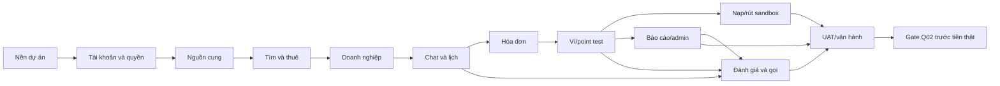

# Backlog và Definition of Done

> **I18N-04 · 05/10/2026 · v0.1.3 (phạm vi danh mục đã duyệt):** B02 danh mục đọc nối I18N-04: nạp 10 ngành/50 nhóm/140 kỹ năng, bản dịch VI/EN/JA, locale và fallback. Không đóng CRUD quản trị, tìm kiếm B03 hoặc locale tài khoản I18N-03. OTP B01-02 vẫn Pending theo chủ dự án.

Phiên bản 0.1.2 · 28/09/2026 · Đợt 1 triển khai local danh mục Expo/NestJS/PostgreSQL/PostGIS. Chi tiết và bằng chứng tại DOC-065; phần ngoài danh mục vẫn là thiết kế, chưa production/tiền thật.

## Trình tự triển khai

Mỗi lát đi xuyên dữ liệu → API → app → test → tài liệu. Không cần viết xong mọi màn hoặc mọi endpoint mới có một hành trình chạy được. App trước; web admin phục vụ vận hành, website khách triển khai theo kế hoạch sau. Không tự áp ngày ra mắt hoặc ngân sách. Việc cấp credentials/chọn gói trả phí cần chủ dự án chọn.

## Definition of Done chung

- FR/scope được đối chiếu trước code; thiết kế mới được review, không tự đưa mục pending vào.
- Migration có phiên bản, kiểm DB test và restore; secrets tách môi trường.
- API contract, authorization, idempotency/version và trạng thái lỗi có kiểm thử phù hợp.
- UI có loading/rỗng/lỗi/offline/không quyền, truy cập được trên thiết bị mục tiêu.
- Test P0 của lát pass; lỗi còn lại được ghi rõ tác động, không giấu bằng mock.
- Excel Danh muc/Anh huong/Quyet dinh/Dong bo và nguồn/bản xuất được cập nhật cùng đợt.
- Có bản demo và hướng dẫn tái hiện cho chủ dự án review; không tự commit/push/deploy production.

## Các đợt và phụ thuộc

### B00 · Nền dự án và kiểm hợp đồng

Phụ thuộc: Không. Trạng thái: Đợt 1 local đã kiểm; native và CI từ xa chưa kiểm. B00 rộng hơn và toàn bộ B02 chưa hoàn tất. Bằng chứng: DOC-065.

Phạm vi:
- Expo app/API và contracts trong npm workspace; web/admin chưa triển khai theo DOC-064
- NestJS module danh mục; chưa có nhu cầu worker
- Môi trường local/test và secrets tách biệt

Tiêu chí hoàn thành:
- Lint, typecheck, build và test chạy được
- Contract và migration có phiên bản, CI cơ bản hoạt động
- Không kết nối tiền thật

QA: QA-055 (chưa đủ toàn phạm vi), QA-056…060; xem DOC-065

Tài liệu: PLAN-001, PLAN-002, PLAN-004

### B01 · Tài khoản và quyền nền

Phụ thuộc: B00. Trạng thái: Chưa triển khai.

Phạm vi:
- Email/mật khẩu, điện thoại/OTP và phiên đăng nhập
- Liên kết định danh, khôi phục, xác thực tăng cường
- Quyền admin và membership theo doanh nghiệp

Tiêu chí hoàn thành:
- Đổi vai không cấp quyền; thu hồi token có hiệu lực
- Không lộ tài khoản tồn tại hoặc lưu OTP/token thô
- Xóa tài khoản kiểm nghĩa vụ, giữ lịch sử tài chính

QA: QA-001, QA-002, QA-003, QA-004, QA-005, QA-006

Tài liệu: PLAN-001, PLAN-002, PLAN-003

### B02 · Nguồn cung đa ngành

Phụ thuộc: B01. Trạng thái: Chưa triển khai.

Phạm vi:
- 10 ngành và kỹ năng dùng chung nhiều ngành
- Hồ sơ, ảnh, địa chỉ và vùng phục vụ
- Bật/tắt nhận việc; admin xác minh và quản lý danh mục

Tiêu chí hoàn thành:
- Thợ/cửa hàng/doanh nghiệp đăng ký được
- Tắt nhận việc chặn cả yêu cầu từ tab cũ
- Giấy tờ và dữ liệu ví không rò qua hồ sơ

QA: QA-007, QA-008, QA-009, QA-012, QA-049

Tài liệu: DOC-004, PLAN-001, PLAN-002

### B03 · Tìm thợ và gửi yêu cầu

Phụ thuộc: B02. Trạng thái: Chưa triển khai.

Phạm vi:
- Danh sách/bản đồ, vị trí tay/GPS, bán kính10km và mở rộng
- Liên hệ trước thuê, nhiều kỹ năng, làm ngay/hẹn trước
- Nhận, từ chối và rút yêu cầu

Tiêu chí hoàn thành:
- Lọc kỹ năng/nơi làm/vùng trước xếp hạng
- Điện thoại xác minh trước thuê; retry không trùng việc
- Làm ngay nhập ETA; không có bước bắt đầu
- Chặn tự thuê/thuê doanh nghiệp đang tham gia. Việc đã nhận không tự hết hạn, tự đóng hay ép đổi lịch theo thời gian; hoàn tất bình thường cần hai dấu thanh toán.

QA: QA-010, QA-011, QA-017, QA-018, QA-053

Tài liệu: PLAN-006, PLAN-002, PLAN-003

### B04 · Doanh nghiệp và bàn giao

Phụ thuộc: B03. Trạng thái: Chưa triển khai.

Phạm vi:
- Mời thành viên7ngày, cấp quyền, rời doanh nghiệp
- Phân công, đổi nhân viên và đầu mối cuộc gọi
- Một quản lý kiêm nhiều quyền; chuyển chủ vẫn pending

Tiêu chí hoàn thành:
- Chặn truy cập sai doanh nghiệp
- Một assignment hiệu lực, lịch sử đầy đủ
- Người cũ mất quyền công việc, giữ chat riêng

QA: QA-013, QA-014, QA-015, QA-016

Tài liệu: PLAN-001, PLAN-002, PLAN-003

### B05 · Chat, lịch và thông báo

Phụ thuộc: B04. Trạng thái: Chưa triển khai.

Phạm vi:
- Phòng cá nhân/cửa hàng, lịch sử, cursor và retry
- Outbox, inbox, đổi lịch và nhắc24h/1h
- Cài đặt thông báo tin nhắn/cuộc gọi

Tiêu chí hoàn thành:
- Chat trước và sau thuê, dùng lại đúng phòng
- ACK sau commit, reconnect phục hồi đủ
- Quản lý không đọc phòng riêng nhân viên
- Đổi lịch chỉ đổi giờ hẹn; không thêm luồng đổi lịch qua admin/report. Không nhắc theo lịch cũ.

QA: QA-019, QA-021, QA-022, QA-023, QA-025, QA-050

Tài liệu: PLAN-002, PLAN-007, PLAN-003

### B06 · Hóa đơn chưa chạy tiền thật

Phụ thuộc: B05. Trạng thái: Chưa triển khai.

Phạm vi:
- Ảnh kết quả, nháp, công/vật tư và phiên bản hóa đơn
- Yêu cầu sửa, preview point mặc định0
- Dừng việc và kiểm cạnh tranh phiên bản

Tiêu chí hoàn thành:
- Gửi cần ảnh ready, không chờ quản lý duyệt
- Bản đã gửi bất biến; sau khóa không sửa số tiền
- Kiểm cạnh tranh yêu cầu sửa và xác nhận

QA: QA-020, QA-026, QA-027, QA-028

Tài liệu: PLAN-001, PLAN-002, PLAN-003

### B07 · Sổ ví/point và quyết toán test

Phụ thuộc: B06. Trạng thái: Chưa triển khai.

Phạm vi:
- Tài khoản sổ, holds, bút toán cân bằng và phiên bản công thức
- Giữ phí/point, thợ nhận tiền, khách báo đã trả
- Nhiều việc, đồng thời và khôi phục sau crash

Tiêu chí hoàn thành:
- Kết quả số nguyên đúng bộ mẫu; projection khớp entries
- Một settlement; hạn mức âm chỉ trả phí
- Thưởng chưa quyết toán không tiêu được; cash trực tiếp không vào sổ platform

QA: QA-029, QA-030, QA-031, QA-032, QA-033, QA-034, QA-035, QA-036, QA-037, QA-043

Tài liệu: PLAN-001, PLAN-002, PLAN-003

### B08 · Nạp/rút và ngân hàng sandbox

Phụ thuộc: B07. Trạng thái: Chưa triển khai.

Phạm vi:
- Một ngân hàng đã xác minh, duyệt thủ công, mức rút50000
- Đối soát mã ngân hàng và payout chưa rõ kết quả
- Hàng đợi admin và nhật ký

Tiêu chí hoàn thành:
- Không rút credit; giữ tiền khi unknown
- Không ghi có hai lần hoặc chuyển lại mù
- Không lộ ví partner cho khách

QA: QA-040, QA-041, QA-042

Tài liệu: PLAN-007, PLAN-003, PLAN-004

### B09 · Báo cáo/admin hoàn tất thay

Phụ thuộc: B07. Trạng thái: Chưa triển khai.

Phạm vi:
- Báo cáo, chứng cứ và URL có quyền
- Preview tác động, fresh auth, lý do và recheck
- Admin hoàn tất dùng cùng service quyết toán

Tiêu chí hoàn thành:
- Không giả dấu thợ nhận tiền
- Đóng báo cáo không sinh bút toán
- Giữ rõ gate Q02, không coi đã giải quyết khoản giữ treo

QA: QA-038, QA-039, QA-047, QA-048

Tài liệu: PLAN-002, PLAN-003, PLAN-005

### B10 · Đánh giá và gọi trong app

Phụ thuộc: B05, B07, B09. Trạng thái: Chưa triển khai.

Phạm vi:
- Q01 hai dấu, mỗi chiều một đánh giá
- Ẩn/gỡ, phản hồi và sao trung bình
- Adapter gọi, thợ/cửa hàng, gọi sau hoàn tất

Tiêu chí hoàn thành:
- Admin hoàn tất không tự mở đánh giá
- Đánh giá bị ẩn/gỡ không tính sao
- Kiểm quyền gọi hiện hành; chọn provider trước tích hợp thật

QA: QA-024, QA-044, QA-045, QA-046

Tài liệu: PLAN-007, PLAN-003

### B11 · Admin vận hành và UAT

Phụ thuộc: B08, B09, B10. Trạng thái: Chưa triển khai.

Phạm vi:
- Tra cứu tài khoản/việc/hóa đơn, hỗ trợ, audit và funnel
- Design System, trạng thái field và khả năng truy cập
- E2E iOS/Android/web, diễn tập phục hồi

Tiêu chí hoàn thành:
- FR→API→QA có bằng chứng, các caP0 pass
- Chủ dự án duyệt UAT; prototype không thay kết quả sản phẩm
- Deploy/backup/restore được kiểm thực tế

QA: QA-051, QA-052, QA-054, QA-055

Tài liệu: PLAN-003, PLAN-004, PLAN-006

### G-MONEY · Cổng bắt buộc trước tiền thật

Phụ thuộc: B11. Trạng thái: Chưa triển khai.

Phạm vi:
- Chốt và triển khai cách xử lý khoản giữ treo qua báo cáo/admin
- Ngân hàng, đối soát và dự trữ nguồn tiền bù point
- Chính sách lưu giữ, chống gian lận và xử lý sự cố

Tiêu chí hoàn thành:
- Runbook PLAN-005 và test ngoại lệ được duyệt
- Chưa mở nạp/rút/giữ phí tiền thật khi gate chưa đạt
- Ngân sách và nhà cung cấp được chủ dự án chọn

QA: QA-038, QA-043, QA-055

Tài liệu: PLAN-005, PLAN-007, PLAN-004

## Các hồ sơ vẫn còn phải làm

PLAN-004 CI/CD/deploy/backup runbook, PLAN-005 runbook ngoại lệ tài chính, PLAN-006 Design System/field specs, PLAN-007 nhà cung cấp/dự toán. Bộ hiện tại đã tạo thiết kế cho PLAN-001/002/003/008; không coi các migration/API/test là đã triển khai.

## Quyết định đã chốt sau review

1. Đã chốt: chặn thuê chính mình và doanh nghiệp đang là thành viên.
2. Đã chốt: việc có thể kéo dài bao lâu cũng được, không bắt đổi lịch và không tự kết thúc. Đổi lịch chỉ thay đổi giờ hẹn; sau xác nhận hóa đơn không còn hành động đổi lịch, không thêm luồng report/admin. Hoàn tất bình thường cần khách báo đã trả và thợ xác nhận đã nhận; xác nhận hóa đơn riêng chưa kết thúc việc.
Xác thực tăng cường và MFA admin đã có trong yêu cầu. Phương thức kỹ thuật cụ thể (ví dụ TOTP cho admin) sẽ chọn khi làm B01; không hỏi duyệt lại nguyên tắc bảo mật.

Chưa cần hỏi lại công thức, Q01, chat riêng, nhận việc hay Q02: các điểm đó giữ đúng baseline hiện hành.

## LOGTEST-01 · 28/09/2026

Phương án A đã triển khai và kiểm local; chi tiết vận hành/bằng chứng tại [DOC-071](../implementation/logging-testing.md). Native còn BLOCKED; `.github/workflows/quality.yml` đã chuẩn bị, chưa push/chạy remote CI.

B00 đã có log/test local và workflow quality. Chưa đóng toàn bộ B00/PLAN-004: còn native, remoteCI và deploy/backup production ngoài phạm vi. DOC-071 là runbook local hiện hành.
