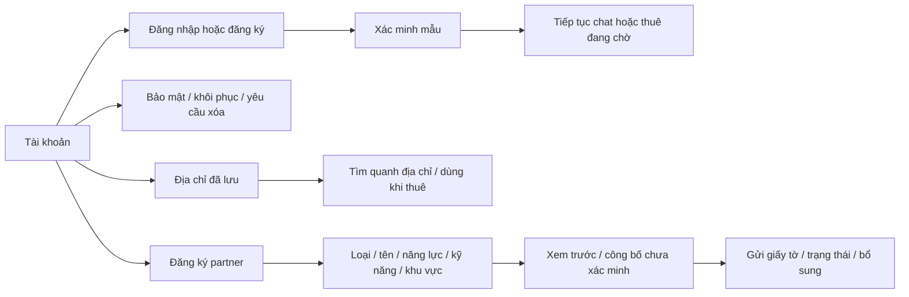

# Đợt 1 — Tài khoản, địa chỉ, đăng ký partner · React v0.9

> **B01-04A · 06/10/2026 — quy tắc hiện hành đã duyệt:** Địa chỉ đầu tiên trong sổ đang rỗng là mặc định; chọn mục mới bỏ mặc định cũ. Gỡ mặc định để chưa có mặc định, không tự chọn địa chỉ khác (thay hành vi tự chọn trong prototype trước đây). Sửa dùng version và giữ bản nháp khi xung đột; gỡ không đổi địa chỉ đã chụp trên việc cũ. Phiên đăng nhập hiển thị thời điểm tạo/hoạt động và đánh dấu hiện tại; thu hồi cả lần đăng nhập kể cả các token refresh, không lộ IP/token. App hiện dùng nhập tọa độ thủ công theo phạm vi đã duyệt; GPS/map, nối tìm/thuê và OTP chưa triển khai trong đợt này. Contract v0.1.5 tại `docs/technical-design`; bằng chứng app tại báo cáo B01-04A trong repo. Các số liệu prototype bên dưới là lịch sử.

DOC-058 · 23/09/2026 · UI-12. Chủ dự án đồng ý làm gộp đợt 1. Đây là thiết kế tương tác React/Storybook, không phải hệ thống xác thực hay xét duyệt production.

## Xem và thử

Mở Tài khoản ở thanh dưới. Các đường vào: Thông tin và bảo mật; Địa chỉ đã lưu; Trở thành partner. Storybook bổ sung Tài khoản · tổng quan / đăng nhập / bảo mật / khôi phục, Khách · địa chỉ, Partner · đăng ký và xác minh, Mobile · tài khoản và đăng ký. Tổng 31 stories.

## Phạm vi đã dựng

- Điện thoại/OTP, đăng ký điện thoại mẫu mới; email/mật khẩu, đăng ký và xác minh email; quên/đặt lại mật khẩu. Sai mã/hết hạn/gửi lại; mã mẫu 123456, mật khẩu ban đầu Demo12345. Đăng nhập từ chat tiếp tục đúng phòng. Email cần xác minh điện thoại trước gửi thuê.
- Thông tin cá nhân; đổi điện thoại/email hai bước, giữ kênh cũ trước bước cuối; xung đột mẫu 0900000099/trung@example.com bị chặn. Đổi mật khẩu và kết thúc phiên mẫu khác. Khôi phục gửi chứng cứ mô tả, yêu cầu xóa có xác nhận mất point/xác thực lại và danh sách nghĩa vụ mẫu; cả hai chờ admin, không tự khôi phục hoặc xóa thật.
- Địa chỉ thêm/sửa/xóa/mặc định, chọn tìm quanh địa chỉ, dùng trong form thuê. Sửa/xóa địa chỉ không thay địa chỉ đã chụp vào công việc cũ. Sơ đồ chọn điểm và từ chối vị trí là tình huống mẫu, chưa định vị/geocode.
- Đăng ký thợ tự do/cửa hàng/doanh nghiệp theo 5 bước; giới thiệu, kinh nghiệm, kỹ năng đa ngành, giá tham khảo, ảnh năng lực, khu vực, địa chỉ và riêng tư. Nháp giữ khi chuyển màn trong lượt thử. Hồ sơ công bố hiện trong tìm kiếm với trạng thái xác minh riêng; không cho thuê chính hồ sơ mình.
- Danh tính/chuyên môn và doanh nghiệp khi áp dụng: tên tệp chứng minh, gửi xét duyệt, cần bổ sung/không đạt/đã xác minh. Phần phản hồi admin nằm trong công cụ mô phỏng, không là quyền của partner. Thay đổi xác minh danh tính của hồ sơ đã công bố cập nhật danh sách mẫu.

## Giới hạn cần phân biệt

- Một tài khoản thử trong mỗi Journey, các vai partner khác là tài khoản mẫu để review. Đăng ký tài khoản mới thay dữ liệu tài khoản mẫu và làm mới việc/chat/hồ sơ vừa đăng ký; không phải kho nhiều tài khoản. Dữ liệu mất khi tải lại.
- Không OTP/email/SMS thật, không OAuth, không token/session backend, không kiểm duyệt thật. Link email được mô phỏng bằng bước nhập mã; hạn 5 phút mô phỏng và độ dài mật khẩu 8 chỉ để thử UI, chưa là chính sách sản phẩm được chốt.
- Tệp ảnh/giấy tờ chỉ ghi tên tệp trong bộ nhớ; không đọc/tải lên server. Ảnh public vẫn minh họa. Không dùng dữ liệu nhạy cảm thật.
- Địa điểm có thể đổi nhãn và được lưu vào form; khoảng cách/kết quả địa lý vẫn dữ liệu mẫu, chưa tính lại bán kính thực. Danh mục kỹ năng là 10 ngành/20 kỹ năng hiện có.
- Hồ sơ mới nối tìm kiếm/xem hồ sơ/xác minh; chưa tự tạo tổ chức, đội ngũ và quyền vận hành doanh nghiệp production. Tổ chức An Tâm mẫu tiếp tục dùng để thử công việc/đội ngũ. Không coi đăng ký doanh nghiệp là đã hoàn tất provisioning backend.
- Admin xử lý khôi phục/xóa/xác minh chính thức nằm trong đợt 4. Checklist xóa chỉ dựa việc/yêu cầu ví/hồ sơ mẫu hiện có, chưa phải kiểm toàn bộ nghĩa vụ server. Google/Facebook, chuyển chủ/đóng doanh nghiệp, quảng bá và tài chính ngoại lệ vẫn pending như trước.

## Kiểm chứng

29 test logic đạt: 22 kiểm tra cũ và 7 mới về OTP, đổi kênh hai bước, đăng ký email/điện thoại, đặt lại mật khẩu, yêu cầu khôi phục/xóa, địa chỉ mặc định và snapshot. Browser đã thử OTP sai/đúng; quay lại chat sau login; thêm và đặt mặc định địa chỉ; đăng ký/công bố partner, bổ sung/xác minh và tìm hồ sơ; đổi kênh hai bước. Màn bảo mật không tràn ngang 360/390/768/1440px, xem hình mobile tài khoản. Build Vite/Storybook đạt. Chưa nghiệm thu toàn bộ WCAG, thiết bị native hoặc tích hợp thật.

## Đồng bộ

DOC-050, DOC-052/053/054/056/057, PLAN-006 và DOC-058, registry, ZIP hiện hành đồng bộ. BRD/FR/NFR/SRS/ERD/API/quyền và wireframe nghiệp vụ không đổi: chuyển luồng đã có vào UI mới, không thay nghiệp vụ. Ghi rõ bản mẫu không thay kết quả triển khai sản phẩm.

## UI-13 — Bố cục Point đã duyệt (23/09/2026)

Trong màn Tài khoản, thẻ Point nằm ngay dưới lời chào và trước danh sách quản lý trên cả mobile/desktop. Thẻ ngang nền xanh nhạt, hiển thị số point, giá trị tương đương và “Dùng để thanh toán dịch vụ”. Bỏ cột Point bên phải và đoạn quy tắc dài tại đây. Quy tắc tích/dùng Point giữ nguyên. Bản vá React v0.9a; gói UI-UX-v0.11.zip.

## UI-14 — Đợt 2, React v0.10

[DOC-059](activity-batch.md) bổ sung đổi lịch/rút/dừng, đánh giá hai chiều và liên lạc/thông báo. Các giới hạn cũ về những màn này được thay bằng phạm vi và giới hạn DOC-059. Tài khoản có đường vào Tin nhắn và thông báo; Point vẫn ngay dưới lời chào. Nghiệp vụ tiền không đổi.

## UI-15 — Lịch sử bố cục; vị trí chuông được thay thế bởi UI-16

Chủ dự án đã duyệt sau tham khảo LinkedIn/Airbnb. React v0.10a: chuông ở header khách/partner/doanh nghiệp mở trang Thông báo riêng, huy hiệu số chưa đọc, Tất cả/Chưa đọc và đánh dấu đã đọc. Bấm thông báo mở đúng việc/phòng chat và cập nhật huy hiệu. Tin nhắn chỉ chứa hộp thư/chat/gọi. Tài khoản → Cài đặt → Thông báo là đường quản lý tùy chọn. Tắt push vẫn giữ thông báo trong app.

Partner/doanh nghiệp dùng thanh dưới Công việc / Ví / Tin nhắn / Tài khoản; nhân viên không có Ví. Hồ sơ cung cấp dịch vụ, Đội ngũ (theo quyền), tài khoản doanh nghiệp của nhân viên nằm trong Tài khoản. Không đổi quyền hoặc nghiệp vụ. Header desktop dùng cùng điểm vào chuông; mobile không thêm tab thứ năm. Bản mẫu vẫn chưa kết nối push thật.

Kiểm chứng: build Vite/Storybook; browser mở chuông/lọc chưa đọc, đường cài đặt, Tin nhắn không còn menu phụ, partner mở thông báo vào đúng chat và giảm huy hiệu. Mobile 390px không tràn ngang. Gói UI-UX-v0.13; registry v1.21.

## UI-16 — Hiện hành: avatar vào tài khoản, tab Thông báo

Chủ dự án chốt 23/09/2026: giữ avatar chữ đầu tên trên header để mở Tài khoản; bỏ chuông header. Thông báo thay Tài khoản trong điều hướng chính (mobile ở dưới, desktop ở trên). Khách: Tìm dịch vụ / Công việc / Tin nhắn / Thông báo. Partner: Công việc / Ví / Tin nhắn / Thông báo; nhân viên không có Ví. Avatar partner dùng tên người đang xem. Hồ sơ/Đội ngũ/Cài đặt vẫn trong Tài khoản và giữ quyền. Huy hiệu chưa đọc nằm ở tab Thông báo. UI-16 thay vị trí chuông của UI-15; các hành vi lọc, đọc, mở đúng đối tượng và tùy chọn thông báo giữ nguyên. React v0.10b, 39 stories; gói UI-UX-v0.14, registry v1.22. Build Vite/Storybook đạt; browser kiểm avatar/tab và bố cục mobile.

## UI-19 · 27/09/2026 · React v0.13
Bổ sung Hỗ trợ từ Tài khoản/công việc, admin hỗ trợ/xác minh/kiểm duyệt đánh giá và nhật ký. Xác minh partner qua admin, bỏ nút tự mô phỏng duyệt; tệp chờ duyệt khóa sửa. Ẩn/khôi phục đánh giá cập nhật điểm trong phiên. Quyết định và giới hạn chi tiết ở DOC-061 `ui-ux/specs/support-moderation.md`; nội dung UI-19 thay các ghi chú trước rằng những màn này chưa có. Không thay tiền/point khi xử lý báo cáo. 48 stories, 42 kiểm tra logic; UI-UX-v0.17.zip.

## UI-20 — cập nhật hiện hành 27/09/2026
React v0.14, UI-UX-v0.18.zip, registry v1.26. Đã bổ sung quản trị tài khoản, đình chỉ partner, danh mục và báo cáo/nhật ký vận hành. Xem [phạm vi, luồng và bằng chứng QA](admin-operations.md). Các ghi chú trước đây rằng bốn nhóm này chưa có trong React được thay bằng UI-20; không đổi nghiệp vụ hay mở các mục pending. Các lớp xác thực và dữ liệu vẫn là mô phỏng.

## P0-1 — quyết định triển khai 06/10/2026

P0-1 · 06/10/2026 · v0.1.6 · Đã duyệt: hồ sơ quản lý riêng có version; draft/published, công bố không tự bật nhận việc; phone_verified trước tạo partner, owner và ví rỗng cùng transaction. Tìm theo distance mặc định, vùng tròn đo tới tâm và phải bao phủ khách; cursor theo distance_m/created_at/id, gắn bộ lọc. Tài khoản/provider test tách biệt được phép tạo trực tiếp; OTP, polygon, bản đồ và xếp hạng recommended/rating chưa triển khai. Không production/tiền thật.

Hồ sơ public và màn quản lý dùng dữ liệu riêng. Chỉ profile.manage/owner đang hoạt động được sửa; draft không hiện public. Công bố yêu cầu ít nhất một kỹ năng active và nơi làm phù hợp từng mode, ảnh năng lực chưa bắt buộc trong gói đầu. Sửa làm published không còn hợp lệ bị từ chối; về draft tắt nhận việc. Tắt nhận việc vẫn xem qua link, không hiện search. Tên kỹ năng public theo VI/EN/JA; không tự dịch tên/bio người dùng. Prototype trước P0-1 còn dữ liệu mô phỏng, không làm chuẩn thay quy tắc máy chủ mới.

Bổ sung theo yêu cầu chủ dự án P0-1: được tạo tài khoản DEMO mới cho thợ/cửa hàng/doanh nghiệp trong DB local để tự thử khi OTP Pending. Không sửa tài khoản hiện hữu, không huy hiệu xác minh hồ sơ, ví 0đ; công cụ chỉ chạy NODE_ENV=development, DB dvqb_local trên localhost. Tài khoản thử không chứng minh xác minh SMS hay đăng ký production đã hoàn tất.
