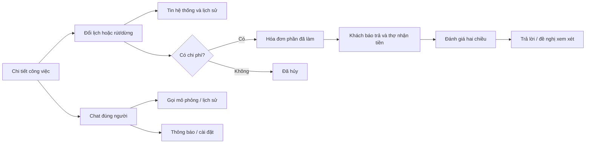

# Đợt 2 — Công việc, đánh giá và liên lạc · React v0.10

DOC-059 · UI-14 · 23/09/2026. Chủ dự án yêu cầu làm tiếp sau đợt 1. Chuyển các nghiệp vụ đã chốt sang React/Storybook; chưa triển khai backend.

## Điểm vào

- Công việc → chọn việc → Lịch hẹn và thay đổi. Đổi ngày/giờ hoặc rút/dừng với lý do. Hai bên đã trao đổi; không có bước duyệt lại lịch.
- Công việc hoàn tất → Đánh giá sau công việc. Chuyển vai để thử đánh giá chiều còn lại, trả lời và đề nghị xem xét.
- Tin nhắn → chọn người → Gọi trong app. Thông báo mở từ tab điều hướng; avatar header → Tài khoản → Cài đặt → Thông báo (UI-16).
- Storybook: Công việc · đổi lịch và dừng; Đánh giá · hai chiều; Liên lạc · hộp thư khách / hộp thư partner; Thông báo · cài đặt; Mobile · công việc và liên lạc. Tổng hiện hành 39 stories sau UI-15.

## Quy tắc áp dụng

- Việc đã nhận không tự hết hạn. Đổi lịch tương lai theo giờ Hà Nội; chỉ trước khóa hóa đơn, không áp dụng khi đã dừng. Lưu lịch sử, dùng lịch mới để thử nhắc 24h/1h; thông báo nhắc cũ được ghi đã thay lịch.
- Yêu cầu chờ: khách rút, partner từ chối, cần lý do. Việc đã nhận: khai báo đã trao đổi; không có chi phí thì hủy, có chi phí thì chờ lập/sửa hóa đơn thực tế. Không đổi tiền/point hoặc mở lại tài chính ngoại lệ.
- Chỉ đánh giá khi có cả hai dấu thanh toán trong dữ liệu mẫu. Mỗi chiều một đánh giá; ảnh chỉ ghi tên tệp, trả lời và gửi đề nghị xem xét không tự ẩn đánh giá. Chưa có admin duyệt trong đợt này.
- Chat trước thuê, lịch sử giữ theo cặp tài khoản. Partner có ba khách mẫu để xem bố cục hộp thư nhiều khách; Mai/Hùng là dữ liệu minh họa độc lập, chưa có tài khoản phía khách để đăng nhập. Tin có customerId, không lẫn phòng; phòng nhân viên theo người được giao, quản lý không đọc được phòng đó.
- Gọi cần việc đã nhận và quan hệ liên hệ còn hợp lệ; cửa hàng là Quản lý An Tâm mẫu. Sau hoàn tất vẫn gọi lại; nhân viên đã rời không gọi theo phân công cũ. Người dùng chọn chat thợ hoặc cửa hàng từ chi tiết việc. Chưa có UI thay đầu mối gọi.
- Màn gọi: quyền mic mẫu, gọi ra/đến, nhận/từ chối, không trả lời/bận, mic/loa, mất kết nối/kết thúc; kết quả lưu vào đúng chat. Không ghi âm, không dùng mic thật, không có WebRTC hoặc thời lượng thật. Đổi vai/rời khu vực đang gọi không mô phỏng cuộc gọi chạy nền.
- Tắt riêng thông báo tin nhắn/chuông gọi; thông báo trong app vẫn giữ. Cài đặt theo tài khoản mẫu; công việc và nhắc lịch có tùy chọn riêng. Không email quảng cáo; thông báo an toàn không bị tắt.

## Kiểm chứng và giới hạn

- 33 test logic đạt (29 trước + 4 nhóm mới): đổi lịch, hủy/dừng, điều kiện đánh giá, quyền gọi sau hoàn tất/rời doanh nghiệp. Build Vite và Storybook đạt.
- Browser: lưu ngày/giờ hẹn và lịch sử; mở đúng chat; gửi tin, xem phía partner; gọi mẫu và kết thúc; tắt chuông vẫn ghi lịch sử; đánh giá hai chiều, trả lời; dừng có chi phí giữ việc chờ hóa đơn. Bố cục mobile/desktop được rà soát.
- Nhắc lịch dùng nút mô phỏng, chưa có worker chạy nền; thông báo chưa có push/email/đa thiết bị hoặc bảo đảm giao nhận. Tin gửi lỗi/thử lại là mô phỏng, không phải retry mạng thật.
- Số sao trên hồ sơ tìm kiếm vẫn là fixture, chưa tổng hợp từ đánh giá mới. Xử lý ẩn/gỡ và tính lại sao ở nhóm admin; không tuyên bố đã nối tổng hợp server.
- Dữ liệu trong phiên, tải lại sẽ mất. Các quyền kiểm tại prototype không thay thế phân quyền server. Ảnh đánh giá chỉ tên tệp; không dùng chứng cứ thật.
- Các mục pending giữ nguyên: banner/voucher, OAuth xã hội, EN/JA, chuyển chủ/đóng doanh nghiệp, chặn/báo cáo liên lạc, tranh chấp nâng cao, đảo tiền và khoản giữ treo. Báo cáo hỗ trợ/admin là đợt 4; không có nút tự hoàn tiền trong đợt này.

## Đồng bộ

DOC-050, DOC-056, DOC-057, DOC-058 (đường vào liên lạc), PLAN-006, README, registry v1.20 và ZIP UI-UX-v0.12. BRD/FR/NFR/SRS/API/ERD và wireframe nghiệp vụ không đổi: đây là bản thể hiện UI của quyết định cũ, không chốt dịch vụ bên ngoài hoặc chính sách mới.

## UI-15 — Lịch sử bố cục; vị trí chuông được thay thế bởi UI-16

Chủ dự án đã duyệt sau tham khảo LinkedIn/Airbnb. React v0.10a: chuông ở header khách/partner/doanh nghiệp mở trang Thông báo riêng, huy hiệu số chưa đọc, Tất cả/Chưa đọc và đánh dấu đã đọc. Bấm thông báo mở đúng việc/phòng chat và cập nhật huy hiệu. Tin nhắn chỉ chứa hộp thư/chat/gọi. Tài khoản → Cài đặt → Thông báo là đường quản lý tùy chọn. Tắt push vẫn giữ thông báo trong app.

Partner/doanh nghiệp dùng thanh dưới Công việc / Ví / Tin nhắn / Tài khoản; nhân viên không có Ví. Hồ sơ cung cấp dịch vụ, Đội ngũ (theo quyền), tài khoản doanh nghiệp của nhân viên nằm trong Tài khoản. Không đổi quyền hoặc nghiệp vụ. Header desktop dùng cùng điểm vào chuông; mobile không thêm tab thứ năm. Bản mẫu vẫn chưa kết nối push thật.

Kiểm chứng: build Vite/Storybook; browser mở chuông/lọc chưa đọc, đường cài đặt, Tin nhắn không còn menu phụ, partner mở thông báo vào đúng chat và giảm huy hiệu. Mobile 390px không tràn ngang. Gói UI-UX-v0.13; registry v1.21.

## UI-16 — Hiện hành: avatar vào tài khoản, tab Thông báo

Chủ dự án chốt 23/09/2026: giữ avatar chữ đầu tên trên header để mở Tài khoản; bỏ chuông header. Thông báo thay Tài khoản trong điều hướng chính (mobile ở dưới, desktop ở trên). Khách: Tìm dịch vụ / Công việc / Tin nhắn / Thông báo. Partner: Công việc / Ví / Tin nhắn / Thông báo; nhân viên không có Ví. Avatar partner dùng tên người đang xem. Hồ sơ/Đội ngũ/Cài đặt vẫn trong Tài khoản và giữ quyền. Huy hiệu chưa đọc nằm ở tab Thông báo. UI-16 thay vị trí chuông của UI-15; các hành vi lọc, đọc, mở đúng đối tượng và tùy chọn thông báo giữ nguyên. React v0.10b, 39 stories; gói UI-UX-v0.14, registry v1.22. Build Vite/Storybook đạt; browser kiểm avatar/tab và bố cục mobile.

## UI-19 · 27/09/2026 · React v0.13
Bổ sung Hỗ trợ từ Tài khoản/công việc, admin hỗ trợ/xác minh/kiểm duyệt đánh giá và nhật ký. Xác minh partner qua admin, bỏ nút tự mô phỏng duyệt; tệp chờ duyệt khóa sửa. Ẩn/khôi phục đánh giá cập nhật điểm trong phiên. Quyết định và giới hạn chi tiết ở DOC-061 `ui-ux/specs/support-moderation.md`; nội dung UI-19 thay các ghi chú trước rằng những màn này chưa có. Không thay tiền/point khi xử lý báo cáo. 48 stories, 42 kiểm tra logic; UI-UX-v0.17.zip.

## UI-20 — cập nhật hiện hành 27/09/2026
React v0.14, UI-UX-v0.18.zip, registry v1.26. Đã bổ sung quản trị tài khoản, đình chỉ partner, danh mục và báo cáo/nhật ký vận hành. Xem [phạm vi, luồng và bằng chứng QA](admin-operations.md). Các ghi chú trước đây rằng bốn nhóm này chưa có trong React được thay bằng UI-20; không đổi nghiệp vụ hay mở các mục pending. Các lớp xác thực và dữ liệu vẫn là mô phỏng.

## UI-21 — rà soát luồng 27/09/2026
Bản hiện hành React v0.15 / UI-UX-v0.19.zip. Đã sửa kiểm trạng thái lúc gửi thuê, mở chat đúng người từ công việc, thông báo đến nhân viên phụ trách và khôi phục giá trị point khi mở hóa đơn từ thông báo. [Ma trận kiểm chứng và phần chưa nghiệm thu](flow-review.md). Không đổi nghiệp vụ đã chốt; 49 tests, 52 stories.

## P1-02 — Tùy chọn nhắc lịch riêng, 14/10/2026

P1-02 ngày 14/10/2026: chủ dự án duyệt bổ sung công tắc nhắc lịch riêng và đồng bộ spec. Settings có bốn boolean bắt buộc message_push, call_push, service_push, reminder_push; mặc định true. reminder_push chỉ điều khiển gửi nhắc 24 giờ/1 giờ ra ngoài ứng dụng, độc lập service_push (công việc/hóa đơn). Tắt bất kỳ mục nào vẫn giữ inbox và lịch sử trong app; thông báo an toàn tài khoản không bị tắt. GET/PUT /me/notification-settings chỉ chính tài khoản, PUT giữ Idempotency-Key khi retry. Không duyệt provider, gửi push/email/SMS thật, billing hoặc production. Bằng chứng triển khai/local/native/CI/UAT được ghi riêng trong báo cáo B05-01 ở repo.

## RT-01A — cập nhật đã duyệt

RT-01A — 14/10/2026: chủ dự án đã duyệt triển khai Socket.IO 4, chỉ transport websocket, một NestJS instance. Path /v1/realtime/socket.io, namespace /; access token qua auth.token, không query URL. HTTP giữ thao tác ghi, ACK sau commit và lấy bù. Mỗi app một kết nối foreground, reconnect khi refresh, đóng khi logout/background; kiểm phiên và quyền hiện hành trước từng lần phát. Sự kiện là tín hiệu tải lại, không tự cộng tiền, unread hoặc quyết toán. Bốn công tắc push không tắt inbox/chat foreground. RT-01B/Redis, push ngoài app, gọi, presence/typing, provider/billing/production chưa mở.

Contract chi tiết: `docs/technical-design/realtime.json` v0.2, API v0.1.13. Dữ liệu thêm correlation_id và realtime_deliveries; unique theo event/user, lease riêng từng consumer; không dùng processed_at chung. QA-094–097 bổ sung kiểm realtime; không đổi trạng thái nghiệm thu của QA cũ. `notification.read.v1` chỉ lần đầu; thêm `invoice.revision_requested.v1`; invoice settled/payment_reported chuẩn hóa payload IDs/version, đọc eligibility/tiền bằng HTTP đúng quyền.

## MSG-01 — Tách Tin nhắn và Thông báo

MSG-01 — 15/10/2026, chủ dự án đã chốt: Tin nhắn và Thông báo có hai bộ đếm chưa đọc độc lập. Tin nhắn mới chỉ tăng badge Tin nhắn, không tạo mục trong inbox Thông báo và không tăng badge chuông. Badge Tin nhắn là tổng Conversation.unread trên tất cả phòng còn quyền truy cập, không phải số phòng; giữ định nghĩa unread hiện hành (không tính tin do chính mình gửi, mốc đọc theo sequence, gồm tin hệ thống của phòng). Badge Thông báo chỉ đếm mục chưa đọc ngoài chat, gồm công việc/hóa đơn/nhắc lịch và các loại khác đã được triển khai. Đọc một nhóm không đánh dấu đọc nhóm kia. Không hiển thị badge khi bằng 0; trên 99 hiện 99+. Sự kiện realtime chỉ yêu cầu tải lại HTTP, không cộng số trực tiếp; lấy bù khi reconnect/foreground, xóa số của tài khoản cũ khi đăng xuất/đổi tài khoản. Tắt message_push chỉ tắt push ngoài app, không tắt badge hoặc lịch sử chat. Không mở thêm provider hoặc production.
