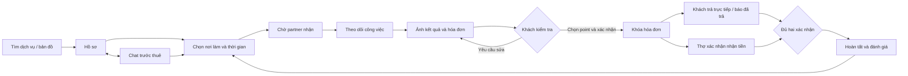

# Luồng khách hàng React v0.9

DOC-056 · 23/09/2026 · UI-05 cho phép làm gộp design system và luồng khách hàng. Bản này để review thiết kế, không kết nối dịch vụ hoặc tiền thật.

Thứ tự khách báo trả và thợ báo nhận có thể đảo nhau. Quyết toán/thưởng ở xác nhận nhận tiền; đánh giá cần cả hai dấu. Thuê lại giữ chat cùng partner trong phiên.

## Cách thử

1. Mở `http://127.0.0.1:5178/` hoặc story Desktop/Mobile hiện có.
2. Chọn hồ sơ → Thuê dịch vụ, hoặc Nhắn tin → Thuê dịch vụ này.
3. Nhập địa chỉ, chọn Làm ngay/Hẹn trước → Gửi yêu cầu thuê.
4. Bấm **Xem phía partner**, hoặc dùng thanh chọn vai trò. Nhận việc, phân công nếu là cửa hàng, chọn ảnh kết quả và gửi hóa đơn. Xem hướng dẫn chi tiết trong DOC-057.
5. Kiểm hóa đơn, dùng point nếu muốn. Có thể yêu cầu sửa; ví partner dùng để kiểm điều kiện giữ phí. Xác nhận hóa đơn rồi báo thanh toán.
6. Chuyển sang người thực hiện, xác nhận nhận tiền → phía khách đánh giá → thuê lại. Danh sách Công việc và Tin nhắn dùng được.

## Nghiệp vụ giữ nguyên

- Không bắt buộc chat trước khi thuê. Tin nhận việc được thêm vào phòng chat của cặp người dùng hiện có.
- Không tự hết hạn công việc; không có nút bắt đầu làm. Hóa đơn khóa không sửa nội dung/point.
- Vật tư và công tách riêng. Phí = floor(công × 10%). Thưởng = floor(công × tiền trả trực tiếp / (50 × tổng)); tổng 0 thì thưởng 0, theo prototype nghiệp vụ hiện hành.
- Hóa đơn mẫu: công 200.000đ, vật tư 100.000đ. Dùng 80.000 point → trả trực tiếp 220.000đ, phí 20.000đ, thưởng 2.933 point. Toàn point không có thưởng mới.
- Khách thiếu điều kiện xác nhận chỉ thấy thông báo phù hợp, không thấy ví/nợ partner. Point đã giữ không dùng lại ở công việc khác.
- Banner/quảng cáo/voucher vẫn ngoài phase đầu. Q02 vẫn cần giải quyết trước tiền thật.

## Phạm vi bản thử và phần chưa được chuyển sang UI mới

Luồng chính đã nối xuyên suốt, kèm chờ/từ chối/yêu cầu sửa/thiếu số dư/mất kết nối. Tài khoản dùng mẫu; dữ liệu lưu trong bộ nhớ trang, tải lại sẽ mất. Partner có màn thao tác riêng, dùng chung dữ liệu với khách. Thợ chọn ảnh và nhập số tiền, hóa đơn sửa tăng phiên bản; mọi thao tác chỉ mô phỏng trong bộ nhớ, không phải giao dịch thật.

Bản đồ/ảnh là minh họa; tìm kiếm vẫn cố định Cầu Giấy. Chưa có đăng nhập thật, gọi thật, nhắc lịch thật, định vị, lưu chat/backend hoặc chuyển tiền. Ảnh đánh giá chưa có trong UI mới. Đổi lịch/dừng việc/báo cáo hỗ trợ và các ngoại lệ khác tiếp tục tra prototype nghiệp vụ cổng 8765; bản React v0.3 chưa thay thế toàn bộ prototype đó. Nhóm partner/doanh nghiệp đã thêm ở v0.4, xem DOC-057; nhóm admin React và các màn phụ vẫn tiếp tục sau.

## Kiểm chứng lịch sử v0.3 ngày 23/09/2026

- Vite và Storybook build thành công. 14 stories gồm nền tảng, chờ nhận, hóa đơn, thanh toán, đánh giá và mobile hóa đơn.
- 8 bài kiểm tra logic: tiền/point, toàn point/0đ, hai thứ tự xác nhận, không đánh giá sớm, lặp nhận tiền không cộng lần hai, yêu cầu sửa/thay phiên bản, khóa không sửa, số point sai và chưa nhận việc không lập hóa đơn.
- Browser: từ hồ sơ gửi thuê → nhận việc → hóa đơn → dùng 80.000 point → thiếu số dư bị chặn → khóa → khách báo trả → thợ nhận → đánh giá thành công. Tin tự động nhận việc xuất hiện đúng phòng chat.
- Browser mobile: hẹn trước lưu đúng 24/09/2026 14:00 giờ Hà Nội; yêu cầu sửa hiển thị lý do và chặn xác nhận. Đã sửa lỗi lưu ngày giờ được phát hiện khi kiểm.
- Chi tiết công việc/hóa đơn không tràn ngang ở 360/390/768/1440px; đã xem ảnh mobile 390px và desktop. Đây không phải nghiệm thu mọi màn/breakpoint hoặc app native.
- Chưa kiểm accessibility tự động toàn bộ v0.3, chưa thử với người dùng thật. Build Storybook có cảnh báo chunk và không ghi được global settings; không ảnh hưởng kết quả build.

## Tác động tài liệu

DOC-050 prototype, PLAN-006 nền tảng, DOC-053 phạm vi thiết kế, DOC-052 hướng dẫn thử, DOC-054 README và DOC-056 này được cập nhật; Excel và ZIP cùng Drive ID được đồng bộ. BRD/FR/NFR/SRS, sơ đồ nghiệp vụ, quyền/trạng thái, ERD/API giữ nguyên vì không thay đổi nghiệp vụ. DOC-008 vẫn là bản mô phỏng nghiệp vụ rộng hơn; không gắn trạng thái hoàn thiện sản phẩm cho bản React.

## Bổ sung v0.4

Khách và partner dùng chung việc/hóa đơn/chat/ví. Tin riêng khách–nhân viên tách khỏi cửa hàng; panel mô phỏng cũ được thay bằng chuyển vai trò thử. Kết quả kiểm v0.4 và giới hạn: [DOC-057](partner-journey.md). UI khách v0.3 đã được chủ dự án xem và đồng ý trước đợt này.

UI-08: hồ sơ đã lưu từ partner cập nhật tìm kiếm/hồ sơ khách và danh sách kỹ năng form thuê trong cùng lượt thử. Danh mục và khoảng cách vẫn là mẫu, chưa có tính vùng phục vụ thật.

UI-09: bộ lọc khách có 10 ngành; đối chiếu tất cả kỹ năng partner đã chọn, hỗ trợ partner nhiều ngành. Form thuê và hồ sơ sử dụng cùng danh mục mẫu với editor.

UI-10: nhân viên bị gỡ giữ lịch sử chat cá nhân; việc chưa quyết toán về doanh nghiệp để phân công lại, hóa đơn và tiền giữ nguyên.

UI-11: nhân viên tự rời cũng đưa việc chưa quyết toán về chờ phân công lại như khi quản lý gỡ; không thay đổi hóa đơn/tiền hoặc lịch sử chat riêng.

UI-12 bổ sung nhóm tài khoản/địa chỉ/onboarding; [DOC-058](account-batch.md) thay phần giới hạn chưa có UI đăng nhập/địa chỉ/đăng ký trước đó. Xác thực/backend/định vị thật vẫn chưa kết nối.

## UI-14 — Đợt 2, React v0.10

[DOC-059](activity-batch.md) bổ sung đổi lịch/rút/dừng, đánh giá hai chiều và liên lạc/thông báo. Các giới hạn cũ về những màn này được thay bằng phạm vi và giới hạn DOC-059. Tài khoản có đường vào Tin nhắn và thông báo; Point vẫn ngay dưới lời chào. Nghiệp vụ tiền không đổi.

## UI-15 — Lịch sử bố cục; vị trí chuông được thay thế bởi UI-16

Chủ dự án đã duyệt sau tham khảo LinkedIn/Airbnb. React v0.10a: chuông ở header khách/partner/doanh nghiệp mở trang Thông báo riêng, huy hiệu số chưa đọc, Tất cả/Chưa đọc và đánh dấu đã đọc. Bấm thông báo mở đúng việc/phòng chat và cập nhật huy hiệu. Tin nhắn chỉ chứa hộp thư/chat/gọi. Tài khoản → Cài đặt → Thông báo là đường quản lý tùy chọn. Tắt push vẫn giữ thông báo trong app.

Partner/doanh nghiệp dùng thanh dưới Công việc / Ví / Tin nhắn / Tài khoản; nhân viên không có Ví. Hồ sơ cung cấp dịch vụ, Đội ngũ (theo quyền), tài khoản doanh nghiệp của nhân viên nằm trong Tài khoản. Không đổi quyền hoặc nghiệp vụ. Header desktop dùng cùng điểm vào chuông; mobile không thêm tab thứ năm. Bản mẫu vẫn chưa kết nối push thật.

Kiểm chứng: build Vite/Storybook; browser mở chuông/lọc chưa đọc, đường cài đặt, Tin nhắn không còn menu phụ, partner mở thông báo vào đúng chat và giảm huy hiệu. Mobile 390px không tràn ngang. Gói UI-UX-v0.13; registry v1.21.

## UI-16 — Hiện hành: avatar vào tài khoản, tab Thông báo

Chủ dự án chốt 23/09/2026: giữ avatar chữ đầu tên trên header để mở Tài khoản; bỏ chuông header. Thông báo thay Tài khoản trong điều hướng chính (mobile ở dưới, desktop ở trên). Khách: Tìm dịch vụ / Công việc / Tin nhắn / Thông báo. Partner: Công việc / Ví / Tin nhắn / Thông báo; nhân viên không có Ví. Avatar partner dùng tên người đang xem. Hồ sơ/Đội ngũ/Cài đặt vẫn trong Tài khoản và giữ quyền. Huy hiệu chưa đọc nằm ở tab Thông báo. UI-16 thay vị trí chuông của UI-15; các hành vi lọc, đọc, mở đúng đối tượng và tùy chọn thông báo giữ nguyên. React v0.10b, 39 stories; gói UI-UX-v0.14, registry v1.22. Build Vite/Storybook đạt; browser kiểm avatar/tab và bố cục mobile.

## UI-19 · 27/09/2026 · React v0.13
Bổ sung Hỗ trợ từ Tài khoản/công việc, admin hỗ trợ/xác minh/kiểm duyệt đánh giá và nhật ký. Xác minh partner qua admin, bỏ nút tự mô phỏng duyệt; tệp chờ duyệt khóa sửa. Ẩn/khôi phục đánh giá cập nhật điểm trong phiên. Quyết định và giới hạn chi tiết ở DOC-061 `ui-ux/specs/support-moderation.md`; nội dung UI-19 thay các ghi chú trước rằng những màn này chưa có. Không thay tiền/point khi xử lý báo cáo. 48 stories, 42 kiểm tra logic; UI-UX-v0.17.zip.

## UI-20 — cập nhật hiện hành 27/09/2026
React v0.14, UI-UX-v0.18.zip, registry v1.26. Đã bổ sung quản trị tài khoản, đình chỉ partner, danh mục và báo cáo/nhật ký vận hành. Xem [phạm vi, luồng và bằng chứng QA](admin-operations.md). Các ghi chú trước đây rằng bốn nhóm này chưa có trong React được thay bằng UI-20; không đổi nghiệp vụ hay mở các mục pending. Các lớp xác thực và dữ liệu vẫn là mô phỏng.

## UI-21 — rà soát luồng 27/09/2026
Bản hiện hành React v0.15 / UI-UX-v0.19.zip. Đã sửa kiểm trạng thái lúc gửi thuê, mở chat đúng người từ công việc, thông báo đến nhân viên phụ trách và khôi phục giá trị point khi mở hóa đơn từ thông báo. [Ma trận kiểm chứng và phần chưa nghiệm thu](flow-review.md). Không đổi nghiệp vụ đã chốt; 49 tests, 52 stories.
