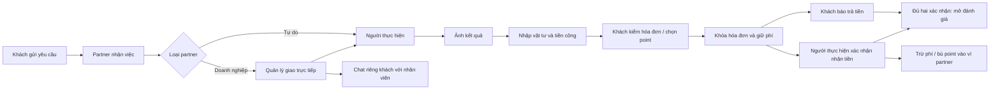

# Partner và doanh nghiệp — React v0.9

DOC-057 · 23/09/2026 · UI-06. Chủ dự án đã xem và đồng ý nhóm UI khách v0.3, cho làm tiếp nhóm partner/doanh nghiệp. Đây là thiết kế thao tác với dữ liệu mẫu, chưa phải sản phẩm hoặc nghiệm thu bảo mật backend.

## Điểm vào

Mở `http://127.0.0.1:5178/`, chọn **Đang xem thử với vai trò** ở đầu trang. Các lựa chọn là tài khoản mẫu khác nhau: khách Anh Tuấn, thợ Minh, quản lý An Tâm, nhân viên Dũng/Hà và các partner mẫu còn lại. Thanh này phục vụ review, không phải chức năng giả danh tài khoản trong sản phẩm.

Storybook có thêm **Partner · thợ tự do**, **Partner · doanh nghiệp**, **Partner · nhân viên**, **Mobile · partner**. Tổng 31 stories. Cổng 6006 hiện phục vụ `storybook-static`; sau chỉnh code cần build lại và tải lại trang. Vite 5178 vẫn là bản dev.

## Phân quyền trong bản mẫu

| Vai trò | Được thao tác |
|---|---|
| Thợ tự do | Bật/tắt nhận việc, nhận/từ chối yêu cầu, ảnh/nháp/hóa đơn, nhận tiền, chat, ví |
| Quản lý cửa hàng | Nhận việc, giao/đổi người phụ trách, xem hóa đơn, ví và đội ngũ. Có thể giao cho chính mình để thực hiện |
| Nhân viên | Chỉ xem/thực hiện việc được giao, gửi hóa đơn trực tiếp không chờ duyệt, nhận tiền, chat riêng với khách; không có Ví/Đội ngũ |

Khi đổi người, người cũ mất quyền thực hiện công việc nhưng lịch sử chat riêng vẫn giữ. Phòng được nhận dạng theo cặp khách–nhân viên, không theo mã việc. Quản lý chỉ thấy phòng của cửa hàng, không thấy tin riêng của nhân viên. Lịch sử phân công lưu trong công việc. Không phân công lại sau đã xác nhận nhận tiền.

## Các tương tác đã dựng

- Công tắc nhận việc ẩn partner khỏi tìm kiếm và chặn yêu cầu mới; việc cũ không bị xóa. Danh sách việc có lọc và tìm theo mã/dịch vụ/khách.
- Một quản lý và hai thợ mẫu; không tạo tài khoản điều phối bắt buộc. Nhận đơn rồi giao trực tiếp hoặc tự thực hiện.
- Ảnh kết quả trước khi nhập hóa đơn: chọn ảnh cục bộ hoặc nút ảnh minh họa để thử. Ảnh chỉ ở bộ nhớ trình duyệt, không tải lên server. Vật tư/công bắt buộc là số nguyên không âm, cho phép 0; không đặt trần giá trị nghiệp vụ.
- Nháp theo công việc giữ khi chuyển màn/vai trò trong phiên. Hóa đơn gửi lại sau khách yêu cầu sửa tăng phiên bản; khách đã khóa thì không chỉnh nội dung/point. Ảnh và mô tả hiển thị cả phía khách.
- Xác nhận nhận tiền cần kiểm tra nội dung và đánh dấu đã nhận đủ; chỉ người thực hiện hiện tại được làm. Có thể nhận trước hoặc sau khách báo trả; đánh giá vẫn chờ cả hai.
- Ví tách số dư, giữ phí, giữ rút, có thể rút và khả dụng trả phí. Hạn mức âm 100.000đ chỉ trả phí, không rút. Không cộng tiền khách trả trực tiếp vào ví nền tảng.
- Nạp/rút tạo yêu cầu chờ admin. Rút giữ tiền ngay; nạp đang chờ không tăng số dư. Một ngân hàng nhận tiền mẫu đã xác minh; không có chuyển tiền/QR thật. Chưa có nút admin duyệt trong React đợt này.

## Ví dụ đối chiếu đã thử

Công 200.000đ + vật tư 100.000đ; khách dùng 80.000 point, trả trực tiếp 220.000đ. Phí 20.000đ, thưởng khách 2.933 point theo công thức hiện hành. Khi Dũng xác nhận nhận tiền, ví cửa hàng 500.000 → 560.000đ (bù 80.000 − phí 20.000). Sau yêu cầu rút 100.000đ: giữ rút 100.000, có thể rút 460.000, khả dụng phí 560.000đ. Thử rút 600.000đ trước đó bị chặn.

## Kiểm chứng và giới hạn

- 16 kiểm tra logic đạt: 8 luồng khách và 8 bổ sung quyền, ảnh bắt buộc, bàn giao, hai phía, lặp nhận tiền, giữ phí/rút, tách ví theo partner và hạn mức âm không được rút.
- Browser đã chạy quản lý nhận → giao Dũng → Dũng gửi ảnh mẫu/hóa đơn → khách dùng point/khóa/báo trả → Dũng nhận tiền → ví đúng. Tin khách gửi riêng cho Dũng không xuất hiện ở phòng cửa hàng. Tắt An Tâm giảm kết quả tìm kiếm từ 4 xuống 3.
- Build Vite/Storybook đạt. Danh sách partner không tràn ngang ở 360/390/768/1440px; đã xem màn phân công mobile 390px. Giao KV-002 cho cùng Dũng giữ cả tin cũ và tin nhận KV-001 trong một phòng chat. Chưa kiểm WCAG toàn bộ hoặc thiết bị native thật.
- Dữ liệu chỉ trong bộ nhớ phiên, tải lại sẽ mất. Tất cả tài khoản/đơn/bank là mẫu. Quyền chỉ được mô phỏng ở frontend; không thay thế xác thực/phân quyền server.
- Hồ sơ giới thiệu/kỹ năng/vùng phục vụ/giá tham khảo đã có trình sửa trong React; Mời/gỡ nhân viên đã có nhóm UI-10; phân quyền tùy chỉnh, tự rời và ngân hàng chỉnh sửa vẫn tra prototype nghiệp vụ 8765. Không tuyên bố đã chuyển toàn bộ các màn phụ sang UI mới.
- Admin React, duyệt nạp/rút thực, report ngoại lệ tài chính, kết nối thanh toán/gọi/nhắc lịch chưa triển khai. Q02 phải giải quyết trước tiền thật. PROMO-02 không đổi.

## Đồng bộ

DOC-050, DOC-052, DOC-053, DOC-054, DOC-056, PLAN-006 và DOC-057 cùng registry/ZIP được cập nhật. BRD/FR/NFR/SRS/quyền-trạng thái/ERD/API và DOC-008 không đổi: đợt này áp dụng nghiệp vụ đã chốt vào UI, không thêm yêu cầu sản phẩm. Bộ thử Figma/Penpot lưu nguyên làm lịch sử.

## Điều hướng mobile — UI-07

Thanh điều hướng cố định dưới màn hình, cùng cách sử dụng với phía khách. Thợ tự do có Công việc, Ví, Hồ sơ, Tin nhắn; quản lý doanh nghiệp thêm Đội ngũ; nhân viên hiện có Công việc, Tin nhắn và Tài khoản (UI-11). Mục đang chọn có nền và màu nổi bật. Nội dung chừa khoảng trống và safe area để không bị thanh dưới che. Desktop giữ thanh ngang phía trên. Thay đổi trình bày, không đổi phân quyền hay nghiệp vụ.

Kiểm tra UI-07: build Vite/Storybook thành công; trình duyệt 360/390/768px thanh dưới fixed, 1440px thanh ngang; không tràn ngang. Quản lý chuyển được sang Ví, nhân viên chỉ có Công việc/Tin nhắn. Chưa kiểm nghiệm bàn phím trên thiết bị native.

## Hồ sơ năng lực — UI-08, v0.5

Sau khi chủ dự án duyệt điều hướng UI-07 và yêu cầu tiếp tục, chuyển nhóm hồ sơ đã có trong UX nghiệp vụ sang React. Vào **Hồ sơ** ở thanh dưới (chủ/quản lý), hoặc Storybook **Mobile · chỉnh sửa hồ sơ**. Bốn nhóm: giới thiệu/kinh nghiệm; kỹ năng; khu vực và địa chỉ cửa hàng; giá công/kiểm tra/di chuyển tùy chọn. Có xem trước và khôi phục bản đã lưu. Tối thiểu một kỹ năng, một khu vực; giá số nguyên không âm, trống là chưa công bố, 0 là giá 0đ.

Lưu cập nhật dữ liệu chung của phiên: khách tìm không dấu theo kỹ năng, xem hồ sơ và chọn kỹ năng trong form thuê. Công việc cũ giữ bản thông tin tại lúc thuê. Nhân viên không có quyền sửa hồ sơ doanh nghiệp. Bản nháp chưa lưu mất khi rời màn; bản đã lưu giữ trong lượt thử, tải lại trang mất.

Danh mục kỹ năng và khu vực là tập mẫu; không phải toàn bộ bộ dữ liệu nhiều ngành. Khu vực lưu/hiển thị nhưng chưa geocode hay tính lại khoảng cách và vùng phục vụ thực. Ảnh năng lực, chứng chỉ, xác minh và danh mục toàn hệ thống chưa chuyển sang nhóm này. Đây là prototype, không có lưu server.

QA: 16 kiểm tra logic cũ đạt; browser chặn không chọn kỹ năng, lưu Sửa máy giặt, khách tìm không dấu ra An Tâm, xem phí kiểm tra 0đ và thuê đúng kỹ năng. Bố cục kiểm 360/390/768/1440px; build Vite/Storybook.

## Bộ chọn đa ngành — UI-09, v0.6

Đã chốt: nhiều kỹ năng thuộc nhiều ngành, tìm kiếm, phân nhóm và bỏ chọn nhanh. Bộ chọn có Ngành → Nhóm dịch vụ → Kỹ năng; tìm không dấu, lọc ngành, hiển thị số lượng và chip Đã chọn, trạng thái rỗng/xóa lọc. Đổi bộ lọc không mất lựa chọn; lưu vẫn yêu cầu tối thiểu một kỹ năng.

Dữ liệu React dùng 10 ngành/20 kỹ năng từ catalogSeed trong wireframe hiện hành, giữ các ID IND/GRP/SKL; chưa phải danh mục đầy đủ lúc ra mắt. Danh mục xuất riêng skill-catalog.mjs, không giới hạn partner theo ngành khởi tạo. Hồ sơ mẫu còn lưu nhãn kỹ năng, chưa thay thiết kế khóa ID trong backend.

Khách lọc được cả 10 ngành; kết quả tính theo các kỹ năng của partner thay vì một ngành cố định. Form thuê dùng chung danh sách kỹ năng đã lưu. Không thay đổi nghiệp vụ, vùng phục vụ hay phạm vi PROMO-02.

Kiểm: 10 ngành/20 ID kỹ năng duy nhất; match chéo ngành; browser thêm Lắp camera vào An Tâm, tìm không dấu, rỗng/xóa lọc, bỏ/chọn lại, khách lọc ngành camera tìm thấy An Tâm và form thuê có Lắp camera. Các kiểm tra logic giao dịch cũ vẫn đạt.

## Đội ngũ doanh nghiệp — UI-10, v0.7

Mở Đội ngũ (quản lý) hoặc story Doanh nghiệp · đội ngũ / Mobile · đội ngũ. Tìm tên/số điện thoại, xem việc phụ trách, các tab Thành viên / Lời mời / Đã rời.

Mời nhân viên thực hiện bằng tên/số điện thoại, hiệu lực 7 ngày; chặn trùng thành viên/lời mời chờ. Thu hồi hoặc hết hạn không thể tham gia. Xem phía người nhận là công cụ mô phỏng, nhập đúng số được mời để nhận; không gửi SMS/OTP thật. Chỉ phân công sau khi nhận lời mời. Người mới có vai trò thử riêng. Mời lại người đã rời dùng lại định danh để giữ chat.

Gỡ nhân viên bắt buộc lý do, không gỡ chủ. Mất quyền việc doanh nghiệp ngay; việc chưa xác nhận nhận tiền quay về chờ phân công, xóa nháp cũ, giữ hóa đơn/point/phí. Việc đã nhận tiền giữ người thực hiện lịch sử. Chat riêng vẫn giữ. Lịch sử lời mời và gỡ lưu trong phiên.

Phạm vi chưa chuyển: cấp/sửa quyền tùy chỉnh, nâng quyền tài chính/quản trị, nhân viên tự rời, nút gửi lại lời mời, gọi điện và xác thực thật. Chuyển chủ/đóng doanh nghiệp vẫn pending. Chưa có backend/quyền server. Nhóm UI-10 thay phần giới hạn mời/gỡ trước đó; không tuyên bố chuyển toàn bộ quản lý doanh nghiệp.

QA: 20 test logic đạt, gồm 4 kiểm tra mới về lời mời và gỡ nhân viên; bảo toàn hóa đơn khóa, thu hồi quyền, giữ ID khi mời lại. Browser mời Nguyễn Minh An → tham gia → giao KV-001 → gỡ → việc chờ phân công; chat riêng cũ vẫn hiển thị. Không tràn ngang ở 360/390/768/1440px. Build Vite/Storybook đạt.

## Gửi lại lời mời và tự rời — UI-11, v0.8

Theo yêu cầu tiếp tục nhóm đội ngũ, chuyển hai luồng đã có trong wireframe sang React. Quản lý gửi lại lời mời đang chờ/hết hạn/thu hồi: lời mời mới hiệu lực 7 ngày, lời mời cũ ghi Đã thay thế và không chấp nhận được. Chặn gửi lại cho thành viên đang hoạt động hoặc khi có lời mời chờ khác cùng số điện thoại.

Nhân viên mở Tài khoản → Rời doanh nghiệp → nhập lý do → xác nhận. Chỉ được tự rời membership của mình, không rời thay người khác; chủ không dùng luồng này. Quyền công việc thu hồi ngay. Việc chưa xác nhận nhận tiền về chờ phân công, xóa nháp cũ, giữ hóa đơn/point/phí; chat riêng giữ nguyên. Ghi người tự rời vào lịch sử và lịch sử phân công. Thanh dưới của nhân viên thêm Tài khoản, khi đã rời chỉ còn Tin nhắn và Tài khoản.

UI-11 thay các giới hạn tự rời/gửi lại được ghi trong UI-10. Quyền tùy chỉnh/nâng quyền vẫn chưa chuyển; chuyển chủ/đóng doanh nghiệp vẫn pending. Không SMS/OTP/server thật. 31 stories, 22 test logic đạt. Browser xác nhận gửi lại MOI-103 → MOI-104, Dũng tự rời và công việc về Cần phân công. Kiểm bố cục tài khoản 360/390/768/1440px không tràn ngang; Vite/Storybook build đạt.

UI-12 bổ sung nhóm tài khoản/địa chỉ/onboarding; [DOC-058](account-batch.md) thay phần giới hạn chưa có UI đăng nhập/địa chỉ/đăng ký trước đó. Xác thực/backend/định vị thật vẫn chưa kết nối.

## UI-14 — Đợt 2, React v0.10

[DOC-059](activity-batch.md) bổ sung đổi lịch/rút/dừng, đánh giá hai chiều và liên lạc/thông báo. Các giới hạn cũ về những màn này được thay bằng phạm vi và giới hạn DOC-059. Tài khoản có đường vào Tin nhắn và thông báo; Point vẫn ngay dưới lời chào. Nghiệp vụ tiền không đổi.

## UI-15 — Lịch sử bố cục; vị trí chuông được thay thế bởi UI-16

Chủ dự án đã duyệt sau tham khảo LinkedIn/Airbnb. React v0.10a: chuông ở header khách/partner/doanh nghiệp mở trang Thông báo riêng, huy hiệu số chưa đọc, Tất cả/Chưa đọc và đánh dấu đã đọc. Bấm thông báo mở đúng việc/phòng chat và cập nhật huy hiệu. Tin nhắn chỉ chứa hộp thư/chat/gọi. Tài khoản → Cài đặt → Thông báo là đường quản lý tùy chọn. Tắt push vẫn giữ thông báo trong app.

Partner/doanh nghiệp dùng thanh dưới Công việc / Ví / Tin nhắn / Tài khoản; nhân viên không có Ví. Hồ sơ cung cấp dịch vụ, Đội ngũ (theo quyền), tài khoản doanh nghiệp của nhân viên nằm trong Tài khoản. Không đổi quyền hoặc nghiệp vụ. Header desktop dùng cùng điểm vào chuông; mobile không thêm tab thứ năm. Bản mẫu vẫn chưa kết nối push thật.

Kiểm chứng: build Vite/Storybook; browser mở chuông/lọc chưa đọc, đường cài đặt, Tin nhắn không còn menu phụ, partner mở thông báo vào đúng chat và giảm huy hiệu. Mobile 390px không tràn ngang. Gói UI-UX-v0.13; registry v1.21.

## UI-16 — Hiện hành: avatar vào tài khoản, tab Thông báo

Chủ dự án chốt 23/09/2026: giữ avatar chữ đầu tên trên header để mở Tài khoản; bỏ chuông header. Thông báo thay Tài khoản trong điều hướng chính (mobile ở dưới, desktop ở trên). Khách: Tìm dịch vụ / Công việc / Tin nhắn / Thông báo. Partner: Công việc / Ví / Tin nhắn / Thông báo; nhân viên không có Ví. Avatar partner dùng tên người đang xem. Hồ sơ/Đội ngũ/Cài đặt vẫn trong Tài khoản và giữ quyền. Huy hiệu chưa đọc nằm ở tab Thông báo. UI-16 thay vị trí chuông của UI-15; các hành vi lọc, đọc, mở đúng đối tượng và tùy chọn thông báo giữ nguyên. React v0.10b, 39 stories; gói UI-UX-v0.14, registry v1.22. Build Vite/Storybook đạt; browser kiểm avatar/tab và bố cục mobile.

## UI-17 · 26/09/2026 · React v0.11
Ví có màn nạp/rút, đề nghị đổi ngân hàng và lịch sử lọc/chi tiết. Đội ngũ có tab Quyền truy cập giải thích quyền hiện hành. Chi tiết, QA và các phần còn thiếu ở `ui-ux/specs/finance-batch.md` (DOC-060). Chưa có trình cấp quyền tùy chỉnh hoặc admin duyệt trong React. UI-16 về avatar/Thông báo giữ nguyên.

## UI-18 · 27/09/2026 · React v0.12
Đã bổ sung cấp/thu hồi quyền nhân viên, ngân hàng lần đầu và admin duyệt tài chính trên cùng dữ liệu phiên. Phần UI-17 nói chưa có các màn này được thay bởi DOC-060 `finance-batch.md` mục UI-18. 45 stories, 39 kiểm tra logic; giữ nguyên avatar và điều hướng UI-16. Admin có danh sách/lọc/chi tiết/nhật ký; không kết nối tài chính thật.

## UI-19 · 27/09/2026 · React v0.13
Bổ sung Hỗ trợ từ Tài khoản/công việc, admin hỗ trợ/xác minh/kiểm duyệt đánh giá và nhật ký. Xác minh partner qua admin, bỏ nút tự mô phỏng duyệt; tệp chờ duyệt khóa sửa. Ẩn/khôi phục đánh giá cập nhật điểm trong phiên. Quyết định và giới hạn chi tiết ở DOC-061 `ui-ux/specs/support-moderation.md`; nội dung UI-19 thay các ghi chú trước rằng những màn này chưa có. Không thay tiền/point khi xử lý báo cáo. 48 stories, 42 kiểm tra logic; UI-UX-v0.17.zip.

## UI-20 — cập nhật hiện hành 27/09/2026
React v0.14, UI-UX-v0.18.zip, registry v1.26. Đã bổ sung quản trị tài khoản, đình chỉ partner, danh mục và báo cáo/nhật ký vận hành. Xem [phạm vi, luồng và bằng chứng QA](admin-operations.md). Các ghi chú trước đây rằng bốn nhóm này chưa có trong React được thay bằng UI-20; không đổi nghiệp vụ hay mở các mục pending. Các lớp xác thực và dữ liệu vẫn là mô phỏng.

## UI-21 — rà soát luồng 27/09/2026
Bản hiện hành React v0.15 / UI-UX-v0.19.zip. Đã sửa kiểm trạng thái lúc gửi thuê, mở chat đúng người từ công việc, thông báo đến nhân viên phụ trách và khôi phục giá trị point khi mở hóa đơn từ thông báo. [Ma trận kiểm chứng và phần chưa nghiệm thu](flow-review.md). Không đổi nghiệp vụ đã chốt; 49 tests, 52 stories.
